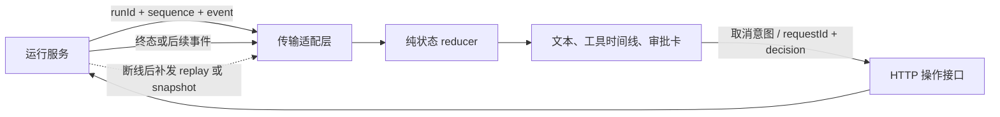

# Agent 前端运行面板：事件流、幂等状态与审批边界

用户点下“停止”后，浏览器可能已显示取消，服务端工具却还在执行；网络重连又可能把最后一条工具事件重放两次。若界面只把每个到达的消息直接追加到组件状态，工具卡会重复、旧运行可能覆盖新运行，审批按钮还可能作用于错误请求。前端需要把流式事件当作带身份和序号的状态迁移来处理。

## 学完你能做什么

- 为一次运行定义 `runId`、单调递增 `sequence` 和事件类型，并说明重复、缺口、旧运行事件分别如何处理。
- 使用稳定的 `callId`、`requestId` 把工具卡和审批卡关联到具体执行，而不是依赖数组下标或显示顺序。
- 解释 UI 取消意图与后端执行取消的区别，并设计断线后 snapshot/replay 的客户端恢复流程。
- 把事件文本作为文本渲染，明确这项措施的安全边界，并说明审批最终必须由后端验证。

## 心智模型：UI 是服务端运行状态的投影

先看数据如何从运行服务到界面，以及用户动作如何回到服务端。



图中 reducer 只负责把事件投影为视图状态，不负责连接服务端或授权操作。取消和审批是从 UI 发出的请求；只有运行服务的确认事件才能证明运行进入终态，服务端策略才有权决定审批是否有效。

## 1. 现象：同一运行的事件可能重复或迟到

客户端断线重连时，服务端可能重放最近几条事件。网络或应用层重试也可能让某个事件被处理两次。另一方面，用户已经切换到新运行时，旧连接仍可能送来旧运行事件。

在 [MiniCode 的 UI 状态测试](https://github.com/Shyu-x/frontend-interview/blob/f7525abd111f84a86a51b6a9113460ba0573fbb3/examples/minicode/tests/ui-state.test.ts) 中，事件信封包含 `runId` 和 `sequence`。同一序号重放会返回原状态；旧 `runId` 事件被忽略；跳过序号会报出缺口；运行结束后晚到事件不改变终态。这些不是“流式文本”的特殊规则，而是有序事件投影的基本约束。

| 到达情况 | 客户端处理 | 为什么 |
|---|---|---|
| `sequence <= state.sequence` | 忽略 | 视为已应用事件的重放，避免重复追加文本或重复结束工具卡 |
| `sequence === state.sequence + 1` | 进入 reducer | 确认事件连续，可按顺序迁移 |
| `sequence > state.sequence + 1` | 暂停应用并请求补齐或快照 | 缺口中的事件可能创建工具卡或审批请求，不能猜状态 |
| `runId !== state.runId` | 忽略 | 旧运行的迟到事件不应污染当前运行 |
| 当前运行已是终态 | 忽略后续事件 | 终态后不接受迟到增量覆盖最终视图 |

这里的序号属于同一个 `runId` 的事件流；如果服务端允许并行发送，客户端仍应先按序号缓冲或重放，不能把到达顺序当成业务顺序。

## 2. 规则：稳定 ID 决定卡片归属

工具调用和权限请求各自有稳定标识。工具事件通过 `callId` 更新对应工具记录；权限决策通过 `requestId` 更新原审批请求。卡片渲染可以依赖这些 ID 作为列表 key，但不能用 key 代替权限校验。

这种关联方式也约束事件合法性：工具结束必须对应正在运行的 `tool:start`；审批决策必须对应存在且仍为 `pending` 的请求；重复 ID 和重复审批应被拒绝或作为协议错误上报。MiniCode 的 reducer 在 [ui-state.ts](https://github.com/Shyu-x/frontend-interview/blob/f7525abd111f84a86a51b6a9113460ba0573fbb3/examples/minicode/src/ui-state.ts) 中实现这些检查，并用 `Object.hasOwn` 和显式属性定义处理诸如 `__proto__` 这样的对象键，避免把外部 ID 当成普通原型属性。

## 3. 机制：用纯 reducer 管理视图状态

下面是读代码用的框架无关逻辑草图，不是可直接运行的实现。完整的 TypeScript 类型、状态复制、事件校验和错误消息见 [项目 reducer](https://github.com/Shyu-x/frontend-interview/blob/f7525abd111f84a86a51b6a9113460ba0573fbb3/examples/minicode/src/ui-state.ts)；请以该文件为准，不要把草图复制成第二份实现。

```text
示意逻辑（runnable: false）：

reduce(state, envelope):
  if envelope.runId != state.runId: return state
  if envelope.sequence <= state.sequence or state.status != running: return state
  if envelope.sequence != state.sequence + 1: raise ReplayRequired

  next = copy(state)
  next.sequence = envelope.sequence
  match envelope.event:
    text delta       -> append text
    tool start/end   -> create/update tools[callId]
    permission ask   -> create permissions[requestId] as pending
    permission result-> update that pending request
    run end          -> set terminal status
  return next
```

这段规则把“校验事件身份和连续性”放在内容处理之前。原状态保持不变，成功迁移返回新状态，因而 UI 可用状态引用变化触发渲染，也能对纯 reducer 做确定性测试。缺口没有被吞掉：调用层需要把它转换为 replay 请求，或在服务端无法重放时获取全量 snapshot。

### 逐事件走读：一条运行如何成为可见状态

下面按 MiniCode 的 `UiEvent` 形状走一条运行轨迹。表中只列变化字段；没列出的字段保持原值。`tools` 和 `permissions` 是 ID 到记录的字典，因此卡片的位置变化不会改变事件目标。

| 到达的 envelope | 校验与迁移 | reducer 返回后的关键 state |
|---|---|---|
| `beginUiRun("r-42")` | 建立新运行，不属于事件 | `{runId: "r-42", sequence: 0, status: "running", text: "", tools: {}, permissions: {}}` |
| `r-42 / 1 / text:delta("正在读取配置。")` | run 匹配、序号连续；追加普通字符串 | `sequence: 1`; `text: "正在读取配置。"`; 其余为空 |
| `r-42 / 2 / tool:start(callId="read-1", name="read")` | run 匹配、序号连续；创建工具记录 | `sequence: 2`; `tools["read-1"] = {name: "read", status: "running"}` |
| `r-42 / 3 / permission:request(requestId="approval-9", description="写入报告")` | 审批 ID 未存在；建立待处理审批 | `sequence: 3`; `permissions["approval-9"] = {description: "写入报告", decision: "pending"}` |
| `r-42 / 4 / permission:decision(requestId="approval-9", approved=false)` | 找到同一 requestId 且仍 pending；拒绝该请求 | `sequence: 4`; `permissions["approval-9"].decision = "denied"` |
| `r-42 / 5 / tool:end(callId="read-1", ok=true)` | 找到同一 callId 且仍 running；结束工具卡 | `sequence: 5`; `tools["read-1"].status = "ok"` |
| `r-42 / 6 / run:end(status="completed")` | 连续且当前仍运行；进入终态 | `sequence: 6`; `status: "completed"` |

现在重放 `r-42 / 5`，因为 `5 <= state.sequence`，返回同一 state 引用，不会把工具状态再迁移一次。若传入 `r-old / 7`，先因 run 不匹配而忽略；若把下一个事件改成 `r-42 / 8`，则序号不连续并要求恢复；若终态后收到 `r-42 / 7`，因为状态已结束而忽略。事件校验的先后次序决定了这些行为：旧 run 和已处理事件不会触碰业务状态，只有连续的新事件才能改变投影。

注意这只是前端状态走读。MiniCode 当前的 `permission:request` 没有 `callId` 字段，所以表中的审批卡只关联 `requestId`，不能声称它已和某张工具卡形成一对一关联。生产协议若要展示“此审批允许哪个工具调用”，应在服务端事件中显式提供稳定的 `callId` 或 action ID 和不可歧义的动作摘要，并对这条关联做后端校验。

### 三个实现取舍

| 设计点 | 当前/建议选择 | 收益 | 代价与何时调整 |
|---|---|---|---|
| 遇到乱序事件 | 对缺口报错并恢复，不在 reducer 内缓存乱序事件 | 协议错误暴露早，单元测试简单；不会把“先到”误当成“先发生” | 传输适配层要缓存、请求 replay 或 snapshot；只有服务端明确允许乱序时，才增加带上限和超时的重排缓冲 |
| reducer 如何复制状态 | 当前用 `structuredClone(state)` 后做一次迁移 | 小型教学状态容易理解，测试时原对象不会被修改 | 每个 token delta 都复制文本和所有映射，长对话/大量工具卡会增加分配；生产可改为按字段结构共享、批量合并 delta 或把事件批次化，但必须保留只读迁移和相同测试不变量 |
| 取消如何反馈 | 立即展示“取消中”，服务端终态后才显示“已取消” | UI 诚实表达意图和执行结果的差异，便于处理超时、拒绝和延迟工具 | 多一种中间状态与超时恢复流程；若产品选择乐观 UI，也要标记为暂定并能在服务端否认时回滚，不能将乐观状态用于授权或审计 |

这三个选择都可以替换，但事件身份、序号水位和服务端权威边界不能跟着丢。把 `structuredClone` 替换成结构共享，不应改变相同输入产生相同逻辑状态的性质；改用乐观反馈，也不应伪造服务端已取消的事实。

### 现有失败测试究竟拦住什么

项目的 [ui-state.test.ts](https://github.com/Shyu-x/frontend-interview/blob/f7525abd111f84a86a51b6a9113460ba0573fbb3/examples/minicode/tests/ui-state.test.ts) 已有四组自动测试。它们分别验证状态投影的不变量，不代表浏览器传输或服务端协议也已经通过测试。

| 测试输入 | 当前断言 | 若回归，能观察到的失败 |
|---|---|---|
| 同一 `runId/sequence` 重复 delta；随后发送旧 `runId` | 重复返回相同状态，旧运行也返回相同状态；输入字符串仍保留原样 | 重复内容出现、旧运行串入新面板，或误把状态层字符串断言成 DOM 安全 |
| 直接发送序号 2；结束后再发下一条 delta | 序号缺口抛错；终态保持原状态 | 缺失事件被静默略过，或终态后又出现新文本 |
| 使用 `requestId="__proto__"` 申请并拒绝；再重复决定 | 原型不被污染，拒绝状态落在该 ID 下，第二次决定抛错 | ID 被当作原型键、更新错记录或同一审批接受矛盾的第二个结果 |
| 未 start 就发 tool end；正常 start 后以 `ok=false` 结束 | 孤立结束抛错；失败工具卡保留 `failed` | 无来源的结束事件创建卡片，或失败被渲染成成功/消失 |

这四组用例给 reducer 的边界提供了失败证据。练习中新增的取消 API、DOM renderer、snapshot/replay 则必须另加对应适配层测试；不能用这四组 reducer 测试替代。

前端“取消”要区分两层含义。点击按钮可以立刻让按钮进入 `cancelling`、禁用重复点击并发出取消请求；这只记录用户意图，不证明后端的模型请求、子任务或工具已经停止。服务端确认取消后，再由 `run:end` 的 `cancelled` 事件将运行投影到终态。实际页面应保留“取消中”和“已取消”的区别；当前教学 reducer 只有运行中及终态，并没有实现取消按钮、取消 API 或后台任务取消传播。

## 4. 断线恢复：快照建立基线，重放补上差量

MiniCode 当前实现的是事件 reducer 与状态测试，没有 SSE/WebSocket 服务端、浏览器传输层、snapshot API 或 replay API。下面是客户端与服务端协商的设计，不是项目已交付能力。

| 阶段 | 客户端动作 | 服务端契约 |
|---|---|---|
| 建立连接 | 保存 `runId` 与最后应用的 `sequence` | 事件携带相同运行 ID 和连续序号 |
| 短暂断线 | 重连时请求 `afterSequence` | 在保留窗口内补发更大序号的事件 |
| 发现缺口或重放窗口过期 | 暂停当前流，申请 snapshot | 返回同一运行的完整视图状态及其 `sequence` |
| 应用 snapshot | 校验运行 ID 和版本，原子替换基线 | snapshot 的序号必须标识包含到哪条事件 |
| 继续接收 | 从 snapshot 序号之后请求 replay | 先重放缺失事件，再发送实时事件 |

snapshot 至少需要包含 `runId`、序号、运行状态、文本投影、工具状态和权限状态。替换 snapshot 与开启后续流之间必须有明确的序号边界，否则两者之间的新事件仍会丢失。生产协议还需定义重放保留期、快照版本、运行过期、权限事件是否可重放，以及多标签页同时连接的资源策略。

## 5. 安全边界：显示内容不等于执行权限

流式文本、工具名和权限描述都是外来数据。把文本放进 React 文本子节点或 Vue 插值中，让框架按文本处理；不要把模型输出直接传给 `innerHTML`、`dangerouslySetInnerHTML` 或等效 HTML sink。测试将 `<script>not HTML</script>` 作为普通文本保留，验证 reducer 不会把文本解释成标记；它没有验证浏览器 DOM 渲染，也不能据此宣称“XSS 已完全防御”。富文本 Markdown、链接协议、代码高亮插件和错误提示等仍须各自审查，必要时采用经过维护的 HTML sanitizer 和明确的 URL allowlist。

同样，审批卡只是一个交互入口。用户点击“批准”后，前端应提交 `runId`、`requestId` 和决定；后端必须检查当前认证主体是否能访问该运行、请求是否属于该运行且仍待审批、请求是否过期、动作是否仍在允许范围内，以及重复提交的幂等规则。浏览器中的 `approved` 状态、隐藏按钮或收到的旧事件都不能成为后端执行工具的授权依据。

## 动手题：做一个可恢复、可审计的运行面板

基于 MiniCode 的现有状态类型和 reducer，为一个框架无关的 `AgentRunPanel` 设计宿主适配层。宿主可以用 React、Vue 或原生 DOM，但 reducer 和协议规则不依赖具体框架。面板至少展示流式文本、按 `callId` 更新的工具时间线、按 `requestId` 更新的待审批卡，并提供“取消中”的本地交互状态。

请实现或提交可评审的设计与测试，覆盖：重复事件、跨运行迟到事件、序号缺口、工具孤立结束、重复审批、`__proto__` ID、取消请求超时、文本安全渲染策略，以及审批 API 被拒绝后的 UI 恢复。断线恢复部分需要给出 snapshot/replay 请求与响应样例，并注明服务端能力是接口假设还是已实现能力。

### 验收与评分（100 分）

| 评分项 | 分值 | 通过证据 |
|---|---:|---|
| 事件连续性与幂等性 | 25 | 自动测试证明重复不双写、旧运行不污染当前状态、缺口触发补齐而不是静默跳过 |
| ID 关联与非法迁移 | 20 | 工具与审批按稳定 ID 更新；孤立结束、重复审批和原型键输入有明确结果 |
| 取消和终态语义 | 15 | UI 将本地取消意图与服务端确认分开；超时/拒绝不会伪造 `cancelled` 终态 |
| 断线恢复协议 | 15 | snapshot 带运行 ID 与水位序号；恢复后能说明不丢事件、不重复应用的边界 |
| 文本与权限安全 | 15 | 渲染使用文本安全路径；审批由后端按主体、运行、请求状态再验证 |
| 可观察性与面试表达 | 10 | 能用 trace 或测试失败定位序号缺口，并在两分钟内解释权衡和未实现边界 |

**最低通过线：80 分**，且“事件连续性与幂等性”“ID 关联与非法迁移”“文本与权限安全”三项不得低于各自分值的一半。失败证据包括：重复文本、旧运行改变当前卡片、缺口仍继续应用、批准请求在后端拒绝后 UI 仍显示已批准，或把文本直接插入 HTML。练习只新增本地组件/适配层与测试；若创建临时 fixture，验收后删除该 fixture，不清理项目已有数据。

### 真实验收步骤

| 输入 / 环境 | 执行 | 通过阈值 | 失败证据 |
|---|---|---|---|
| Node.js 22.18+；进入 `examples/minicode` | `npm ci && npm run verify` | 类型检查和现有自动测试全部通过 | 命令退出码非 0，或失败测试未定位到事件序号/ID/状态 |
| 当前运行 `runId = new`；先应用序号 1，再重放序号 1 和旧运行序号 2 | 在组件/适配层测试中发送这些 envelope | 文本只追加一次，当前状态未被旧运行改变 | 重复文本、工具卡重复，或当前面板被旧 run 更新 |
| 当前序号为 1，收到序号 3 | 注入缺口并观察网络适配层 | 暂停后申请 replay/snapshot；不可把 3 当作连续事件应用 | 静默跳过序号 2 或卡片进入无法解释的状态 |
| 用户点击取消、服务端超时或拒绝 | 用可控 mock 控制取消 API 响应 | UI 保持“取消中”或恢复可操作；只有终态事件可显示已取消 | 本地点击直接把服务端运行标为已取消 |
| 后端拒绝审批；文本内容包含 `<script>` | 观察 DOM 与审批卡状态 | 内容以文本显示，审批失败可见且不会显示为已批准 | 生成执行 HTML，或前端本地决定压过后端拒绝 |

清理方式：关闭本地开发页面/测试进程，移除练习新增的临时 fixture。不要删除 MiniCode 伴随工程的源文件和既有测试。

## 易错点与修正

| 易错实现 | 失败原因 | 修正 |
|---|---|---|
| 收到 delta 就 `text += delta`，不校验信封 | 重放会重复内容，旧 run 会污染当前 run | 按运行 ID 和序号先校验，再进入纯 reducer |
| 用工具名称或数组下标关联卡片 | 同名工具并行运行时会更新错卡 | 使用服务端为每次调用生成的 `callId` |
| 取消按钮点击后直接设为 `cancelled` | 浏览器只发出了意图，工具可能仍在执行 | 展示取消中，等待服务端的确认事件；超时保留不确定状态并允许查证 |
| 看到权限卡被隐藏就认为不能执行 | UI 是不可信客户端，用户可构造请求或重放旧请求 | 后端按身份、运行与请求状态重新授权并审计 |
| 用转义文本测试证明 XSS 已解决 | reducer 测试没有覆盖真实 DOM、Markdown renderer 与 URL | 对每个 HTML sink、链接、插件做单独安全审查和浏览器级测试 |
| 收到序号跳跃后继续展示后续事件 | 中间事件可能包含审批/工具开始等关键迁移 | 先 replay，超出保留窗口后原子装载 snapshot |

## 面试回答

**30 秒回答：** Agent 运行 UI 是带版本的服务端事件流在浏览器里的投影。我按 `runId` 隔离运行、按连续 `sequence` 做幂等 reducer，并用 `callId` 和 `requestId` 更新工具及审批卡；断线后补放事件或用带水位序号的 snapshot 恢复。取消按钮仅表示请求，是否取消由服务端确认，审批也必须由后端再次校验。

**2 分钟回答：** 我不会把每条 token 事件直接追加进组件状态，因为重连重放会产生重复，旧连接也可能覆盖用户刚切换的新运行。我把事件封装成 `runId + sequence + event`：旧运行忽略，已经应用的序号视为幂等重复，连续序号交给 reducer，遇到缺口则暂停并请求 replay，无法补放时用带水位序号的完整 snapshot 替换状态。工具开始/结束按 `callId` 配对，审批请求和决定按 `requestId` 配对，非法迁移进入协议错误与观测日志。取消请求和取消结果分开显示；后端才知道模型、子任务及工具是否真正停止。文本按文本节点渲染只能降低直接 HTML 注入风险，Markdown、链接和插件还要单独审查；审批操作始终由后端重新验证。MiniCode 中可用 [四类 reducer 测试](https://github.com/Shyu-x/frontend-interview/blob/f7525abd111f84a86a51b6a9113460ba0573fbb3/examples/minicode/tests/ui-state.test.ts) 验证重放、缺口、ID 和终态，但该伴随工程没有交付 SSE 服务端或 snapshot/replay API，因此恢复协议仍是生产设计要求，不是已运行能力。

## 生产差距清单

- **传输实现**：项目没有 SSE/WebSocket 客户端，没有心跳、重连退避、请求超时和浏览器生命周期处理。
- **恢复 API**：项目没有事件持久化、replay 保留窗口或 snapshot 版本协议，无法验证跨断线不丢事件。
- **取消传播**：项目的 UI reducer 只处理服务端 `run:end` 状态；没有浏览器取消接口，也没有证明任务/工具已中止的协议。
- **服务端审批**：客户端 reducer 只维护显示状态，不包含认证、授权、审批过期、幂等提交或审计存储。
- **渲染安全**：示例只验证字符串状态，不验证真实浏览器 DOM、Markdown、URL 协议或第三方渲染器。
- **高频渲染**：没有虚拟化、批量 flush、文本分片上限或长运行内存策略；上线前需用目标设备的长流 trace 和交互延迟测量。

## 自测题

1. 收到同一个 `runId` 的序号 8 两次，第二次应该如何处理？为什么不能再次追加文本？
2. 当前序号是 8，却先收到序号 10；继续应用、丢弃，还是请求恢复？说明依据。
3. 为什么按钮显示“已批准”不能作为后端执行工具的授权证据？
4. 页面本地显示“已取消”后，什么事件或接口事实才能说明后端工作已结束？

??? success "参考答案"
    1. 视为已应用事件的重复并保持状态不变，否则会重复文本、工具迁移或审批结果。
    2. 停止应用并补放 9；若重放不可用，加载能标明覆盖水位的完整 snapshot，再从水位之后续传。
    3. 浏览器状态可被用户篡改或伪造；后端要校验认证主体、运行归属、请求仍待审批和允许动作，并做好重复提交处理。
    4. 需要服务端明确确认该 run 已取消/结束；客户端发出的取消请求只是意图，超时也代表结果未知。

## 深入阅读

- [MiniCode UI 状态 reducer](https://github.com/Shyu-x/frontend-interview/blob/f7525abd111f84a86a51b6a9113460ba0573fbb3/examples/minicode/src/ui-state.ts)：逐行看事件类型、连续性校验、工具/审批状态迁移以及安全对象键处理。
- [MiniCode UI 状态测试](https://github.com/Shyu-x/frontend-interview/blob/f7525abd111f84a86a51b6a9113460ba0573fbb3/examples/minicode/tests/ui-state.test.ts)：观察测试如何把重放、旧运行、缺口、原型键和非法迁移变成可执行约束。
- [MiniCode README](https://github.com/Shyu-x/frontend-interview/blob/f7525abd111f84a86a51b6a9113460ba0573fbb3/examples/minicode/README.md)：确认伴随工程当前交付范围，区分项目已有能力与本文提出的前端/传输层扩展。
