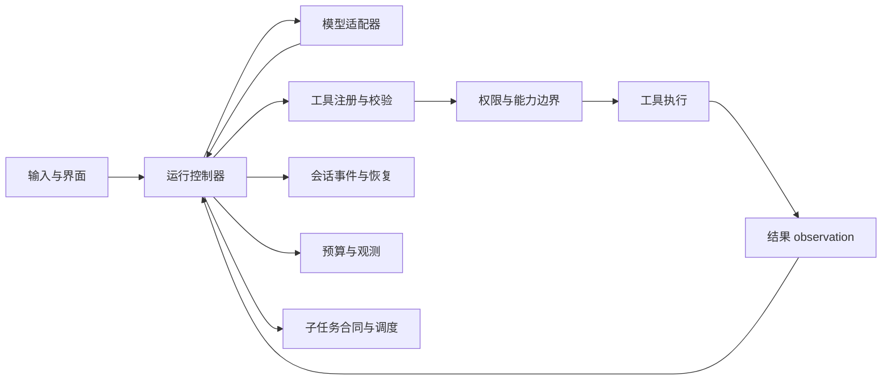

# Claude Code 风格的 Agent 架构教学：区分行为与实现

!!! warning "不是 Claude Code 内部源码分析"
    本页不提供 Claude Code 内部源码快照。旧文中“1902 个源文件”、精确内部目录和 QueryStateMachine 状态数没有可核验的来源，已删除。下面的模块边界和状态设计是教学推演，不代表 Claude Code 内部实现。保留原 URL 是为了兼容已有链接。

## 1. 先划分证据等级

公开行为能说明产品提供什么能力，不能唯一推出内部如何实现。例如，一个产品支持取消，并不能证明它使用 AbortController，更不能证明它在所有工具中强制终止进程。

| 证据 | 合理结论 | 不合理跳跃 |
|---|---|---|
| 官方产品文档 | 公开功能、接口和配置行为 | 精确内部文件名、算法和锁实现 |
| 锁定提交的源文件 | 该版本代码怎样组织和运行 | 所有发布版本都如此 |
| 本仓库教学代码 | 示例的控制流与断言 | 这是目标产品真实源码 |
| 设计推演 | 一种满足要求的实现方案 | 目标产品一定采用这套方案 |

官方总览描述 Claude Code 的代码读取、修改、命令执行及开发工具集成能力。[Claude Code 官方总览](https://code.claude.com/docs/en/overview)。这些行为适合提出架构问题，但本页不会根据它们臆造产品内部目录。

公开仓库和文档是阅读入口，而非本页内部实现声明的依据：[官方仓库](https://github.com/anthropics/claude-code)。阅读时先确认实际发布了什么，再判断材料能否支持你的结论。

## 2. 教学架构：把职责拆成边界

下图是本课程的设计模型，不是产品源码图：

读图时跟一次请求，而不是先背模块名字：用户给出目标，模型提出动作，宿主校验与授权后执行，将观察结果回给模型。预算、会话和事件记录跨越整条链路；子任务是可选分解机制，不是核心 loop 的前提。

### 模型适配边界

供应商的鉴权、消息编码、工具调用字段、错误和 usage 应收敛到适配器。loop 使用稳定的本地契约，否则换供应商会同时改 UI、工具、存储和调度器。

本项目的 `ModelAdapter` 只是文本和工具调用接口，默认实现为 FakeModel。它不包含真实网络客户端、多模态或供应商流式协议；这些是扩展，而不是已经证明兼容的能力。

### 工具与权限边界

工具描述是给模型看的，参数验证和授权是宿主执行的。模型说“这个路径安全”不能代替本地校验；用户在 UI 点批准，也不能跳过后端的用户身份、目标和策略校验。

把这两个边界分开，才能分别测试“参数有误”和“参数有效但没有权限”。如果全部揉进 prompt，失败时既难定位，也难可靠阻止副作用。

### 状态与事件边界

会话日志保存发生过的事实；UI 状态是事件的投影；上下文摘要是送给模型的派生数据。三者不应互相覆盖。

前端收到工具完成事件时更新卡片，并不代表已经存好完整日志。数据库里存在日志也不等于 UI 已收到所有事件。断线恢复需要身份、序号和重放/快照协议，不能只重新追加文本。

## 3. 一个可核验的执行走读

不用假设目标产品内部代码，直接阅读本仓库 `examples/minicode/src/agent.ts` 和相应测试。

1. 用户输入进入历史；FakeModel 返回 assistant 工具请求，包含调用 ID。
2. loop 保存请求，调用注册表：检查工具名、验证 unknown 参数、授权、再次检查取消。
3. 工具成功或普通异常都形成 observation；结果按调用 ID 配对，避免无法解释的孤立工具消息。
4. 第二轮模型看到 observation；无工具请求时返回最终答案。
5. 达到工具、token 或轮数预算时结束；取消会停止等待并传播 signal。
6. 取消过程中尚未拿到结果的调用补入明确的失败 observation，避免会话留下悬空调用。

对应项目在 Node.js 22.18.0 下通过自动测试。测试证明的是教学实现的行为，不是 Claude Code 的控制流。

## 4. 为什么不能画一个万能状态机就结束

设计状态机时，要先区分运行状态、工具状态、审批状态和持久任务状态。它们不是同一层：

| 状态对象 | 示例状态 | 必须处理的边界 |
|---|---|---|
| 一次运行 | running / completed / failed / cancelled | 终态后晚到事件、重复运行 |
| 工具调用 | running / ok / failed | callId 配对、部分副作用 |
| 权限请求 | pending / approved / denied | requestId、过期和重复审批 |
| 后台任务（设计练习） | queued / leased / running / terminal | 重启、租约、重复投递、幂等 |

单个进程的 Promise 完成，不等于持久后台任务完成。工具超时，也不等于工具进程已终止。状态名相似，恢复和权限保证却不同；面试回答应该解释这些区别，而不是声称有“十个内部状态”。

## 5. 前端工程师应该带走什么

- 展示层订阅事件和调用公开操作接口，不应直接控制后端内部循环。
- `runId` 区分不同运行；`callId` 和 `requestId` 关联工具与审批；序号控制重放和缺口。
- 浏览器停止读取只说明客户端不再等待。真正取消要传到后端，并明确合作工具或进程的终止能力。
- 展示模型输出时保留不可信数据边界；文本渲染不是完整 XSS 防护，也不授权链接、文件或命令。

具体 reducer、trace 和测试见 [Agent 前端运行面板](../architecture/frontend-agent-ui.md)。

## 6. 练习：审查一个“源码分析”结论

选择一篇 Coding Agent 架构文章，列出五个关键结论：

1. 给每条标记“公开行为”“源码事实”“推断”或“教学示意”。
2. 源码事实必须附提交和真实文件；文档事实附官方页面和核对日期。
3. 对无法找到证据的精确数字、目录和状态数，改写为问题或推断。
4. 选择一个设计结论，在 MiniCode 中用测试复现，说明它能与不能证明什么。

验收：五条全部可追溯，没有用另一篇转述文章循环证明自己；至少一条包含替代解释；自动测试结果和产品事实严格分开。

## 面试回答

30 秒：我会先确认材料的证据范围。产品行为能指导架构设计，但不能推出精确内部实现；我的实现通过模型、工具、权限、会话和事件边界组织，并用可运行测试验证。

2 分钟：用一次工具调用解释闭环，再说明错误、预算和取消如何影响状态。最后区分“停止等待”“终止进程”“撤销副作用”，并指出哪些有源码/测试证据，哪些仍是设计假设。

更多路线见 [课程验收表](../learning-paths.md)，可运行代码见 [MiniCode](../../minicode/index.md)；需要真正公开源码案例时，阅读带提交证据的 [OpenCode 案例](opencode-analysis.md)。
