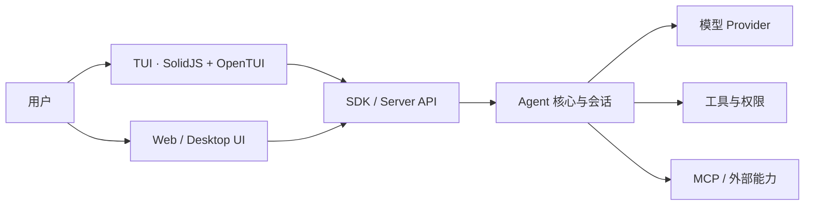
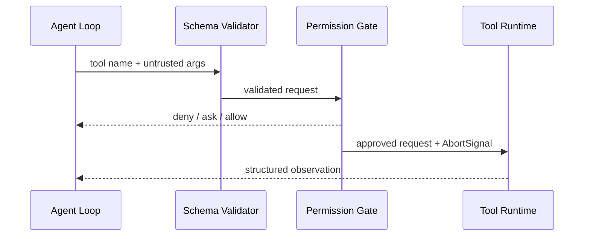

# OpenCode 架构分析：基于当前 TypeScript/Bun 仓库

!!! warning "这是一份版本化案例，不是永远有效的产品说明"
    本文只描述官方 `anomalyco/opencode` 仓库提交 `d21b0790a6c146815f28fea604e41e922f009590`。旧版 OpenCode 曾有不同的实现和维护方；“Go + Bubble Tea”“Claude Code 用 Rust”“远程 MCP 只有 HTTP+SSE”等旧结论已经从本文删除。阅读其他版本时，请重新核对仓库目录、依赖和官方文档。

!!! abstract "学完这一页你能"
    - 从仓库证据区分核心服务、SDK、TUI、Web UI 与桌面壳的责任。
    - 解释为什么 Agent 的业务状态不应直接依赖某个界面实现。
    - 用“模型适配、工具、权限、会话、事件”五个边界审查 Coding Agent。
    - 在面试中说明源码分析的证据等级，不把推断冒充官方实现。

## 0. 先建立证据边界

源码案例最容易出现两种错误：一是把历史项目当成当前项目，二是用教学代码补齐看不到的实现，再称作“源码”。本文将证据分成三级：

| 等级 | 可以写什么 | 必须附什么 |
|---|---|---|
| 已验证 | 仓库语言、目录、依赖、构建命令、公开接口 | 文件路径与 commit |
| 合理推断 | 由依赖方向推断的架构取舍 | 推断依据和替代解释 |
| 教学示意 | 为解释概念而写的简化代码 | 明确标注“非官方源码” |

本文只把前一级称作 OpenCode 的实现。后两级会显式标注。

## 1. 当前技术栈快照

以锁定提交为准，官方仓库的开发和构建入口展示了这些事实：

- 主仓库以 TypeScript 为主，开发环境要求 Bun。
- `packages/opencode` 承担核心业务逻辑和服务端能力。
- 终端界面使用 SolidJS 与 OpenTUI；构建脚本使用 Bun 的编译能力生成各平台可执行文件。
- `packages/app` 提供共享 Web UI，桌面应用使用 Electron 包装该界面。
- TUI 通过服务端 API/SDK 边界读取能力，而不是让展示层直接导入所有后端内部模块。



这张图最重要的不是包名，而是依赖方向：界面消费稳定边界，Agent 核心不反向依赖某个终端组件。这样才能让 TUI、Web 和桌面端共享同一套会话与工具语义。

## 2. 五个审查边界

### 2.1 模型适配边界

模型供应商会在消息结构、stop reason、流式增量、工具参数片段、错误码和用量统计上产生差异。Agent Loop 不应到处判断供应商名称，而应只依赖统一适配器：

```ts
// 教学示意，非 OpenCode 官方源码
interface ModelAdapter {
  stream(input: {
    messages: Message[];
    tools: ToolSchema[];
    signal: AbortSignal;
  }): AsyncIterable<ModelEvent>;
}
```

审查问题：

1. 部分 JSON 工具参数由谁拼接与校验？
2. 限流、重试和幂等是否留在适配层？
3. usage 是否转换成统一成本账本？
4. 供应商新增字段是否会污染会话存储？

### 2.2 工具与权限边界

工具系统至少要把“模型建议调用”与“系统允许执行”分开。模型返回结构化参数不代表参数可信；执行前仍需 Schema 校验、权限决策和工作区约束。



面试时要主动说出：工具失败应回灌为 observation，让模型决定修正参数或停止；取消信号必须继续传给网络请求和子进程，不能只停止 UI 动画。

### 2.3 会话与事件边界

多界面共享核心能力，需要统一描述 run、turn、message、tool call、permission request 和 usage。界面应消费事件或 SDK 数据，而不是从终端输出反向解析状态。

建议用下面的最小事件集检查自己的实现：

```ts
// 教学示意，非 OpenCode 官方源码
type AgentEvent =
  | { type: "message.delta"; messageId: string; text: string }
  | { type: "tool.started"; callId: string; name: string }
  | { type: "tool.finished"; callId: string; ok: boolean }
  | { type: "permission.requested"; requestId: string }
  | { type: "run.finished"; reason: string };
```

这些事件应满足：标识稳定、可重放、乱序时可检测、重复投递尽量幂等。

### 2.4 SDK / 服务边界

把 SDK 当成 TUI 与核心服务之间的边界，有三个收益：

1. TUI 不需要知道数据库、模型 Provider 或工具注册表的内部结构。
2. Web、桌面端和第三方客户端可以复用同一协议。
3. 核心包重构时，只要 API 契约稳定，界面不必跟着迁移内部模块。

代价是 API 版本、错误类型、流式断线恢复和生成 SDK 都需要专门维护。源码审查不能只看“有没有 SDK”，还要看界面是否偷偷越过 SDK 导入内部实现。

### 2.5 表现层边界

前端工程师最值得研究的是：流式 Agent UI 不是把 token 追加到字符串这么简单。它还要处理：

- tool call 与文本交错；
- ask/allow/deny 审批；
- 用户取消后的状态收敛；
- 断线重连与事件重放；
- Markdown、代码和外链的安全渲染；
- 未知工具的降级显示；
- 大会话时间线的虚拟化与局部更新。

一个稳妥的 reducer 要按稳定 ID 更新实体，而不是假设事件一定按理想顺序到达：

```ts
// 教学示意，非 OpenCode 官方源码
function reduceEvent(state: State, event: AgentEvent): State {
  switch (event.type) {
    case "message.delta":
      return appendDeltaById(state, event.messageId, event.text);
    case "tool.finished":
      return finishToolById(state, event.callId, event.ok);
    default:
      return state;
  }
}
```

## 3. MCP 结论必须按当前规范表述

本文锁定的 MCP 规范快照为 `2025-06-18`。标准传输是 stdio 与 Streamable HTTP；后者取代 `2024-11-05` 的旧 HTTP+SSE。SSE 仍可作为 Streamable HTTP 的响应或服务端通知流，但不应再把新远程传输概括成“两条独立的 HTTP+SSE 端点”。

远程 MCP 还必须考虑 Origin 校验、localhost 绑定和鉴权。是否支持 MCP 不能只记成“是/否”，应进一步检查：

- 采用哪个协议版本；
- 支持哪些 transport；
- 工具权限是否继承主进程策略；
- 外部返回内容是否标记为不可信；
- 服务端断线和重连如何恢复。

## 4. 从源码案例提炼到自己的项目

不要复制 OpenCode 的目录名。更有价值的是把边界转成可执行验收：

| 能力 | 最小验收 |
|---|---|
| 模型适配 | FakeModel 与真实适配器跑同一组 Loop 测试 |
| 工具 | 畸形参数变成失败 observation，会话不崩溃 |
| 权限 | `..`、越界符号链接和破坏性命令被拦截 |
| 会话 | 强杀后能恢复，不产生孤立 tool result |
| 取消 | UI 取消能终止模型请求、工具和子进程 |
| UI | 事件重放后状态一致，未知工具可降级显示 |
| 多 Agent | 有单 Agent 基线、写入所有权和证据回传 |

本站的 [`examples/minicode`](https://github.com/Shyu-x/frontend-interview/tree/main/examples/minicode) 提供了其中 Loop、工具、权限、会话、取消和子 Agent 的可运行基线。

## 5. 面试回答

??? question "30 秒：OpenCode 当前架构最值得学什么？"
    不要背历史语言和目录。当前仓库最值得学的是把核心服务与 TUI/Web/Desktop 表现层隔开：界面通过 SDK/API 消费统一会话和事件，Agent 核心把模型、工具、权限、MCP 放在可替换边界后面。这样多端共享语义，界面也不会绑定后端内部结构。

??? question "追问：为什么不能说这就是 OpenCode 永久架构？"
    Coding Agent 变化很快，目录、TUI 和协议都会迁移。可信的源码结论必须绑定仓库、commit、文件路径和核验日期；没有这些只能叫推断或历史快照。

??? question "追问：前端候选人能从中讲出什么深度？"
    可以从流式事件 reducer、工具时间线、审批交互、取消传播、断线恢复、安全 Markdown、长列表性能切入，再解释为什么这些 UI 都依赖稳定的服务/SDK 事件契约。

## 6. 动手作业

1. 在锁定提交中找到核心服务、TUI、Web UI、桌面应用和构建脚本，为每项记录一条文件证据。
2. 画出一次工具调用从 UI 到核心再回到 UI 的事件图；推断部分必须用虚线并写明依据。
3. 给 MiniCode 增加一个事件 reducer，随机打乱两个互不依赖事件的顺序，验证最终状态一致。
4. 写一份 ADR：为什么你的项目需要或不需要服务/SDK 边界。

验收标准：结论全部绑定文件或提交；教学示意不得标成官方源码；测试命令可重复执行；任何时效性结论都有 `verified_at`。

## 深入阅读与参考

- [OpenCode 官方仓库（锁定提交）](https://github.com/anomalyco/opencode/tree/d21b0790a6c146815f28fea604e41e922f009590)：核对目录、依赖和构建脚本。
- [OpenCode CONTRIBUTING](https://github.com/anomalyco/opencode/blob/d21b0790a6c146815f28fea604e41e922f009590/CONTRIBUTING.md)：核对开发环境与核心包职责。
- [OpenCode 构建脚本](https://github.com/anomalyco/opencode/blob/d21b0790a6c146815f28fea604e41e922f009590/packages/opencode/script/build.ts)：核对 Bun 构建和 OpenTUI/Solid 转换。
- [MCP 2025-06-18 Transports](https://modelcontextprotocol.io/specification/2025-06-18/basic/transports)：核对 stdio、Streamable HTTP 与旧 HTTP+SSE 的关系。

## 自测题

1. “仓库用了 TypeScript”属于哪一级证据？需要附什么？
2. 为什么工具 Schema 校验不能替代权限闸门？
3. 为什么事件必须带稳定 ID？
4. Streamable HTTP 与旧 HTTP+SSE 的关系是什么？
5. 如何证明多 Agent 优于单 Agent，而不是只是调用次数更多？

??? note "答案要点"
    1. 已验证事实；附仓库 commit 与文件证据。2. Schema 只验证形状，不能决定是否允许执行。3. 用于增量更新、重放、去重和乱序检测。4. 前者在新规范中取代后者，SSE 仍可作为流式载体，旧端点只用于兼容。5. 用同一任务集比较正确率、成本、p95 延迟、重复劳动率和冲突率。
