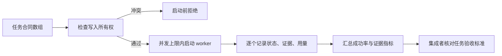

# 子 Agent 编排：并发、预算与失败恢复

本文是三篇中的实现主线：前一篇定义是否采用多 Agent，另一篇定义交接合同；这里关注调度器怎样执行、怎样在失败时给出可复核结果。可运行实现位于 [`examples/minicode/src/subagents.ts`](https://github.com/Shyu-x/frontend-interview/blob/f7525abd111f84a86a51b6a9113460ba0573fbb3/examples/minicode/src/subagents.ts)，对应测试为 [`examples/minicode/tests/subagents.test.ts`](https://github.com/Shyu-x/frontend-interview/blob/f7525abd111f84a86a51b6a9113460ba0573fbb3/examples/minicode/tests/subagents.test.ts)。页面没有复制一套无法独立运行的伪实现。

## 从输入到验收

示例的 worker 接收 `TaskContract` 和 `AbortSignal`，返回 `WorkerResult`；调度器接收任务数组、worker 与可选父信号，返回按输入顺序排列的结果和聚合指标。完整字段以源码类型定义为准。



调度报告不是最终产品答案。它帮助父 Agent 看见每项任务的状态和证据，但最终仍要按用户目标验收。

## 合同、所有权与并发

任务合同包括 `id`、`goal`、`nonGoals`、`input`、`ownedPaths` 和 `budget`。启动前检查 ID 唯一、非空目标、对象输入、字符串数组和正安全整数预算；截止时间不能超过 Node 定时器范围。结果校验状态、字段类型、证据项和非负用量；taskId 必须匹配，`ok` 还必须带非空证据。输入对象内部的业务 schema 仍由接入层验证。

调度器先校验并调用 `countOwnershipConflicts`。所有权路径按 POSIX 规则规范化，并将反斜杠当作路径分隔符；绝对路径、盘符路径、越出工作区的 `..` 路径和通配符会被拒绝。根目录、相同路径以及父/子目录之间都算冲突，因此 `src` 与 `src/pages` 不能同时分配给不同 worker。检测到冲突后整批拒绝启动。此检查仍不能发现不同目录上的语义冲突。只读任务可共享输入并行执行；共享文件修改应指定单一写入者，或由独立 worktree 隔离后再集成。

`SubagentOrchestrator(concurrency)` 将并发值限制为正整数，并启动不超过该值的 runner。结果按合同原始顺序写回数组，所以完成顺序不影响报告顺序。并发上限还应结合模型服务、浏览器会话、数据库连接等下游容量设置；该类本身不读取供应商限流信息。

## 预算、取消和失败

每份任务合同携带独立预算字段，调度器额外传入 `BudgetMeter`。worker 可在每步或每次模型调用后调用 `charge(steps, tokens)`；计量值必须是非负安全整数，累计超过任一额度时该调用会抛错。worker 应让超限错误冒泡；若它捕获并吞掉错误，调度器无法强制停止其后续动作。最终报告用量取计量累计值与 worker 自报值两者中的较大值，避免低报掩盖已计量消耗。未接入 meter 的 worker 仍只能依靠返回后的自报值检查，不能获得实时用量保证。

`deadlineMs` 会触发子任务 signal；父 `AbortSignal` 也会传播，且父信号已预先取消时不会启动 worker。调度器通过 abortable 等待包装，在取消或超时时尽快停止等待并记录取消结果。这个机制不能杀死不响应 signal 的 worker，也不能撤销已经发生的文件写入、网络请求或其他副作用。隔离工作区、只读权限和幂等设计仍是副作用控制手段。

worker 抛错时，调度器为该任务生成 `failed` 结果并继续收集其他结果；取消状态根据子信号判断。已失败任务不会清空其他 worker 的成功结果。生产系统还需决定哪些失败可重试、最大重试次数与退避策略，并避免对非幂等工具盲目重试；当前示例没有实现重试。

| 情况 | 当前示例行为 | 集成者要做的事 |
|---|---|---|
| 写入路径冲突 | 整批执行前抛错 | 拆分所有权或改串行/隔离执行，再重新派发 |
| worker 抛错 | 记录 `failed`，保留其他结果 | 检查错误，决定人工介入或安全重试 |
| 父任务预取消 | 不启动 worker，立即得到取消结果 | 保留取消原因并停止后续工作 |
| 父任务运行中取消 | 中止等待、传播 signal 并返回取消结果 | 非合作 worker 可能继续运行或产生副作用；需用隔离和权限限制后果 |
| meter 超过 steps/tokens | `charge` 抛错；错误向外冒泡时任务记为失败 | 每次消耗后及时计量并传播超限错误；无法强制停止吞掉错误的 worker，也无法撤销已发请求 |
| worker 自报超限 | 返回后检查并标为 `failed` | 仅适用于无法逐步计量的 worker，不代表超限前已停止 |
| 超时 | 中止等待并传播子 signal | 不合作 worker 可能在后台继续；不可把超时当作进程终止或回滚 |

## 证据与验收

示例聚合了四个指标：成功率、成功结果中的证据覆盖率、重复证据率和写入冲突数。它们是调度观察信号，不等价于答案正确率：有证据不代表证据支持结论；基于 URI 字符串的去重也无法判断语义重复。产品验收还应检查证据能否访问、位置是否准确，以及是否覆盖合同中的目标。

当前仓库的 `subagents.test.ts` 与 `regressions.test.ts` 覆盖输入顺序与指标、部分失败、重叠路径拒绝、规范化后冲突与越界路径、兄弟目录可并行、重复 id 拒绝、无证据成功/负 usage 拒绝、meter 超额后仍能识别低报、预取消与排队任务取消、不响应 signal 的 worker 超时后停止等待，以及合作 worker 下真实并发峰值不超过上限。回归用例没有证明超时会杀死 worker 或回滚副作用；abortable 只让调度器及时返回。

`boundaries.test.ts` 还覆盖空 ID/目标、非法预算和数组、绝对路径/通配符/反斜杠、错误 taskId 与非对象结果。worker 继续产生副作用、符号链接别名和外部模型业务质量仍不在这些测试的保证范围。`input` 内部领域 schema 由接入层负责。运行方式（Node.js `>=22.18`，TypeScript `5.9.3`）：

```sh
cd examples/minicode
npm ci
npm run verify
```

`verify` 运行类型检查和 Node 测试，本次集成已在 Node.js 22.18.0 执行并通过全部 33 项测试。若失败，检查测试名称对应的行为和报告中的 `status`、`error`、`usage`。本页的调度 trace 是教学走读，不是实际模型评测结果。

## 前端落地示例

以“并行审查多页无障碍问题”为例，先为每个页面分配只读路径和统一检查项，设置 worker 数上限；每项结果带严重度、源码位置、复现步骤和证据。集成者合并重复发现，再用自动化检查与浏览器手动复核。若子任务修改共享组件或 design token，则先重新划分单一写入者，避免并行改写。

生产验收至少检查：空/重复任务 id 和非法预算是否启动前被拒绝；绝对、越界、通配符和规范化后的父子路径是否按规则处理；畸形结果、错误 task id 和无证据成功是否失败；meter 是否在超限时抛错，worker 是否传播该错误，报告用量是否取自报与计量的较大值；预取消、超时及运行中取消是否及时停止编排器等待，同时确认非合作 worker 的副作用边界；并发上限是否生效；单项失败是否保留其他成功结果及可访问证据；同一评测集下质量、成本和 p95 是否满足采用门槛。阈值应由项目预算和用户体验目标确定，不能从示例中的常量推导。

## 完整走读：五个页面任务、并发上限二、一个失败

下面用五个只读前端审查任务走一遍输入、调度和结果汇总。它是按调度器规则推导的教学 trace，不是 `npm run verify` 的固定输出；毫秒数只用于说明先后关系。

场景目标：审查五个页面的窄屏键盘可达性，成功报告必须附源码位置证据。每个任务拥有一个页面路径；所有预算均为 5 steps、500 tokens、1000ms。不同路径互不重叠，因此可以并行。

| 任务 | ownedPaths | worker 行为 | 成功证据 URI |
|---|---|---|---|
| `home` | `src/pages/home` | 计量 2 steps / 200 tokens，返回 ok，自报 3 / 240 | `file:///src/pages/home.tsx#L10` |
| `cart` | `src/pages/cart` | 计量 4 / 300，返回 ok，自报 3 / 260 | `file:///src/pages/cart.tsx#L22` |
| `account` | `src/pages/account` | 计量 2 / 180 后抛错，不返回成功结果 | 无 |
| `help` | `src/pages/help` | 计量 3 / 220，返回 ok，自报 2 / 190 | `file:///src/pages/cart.tsx#L22` |
| `search` | `src/pages/search` | 计量 2 / 120，返回 ok，自报 2 / 150 | `file:///src/pages/search.tsx#L7` |

注意 `help` 故意引用与 `cart` 相同的 URI，用来观察指标会如何暴露重复引用。它仍满足“成功结果至少带一条证据”的结构要求；结构合法不等于发现内容正确。

### 派发时间线

输入数组顺序是 `home, cart, account, help, search`。并发上限为 2，调度器启动两个 runner；每个 runner 完成或失败后再取下一个合同。

为得到明确时间线，假设这五个 worker 分别在 40ms、10ms、20ms、5ms、10ms 后完成（`account` 在失败前用完 20ms）。这些延迟仅定义走读顺序，不代表模型调用耗时承诺。

| 相对时间 | Runner 1 | Runner 2 | 活跃数 |
|---:|---|---|---:|
| 0ms | 启动 `home` | 启动 `cart` | 2 |
| 10ms | `home` 继续 | `cart` 完成，接着启动 `account` | 2 |
| 30ms | `home` 继续 | `account` 抛错，记录 failed，接着启动 `help` | 2 |
| 35ms | `home` 继续 | `help` 完成，接着启动 `search` | 2 |
| 40ms | `home` 完成 | `search` 继续 | 1 |
| 45ms | 空闲 | `search` 完成 | 0 |

这条时间线里五个任务都启动了，但同时活跃的 worker 从未超过 2。`account` 的失败只结束该合同；runner 继续处理后面的 `help` 与 `search`。如果父任务在中途取消，调度器会停止等待并返回取消状态，但仍不能保证不响应 signal 的 worker 停止副作用。

### 逐项结果如何生成

调度器按**输入合同顺序**存放结果，而不是按完成顺序。因此 `home` 即使最后才完成，报告仍以 `home, cart, account, help, search` 排列。

| taskId | status | 最终 usage | 计算方式 | evidence |
|---|---|---:|---|---|
| `home` | `ok` | 3 steps / 240 tokens | meter 2/200 与自报 3/240 逐项取较大值 | 1 条 |
| `cart` | `ok` | 4 / 300 | meter 高于自报的 steps 与 tokens | 1 条 |
| `account` | `failed` | 2 / 180 | worker 抛错后记录当时 meter 累计值 | 0 条 |
| `help` | `ok` | 3 / 220 | meter 高于自报的 steps 与 tokens | 1 条，与 `cart` URI 重复 |
| `search` | `ok` | 2 / 150 | tokens 使用自报较大值，steps 相同 | 1 条 |

对于正常返回的 worker，最终 usage 是 `max(meter steps, self-reported steps)` 与 `max(meter tokens, self-reported tokens)`。抛错的 worker 走异常分支，所以该失败结果使用 meter 当前累计值；若失败发生在任何计量前，usage 会是零。此报告保留了四项成功证据和一项失败状态，没有把失败任务伪装成空成功。

### 指标逐个推导

`calculateMetrics` 对成功结果统计指标。这个示例的报告应得到：

| 指标 | 推导 | 值 |
|---|---|---:|
| `successRate` | 4 个 ok ÷ 5 个任务 | `0.8` |
| `evidenceCoverage` | 4 个有证据的 ok ÷ 4 个 ok | `1` |
| `duplicateEvidenceRate` | 4 个成功证据 URI 中 1 个重复 ÷ 4 | `0.25` |
| `writeConflictCount` | 五个页面路径两两无父子/规范化重叠 | `0` |

`evidenceCoverage = 1` 只表示每个成功结果都带了证据，不表示审查找全或结论正确。`duplicateEvidenceRate = 0.25` 是 URI 字符串去重；它能提示 `cart` 与 `help` 交回同一引用，却不能判断它们结论是否相同。最终集成者仍需打开证据、核对行号、检查覆盖范围，并对照键盘可达性验收标准。

### 这个 trace 揭示的验收点

1. 受限并发看活跃 worker 峰值，不看最终任务数；五个任务可以在上限二的条件下全部完成。
2. 部分失败的验收应确认失败有状态与用量，同时剩余排队任务继续执行，成功结果不丢失。
3. 逐步计量与自报值取大值，能发现 `home` 的自报高于 meter、`cart` 的 meter 高于自报两种情况。
4. 成功必须附证据，是结构门槛；证据支持结论、没有遗漏页面，仍需由产品验收验证。
5. 若改成并行写文件，必须先检查归属路径；只读页面检查不需要伪造写入所有权。

回归用例与走读对应关系：

| 走读/异常点 | 自动化用例检查什么 |
|---|---|
| `home`、`cart` 等正常结果 | 结果按输入顺序保留，证据指标可计算。 |
| `account` 失败 | 单任务失败不会清空其他成功结果。 |
| 五个任务、并发上限二 | 活跃 worker 峰值不超过 2。 |
| `cart` 与 `help` 重复 URI | 走读解释 duplicate rate；基础测试另验证无重复时为 0。 |
| 预取消/超时 | worker 不启动或调度器及时停止等待；不验证进程被杀死。 |

`regressions.test.ts` 当前的并发测试用五项任务验证峰值；本节 trace 用四项成功、一项失败展示结果与指标，所以两者关注点相近，但并非同一个自动化固定样例。

## 面试回答

**30 秒：**我会用结构化任务合同描述目标、输入、写入范围、预算和结果格式。调度器先检查写入冲突，再按并发上限执行；每个 worker 有独立预算，父取消传播到子任务，单项失败不会抹掉成功结果。最后核对状态、使用量和证据，而不是只看摘要。

**2 分钟展开：**先讲输入与返回合同，再讲调度顺序：校验任务 id/预算及规范化写入所有权、受限并发、按任务保留结果。`BudgetMeter` 可在执行中逐步计量，超额时抛错；worker 必须传播错误，meter 本身不能强制停止捕获错误后继续运行的 worker。报告用量取计量值与自报值的较大值。abortable 在父取消、预取消或超时后尽快停止调度器等待，但不能杀死非合作 worker 或撤销副作用。结果还要校验 schema、任务 id 和成功证据。部分失败要保留成功结果；重试受幂等性约束。验收既看各边界回归测试，也看实际任务质量、成本、p95 和冲突/重复证据。

## 练习与评分

**练习：**将示例调度器用于 12 个前端页面的只读性能检查。说明合同如何分配、并发上限如何决定、一个 worker 超时后如何处理，以及最终怎样判定报告可交付。

| 评分项 | 分值 | 满分表现 |
|---|---:|---|
| 合同与输入 | 2 | 页面范围、检查目标、非目标、结果 schema、证据类型明确。 |
| 并发和所有权 | 2 | 指定受下游容量约束的上限；只读任务不伪造写权限。 |
| 预算与取消 | 2 | 每任务有独立额度和 deadline，说明 worker 如何响应取消。 |
| 失败与恢复 | 2 | 失败状态单独保留；重试有次数、退避与幂等约束。 |
| 证据与验收 | 2 | 对照质量门槛核实源码/trace/测试证据，且报告成本与延迟。 |

**自测：**

1. `src` 与 `src/pages/cart` 分配给不同 worker 时为什么应判冲突？
2. `BudgetMeter.charge` 抛错后，能否保证已经发出的网络请求被撤销？
3. worker 返回后检查 token 用量，能否证明超限前停止了生成？
4. `duplicateEvidenceRate` 为零能否证明没有重复分析？为什么？

答案要点：父子目录所有权有覆盖关系；meter 抛错应由 worker 传播，但无法阻止 worker 吞掉错误或回滚已发出的副作用；仅返回后自报只能发现超限，不能证明实时中断；URI 去重不能发现不同 URI 指向相同内容或重复推理。

## 深入阅读

- [实现源码](https://github.com/Shyu-x/frontend-interview/blob/f7525abd111f84a86a51b6a9113460ba0573fbb3/examples/minicode/src/subagents.ts)：调度器、所有权检查与指标计算。
- [实现测试](https://github.com/Shyu-x/frontend-interview/blob/f7525abd111f84a86a51b6a9113460ba0573fbb3/examples/minicode/tests/subagents.test.ts)：测试输入顺序、部分失败、预算、所有权和取消。
- [回归测试](https://github.com/Shyu-x/frontend-interview/blob/f7525abd111f84a86a51b6a9113460ba0573fbb3/examples/minicode/tests/regressions.test.ts)：测试规范化路径、超时、预取消、证据、meter 和并发峰值。
- [子 Agent 上下文隔离](../multi/subagents-context-isolation.md)：交接时的数据和权限边界。
