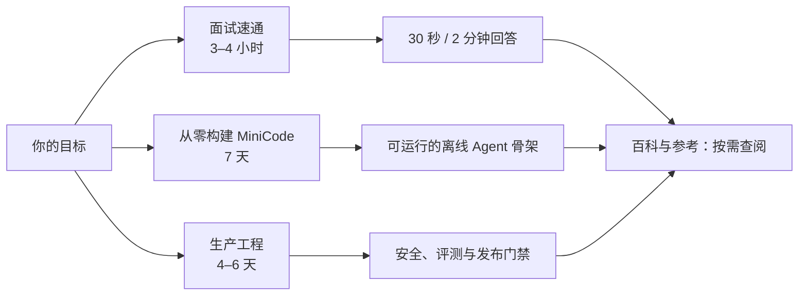

# AI Agent 概览

这里把 Agent 当成工程系统，而不是提示词技巧。先按目标选一条路线，其他文章作为需要时查阅的参考，不把大量百科资料当成必修长廊。

!!! abstract "学完这一篇你能"
    - 根据面试、动手构建或上线目标，选对入口而非从长目录硬读。
    - 说明每条路线的前置、产出、验收和预计时间，并按验收推进。
    - 区分必修课程、可运行项目和版本敏感的百科/案例资料。

## 0. 三条路线，一处参考

图中三条支线各自以可检查的结果结束，再汇入参考资料；参考资料不是第四条必修路线。

## 1. 选择入口

| 路线 | 前置 | 产出 | 验收 | 预计时间 | 起点 |
|---|---|---|---|---|---|
| 面试速通 | JavaScript 异步、HTTP 基础 | 一页架构图、10 个问答 | 30 秒说清 loop/工具/上下文/权限/评测；2 分钟解释单、多 Agent 取舍 | 3–4 小时 | [路线 A](learning-paths.md#路线-a面试速通) |
| 从零构建 MiniCode | Node.js 22.18+、TypeScript、命令行 | 可运行的离线 Agent 教学骨架 | `npm ci && npm run verify` 通过；能演示 loop、会话恢复、路径权限、记忆与子任务 | 7 天，每天 1.5–2 小时 | [课程总览](../minicode/index.md) |
| 生产工程 | 已有单 Agent 原型，理解会话、工具和权限 | 威胁模型、评测集、trace 与发布检查清单 | 用固定任务集复跑；能从 trace 定位失败；明确高风险工具的策略和回滚方式 | 4–6 天 | [路线 C](learning-paths.md#路线-c生产工程) |

!!! warning "先有单 Agent 基线，再拆多 Agent"
    子 Agent 必须继承明确的任务契约，并有独立预算、取消传播和证据回传。没有这些条件时，多 Agent 只会掩盖原型的问题。

## 2. 默认主线：七天 MiniCode

没有明确面试期限时，默认从 [MiniCode](../minicode/index.md) 开始。课程按模型调用 → 单次 Agent → loop 与工具 → 会话/压缩 → 权限边界 → 记忆 → 子 Agent 逐步展开。伴随项目实现并验证其中的稳定子集；教学页里的技能、待办、沙箱进程和持久后台任务等扩展设计不等于伴随项目已有功能。Day 5 与 Day 7 是必修学习节点，但验收范围以伴随项目 README 明列的能力为准。

| 节点 | 产出 | 真实验收 |
|---|---|---|
| Day 3 | loop 与工具注册表 | 工具结果回灌模型，错误不会丢失会话 |
| Day 4 | 会话与有损摘录 | 日志可恢复，保留完整最近轮次；旧约束可能丢失，需额外验证 |
| Day 5 | 权限与沙箱 | 越界路径和逃逸符号链接被拒绝；执行与网络请求需要审批 |
| Day 6 | 记忆 | 可测试记忆记录的来源、更新与检索；技能和待办是课程扩展设计 |
| Day 7 | 子 Agent | 子任务有契约、独立预算、取消传播、写入所有权和证据指标；持久后台队列属于扩展设计 |

## 3. 百科与参考

左侧“百科与参考”保留了全部既有文章，但不是必读清单。先完成路线 A/B/C 中与你目标对应的 canonical 页面，再沿着下面的主题入口按问题深入；框架、DeepSeek Harness、RAG 专题和产品案例用于比较方案或查证细节。版本敏感内容先确认 `verified_at`、`source_commit` 与来源，再把设计取舍带回项目。

逐页顺序、前置、产出、命令和估时见 [路线与验收表](learning-paths.md)。新增或实质更新文章还必须遵守 [教程写作规范](../design/writing-standard.md) 的验证与源码关联要求。

## 深入阅读与参考

### Canonical 主线与深入参考

| 主题 | Canonical（先读） | 深入参考（遇到具体问题再读） |
|---|---|---|
| 核心循环与 Harness | [工程体系总览](system/agent-engineering-map.md)、[Harness 全景](harness/harness-overview.md)、[Agent Loop 解剖](harness/agent-loop-anatomy.md) | 工具协议、steering/abort、Harness 对比与源码案例 |
| 上下文与会话 | [上下文膨胀](context/context-bloat-and-rot.md)、[会话存储总览](storage/session-storage-overview.md) | 压缩策略比较、KV cache、JSONL/SQLite 设计与故障模式 |
| 安全 | [权限模型](security/permission-models-spectrum.md)、[提示注入防护](security/prompt-injection-defense.md) | 沙箱技术、企业治理、MCP 配置安全与权限门禁实现 |
| 检索与记忆 | [Agentic RAG 与 grep](rag/agentic-rag-vs-grep-search.md)、[记忆全景](memory/memory-taxonomy.md) | 混合检索、向量库、记忆读写流水线与安全评估 |
| 多 Agent 与评测 | [单/多 Agent 决策](multi/single-vs-multi-agent.md)、[评测从零搭建](ops/agent-evals-from-scratch.md) | 编排模式、上下文隔离、失败模式、可观测与成本预算 |

主线页面提供足以形成工程判断的共同词汇；深入参考按需回答实现、框架或案例层面的后续问题。不要把表中右列当作路线的额外必修阅读。

!!! tip "怎么用这些资料"
    先读「官方文档与规范」建立准确的概念，再读「源码与示例」核对细节，最后用「教程、书籍与视频」换一种讲法加深理解。每条都写明了读哪一节、带着什么问题读。

### 官方文档与规范

| 资源 | 为什么读 | 怎么读 |
|---|---|---|
| [Claude Agent SDK 概览](https://docs.claude.com/en/api/agent-sdk/overview) | SDK 官方入口，快速了解 Agent 开发核心概念与最小闭环。 | 读概览与快速开始，带着“如何注册工具”问题，跑通后记录日志。 |
| [Claude 子 Agent 文档](https://docs.claude.com/en/docs/claude-code/sub-agents) | 子 Agent 是复杂系统基础，官方说明工具权限与协作方式。 | 读创建与权限章节，做一个只读审查子 Agent，跑一次代码审查。 |
| [OpenAI Agents SDK（Python）](https://openai.github.io/openai-agents-python/) | Python 版 Agents SDK 官方文档，含 handoff 等核心抽象。 | 复现 Quickstart，再加两个 Agent 的 handoff，观察任务如何转交。 |
| [Google ADK 文档](https://google.github.io/adk-docs/) | ADK 官方文档覆盖多工具 Agent、编排与评测，体系完整。 | 跟快速开始建多工具 Agent，重点看评测章节并跑示例。 |

### 源码与示例

| 资源 | 为什么读 | 怎么读 |
|---|---|---|
| [Claude Agent SDK（TypeScript）](https://github.com/anthropics/claude-agent-sdk-typescript) | TypeScript SDK 源码与示例，能看清工具调用和消息循环实现。 | 克隆后跑 README，再把自定义函数注册成工具并调试。 |
| [smolagents 仓库](https://github.com/huggingface/smolagents) | 核心代码不到千行，是理解最小 Agent 循环的极佳范本。 | 精读 agent loop 与工具调用部分，手写一个简化版循环。 |
| [pi 编码 Agent 工具集](https://github.com/earendil-works/pi) | 编码 Agent 的 loop 与 LLM API 实现，适合对照自己的循环。 | 读 agent loop 和统一 LLM API，列出与你实现的差异。 |

### 教程、书籍与视频

| 资源 | 为什么读 | 怎么读 |
|---|---|---|
| [Effective context engineering for AI agents](https://www.anthropic.com/engineering/effective-context-engineering-for-ai-agents) | 系统讲解上下文工程，直接决定 Agent 的稳定性与成本。 | 读完检查现有提示，删重复上下文，记录 token 与效果变化。 |
| [How we built our multi-agent research system](https://www.anthropic.com/engineering/multi-agent-research-system) | 真实多 Agent 研究系统复盘，讲清何时拆分与如何编排。 | 画出 lead 与 subagent 调用图，判断你的任务是否需要多 Agent。 |
| [A practical guide to building agents（OpenAI）](https://cdn.openai.com/business-guides-and-resources/a-practical-guide-to-building-agents.pdf) | OpenAI 的实践指南，用模型、工具、指令三要素拆解 Agent。 | 读后按三要素检查自己的设计，补齐缺失的工具或指令。 |
| [LLM Powered Autonomous Agents（Lilian Weng）](https://lilianweng.github.io/posts/2023-06-23-agent/) | 经典长文，规划、记忆、工具三部分讲得透彻。 | 精读三部分，各写一段理解，并对照自己的 Agent 找差距。 |
| [Agents（Chip Huyen）](https://huyenchip.com/2025/01/07/agents.html) | Chip Huyen 从工程视角讲 Agent 的工具与规划，接地气。 | 读工具与规划章节，列出你 Agent 缺失的环节并排优先级。 |
| [Hugging Face Agents Course](https://huggingface.co/learn/agents-course/unit0/introduction) | 免费动手课程，从零搭 Agent 并提交 Space，反馈快。 | 完成 Unit 1，边做边改参数，最后提交一个小 Agent 到 Space。 |
