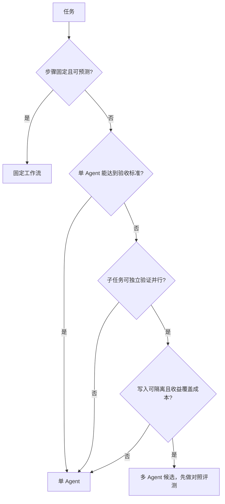

# 单 Agent 还是多 Agent：如何用证据做选择

这篇只解决一个问题：任务是否值得拆成多个 Agent。任务交接与上下文隔离见[子 Agent 上下文隔离](subagents-context-isolation.md)；并发调度和失败处理见[子 Agent 编排](../harness/subagents-orchestration.md)。这里不复制实现教程。

## 先看任务结构

前端性能排查可能涉及网络瀑布、组件渲染、缓存和构建产物。若这些方向能各自只读检查、独立给出证据，多个 Agent 可以并行调查；若需要连续修改同一页面状态、共享设计决策或反复互相澄清，拆分会增加协调成本。

按图从上往下判断。固定步骤用代码表达；开放问题先试单 Agent；只有确实可分、能分别验收且写入受控时，多 Agent 才进入候选。

## 用同一把尺比较

先把“成功”写成可观察条件，再用相同输入集比较单 Agent 与多 Agent。评测集应覆盖普通任务、边界情况和失败案例；重复运行并记录模型、提示、工具版本与时间，避免把一次偶然结果当结论。

| 指标 | 怎么测 | 需要回答的问题 |
|---|---|---|
| 任务质量 | 按预先写好的正确性 rubric 人工或自动评分 | 是否达到用户要求，证据是否正确？ |
| 成本 | 汇总各 Agent 的输入/输出 token 或实际费用 | 质量提升值不值得额外成本？ |
| 延迟 | 端到端耗时及 p50/p95 | 并行是否缩短用户等待时间？ |
| 重复劳动 | 重复检索、重复证据或重复工具调用占比 | 扇出是否在做同一件事？ |
| 协调与写入风险 | 冲突次数、失败任务数、人工返工时间 | 结果能否安全汇总与落盘？ |

不要预设“Agent 数量越多越好”或套用跨任务的固定准确率阈值。多 Agent 的 token 总量通常是各 worker 与汇总者之和；并行可能降低等待时间，但不会自动降低总成本。若收益不稳定或没有超过事先约定的门槛，就保留更简单的方案。

把候选方案交给实现前，还要检查实际写入范围是否重叠：目录与其子目录也可能覆盖同一文件集合；预算要能在执行中计量，取消只能停止等待/后续工作，不能承诺回滚已经发生的外部副作用。具体边界由[编排篇](../harness/subagents-orchestration.md)展开。

## 前端场景判断

| 场景 | 候选形态 | 判断依据与验收 |
|---|---|---|
| 按设计稿实现一个组件并修复响应式问题 | 单 Agent | 改动集中且视觉决策相互依赖；以断点截图、交互行为和回归检查验收。 |
| 对多个互不依赖页面做只读无障碍审查 | 多 Agent 候选 | 页面范围可分配，统一检查清单；比较缺陷召回、误报、重复发现和审查时间。 |
| 按固定步骤生成路由清单、跑 lint、生成报告 | 固定工作流 | 顺序已知，用脚本或工作流控制更可预测。 |
| 同时让多个 Agent 改共享 CSS、设计 token 或路由配置 | 默认不并行写 | 决策互相影响；指定单一写入者，或分支隔离后由集成者验收。 |

## 面试回答

**30 秒：**我先用单 Agent 建立质量、成本和延迟基线。只有子任务能独立拆分、独立验证，并且并行收益超过协调、token 与写入冲突成本时才用多 Agent；固定步骤直接用工作流。上线前限制并发、定义写入所有权、保留部分失败结果，并用同一评测集做回归比较。

**2 分钟展开：**先讲具体任务的依赖图和单 Agent 当前失败点，然后说明哪些只读子任务可以并行，哪些共享状态必须串行。给每个 worker 明确目标、输入、边界、预算和结果格式，汇总时检查结果与证据。评测要同时看正确率、成本、p95、重复劳动和冲突/返工；并行主要改善可并行部分的等待时间，不保证更低费用。若质量收益未达到预先设定的门槛，或失败/冲突让返工变多，就回退到单 Agent 或固定工作流。

## 练习与评分

**练习：**产品要求修复一个首屏加载慢的问题。你有 30 个页面、网络 trace、构建报告和一个共享样式仓库。写出方案选择、任务拆分、写入规则、对照指标和停止条件。

| 评分项 | 分值 | 满分表现 |
|---|---:|---|
| 基线与验收 | 2 | 先定义当前性能和正确性基线、目标门槛及可复现输入。 |
| 拆分合理 | 2 | 页面级只读调查可并行；共享修复决策交给一个集成者。 |
| 合同与边界 | 2 | 任务输入、非目标、结果格式、证据和预算清楚。 |
| 成本与失败 | 2 | 记录 token/费用、p95、重复劳动、部分失败与取消。 |
| 回退条件 | 2 | 明确低于质量收益门槛、冲突或成本超限时停止扇出。 |

**自测：**

1. 固定流程为何不必包装成多 Agent？
2. 两个 Agent 分别审查同一段代码，如何识别重复劳动？
3. 多 Agent 用时变短但总 token 翻倍，能否称为整体改进？你还需要哪些目标约束？

答案要点：已知步骤优先用固定工作流；以证据 URI/内容和任务覆盖去重；只有延迟是主要目标且预算允许时，才可能接受成本上升，并按预先设定的效用/成本门槛判断。

## 延伸阅读

- [子 Agent 上下文隔离](subagents-context-isolation.md)：任务输入、输出和隔离边界。
- [子 Agent 编排](../harness/subagents-orchestration.md)：并发、预算、取消、失败与自动验收。
- [MiniCode 回归测试](https://github.com/Shyu-x/frontend-interview/blob/f7525abd111f84a86a51b6a9113460ba0573fbb3/examples/minicode/tests/regressions.test.ts)：查看路径冲突、取消边界和并发上限的可执行检查。
