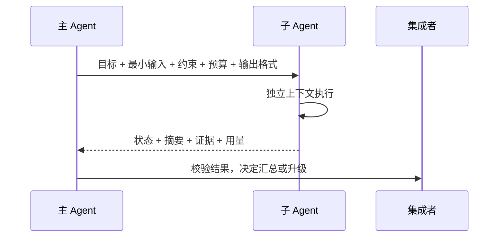

# 子 Agent 上下文隔离：定义可靠的交接边界

## 并发有上限，结果仍按输入归位 {#bounded-agent-fanout}


本节对照[官方资料](https://tc39.es/ecma262/multipage/control-abstraction-objects.html#sec-promise.all)核对 ECMAScript living specification checked 2026-10-13。
完整实现与行为测试在 [mcp-mini.mjs](https://github.com/Shyu-x/frontend-interview/blob/c1a7d0be48d2601aa4d71b303fbc08921e77235d/scripts/implementation-labs/agent/mcp-mini.mjs) 和 [测试文件](https://github.com/Shyu-x/frontend-interview/blob/c1a7d0be48d2601aa4d71b303fbc08921e77235d/scripts/implementation-labs/agent/mcp-mini.test.mjs)。从仓库根目录运行 node --test scripts/implementation-labs/agent/mcp-mini.test.mjs。

把全部任务传给 Promise.all，并不会限制启动数量。先保留一个共享游标，再启动固定数量的执行槽。每个槽领取下一个索引，完成后才继续领取。结果使用原始索引保存，不能按完成顺序排序，否则第二个先完成的分析可能被误配给第一个文件。这里的并发是异步工作重叠，不等于 JavaScript 在同一线程执行 CPU 并行计算。

```js
import { mapWithLimit } from './scripts/implementation-labs/agent/mcp-mini.mjs';
const results = await mapWithLimit(['header', 'router', 'store'], 2,
  async (part) => {
    if (part === 'router') throw new Error('分析失败');
    return { part, finding: 'ok' };
  });
console.log(results.map(result => result.ok)); // [true, false, true]
```

先验证 limit 是正整数。执行槽数取 limit 与任务数的较小值。领取索引的操作在同步段完成，随后才 await；单线程执行这个同步段时不会被另一个槽插入。结果记录成功值或失败信息，一个任务失败不应丢掉已经完成的其他任务。

不同任务还需要上下文隔离。每个 worker 只接收自己的输入与必要只读资料，不把整个历史对象的可变引用共享给它。对文件写作任务则分配明确所有权，并发限制本身不能解决两个 worker 同时改同一文件的问题。

A009 通过峰值计数和结果索引检查并发上限与部分失败。它未实现重试、取消或进程隔离。继续练时让队列中途取消，要求不再领取新索引，同时等待已经开始的工作释放资源。不要只让最终 Promise 提前返回却把其他任务留在后台继续写。

这篇解释主 Agent 与子 Agent 之间应该传什么、结果如何交回。它不讨论多 Agent 是否值得使用，见[单 Agent 还是多 Agent](single-vs-multi-agent.md)；具体调度实现见[子 Agent 编排](../harness/subagents-orchestration.md)。

## 隔离解决什么，又不解决什么

子 Agent 通常在单独的消息上下文中执行；主 Agent 通过明确输入启动它，再接收结果。隔离可以减少无关历史进入子任务，也能让主上下文只保留摘要。但这不自动意味着文件系统、工具、网络、预算或运行时状态彼此隔离。真实边界取决于宿主实现和授权的工具。



父 Agent 的完整历史不应被默认转发。任务需要的信息要在交接里显式提供；必要时提供文件路径、行号、版本、用户约束和引用来源。否则“上文中的方案”对独立上下文没有含义。

## 合同的输入与输出

下面是设计字段清单，不是某个运行时的精确 API。仓库示例会检查 ID 唯一、目标非空、输入为对象、nonGoals/ownedPaths 为字符串数组和合法预算；结果校验状态、摘要、证据项及非负用量，成功必须带证据。`input` 内部业务字段和实际工具权限仍由接入层验证。具体行为见[编排篇](../harness/subagents-orchestration.md)。

| 方向 | 字段 | 示例：前端无障碍审查 |
|---|---|---|
| 输入 | `taskId`、`goal`、`nonGoals` | `a11y-settings-page`；检查设置页键盘可达性；不修改文件 |
| 输入 | `input`、`references` | 页面路径、验收准则、目标分支；设计规范链接或相关源码片段 |
| 输入 | `ownedPaths` / 权限 | 空写入范围，允许只读检查；明确工具白名单 |
| 输入 | `budget` | 最大步骤/调用数、token 上限、截止时间 |
| 输出 | `taskId`、`status` | 必须与派发任务一致；`ok`、`failed` 或 `cancelled` |
| 输出 | `summary`、`findings` | 结论及严重度、位置、影响和建议 |
| 输出 | `evidence` | 文件路径与行号、测试名称或有权限访问的 URL |
| 输出 | `usage`、`error` | 记录消耗；失败时保留可诊断原因 |

输出格式应让主 Agent 能决定下一步，而非要求子 Agent 自评“已完成”。比如，`ok` 只代表 worker 正常返回；集成者仍需验证证据与任务验收条件。摘要压缩不能丢掉关键位置、例外和不确定性，也不应把没有证据的推测升级成事实。

## 隔离边界与权限

隔离至少分成四类，设计时逐项确认：

| 边界 | 常见默认误解 | 需要显式约定 |
|---|---|---|
| 上下文 | 子 Agent 自动看到父对话 | 只传自足任务所需的材料；不要假设继承历史 |
| 工具/权限 | 新上下文代表沙箱 | 使用只读工具或运行时权限控制；任务文本本身不是安全机制 |
| 状态/写入 | 不同 Agent 不会互相覆盖 | 只读可并行；规范化路径上的同路径或父子路径写入冲突须在启动前拒绝；必要时使用隔离工作区 |
| 资源/生命周期 | abort 或预算超限会杀死 worker 并回滚副作用 | 通过 meter 逐步计量、设置截止时间并在取消时尽快停止编排器等待；不能终止不合作 worker，也不能撤销已发生的副作用 |

一个前端审查 worker 可以只读扫描 `src/pages/settings/**` 并返回发现。若它可以直接修改共享的 `tokens.css`，就不再是只读审查；应把补丁交给单一写入者，或在隔离工作区里修改后由集成者审查。

仓库回归用例已验证规范化后路径与父子目录冲突、成功结果缺少证据时拒绝、预取消不启动 worker、排队任务取消，以及不响应 signal 的 worker 超时后调度器停止等待。测试不能证明 worker 进程已终止或其外部副作用已回滚；`input`、`nonGoals` 等业务字段的 schema 也留给调用方验证。

## 面试回答

**30 秒：**上下文隔离是限制子 Agent 可见输入和主 Agent 接收内容的机制，不等于权限或文件系统隔离。我会定义自足任务合同，给它最小输入、工具权限、预算和结构化输出；结果要通过 schema 校验并带证据与用量。并行读可以，写入要明确所有权，取消/超时能让编排器及时停止等待，但不能保证杀死 worker 或撤销副作用。

**2 分钟展开：**先说明独立上下文减少了历史噪声，但也带来信息缺失，因此任务合同需包含目标、非目标、必要输入、验收标准、预算和输出 schema。然后把安全边界拆成上下文、工具权限、共享状态和生命周期，不能用 prompt 代替权限控制。前端场景中，多页只读审查可以按路径分工；修改共享样式变量应交给单一集成者。规范化后的相同路径及父子路径所有权冲突应在启动前拦截。meter 用于逐步核算资源，取消与 deadline 可令调度器停止等待，但不承诺杀死非合作 worker 或回滚副作用。父 Agent 还要校验状态、task id、证据和用量，失败时保留其他 worker 的有效结果，并根据风险决定重试、人工介入或停止。

## 练习与评分

**练习：**把“检查购物车页在窄屏下的可访问性”写成子任务合同。标出输入、非目标、工具权限、写入所有权、预算、结果字段和验收证据。

| 评分项 | 分值 | 满分表现 |
|---|---:|---|
| 输入足够且最小 | 2 | 包含路径、断点、可访问性准则与必要引用，没有“看上文”。 |
| 权限与写入清楚 | 2 | 只读审查，不授予无关写权限。 |
| 预算可执行 | 2 | 步数/调用、token、截止时间有明确限制；说明 worker 如何逐步计量。 |
| 输出可消费 | 2 | 有状态、任务 id、摘要、发现、位置、证据、用量与错误；成功必须提供证据。 |
| 验收可复核 | 2 | 检查 schema、路径冲突和取消边界；给出测试或源码位置，不把停止等待说成终止 worker。 |

## 深入阅读

- [子 Agent 编排](../harness/subagents-orchestration.md)：仓库内可运行的并发调度示例与测试。
- [MiniCode 第 7 天](../../minicode/day7-subagents-and-background-tasks.md)：配套学习路径中的任务图与后台任务主题。
