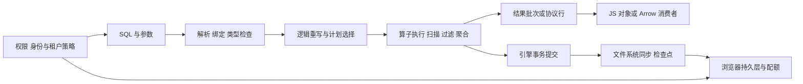

# 浏览器 SQL 引擎：查询计划、结果物化与持久化边界

设想一个离线报表页要筛选 20 万行本地数据。`SELECT` 语句看起来只有一行，但成本可能来自 Wasm 执行、Arrow 到 JS 的对象转换、主线程渲染、OPFS 检查点或两个标签争锁。优化 SQL 之前，先找出数据在哪一层被扫描、复制、物化和持久化。

本章关注数据库引擎与浏览器存储的接缝，不重复 [IDB 事务与缓存](deep-dive/storage-service-worker-idb.md)、[Wasm 线性内存基础](wasm-js-interop-memory.md)和[通用 Wasm 性能模型](wasm-when-to-use-performance.md)。

## 1. 是什么：SQL 不会直接变成一张表

下图追踪一次查询跨越的边界。每次边界都可能改变表示形式、调度方式或故障语义。



读图时把执行路径 D→E→F 与持久化路径 D→G→H→I 分开。一次 SQL `COMMIT` 不等于数据已经落到稳定介质；一次 `query()` 返回也不表示调用方没有把批次转成庞大的对象数组。

| 引擎 | 查询/执行侧心智模型 | 结果与持久层线索 |
| --- | --- | --- |
| PGlite | PostgreSQL 编译到 Wasm，保留 PostgreSQL SQL/规划器/执行器语义的嵌入式实例 | JS API 使用扩展 PostgreSQL wire protocol；浏览器文档示例用 `idb://` 持久化，默认构造则是内存实例 |
| DuckDB-Wasm | 面向分析的向量化/列式查询引擎，常与 Parquet、Arrow 配合 | `query()` 聚合成 Arrow Table；`send()` 按 RecordBatch 懒取；OPFS 需要明确 checkpoint |
| SQLite Wasm | SQLite 虚拟机执行字节码，访问方式由 VFS（虚拟文件系统）接到存储 | `EXPLAIN QUERY PLAN` 看高层扫描；OPFS 的 VFS 选择决定 worker、锁和多标签取舍 |

这些是阅读入口，不代表三个系统内部运算完全同构。PGlite 的 API、SQLite 的 VDBE 和 DuckDB 的向量化执行必须分别看官方材料与固定源码。[PGlite API](https://github.com/electric-sql/pglite/blob/d9eadc63cf16db6d40fd13b5cf2c06e2e645fbd9/docs/docs/api.md) · [DuckDB-Wasm 查询](https://duckdb.org/docs/current/clients/wasm/query) · [SQLite VDBE](https://www.sqlite.org/vdbe.html)

## 2. 为什么：查询延迟是多段成本，不是一个“SQL 时间”

一次列表查询可以拆成解析/绑定、优化、执行、结果传输、JS 处理与绘制。引擎 profile 中的执行耗时通常不包含你的 JSON 映射、React 更新或布局；端到端观测必须从用户动作起，到结果可交互止。

### 五层递进：从现象到边界

1. **现象：** 返回 10 行的查询可能很快，也可能因无索引扫描大表、等待锁或把全部结果变成对象而慢。
2. **规则：** 引擎根据谓词、统计信息、可用索引、排序和预期行数选择计划；结果 API 决定一次收集还是流式消费。
3. **机制：** 计划是算子树：扫描产生数据，过滤/投影减少数据，连接/聚合重排或汇总，最顶层节点交付结果。
4. **实现：** 查 `EXPLAIN`/`EXPLAIN ANALYZE` 或 SQLite `EXPLAIN QUERY PLAN`，再分别计时执行与结果映射。
5. **边界：** 小表顺序扫描可能比索引访问划算；解释计划的文本格式通常不是稳定 API；某个引擎中的好计划不保证另一个引擎同样选择。

PostgreSQL 的 `EXPLAIN` 树包含扫描、连接、聚合等计划节点；估算行数来自统计信息，估算不准会影响成本比较。[PostgreSQL EXPLAIN](https://www.postgresql.org/docs/current/using-explain.html) 和[统计信息说明](https://www.postgresql.org/docs/current/planner-stats-details.html)。SQLite 明确把 EQP 输出定位为交互调试信息，格式可能随版本改变，应用不能依赖其文本解析。[SQLite EQP](https://www.sqlite.org/eqp.html)。

### 谓词下推与索引：减少“进入后续阶段”的数据

谓词下推是尽可能把 `WHERE` 条件交给扫描源处理，让不匹配的行/块不要经过更昂贵的上层算子或跨边界传给 JS。它能否发生取决于表达式、数据源能力和查询计划；“写了 WHERE”不等于必定少读数据。

DuckDB 自动维护 zonemap（min/max 区间）以跳过不可能匹配的 row group；数据按过滤列有序时，区间更可能排除整组。ART 索引适合部分高选择性的单列查询，但维护索引会增加写入和内存成本，官方文档指出它并不加速 join、aggregation、sorting。[DuckDB indexing](https://duckdb.org/docs/guides/performance/indexing)。

SQLite 的 EQP 中 `SEARCH` 表示只访问行子集，`SCAN` 表示扫描（即使扫描顺序由索引定义，仍可能显示 `SCAN`）。检查索引名、覆盖索引、WHERE 使用项和嵌套循环顺序；不要把 `SEARCH` 标签当性能保证。[SQLite EQP](https://www.sqlite.org/eqp.html)。SQLite 官方建议用 `PRAGMA optimize` 作为统计信息维护入口，并说明从 3.46.0 起它会限制分析工作以快速完成。[PRAGMA optimize](https://www.sqlite.org/pragma.html#pragma_optimize)。

PGlite 基于 PostgreSQL，不应因运行在浏览器就另造一套索引直觉。对实际数据看 `EXPLAIN (ANALYZE, BUFFERS)`（能力和输出以具体构建支持为准），核对估算/实际行数、过滤前后行数、计划节点与缓冲访问。`EXPLAIN ANALYZE` 会执行语句；不要对有副作用的写入随手运行，可在事务后回滚或使用只读副本。[PostgreSQL EXPLAIN 注意事项](https://www.postgresql.org/docs/current/using-explain.html)。

### 结果物化与跨边界表示

DuckDB-Wasm 的 `query()` 返回完整 Arrow Table，`send()` 才以 RecordBatch 流式交付；官方建议大结果优先考虑后者。把 Arrow Table 调用 `toArray().map(row => row.toJSON())` 会创建 JS 行对象，可能同时持有 Arrow buffers 与对象数组。不要将 Arrow、Wasm、JS 之间的“零拷贝”当 API 保证：数据类型转换、对齐、生命周期和具体 API 都可能需要分配或复制。[DuckDB query](https://duckdb.org/docs/current/clients/wasm/query)。

PGlite 查询默认把行转为字段名对象，也可选数组行；参数通过 PostgreSQL extended protocol 编码。减少列数、分批取结果、在数据库端聚合，通常比先生成全量 JS 对象再过滤更值得优先检查。固定源码可从 [PGlite `pglite.ts`](https://github.com/electric-sql/pglite/blob/d9eadc63cf16db6d40fd13b5cf2c06e2e645fbd9/packages/pglite/src/pglite.ts) 追踪 query mutex、协议解析和 filesystem sync；这些源码细节不应直接外推为所有版本/后端契约。

## 3. 怎么样：定位查询、结果和存储各自的问题

### 先决定返回数据形状

| 工作负载 | 首先比较的返回方式 | 需要测的量 |
| --- | --- | --- |
| 小型设置面板 | 少量行转 JS 对象 | 查询+类型解析+组件更新时间 |
| 表格滚动/虚拟列表 | 有界分页或批次 | 首批可交互时间、峰值内存、滚动丢帧 |
| 全量分析 | 引擎内聚合/过滤，再流式 batch | 读取 row group、batch 数、转换与下游消费时间 |
| 导出文件 | 由数据库端 COPY/写文件 | 文件生成、落盘 checkpoint、导出到下载缓冲的峰值 |

在 SQL 层设置 `LIMIT` 不必然解决扫描成本：没有可用过滤索引时仍可能读取大量数据；但它可以限制结果物化和 UI 的数据量。Keyset 分页需有稳定排序键，并使用上次键作为边界；大 OFFSET 往往仍需跳过前面的结果。

### 再检查计划，而非盲目加索引

每个索引都要回答三个问题：常用谓词是否匹配它的前缀/列顺序？该谓词是否足够选择性？读查询节省是否抵过写维护和内存？DuckDB 的 ART 与 SQLite 的 B-tree 行为不同；不能把“有索引”翻译成“每次都走索引”。

对于列式分析，先投影所需列并过滤，再把列式 RecordBatch 交给后续计算，避免过早逐行对象化。对于点查/OLTP，关注主键与复合索引、事务边界和热点竞争。具体执行器实现差异需要对照固定版本，而不是凭“Wasm 快/SQLite 小”作结论。

### IDB 与 OPFS：存储层不等于数据库层

IndexedDB 是浏览器提供的对象存储事务 API；OPFS 是 origin 私有文件系统接口。数据库可以构建自己的文件系统适配层，但“数据在同源”不说明它们共享同一种锁、原子性或回收方式。更完整的 IDB 事务、版本升级与配额基础见[浏览器存储章节](deep-dive/storage-service-worker-idb.md)。

PGlite 的浏览器持久化路径需单独看：该项目文档展示以 `idb://` FS 后端保存数据库；它不是本实验中的 Node 内存实例，也不能因为 SQLite/DuckDB 文档讨论 OPFS 就推导 PGlite 使用同一个文件/VFS 路径。核对固定版本的 PGlite Browser guide、FS 实现和部署测试，分别验证 SQL transaction rollback 与重新打开后恢复；本页没有运行 IDB 或 OPFS 持久化实验。[PGlite 固定源码 README](https://github.com/electric-sql/pglite/blob/d9eadc63cf16db6d40fd13b5cf2c06e2e645fbd9/README.md)。

| 维度 | IndexedDB | OPFS |
| --- | --- | --- |
| API 模型 | object store、key/range、事务作用域 | 文件/同步访问句柄，由引擎 VFS 管数据库文件 |
| 数据布局 | 适合应用对象与显式事务 | 适合复用 SQLite/DuckDB 等文件布局；文件锁由 VFS/宿主协调 |
| Worker | 可从 Worker 使用；浏览器 API 异步 | SQLite Wasm 的 OPFS 同步访问路径要求 Worker；DuckDB-Wasm async API 已在 Worker 中运行 |
| 并发 | IDB 事务调度不等于多个 SQL 实例安全共用数据库文件 | 取决于 VFS、锁模式、浏览器 API 与连接寿命；必须检查引擎文档 |
| 持久性 | durability 是事务选项/提示，不是对物理硬件永不丢失的绝对承诺 | 引擎可能还需 journal/WAL、checkpoint、flush 和关闭句柄 |

IndexedDB 规范暴露 `default`、`strict`、`relaxed` durability 选项，但底层持久化承诺仍受浏览器与操作系统实现约束。[IndexedDB 3.0](https://www.w3.org/TR/IndexedDB-3/)。Storage Standard 定义持久存储与配额估算 API；配额不是应用可以预设为固定常数的硬盘空间。[Storage Standard](https://storage.spec.whatwg.org/)。

### 多标签：先选唯一所有者，再谈并发

多个标签直接创建同一存储路径的引擎实例，可能造成打开失败、写锁等待、`SQLITE_BUSY`、陈旧视图，甚至违反后端约束。优先考虑一个 Worker/SharedWorker 拥有数据库，标签通过消息传递请求查询；如确需多实例，确认具体 VFS/引擎支持、锁策略、关闭时机和失败重试。

SQLite 官方 OPFS 文档区分 `opfs`、`opfs-wl`、`opfs-sahpool`：`opfs-wl` 借 Web Locks 协调并依赖 `Atomics.waitAsync()`；`opfs-sahpool` 面向不同的访问句柄池取舍，无法提供库级透明并发。官方文档特别提醒，多标签支持依具体 VFS 而定；WAL 在该 Wasm/OPFS 环境中也不自动带来并发收益。[SQLite Wasm persistence](https://sqlite.org/wasm/doc/tip/persistence.md)。这是会随浏览器/SQLite 版本变动的能力，选型时要核对部署目标。

DuckDB-Wasm 的 OPFS 文档要求显式 `CHECKPOINT` 刷新数据；文件句柄由一个 handle 持有时，另一数据库实例需要先通过 `dropFile()`/`dropFiles()` 释放注册文件。[DuckDB-Wasm instantiation](https://duckdb.org/docs/current/clients/wasm/instantiation)。不要把“连接对象不同”当作“文件锁互不影响”。

### 事务、迁移、配额与回收是四个问题

把“写入成功”拆成至少四个时刻：SQL 事务原子提交；引擎日志/文件系统同步；浏览器存储 API 确认；设备/浏览器崩溃后恢复。调用返回的具体保证看产品、FS/VFS、durability 配置和版本。PGlite 的 API 文档区分 relaxed durability 下的存储 flush 等待语义；不要从 SQL `COMMIT` 单独推断浏览器断电级持久保证。[PGlite API](https://github.com/electric-sql/pglite/blob/d9eadc63cf16db6d40fd13b5cf2c06e2e645fbd9/docs/docs/api.md)。

迁移至少包含一个引擎 schema version、一组按序迁移和迁移锁/单一所有者策略。让每个步骤幂等或在同一 SQL 事务里原子完成；升级失败需保留旧版本可恢复路径。IndexedDB 自己的 object store/versionchange 与 SQL 表迁移是两层版本，不能用一个版本号自动替代另一个。

配额应作为运行期可观测值处理：估算空间、处理写入失败、保留可恢复备份/导出选项，并避免将易重建缓存与用户唯一数据混放。`navigator.storage.persist()` 是请求持久化资格，不是无限配额或绝不驱逐的承诺；私密浏览、设备空间与浏览器策略也会改变可用行为。删除行不必然立即缩小数据库文件，具体 vacuum/compact/checkpoint 能力按引擎版本执行，并在产品中提供可中断的恢复流程。

## 4. 手写机制：一个查询生命周期的简化模型

下面是**示意代码：未通过自动验证**。它只表达“先减小数据库返回量、再有界消费批次”的结构，不是 PGlite、DuckDB-Wasm 或 SQLite 的可复制产品 API。

```text
function runReport(connection, filters, batchConsumer):
    plan = prepare(SQL with parameter placeholders)
    inspect plan against representative data
    cursor = execute(plan, filters)
    while batch = cursor.nextBatch(maxRows):
        batchConsumer(batch)  // 不累积成一个无界 JS 数组
    close cursor and connection resources
```

1. 参数占位符把数据值与 SQL 语法分离，但不能授权调用者访问某租户。
2. 检查计划要用有代表性的数据分布；空表与生产表可能选择不同计划。
3. 批次消费让峰值内存受批次大小影响，消费者若把批次全部缓存，仍会回到 O(总结果) 内存。
4. 资源关闭释放 statements、连接或文件句柄；持有未 reset 的 statement 可能继续占用 SQLite 锁。

## 5.真实项目：选引擎前把使用模式说清

### PGlite / ElectricSQL

[PGlite](https://github.com/electric-sql/pglite) 将 PostgreSQL 嵌入 JS/Wasm 运行时，适合需要 PostgreSQL 兼容 SQL、本地事务或同步产品组合的场景。它并没有因此自动提供服务器身份、远端授权或跨设备同步；ElectricSQL 的[同步文档](https://electric-sql.com/docs)与本地数据库本身是不同系统层。查询实验使用参数而非拼接字符串，但数据库隔离仍需服务端验证租户。

### DuckDB-Wasm

[DuckDB-Wasm](https://github.com/duckdb/duckdb-wasm) 以浏览器内分析为目标，Arrow 是导入/结果的重要数据协议。用 `send()` 让下游按批次处理，避免为了“方便”把整个结果对象化；若使用多线程 bundle，需要 cross-origin isolation 与对应 Worker/SharedArrayBuffer 条件，且官方当前将线程能力标注为实验性。[Wasm 故障排查](https://duckdb.org/docs/current/clients/wasm/troubleshoot)。

### SQLite Wasm

[SQLite Wasm](https://github.com/sqlite/sqlite-wasm) 将 SQLite API 与 VFS 分开，浏览器持久化由具体 VFS 连接到 OPFS。部署时需选择目标浏览器、worker 模型和多标签行为；项目选择一个 VFS 不能视为跨版本永久承诺。想先学 IDB 事务而不涉及 SQL 文件引擎，可对照本地[本地优先同步与恢复](../engineering/local-first-sync-crdt.md)。

## 6. 误区与安全边界

| 误区 | 修正 |
| --- | --- |
| 有索引就一定更快 | 低选择性、小数据、额外排序/回表和维护成本都可能让顺序扫描更合算；读计划并量真实工作负载。 |
| `COMMIT` 返回等于数据永不丢 | SQL 原子性、文件同步、浏览器持久层与物理介质是分开的保证。 |
| 用 IndexedDB 保存 SQL 数据就获得多标签事务 | IDB 事务调度不等于引擎文件格式支持多实例并发。 |
| SQL 参数化就完成租户鉴权 | 参数化防止值被当 SQL 语法解析；攻击者仍可提交另一个 tenant ID。 |
| 本地库可作为权限权威 | 用户能改浏览器存储与客户端代码；服务端必须按已认证主体校验租户、行级授权及写入不变量。 |
| Wasm 使数据天然零拷贝/安全 | ABI 转换会分配；Wasm sandbox 不限制宿主暴露的 API，错误的宿主桥接仍可越权。 |

客户端 SQL 过滤可以降低误显示与传输量，但不能代替服务端租户鉴权、行级权限、撤权和审计。不能把客户端提交的 `tenant_id` 当成授权证据；服务端应由认证上下文确定主体并把授权条件纳入受控查询或数据库策略。参数化示例只证明输入不作为 SQL 语法解释，不证明请求者有权看数据。

## 7. 真实验收：固定脚本验证事务与参数边界

仓库已有的教学实验只在 **Node 24.16.0 + PGlite 0.5.8 内存实例**运行。它验证 CHECK 约束触发事务回滚、keyset 查询结果、参数绑定不会把注入字符串解释为 SQL；不验证浏览器、IDB、OPFS、多标签、持久化耐久性、配额或性能。页级 `runnable: true` 指的就是这条确实运行过的仓库脚本，不代表文中所有产品 API 示例已执行。

在集成实验目录运行：

```sh
node pglite-transactions.mjs
```

观察输出：

```text
PGlite 0.5.8: rollback, keyset query, parameterization: PASS
```

| 验收项 | 输入/命令 | 通过阈值 | 失败证据 | 清理 |
| --- | --- | --- | --- | --- |
| 回滚 | 事务中先插入合法行，再插入违反 `CHECK(total >= 0)` 的行 | promise reject，后续 count 仍为 3 | 断言失败或 count 不为 3 | `finally` 中 `db.close()`；仅内存数据 |
| 查询 | tenant=`a`、id 大于 1、上限 10 | 只返回 id 2 | 返回集合不同或断言退出非零 | 同上 |
| 参数绑定 | 将 `a' OR 1=1 --` 作为参数 | 查询返回 0 行 | 若扩大结果或 SQL 报错则不通过 | 同上 |

已在本任务工作目录实际执行：`node pglite-transactions.mjs`，结果如上；`node --version` 为 `v24.16.0`，`npm ls --depth=0` 显示 `@electric-sql/pglite@0.5.8`。阈值是行为断言全部通过且退出码 0。调试时先检查脚本中的断言和数据库错误；不要通过放宽断言让它变绿。脚本创建内存实例，并在 `finally` 关闭，没有持久文件需删除。

## 8. 面试回答

### 30 秒

浏览器 SQL 的端到端成本不止查询执行，还包括计划选择、结果物化、JS/Wasm 边界和持久化 flush。我会先看引擎计划，尽早做投影/过滤，按结果 API 选择对象化或 Arrow batch；多标签能力和 durability 则按具体 VFS/版本确认。客户端 SQL 只是本地数据层，不能替代服务端租户授权。

### 2 分钟

比如离线分析页，我会先按完整链路拆分点击到可交互的时间：解析和计划、scan/filter/aggregate、结果 batch 生成、JS 转换和 UI 消费，另测事务提交到 checkpoint/恢复的时间。DuckDB-Wasm 适合列式与 Arrow 数据流，`send()` 可避免一次性物化全部查询结果；SQLite Wasm 要选 OPFS VFS 并验证 Worker、浏览器和多标签锁；PGlite 提供 PostgreSQL 兼容本地引擎但其同步/持久存储是另一层。索引依选择性、排序与更新成本衡量，不以“创建成功”代替计划检查。真实验收要固定数据、运行 EXPLAIN 和端到端测量，记录峰值内存与首批输出；浏览器崩溃恢复和并发必须在目标浏览器单独测试。授权始终由服务器验证，客户端 tenant 条件只是一项过滤条件。

## 9. 自测

??? question "1. `WHERE account_id = ?` 为什么不能单独证明查询是高效的？"
    答：需要看实际计划与选择性。没有索引、统计不准或过滤不能下推时，仍可能扫描大部分数据；另需量结果对象化成本。

??? question "2. DuckDB-Wasm 的 `send()` 与 `query()` 核心差别是什么？"
    答：前者懒取 Arrow RecordBatch，后者完整物化 Arrow Table。下游若再收集所有 batch，峰值内存仍会随总结果增长。

??? question "3. SQL 事务提交成功后，浏览器崩溃一定能恢复吗？"
    答：不能仅从 COMMIT 推出该保证。要核对引擎 journal/flush/checkpoint、VFS、浏览器持久性和设备故障边界。

??? question "4. 两个标签打开同一个 OPFS 数据库会怎样？"
    答：取决于具体引擎 VFS 和锁策略，可能排队、BUSY 或打开失败。先看目标版本官方文档，实测竞争与恢复，不推断 IDB 与 OPFS 等价。

??? question "5. 参数绑定后，客户端 SQL 是否就能安全处理多租户数据？"
    答：不能。绑定只分离数据值和 SQL 语法；客户端可修改参数，服务端仍需从可信认证上下文决定租户并执行授权校验。

## 10. 深入阅读

- [PGlite API（固定提交）](https://github.com/electric-sql/pglite/blob/d9eadc63cf16db6d40fd13b5cf2c06e2e645fbd9/docs/docs/api.md)：核对参数协议、返回行模式、filesystem 和 durability 配置。
- [PGlite 实现（固定提交）](https://github.com/electric-sql/pglite/blob/d9eadc63cf16db6d40fd13b5cf2c06e2e645fbd9/packages/pglite/src/pglite.ts)：从 `query()` 入口跟到协议消息、串行化与 FS 同步；和该提交包含的 PostgreSQL 子模块一起读，避免把 JS 门面误认为 planner。
- [DuckDB-Wasm 查询文档](https://duckdb.org/docs/current/clients/wasm/query)：比较全量物化、Arrow 流与 prepared statement；版本行为需在项目锁文件核对。
- [DuckDB-Wasm 源码树（固定提交）](https://github.com/duckdb/duckdb-wasm/tree/448ec38a52238ad2aacde514f0ee3acfd9515b6c/packages/duckdb-wasm)：从 JS API 与 worker/RPC 入口追踪 query/send；核心 optimizer/executor 不在 Wasm 客户端仓库，应继续读 DuckDB 引擎源码。
- [DuckDB 物理计划生成器（源码入口）](https://github.com/duckdb/duckdb/blob/main/src/include/duckdb/execution/physical_plan_generator.hpp)：查看逻辑算子如何映射为物理算子；链接使用上游 main，阅读时应按项目锁定的 DuckDB 子模块/版本切换到对应提交。
- [DuckDB-Wasm OPFS 与实例化](https://duckdb.org/docs/current/clients/wasm/instantiation)：理解 worker、`CHECKPOINT`、文件句柄所有权。
- [SQLite Wasm persistence](https://sqlite.org/wasm/doc/tip/persistence.md)：根据目标浏览器挑 VFS，并阅读并发限制与 WAL 说明。
- [SQLite Wasm 源码树（固定提交）](https://github.com/sqlite/sqlite-wasm/tree/b30a8a19cab9a7928ac6b44bbc91f0b65e56324d)：从 JS wrapper、worker 与 OPFS VFS glue 阅读宿主边界；SQL planner/VDBE 主体应对照同一 SQLite release 的核心源代码。
- [Storage Standard](https://storage.spec.whatwg.org/) 与 [IndexedDB 3.0](https://www.w3.org/TR/IndexedDB-3/)：区分持久化资格、配额估算、事务原子性和 durability 提示。
- [本地优先与协同同步](../engineering/local-first-sync-crdt.md)：将本地数据库、同步队列、恢复和服务端权限连成完整系统。
- [Wasm 线性内存与 JS 互操作](wasm-js-interop-memory.md)：回看视图、拷贝和宿主 ABI 的基础，不把零拷贝作为默认假设。
