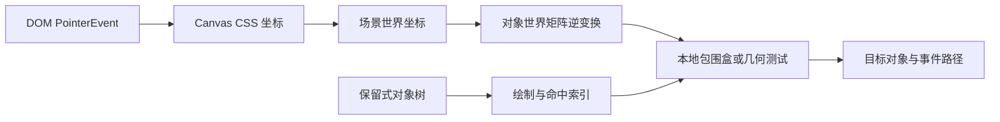

# Canvas 场景图与命中测试：从绘制列表到逆矩阵

Canvas 2D 上画一张图很直接；当图中每个对象都要拖动、选中、分组、缩放和键盘访问时，问题会转成“谁拥有对象状态、谁重绘、屏幕点如何映射回对象”。已有 [Canvas/WebGL 基础页](canvas-webgl-pipeline.md) 讲即时绘制和 DPR，本页沿用这些概念，进一步构建可交互的保留式模型。

## 心智模型

下图表示一次指针命中的完整路径：屏幕坐标先进入场景坐标，再经对象世界矩阵逆变换回本地几何。



## 逆变换中的退化矩阵 {#handwrite-canvas-singular}

点击命中要把画布坐标逆变换到节点本地坐标。缩放矩阵的行列式为零时没有逆矩阵，直接除以行列式会得到 `Infinity` 或 `NaN`，所以实现应把它作为“不可命中”处理。[MDN：CanvasRenderingContext2D.getTransform](https://developer.mozilla.org/en-US/docs/Web/API/CanvasRenderingContext2D/getTransform)

[`canvas-transform.mjs`](https://github.com/Shyu-x/frontend-interview/blob/c1a7d0be48d2601aa4d71b303fbc08921e77235d/scripts/implementation-labs/systems/canvas-transform.mjs) 接受 Canvas 的 `[a,b,c,d,e,f]` 顺序，`inversePoint` 在行列式接近零时返回 `null`，`hitTestRect` 再用本地矩形判断。运行 `node --test scripts/implementation-labs/systems/canvas-transform.test.mjs`，其中旋转和奇异矩阵两个用例能区分“屏幕轴对齐框”与“节点局部几何”。

实现时先从 pointer event 得到 CSS 像素，再除以 DPR 得到 backing-store 坐标；之后减去对象平移并乘以 2×2 线性部分的逆矩阵。父子场景图要把父节点矩阵与局部矩阵按约定次序相乘，然后对组合矩阵求逆。最后在本地矩形做边界比较，因此旋转过的对象也能准确命中。矩阵乘法次序错了会出现“绘制在一个位置、点击命中却在另一个位置”的症状。

```js
const det = a * d - b * c;
if (Math.abs(det) < 1e-12) return null;
const dx = screenX - e;
const dy = screenY - f;
const localX = (d * dx - c * dy) / det;
const localY = (-b * dx + a * dy) / det;
return rect.x <= localX && localX <= rect.x + rect.width
  && rect.y <= localY && localY <= rect.y + rect.height;
```

验收按 identity、缩放加平移、旋转三组矩阵逐一执行，再将 `scaleX=0` 传入。前三组分别命中和落空的坐标要符合手算结果；最后一组返回 miss，不能靠 `NaN` 比较偶然落空。

1. Canvas 只持有最终位图；场景图由应用维护对象、父子关系、局部矩阵和交互属性。
2. 绘制通常按树遍历输出命令；命中测试反向使用同一组坐标变换。
3. 最上层绘制对象通常优先命中，因此候选顺序应与层级和 z-order 一致。
4. 可访问性与键盘语义仍需 DOM companion layer，位图不会自动成为一组可聚焦控件。

## 1. 现象：Canvas 画出来的矩形不会自动收到 click

浏览器事件命中的是 `<canvas>` 元素，不是此前调用 `fillRect` 的那个概念对象。对象身份只能由应用自己的数据结构恢复。

Canvas immediate mode 与 retained mode 的区别在于应用是否保留场景描述，而不是“GPU 是否记住图形”。即时 API 可以由应用保留数据对象；保留式也可以最终绘制到 Canvas 位图。

| 模型 | 状态归属 | 局部更新 | 命中与语义 |
|---|---|---|---|
| immediate drawing | 应用在每帧发绘制命令 | 常清屏重画 | 应用另写空间索引与目标选择 |
| retained scene graph | 对象树保留 transform/style/bounds | 标记脏节点或脏区域 | 对象可参与自定义事件路径；语义仍需 DOM |
| SVG DOM | 浏览器维护元素树 | DOM/CSS 更新 | 原生元素事件、焦点及语义可用 |

## 2. 规则：定义坐标空间，避免混用

一次指针位置可能涉及四种空间：viewport CSS 像素、canvas content box CSS 像素、Canvas backing-store 像素、对象局部坐标。DPR 只负责 backing-store 分辨率，不应重复乘进 pointer CSS 坐标。

Canvas 内容尺寸随 CSS 尺寸和 DPR 调整；CSS transform、边框、滚动和页面缩放会影响简单 `clientX - rect.left` 的适用性。若 Canvas 本身经过旋转或斜切 CSS transform，需要使用 DOMMatrix 逆变换，且先明确 content box 与 border box。

没有 CSS transform、且画布没有额外 border/padding 时，常见换算是：

示意代码：未通过浏览器自动验证。它只适用于矩形 CSS 映射，且结果是 backing-store 像素；若场景采用逻辑 CSS 像素，还需执行文中所述的单位转换。

```js
const rect = canvas.getBoundingClientRect();
const logical = {
  x: (event.clientX - rect.left) * canvas.width / rect.width,
  y: (event.clientY - rect.top) * canvas.height / rect.height,
};
```

该换算把 CSS 像素映射到 backing-store 像素。如果场景坐标使用逻辑 CSS 像素，仍要除去 DPR/画布比例，或统一规定场景坐标就在逻辑画布单位。不要把这个公式套用到旋转/斜切后的 bounding rect：轴对齐包围盒不能反推出原始局部点，需要把 CSS transform matrix 逆变换也纳入映射。

pointer event 的 `clientX/clientY` 与 `getBoundingClientRect()` 都是 viewport CSS 坐标，滚动页面时仍处在相同坐标系；`pageX/pageY` 带页面滚动偏移，混用会产生滚动量误差。CSS 缩放导致 `rect.width` 与 backing-store ratio 不为 1 时，按两者比例映射。

对象局部矩阵可表示平移、旋转和缩放。矩阵复合顺序不是可交换的：先平移再旋转与先旋转再平移会产生不同位置。

若矩阵 determinant 为 0（例如某个缩放轴为零），逆矩阵不存在，不能执行通常的 local hit test。实现需要定义此类对象是否不可命中、命中退化线，或改由父节点负责；不要把 `Infinity/NaN` 坐标继续传入 bounds 判断。

## 3. 机制：反向变换命中

屏幕点要命中一个带旋转/缩放的矩形，不能直接对其轴对齐屏幕 bounds 做逻辑判断。做法是把点乘对象 world matrix 的逆矩阵，恢复到对象自己的局部空间，再测本地包围盒。

脚本使用 Canvas 的六参数仿射矩阵布局，涵盖可逆检查和点变换。下面的 `containsLocalPoint` 是已在完整实验中运行的算法摘录；参数 `worldPoint` 已处于场景世界坐标，屏幕到场景的相机/Canvas 转换需要先完成。完整实验在仓库 `scripts/content-labs/graphics/scene-hit-test.mjs`。

```sh
node scripts/content-labs/graphics/scene-hit-test.mjs
```

无需安装第三方依赖；运行时为 Node.js 24.16.0，自动断言命令与运行命令相同。若失败，先检查终端断言位置；奇异矩阵应抛出 `RangeError`，若命中测试失败则检查矩阵参数是否按 `[a,b,c,d,e,f]` 顺序传入。

预期输出：`scene hit-test assertions passed`。实验用断言验证旋转缩放后的中心点命中、远处点不命中，以及奇异矩阵被拒绝；它验证 CPU 算法，不验证浏览器事件投递或 GPU 性能。

```js
function containsLocalPoint(inverseWorld, worldPoint, bounds) {
  const local = transformPoint(inverseWorld, worldPoint.x, worldPoint.y);
  return local.x >= bounds.x && local.x <= bounds.x + bounds.width &&
    local.y >= bounds.y && local.y <= bounds.y + bounds.height;
}
```

对象很多时，逐对象逆矩阵和几何判断为 O(n)。可先用屏幕空间 AABB、均匀网格、四叉树或 R-tree 筛候选，再按逆矩阵精确测试；空间索引只减少候选，不能替代前后遮挡和命中语义。

## 4. 实现：最小 retained scene

最小节点通常至少保留 id、parent、local transform、world transform、local bounds、visible、pointerEvents、z-order 和绘制/命中行为。world transform 在父矩阵变化后失效；用版本号或 dirty flag 沿子树传播，避免每次查询都从根重算。

```js
function updateWorld(node, parentWorld, parentVersion) {
  if (node.localVersion !== node.cachedLocalVersion ||
      parentVersion !== node.cachedParentVersion) {
    node.world = multiply(parentWorld, node.local);
    node.inverseWorld = invert(node.world);
    node.cachedLocalVersion = node.localVersion;
    node.cachedParentVersion = parentVersion;
    node.worldVersion++;
  }
  for (const child of node.children) {
    updateWorld(child, node.world, node.worldVersion);
  }
}
```

示意代码：未通过自动验证。此片段假定矩阵乘法、树结构和缓存字段已定义；用于说明失效传播，不是可直接运行的场景引擎。

事件模型要明确 capture、target、bubble 是否存在，停止传播是否影响兄弟节点，pointer capture 在拖动出画布后由谁释放。原生 DOM `setPointerCapture()` 作用于 DOM 元素；Canvas 内部对象的 capture 需要场景系统自己维护对象引用。

## 5. 脏矩形与重绘

全屏重绘简单且容易正确，但当画布像素面积巨大、只有小部分变化时，可以维护 dirty region。若对象从旧 bounds 移到新 bounds，两处都必须重绘：旧位置区域擦除，新位置区域画入。透明合成、阴影、滤镜和对象重叠会扩大所需脏区。

多个矩形可合并；若合并后的面积接近整个画布，整帧重绘更合适。不能用固定对象数阈值断言哪种方式更快，应在目标设备记录每帧 CPU 时间、重绘像素面积和合成成本。

Canvas resize 会清空位图并重置 context state，因此 resize 流程必须重设 transform、裁剪和样式，再全量 redraw。DPR 变化也可能在窗口移动到另一块屏幕或浏览器缩放时发生，不能只在初始化读一次。

脏区裁剪还要求绘制代码可在 clip 内正确重建最终像素。若 dirty rectangle 与对象跨越区域相交，必须重绘所有与区域相交且在 z-order 上位于擦除位置之上的对象；只重画“本帧变更对象”会把未变更但被清空的重叠对象一起擦掉。抗锯齿边缘需要给 dirty bounds 加像素余量，余量大小应由 stroke width、shadow blur 和滤镜范围推导。

## 事件、无障碍与 OffscreenCanvas 边界

- Canvas 可在 DOM 上接一个 pointer listener，再把事件映射到场景对象；不要为数万个图形各挂 DOM listener。
- 保留 DOM 中可聚焦的工具条、列表或隐藏语义节点；提供方向键/Tab 导航、名称、角色和选中状态。Canvas 位图本身不是可访问性树。
- `OffscreenCanvas` 可把绘制工作交给 Worker（在支持的上下文中），但不会自动把 DOM PointerEvent、布局测量和焦点搬到 Worker。主线程仍要转发必要的输入与尺寸。
- 把大对象树每帧完整 structured clone 到 Worker 会增加通信成本；优先发送紧凑变更、共享数据视具体 API 和隔离要求而定。
- Worker 上下文不可读取 DOM；字体加载、图像解码和输入协调需要设计清楚。具体支持能力应查目标浏览器版本与 MDN/HTML 标准，不用功能检测替代降级路径。

场景对象的事件路径也要考虑对象销毁：pointerdown 命中对象后若对象在 pointerup 前从树中删除，capture target 应清理；拖动期间重新排序或变换父节点时，后续 pointermove 坐标应基于最新 world transform 计算。触控输入要处理 pointercancel，因为浏览器接管滚动/缩放后不一定收到正常 pointerup。

无障碍 companion DOM 可以选择两种映射：只暴露当前选中对象的描述与键盘命令，或以虚拟列表呈现场景中可操作对象。后一种方式要管理焦点与画布视口同步，避免把百万个绘图对象全部转换成 DOM 节点。具体策略取决于对象是否具有独立业务身份和用户能否按名称搜索。

## 真实项目模式

**PixiJS** 把 DisplayObject/Container 场景组织、渲染管线和交互系统分层。可从 [PixiJS 8.14.3 固定源码](https://github.com/pixijs/pixijs/tree/65552017d23255c1442a7d4ac7f0d49e3225fb1d) 查 `src/scene/container` 与 `src/events`；学习对象树更新和事件管理，不要把版本间内部目录当稳定 API。

**Fabric.js** 把 Canvas 上的对象包装成可选择、变换、序列化的对象模型。其 [6.7.1 源码](https://github.com/fabricjs/fabric.js/tree/refs/tags/v6.7.1) 可从 `src/canvas/SelectableCanvas.ts` 与 `src/shapes/Object` 追踪 pointer 目标选择和对象变换。选择对象模型意味着需要处理对象生命周期与序列化边界。

二者都是可查证项目案例，不代表一套通用场景图在所有交互密度都更优；简单绘图仍可能以即时绘制和局部 hit map 更清晰。

## 误区与对照

| 误区 | 反例 | 修正 |
|---|---|---|
| pointer 坐标乘 DPR 后直接命中对象 | 对象坐标是 CSS/逻辑空间时坐标扩大了 DPR 倍 | 坐标转换链每一段只做一次单位转换 |
| 只测世界矩形 AABB | 旋转矩形的 AABB 会把角落空白误判成命中 | 逆变换到本地空间做精确测试 |
| 脏区只擦新位置 | 旧图像残留 | 合并旧 bounds、新 bounds 和滤镜扩张范围 |
| Worker 就能解决 Canvas 卡顿 | 主线程仍可被布局、序列化和事件处理占满 | profile 逐项确认工作真正移出主线程 |
| Canvas 自动无障碍 | 位图没有逐对象语义 | DOM companion、键盘交互与辅助技术测试 |

## 真实验收

**输入/环境：** 运行 Node 24 的纯 CPU 仿射实验，输入含旋转、非单位缩放、平移以及奇异矩阵。

**执行：** `node scripts/content-labs/graphics/scene-hit-test.mjs`。

**通过阈值：** 3 类断言全部通过，输出固定成功行；该阈值只针对数学样例。

**失败证据：** assert 的 expected/actual 或未抛出的 singular matrix 会导致非零退出。

**清理：** 无生成文件、无后台进程。

浏览器层真实验收还应在 Chromium/Firefox/WebKit 的目标版本测 CSS transform、DPR 改变、pointer capture、键盘路径与屏幕阅读器语义；该任务没有运行浏览器自动化。

额外交互用例应覆盖高 DPI 与浏览器缩放、页面滚动、鼠标/触摸/笔、pointercancel、object removal during capture、父节点旋转后子对象 hit、透明区域策略、重叠对象 topmost 选择。对脏矩形模式启用逐像素截图对照：同一输入下比较 full redraw 与 dirty redraw 的图像差异，容差单独考虑抗锯齿。

## 面试回答

**30 秒：** Canvas 命中的是画布 DOM 节点，不是绘图对象。交互场景要由应用维护对象树，把 pointer 坐标转到场景空间，再用目标对象 world matrix 的逆矩阵映回本地几何，并按绘制层级处理遮挡。

**2 分钟：** 我会保留对象、父子关系、local/world transform、bounds 和交互策略；transform 变更沿子树标脏。事件先经空间索引筛选，再逆变换做本地精确测试，按 z-order 决定 topmost target。拖动使用对象级 pointer capture，脏区覆盖旧、新 bounds 及滤镜扩张；键盘与屏幕阅读器通过 DOM companion 暴露。验收分成纯矩阵断言和真实浏览器输入/无障碍测试，不把 CPU 算法成功等同于用户交互正确。

## 自测

??? question "1. 对象变换后，为什么要用逆矩阵测试？"
    它把屏幕点恢复到对象局部坐标，让局部几何可沿用简单、准确的包含判断。

??? question "2. DPR 应乘在哪个坐标转换阶段？"
    CSS 逻辑尺寸到 backing-store 像素阶段；pointer 的 viewport CSS 坐标不要重复乘 DPR。

??? question "3. 移动对象时脏区至少包括哪里？"
    旧 bounds 和新 bounds，并为阴影/滤镜等视觉外溢扩大范围。

??? question "4. OffscreenCanvas 是否自动提供 Canvas 内对象的无障碍语义？"
    否；Worker 绘制与 DOM 可访问性树是不同职责。

## 深入阅读与源码路线

1. [WHATWG Canvas 2D](https://html.spec.whatwg.org/multipage/canvas.html)：核对 context、变换和绘制语义。
2. [MDN OffscreenCanvas](https://developer.mozilla.org/en-US/docs/Web/API/OffscreenCanvas)：核对可用上下文和 Worker 使用限制。
3. [PixiJS 固定源码提交](https://github.com/pixijs/pixijs/tree/65552017d23255c1442a7d4ac7f0d49e3225fb1d)：从 Container 变换更新跟到事件系统。
4. [Fabric.js 6.7.1](https://github.com/fabricjs/fabric.js/tree/refs/tags/v6.7.1)：从 SelectableCanvas 追踪对象查找和选择。

源码快照核验日期：2026-10-12。阅读时先看公开 API，再跟 renderer 的遍历、transform 计算、命中索引和事件分发；记录版本号，避免把内部字段误当兼容承诺。
