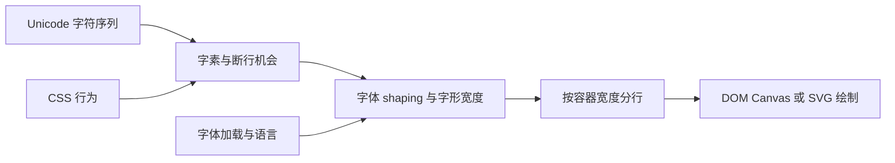
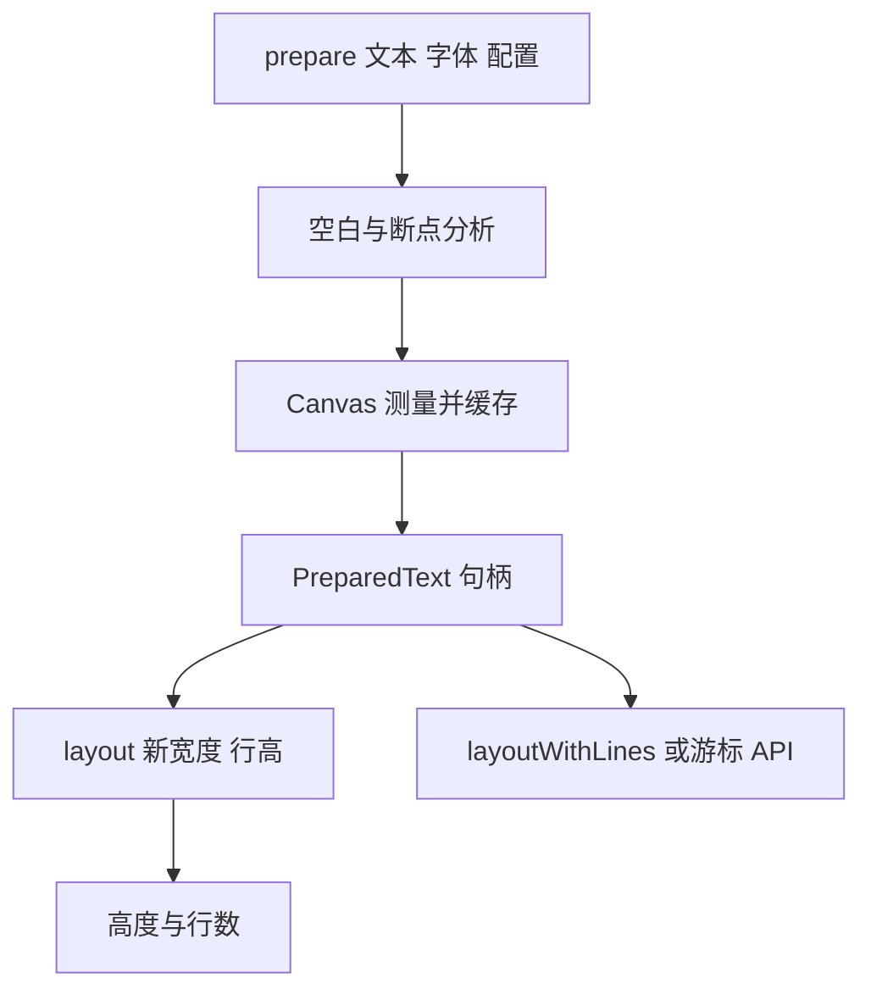

# 浏览器文本测量与 Pretext：从字素到行布局

聊天消息高度、编辑器行数和虚拟列表偏移看似只差一次 `measureText()`，实际牵涉 Unicode 分段、字体塑形、双向文字与换行规则。若用字符数乘平均宽度估高，阿拉伯文、emoji 组合符和中日韩禁则行都可能让滚动锚点漂移。

本页聚焦“测量和行布局”，不实现字体渲染引擎。文中 Pretext 指 [chenglou/pretext](https://github.com/chenglou/pretext)，源码快照锁定在 [bac1774](https://github.com/chenglou/pretext/tree/bac1774c0f8b7a92e44b9da43b6d5443d55d0d9b)。结论只覆盖该提交的 README/API 描述；浏览器平台差异仍要在目标浏览器复测。

## 心智模型：文本不是可独立计宽的字符列表

先看数据经过哪些阶段，再决定缓存放在哪里。



1. Unicode code point 不等于用户感知字符；组合附加符和 ZWJ emoji 可能由多个码点构成一个字素簇。
2. 字体 shaping 把字符序列映射为字形、位置与 advance；连字、字距和书写方向使“每字固定宽度”不成立。
3. 分行还要判断合法断点、可用宽度、空白折叠和语言相关标点规则。
4. 最后由 DOM、Canvas 或 SVG 画出结果；它们可共享字体引擎，但 API 和 CSS 规则并不等价。

## 五层递进

### 1. 现象：相同字符数会占不同高度

`WWWW` 与 `iiii` 的字符数相同，但字形 advance 不同；`e` 加组合重音符在 UTF-16 中常是两个 code unit，却通常显示为一个字形；阿拉伯文需要上下文 shaping，不能把单字分别测宽再相加。

```js
const canvas = document.createElement('canvas');
const ctx = canvas.getContext('2d');
ctx.font = '16px Arial';
console.log(ctx.measureText('WWWW').width);
console.log(ctx.measureText('iiii').width);
```

这段仅是浏览器示意代码，未在自动化浏览器执行；具体数值随字体文件、浏览器与平台变化，不把某一数值当跨平台断言。

### 2. 规则：分段、测量和断行是不同问题

| 概念 | 解决的问题 | 不能替代什么 |
|---|---|---|
| code point | Unicode 标量值 | 不能表示视觉字素边界 |
| grapheme cluster | 用户通常感知的字符边界 | 不是单字形；shaping 可重排或合并 |
| shaping | 字符到字形及位置 | 不负责整段 CSS 行断点决策 |
| line breaking | 允许在哪里换行 | 不决定目标字体的具体 advance |
| line layout | 在指定宽度下选断点与行高 | 不负责光栅化像素 |

#### 双向文字不是字符串反转

Unicode Bidirectional Algorithm 会根据强方向字符、弱方向字符、数字与嵌入控制符，解析段落方向和显示次序。阿拉伯/希伯来文中数字仍按规则保持次序，标点也可能随上下文归属到不同视觉侧；把 RTL 字符串 reverse 后再测量会破坏字素和语义。

测量库可以把整段交给浏览器 Canvas 字体系统测宽，但它仍需在“逻辑顺序字符”“断点游标”和“最终视觉 glyph run”之间维持一致性。若自行切分文本并在每行调用 `fillText()`，应对照带 `dir`、`lang` 的 DOM 行盒，检查括号镜像、数字序列、混排标点和选择方向。

#### 字素分段并不等于 shaping cluster

`Intl.Segmenter` 的 grapheme 粒度适用于按用户感知字符游标切片，但字体 shaping 可能把相邻字符合成连字，也可能在特定脚本中调整邻接 glyph 的位置。字素边界不能直接当字形边界；按字素依次量宽再求和也会丢失 kerning/ligature 等上下文。

因此，合理测量方式要在足够完整的文本片段上调用字体引擎，并把切分策略限于可以安全组合的断行片段。Pretext README 描述的是 break opportunities 分段后测量，并声明 `prepare` 的缓存句柄是不透明值。不要依赖其内部缓存结构或自己从 `PreparedText` 抽取宽度，除非该版本 API 明确公开。

Unicode UAX #29 定义默认字素簇边界，UAX #14 描述行断行算法；浏览器仍可根据语言、CSS 属性及排版上下文调整最终行为。规范是算法参考，不意味着任意 JavaScript 库完整实现浏览器排版。

`CanvasRenderingContext2D.measureText()` 返回 `TextMetrics`，主要可取 advance width；它不返回浏览器 DOM 元素完整的换行、字体回退、CSS inline box 与行高结果。若需要盒子最终高度，DOM 测量更直接，但交错读取布局可能触发同步 layout。

### 3. 机制：Pretext 把昂贵工作放在准备阶段

在固定文本和字体配置、容器宽度频繁变化的场景，先分段并缓存宽度，再只根据新宽度计算行数。



`prepare(text, font, options)` 是一次性分析和 Canvas 测量，产出不透明句柄。`layout(prepared, maxWidth, lineHeight)` 按缓存宽度做算术分行；窗口 resize 时通常只需重新 `layout`。如果每个 render 都对相同输入调用 `prepare`，就会重复其预处理成本。

API 边界来自提交内 README：

- `prepare()` / `layout()` 用于估算段落行数与高度。
- `prepareWithSegments()` 配合 `layoutWithLines()` 物化每行文本。
- `measureLineStats()` 和 `walkLineRanges()` 可读取行宽、数量、游标而不构造每行字符串。
- `layoutNextLineRange()` 适合每行宽度变化的流式布局；`materializeLineRange()` 在需要绘制内容时才生成字符串。
- `rich-inline` 子路径支持扁平化的混合字体片段与额外宽度，但不是完整 CSS inline formatting engine。

这些 API 是测量和切分工具。它们不替你绘制文字，也不意味着 Canvas 的逐行 `fillText()` 与浏览器 DOM 的 shaping / bidi 行盒逐像素相同。

### 4. 实现：先准备，再布局

以下是浏览器侧示意调用。具体 package 导出和选项应以锁定的版本及对应提交 README 为准。

```js
import { prepare, layout } from '@chenglou/pretext';

const font = '16px Inter';
const text = '订单已发货 — مرحبًا بالعالم — 你好';
const prepared = prepare(text, font, { whiteSpace: 'normal' });

function heightFor(width) {
  return layout(prepared, width, 24).height;
}

console.log(heightFor(320));
console.log(heightFor(480));
```

示意代码：未通过自动验证。它依赖浏览器 Canvas 与安装好的 Pretext 包，本页环境没有启动浏览器来验证绘制结果。

实现应把缓存键视为完整输入，而不是只用 text：

```text
cache key = 文本 + font 字符串 + letterSpacing + whiteSpace + wordBreak + lang
```

这是工程缓存建议，不是 Pretext 内部缓存格式承诺。`lang` 变化可能改变字体回退和断行；字体文件加载完成后也应重新准备文本。

#### 让缓存可失效，而不是永久存活

可以为每段测量保存一个 generation。语言、主题字体、字号或文本修改时增加 generation；虚拟行缓存项存该版本，消费时发现版本不一致就重新 `prepare`。这样避免全局逐项同步清理旧缓存，也便于把“字体尚未加载”的结果标记为低置信度。

```js
let metricsGeneration = 0;
const preparedCache = new Map();

function invalidateMetrics() {
  metricsGeneration++;
  preparedCache.clear();
}

async function waitForTypography(font, text) {
  // Canvas-only text may not trigger CSS font loading, so request this face explicitly.
  await document.fonts.load(font, text);
  await document.fonts.ready;
  invalidateMetrics();
}
```

示意代码：未通过自动验证。`FontFaceSet.load(font, text)` 显式请求与字体描述和文本匹配的字体；之后 `document.fonts.ready` 等待当前已触发的加载和布局操作完成。只等待 `ready` 不会主动加载页面尚未使用的字体；系统字体或名字拼错而回退的情形也不能仅凭 Promise resolve 证明使用了预期字形。若字体可以后续增量加载，需要在字体选择变化后主动失效，而不是只等待一次。[CSS Font Loading](https://www.w3.org/TR/css-font-loading/)

**缓存键应包含被测量环境，而不仅是视觉文本。** 可用对象化 key 再序列化，明确保存 resolved pixel size、font string、letter spacing、white-space 模式、word-break 模式、locale/lang 与字体版本。页面 CSS 改动也要进入失效策略，否则同一字符串在 DOM 与 Canvas 的上下文可能逐渐分叉。

### 5. 边界：浏览器字体状态是测量输入的一部分

`document.fonts.ready` 可用于等待当前文档字体加载流程完成；若在 fallback 字体时 prepare，随后自定义字体加载完成，旧的 `PreparedText` 不会神奇地换成新字体的 advance。需在字体状态稳定后重建准备结果，并使依赖旧度量的虚拟列表高度失效。

以下情况应做 DOM 对照测量：

1. 复杂混排依赖 CSS `font-feature-settings`、`font-variation-settings` 或 `font-optical-sizing`。
2. 文本继承 `word-spacing`、非默认 `font-kerning`、minimum font size 等 Canvas API 未覆盖的样式。
3. 页面有复杂 inline 元素、链接、图标、ruby、强制断点或完整 CSS whitespace 行为。
4. 要求屏幕阅读器语义、选区、光标与复制行为；Canvas 绘制文字没有 DOM 文本节点语义。

Pretext README 还明确指出 `system-ui` / `-apple-system` 在特定 macOS 环境存在测量差异风险，且要求运行环境支持 `Intl.Segmenter`、Canvas 2D 文本测量和 Unicode 属性转义。不要把其覆盖范围说成“完整浏览器排版”。

#### DOM、Canvas 与 SVG 的职责对照

| 能力 | DOM/CSS | Canvas 2D | SVG text |
|---|---|---|---|
| 自动换行与行盒 | CSS 排版模型原生处理 | 应用自行分行 | 默认按 SVG 文本布局规则，文本换行控制另有约束 |
| 读布局尺寸 | `getBoundingClientRect()` 反映布局后的盒子 | `measureText()` 返回字体 TextMetrics | `getComputedTextLength()` 测长度 |
| 可访问语义 | 原生文本与控件语义 | 需要 companion DOM | text 节点可保留文本语义，但复杂交互仍需设计 |
| 图层绘制 | DOM/CSS paint | 位图绘制 | 可缩放矢量元素 |
| 几何读操作 | 可能触发布局计算 | 不读 DOM 布局 | SVG geometry API 独立于 CSS 行盒 |

这不是性能优劣表：相同任务输入、浏览器实现与目标设备不同，结果也会不同。选择原则是：DOM 需要语义和浏览器排版，Canvas 需要位图高频绘制，SVG 需要可缩放独立图形；Pretext 为需要自行管理文本位置的场景提供测量/分行积木。

## 可运行实验：测量误差应与 DOM oracle 对照

本文没有将示意浏览器片段标为可运行。实际项目可以建立一个目标浏览器验收页：

1. 固定浏览器版本、操作系统、字体文件哈希、语言和 CSS 字体属性。
2. 准备覆盖拉丁连字、组合字符、阿拉伯文、CJK 标点、emoji ZWJ 的语料。
3. 对每段文本分别用 DOM 实际行盒和 Pretext 估算行数/高度，记录按语料类别统计的差值。
4. 字体加载前后各测一次，断言缓存失效后的结果与加载后 DOM 行盒相符。
5. 容差由产品布局要求定义；禁止拿一次机器输出外推到所有平台。

此验收需真实浏览器、字体资产和自动化驱动，本仓库任务未执行，故本文 `runnable: false`。

正式 benchmark 还要分别记录冷缓存 prepare、暖缓存 layout、line materialization 和 DOM oracle 的耗时，避免把字体文件加载或页面初始化混在单次 layout 数字里。输入文本至少区分 ASCII、组合附加符、emoji ZWJ、阿拉伯混排、CJK 和长 URL；报告每组 P50/P95 偏差和时长，不只给一个平均数。

### 失败诊断顺序

1. 用浏览器开发者工具检查实际应用的 computed font、line-height、letter spacing、word spacing 与 `lang`。
2. 确认字体网络请求已完成，并在 DOM 中确认目标字体确实用于这些字符，而非缺字 fallback。
3. 选择最小失败字符串并同时打印 code point 与 grapheme 边界，避免误把 UTF-16 offset 当用户字符索引。
4. 对照 Canvas `measureText()` 的 `width`、`actualBoundingBoxAscent/Descent` 与 DOM 实际行盒；它们代表不同测量量。
5. 若误差只在一种浏览器/系统字体出现，保留该平台作为已知差异并设计容差，不要用调整平均字宽的方式掩盖平台 bug。

## 真实项目如何使用文本测量

- **Pretext 自身**：其 README 将 `prepare` 描述为一次分析/测量，将 `layout` 作为基于缓存宽度的热路径；动态宽度 demo 展示按布局参数重用准备文本。[API 与 caveats](https://github.com/chenglou/pretext/blob/bac1774c0f8b7a92e44b9da43b6d5443d55d0d9b/README.md) 与 [动态布局 demo](https://github.com/chenglou/pretext/blob/bac1774c0f8b7a92e44b9da43b6d5443d55d0d9b/pages/demos/dynamic-layout.ts)
- **浏览器 Canvas API**：Canvas 2D 提供 `measureText()` 和 `TextMetrics`，适合作为字体引擎度量入口，但需自己解决分行和 DOM 样式一致性。[WHATWG Canvas 标准](https://html.spec.whatwg.org/multipage/canvas.html#text-metrics)
- **浏览器 DOM**：CSS Text 与 CSS Inline Layout 定义空白处理、换行和行盒，应用可用实际元素读取几何尺寸作为 oracle，代价是 DOM 树与布局参与。[CSS Text](https://www.w3.org/TR/css-text-3/)、[CSS Inline Layout](https://www.w3.org/TR/css-inline-3/)

## 易错点

| 错法 | 失效原因 | 修正 |
|---|---|---|
| `text.length * 平均字宽` | UTF-16 code unit 数不等于字素或字形数 | 用目标字体测量与断行算法 |
| 字体尚未载入就缓存 | fallback advance 可能不同 | 等待 `document.fonts.ready`，字体变化后失效缓存 |
| Canvas 每次 resize 都重新 prepare | 重复分析和测量 | 对稳定文本/字体复用准备结果，仅 layout 新宽度 |
| 把 Pretext 当 CSS 引擎 | 复杂 inline/style 不在其承诺边界 | 对严格排版用 DOM oracle，并限定支持 CSS 子集 |
| 同一 prepared handle 改了 `lang` 仍复用 | 原断点和字体测量可能不匹配 | 语言变化时重新 prepare |

## 面试回答

**30 秒：** 文本高度不是字符数乘平均字宽；需要区分 Unicode 分段、字体 shaping、断行与绘制。Pretext 把文本分析和 Canvas 度量放在 `prepare`，再用 `layout` 对新宽度复用缓存，但它不等于完整 CSS 排版引擎。

**2 分钟：** 虚拟列表若逐条读 DOM 高度并交错写布局，可能反复触发同步 layout。我会在字体加载和语言确定后按 text/font/排版选项准备数据，宽度变化只重算行布局，并在字体或语言变化时失效缓存。评估时锁定浏览器、字体哈希和多语种语料，把 DOM 行盒作为 oracle，统计行数和高度偏差；复杂 inline、字体特性与无障碍仍使用 DOM 文本，不以纯 Canvas 替代语义层。

## 自测

??? question "1. 一个 emoji 在 JS 字符串中占多个 code unit，为什么不能按 length 算宽？"
    因为 code unit、Unicode code point、字素簇和 shaping 后字形并非一一对应。

??? question "2. 文本宽度固定，容器 resize 时 Pretext 的哪步可复用？"
    字体与文本选项不变时复用 `prepare` 的句柄，只调用 `layout`。

??? question "3. webfont 加载后为什么要失效旧 prepared text？"
    fallback 字体和最终字体的字形 advance、断行位置可能不同，旧缓存反映的是旧度量。

??? question "4. Pretext 是否完整实现 CSS inline 排版？"
    否；其 README 限定支持的 whitespace / break 子集，并明确 rich-inline 不是完整 CSS inline formatting engine。

## 深入阅读

1. [Pretext README（固定提交）](https://github.com/chenglou/pretext/blob/bac1774c0f8b7a92e44b9da43b6d5443d55d0d9b/README.md)：读 API、支持范围和平台 caveats。
2. [Unicode UAX #29](https://www.unicode.org/reports/tr29/)：读字素簇边界规则。
3. [Unicode UAX #14](https://www.unicode.org/reports/tr14/)：读默认行断行类别与机会。
4. [HTML Canvas TextMetrics](https://html.spec.whatwg.org/multipage/canvas.html#text-metrics)：区分 advance 与 DOM 行盒。
5. [Unicode UAX #9](https://www.unicode.org/reports/tr9/)：理解双向文本解析和视觉顺序，避免手工反转字符串。

## 源码阅读路线

源码版本：Pretext `bac1774c0f8b7a92e44b9da43b6d5443d55d0d9b`，核验日期 2026-10-12。

1. 先读仓库根目录 `README.md` 的 API 和 Caveats，识别公开承诺。
2. 再从 `src/` 中定位 `prepare`、`layout`、`walkLineRanges` 的导出实现，跟踪 prepare 中分段与 Canvas 测量的调用边界。
3. 对比 `pages/demos/dynamic-layout.ts`，看布局宽度变化时 prepared 句柄如何复用。
4. 最后读同一 commit 的测试与平台问题记录；源码细节不得外推到未来版本。
