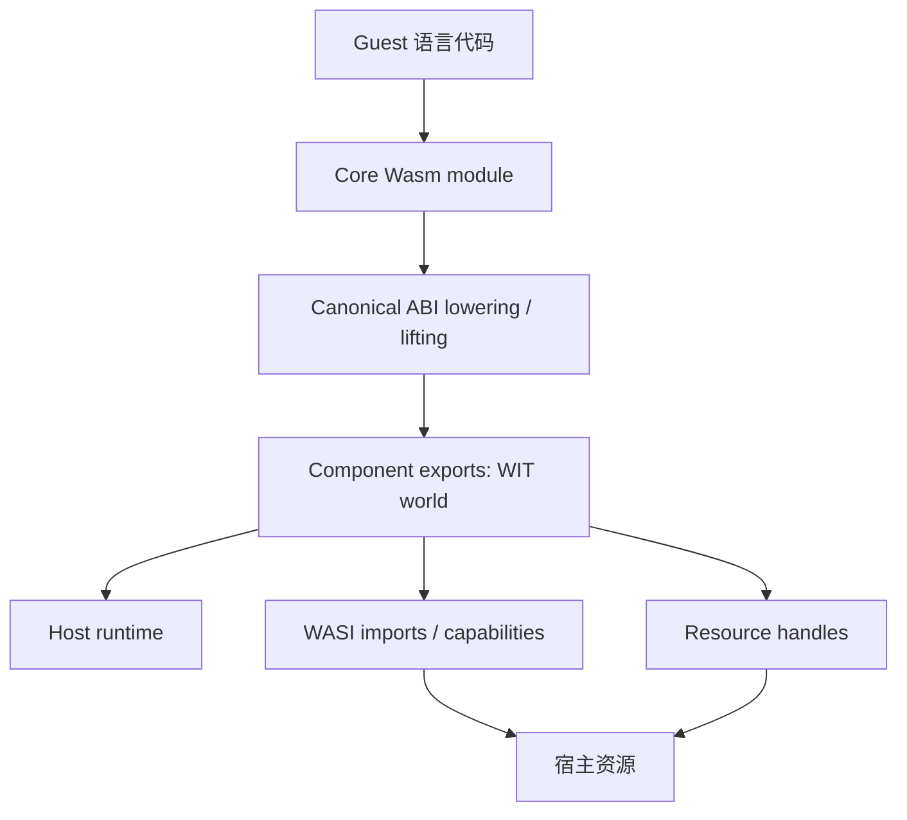
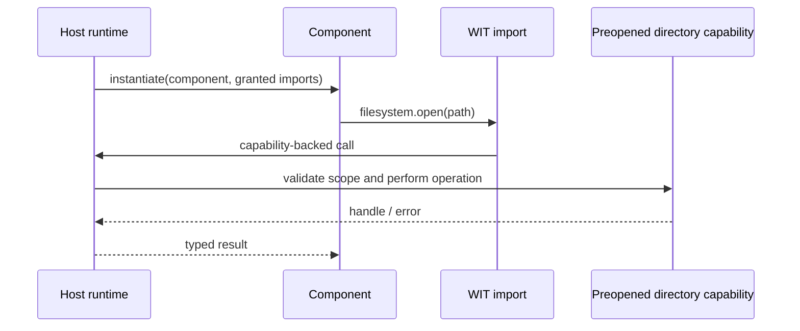

# WebAssembly Component Model、WIT 与 WASI 权限边界

Core Wasm 模块提供低层函数、表、全局变量和线性内存。两个模块即使都能实例化，也未必有稳定、语言无关的高层接口：字符串怎么编码？列表归谁释放？错误如何返回？资源句柄由谁关闭？Component Model 在 Core 模块之上定义组件、接口类型与适配规则，让工具链可以生成跨语言绑定。

本篇聚焦组件级接口、WASI 能力授权和宿主支持，不重讲线性内存指针与字符串传递基础；见[Wasm-JS 内存互操作](wasm-js-interop-memory.md)。

## 概览：从 Core 模块到受限能力



图里最关键的区分是：Core Wasm 描述机器可执行模块；组件接口以 WIT 类型表达跨语言契约；WASI 是可由宿主选择性提供的接口集合。拥有接口声明不等于宿主已经授权实现它。

## 五层递进

### 1. 现象：组件把“能调用”提升成“能互操作”

Core Wasm 函数参数限于 Core 类型。字符串、列表、variant、result 或资源等高级值需由工具链约定低层编码。各语言若自行规定内存布局，就形成彼此不兼容的胶水协议。

Component Model 将一个或多个 Core 模块组合成 component，并使用 interface types 描述更丰富的数据类型。WIT（WebAssembly Interface Types）是书写组件接口的 IDL；一个 `world` 描述组件需要导入什么、向外提供什么。[Bytecode Alliance Component Model 文档](https://component-model.bytecodealliance.org/)提供从 WIT 到组件工具链的用户路径。

### 2. 规则：WIT 描述契约，不承诺传输是零拷贝

示意代码：未通过自动验证。下列 WIT 片段只说明接口结构，不对应已编译的 component binary。

```wit
package demo:catalog;
interface search {
  record item {
    id: u32,
    title: string,
  }
  lookup: func(query: string) -> list<item>;
}
world app {
  import search;
}
```

上面是接口示意，未通过自动验证，也没有附带可运行的 component 构建产物。`lookup` 的调用在 canonical ABI 层会把高级类型降低（lower）成 Core Wasm 可传递的表示，返回值再提升（lift）回调用方语言表示。具体内存与 realloc 约定由 canonical ABI 定义及 bindings generator 落实，不应把 WIT 类型误认为 Core Wasm 原生类型。

| WIT 类型 / 概念 | 接口层含义 | ABI / 生命周期需追问 |
|---|---|---|
| `string` | Unicode 文本抽象 | UTF-8 编码、字节长度、分配与释放 |
| `list<T>` | 有序元素序列 | 元素布局、长度、是否复制 |
| `option<T>` | 可选值 | tag 与 payload 编码 |
| `result<T, E>` | 成功或错误联合 | 错误类型边界与调用约定 |
| `resource R` | 不透明、带生命周期的对象身份 | 创建、借用、drop 与跨调用有效期 |

### 3. 机制：Canonical ABI 负责高层值与 Core ABI 的适配

Canonical ABI（规范 ABI）定义 component interface types 如何映射到 Core Wasm 函数参数、结果、内存和资源操作。它包含“lift / lower”转换方向：导出函数把 Core 表示提升为接口值；导入函数把接口值降低给 Core 实现。canonical options 可以约定字符串编码、内存和 realloc 等机制。

这让不同语言的工具链能生成兼容 glue，但转换不必然免费。字符串和列表可能涉及编码或复制；组件链接器可合并/优化某些适配路径，但要依据实际工具链和宿主测量。不能仅因使用 Component Model 就推导为零拷贝、零分配或固定调用开销。

读取规范时从[Component Model 规范仓库](https://github.com/WebAssembly/component-model)进入 `design/mvp` 与 canonical ABI 文档；读实现时看 [`wit-bindgen`](https://github.com/bytecodealliance/wit-bindgen) 和 [`wasm-tools`](https://github.com/bytecodealliance/wasm-tools)。这些项目迭代较快，验证实现结论前应记录实际 commit。

### 4. 机制：Resource 是带析构协议的句柄，不是共享语言对象

WIT resource 表示接口层不透明实体，可通过方法调用、借用或拥有句柄交互。资源模型为创建与释放定义协议，避免把宿主对象指针直接暴露给 guest。拥有型 handle 可在 `drop` 或所有权转移时释放；borrowed handle 具有受限生命周期，不能任意保存至借用范围外。

资源不自动代表安全能力。宿主仍须决定 guest 可创建哪种资源、可对其执行什么操作、数量上限和关闭行为。若资源包装一个文件描述符，WIT 类型只提供结构化接口；底层权限仍由 host 持有的 capability 决定。

### 5. 机制：WASI 的 capability 是宿主提供的能力

WASI（WebAssembly System Interface）将文件系统、网络、时钟、随机数、环境等宿主能力表达为 imports。模块不能仅靠自己声明一个 import 就获得宿主资源；实例化时 host 必须提供对应实现，并可只授予特定目录、网络出口或其他受限资源。

WASI 0.2 基于 Component Model，接口在 WIT package 中表达，常见接口由 `wasi:cli`、`wasi:filesystem`、`wasi:http` 等包组成。WASI 0.1（Preview 1）采用 Core 模块和 fd 风格接口；两版接口/工具链并不直接兼容。[WASI 官方安全说明](https://wasi.dev/security)概述 capability 设计及宿主授权边界。版本支持和接口细节会随 WASI 发布变化，不能只写“支持 WASI”而不标版本与 world。

另需避免把 0.2 当成 WASI 当前唯一版本：在本文核验的 Component Model 官方仓库快照中，WASI Developer Preview 0.3.0 已加入原生 async functions、streams、futures 与并发相关能力，0.3.1 又新增 `map<K,V>` 和 WIT annotations。它们是渐进开发中的 Developer Preview，不等同于已完成标准或浏览器 WebAssembly API；工具链、宿主和组件生成器须明确支持到哪个 preview 版本。[Component Model 仓库与里程碑](https://github.com/WebAssembly/component-model/blob/6c48079bbc808bb3bdeb9554f338ab3a5b187388/README.md)。



宿主权限应尽量按 capability 粒度授予。组件拥有 `filesystem` 接口也不必然拥有整台机器文件系统；宿主可以将具体预打开目录绑定给 capability。反之，若宿主传入过宽句柄或提供可执行本机代码的接口，guest 的沙箱性质会显著改变。

## Core Wasm 与 Component Model 的关系

| 维度 | Core Wasm | Component Model |
|---|---|---|
| 模块单位 | module / instance | component / instance |
| 基础类型 | i32/i64/f32/f64、引用、内存等 | records、variants、strings、resources 等 interface types |
| 接口声明 | imports / exports 的 Core 签名 | WIT world、interface、package |
| 链接 | Core imports/exports | component composition 与 adapter |
| 使用入口 | 浏览器 `WebAssembly.Module` / `Instance` API | 需要具备组件支持的工具链与 host runtime |
| 权限 | 由 imports 和宿主提供决定 | WIT/WASI imports 可表达更清晰的 capability contract，仍需 host 实际授权 |

浏览器原生 `WebAssembly.instantiate()` 的标准对象模型主要针对 Core Wasm。浏览器并未因此自动提供 WASI 文件系统或 Component Model 原生实例化 API；项目可将组件 runtime 编译为 JS/Wasm 并在浏览器中运行，但这属于应用引入的实现，且通常需要为 WASI 能力提供浏览器适配层。

## 手写最小模型：能力由宿主注入

下例是伪代码，只表达依赖方向；没有具体 runtime 的 API，未运行。

```text
component imports filesystem.read_file

host grants:
  filesystem = preopen("/srv/public-assets", read_only=true)

guest asks:
  read_file("logo.svg")

host resolves relative to the granted directory
host rejects paths outside the preopen capability
```

正确性依赖宿主如何绑定目录、规范化路径、处理符号链接及错误，不应只靠 guest 在调用前做字符串过滤。WASI capability 能帮助缩小授权面，但宿主实现和部署配置仍是信任边界。

## 浏览器、服务端与组件宿主支持边界

截至本文核验日 2026-10-12，组件模型/WASI 必须按 runtime、工具链、具体版本及目标接口核实。标准成熟度、二进制解析能力和应用 API 可用性是不同问题。WebAssembly 官方 feature dashboard 跟踪 core proposals 的实现情况；组件模型 repo 和 Bytecode Alliance 文档跟踪组件工具链；它们不能代替目标浏览器兼容矩阵。

| 环境 | 可确认的方向 | 实际使用前检查 |
|---|---|---|
| 浏览器 WebAssembly JS API | Core Wasm Module/Instance/Memory/Table API | 浏览器版本、Core feature、COOP/COEP 等线程条件 |
| 浏览器内组件方案 | 可通过自带 runtime/tooling 执行组件 | runtime 包体、WASI shim、DOM/Fetch bridge、启动成本 |
| Wasmtime | Bytecode Alliance 的组件宿主实现 | Wasmtime 版本、支持的 component/WASI world 与配置 |
| Wasmer / 其他 server runtime | 不同版本有不同 component/WASI 能力 | 官方版本矩阵和具体功能 flag，不能由产品名推断 |
| Node / Bun / Deno | 可运行 Core Wasm；组件/WASI 不是自动等同 WebAssembly API | 当前发行版是否内置所需 runtime，还是需 JS package/shim |

截至 2026-10-12，WebAssembly 官方 proposals 列表将 Component Model 放在 active proposal 的 phase 1；官方 Component Model 仓库同时描述 0.2/0.3 为 Developer Preview，在浏览器外允许宿主与工具链稳定消费以收集反馈。这与组件工具链已经可用于工程实验并不冲突：提案阶段、preview 兼容契约和特定 host 能力是三件不同的事。[提案跟踪表](https://github.com/WebAssembly/proposals)与[Component Model 里程碑](https://github.com/WebAssembly/component-model/blob/6c48079bbc808bb3bdeb9554f338ab3a5b187388/README.md)。部署前应再次查验，因为这些状态属于时效事实。

## 两个真实项目路径

1. **Wasmtime**：Bytecode Alliance 的 Wasm runtime，提供 component execution 与 WASI host 能力。阅读 [Wasmtime docs](https://docs.wasmtime.dev/) 的 component/WASI 章节，再沿 [Wasmtime source](https://github.com/bytecodealliance/wasmtime) 查看 linker、component linker 和 WASI host 的版本实现。
2. **wit-bindgen + wasm-tools**：前者生成 WIT bindings，后者解析、链接和操作组件。用户文档在[Component Model 文档站](https://component-model.bytecodealliance.org/)，源码入口为 [`wit-bindgen`](https://github.com/bytecodealliance/wit-bindgen) 与 [`wasm-tools`](https://github.com/bytecodealliance/wasm-tools)。
3. **WASI HTTP samples**：Bytecode Alliance 的 [sample-wasi-http-rust](https://github.com/bytecodealliance/sample-wasi-http-rust) 展示组件如何消费 HTTP world；读 sample 的 WIT、guest source、build manifest，再核对当前 Wasmtime/WASI dependency 版本。

## 误区与故障诊断

| 误区 | 诊断方式 |
|---|---|
| “WIT 文件就是 Wasm 模块” | WIT 是接口描述；需 bindings、adapter、component binary 和 host。 |
| “Component Model 一定比手写指针更快” | 查看生成 glue 和实际 profile，计入转换、内存分配、跨边界次数。 |
| “声明了 WASI import 就拥有系统权限” | 检查实例化时 host 实际提供的 imports/handles。 |
| “WASI 就是浏览器内置文件 API” | 查目标环境是否提供 WASI host；浏览器 Web API 与 WASI 不是同一套接口。 |
| “Wasm 是安全沙箱，所以 native import 安全” | 每个 host import 都可能扩大能力；审计实现、授权和资源上限。 |
| “支持 WASI 就够了” | 明确 Preview 1/0.2/具体 world、WIT package 版本与工具链兼容性。 |

构建失败先检查 WIT package/version、world 名、依赖锁定和生成 bindings 是否一致；链接失败检查 adapter 和 target；运行失败检查 host 是否实现每个 import；权限失败检查 capability 实际绑定范围。组件解析成功只证明格式被读懂，不代表所有接口都能实例化。

### 从 WIT world 到可部署产物的验证链

一个面向组件的工程通常至少涉及这些阶段：

1. 写 WIT package，锁定 package version 和依赖来源。
2. 选择 guest language binding generator，确认它支持目标 WIT 类型、resource 和 ABI 选项。
3. 编译 Core Wasm module，再由 componentization 工具包装或链接成 component。
4. 用 `wasm-tools component wit` 或对应工具检查产物实际 world；不要只看源 `.wit` 文件。
5. 在指定 host runtime 中实例化，并明确列出所有 imports 和授权的资源。
6. 执行成功路径和拒绝路径，例如允许目录内读取、拒绝 capability 外路径。
7. 将工具版本、WIT 锁文件、runtime 版本和宿主配置一并纳入可复现构建。

这条链的不同产物可能属于不同规范层：普通 wasm validator 验证 Core module 合法性，不一定验证 component structure 或宿主 world 兼容性；组件 validator 通过，也不代表 host 会提供所有 imports。

### 资源泄漏与调用失败

资源句柄把生命周期显式化，但 guest panic、宿主取消和网络中断仍可能打断正常释放流程。Runtime 应定义实例退出时如何 drop 活跃资源，接口设计也应避免资源只在“成功结果”中可见、错误路径无法关闭。

一次调用失败时追踪：组件是否已分配 resource；错误是 WIT `result` 还是 trap；调用方是否仍拥有 handle；host 是否有实例级清理钩子；资源计数是否回到基线。资源数量上限和调用预算应由宿主配置，不能把客体遵守协议当成唯一防护。

### WIT 版本演进与兼容

跨语言组件往往由独立团队发布。除函数签名之外，record 字段增加、enum case 添加、variant 变化和资源方法调整都会影响生成代码及兼容性。应把 WIT package version 纳入依赖锁定，并将兼容策略写成 contract tests：新 guest 能否运行在旧 host；旧 guest 是否仍能调用新 host；未知 enum/tag 的处理如何定义。

当一方更新 wit-bindgen 或 wasm-tools 时，生成 glue 可能变化，即使 WIT 文件没改也应检查产物差异。避免把自动生成代码当作稳定 ABI 文档；规范类型文件才是契约来源，生成物是特定工具链的实现结果。

### WASI 能力审计清单

部署 review 可逐项确认：

| 检查点 | 需要留下的证据 |
|---|---|
| 文件系统 | 具体 preopen 路径、读写模式、路径解析策略 |
| 网络 | 是否允许 connect/listen/DNS，目标地址如何受限 |
| 环境变量 | 哪些变量注入 guest，是否含密钥 |
| 时钟与随机数 | 是否由 host 提供，精度/确定性是否影响测试 |
| 资源预算 | CPU、内存、文件句柄、并发调用和执行时长上限 |
| Import surface | 产物实际需要的 imports 与宿主实际提供的 imports 对照 |
| 版本 | WASI world/package、runtime 与 bindings 版本 |

仅用 capability 模型不足以证明部署安全。Runtime bug、过宽授权、宿主 native extension 和资源耗尽仍需单独考虑。

## 30 秒与 2 分钟回答

**30 秒：** Core Wasm 是低层执行格式；Component Model 用 WIT 描述高级跨语言接口，并由 canonical ABI 把字符串、列表和资源等类型映射到 Core 调用约定。WASI 用 imports 表达宿主能力，宿主在实例化时决定是否授权。浏览器支持 Core API 不等于原生支持 Component Model 或 WASI。

**2 分钟：** 语言间直接共享 Core 函数签名时，字符串、列表、错误和资源生命周期需要另定 ABI。组件把这些类型表达成 WIT interface/world；canonical ABI 负责 lift/lower 和内存约定，bindings generator 生成语言胶水。资源 handle 仍要有创建、borrow、drop 协议。WASI capability 只在 host 提供实现后可用，可将文件能力绑定到只读预打开目录。验收时分别检查 component binary 的 imports、runtime 对目标 world 的支持和宿主实际授予的资源，最后做越权访问负例；单看 WIT 文件或 wasm 文件通过验证器不足以证明权限有效。

## 自测

??? question "1. WIT 的 `string` 是否对应 Core Wasm 原生字符串参数？"
    不是。Component ABI 需要将接口值 lower 到 Core 表示，具体编码与内存约定由 canonical ABI / bindings 实现。

??? question "2. Guest 声明了文件系统 import，为何仍可能无法打开文件？"
    宿主必须实例化时提供该 import，并可只给特定目录或只读 handle；没有授权就不能仅凭声明获得能力。

??? question "3. 为什么浏览器能实例化 Core Wasm 不代表可实例化 WASI component？"
    浏览器 JS API 与 WASI host/component runtime 是不同规范面；浏览器不自动提供宿主系统接口。

??? question "4. Resource handle 相比裸指针多了什么？"
    它为接口层对象身份及操作、借用和销毁建立受控协议，但实际安全性仍取决于 host 实现和 capability。

## 深入阅读

- [Component Model 文档](https://component-model.bytecodealliance.org/)：从 WIT、world 和组件工具链入手。
- [Component Model 规范](https://github.com/WebAssembly/component-model)：查 canonical ABI 与 resource 规则。
- [WASI 安全模型](https://wasi.dev/security)：理解 capability imports 与宿主授权。
- [WebAssembly proposals](https://github.com/WebAssembly/proposals)：核对组件与 Core 特性的提案阶段。
- [WebAssembly features](https://webassembly.org/features/)：按引擎核实 Core feature 支持。
- [wit-bindgen](https://github.com/bytecodealliance/wit-bindgen)：看绑定生成器如何落实 WIT。
- [Wasmtime](https://github.com/bytecodealliance/wasmtime)：读实际组件宿主和 WASI 实现。
