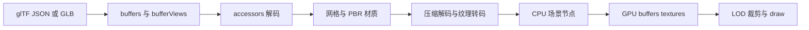

# Web 3D 资产管线：glTF、压缩、流式加载与显存预算

加载一个 3D 资产不止是下载 `.glb`。数据要解析、解压、建立材质和场景对象、上传 GPU，再参与裁剪与绘制。大型场景里，网络体积可能不是峰值内存；同一网格可能同时存在压缩响应、解码缓冲、CPU typed array 和 GPU buffer。

## 心智模型：资产从交付格式到 draw 数据



1. `buffer` 是原始字节资源，GLB 可将主 buffer 放在 BIN chunk；JSON glTF 也可能引用外部文件。
2. `bufferView` 给出 buffer 内的一段字节范围，accessor 用 componentType/type/count 和偏移/步长解释该区域。
3. primitive 把属性 accessor、索引和材质组合成可绘制网格；node/scene 组织层级与变换。
4. 压缩扩展改变传输或 GPU 纹理存储方式；加载器需要解码器/转码器及其线程和内存策略。

## 1. 现象：文件大小不等于运行时内存

一个 2048×2048 RGBA8 未压缩纹理单个基础 mip 需要 `2048 × 2048 × 4 = 16,777,216` 字节，约 16 MiB（MiB=2²⁰）。完整 mip 链在理想紧密布局下约乘 4/3，接近 21.3 MiB，尚未包含 staging、驱动对齐和其他副本。

压缩 JPG/PNG 下载可能只有数 MiB，但解码后仍会形成 GPU 可采样纹理；KTX2 携带的 Basis Universal 数据可按目标 GPU 格式转码，但最终显存占用依目标格式、尺寸和 mip 策略变化。不要用网络响应体积当 VRAM 指标。

## 2. 规则：accessor 是有边界的类型视图

Khronos glTF 2.0 规范将 accessor 定义为对 bufferView 内数据的 typed view。元素字节数是 component 大小乘组件个数；若用于顶点 attribute 且 bufferView 给出 byteStride，要按 stride 跳到下一个元素。需检查 accessor offset、bufferView offset、对齐和完整范围。

例如 1000 个 `VEC3` float position 元素紧密存储，元素宽 12 字节，总计 12,000 字节。若其 interleaved stride 是 32 字节，最后一个元素的终止偏移按 `(count - 1) × stride + elementBytes` 计算，而不是 `count × elementBytes`；前者用于检查最后一项是否越界，后者是逻辑有效数据体积。

**安全解析顺序**：先验证所有索引和长度，再建立 typed view；对稀疏 accessor 应从隐式零初始化基数组并应用稀疏索引覆盖。只读前几个顶点不足以验证 malformed asset 的边界安全。

### normalized、索引与 sparse 的具体边界

`normalized: true` 只对整数 component 数据规定映射到浮点使用域的解释方式，底层字节仍是整数存储。读取 `Uint8` 颜色时，如果直接当 0–255 的 shader 色值而未归一化，或在 CPU 侧归一化后又让 GPU 再归一化，就会得到错误结果。应明确归一化由 typed decode 还是 vertex attribute format 执行，不能重复做。

primitive 的 `indices` accessor 必须是标量无符号整数类型；索引值要落在该 primitive 对应的顶点范围内。缺少 indices 时则按非索引绘制处理。验证器还需检查 mode、属性计数与 index count 一致性；超大模型的索引类型与目标图形 API 支持也要考虑。

稀疏 accessor 的 base `bufferView` 可以缺省，此时逻辑基数组从零初始化，再由 sparse indices 指出被替换元素、sparse values 提供新值。索引必须严格递增且小于 accessor count。直接把 values 当完整 accessor 或忽略 base 缺省，会让形变目标等数据变错。

矩阵 accessor 中小分量矩阵存在列对齐规则：MAT2/MAT3 使用 8-bit 或 16-bit component 时，列可能有 padding。不能一律将矩阵按 componentCount × componentBytes 紧密读取；按规范的 component alignment 和 matrix column padding 推导元素布局，再验证 stride。

index 范围检查至少同时覆盖：`bufferView` 范围、buffer 总长、accessor offset 对齐、有效 stride、count 乘法溢出风险以及最终顶点索引范围。检查乘法时先比较上限再计算，避免在有限整数运算环境里长度溢出绕过边界。

## 3. 机制：传输压缩与运行时表现各自付账

| 技术 | 主要减少 | 加载成本/约束 | 不解决 |
|---|---|---|---|
| Draco mesh compression | 网格几何传输字节 | 需要兼容 decoder、CPU 解码时间和临时内存 | 不保证更小的 GPU vertex buffer |
| EXT_meshopt_compression | 网格/动画数据传输 | 需对应 Meshopt decoder 与扩展支持 | 不替代 LOD 或视锥裁剪 |
| KHR_texture_basisu / KTX2 | 纹理传输与目标 GPU 存储格式选择 | 需 transcoder，并依设备支持选择格式 | 不自动控制纹理分辨率和显存总量 |
| LOD | 远距离几何细节和处理量 | 资产需有多级数据及切换策略 | 不压缩单个最高级模型 |
| frustum/occlusion culling | 不可见对象提交量 | bounds、层级和可见性更新有 CPU 成本 | 不减少可见对象的三角形数 |

Draco 与 Meshopt 是针对不同编码方案/数据组织的工具，不要把二者标签当“所有模型都应同时开启”的保证。KTX2/Basis Universal 的最终 GPU 格式取决于 adapter 支持和 loader 决策。

## 4. 实验：校验 accessor 字节跨度与网格预算

仓库实验实现了常见 accessor 元素大小和 stride 跨度计算，并估算 position + color + index 的 payload；它不是完整 glTF validator。

```sh
node scripts/content-labs/graphics/gltf-budget.mjs
```

无需安装第三方依赖；运行时为 Node.js 24.16.0，脚本自身通过 `node:assert/strict` 做自动检查。若失败，检查 accessor 的 `componentType`/`type` 是否受实验表支持，stride 是否小于元素宽度，以及字节合计是否重复计入 padding。

预期输出：`position=12000 B; estimated mesh payload=22000 B`。脚本断言 VEC3 float 的紧密长度、带 stride 的跨度、属性与索引合计及非法 stride。

算法入口位于仓库 `scripts/content-labs/graphics/gltf-budget.mjs`。它还用真实 ArrayBuffer 和 DataView 读取交错排列的 float32 VEC3，断言各顶点坐标、偏移、stride 与越界拒绝，不只是相加预设字节数。它明确拒绝矩阵类型，未处理 sparse accessor、normalized 整数解码、mesh compression、完整 bufferView 边界或 GLB 容器解析；生产校验应使用 Khronos glTF Validator 并对加载器做恶意输入测试。

## 5. 加载流水线与线程预算

适合并发解码的工作可放 Worker：解压网格、解码图片、生成几何 bounds、解析 JSON。主线程保留 DOM/canvas、交互状态、场景调度及需要它的渲染器 API。Worker 转移 ArrayBuffer 可避免复制，但转移后发送方 buffer 会 detached；共享内存另受 cross-origin isolation 等限制。

规划流水线时，把每个阶段的输入、输出、峰值并存字节和取消能力列出来：

```text
下载压缩字节 → 解压/转码临时数据 → CPU mesh/image → GPU 上传副本 → GPU 常驻资源
```

对每个阶段记录最大并发数。四个模型同时解码可能比单模型慢且峰值更高；用有界队列限制解码和纹理转码并发。用户切换场景时取消尚未开始的工作、忽略过期结果并释放已创建 GPU 资源。

主线程之外并不代表免费：Worker 有消息队列、调度和内存占用；创建多个 worker 也不会自动提高吞吐。根据 Performance trace 中 long task、解码耗时、GC 和帧时间验证。

## 坐标、颜色、PBR 与拾取边界

- glTF 2.0 使用右手坐标系，线性距离单位约定为米；引擎转换时要同时处理节点矩阵、法线、绕序、相机和灯光，不要只翻一个坐标轴。
- glTF metallic-roughness PBR 材质定义 base color、metallic、roughness 等输入；颜色纹理通常按 sRGB 解释，法线、粗糙度等数据纹理则按线性数据处理。错误 gamma 转换会使材质明显偏亮/偏暗。
- 渲染坐标通常用有限精度 float；地球尺度坐标叠加毫米级对象时需要局部原点/相机相对坐标或分区，不要假设 float32 在任意大坐标仍保持细节。
- CPU raycast 拾取可用 BVH 加速；GPU ID picking 可用特殊 render target，但读回可能造成同步等待。交互设计须测点击延迟、透明物体策略和高 DPI buffer 开销。
- LOD 切换应控制视觉跳变和 popping；screen-space error / 距离不是一个通用固定阈值，需结合视场角、屏幕尺寸和产品容差验证。

## 真实项目

**Khronos glTF Sample Viewer** 可作为规范资产呈现和材质行为参考；查看 [固定仓库快照](https://github.com/KhronosGroup/glTF-Sample-Viewer/tree/b6f9275f7a95a8a12804e0ff33af3df3c7e9ccc5) 的 loader 与 renderer，留意 extensions 与设备格式选择。它是参考 viewer，不是任意应用的默认性能预算。

**Three.js GLTFLoader** 将 glTF 资源转换为 Three.js 场景对象，并通过 loader plugin/decoder 路径接入扩展；在 [Three.js 固定提交](https://github.com/mrdoob/three.js/tree/f12e7868b4cb9d491512d7f0f372e329a5d2bc0f) 从 `examples/jsm/loaders/GLTFLoader.js` 追踪 accessor、材质和扩展处理，再查看 DRACOLoader、KTX2Loader、MeshoptDecoder 集成。加载器 API 和 decoder 配置需以该版本源码为准。

**Babylon.js glTF loader** 可从 [固定提交](https://github.com/BabylonJS/Babylon.js/tree/a6b8e226d46464328197447f9fc93054c7b494fb) 的 `packages/dev/loaders/src/glTF` 查 loader、材质与 extension 分层。大引擎提供资产集成与运行时工具，但也增加 bundle、抽象和升级成本。

### 资产边界与引擎边界要分开验证

glTF validator 通过只能说明 asset 满足验证器所覆盖的规范条件，不代表某个引擎所有 extensions 都实现，也不代表目标设备支持所需 GPU format。建议 fixture 按 core asset、required extension、optional extension、超大数据、稀疏数据、色彩与坐标语义分组；对引擎输出再做截图/数值对照。

对于加载中途失败，要区分网络失败、JSON/GLB 结构错误、decoder 初始化失败、extension 不支持、GPU 上传 validation failure。用户界面可以按阶段报告重试能力：网络可重试，资产格式错误需换源，设备 feature 缺失可能走降级格式，GPU out-of-memory 则应降低并发或选择更低 LOD。

取消下载并不会自动取消已经运行的 WASM 解码或已创建的 GPU resource。loader 要把 AbortSignal、worker job id、资源 scope 关联起来；过期 job 的结果应丢弃并 dispose，避免用户切换场景后后台继续占用内存。

## 误区

| 误区 | 纠正 |
|---|---|
| 压缩文件小，所以显存占用也小 | 估算解压后的顶点/索引和纹理 GPU 格式字节 |
| `count × elementBytes` 是任意 stride accessor 的跨度 | 最后一项边界用 `(count-1) × stride + elementBytes` |
| Worker 能直接使用页面 WebGL context | Worker 能力依 transfer/control API 与环境，不能任意访问主线程上下文 |
| draw call 少就一定帧率高 | 同时测 culling、decoder、CPU submission、GPU 时间与视觉质量 |
| PBR 材质颜色错只调灯光 | 先检查纹理色彩空间、数据贴图线性处理和曝光/tonemapping |

## 真实验收

**输入/环境：** Node 24 脚本验证 accessor 算法；浏览器资产验收另用固定 glTF/GLB fixture、目标浏览器/GPU 和 Khronos Validator。

**命令：** `node scripts/content-labs/graphics/gltf-budget.mjs`；真实资产可用官方 glTF Validator CLI（版本和安装命令必须按项目锁定）。

**观察项：** 解析无越界、扩展解码成功、mesh/texture 数与预期相符；通过 profiler 记录下载字节、解码耗时、CPU 峰值/显存估算、首帧时间和稳定帧时间。

**通过阈值：** 该 CPU 小实验所有断言通过；项目阈值应按目标设备定义资产体积、首帧时间和内存上限。本文没有虚构通用阈值。

**失败证据：** Validator issue、加载异常、WebGL/WebGPU validation error、明显纹理色彩偏差、设备丢失、CPU/GPU 内存超过项目预算。

**清理：** 释放场景节点和 renderer 资源、撤销 object URL、终止自建 worker。

## 面试回答

**30 秒：** glTF 用 buffer 存字节、bufferView 切片、accessor 给出类型和步长，primitive 把属性、索引与材质组织成网格。压缩解决传输/存储编码问题，最终还要解码、上传并受显存与可见性管理约束。

**2 分钟：** 我会先验证 accessor 的类型、offset、stride 和 buffer 边界，再并行下载并限制解码/转码并发。网格压缩、KTX2 纹理、LOD 和视锥裁剪分别针对不同成本；用 CPU/显存预算估算各阶段同时存在的数据。加载器完成后检查坐标/法线、sRGB 与线性贴图、PBR、拾取和设备恢复。验收记录目标浏览器/GPU、资产哈希、首帧与稳定帧、解码时间、内存和图像结果，而不把文件下载大小等同运行开销。

## 自测

??? question "1. bufferView 与 accessor 的责任分别是什么？"
    bufferView 描述 buffer 中的字节区域；accessor 描述如何把该区域解释为带类型、数量、偏移及可能步长的数据。

??? question "2. Draco 压缩后为什么还要预算 GPU buffer？"
    解码后需要恢复可用于渲染的数据；传输压缩不等同于 GPU 存储压缩。

??? question "3. 为什么传输字节数不能作为纹理显存预算？"
    图片解码/转码后的尺寸和格式决定 GPU 存储，mip 与 staging 还会增加占用。

??? question "4. texture color space 配错会产生什么问题？"
    颜色纹理与线性数据贴图会被错误的 gamma/色彩转换处理，导致材质亮度和 PBR 结果偏差。

## 深入阅读与源码路线

1. [glTF 2.0 规范](https://registry.khronos.org/glTF/specs/2.0/glTF-2.0.html)：读 bufferView、accessor、mesh primitive、材质和 GLB 容器。
2. [Khronos glTF 扩展注册表](https://github.com/KhronosGroup/glTF/tree/main/extensions)：查 Draco、Meshopt、Basis/KTX2 的能力和约束。
3. [Three.js GLTFLoader 固定提交](https://github.com/mrdoob/three.js/blob/f12e7868b4cb9d491512d7f0f372e329a5d2bc0f/examples/jsm/loaders/GLTFLoader.js)：由 accessor 读取追到 extension。
4. [Babylon glTF loader 固定提交](https://github.com/BabylonJS/Babylon.js/tree/a6b8e226d46464328197447f9fc93054c7b494fb/packages/dev/loaders/src/glTF)：比较模块划分与材质导入。
5. [Khronos glTF Sample Viewer 固定提交](https://github.com/KhronosGroup/glTF-Sample-Viewer/tree/b6f9275f7a95a8a12804e0ff33af3df3c7e9ccc5)：读规范样例如何走到实时渲染。

源码/规范核验日期：2026-10-12。CPU 算法实验不验证浏览器扩展支持、解码器正确性或 GPU 性能。
