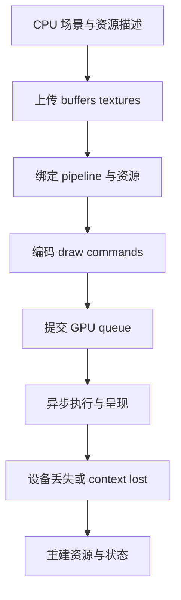

# WebGL 与 WebGPU 资源生命周期：状态机、绑定与提交

WebGL 示例常常只演示创建 buffer、绑定程序和发 draw call；真实应用更难的是追踪资源何时创建、何时更新、是否重复绑定、何时可回收，以及设备丢失后如何恢复。[既有管线页](canvas-webgl-pipeline.md) 已讲 shader 阶段和矩阵，本页聚焦工程生命周期与 API 心智模型。

## 心智模型



## 资源预算与幂等释放 {#handwrite-gpu-resource-lease}

显式 GPU API 要求应用管理 buffer、texture 等对象的生命周期；释放路径可能来自正常卸载，也可能来自设备丢失后的重建。资源管理器应先从账本删除租约，再调用销毁回调，这样回调抛错或重复清理都不会让同一份预算被重复计数。[WebGPU：GPUBuffer.destroy](https://www.w3.org/TR/webgpu/#dom-gpubuffer-destroy)

[`resource-lease.mjs`](https://github.com/Shyu-x/frontend-interview/blob/c1a7d0be48d2601aa4d71b303fbc08921e77235d/scripts/implementation-labs/systems/resource-lease.mjs) 是可运行的通用预算模型，不创建真实 GPU 对象。它演示容量上限、唯一 key、幂等 release 和 `disposeAll`；运行 `node --test scripts/implementation-labs/systems/resource-lease.test.mjs`，观察超额申请会失败且两次清理只调用一次销毁。

管理器保存 `key → {bytes, destroy, released}`，申请前把当前账本与新资源大小相加，超过预算就拒绝创建。释放闭包首先移除账本记录并标记 released，再调用 `destroy()`；顺序很重要，因为 GPU 回收回调可能抛错，预算也不能因此永久占住。批量设备丢失清理需要继续尝试其它资源，最后聚合错误统一报告，否则第一个异常就会让后续 buffer 泄漏。

```js
if (pool.bytes + bytes > pool.budgetBytes) throw new Error('budget exceeded');
const release = pool.acquire(key, bytes, () => gpuBuffer.destroy());
device.addEventListener('lost', () => {
  try { pool.disposeAll(); }
  catch (error) { reportCleanupFailures(error.errors); }
  recreateDeviceResources();
}, { once: true });
```

这里的管理器是通用生命周期账本，实际 `GPUDevice` 丢失事件需由创建 device 的组件连接。GPU buffer 的字节数不等于实际显存消耗；纹理对齐、驱动分配与浏览器策略都可能使预算估值偏小，因此要留余量并处理 `device.lost` 后的重建。

1. WebGL 主要通过可变的 context state 工作：当前 program、buffer、纹理单元、blend/depth 状态影响后续命令。
2. WebGPU 将 shader、vertex layout、primitive/depth/blend 等组合成显式 pipeline，再通过 bind group 绑定资源，命令写入 encoder/pass 后提交 queue。
3. 两者都需要把 CPU 数据传给 GPU；显式 API 不会自动消除带宽、同步或资源重复创建成本。
4. GPU 执行通常异步；CPU 端调用耗时不能直接代表 GPU 完成时间。

## 1. 现象：同一批顶点，提交方式改变成本结构

小 demo 每帧重建 buffer 也能显示三角形；生产场景这样做可能导致重复分配、上传和驱动状态校验。优化首先要区分 CPU command encoding、数据上传、GPU 执行和屏幕呈现。

| 工作 | WebGL 常见入口 | WebGPU 常见入口 |
|---|---|---|
| 顶点数据 | `createBuffer` + `bufferData` / `bufferSubData` | `createBuffer` + `queue.writeBuffer` 或 staging/copy |
| 顶点布局 | `vertexAttribPointer` 绑定到当前状态 | `GPUVertexBufferLayout` 写进 pipeline descriptor |
| shader + render state | `useProgram` 与多项 context state | `GPURenderPipeline` 描述符 |
| 资源绑定 | texture unit、uniform、buffer binding 等分散状态 | bind group/layout 显式声明资源集合 |
| 一批 draw | WebGL draw 调用 | encoder 内 render pass 的 draw，最后提交 command buffer |

WebGPU 命令编码与执行分离；创建 `GPUCommandEncoder`、结束 pass、`queue.submit()` 不代表 GPU 已经完成所有工作。

## 2. 规则：资源所有权与兼容性

WebGL context 属于 Canvas。context lost 后旧 GL 对象不可继续用于新 context 状态，需重新创建 program、buffer、texture、framebuffer 和状态缓存。应用应监听 `webglcontextlost` / `webglcontextrestored`，暂停无效渲染并重建 GPU 资源。

WebGPU 对象由创建它的 `GPUDevice` 拥有。`device.lost` 会异步给出丢失信息；device invalid 后关联对象不可继续使用。资源层应保留 CPU 侧可重建描述或可重新获取资产的路径，而不是只持有 GPU handle。

显式调用 `GPUBuffer.destroy()`、`GPUTexture.destroy()` 等可在不再使用资源时主动释放底层分配，规范指出这比只依赖 GC 更适合可预测回收。销毁不意味着先前提交的 GPU 操作同步停止；不要销毁前提是“此刻 CPU 已经返回”。

### 设备丢失是一条状态迁移，不是一次异常提示

GPU 资源管理最好显式维护 `ready → lost → rebuilding → ready` 状态。进入 `lost` 后停止 frame loop 或让它只更新 CPU 状态，不继续向失效 device 编码工作；`rebuilding` 阶段重新申请 adapter/device，检查 features/limits，再按当前场景描述重建资源。若浏览器在重建期间再次丢失设备，流程应可重复，而不是只允许首次恢复。

```js
// 示意代码：未通过自动验证；具体 renderer 需要管理并发恢复和取消。
let rendererState = 'ready';
let deviceGeneration = 0;

async function recoverDevice(oldDevice) {
  rendererState = 'lost';
  const info = await oldDevice.lost;
  console.warn('GPU device lost', info.reason, info.message);
  rendererState = 'rebuilding';
  const next = await requestDeviceWithRequiredFeatures();
  deviceGeneration++;
  await rebuildPipelinesAndResources(next, sceneDescriptors);
  rendererState = 'ready';
}
```

重建任务要和 generation 绑定。恢复期间用户切换 scene 时，旧 generation 的异步纹理解码完成后不能写入新 scene；必须检查 generation，再决定上传还是丢弃 CPU 结果。生产恢复策略还需处理用户手动销毁 device、adapter 消失、所需 feature 不再可用和内存分配失败。

WebGL 的 `webglcontextlost` 默认行为会阻止继续使用丢失 context；事件处理通常需要 `preventDefault()` 才允许浏览器尝试恢复。恢复事件意味着 GPU resource handle 需按 context 全部重建。不能把 WebGL lost 和 WebGPU `device.lost` 的时序/取消语义混为一谈。

## 3. 机制：绑定布局与 draw call batching

GPU draw call 的 CPU 提交有成本。典型归并策略是把相同 pipeline、材质/纹理集和几何格式的对象按兼容约束排序，或者将重复网格用 instancing 用单次 draw 提交多个 instance。不能为了减少 draw call 任意重排：透明物体的合成顺序、深度状态和 stencil 依赖可能要求保留次序。

WebGL 的 attribute 指针状态依赖当前绑定的 ARRAY_BUFFER，容易因隐式 context state 改错。WebGPU 的 vertex buffer layout 固定在 pipeline，draw 前再绑定实际 buffer slot；pipeline layout 和 bind group layout 需要相符。两种模型都可以缓存绑定状态，但缓存失效规则不同。

纹理比“文件压缩后字节数”占用更多 GPU 内存。未压缩 RGBA8 纹理近似 `width × height × 4` 字节；完整 mip chain 理想情况下接近基础层的 4/3，格式对齐、驱动分配和临时上传缓冲另有开销。GPU 上传和采样还受带宽、格式转换及纹理缓存影响。

## 4. 实现：最小 WebGPU 资源登记表

示意代码：未通过自动验证。以下为教学用伪接口，强调逻辑所有权，不是完整 WebGPU renderer。先登记资源和所属 scope：

```js
class ResourceScope {
  constructor(device) {
    this.device = device;
    this.resources = new Set();
    this.disposed = false;
  }
  own(resource) {
    if (this.disposed) throw new Error('scope disposed');
    this.resources.add(resource);
    return resource;
  }
}
```

释放时先锁定终态，再遍历登记表；这也是未运行的示意片段：

```js
ResourceScope.prototype.dispose = function () {
  if (this.disposed) return;
  this.disposed = true;
  for (const resource of this.resources) resource.destroy?.();
  this.resources.clear();
};
```

真实代码还要处理共享资源引用计数、销毁顺序、设备丢失、正在提交的工作、异步 pipeline 创建失败和资源重建。

工程资源描述一般分为两层：GPU handle 生命周期与可重建 descriptor/asset key。遇到 `device.lost`，由 renderer 进入 lost 状态，停止发命令；重新请求 adapter/device 后按 descriptor 重建 pipeline、buffer、texture，并恢复 CPU 侧最新数据。

可重建描述应该足够表达资源，而不持有只能使用一次的临时 upload buffer。例如 mesh descriptor 保留 vertex layout、usage、原始资产 key 和当前 CPU 更新版本；texture descriptor 保留格式、尺寸、mip 策略、采样器和可重新获取的 image source。静态资源可释放 CPU 副本降低常态 RAM，但若无法重新请求/解码，就不能保证设备丢失后恢复。

共享资源不能由任一组件无条件 destroy。常见做法是资源缓存持有 owner/ref count：组件释放租约，计数归零后进入延迟销毁队列；设备丢失时缓存中的 GPU handle 一次性失效，但逻辑资源描述仍可保留。要避免将 ref count 用作资源使用正确性的唯一判据，仍需遵守提交与场景卸载顺序。

## 5. 同步与 profiling：先定义测的是什么

浏览器 JS 同步读取 GPU 结果容易迫使 CPU 等待 GPU。WebGL `readPixels`、查询状态、频繁读取 framebuffer 可能成为同步点；WebGPU 使用异步映射路径（例如 buffer map async）并对 MAP usage 有约束。应用应尽量将读回设计成异步流水线，而不是每帧要求 CPU 立刻拿到结果。

基准实验至少报告：浏览器和 GPU/驱动、分辨率、目标帧、CPU 提交时间、GPU timestamp（若设备支持且权限/特性满足）、帧呈现时间、warm-up 次数和置信区间。一个“FPS”数字混合了 VSync、GPU 空闲、浏览器调度与工作负载，不足以判断具体瓶颈。

WebGPU 的 timestamp query 是受 feature/限制控制的能力，不应假设每个设备默认都支持；计时结果也应异步读取。无 GPU timestamp 时，可借助浏览器性能工具和应用级帧分段计时，但要清楚这些值只是 CPU 可见时间或帧时间代理。

### 对照实验如何避免错误结论

如果比较两种 backend，固定同一个逻辑 workload，并记录输出图像校验（容差）、shader/material feature、色彩空间、MSAA、阴影与后处理开关。WebGPU 和 WebGL 的 feature set 不完全相同，若一边关闭阴影、另一边开启，时间差不能归因给 API。

冷启动阶段要单独记录 shader/pipeline compilation；稳态阶段先 warm up 再取样。报告 CPU command encoding 与提交耗时、可用的 GPU timestamp、帧呈现间隔、掉帧数和显存估算。若浏览器无时间戳扩展或 feature，就把该栏标为 unavailable，不能以 `performance.now()` 包住 async submit 冒充 GPU 执行时间。

资源压力测试可每隔固定轮次创建并释放 render target/texture，观察进程显存曲线和错误状态；但浏览器常不给页面精确 VRAM 查询。此时以资源字节估算、创建/销毁数量、GPU 错误、device loss 与系统 profiler 作为证据组合，而非声称页面内存数字是精确显存。

## 真实项目与差异

- **Three.js** 同时存在成熟 WebGL renderer 与持续演进的 WebGPU renderer。固定源码快照 [f12e786](https://github.com/mrdoob/three.js/tree/f12e7868b4cb9d491512d7f0f372e329a5d2bc0f)：从 `src/renderers/WebGLRenderer.js`、`src/renderers/webgl` 跟 WebGL 缓存与状态，再看 `src/renderers/webgpu` 的 pipeline、binding 和 render context；抽象层降低 API 负担，也意味着要区分通用材质与后端特性。
- **PixiJS** 在 [提交 6555201](https://github.com/pixijs/pixijs/tree/65552017d23255c1442a7d4ac7f0d49e3225fb1d) 中有多个 Renderer backend 与模块化 systems/pipes；从 `src/rendering/renderers`、`src/rendering/renderPipes` 看对象提交如何分派。版本内 backend 状态和功能成熟度需按提交查看，不拿 README 上的动态状态做长期断言。
- **WebGPU 标准** 明确 device 是其创建对象的 owner，并定义 buffer `destroy()` 和 `device.lost`；这些规范保证资源语义，不提供你的应用级资产恢复策略。[GPUWeb 规范](https://gpuweb.github.io/gpuweb/)

## 误区与边界

| 误区 | 实际边界 | 验证方式 |
|---|---|---|
| WebGPU 一定更快 | API 设计差异不能证明给定负载更快 | 同一场景、同一画质、同一设备做分项测量 |
| 少 draw call 一定更快 | 排序、实例缓冲、shader 分支也有成本 | 记录 CPU/GPU 时间与图像正确性 |
| 资源变量离开作用域就立即释放显存 | GC/驱动回收异步且时机不可控 | 明确 destroy/dispose 与资源复用 |
| device lost 后重试同一 GPU handle | 旧 device 创建的对象已失效 | 保存 descriptor/资产来源并整体重建 |
| `queue.submit()` 返回即 GPU 完成 | 命令提交是异步流水线 | 用异步 timestamp/readback 或 GPU 工具观测 |

## 浏览器/GPU 实验限制

示意代码：未通过自动验证。本文没有创建真实 WebGL/WebGPU 上下文，也未在 GPU 上跑 benchmark。WebGPU 能力依赖浏览器实现、adapter features/limits、驱动和设备策略；WebGL 可用性也受 context loss 和平台限制。任何性能结论必须绑定测试环境和原始测量数据。

## 真实验收

1. **输入/环境：** 锁定同一浏览器版本、GPU、驱动、画布像素尺寸、对象数与资产；验证 WebGL 与 WebGPU 路径。
2. **命令：** 使用项目提供的启动脚本与浏览器自动化；本文不虚构仓库不存在的 benchmark 命令。
3. **可观察输出：** 每后端报告 pipeline/texture/buffer 数、上传字节、draw/instance 数、CPU 编码时间、可用的 GPU 时间，以及 context/device loss 恢复次数。
4. **通过阈值：** 先定义产品帧预算和允许的视觉误差；要求资源计数稳定、设备恢复后图像正确、读回无主线程长同步等待。
5. **失败证据：** 资源数逐帧增长、恢复后黑屏、GPU 时间超预算、同步读回导致长任务或两后端像素差超过容差。
6. **清理：** cancel RAF、销毁 renderer 资源、移除 context/device 监听并释放测试页面。

验收步骤是可执行实验设计，不代表本任务已运行浏览器/GPU 测量。

## 面试回答

**30 秒：** WebGL 是 context 状态机，WebGPU 把 pipeline、绑定布局、command pass 和 queue submission 显式化。两者都要管理资源创建、上传、销毁和设备丢失；性能判断要拆开 CPU 提交、传输和 GPU 执行。

**2 分钟：** 我会把不可变 pipeline 与动态 buffer/texture 分开缓存，用资源 scope 管理 dispose，并保留可重建 descriptor/资产 key。按兼容 pipeline/material/geometry 批处理或 instancing，同时守住透明顺序语义。避免同步读回；用异步 GPU timestamp（若支持）和浏览器工具分开测 CPU 与 GPU，固定浏览器/GPU/分辨率做对照。context/device lost 后不复用旧 handle，而是重建资源并做图像与资源计数验收。

## 自测

??? question "1. WebGPU pipeline layout 与实际资源绑定之间如何关联？"
    Pipeline 声明 bind group layout，运行时绑定的 bind group 必须符合对应布局。

??? question "2. 为什么 queue.submit 后不能立刻销毁并假定工作被取消？"
    已提交 GPU 命令异步执行；destroy 影响后续使用/可回收时机，不等价于同步取消先前工作。

??? question "3. draw call batching 有什么正确性约束？"
    透明混合、深度/stencil 状态与其他依赖可能限制排序，不能只按材质排序。

??? question "4. device lost 恢复为什么需要 CPU 侧描述？"
    旧 device 创建的 GPU 对象不可用，必须从资产或 descriptor 重建。

## 深入阅读与源码路线

1. [WebGPU 规范](https://gpuweb.github.io/gpuweb/)：读 buffer destruction、device lost、queue 与 timestamp query 条款。
2. [WebGL 2 规范](https://registry.khronos.org/webgl/specs/latest/2.0/)：读 context/object 状态和 sync APIs。
3. [Three.js 固定提交](https://github.com/mrdoob/three.js/tree/f12e7868b4cb9d491512d7f0f372e329a5d2bc0f)：先从 renderer 公共入口走到 WebGL state cache，再看 WebGPU pipeline/bindings。
4. [PixiJS 固定提交](https://github.com/pixijs/pixijs/tree/65552017d23255c1442a7d4ac7f0d49e3225fb1d)：追踪 backend 初始化与 render pipe 提交。

源码版本与官方规范核验日期：2026-10-12。此页代码片段是机制示意，GPU 实验未运行。
