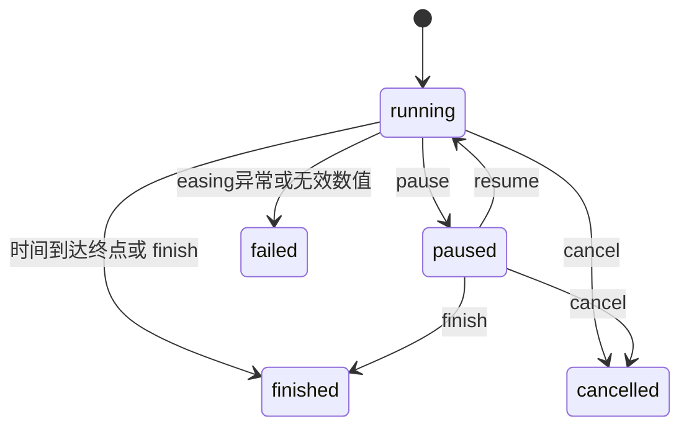

# 手写数值动画引擎：用一条时间线驱动多个动画

## 先说清练习来源

用户提供了一条线索：PDD 秋招第一场笔试考过动画引擎题，并于 2026-10-12 补充指的是 2026 年。这一补充记录为用户线索；目前没有找到能独立核实年份、场次、题面或官方答案的公开证据，不能据此断言下面的实现就是那道原题。公开社区报告里另有 PDD 翻转倒计时和打字机类题目的讨论，但这与“简易动画引擎”不是同一题的证据，也不能反推出原题要求。[牛客社区报告](https://www.nowcoder.com/feed/main/detail/076d4b5635a0416d97ed42e30e50348a)

本文和配套代码是作者根据前端动画原理派生的一道练习。它没有复刻任何 OJ 的输入输出协议，也没有假称通过了 PDD 的原题测试。练习目标是面试时能解释时间如何映射到数值、控制方法如何改变状态，以及浏览器卡顿时系统会做什么。

本文验证的是 Node.js 下的数值模型与状态管理。它没有在真实浏览器页面中验证绘制、合成、帧率或视觉流畅度；代码里的浏览器适配器只是把 `requestAnimationFrame` 接入同一模型。

## 一个具体问题：动画不能按帧数前进

想象一个进度条要在 800 毫秒内从 0 走到 100。若每次回调固定增加 1，60 Hz 屏幕每秒大约回调 60 次，120 Hz 屏幕则大约回调 120 次。同一段代码在不同屏幕上会得到不同速度；标签页被隐藏、主线程被长任务占住时，又可能少跑很多次。

应该让某个时刻的数值由“当前时间、开始时间、持续时间”决定。假设动画从时间 200 ms 开始，持续 800 ms，那么时间 600 ms 对应的归一化进度是 `(600 - 200) / 800 = 0.5`。从 0 到 100 的线性插值结果就是 50。浏览器这一帧是否恰好在 600 ms 到来，不会改变这个计算规则。

`requestAnimationFrame`（简称 rAF）请求浏览器在下一次重绘之前执行一次回调。它是一次性请求，回调若要继续运行，必须再请求下一帧；浏览器通常会在页面进入后台时暂停它。回调参数携带一个以毫秒计的时间戳，应当用它计算进度，而不是把每帧视为固定时长。[MDN：requestAnimationFrame](https://developer.mozilla.org/en-US/docs/Web/API/Window/requestAnimationFrame)

## 心智模型：时间先变成进度，进度再变成值

先看引擎在每帧所做的转换。图里只有一条时间轴和一个值映射：调度器负责提供帧时间，引擎负责将时间转成进度和数值，使用者负责把数值写到自己的对象或界面。


读图时要区分两件事：时间模型决定现在位于动画的哪个进度；动画模型决定这个进度对应哪个值。本练习只负责有限范围内的单一数值，不处理 CSS 关键帧、颜色插值、重复次数、播放速率和滚动时间线。Web Animations 规范同样把 timing model 与 animation model 分开，并将时间输入映射为迭代进度。[W3C Web Animations §3](https://www.w3.org/TR/web-animations-1/#web-animations-model)

## 五层递进

### 第一层：现象——同一时刻应当得到同一进度

动画不是“每帧做一点”，而是“在时间轴上的当前位置”。对于从 `from` 到 `to` 的数值，线性动画可写成：

`progress = clamp((now - startTime - delay) / duration, 0, 1)`

`value = from + (to - from) * progress`

若数值从 20 变化到 80，延迟 100 ms，时长 400 ms，那么 `now = startTime + 300 ms` 时，经过延迟后的有效时间为 200 ms，进度为 0.5，结果为 50。即使中间几帧没有执行，下一帧仍可直接算出当时的值。

### 第二层：规则——显式定义时间边界和调用结果

这道练习采用以下契约。它们是本练习的设计选择，不声称与 Web Animations API 完全兼容。

| 输入或操作 | 本练习的规则 | 可以观察到什么 |
|---|---|---|
| `from`、`to` | 必须为有限数值 | 字符串、`NaN` 和无穷值在创建时抛错 |
| `duration`、`delay` | 毫秒，均为有限非负数 | 负数创建时抛 `RangeError` |
| `easing` | 默认 `linear`，支持 `easeInOut` 或函数 | 插值前变换进度 |
| 延迟期 | 不调用更新函数 | 到计划开始时刻后第一帧产出起始值 |
| 零时长 | 同步写终点并完成 | 不申请帧，延迟不延后完成 |
| `pause()` | 保留已经过的有效时间 | 暂停时不再消耗动画时长 |
| `resume()` | 从保留的进度接着走 | 不重新从起点开始 |
| `cancel()` | 终止且不触发完成回调 | 状态成为 `cancelled` |
| easing 抛错或返回非有限值 | 只终止出错动画并调用 `onError` | 状态成为 `failed`，同帧其他动画继续 |
| `finish()` | 立即写终点并完成 | 完成回调最多调用一次 |
| 非递增帧时间 | 不让已显示值倒退 | 取上一帧和当前时间的较大者 |
| 回调抛错 | 交给 `onError` | 不会中断同一帧其余动画 |

延迟与零时长规则尤其需要说清楚：零时长动画会同步完成，因此即使给它配置正延迟也会立即完成。这是本练习刻意简化的语义；想模拟 Web Animations，需要另外实现 delay 阶段、fill 行为以及动画事件时序。

### 第三层：机制——状态和调度分开管理

引擎把活跃动画保存在一个集合中，并且至多持有一个待执行的帧请求。添加多个动画不会给每个动画各自开一条 rAF 循环。每帧遍历集合快照，快照允许某个回调在运行中取消自己或其他动画，而不跳过后续成员。

用状态图表达控制行为。`finished`、`cancelled` 与 `failed` 都是终态；对终态再次调用控制方法不会再次运行完成回调。帧请求只在至少有一个 `running` 动画时保留，全部暂停时停止空转。



Web Animations 规范也定义 idle、running、paused、finished 等播放状态，并用 hold time 固定暂停时的 current time。[W3C Web Animations §4.4](https://www.w3.org/TR/web-animations-1/#play-states)。这里采用更小的状态机，没有模拟 ready promise、可寻址 currentTime、反向播放或与 CSS 动画协调。

### 第四层：实现——时钟注入让时间可以手控

生产环境适配器使用 `performance.now()` 提供起始时间，使用 rAF 传入的时间戳更新帧。测试环境不依赖真实等待，而是注入手动时钟，明确推进到 0、25、50 ms 等时刻。构造参数必须有 `request`、`cancel`、`now` 三个函数，缺失时会抛错。

以下创建调用展示公开 API 的形状。`animate()` 返回控制句柄；`onUpdate` 接收最新数值与句柄，`onComplete` 接收完成句柄，`onError` 接收异常与句柄。

```js
const engine = new AnimationEngine();
const progress = engine.animate({
  from: 0,
  to: 100,
  duration: 800,
  delay: 120,
  easing: 'easeInOut',
  onUpdate: (value) => renderProgress(value),
  onComplete: () => announceDone(),
});
```

创建操作检查数值与缓动配置，记下绝对开始时间，再注册动画对象。非零时长动画会要求一个帧。`from`、`to` 是数值，因此这一例子演示的是数值进度，而不是可直接赋给 DOM 样式的带单位字符串。

帧更新的核心只需要一个归一化进度和一条插值式。这个片段对应真实文件 `scripts/content-labs/interview/animation-engine.mjs` 中的帧处理逻辑；文件还包含输入检查、终态处理、调度器清理和控制句柄。

```js
const elapsed = Math.max(0, time - animation.startedAt);
const progress = Math.min(1, elapsed / animation.duration);
const eased = animation.easing(progress);
const value = animation.from * (1 - eased) + animation.to * eased;
if (progress === 1) this.#complete(animation);
else this.#render(animation, value);
```

加权插值 `from * (1 - eased) + to * eased` 避免先计算 `to - from` 时，有限但极端的正负端点差值溢出。缓动函数允许有限的过冲进度；若函数抛错、返回 `NaN` 或无穷值，引擎将该项置为 `failed`、交给 `onError`，继续处理同帧其他动画。终点处直接写入精确的 `to`，避免浮点误差。`easeInOut` 接收 `[0, 1]` 内进度，在前半段减速变化，在后半段加速变化。

暂停时先用当前时钟记录已经经过的有效时长，然后把该动画标记为 `paused`。只有不存在 `running` 动画时才取消帧请求；每帧结束时也只会在仍有 running 项时续订，因此更新回调里暂停最后一项不会重新形成空循环。恢复时用经单调钳制的新时刻重新建立起始基准，让暂停的现实时间不被计入动画时长。代码里的绝对时间均以同一时间源为基准；不要混用 `Date.now()` 与 rAF 高精度时间戳。

### 第五层：边界——时间函数解决不了所有呈现问题

| 情况 | 时间模型如何处理 | 使用者还要考虑什么 |
|---|---|---|
| 120 Hz 或 144 Hz 显示器 | 每帧重新按绝对时间算进度 | 回调代码仍需控制成本 |
| 隐藏标签页暂停帧 | 恢复时按时间戳算到当前进度 | 是否允许恢复后跳到终点是产品语义 |
| 主线程被长任务阻塞 | 下次回调可直接追到正确时间 | 用户会看见跳跃，模型无法补回错过的画面 |
| 动画属性触发布局 | 引擎照常产出数值 | DOM 写入可能触发布局、绘制或合成成本 |
| 调用方销毁目标对象 | 引擎不会自动知道目标生命周期 | 调用方需及时 `cancel()` 并解除外部引用 |
| 两动画写同一目标 | 两个回调按创建顺序更新 | 需要上层定义覆盖、合成或冲突规则 |
| 缓动函数超出 0 到 1 | 数值可能越过终点 | 是否限制过冲取决于动画语义 |

### 为什么不用固定增量或 `setInterval`

固定增量方案将“每次回调”误当成“固定时间已流逝”。但刷新率并不固定，回调也会被调度延迟。因此每帧增加 `delta` 的结果会依赖帧数；绝对时间方案的结果取决于时间戳，不依赖于此前回调了几次。MDN 对 rAF 的说明明确建议使用回调时间戳计算进度，并指出高刷新率屏幕会让基于固定增量的动画运行更快。[MDN：requestAnimationFrame](https://developer.mozilla.org/en-US/docs/Web/API/Window/requestAnimationFrame)

`setInterval(fn, 16)` 也不等价于屏幕重绘。浏览器不保证每隔 16 ms 准时运行任务；即使间隔足够短，也可能在两次绘制之间多次更新，浪费主线程工作。rAF 把更新请求交给浏览器的绘制节奏，并允许浏览器在页面不可见时暂停；但它同样不是“每 16.67 ms 准时执行”的承诺。

### 背景标签页、长任务与时钟跳变

浏览器通常在隐藏页面时暂停 rAF。页面恢复后，动画可以按策略选择继续墙钟时间、暂停期间冻结、直接完成，或重置。此引擎的暂停语义由显式 `pause()` 实现；单纯隐藏标签页时，rAF 不回调，恢复后的时间戳会让进度向前跳。教程没有为 `visibilitychange` 做自动暂停，因为这是产品决策而非通用正确答案。

主线程上的长任务也会使画面错过帧。假设前一帧在 100 ms，下一帧在 180 ms，持续时间为 200 ms 的动画将直接从 50% 更新至 90%。它不会插值补画中间几帧。动画函数能够保证时间正确，不能保证每帧都在显示器上出现。

刷新率可以帮助理解预算，但不等于浏览器给 JavaScript 的保证。60 Hz 的刷新周期约为 16.67 ms，120 Hz 约为 8.33 ms，144 Hz 约为 6.94 ms。脚本还要与样式、布局、绘制、合成及浏览器其他工作共享时间；当执行超过可用窗口时，就可能错过目标帧。

假设动画回调中的业务处理耗时 5 ms，它占 60 Hz 周期的一部分，也占 120 Hz 周期更大的比例。优化时应优先减少每帧重复工作，例如把不变的计算移出回调、缓存静态配置、避免读取布局和写样式交替发生。是否达成目标仍需用设备上的性能轨迹确认，单次测量不能代表所有刷新率和设备。

时间戳也不应被当作唯一的性能指标。两个回调之间的时间差能提示掉帧，但不能单独解释是 JavaScript、布局、绘制、合成还是系统调度导致。排查时将主线程长任务、强制布局和 GPU/合成轨迹并排观察，才容易找到对应阶段。

若浏览器或测试时钟提供了向后走的时间戳，引擎把它钳制为最后一次见到的时间，避免数值倒退。Web Animations 规范讨论了单调递增时间线和方向改变时的完成状态；本练习仅防止意外倒退，不支持有意反向的时间线。[W3C Web Animations §4.3](https://www.w3.org/TR/web-animations-1/#timelines)

中断策略可以用场景来决定，而不是从 `cancel()` 这个名字猜测。用户关闭弹窗时，应该马上停止对已移除元素的更新；下载任务短暂切到后台时，可能希望恢复后继续墙钟进度；需要用户读完的逐字提示，则可能要隐藏页面时冻结。三种场景对停顿的预期不同。

若要在浏览器隐藏时显式暂停，可监听 `visibilitychange`，在 `document.hidden` 为真时暂停并在重新可见时恢复。但还应确认页面路由、组件卸载和多个动画共享的生命周期。把监听器装在每个动画实例上会造成重复订阅；更完整的引擎通常在调度器层维护一个可见性策略，并让产品选择行为。

本练习不自动绑定 `document`，因为这样会让 Node 时间模型依赖浏览器全局，并把产品策略塞进调度核心。调用者可以根据页面语义调用控制句柄。这个边界也使同一个动画模型可以由手控时钟、浏览器 rAF 或其他受控时间源驱动。

若引擎要用于多个组件，组件需要保留自己创建的句柄，并在销毁时取消。单靠引擎的 `activeCount` 无法判断 DOM 节点是否仍连接，也无法替应用推断目标元素的所有者。弱引用也不能替代显式终止，因为调度集合本身会强引用动画记录。

### DOM 布局读取与写入次序

引擎本身只调用 `onUpdate(value)`，没有读取 DOM 布局，也没有直接写样式。实际页面接入时，回调可以将数值写入 `transform` 或 `opacity`，也可以写入 `width`、`top` 等会改变布局的属性。后者可能让浏览器重新计算几何关系，再绘制受影响区域。

一个常见陷阱是在同一帧里先读取 `getBoundingClientRect()`，再写样式，然后又读取布局。读取可能迫使浏览器立即完成此前排队的样式和布局工作；交错的读写会反复触发同步布局。把测量集中到帧前、把 DOM 写入集中到帧后，通常更容易控制这条流水线。具体是否造成强制布局，应使用浏览器性能面板和性能轨迹验证，而不是只从代码外观推断。

数值模型的 `onUpdate` 是同步调用。这意味着回调耗时会直接占用当前帧的主线程时间；若调用方在回调中解析复杂文档、过滤数万条记录或执行重计算，即便只更新 `opacity`，下一次绘制也可能延迟。渲染属性便宜不代表生成属性值的计算也便宜。

另一个实际问题是多个动画同时写同一元素。引擎按集合创建顺序调用回调，但 DOM 最终值取决于最后一次写入；这不是属性叠加模型。要支持冲突，需要设计目标与属性级的覆盖策略，或让多个动画在同一目标上组合一个总值。不能只把集合换成 Map 就声称解决了冲突。

### 合成、GPU 与属性选择

浏览器渲染通常包含样式、布局、绘制和合成等阶段。改变 `width`、`height` 或 `top` 可能需要布局；改变 `color` 或阴影通常至少涉及绘制；在满足浏览器条件时，`transform` 和 `opacity` 可以只更新合成阶段。[web.dev：渲染性能](https://web.dev/articles/rendering-performance)

这不意味着 `transform` 和 `opacity` 永远免费，也不意味着浏览器一定把元素提升到独立图层。图层会占用内存和管理成本；对大量元素无差别使用 `will-change` 可能增加资源压力。应先检查动画实际触发的渲染阶段，再决定是否优化。[web.dev：仅使用合成器属性并管理图层](https://web.dev/articles/stick-to-compositor-only-properties-and-manage-layer-count)

更关键的是，JavaScript 的 rAF 引擎每帧运行在主线程上，并经由回调写入值。浏览器可以优化某些声明式动画，而自定义逻辑仍需执行 JavaScript。本文实现不宣称 GPU 加速。若只是将元素从左移到右，CSS transition、CSS animation 或 WAAPI 可能更简洁；只有当值由应用状态、物理公式或其他程序逻辑驱动时，手写引擎才更能体现价值。

### 时间精度、舍入与数学边界

时间戳以毫秒的浮点数表示。不要把 `duration` 换算成“目标帧数”，也不要假设帧率恒定。动画值的内部计算保留浮点精度，最终展示时再按产品需要舍入，例如整数像素、货币小数或进度百分比。

Web Animations 规范建议用户代理能用微秒精度表示输入时间值；这是一条实现建议，不代表所有浏览器时间戳都向网页暴露微秒精度。[W3C Web Animations §9.1](https://www.w3.org/TR/web-animations-1/#precision-of-time-values)。`requestAnimationFrame` 使用的 `DOMHighResTimeStamp` 单位为毫秒，并与文档时间线保持关联。[MDN：rAF timestamp](https://developer.mozilla.org/en-US/docs/Web/API/Window/requestAnimationFrame#parameters)

持续时间为 0 时不能计算 `elapsed / duration`，否则会出现除零结果。本练习将其定义为同步终点更新。输入校验排除负持续时间、非有限数值与未知 easing。自定义缓动有可能返回 `NaN` 或无穷数；如需不可信插件接口，应进一步校验返回值，并报告明确错误。

边界帧的完成判定用 `progress >= 1`，而不是等待 `progress === 1` 的浮点巧合。代码在除法结果达到或超过 1 时立即钳制到 1，并写回原始终点。这使 100 ms 动画在 101 ms 的第一帧也会确定完成，不会要求某一帧恰好落在精确的 100 ms。

数值插值可以支持负数和递减方向。例如 `from = 10`、`to = -10`、`progress = 0.25` 时，结果是 5。起终点不应被排序；排序会破坏调用者定义的方向。引擎只限制进度，不限制数值范围，因此过冲 easing 可以有意越出两端。

进度与值的单位要分清。时间以毫秒表达，进度是无量纲比例，起点与终点必须使用相同数值单位。若端点分别是“像素”和“角度”，虽然两者都是 JavaScript number，算式在语法上成立，语义却不成立。带单位的 CSS 字符串、颜色和变换矩阵需要各自的解析与插值策略。

显示精度也属于目标属性，而非时间模型。数值进度可保留许多小数，CSS 会接受小数像素，用户界面文字通常会舍入到整数或固定小数位。若每帧先舍入再累计，舍入误差会不断叠加；从端点直接计算则避免历史误差累积。

### 资源清理、回调异常与中断语义

引擎在没有运行中的动画时取消待执行帧请求。这能避免空转循环，但不会替调用方解除保存在闭包、事件监听器或业务对象里的引用。拥有动画句柄的一方应在组件卸载、弹窗关闭、路由切换等生命周期节点取消动画。

`onUpdate` 和 `onComplete` 都是用户代码，可能抛异常。引擎先将异常交给该动画的 `onError`；若没有错误处理函数，异常会被忽略，帧调度仍继续。对于生产组件，这个默认行为应谨慎评估：可以换成全局错误报告器、异步重抛，或在开发环境直接暴露错误。本练习选择不中断其他动画，并通过测试明确这个约定。

取消表示中断，不触发完成回调；完成表示自然到期或调用 `finish()`，完成回调只运行一次。完成时先移出活动集合并把状态设为 `finished`，再写终值并调用 `onUpdate`，最后调用 `onComplete`。因此两个回调都能读到终态，最终更新回调若再次调用 `finish()` 也只是无操作。Web Animations API 有 `Animation.cancel()`、`Animation.finish()`、`Animation.pause()` 等对应方法，但其取消会影响动画效果与事件/finished promise；本练习仅提供数值模型层面的相似控制名称，不兼容其完整事件行为。[MDN：使用 Web Animations API](https://developer.mozilla.org/en-US/docs/Web/API/Web_Animations_API/Using_the_Web_Animations_API)

## 手写实现与运行方式

配套实现位于 `scripts/content-labs/interview/animation-engine.mjs`。它导出 `AnimationEngine`，无第三方依赖。浏览器默认调度器要求全局存在 `requestAnimationFrame`、`cancelAnimationFrame` 与 `performance.now()`；Node 下运行必须注入时钟。

| 成员 | 行为 | 返回值 |
|---|---|---|
| `new AnimationEngine(scheduler?)` | 用指定调度器创建引擎；浏览器省略时使用默认适配器 | 引擎对象 |
| `engine.animate(options)` | 创建数值动画并加入共用调度 | 控制句柄 |
| `handle.state` | 读取 `running`、`paused`、`finished`、`cancelled` 或 `failed` | 字符串 |
| `handle.value` | 读取最近一次提交的数值 | 有限数值 |
| `handle.pause()` | 冻结进度；终态调用无效果 | 句柄 |
| `handle.resume()` | 从暂停处继续；非暂停调用无效果 | 句柄 |
| `handle.cancel()` | 取消动画且不触发完成 | 句柄 |
| `handle.finish()` | 立即写终点并完成 | 句柄 |
| `engine.activeCount` | 当前保留的非终态动画数 | 整数 |

`animate(options)` 的配置字段是 `from`、`to`、`duration`、可选 `delay`、可选 `easing`，以及 `onUpdate`、`onComplete`、`onError` 回调。时长和延迟以毫秒计。缓动选项支持字符串 `linear`、`easeInOut` 或一个自定义函数。

下面片段是最小的 Node 使用方式。它采用仓库实际实现和测试中同样的 `ManualClock`；不是网页视觉演示。

```js
import { AnimationEngine } from './animation-engine.mjs';
import { ManualClock } from './manual-clock.mjs';

const clock = new ManualClock();
const engine = new AnimationEngine(clock);
const values = [];
engine.animate({ from: 0, to: 100, duration: 100, onUpdate: (v) => values.push(v) });
clock.frame(0);
clock.frame(25);
console.log(values); // [0, 25]
```

真实仓库用 Node 内建的 `node:test` 验证边界。测试不依赖墙钟睡眠，不应加 `setTimeout` 等待以检查动画进度；明确推进手控时间，才能稳定检验精确的暂停位置和帧调度次数。

## 真实项目中的两种做法

### 浏览器提供的 Web Animations API

`Element.animate(keyframes, options)` 会创建动画、应用到元素并立即播放，返回 `Animation` 对象。官方示例以关键帧对象描述 `transform`，再用 `duration`、`fill` 等时序选项控制它；后续可以调用 `pause()`、`play()`、`finish()` 或 `cancel()`。[MDN：Element.animate](https://developer.mozilla.org/en-US/docs/Web/API/Element/animate)

当需求能由关键帧表达时，优先考虑浏览器 API。浏览器掌握动画效果、目标元素和时间线，可以配合自身渲染实现；但具体属性是否能脱离主线程仍取决于浏览器与属性，不能仅凭使用 WAAPI 就保证合成器执行。

以下短例展示应用在点击时播放动画。它是 API 用法示例，没有纳入本文 Node 验收，也没有声称在本文环境实测。

```js
const box = document.querySelector('.box');
const animation = box.animate(
  [{ transform: 'translateX(0px)' }, { transform: 'translateX(240px)' }],
  { duration: 600, easing: 'ease-out', fill: 'forwards' },
);
button.addEventListener('click', () => animation.pause());
```

### GSAP 的共享 ticker 与补偿策略

GSAP 3.13.0 在提交 `9f8eca1cc21cab9fc41fa1a3edb984d7ef02fd89` 的 `src/gsap-core.js` 中维护 ticker。源码使用 rAF；没有 rAF 时使用定时器后备，并按经过时间更新 ticker。`lagSmoothing(threshold, adjustedLag)` 暴露了长延迟补偿配置。[GSAP 3.13.0 ticker 源码](https://github.com/greensock/GSAP/blob/9f8eca1cc21cab9fc41fa1a3edb984d7ef02fd89/src/gsap-core.js)

长时间停顿是否应让动画“跳到真实墙钟位置”，还是缩短这段停顿以维持视觉连续，是库可以提供的工程选择。补偿会改变时间线语义；它不是普适的真值修正。倒计时、媒体同步、游戏模拟和装饰动效对停顿的预期并不相同。

本练习与 GSAP 有一个共同点：多个动画由共享 tick 驱动。两者差别很大：本文没有 ticker 订阅管理、时间轴、插件、单位解析、属性覆写、目标缓存、重复/反向播放或 lag smoothing。面试中应将它称为可测试的教学型数值引擎，而不是生产动画库。

## 易错点与对比

| 易错写法 | 可见故障 | 修正方式 |
|---|---|---|
| `value += 1` | 屏幕刷新率改变后速度改变 | 用帧时间减开始时间得到已过时长 |
| 每个动画单独递归请求 rAF | 动画数量越多，调度入口越多 | 共用一个帧回调迭代活动集合 |
| `setInterval(callback, 16)` | 更新与浏览器重绘脱节 | 用 rAF 请求绘制前更新 |
| 暂停时只停止回调 | 恢复后现实时间被计入动画时长 | 记录有效时长并重新建立时间基准 |
| 不清除帧请求 | 完成后仍保留空转循环 | 活动集合无 running 项时取消帧 |
| 让异常从更新回调冒泡 | 同一帧的其他动画可能不再更新 | 设计错误回调并定义异常策略 |
| 直接声称 GPU 加速 | 把 JavaScript 更新、布局和绘制成本混为一谈 | 以属性和性能轨迹验证具体渲染路径 |
| 把练习代码说成公司原题 | 混淆用户线索、公开题面与作者设计 | 说明出处状态，勿伪造年份或 OJ 协议 |

### 面试时怎么讲

#### 30 秒回答

我会用 `requestAnimationFrame` 的时间戳，而不是每帧固定增加数值。每帧先计算 `(当前时间 - 开始时间 - 延迟) / 持续时间` 并限制到 0 到 1，再将缓动后的进度插值到起点和终点。多个动画共用一个调度器；暂停保存已走时长，恢复重新设时间基准，完成或取消后清理帧请求。它解决的是数值与时间的映射，不保证 DOM 更新一定只走合成阶段。

#### 2 分钟回答

若要做一个需要程序状态驱动的进度动画，我会把动画拆成时间模型和数值映射。调度器在浏览器用 rAF，回调参数是本帧时间戳；Node 测试则注入手控时钟。每帧用时间戳减开始时刻与延迟，除以 duration 得到 0 到 1 的进度，然后经过 easing，再用加权插值 `from * (1 - eased) + to * eased` 算出值。这样 60 Hz 与 144 Hz 下，同一时间点有相同进度，也不需要补跑错过的帧。

引擎维护一份活动集合和单个帧请求，只有存在 running 项才续订帧。控制句柄有 running、paused、finished、cancelled、failed 状态。暂停记录已经流逝的有效时间；恢复把单调钳制后的当前时间重新设为新基准。自然到期和 `finish()` 只触发一次完成，嵌套 `finish()` 有重入保护，`cancel()` 不触发完成。零时长同步写入终点；无效数字、负时长和未知 easing 在创建时拒绝；easing 执行失败会只终止该动画并交给 `onError`。回调异常不会中断同帧其他动画。

主要失败模式有三类。隐藏页面会暂停 rAF，恢复时可能出现进度跳跃；主线程长任务会使中间帧丢失，但绝对时间能使下一帧追上时间；DOM 属性若触发布局，动画仍会卡顿，因为调度器并不能消除布局成本。声明式关键帧动画可考虑 WAAPI；数值控制或复杂时间线可以使用成熟库。测试以手控时钟验证模型，但真实浏览器中的合成路径和视觉性能需要额外的浏览器性能轨迹，本文没有声称覆盖这些内容。

## 自测题

下面四题答案可展开。先尝试说出“状态变化、时间计算、渲染边界”中的具体一项，不要只说 API 名字。

??? success "题 1：为什么绝对时间不依赖屏幕刷新率？"

    因为值由当前帧时间和开始时间之差决定。回调次数改变只改变采样频率，不改变某个时间点对应的进度。

??? success "题 2：延迟期内的动画应该处于什么状态？"

    本练习保持 `running` 状态，但不调用 `onUpdate`。进入计划开始时间后的第一帧才产出起点值。若产品需要暴露 `waiting` 状态，可扩展状态机。

??? success "题 3：为什么隐藏标签页恢复时可能跳到终点？"

    浏览器通常暂停后台页面的 rAF。恢复后回调时间戳已经晚于动画终点，按绝对时间计算后进度会被限制到 1。是否冻结墙钟时间需由业务选择显式暂停。

??? success "题 4：使用 transform 是否必然 GPU 加速？"

    不是。浏览器和元素状态决定是否使用独立合成图层；图层增加也有资源成本。应检查渲染轨迹，不应无条件添加 `will-change`。

## 真实验收：可复现的 Node 模型测试

本节的通过结论只覆盖数值模型、状态转换和调度器行为。它不验收浏览器绘制、GPU、页面卡顿、rAF 高频率或无障碍动效体验。

| 验收项 | 输入或环境 | 观测与通过阈值 | 失败证据 | 清理方式 |
|---|---|---|---|---|
| 基础插值 | Node 24.16.0；手控时钟推进 0、25 ms；动画 0→100，duration 100 ms | 更新值依序为 0、25；允许值完全相等 | 任一值不符、测试失败或异常输出 | 测试进程结束；无后台计时器 |
| 完成终态 | duration 50 ms，推进到 70 ms | 状态为 `finished`，值精确为 100，完成回调一次，活动数为 0 | 终值偏差、重复完成或残留帧 | 同上 |
| 延迟 | delay 10 ms，先推进到 9 ms | 9 ms 前更新次数为 0；10 ms 帧首次输出起点 | 延迟期出现更新或没有帧请求 | 同上 |
| 暂停与恢复 | 推进 30 ms 后暂停，移动时钟再恢复 | 暂停期间的有效进度不增加 | 恢复值重置或跳过暂停时长 | 同上 |
| 取消与清理 | 创建动画后取消 | 状态 `cancelled`、活动数 0、帧请求数 0、完成回调 0 次 | 留有待执行帧或触发完成 | 同上 |
| 输入边界 | 负时长、`NaN`、无穷值、未知 easing | 创建操作抛出，活动数仍为 0 | 接受非法配置或留下动画 | 同上 |
| 异常隔离 | 更新、完成和 easing 回调主动抛错；easing 同帧另有正常动画 | 错误进入 `onError`；只有 easing 失败使动画为 `failed`，更新回调错误不终止时间推进，完成回调错误不撤销 `finished` | 错误中断同帧其他动画、错误终态或清理遗漏 | 同上 |
| 重入保护 | 最终 `onUpdate` 再次调用 `finish()` | 最终更新有限次、完成回调恰好一次 | 栈溢出或重复完成 | 同上 |
| 极端端点 | `Number.MAX_VALUE` 到 `-Number.MAX_VALUE`，推进到 50% | 插值为有限的 0 | 写出 `Infinity` 或失败 | 同上 |

在仓库根目录执行自动测试：

```sh
node --test scripts/content-labs/interview/animation-engine.test.mjs
```

预期退出码为 0；Node 的测试汇总应显示 `tests 27`、`pass 27`、`fail 0`。测试覆盖插值、缓动、延迟、统一调度、暂停、恢复、暂停时仍有延迟、取消、完成、零时长、非递增时钟、非法输入、调度器校验、回调异常隔离、终帧重入保护、极端端点及清理。若断言失败，先读第一条失败用例及其定位，再检查开始时刻、暂停累计时长、失败终态或帧请求清理。

执行命令不需要安装依赖，也不会启动本地服务器。脚本导入 Node 内建测试模块并在当前进程中执行；退出码是自动验收门槛，测试汇总是人可读的第二份证据。测试运行时间不是性能基准，不能从几十毫秒的测试用时推断每帧成本。

失败时先确认 Node 主版本为 24，再确认当前目录是仓库根目录。若首个断言失败，后续失败可能只是同一个状态错误传播的结果；先从首个时间边界还原行为，不要为让数字通过而放宽断言。若测试全通过但页面动画仍卡顿，则进入浏览器性能面板检查长任务与渲染阶段，因为 Node 数值测试不含 DOM。

测试环境本身也是实现的一部分。手控时钟只模拟一次性调度、取消和显式时间推进，不复刻浏览器任务队列、微任务、页面可见性、绘制或合成。它让时间边界可重复，因此适合验证模型，但不能替代浏览器集成测试或设备性能测量。

浏览器验证若作为后续工作，应实际接入页面并检查隐藏/恢复、不同刷新率下的时间行为、真实渲染属性与性能轨迹。仅通过 Node 测试不能将该项标为通过；本文没有伪造浏览器测试结果。

## 深入阅读

- [Web Animations Level 1：时间模型](https://www.w3.org/TR/web-animations-1/#timing-model)：读完能解释局部时间、延迟、活动时间与进度之间的转换。
- [Web Animations Level 1：动画播放状态](https://www.w3.org/TR/web-animations-1/#play-states)：读完能比较标准状态模型与本文教学引擎的简化状态模型。
- [MDN：requestAnimationFrame](https://developer.mozilla.org/en-US/docs/Web/API/Window/requestAnimationFrame)：读完能解释时间戳、一次性请求、显示刷新率和后台暂停。
- [MDN：Element.animate](https://developer.mozilla.org/en-US/docs/Web/API/Element/animate)：读完能用关键帧和时间选项表达数值引擎未覆盖的 DOM 动画。
- [GSAP 3.13.0 ticker 源码](https://github.com/greensock/GSAP/blob/9f8eca1cc21cab9fc41fa1a3edb984d7ef02fd89/src/gsap-core.js)：读 ticker 与 lag smoothing，理解成熟库如何集中调度及选择长帧补偿策略。
- [web.dev：渲染性能](https://web.dev/articles/rendering-performance)：读完能识别布局、绘制、合成阶段各自可能承担的工作。
