# 数据所有权与背压：从 ArrayBuffer 到 GPU 帧队列

把 1920×1080 的 8-bit YUV 4:2:0 帧送去编码，裸像素至少占 `1920 × 1080 × 1.5 = 3,110,400` 字节，约 2.97 MiB。摄像头以 30 fps 产生数据时，若下游只能处理 20 fps，队列每秒净增 10 帧，约 29.7 MiB/s；即使每个 `postMessage` 都是 O(1) 的所有权转移，系统仍会因队列没有上限而持续积累内存。

这篇教程把一帧作为贯穿案例：谁持有它、是否复制、队列允许积压多少、生产端怎样接收消费速度信号、取消时谁释放资源。它连接 [本地优先同步](../engineering/local-first-sync-crdt.md)、[浏览器数据库查询计划](../browser/browser-databases-query-plans.md)、[WebCodecs 媒体流水线](../web-apis/webcodecs-media-pipelines.md)，以及仓库的 [Wasm 资源边界](../runtime/runtime-boundaries-isolates-ffi.md) 和图形资源生命周期专题。

## 心智模型：每个边界都有所有权与容量

图中从上游生产者向下游消费者看数据路径；每条箭头都要标记传输语义，每个方框都要标记容量和关闭动作。


1. `copy` 产生独立数据，`transfer` 移交资源所有权，`shared` 让多个执行上下文看到同一内存。
2. 队列是资源拥有者之一；排队中的每项要么被消费，要么被明确丢弃 / 关闭。
3. 背压将消费能力向上游传播；若上游不能暂停，就必须选丢帧、降采样、限流或持久化策略。

## 第一层：现象——消息很快，内存仍然失控

页面收到 `VideoFrame` 后执行 `worker.postMessage(frame, [frame])` 或传输帧的底层 buffer，发送端通常失去访问权；这消除了某些复制，却没有限制 worker 内待处理队列。若主线程每 33 ms 送入一帧、worker 每 50 ms 才消费一帧，积压会线性增长。

类似的积压会出现在不同系统里：Wasm `Memory` 的线性内存越扩越大；GPU command queue 可能等待昂贵 readback；数据库查询结果若一次 `toArray()` 全物化，会同时占住整批 Arrow buffer 与 JS wrapper；视频处理若保留每个未编码帧，则 frame 的底层资源也无法回收。

| 现象 | 被忽略的资源 | 可观察证据 |
|---|---|---|
| Worker 主线程不阻塞但内存上涨 | 未限制的消息队列 | outstanding task 数持续增长 |
| 图像发过去后发送端 buffer 变为 0 字节 | 只关注传输行为 | 接收方和释放路径没有记录 |
| WebGL / WebGPU 处理后仍有显存占用 | GPU resource 未 destroy / readback 尚未完成 | GPU memory / fence / device lost trace |
| Wasm memory 不随对象释放而变小 | linear memory 容量与 allocator 状态 | `memory.buffer.byteLength` 只增不减 |
| DB 查询后内存迟迟不降 | 结果 batch / typed view 仍被引用 | heap snapshot 保留链指向 batch |

## 第二层：规则——复制、转移、共享、借用是不同合同

| 语义 | 接收方 | 发送方 | 同步要求 | 常见用途 |
|---|---|---|---|---|
| Clone / copy | 独立副本 | 原数据仍可用 | 通常不需要跨线程锁 | 小消息、保留快照 |
| Transfer | 接管可转移资源 | 原 buffer detached 或句柄失效 | 通过所有权迁移避免并发写同一资源 | 单所有者的大型 buffer、帧句柄 |
| Shared memory | 同一底层内存 | 仍可访问 | 多个执行上下文并发读写时必须定义同步协议 | SAB ring buffer、共享 Wasm memory |
| Borrow（协议层概念） | 临时使用受限视图 | 所有者仍负责生命周期 | 需要约定借用期间不可释放 / 改写 | API 传入只读视图、GPU 外部纹理句柄 |

Web 的 structured clone 可复制很多内建值；transfer list 中放的是实际可转移资源，例如 `ArrayBuffer`，TypedArray 本身不是转移对象，应该转移它的 `.buffer`。transfer list 也不自动把资源加入消息 payload：要将 buffer 作为消息字段一起发送。具体步骤见 [MDN Transferable objects](https://developer.mozilla.org/en-US/docs/Web/API/Web_Workers_API/Transferable_objects) 和 [HTML structured serialize / transfer steps](https://html.spec.whatwg.org/multipage/structured-data.html#transferable-objects)。

转移是所有权改变，不是线程安全算法。`SharedArrayBuffer` 不是 transferable；共享内存可由多个 agent 同时观察，复合操作仍可能 race。`Atomics.add` 只原子化该次操作，不会自动令“检查空位 → 写 payload → 发布索引”成为原子事务。共享 ring buffer 需要定义槽位状态、读写序列、内存可见性、满队列策略和关闭协议。

## 第三层：机制——队列长度与字节预算要同时约束

设生产速率为 `λ`（items/s），消费速率为 `μ`。若长期 `λ > μ` 且没有丢弃、暂停或扩容上限，则积压约以 `λ - μ` 增长；队列包含不同尺寸数据时，还应按 `Σ item.byteLength` 计量。若队列上限只限制 item 个数，一个 100 MB chunk 仍可超出内存预算；若只限制字节，零长度控制消息仍可能压垮元数据和调度。

一个可操作的队列预算至少有两项：`maxItems` 和 `maxBytes`。入队前先检查二者，记录当前值和 high-water mark；当达到阈值时，系统必须做有名字的选择：暂停、拒绝、阻塞等待 credit、丢最旧、丢最新、降低精度或写入有界磁盘队列。不同工作不能共用一种策略：视频预览可丢过时帧；文件压缩不能静默丢 chunk；数据库导出可等待消费；音频实时通道需评估延迟与连续性。

```mermaid
flowchart TD
  P[生产数据] --> C{条数与字节预算都满足?}
  C -->|是| Q[入有界队列]
  C -->|否| S{数据语义选择策略}
  S -->|可暂停| W[等待 pull / credit]
  S -->|实时可丢旧值| X[关闭并丢弃过时资源]
  S -->|必须完整| R[拒绝 / 错误 / 有界持久化]
  Q --> D[消费者处理并归还 credit]
  D --> P
```



1. 用**当前积压**和**累计处理量**区分状态。累计吞吐量稳定，不代表当前 queue 没有不断变长。
2. 记录 `queuedItems`、`queuedBytes`、`peakQueuedBytes`、`inFlight`、`drops`、`cancelled` 与处理延迟分位数。
3. 每次出队不一定释放内存：下游可能持有 view、GPU texture、VideoFrame、Wasm handle 或数据库 batch。
4. high-water mark 是反馈触发阈值，不是强制 byte limit；若一个 chunk 可以大过阈值，必须在 enqueue 前执行 hard limit。

### Pull 与 credit

Pull 驱动的 source 在消费者要数据时才生产，天然减少无用预取，但调用方仍可一次要求很大的 chunk。Credit 协议由消费者授予有限额度，例如“最多同时处理 3 帧 / 6 MiB”；消费者结束处理后才归还 credit。两种方法都需要处理取消、超时、生产失败和永久不归还额度的消费者。

WHATWG Streams 的 `ReadableStream` / `WritableStream` / `TransformStream` 用队列、desired size 和 backpressure signal 表达需求关系。`pipeTo()` 传播背压和关闭 / 错误行为。`tee()` 会聚合两支的需求：只有两支都没有读取时，源才收到明确的 backpressure；一支读取较快时，慢支仍可能积累自己的分支队列。不是所有 push source 都能被暂停，规范定义的是 stream 协议，浏览器摄像头、GPU 与数据库 adapter 是否尊重暂停还要检查各自 API。

### 取消与资源清理

`ReadableStream.cancel()` 表示消费者不再需要数据；underlying source 的 `cancel(reason)` hook 是释放文件、socket 或设备访问的清理机会。`AbortController.abort()` 发出取消信号，只有监听它的操作才会停止。取消不会回滚已经发出的网络请求副作用、已经写入数据库的行、已提交 GPU 命令或已经交付给其他 worker 的消息。

资源关闭必须回到真正 owner：`VideoFrame.close()`、GPU buffer / texture 的 `destroy()`、reader / writer `releaseLock()`、worker `terminate()`、Wasm wrapper 的显式 dispose。关闭后再访问资源应产生明确失败或不再操作；共享池中的对象则不能由非所有者擅自释放。

## 第四层：实现——一个跨边界的所有权账本

设计具体帧路径时给资源一个 owner 和状态，不只维护一个 `pending` 数字。

| 阶段 | 所有者 / 可变者 | 退出条件 | 释放或交还 |
|---|---|---|---|
| Camera / decoder 交付 | decoder 创建 `VideoFrame`，接收端持有句柄 | 入队成功或拒绝 | `close()` 或明确转移给下游 |
| Worker mailbox | worker 接管 transfer buffer | 任务开始 / 被取消 | 处理结束后 close / 回传可重用 buffer |
| Wasm transform | Wasm instance 使用输入区 | 输出完成或异常 | 归还 slab / 清理 JS view 引用 |
| GPU upload | GPU command 引用 buffer / texture | fence / work done 完成 | `destroy()`，不可提前回收仍在用资源 |
| Encoder queue | encoder 持有待编码帧 | `encodeQueueSize` 降到阈值或 reset | frame close；reset 后重新检查状态 |
| DB result batch | query cursor / Arrow batch owner | 消费完成或 query cancel | close reader / release batch / 解除大 buffer 引用 |

仓库的两个 Node 脚本提供 CPU 教学实验，不接入浏览器媒体、GPU 或真实 Worker：

```sh
node scripts/content-labs/systems/transfer-ownership.mjs
node scripts/content-labs/systems/frame-budget.mjs
```

预期输出：

```text
structured clone vs transfer: independent clone and detached sender: PASS
frame ownership: peak=3, closed=20, live=0; YUV420 estimate=3110400 bytes: PASS
```

第一个脚本使用 Node 的 `structuredClone` 验证复制后原始值不变、转移后 sender buffer detached。第二个脚本以 mock resource 计数验证队列保留最近 3 项，淘汰和完成共关闭 20 项，最后 live resource 为 0；它并不证明 WebCodecs / GPU 实际分配了同样内存。

### 资源跨不同内存域

CPU `ArrayBuffer` 和 Wasm `Memory.buffer` 都可映射成 TypedArray view，但 view 的有效性取决于底层 buffer 生命周期。非 shared Wasm memory 扩容时，旧 `ArrayBuffer` view 可能失效，调用者需重新获取 `memory.buffer` 并重建 view；不要跨 grow 持有旧 view 当作稳定内存。Shared Wasm memory 让多个 worker 访问同一线性内存，仍需同步协议。

GPU buffer 不是可直接当作普通 JS heap byte array 使用。上传、命令提交与 readback 有自己的异步完成边界；在 GPU work 完成前释放资源、复用输入内存或读回结果可能违反 API 生命周期。`VideoFrame` 是带资源所有权的对象；应用应在消费完后 `close()`，不能把“JS GC 最终会处理”当作每帧的确定释放策略。

Arrow 这样的 columnar representation 可以让 consumer 通过 typed view 访问 batch，但“零拷贝”受边界限制：数据必须在可共享的同一 backing buffer / 地址空间，格式、对齐和生命周期兼容；转换到 GPU、worker clone、Wasm ABI 或 JS 对象数组时可能复制或持有原 batch。先对照 [DuckDB-Wasm](../open-source/trending/systems-projects-deep-dive.md) 的 worker / Arrow 路径与 query API，再用内存 profile 确认数据没有被 `toArray()` 全量物化。

## 第五层：边界——背压策略依赖产品语义

| 工作负载 | 优先策略 | 明确风险 |
|---|---|---|
| 摄像头实时预览 | 有界 queue，丢弃最旧帧以追上实时 | 画面会跳帧；必须关闭被丢弃的 frame |
| 视频离线导出 | 下游 credit / 暂停读取 | 吞吐下降但保持帧完整；暂停能力需测实际 source |
| 音频处理 | 小队列、严格时钟与欠载观测 | 丢帧可能产生音频缺口，不能只复用 video 策略 |
| 数据库 CSV 导出 | cursor / stream 分批 pull | cancel 要关闭 cursor，单 batch 上限仍需设定 |
| Wasm 计算任务 | transfer 或固定池复用，任务队列 hard cap | memory grow 不会自动归还系统 RSS |
| GPU compute | 资源池上限与 fence / work completion | readback 与同步点可能成为延迟热点 |

Transfer 只能消除或避免一类所有权复制；它不限制总队列、对象数、处理延迟，也不保证数据从输入到 GPU 只拷贝一次。SharedArrayBuffer 避免复制，但把竞争条件与协议正确性转给应用。高水位参数也不是通用常数，应由设备内存预算、帧大小、最大可容忍延迟与实际 consumer service rate 推导。

### 两个真实实现参照

WHATWG Streams Standard 在 stream controller 与 queue 算法中定义 `desiredSize`、pull / enqueue、cancel 和 pipe shutdown 行为；当消费者变慢时，背压沿 pipe 传播。阅读固定快照的 [whatwg/streams](https://github.com/whatwg/streams/tree/b9ba9f49d95b4280be0dc2372377a006c3a91c18) 时，从 `ReadableStreamDefaultController` 的 pull / enqueue 算法、`pipeTo` shutdown 和 cancel 步骤开始，再对照 [living standard](https://streams.spec.whatwg.org/)。

Comlink 在 [固定提交](https://github.com/GoogleChromeLabs/comlink/tree/114a4a6448a855a613f1cb9a7c89290606c003cf) 的 `src/comlink.ts` 中将 `wrap` / `expose` 映射到 endpoint 消息请求，并处理 transfer handlers；其 API 文档说明 proxy 属性访问与函数调用是异步的。沿 `transfer()`、message handler 和 `releaseProxy` 追生命周期，能看到 RPC 抽象隐藏的是消息格式，不是线程共享内存，也不是同步调用。

## 错误表：症状、根因、修正

| 错误做法 | 会看到什么 | 修正 |
|---|---|---|
| 只限 queue item 数 | 大对象把 byte budget 撑爆 | 入队同时检查 bytes 与 items，拒绝单项超限 |
| transfer 后发送方还继续读 view | buffer byteLength 为 0 或访问失败 | 明确 transfer ownership handoff，接收方回传 buffer 才复用 |
| 认为 SAB 是线程安全共享变量 | 索引与 payload 顺序竞态、偶发读旧值 | 使用 Atomics 设计发布 / 消费协议，单测环绕与满队列 |
| 调用 abort 就认为任务回滚 | 网络 / DB / GPU 已提交副作用仍存在 | 区分取消、清理和补偿事务；对已提交工作另设计撤销 |
| 丢弃 VideoFrame 但不 close | 原生资源压力持续上涨 | 丢帧路径必须关闭 frame 或移交给确定的 owner |
| Arrow / Wasm view 留在缓存 | 大 backing store 被小 view 保留 | 缩短 view 生命周期，复制必要小片段后释放 batch |
| 仅测平均帧率 | 偶发 queue 峰值导致延迟和内存尖峰 | 同时记录 p95/p99 延迟、queued bytes、peak resources 与 drop |

## 真实验收：CPU 所有权模型

输入是一个 4-byte `ArrayBuffer` 和连续 20 个含 timestamp 的 mock frame；环境为仓库根目录的 Node v24.16.0。执行上节两条命令；实际输出与预期输出一致。通过阈值：clone 后源值保持 1，transfer 后 sender `byteLength === 0`；frame queue peak 不超过 3、20 个创建的 frame 全部关闭、末态 live 数为 0。

失败时看 Node assertion 中的实际 / 期望值，尤其是资源重复 close、淘汰策略错误或发送端未 detach。实验只在进程内分配内存，无文件、网络、GPU 或后台 worker；进程退出即清理。它验证教学模型中的 ownership / queue accounting，不测真实 structured clone 性能，也不证明 GPU、WebCodecs、Wasm allocator 或数据库 adapter 的具体开销。

## 30 秒与 2 分钟回答

**30 秒：** 数据流水线需要明确 copy、transfer、share 的所有权语义，并把队列同时限制在 item 与 byte 预算内。Backpressure 将消费速度反馈给生产者；取消只有经每个资源 owner 执行 cleanup 才能释放句柄，而且不会回滚已经提交的副作用。

**2 分钟：** 以摄像头帧为例，我先标记 VideoFrame、CPU buffer、Wasm memory、GPU texture 和编码队列各自的 owner，再测每个边界是否 clone、transfer 还是共享。按 λ 与 μ 估算队列增长，并设 maxItems / maxBytes，依据实时预览、离线导出或 DB 查询选择丢旧帧、等待 credit 或报错。取消时把 AbortSignal 传到底层可取消操作，并在对应 owner 处 close / destroy / release；另行处理已经提交的 DB、网络或 GPU 工作。CPU mock 只能验账本，不替代设备实测。

## 自测题

??? question "1. 为什么 ArrayBuffer transfer 不等同于线程安全？"
    **答案：** transfer 把资源从一个所有者移交给另一个，避免两边同时操作；它没有建立并发共享内存协议，也不会约束多个 worker 的队列。

??? question "2. maxItems 与 maxBytes 为什么要同时设？"
    **答案：** 条数上限挡不住单个超大 chunk，字节上限挡不住大量零 / 小消息带来的对象和调度开销。

??? question "3. `AbortController.abort()` 是否保证事务回滚？"
    **答案：** 不保证。它通知订阅 signal 的操作取消；已经提交到数据库、网络对端或 GPU queue 的副作用需独立处理。

??? question "4. 为什么丢弃过期 VideoFrame 时还要显式关闭？"
    **答案：** frame 可能持有原生图像资源；从 JS queue 删除引用不等同于立刻释放，`close()` 把资源回收动作交回明确生命周期。

## 深入阅读

- [WHATWG Streams Standard @ b9ba9f4](https://github.com/whatwg/streams/tree/b9ba9f49d95b4280be0dc2372377a006c3a91c18)：读 queue desired size、pull、`pipeTo` cancel / abort 传播，理解标准提供的背压合同。
- [Comlink @ 114a4a6](https://github.com/GoogleChromeLabs/comlink/tree/114a4a6448a855a613f1cb9a7c89290606c003cf)：读 `src/comlink.ts` 的 transfer handlers 与 proxy release，理解 RPC wrapper 的传输边界。
- [Transferable objects](https://developer.mozilla.org/en-US/docs/Web/API/Web_Workers_API/Transferable_objects)：检查 transferable 清单、payload 附带和 sender detach 行为。
- [Atomics API](https://developer.mozilla.org/en-US/docs/Web/JavaScript/Reference/Global_Objects/Atomics)：理解共享数据上的原子操作仍需完整队列协议。
- [Wasm 与 GPU 资源生命周期](../runtime/runtime-boundaries-isolates-ffi.md)：从线性内存 growth、FFI 值所有权与显存释放继续追踪。
