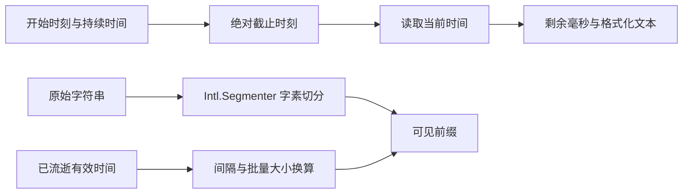

# 手写倒计时与打字机时间线：绝对截止时间和 Unicode 字素

## 题目线索与本文范围

公开社区讨论中出现过 PDD 笔试题相关报告，提到翻转倒计时、打字机效果和并发进度等题型；页面显示 09-22，但无法从该页面核实年份、完整题面或官方评分协议。[牛客社区讨论](https://www.nowcoder.com/feed/main/detail/076d4b5635a0416d97ed42e30e50348a?sourceSSR=dynamic)。本文不复制题面，也不把这些报告说成同一题，更不声称拥有 PDD 官方答案。

下面是作者派生的两道练习：第一道以绝对截止时间计算倒计时，第二道按 Unicode 字素簇（grapheme cluster）推进文本。两者只实现时间与文本模型，不含完整 DOM 组件、CSS 翻页动画、删除回放、实时流追加或 OJ 输入输出。

Node 测试真实覆盖这些模型和边界行为。文中若出现接入 rAF 或 DOM 的片段，会明确标为未在浏览器运行；通过模型测试不能推断 CSS 翻页、真实屏幕刷新或无障碍体验已经验收。

## 问题：每秒减一与按码元截断都会出错

一个常见倒计时写法是每隔 1000 ms 执行 `remaining -= 1000`。浏览器主线程忙碌、标签页隐藏、系统休眠时，间隔回调可能延迟或被节流。如果十次回调实际跨过 12 秒，计数器仍只减 10 秒，倒计时会落后真实截止时间。

更稳妥的做法是先记录一个绝对截止点 `deadline = now() + duration`，每次展示前重新计算 `remaining = max(0, deadline - now())`。无论中间遗漏多少次更新，下一次读取都能追上当前时钟。这是“读时计算”，不是按 tick 次数累减。

打字机效果也有常见边界。JavaScript 字符串的 `length` 和 `slice()` 以 UTF-16 码元为单位；扩展 emoji 可能包含多个码点和多个码元，家庭 emoji 还可由零宽连接符组合。按码元切片可能产生孤立代理项；按码点展开也可能把视觉上的一个字符拆开。`Intl.Segmenter` 能按 grapheme 粒度取得更接近用户感知字符的片段。[MDN：Intl.Segmenter](https://developer.mozilla.org/en-US/docs/Web/JavaScript/Reference/Global_Objects/Intl/Segmenter)

## 心智模型：截止点和文本片段分别由时钟驱动

先看两种模型各自保存什么。倒计时保存截止时刻，打字机保存分段结果与已经消耗的有效时间；都不保存“上次 tick 后应该减去几秒”。



读图时把“计时策略”与“如何显示”分开。倒计时模型返回毫秒和 `MM:SS` 字符串；`digitTransitions()` 只比较旧字符串与新字符串的槽位，返回变化数据。打字机模型返回完整可见前缀，不负责把它写进 DOM。UI 决定如何使用结果。

## 一、倒计时：用截止时刻取代计数器

### 时间公式与边界

设当前单调时钟读数为 `t`，创建时长为 `D`，截止时间为 `T = t + D`。在任意后续读数 `n` 上，剩余时长为 `max(0, T - n)`。这个公式可以直接跳到任意时刻，所以浏览器少调度几次不会积累数值误差。

例如，倒计时 5 秒在时钟 `1000 ms` 启动，截止点是 `6000 ms`。若页面下一次可更新时已经是 `3750 ms`，剩余量就是 2250 ms，而不是根据几次 interval callback 来猜。

`DeadlineClock` 接收调用者提供的 `now()` 函数。它不擅自选择 `Date.now()` 或 `performance.now()`，因为两者适合不同生命周期：单页内测量可选单调高精度时钟；刷新页面后仍要恢复的截止时刻，通常需要服务器给出的 epoch 时间或持久化的墙钟时间。不要把页面内的单调时间戳写入持久存储后当成跨会话的 epoch。

本实现单调钳制倒退的 `now()` 读数。若系统时钟被回拨，剩余量保持不增加，直到输入时钟赶上已观测的最大值；若时钟前跳，下一次读取会提前到零。对付款、报名截止或授权期限，客户端计时只能展示信息，最终判定应由可信服务端时间完成。

### 暂停、恢复和释放

运行时暂停会先重新读取剩余量，再将状态改为 `paused`。恢复时用新的时刻加上保存的剩余量，建立一个新截止点。因此显式暂停期间不消耗倒计时。页面切到后台则不会自动调用 `pause()`；页面可见性是产品规则，需由调用者选择后台继续走时或冻结。

状态为 `idle`、`running`、`paused`、`finished`、`cancelled` 或 `disposed`。`cancel()` 保留当时剩余量但停止时间变化；`dispose()` 清除截止点并将快照置为 00:00。模型没有定时器，因此自身不会留下 interval；外层 UI 仍要取消它创建的 rAF、监听器或订阅。

| 方法或属性 | 输入 | 可观察结果 |
|---|---|---|
| `new DeadlineClock({durationMs, now})` | 有限非负毫秒与时钟函数 | 创建 idle 模型 |
| `start()` | 无 | 记录绝对截止点；重复调用不重置 |
| `remainingMs()` | 无 | 返回精确毫秒余量，过期后固定为 0 |
| `snapshot()` | 无 | `{state, remainingMs, display}` 新对象 |
| `pause()` | 无 | 保存余量并冻结 |
| `resume()` | 无 | 从保存余量重建截止点 |
| `cancel()` | 无 | 进入 cancelled，不再随时间变化 |
| `dispose()` | 无 | 进入 disposed 并清掉内部截止点 |

`now()` 必须始终使用同一个时间原点与单位。若 `durationMs` 用毫秒而 `now()` 返回秒，算式也会运行，却会立刻给出错误结果；类型系统无法区分两种 number。调用边界最好明确使用变量名和测试值标记单位，并对来自网络的输入进行解析和范围校验。

下面展示绝对时间运算的最小形状。真实逻辑还包含暂停、恢复、输入校验和时间单调钳制，位于 `scripts/content-labs/interview/deadline-clock.mjs`。

```js
const deadline = startTime + durationMs;
const remaining = Math.max(0, deadline - now());
const totalSeconds = Math.ceil(remaining / 1000);
const minutes = Math.floor(totalSeconds / 60);
const seconds = totalSeconds % 60;
```

余数只用于秒字段，分钟不取模 60。因此 60 分钟显示为 `60:00`，而不是意外回到 `00:00`。若产品希望显示 `HH:MM:SS`，应先明确超过 1 小时的格式，再改格式化器；不能在算法里悄悄丢弃高位分钟。

这里对正的剩余毫秒向上取整到秒。`remaining = 1` 毫秒仍显示 1 秒；仅当剩余量为零时显示 `00:00`。这种显示约定适合“还剩几秒”的倒计时；显示精确毫秒、进度环或已用时间时应使用原始 `remainingMs`，不要拿格式化字符串反推模型时间。

可以用边界表检查舍入与进位，不需要等一分钟再手动观察：

| 剩余毫秒 | 总秒数（向上取整） | 显示 |
|---:|---:|---|
| 0 | 0 | 00:00 |
| 1 | 1 | 00:01 |
| 999 | 1 | 00:01 |
| 1000 | 1 | 00:01 |
| 1001 | 2 | 00:02 |
| 59999 | 60 | 01:00 |
| 60000 | 60 | 01:00 |
| 60001 | 61 | 01:01 |

这份表格刻意在整秒前后都取值。若 59999 ms 显示为 `01:00`，这是“向上显示还有多少秒”的结果；若产品希望显示经过时间，59999 ms 可能更适合显示 `00:59`。取整方向由用户承诺决定，不能只因为某个数字看起来熟悉就省略边界定义。

开始操作也要有清楚语义。构造对象不会自动运行，只有调用 `start()` 才读取时间并建立 deadline；重复调用 start 不重置倒计时。暂停或取消后的恢复只通过 `resume()` 发生。若要重新开始一轮，应创建新实例，而不是偷偷复用已经完成的状态。

`snapshot()` 每次返回一份新对象，适合状态管理层比较和渲染。它不会订阅时钟，也不会在后台自行通知 UI；如果调用方一直不读取，屏幕当然也不会刷新。纯模型与绘制节奏分开，测试才能把“时间算对”与“浏览器何时绘制”两件事分别验收。

### 翻页数字只是状态差异数据

显示从 `01:00` 变为 `00:59` 时，模型可以逐槽返回 `{position, from, to, changed}`。这份数据足以让 UI 知道哪几位发生变化，但并没有建立卡片、旋转轴、裁切面、动画时长或 CSS transform。`digitTransitions()` 仅处理固定宽度的 ASCII 时钟格式，并要求新旧字符串相同宽度。

在界面层，每个位数可将 `from` 与 `to` 放入两个视觉面，再由 WAAPI 或 CSS transition 做翻转。但这是调用者的渲染策略；本文没有实现或测试该 DOM 结构。容器高度、字体基线、减少动态效果偏好和屏幕阅读器文本都要单独设计。

## 二、打字机：按用户感知字符推进

### UTF-16 码元、码点、字素簇

字符串下标先遇到 UTF-16 码元（code unit）。例如某些 emoji 用一对代理码元表示；`[...text]` 改按 Unicode 码点（code point）遍历，会将代理对合并，却仍会拆开肤色修饰符、地区旗帜对、组合附加符号和 ZWJ emoji 序列。

字素簇是近似于用户所感知“一个字符”的文本单元。`Intl.Segmenter(locale, {granularity: 'grapheme'})` 返回可迭代的分段对象，每个对象的 `segment` 是一段文本。本文将这些 segment 预先放入数组，之后按数组项拼接可见前缀；既不会切开 surrogate pair，也不会切开家庭 emoji 序列。[MDN：Intl.Segmenter 用法](https://developer.mozilla.org/en-US/docs/Web/JavaScript/Reference/Global_Objects/Intl/Segmenter)

预先分段需要与文本长度成正比的内存；本实现一次性处理完整输入，不适合无限增长的实时文本流。输入长度上限、虚拟化和流式分段属于另一层工作。若运行环境没有 `Intl.Segmenter`，构造函数明确失败；本文不偷偷退回 `[...text]`，因为那会改变“一个字符”的契约。

### 推进公式、延迟与批量

令 `elapsed` 为已流逝的有效毫秒，`delay` 为首次输出前的初始等待，`interval` 为每批间隔，`batchSize` 为每次最多显示的字素数。活跃时长是 `max(0, elapsed - delay)`；已显示数量是 `min(total, floor(activeElapsed / interval) * batchSize)`。

在本文约定下，启动瞬间显示 0 个字素。若 interval 为 50 ms，第一批在有效时间满 50 ms 后出现；batchSize=3 则首次显示前三个字素。选择“第一字立刻出现”也合理，但公式需要加一，并要同步改变验收边界。本实现不混用两种语义。

浏览器若在后台暂停更新 4 秒，恢复时一次 `update()` 可根据已流逝时间直接显示已经到期的前缀。它不会模拟四十次漏掉的逐字 callback，也不会回放每一个字。若产品希望恢复后仍逐字补播，可以将已到期的差值队列化，但那需要定义积压上限与中断策略。

`pause()` 先同步一次当前进度，然后记录已流逝时长；`resume()` 开始新的时钟片段，暂停期间不计入有效时间。`fastForward()` 立刻显示全文并完成；`cancel()` 保留当前前缀并终止；`dispose()` 清除分段数组。删除字符、逐字回删、循环播放、随机速度、边打字边追加都不在当前契约内。

| 方法或属性 | 输入 | 可观察结果 |
|---|---|---|
| `new TypewriterTimeline(options)` | 文本、正 interval、可选 delay/batch/locale、时钟 | 预切分字素，状态 idle |
| `start()` | 无 | 开始计算有效时间，空文本直接完成 |
| `update()` | 无 | 依当前时间返回并保存可见前缀 |
| `snapshot()` | 无 | 状态、已显示数、总数、前缀和 done 标记 |
| `pause()` / `resume()` | 无 | 冻结 / 继续有效时长 |
| `fastForward()` | 无 | 显示全文并进入 finished |
| `cancel()` | 无 | 保留前缀并进入 cancelled |
| `dispose()` | 无 | 丢弃字素数组并进入 disposed |

`batchSize` 是每个完整 interval 新增的最大字素数。最后一批可少于 batchSize，例如 5 个字素、每批 2 个，三次间隔分别显示 2、4、5 个。`initialDelayMs` 只在最初等待一次；暂停后恢复沿用已扣除 delay 的总有效时间，不会每次恢复都重新等完整 delay。

代码中的时间采样接口刻意只有 `now()`。每次 `update()` 都按时间公式计算绝对进度，而不执行 `revealed += 1`。因此调用方多久采样一次不会改变最终前缀；但 UI 是否每个时刻都重绘，仍取决于调度与主线程状态。

用一张表检查第一次与追赶边界。表里的“有效时间”已经扣除初始延迟，`batchSize=2`、`interval=20 ms`：

| 有效时间 | 完整间隔数 | 理论可见数 | 8 个字素的实际前缀长度 |
|---:|---:|---:|---:|
| 0 ms | 0 | 0 | 0 |
| 19 ms | 0 | 0 | 0 |
| 20 ms | 1 | 2 | 2 |
| 39 ms | 1 | 2 | 2 |
| 40 ms | 2 | 4 | 4 |
| 90 ms | 4 | 8 | 8 |

完成后，`update()` 仍返回稳定的最终快照，不会将 `finished` 重新改回 `running`。取消则保留当前前缀，且 `resume()` 不会复活取消状态。显式快进可以发生在 idle、running 或 paused 状态；它直接将可见数量设为全部字素并进入 finished。

文本模型当前有意不支持“追加更多内容”。若正在显示的原始文本被追加，预切分数组与总长度都需要更新，还需决定新内容从当前时间立刻出现还是重新等待一个间隔。对于网络流，应另行设计追加 API、背压和队列上限，而不是从外部偷偷修改原字符串。

预先分段也有成本。创建时需要访问输入中的每个字素并将 segment 保存在数组里，显示快照时再把前缀 join 成新字符串。对几百字的提示很直接；对数百万字的长文，逐帧 join 全前缀并不合适，应以块、游标或虚拟文本渲染，并设置输入上限。这个简化实现的目标是清楚定义 Unicode 和时间语义，不是长文本性能库。

### 用浏览器驱动模型（示意，未运行）

下面代码展示一个调用者可以怎样把模型接到页面帧回调。此代码标为 `runnable: false`：没有 HTML、没有实际 DOM 测试，也没有在浏览器运行。仓库里通过测试的是模型方法，不是这个片段。

```js
function renderFrame() {
  const snapshot = timeline.update();
  output.textContent = snapshot.visibleText;
  if (snapshot.state === 'running') frameId = requestAnimationFrame(renderFrame);
}
frameId = requestAnimationFrame(renderFrame);
```

调用者还要在组件卸载时用 `cancelAnimationFrame(frameId)` 清除待处理帧，并调用 `timeline.cancel()` 或 `dispose()` 释放状态。`requestAnimationFrame` 是一次性请求，继续运行需要在回调中再次请求；它通常与显示刷新节奏协调，后台页面可能暂停。[MDN：requestAnimationFrame](https://developer.mozilla.org/en-US/docs/Web/API/Window/requestAnimationFrame)

这段适配有个值得讨论的选择：打字机模型按 interval 变化，但渲染循环可能每帧读取一次。若 UI 不需要逐帧效果，可使用更低频的调度器；但即便降频，进度仍应按绝对时间采样，而不是把每个 scheduler callback 直接当作一个字符。若同一页面还有其他 RAF 动画，最好共用页面级调度器，避免每个组件各自启动一个长循环。

倒计时也可按需刷新，而无需常驻每帧任务。格式只在显示秒数变化时更新时，可以在应用层判断 `snapshot.display` 是否变更后再写 DOM；时钟模型本身仍返回精确毫秒。取整前后显示字符串相同的多个读数，不需要造成多次相同 DOM 写入。

### 无障碍与文本更新频率

打字机逐字更新可能频繁触发辅助技术播报。把整个容器设为 `aria-live` 并每 20 ms 写一个字，可能使屏幕阅读器不断打断或积压播报。可以让视觉逐字动画和辅助技术摘要分离：视觉容器不作为高频 live region，另设完成后才更新的简短可访问文本，或按业务分段播报。

倒计时每秒变化也不必每一帧播报。若时限本身重要，产品应决定关键阈值是否需要通知，而不是把 `00:59`、`00:58` 每一秒都强制读给用户。数字滚动与翻页动画还应尊重 `prefers-reduced-motion`，必要时改为静态数字直接替换。[MDN：Web Animations API 无障碍提示](https://developer.mozilla.org/en-US/docs/Web/API/Web_Animations_API.)

可见文本用 `textContent` 插入可以把输入当作文本，而非 HTML。若未来需求包含标签或富文本，分段和转义就变成不同问题；不要把这份纯文字模型输出拼进 `innerHTML`，否则输入内容可能被解释为标记。

## 真实实现对照

### Web Animations API：DOM 效果交给浏览器动画对象

浏览器的 `Element.animate(keyframes, options)` 可将元素关键帧和时序选项交给 Web Animations API，并返回可控的 `Animation` 对象。对象提供 `pause()`、`play()`、`finish()` 和 `cancel()` 等播放控制；本文的两个模型则只给出数字和字符串，不直接触碰元素。[MDN：Element.animate](https://developer.mozilla.org/en-US/docs/Web/API/Element/animate) [MDN：Animation 控制方法](https://developer.mozilla.org/en-US/docs/Web/API/Animation)

如果把旧数字和新数字放到前后两层，WAAPI 可驱动 transform 来做翻页。这只是基于官方 API 的适配方向，并不是本文已有的生产案例代码，也没有在浏览器实测。若只需要每秒更新文字，通常无需为每次文本变化创建一个复杂翻转动画。

### Typed.js：成熟打字机库对时序与生命周期的处理

Typed.js 是面向 DOM 的打字机效果库。本文固定检查 v2.1.0 对应提交 `3daa3a4760dff3c563964ef0935b64ccfb0b22f8`，其 `src/typed.js` 管理逐段输出、退格、字符串序列和回调等行为。[Typed.js 固定版本源码](https://github.com/mattboldt/typed.js/blob/3daa3a4760dff3c563964ef0935b64ccfb0b22f8/src/typed.js) [v2.1.0 release](https://github.com/mattboldt/typed.js/releases/tag/v2.1.0)

Typed.js 的需求面比本文大：它围绕元素和循环字符串组织交互，而本练习接受一段纯字符串并产出可见前缀。阅读成熟库时要继续核对具体版本是否按 grapheme cluster 分段，不能从“支持打字机效果”推断它保证复杂 emoji 不会被拆开。本文独立选择 `Intl.Segmenter`，并用家庭 emoji 和组合字符测试了自己的模型。

## 易错点与权衡

| 误区 | 结果 | 应采用的检查 |
|---|---|---|
| 每秒执行 `remaining--` | 调度延迟累积成倒计时漂移 | 在任意时刻用 `deadline - now` 重算 |
| 只监听一秒 interval | 后台恢复时逐次追赶、页面恢复慢 | 下一次展示直接采样当前时间 |
| 秒数格式用 `% 60` 计算分钟 | 超过 60 分钟时高位丢失 | 分钟用总秒数向下除以 60 |
| 向下取整剩余秒 | 还有 999 ms 时显示 00 秒 | 对正剩余毫秒采用 `ceil` |
| `text[i]` 或 `slice(0, i)` | 截断代理对或组合序列 | `Intl.Segmenter` 按 grapheme 分段 |
| `[...text]` 当成完整 Unicode 字符 | 码点正确但用户感知字素仍可能拆开 | 测试组合符、旗帜与 ZWJ 序列 |
| 每个 tick 只推进一个 chunk | 页面后台后恢复要大量 tick 才追上 | 基于 elapsed 直接算目标前缀长度 |
| 把模型输出说成已测翻页动画 | 时间模型没有验证 DOM、CSS 与绘制 | 说明真实验收范围并用浏览器另测 |

### 30 秒面试回答

倒计时我会保存绝对截止时刻，每次渲染前算 `max(0, deadline - now())`，不按 interval 次数减一，这样后台少回调后也能直接追到真实剩余时间。打字机我会先用 `Intl.Segmenter` 按 grapheme cluster 切分，再根据已流逝时间和每批间隔算显示前缀长度，避免把 UTF-16 码元或组合 emoji 切断。暂停时冻结有效时间，恢复时建新的时间片；模型只产出状态，DOM 动画由界面层负责。

### 2 分钟面试回答

倒计时若每秒执行一次 `remaining -= 1`，事件循环被阻塞或者后台 interval 被节流后，计数会落后。实现时我记录 `deadline = now() + duration`，随时根据当前时钟重新求剩余时间，并用 `Math.max(0, …)` 将其截到零。显示时对正的剩余毫秒向上取整，分钟保留总量，所以 60 分钟不会回绕成 0 分钟。暂停时存余量，恢复时基于新的当前时刻重新建 deadline。此模型适合显示倒计时；涉及业务截止判定时应以服务端时间为准。

打字机则不能把 JavaScript 字符串下标当作用户看到的字符序号。UTF-16 码元会拆代理对，码点展开仍可能拆组合字符和 ZWJ emoji，所以我用 `Intl.Segmenter` 预切字素簇。时间公式将 `elapsed` 扣除初始 delay，再除以间隔并乘批量大小，最终限制在文本总字素数。恢复时直接计算已到期的前缀，而不是把漏掉的更新逐一回放。

我会用手控时钟验证分钟进位、零点、长时间跳跃、暂停恢复、后台后的直接追赶，以及中英文、组合重音和家庭 emoji。限制也要说清楚：本实现没有真的画翻页 DOM，没有测 rAF 绘制表现；`Intl.Segmenter` 不支持的运行环境会明确报错；拼字、删除回放和流式文本追加不在范围内。

## 自测题

??? success "题 1：5 秒倒计时晚了 1.4 秒才执行下一次更新，应该显示多少？"

    若 deadline 根据同一时间源推进，下一次剩余量直接由 deadline 减当前时刻计算，约为 3.6 秒；不会只减 1 秒后显示 4 秒。

??? success "题 2：为什么 `Math.ceil(remainingMs / 1000)` 适合秒倒计时？"

    对任何正的剩余毫秒都至少显示 1 秒，只有真正到零才显示 00 秒。若显示已经过去的整秒，取整策略则会不同。

??? success "题 3：展开字符串 `[...text]` 是否足以避免拆开 emoji？"

    不足。它遍历码点，代理对可以保持完整，但一个用户感知字素仍可包含多个码点，例如组合标记或 ZWJ emoji。

??? success "题 4：后台恢复后打字机应逐字补发所有遗漏步骤吗？"

    本练习不会。一次更新直接跳到按 elapsed 应显示的前缀；逐步追赶会产生额外积压、延迟和取消策略，需要独立设计。

## 真实验收：输入、命令与通过阈值

自动验收仅针对两个纯模型，Node 24.16.0，无第三方依赖。倒计时没有真实 interval；打字机没有 DOM。命令不会验证页面帧率、CSS 翻页、浏览器无障碍树或 `prefers-reduced-motion`。

| 检查 | 输入 | 通过阈值 | 失败证据 | 清理 |
|---|---|---|---|---|
| 倒计时无漂移 | 5 秒时长，时钟从 1000 跳到 2750 ms | 余量严格为 3250 ms | 比例于读取次数的误差或非有限值 | 测试进程退出 |
| 分钟进位 | 60000、60001 ms | 分别为 01:00 与 01:01 | 秒字段未归零或分钟丢失 | 同上 |
| 后台跳时 | 10 秒计时，时钟一次跳到 25 秒 | 状态 finished 且余量 0 | 仍等待补跑多个间隔 | 同上 |
| 暂停恢复 | 暂停 3800 ms 剩余，再让时钟跳过 8 秒 | 暂停时长不消耗余量 | 余量减少或恢复重启完整时长 | 同上 |
| Unicode 字素 | `A👩‍👩‍👧‍👦é中` | 分成 4 个字素；更新前缀不出现半个序列 | 码元或码点计数与用户感知单位混淆 | 同上 |
| 延迟与批量 | 40 ms 初始延迟，20 ms 间隔，每批 2 个 | 满 60 ms 后显示 AB，100 ms 后全部 5 个 | 首字时刻偏一间隔或批次数错误 | 同上 |
| 时间异常 | 非法 duration、NaN 时钟、时钟回退 | 构造/采样拒绝非法数值，回退不增加余量 | 无效显示或倒计时回滚 | 同上 |
| 生命周期 | cancel、fastForward、dispose | 状态、前缀和释放后的分段数符合测试 | 终态被意外复活或仍留文本数组 | 同上 |

在仓库根目录执行：

```sh
node --test scripts/content-labs/interview/ui-timeline.test.mjs
```

预期退出码为 0，摘要为 `tests 22`、`pass 22`、`fail 0`。若测试失败，先从失败断言的输入时刻检查单位是否为毫秒、时钟是否同源，再检查 interval 的取整边界和 segmenter 输出。命令执行后没有服务器或临时文件需要额外删除。

仓库脚本位置为 `scripts/content-labs/interview/deadline-clock.mjs`、`scripts/content-labs/interview/typewriter-timeline.mjs` 与 `scripts/content-labs/interview/ui-timeline.test.mjs`。不应将 `../..` 形式的相对代码路径嵌入 Markdown 链接；本文用可复制的仓库路径与可执行命令说明它们。

浏览器 UI 若作为后续验收，应由实际页面驱动 `requestAnimationFrame`，覆盖隐藏/显示、可访问文本、CSS 动画和减少动态效果偏好，并检查真实浏览器的计时源。本文没有运行该层，因此它不属于上面 22 项 Node 测试的通过范围。

## 深入阅读

- [MDN：Intl.Segmenter](https://developer.mozilla.org/en-US/docs/Web/JavaScript/Reference/Global_Objects/Intl/Segmenter)：了解 grapheme、word 和 sentence 三种文本分段粒度及其迭代接口。
- [ECMA-402：Intl.Segmenter](https://tc39.es/ecma402/#segmenter-objects)：阅读国际化 API 的标准语义，理解字素切分来自规范 API，而不是手写 emoji 正则。
- [MDN：Element.animate](https://developer.mozilla.org/en-US/docs/Web/API/Element/animate)：学习把关键帧和时间选项交给浏览器动画对象的接口。
- [Typed.js 3daa3a4 源码](https://github.com/mattboldt/typed.js/blob/3daa3a4760dff3c563964ef0935b64ccfb0b22f8/src/typed.js)：观察真实打字机库如何组织逐字推进、退格、字符串轮播与生命周期。
- [Web Animations Level 1 时间模型](https://www.w3.org/TR/web-animations-1/#timing-model)：比较标准动画时间线与本文一次性数值/文本模型的边界。
