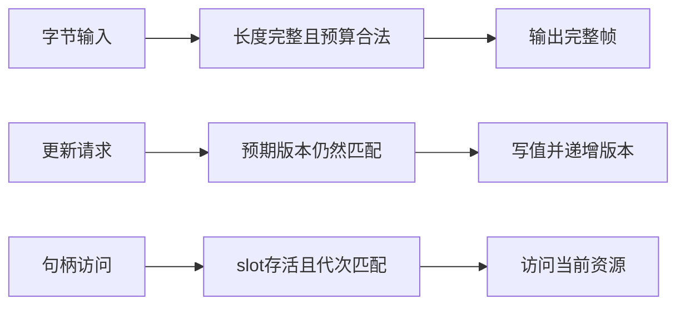
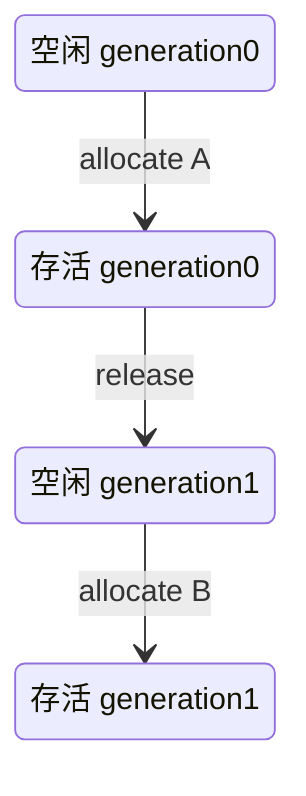

# 三道挑战题完整解答：拆帧、版本 CAS 与代次句柄

服务端收到的 chunk 被任意拆分；两个请求持有同一旧版本；一个释放过的 slot 被新资源复用。这三个故障都来自“看起来相同的引用，不一定仍指向原来的完整状态”。本页给出完整源码和测试，不只列解题思路。

先观察每个模型以什么证据允许状态前进：



拆帧检查的是消息边界，CAS 检查的是更新前提，句柄检查的是资源身份。这些检查不能因为“调用者大概不会传错”而省略。

完整实现见[models.mjs](https://github.com/Shyu-x/frontend-interview/blob/cb0ff08cb866221416d0625e7235d372c258059a/scripts/content-labs/challenges/models.mjs)，测试见[models.test.mjs](https://github.com/Shyu-x/frontend-interview/blob/cb0ff08cb866221416d0625e7235d372c258059a/scripts/content-labs/challenges/models.test.mjs)。frontmatter 与两个源码链接固定同一个实现快照；分支合并并清理后链接仍可追溯，不随后续主分支更新而改变本页验收所指的代码。

## H283：四字节长度前缀增量拆帧

### 现象与规则

发送方写入 `[length][payload]`，不代表接收方会一次收到它。题目固定 length 为四字节 unsigned big-endian，单位为 payload 字节数；`feed(Uint8Array)` 返回本次完整帧数组，`end()` 表示没有后续输入。长度为零是合法空帧。

`maxBytes` 必须为 0–16 MiB 的安全整数。收到完整 header 后先核对声明长度，再分配 payload；大于预算、类型错误或 EOF 残缺进入不可恢复 failed 状态并释放部分 payload。failed 后再次输入抛错；成功 end 可重复调用，但之后不可 feed。

| 输入状态 | 本次输入 | 结果 |
| --- | --- | --- |
| header 已收到 2 字节 | 另 2 字节 header 与部分 payload | 等待 payload，不提前输出 |
| payload 只差 1 字节 | 最后字节加下一帧 header | 输出第一帧，继续解析第二帧 |
| header 声明超过预算 | header 本身 | RangeError，尚未分配 payload |
| body 未收完整 | end | SyntaxError，并转 failed |

### 机制与实现

保留 `headerUsed`、`payloadUsed` 和状态；一次 feed 可以处理多帧，但任何一帧未完整时都不能输出。需要复制 bytes，不能把输入 chunk 的 subarray 当长期输出，否则调用者复用 buffer 会改变已交付帧。

下面是实际可运行的调用；此前创建协议字节使用固定五字节样例：

```js
import { lengthPrefixedDecoder } from './scripts/content-labs/challenges/models.mjs';
const decoder = lengthPrefixedDecoder(8);
const first = decoder.feed(Uint8Array.of(0, 0));
const second = decoder.feed(Uint8Array.of(0, 1, 7));
decoder.end();
console.log(first, second.map(frame => [...frame]));
```

从仓库根目录用 Node 模块执行，结果是空数组与 `[[7]]`。实际源码中读取长度的关键片段如下，header 恰好四字节：

```js
const length = new DataView(header.buffer).getUint32(0, false);
if (length > maxBytes) return fail(new RangeError('frame exceeds maxBytes'));
headerUsed = 0;
payload = new Uint8Array(length);
if (length === 0) { output.push(payload); payload = null; }
```

完整循环还要消费未使用的 chunk 字节、处理零长度帧、重置 body 游标并拒绝失败后的再输入；这些分支都在完整源码中，没有省略成占位代码。

### 边界与验证

测试将 `[7]` 和空帧组成的九字节流按所有 **256 种**分块组合喂入，与原始两个 payload 对照；另外覆盖所有二段切分、中文/emoji 原始 bytes、最高位为 1 的无符号长度、空输入、重复 end、失败后继续输入及输出隔离。拆分测试不是固定几个位置都通过就推断所有分块。

这不是 WebSocket、HTTP 或生产 RPC 解析器。单次 feed 中若前面有完整帧、后面遇到非法帧，本调用整体抛错，前面的暂存输出不交付；先前成功调用的输出不撤回。模型没有生产端背压、连接超时或慢速攻击保护，必须在外层处理。[Node Stream](https://nodejs.org/docs/latest-v24.x/api/stream.html)与[RFC 6455](https://www.rfc-editor.org/rfc/rfc6455)分别提供真实流和另一种协议机制参考，不是本自定义协议的题面来源。

## H179：乐观版本 CAS 教学存储

### 现象与规则

两个请求都读到 `{value:10, version:0}`。如果双方直接 set，最后写入者会覆盖前一个更新；本题要求后提交者得到冲突。`createVersionedStore([{id,value}])` 初始化每条 version=0；`read(id)` 返回复制快照；`compareAndSwap(id, expectedVersion, newValue)` 只在版本匹配时更新。

| 事件 | 返回值 | 存储状态 |
| --- | --- | --- |
| CAS(a,0,11) | `{ok:true,version:1}` | value=11,version=1 |
| CAS(a,0,12) | `{ok:false,currentVersion:1}` | 保持 value=11 |
| read(a) 后修改返回对象 | 返回对象变化 | 存储不变 |
| 匹配版本但新值无法 structuredClone | DataCloneError | value/version 均不变 |

ID 必须为非空字符串，重复初始 ID 和缺失记录报错，预期版本为非负安全整数。不支持删除与重新创建，因而不讨论删除后的版本重置；允许的值取决于 `structuredClone`，不支持函数，不是任意 JavaScript 对象的序列化器。

### 机制与实现

先比较版本，成功路径先复制新值再写入，确保 clone 失败不留下“版本前进但内容没更新”的半完成状态：

```js
if (current.version !== expectedVersion) {
  return { ok: false, currentVersion: current.version };
}
const copiedValue = structuredClone(newValue);
current.value = copiedValue;
current.version++;
return { ok: true, version: current.version };
```

完整源码额外检查 ID、整数范围与版本溢出，初始化和 read 都复制值。下列调用直接由实际实现支持：

```js
import { createVersionedStore } from './scripts/content-labs/challenges/models.mjs';
const store = createVersionedStore([{ id: 'order', value: 10 }]);
console.log(store.compareAndSwap('order', 0, 11));
console.log(store.compareAndSwap('order', 0, 12));
console.log(store.read('order'));
```

输出依次是成功 version=1、冲突 currentVersion=1、值11与版本1的记录；键的展示顺序不参与验收。测试还验证初始化对象、read 快照和新值都不与调用者共享可变引用。

### 边界与验证

这是同步、单进程、内存模型，不是原子跨线程操作，也不提供多记录事务或持久化。真正数据库要把版本条件写进 UPDATE，并检查影响行数；隔离级别、重试、事务范围与业务跨行约束需要单独测试。[PostgreSQL 18 事务隔离](https://www.postgresql.org/docs/18/transaction-iso.html)支持机制研究，不能从 Node Map 测试推断数据库已经验收。

## H335：slot 与 generation 的句柄池

### 现象与规则

slot=0 曾属于资源 A，释放后又属于 B。只传 slot 的异步回调可能把 B 当 A 修改；句柄必须同时携带 generation。`createHandlePool(capacity)` 支持 allocate、get、release 和只含元数据的 snapshot，容量为 1–100000。



旧句柄 `(0,0)` 在资源 B 存活时也不能访问，因为 B 的句柄是 `(0,1)`。满池、陈旧句柄、重复 release、非法 slot/generation 抛 RangeError；释放将 value 清为 undefined。

### 机制与实现

实际校验同时检查 slot 范围、存活位和代次：

```js
const slot = slots[handle.slot];
if (!slot || !slot.used || slot.generation !== handle.generation) {
  throw new RangeError('stale handle');
}
return slot;
```

allocate 从空闲栈取一个槽位，release 增长代次后还回空闲栈；代次达到安全整数上限时永久退役该槽位，不回绕复活旧句柄。返回句柄冻结，snapshot 只含 generation/used，不返回 value。

```js
import { createHandlePool } from './scripts/content-labs/challenges/models.mjs';
const pool = createHandlePool(1);
const old = pool.allocate('A');
pool.release(old);
const current = pool.allocate('B');
console.log(current, pool.get(current));
```

输出新句柄 `{slot:0,generation:1}` 与 B；调用 `pool.get(old)` 则失败。这些值对象仍遵循引用语义：get 不深拷贝 value，资源所有者必须自行决定外部是否可修改对象。

### 边界与验证

测试覆盖满池、槽位复用、旧代次、双释放、多个存活槽位与只返回元数据的 snapshot。不用“测试结束时内存为零”断言真实 GC 已发生；这里检验代码不再持有 value，不测 V8 的回收时间。达到 `MAX_SAFE_INTEGER` 的退役分支没有靠运行数千万亿次复用实测，属于代码防线而非测试覆盖声明。

句柄限定用于创建它的池，但没有带池标识；调用者必须保持池与句柄关联。这不是防伪能力令牌，不能用它作为跨租户鉴权。真实共享内存池还需要原子更新、并发竞争和生命周期协议。[Worker Threads](https://nodejs.org/docs/latest-v24.x/api/worker_threads.html)和[Wasm Core](https://webassembly.github.io/spec/core/)是进一步研究入口，不是同步模型等同其实现的证据。

## 真实验收

无需第三方依赖；从仓库根目录用 Node 24.16.0 执行：

```sh
node --test scripts/content-labs/challenges/models.test.mjs
node --test scripts/check-handwritten-bank.test.mjs
```

模型测试应显示 `tests 21 / pass 21 / fail 0`；题库检查器测试为 `tests 10 / pass 10 / fail 0`。失败时先检查具体子测试，拆帧看游标和字节长度，CAS 看复制前后的状态，句柄看 used/generation。检查器反向用例另覆盖伪来源锚点、字段重复以及“已实现但未实跑”的状态误判。两者都使用真实异常与状态断言，不把预填数字相加冒充验证。

全部实验回归入口包含此前 13 个子入口加本页 1 个：

```sh
node scripts/content-labs/run.mjs --integrations --interview --challenges
```

预期聚合输出 `PASS 14 content labs on v24.16.0`。其中此前面试套件 57 个测试、本页21个测试分别输出，不混称为360道题全部通过。所有新测试数据仅在内存中，无文件、服务器或生产数据需清理。

## 易错点与修正

| 错误 | 可观察后果 | 修正 |
| --- | --- | --- |
| 一次网络 chunk 当一帧 | 跨 header/body 时拆错 | 用持久游标和状态 |
| 分配后才检查长度 | 恶意声明占用内存 | 验证预算后分配 |
| 比较与写值之间 await | 另一个更新能插入 | 明确同步原子区域或真实数据库原子条件 |
| 返回存储原对象 | 调用者绕过 CAS 修改值 | 复制快照与新值 |
| 只验证 slot | 旧回调访问新资源 | 同时验证 generation |

## 面试回答与自测

30 秒：三个模型分别用长度完整性、版本匹配和代次匹配证明前提仍成立，失败路径不能提交半完成状态；同步测试不替代真实网络或数据库并发。

2 分钟：我先定义边界：每帧四字节长度、16 MiB 最大预算、EOF 残缺报错。实现保存游标并在分配前验证，测试所有短流分块组合。CAS 类似：先比较版本，再复制，再提交，clone 失败不改变旧状态。句柄池则把 slot 与代次绑定，释放后复用也拒绝旧回调。最后说明流模型缺少背压，CAS 没有跨行事务，句柄池没有防伪或多线程保证。

<details><summary>拆帧通过所有短流分块组合，能否证明真实连接没有慢速攻击风险？</summary>

不能。还要设置连接超时、输入速率、累计连接预算和生产端背压。

</details>

<details><summary>CAS 冲突时能否直接重试原来的 newValue？</summary>

不能保证正确。应该重新读当前值、重新计算更新并按业务限制重试，避免把旧计算再次覆盖上去。

</details>

<details><summary>为什么 generation 不回绕？</summary>

回绕可能让多年以前的旧句柄再次匹配；本模型选择退役槽位，需要业务另外处理可用容量降低。

</details>
