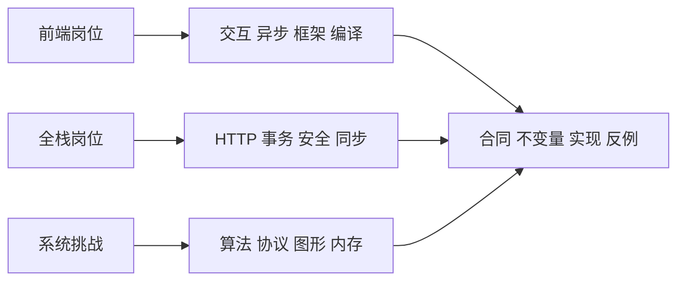

# 前端与全栈手写题库：360 道合同化挑战

“手写一个队列”不足以区分普通练习与有挑战的笔试。队列要不要限制字节数？取消会不会释放生产端？同一个回调是否允许重入？本题库把这些问题写成可判定合同，保留原有 48 题，再新增 312 题，共 **360 道**。这不是 360 份已经完成的答案。

先按准备目标选题册，再按证据完成练习：



每条路线都先固定输入输出与失败语义，再选择实现。面试不会因为你用了某个框架就省略时序、资源和数据一致性问题。

## 完整范围与稳定编号

原 48 题的标题编号保留；机器清单将它们对应为 H001–H048。新增题使用显式 H049–H360，来源页和代表解答不算额外题目；追问、两个用例与不同语言实现也不重复计数。

| 编号 | 题册 | 数量 | 核心挑战 |
| --- | --- | --- | --- |
| H001–H048 | [面经相关基础与进阶](handwritten-question-catalog.md) | 48 | 公开回忆、常见题型和作者派生合同 |
| H049–H074 | [UI 与可访问组件](practice-ui-components.md) | 26 | 键盘、组合交互、编辑状态与生命周期 |
| H075–H100 | [异步编排与调度](practice-async-orchestration.md) | 26 | 公平、取消、背压、重入和跨资源一致性 |
| H101–H126 | [框架与状态系统](practice-framework-state.md) | 26 | 订阅、owner、缓存与渲染一致性 |
| H127–H152 | [编译器与工具链](practice-compilers-tooling.md) | 26 | 小语法、IR、构建图和热更新 |
| H153–H178 | [Node 与 HTTP](practice-node-http.md) | 26 | 流、连接、协议和服务生命周期 |
| H179–H204 | [数据库与事务](practice-databases-transactions.md) | 26 | 冲突、快照、索引、迁移和恢复 |
| H205–H230 | [鉴权与安全](practice-auth-security.md) | 26 | 租户、会话、授权和输入边界 |
| H231–H256 | [分布式同步](practice-distributed-sync.md) | 26 | 幂等、租约、重放、重试和最终收敛 |
| H257–H282 | [算法与数据结构](practice-algorithms-structures.md) | 26 | 编辑、区间、图、索引与精确 tie-break |
| H283–H308 | [解析器与协议](practice-parsers-protocols.md) | 26 | 跨 chunk、损坏输入、编码与状态机 |
| H309–H334 | [图形与媒体](practice-graphics-media.md) | 26 | GPU 所有权、资产布局、空间查询与媒体时间 |
| H335–H360 | [运行时与内存](practice-runtime-memory.md) | 26 | 代次、arena、跨线程、线性内存与 ABI |

## 每道新增题的八个字段

| 字段 | 读者应能回答 |
| --- | --- |
| 题目契约 | 实现哪个接口，输入什么，输出什么？ |
| 约束与不变量 | 支持哪些数据，状态、顺序和错误规则是什么？ |
| 用例 A | 一组具体输入/事件产生什么结果？ |
| 用例 B | 哪个边界会让看似正确的实现失败？ |
| 实现提示 | 必要的数据结构或状态如何组织？ |
| 进阶追问 | 取消、扩容、并发、故障或性能边界如何变化？ |
| 难度 / 建议时长 | 如何做限时练习？这不是公司评分标准。 |
| 依据与状态 | 是真实面经还是自主题？是否已有实跑解答？ |

新增 312 题是作者自主设计，官方资料只支持机制参考。原 48 题保留各自公开面经性质与未知字段；[来源与证据页](handwritten-practice-sources.md)区分公开题库、个人回忆、官方机制和用户线索。PDD 动画引擎“2026 年秋招第一场”目前仍只是用户线索，不是找到完整原题的声明。

## 五层练习法：是什么、为什么、怎样写

1. **现象：**手算用例 A，明确输出格式和可观察副作用。
2. **规则：**把合同写成签名、前置条件和失败语义，不能同时接受互相矛盾的结果。
3. **机制：**用队列、索引、图或有限状态机解释不变量为什么保持。
4. **实现：**先实现合同子集再跑反例，不用依赖库偷偷完成要求手写的核心算法。
5. **边界：**主动加入取消、重复消息、越界、恶意输入、时钟跳变或故障恢复。

例如完整参考的 H283 不是“把数组切几段”：其四字节长度头可能拆成四次输入，payload 可能多次输入或与下一帧合并。长度超过预算必须在分配之前失败，EOF 不能默默吞掉半个包。[三道代表题完整解答](handwritten-challenge-solutions.md)包含 H179、H283、H335 的源码与真实测试。

## 如何选题与交付答案

| 准备方式 | 执行方法 | 完成标准 |
| --- | --- | --- |
| 45 分钟模拟 | 从一个题册任选一题，先口述合同，再编码 | 正常、失败与清理用例可重复通过 |
| 高难加练 | 选择“难/挑战”，加入该题进阶追问 | 新约束下重新说明不变量，不只是补 if |
| 全栈小项目 | 将 HTTP、事务和授权各一题组合 | 端到端请求、失败回滚和租户隔离可观察 |
| 原理复盘 | 连接站内框架、引擎、Wasm 或图形专题 | 能解释实现与真实系统之间的差距 |

不建议按编号机械刷完。先找自己最弱的失败边界，例如“过期回调写回”“事务读后覆盖”“资源释放后复用”；再从不同题册选相同机制的不同合同。浏览器键盘、屏幕阅读器、真实 GPU、多进程数据库与网络故障必须另外执行，不能由 Node 同步模型代替。

## 可复现清单与真实验收

机器清单为[handwritten-bank-360.json](../assets/research/handwritten-bank-360.json)，逐题保存 ID、标题、页面、证据类型、机制来源和合同 SHA-256。清单不是第二份题库，不重复增加数量；修改用例后应更新哈希，避免旧索引与正文漂移。

仓库根目录执行结构和清单检查：

```sh
node scripts/check-handwritten-bank.mjs --check
node --test scripts/check-handwritten-bank.test.mjs
```

通过阈值是连续 H001–H360、48 旧题加 312 新题、12 个题册各 26 题、八字段齐全、两个用例不重复、已登记来源锚点存在、清单与正文一致。检查还拒绝重复 ID、相同归一化标题、完全相同合同及省略占位。它不能自动证明用例算对、语义完全不重复或所有题已实现；这些需要人工复核与实际解答。

生成清单的命令输出 JSON 到标准输出，校验失败时退出非零。不要把报错文本当 JSON 覆盖清单：

```sh
node scripts/check-handwritten-bank.mjs --json
```

代表解答验收与此前实验的回归命令如下；依赖安装和范围见[系统路线](../resources/content-map-and-roadmap.md)：

```sh
node --test scripts/content-labs/challenges/models.test.mjs
node scripts/content-labs/run.mjs --integrations --interview --challenges
```

本页 `runnable: false` 表示这是题库索引，不是 360 个答案的运行入口。代表题分别给出本机版本和输出；完整 CI 检查是元数据、格式、图表、题库结构和严格站点构建。清理无需删除题库：测试仅用内存，没有生产数据；生成的站点和安装依赖按仓库既有忽略规则保留。

## 面试回答

30 秒：我把题面拆成接口、状态不变量和失败语义，先手算两个可判定用例，再选择数据结构；限时内完成合同，而不是追求未经约定的“通用实现”。

2 分钟：例如乐观更新，两个读者都拿到 version=0，先提交者更新为 1，后提交者必须得到冲突而不能覆盖。单进程教学模型用一次同步比较更新演示机制；真实 SQL 要把版本条件放入 UPDATE 并检查影响行数，还要处理回滚、重试和跨行业务约束。用陈旧版本与不可复制新值测试错误路径，说明模型测试不能证明数据库隔离级别。

## 自测

<details><summary>360 道中多少道有完整实现？</summary>

不能把总题量当作答案数量。新增题中 H179、H283、H335 在代表解答页提供本轮完整模型；旧专题有其原有实现。其他新增题是完整练习合同，尚未逐项实现或实跑。

</details>

<details><summary>为什么字段齐全仍要人工检查重复与答案？</summary>

相同问题可以换一种措辞，字段也可能填上错误结果；结构检查只排除明显重复、缺失和漂移，不能替代语义审查与独立 oracle。

</details>

<details><summary>为什么参考 RFC 的题不能称为官方笔试原题？</summary>

RFC 支持协议机制，招聘归属需要原题或可靠面经。作者设计的接口和用例应始终标为自主练习。

</details>

## 深入阅读

- [来源与证据分级](handwritten-practice-sources.md)：核对原题、个人回忆和机制参考的区别。
- [全仓内容地图](../resources/content-map-and-roadmap.md)：把练习连接到框架、运行时、数据库和图形原理。
- [BFE.dev](https://bigfrontend.dev/problem)与[GreatFrontEnd](https://www.greatfrontend.com/questions)：阅读公开题型入口，比较自己的薄弱覆盖，不复制付费答案。
