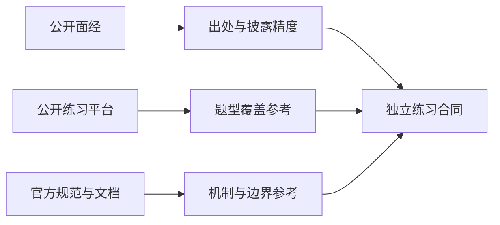

# 手写题来源与证据：公开题库、官方机制和自主挑战

搜索到一个热门题目，不等于找到了某家公司某一场笔试的完整原题。下面登记本轮实际查阅的公开入口；新增 H049–H360 的接口、约束和用例由作者设计，不是复制这些入口的题面或答案。

先看来源能证明什么，再看如何设计练习：

面经能支持“作者回忆出现过相近题型”，规范能支持“某种行为的机制”，两者不能互相替代。现有面经登记继续保存在[出处 JSON](../assets/research/interview-provenance-20261012.json)，不混入本页的机制参考。

## 证据分级与本轮边界

| 类型 | 可以据此说什么 | 不可以据此说什么 |
| --- | --- | --- |
| 个人面经 | 作者自述经历与题型，保留未披露字段 | 公司官方题面、统一评分规则、准确隐藏用例 |
| 公开练习平台 | 平台公开展示的题型与准备方式 | 页面未公开的公司归属或付费答案 |
| 官方机制文档 | API、规范或项目提供的机制参考 | 文档中的机制必然被招聘考过 |
| 作者自主设计 | 本仓库规定的接口、约束和判定用例 | 任意公司的原题或已执行的实现 |
| 用户线索 | 用户于本次对话指明的年份和题型 | 独立公开核验已经完成 |

用户补充 PDD“第一场动画引擎”为 **2026 年秋招**。这是用户提供的年份线索，不是公开帖子佐证；具体日期、场次序号、完整接口和评分规则仍未独立核实。[动画引擎实现](animation-engine-handwritten.md)保留为自主教学解答。找不到该题不会阻止扩充相当难度的前端与全栈练习。

核验日期统一为 2026-10-12。Living Standard 和 latest 文档会继续变化；下面的 Node 参考锁定 v24 系列、PostgreSQL 锁定 18 系列，不能从文档最新补丁号推断本机测试版本。TypeScript/Vite 等入口仅为 API 研究参考，不声称分析了没有固定的生产源码提交。

## 公开练习入口

### S01 {#s01}

[BFE.dev JavaScript Coding Questions](https://bigfrontend.dev/problem)：公开列表涵盖异步队列、Grid 自动放置、不可变更新、解析与虚拟 DOM 等题型。只用于审视覆盖面，没有批量复制题面、测试或解答，也不引用列表中的公司标签作为招聘证据。

### S02 {#s02}

[GreatFrontEnd Questions](https://www.greatfrontend.com/questions)：公开入口区分 JavaScript、UI、算法等练习。只读取无需登录的内容，不绕过付费墙，不照搬题库；新增题目的时长和难度是本站建议，不是平台评级。

## 前端与语言机制

### S03 {#s03}

[WHATWG DOM](https://dom.spec.whatwg.org/)：事件传播、监听器与节点关系；用于设计可重入事件和资源清理用例。

### S04 {#s04}

[WHATWG Streams](https://streams.spec.whatwg.org/)：队列、背压、锁与取消；用于区分消费者取消和生产端失败。

### S05 {#s05}

[WAI-ARIA APG](https://www.w3.org/WAI/ARIA/apg/)：控件键盘行为与角色模式；ARIA 属性不能替代实际浏览器、键盘与读屏器验收。

### S06 {#s06}

[React useSyncExternalStore](https://react.dev/reference/react/useSyncExternalStore)：外部状态快照和订阅合同；不是本站简化 store 与 React 生产实现等价的证明。

### S07 {#s07}

[Vue Reactivity in Depth](https://vuejs.org/guide/extras/reactivity-in-depth.html)：依赖关系与追踪机制；用于构造动态分支和清理边界。

### S08 {#s08}

[TypeScript Compiler API](https://github.com/microsoft/TypeScript/wiki/Using-the-Compiler-API)：AST、程序和增量入口；Wiki 本身不是固定版本的源码快照。

### S09 {#s09}

[Babel Parser](https://babeljs.io/docs/babel-parser)：语法分析与解析选项；练习采用自己的小语法，不声称实现完整 ECMAScript。

### S10 {#s10}

[Vite HMR API](https://vite.dev/guide/api-hmr)：模块热更新与生命周期；不是本仓库简化 HMR 的性能证明。

### S11 {#s11}

[ECMAScript 编辑草案](https://tc39.es/ecma262/multipage/)：对象、类型、迭代和内存模型；这是会变化的草案，不将页面标题的年份等同于正式年度标准已经发布。

## 服务端、事务与安全机制

### S12 {#s12}

[Node v24 Stream](https://nodejs.org/docs/latest-v24.x/api/stream.html)：write 返回值、drain、pipeline 与销毁；容量约束和结束条件必须在题目中另外声明。

### S13 {#s13}

[Node v24 HTTP](https://nodejs.org/docs/latest-v24.x/api/http.html)：请求、响应、连接和终止事件；数据 chunk 不等于完整协议消息。

### S14 {#s14}

[PostgreSQL 18 Transaction Isolation](https://www.postgresql.org/docs/18/transaction-iso.html)：快照与事务冲突；单进程 JavaScript CAS 模型不能证明数据库隔离级别。

### S15 {#s15}

[PostgreSQL 18 SELECT](https://www.postgresql.org/docs/18/sql-select.html)：排序、分页和行锁；SKIP LOCKED 不是一般一致性查询的替代方案。

### S16 {#s16}

[RFC 9110 HTTP Semantics](https://www.rfc-editor.org/rfc/rfc9110.html)：方法、条件请求和状态码；教学缓存需另定持久化及失效合同。

### S17 {#s17}

[RFC 9700 OAuth 2.0 Security BCP](https://www.rfc-editor.org/rfc/rfc9700)：授权流程的安全边界；安全题调用成熟密码库，不自行设计密码算法。

### S18 {#s18}

[OWASP Cheat Sheet Series](https://cheatsheetseries.owasp.org/)：鉴权、会话、输入与请求安全的核对入口；两条正常用例无法证明生产系统安全。

### S19 {#s19}

[Redis Streams](https://redis.io/docs/latest/develop/data-types/streams/)：消费组、pending 与确认；模型题不宣称部署了真实 Redis 或通过节点故障测试。

### S20 {#s20}

[Yjs Document Updates](https://docs.yjs.dev/api/document-updates)：更新传输、状态向量与合并；收敛不自动包含鉴权、业务约束与持久化。

## 图形、协议与运行时机制

### S21 {#s21}

[WebGPU 规范](https://www.w3.org/TR/webgpu/)与[编辑草案](https://gpuweb.github.io/gpuweb/)：命令、资源状态和映射；CPU 生命周期模型不替代真实 GPU 验收。

### S22 {#s22}

[glTF 2.0](https://registry.khronos.org/glTF/specs/2.0/glTF-2.0.html)：bufferView、accessor 和资产布局；题目列明支持子集，不能用 VEC3 读取器冒充完整矩阵/稀疏访问器实现。

### S23 {#s23}

[WebCodecs](https://www.w3.org/TR/webcodecs/)：时间戳、队列和帧生命周期；不承担容器解复用或保证任意 codec 支持。

### S24 {#s24}

[WebAssembly Core](https://webassembly.github.io/spec/core/)：线性内存与执行机制；题目的 arena 模型不代表 Wasm 或宿主 GC 的生产实现。

### S25 {#s25}

[WHATWG Encoding](https://encoding.spec.whatwg.org/)：编码错误和跨 chunk 解码状态；练习必须声明 fatal 或 replacement 错误策略。

### S26 {#s26}

[RFC 6455 WebSocket](https://www.rfc-editor.org/rfc/rfc6455)：帧与消息分片；本站长度前缀示例是自定义教学协议，不是 WebSocket 解析器。

### S27 {#s27}

[Node v24 Worker Threads](https://nodejs.org/docs/latest-v24.x/api/worker_threads.html)：跨线程消息与内存传递；同步模型测试不证明真实多线程时序。

### S28 {#s28}

[WHATWG HTML](https://html.spec.whatwg.org/multipage/)：任务、事件循环和平台资源；注入时钟的实验不复刻浏览器所有调度算法。

### S29 {#s29}

[CP-Algorithms](https://cp-algorithms.com/)：算法作者维护的机制资料，不是语言规范或公司题库；练习实例、规模和 tie-break 规则由本站定义。

### S30 {#s30}

[SQLite Query Planning](https://sqlite.org/queryplanner.html)：检索与索引规划；手写索引模型不能推导真实数据库在任意数据分布下的计划。

### S31 {#s31}

[RFC 8259 JSON](https://www.rfc-editor.org/rfc/rfc8259.html)：JSON 词法与结构参考；教学流式事件解析器另行声明深度、字节预算和重复键策略，不用整流 JSON.parse 替代要求手写的状态机。

### S32 {#s32}

[Protocol Buffers Encoding](https://protobuf.dev/programming-guides/encoding/)：字段 key、wire type 与长度编码；练习明确支持子集与未知字段处理，不能由一个 wire 读取器推断完整 schema 和消息兼容性。

### S33 {#s33}

[RFC 6570 URI Template](https://www.rfc-editor.org/rfc/rfc6570.html)：模板展开与百分号编码参考；模板展开不是路由反向匹配，题目锁定支持的运算符子集。

### S34 {#s34}

[RFC 8785 JSON Canonicalization](https://www.rfc-editor.org/rfc/rfc8785.html)：确定序列化与排序约定；canonical bytes 不自动证明签名、鉴权或跨租户访问安全。

## 五层用法与真实验收

| 层 | 应交付什么 | 失败证据 |
| --- | --- | --- |
| 现象 | 一组具体输入与可观察结果 | 只复述题目名 |
| 规则 | 确定类型、顺序、错误与资源合同 | 同一用例产生两个合法答案 |
| 机制 | 数据结构、状态和关键不变量 | 用回调次数替代真实时间或所有权 |
| 实现 | 自己完成可追踪源码与测试 | 只给伪代码却称已实跑 |
| 边界 | 并发、损坏输入、取消和恢复 | 正常输入通过就声称生产安全 |

本页 `runnable: false`，只是来源与方法索引。来源登记不能自动执行所有练习；[360 题索引](handwritten-practice-360.md)说明机器检查、人工复核与代表实现之间的边界。清理方式是删除自己本地的临时练习数据，不删除来源或仓库题目。

## 面试答法

30 秒：我先固定接口、输入输出与失败语义，再用不变量选数据结构；参考官方机制，但不会把自主练习称为某厂原题。

2 分钟：例如流式解析，先确认长度单位、上限、跨 chunk 和 EOF 的规则，选择有限状态机而不是按每次网络 chunk 切帧。给出跨 header 与 body 的测试，加入恶意超长声明和结束残缺；最后区分“模型测试通过”与“真实网络、取消和背压已验收”。来源帮助核对机制，不替代这些测试。

## 自测

规范链接能否证明 PDD 考过动画引擎？

不能。规范证明机制参考，题目归属要有独立的原题或面经证据。

官方 latest 文档的版本是否就是本机版本？

不是。记录测试命令实际打印的运行时版本；文档仅是所锁系列的参考。

题目 JSON 全字段齐全是否等于所有答案正确？

不等于。它检查题库结构与可追溯性，不能替代实现、独立 oracle 或设备实验。

