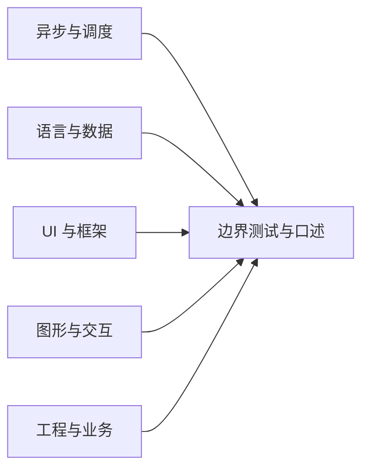

# 前端手写题目录：48 道带约束与验收点的练习

本页保留原有 48 题；全部训练已扩展为[360 道前端与全栈手写题](handwritten-practice-360.md)。新增 H049–H360 分布于 12 个进阶题册，包含更多高难接口、状态、并发、事务和系统边界，不在本页重复计数。

面试现场最常见的失分不是忘记 API，而是题目输入输出和边界没有问清楚。每题先复述约束，再写最小实现，最后主动给出能区分正确与错误实现的测试。本页题目均为**练习题改述**：其中标注“真实题源”的题目能在公开面经找到对应回忆；其余是围绕同一机制派生的训练变体。链接到已有实现路径不表示 48 题都已实现或逐项运行。已经提供源码和自动测试的关联专题包括[秋招笔试算法](autumn-exam-algorithms.md)（8 项测试，窗口题与独立穷举器逐项比较 1093 个数组）、[动画引擎模型](animation-engine-handwritten.md)（27 项测试）、[异步代次场景](real-interview-scenarios.md)和[倒计时与打字机模型](deadline-clock-and-typewriter.md)。这些测试仅覆盖各专题明确写出的行为，不外推为浏览器 UI 或本目录全部练习已验收。当前目录共 48 题，其中题 41–43 的时间、年份和届别保持原帖已披露的精度。本页 `source_commit` 标记仓库基线；外部面经没有 Git 提交号，由[来源登记表](../assets/research/interview-provenance-20261012.json)记录 URL 和核验日期。

建议先看下面的分类关系，再任选一道限时完成：

每个条目包含输入/输出、核心不变量、易错测试、难度/限时和站内实现路径。时间是练习建议，不是招聘公司的统一标准。`真实题源`仅表示公开作者回忆过相近题目；派生题不是任何公司实际考题的声明。

## 异步与调度

### 1. 限制并发的 Promise 池｜真实题型，PDD 汇总转述

- **约束与输入输出：**输入任务函数数组和正整数上限 `k`；输出按输入顺序排列的结果，失败策略需先约定为整体拒绝或收集错误。
- **核心不变量：**任一时刻运行中的任务数不超过 `k`；每个任务只启动一次；结果索引不因完成顺序变化。
- **易错测试：**空数组、`k=1`、`k` 大于任务数、同步抛错、Promise 拒绝、一个任务从不结束。
- **难度/限时：**中，25 分钟。**实现路径：**[Promise 手写实现](promise-implementations.md)；实际题型见[公开汇总](../assets/research/interview-provenance-20261012.json)。

### 2. 顺序执行异步任务｜真实题型，PDD 汇总转述

- **约束与输入输出：**输入任务函数列表；依序启动并输出结果数组，前一任务完成后才启动下一项。
- **核心不变量：**任务 i 启动前，0 至 i-1 均已完成；拒绝时按约定中止或记录错误。
- **易错测试：**第一个任务同步返回值、空任务、第二项拒绝、后续任务是否仍执行。
- **难度/限时：**易，15 分钟。**实现路径：**[Promise 与 async/await](../js/promise-async.md)。

### 3. 带上限与退避的重试｜真实题型，PDD 汇总转述

- **约束与输入输出：**输入任务、最多重试次数、退避函数和可重试错误判断；输出首个成功值或最终错误。
- **核心不变量：**总尝试次数不超过 `1 + retries`；不可重试错误立即失败；等待时间按明确公式递增。
- **易错测试：**零重试、同步抛错、不可重试错误、最后一次成功、取消信号在等待期间触发。
- **难度/限时：**中，25 分钟。**实现路径：**[Promise 手写实现](promise-implementations.md)。

### 4. 异步搜索结果防过期｜真实题型改述，PDD 个人回忆

- **约束与输入输出：**输入查询字符串并模拟可乱序完成的请求；仅展示最新输入对应的响应。
- **核心不变量：**只有仍处于当前代次的响应可以写状态；请求无法物理取消时仍须丢弃过期结果。
- **易错测试：**旧请求晚到、新请求失败、连续相同查询、组件卸载后响应到达。
- **难度/限时：**中，20 分钟。**实现路径：**[Promise 与 async/await](../js/promise-async.md)、[异步代次场景](real-interview-scenarios.md)；对应真实题型见面经题库的 PDD 2026 条目。

### 5. 首次调用包装器 once｜真实题型，字节面经

- **约束与输入输出：**输入函数，返回最多执行一次的包装函数；是否缓存首次返回值需明确。
- **核心不变量：**本题采用 at-most-once 合同：在调用底层函数之前先标记已调用；因此同步重入或抛错后再次调用都不会重进底层函数。
- **易错测试：**多次调用、递归重入、函数抛错、保留 `this` 与参数。若改成“成功才缓存、失败可重试”，必须另用 `executing` 状态挡住执行期间的重入，那不属于本题合同。
- **难度/限时：**易，15 分钟。**实现路径：**[发布订阅、Proxy 与 Reflect](pubsub-proxy-reflect.md)；真实题源见[来源 JSON](../assets/research/interview-provenance-20261012.json)。

### 6. 发布订阅 EventEmitter｜真实题型，字节面经

- **约束与输入输出：**实现 `on/off/emit/once`；明确事件名、重复监听和监听器异常策略。
- **核心不变量：**`off` 只移除目标订阅；`once` 在回调重入前移除；一次 emit 的监听快照语义稳定。
- **易错测试：**监听器移除自身、添加新监听、重复订阅、监听器抛错、事件名不存在。
- **难度/限时：**中，25 分钟。**实现路径：**[发布订阅、Proxy 与 Reflect](pubsub-proxy-reflect.md)。

### 7. Promise.all 简化实现｜真实题型，PDD 与美团面经

- **约束与输入输出：**接收可迭代值，输出按原顺序的数组；任一项拒绝则整体拒绝。
- **核心不变量：**完成顺序不改变结果索引；所有项 fulfilled 后才 resolve；每个输入只计数一次。
- **易错测试：**空 iterable、普通值、thenable、同步 then getter 异常、拒绝后其他任务继续。
- **难度/限时：**中，25 分钟。**实现路径：**[Promise 手写实现](promise-implementations.md)。

### 8. 绝对截止时间倒计时｜真实题型，PDD 汇总转述

- **约束与输入输出：**输入截止时间戳，周期性输出剩余毫秒数直至 0；不依赖每次 tick 精确准时。
- **核心不变量：**展示值由 `deadline - now` 得出，而非不断减固定间隔；结束和卸载后不再调度。
- **易错测试：**切后台后恢复、系统时钟变化、截止时间已过、快速重复启动、卸载清理。
- **难度/限时：**中，20 分钟。**实现路径：**[防抖与节流](../js/debounce-throttle.md)、[倒计时模型](deadline-clock-and-typewriter.md)；模型测试不等于浏览器翻页动画验收。

## 语言与数据结构

### 9. 大数加法｜真实题型，腾讯面经

- **约束与输入输出：**输入非负整数字符串，输出精确和字符串，不转 Number。
- **核心不变量：**逐位相加，下一位进位只来自当前位和；遍历结束后补最后进位。
- **易错测试：**长度不等、全零、末位产生进位、前导零、超长输入。
- **难度/限时：**易，15 分钟。**实现路径：**[算法目录](../algorithm/index.md)。

### 10. 深拷贝与循环引用｜真实题型，阿里大文娱

- **约束与输入输出：**定义支持的类型集合并返回不共享可变引用的副本；循环引用必须保留引用图结构。
- **核心不变量：**同一源对象在结果中映射到同一个副本；原始值可直接返回。
- **易错测试：**自身循环、两个对象互相引用、数组、Date/Map/Set、Symbol 键、函数策略。
- **难度/限时：**中，30 分钟。**实现路径：**[深拷贝](../js/deep-copy.md)。

### 11. 带小数的千分位格式化｜真实题型，字节生活服务

- **约束与输入输出：**输入有限十进制字符串，整数部分每三位分组，小数保持原样；需定义负数策略。
- **核心不变量：**小数和符号不参与整数分组；格式化不得改变十进制字符精度。
- **易错测试：**`0`、负数、三位边界、已有分隔符、小数尾零、超过安全整数。
- **难度/限时：**易，15 分钟。**实现路径：**[JavaScript API](../js/array-api-es6-to-es2025.md)。

### 12. 两个有序数组稳定合并｜真实题型，字节面经

- **约束与输入输出：**输入两个升序数组，输出升序合并结果；相等元素的稳定先后规则需说明。
- **核心不变量：**每次选择当前未消费元素中的较小者；输出前缀永远有序。
- **易错测试：**任一数组为空、重复值、负值、一个数组全小于另一个。
- **难度/限时：**易，15 分钟。**实现路径：**[数组算法](../algorithm/array.md)。

### 13. 有序合并后按键去重｜真实题型改述，美团面经

- **约束与输入输出：**输入两个有序对象数组和去重键；输出保持首次出现顺序的唯一元素。
- **核心不变量：**去重判等由指定键决定；输出相对输入合并序列稳定。
- **易错测试：**缺失键、键值为 0/null、同键不同对象、跨数组重复。
- **难度/限时：**易，20 分钟。**实现路径：**[数组算法](../algorithm/array.md)。

### 14. 合并字符串匹配位置｜真实题型， 美团面经

- **约束与输入输出：**输入字符串数组和目标串，返回每个词在目标串中的匹配位置；明确找首个还是全部、是否区分大小写。
- **核心不变量：**位置索引必须与输入数组顺序一一对应；边界采用 UTF-16 code unit 还是 Unicode code point 要说明。
- **易错测试：**空串、重复词、重叠匹配、emoji、未找到。
- **难度/限时：**易，20 分钟。**实现路径：**[数组与字符串 API](../js/array-api-es6-to-es2025.md)。

### 15. 单链表倒数第 K 个节点｜真实题型，美团面经

- **约束与输入输出：**输入单链表和正整数 K，返回倒数第 K 个节点或约定的越界结果。
- **核心不变量：**快慢指针始终相距 K 个节点；快指针到尾时慢指针处于目标。
- **易错测试：**空表、K=1、K=长度、K>长度、单节点。
- **难度/限时：**易，15 分钟。**实现路径：**[链表算法](../algorithm/linked-list.md)。

### 16. 二叉树层序遍历｜真实题型，美团面经

- **约束与输入输出：**输入二叉树根，输出按层分组的节点值；空树输出空列表。
- **核心不变量：**每轮开始记录队列当前长度，恰好消费当前层节点。
- **易错测试：**空树、单节点、单侧链、左右子节点均存在。
- **难度/限时：**易，15 分钟。**实现路径：**[二叉树算法](../algorithm/binary-tree.md)。

### 17. alpha/beta 版本比较｜真实题型，PDD 面经

- **约束与输入输出：**比较形如 `1.2.0-alpha.2` 的版本；题目前须确认版本语法和排序规则。
- **核心不变量：**数字段按数值比较；稳定版本通常高于同号预发布版本；规则需遵循明确约定。
- **易错测试：**`1.10`/`1.2`、前导零、缺省段、alpha 与 beta、非法输入。
- **难度/限时：**中，25 分钟。**实现路径：**[秋招笔试算法与协议题](autumn-exam-algorithms.md)包含版本优先级实现及测试；[字符串与数组 API](../js/array-api-es6-to-es2025.md)复习基础。

### 18. 对象扁平化并保留路径｜真实题型改述，PDD 汇总转述

- **约束与输入输出：**输入嵌套对象，输出路径到叶值的映射；明确数组路径和空容器表示。
- **核心不变量：**每个叶节点只产生一个唯一键路径；遍历不修改输入对象。
- **易错测试：**空对象、数组、键名含点、null、循环引用、同名路径冲突。
- **难度/限时：**中，25 分钟。**实现路径：**[JavaScript 与 TypeScript](../resources/javascript-typescript.md)。

## UI 与框架

### 19. Tooltip 组件｜真实题型，PDD 面经

- **约束与输入输出：**输入触发元素、提示内容与开关策略，展示定位浮层；覆盖指针和键盘操作。
- **核心不变量：**焦点/悬停在触发器或浮层范围内时保持显示；关闭时移除事件与定时器。
- **易错测试：**Tab 聚焦、触屏、鼠标穿越间隙、视口边缘、父容器裁切。
- **难度/限时：**中，35 分钟。**实现路径：**[React 组件模式](../react/r19/component-patterns-best-practices.md)、[DOM 事件](../web-apis/dom-events-delegation.md)。

### 20. Vue 通知窗口队列｜真实题型，美团面经

- **约束与输入输出：**输入消息与持续时间，按规则展示通知并返回关闭方法；可同时展示数量需由题目指定。
- **核心不变量：**每条通知最多关闭一次；离开页面时清除计时器；关闭某一项不误删其他项。
- **易错测试：**连续触发、手动关闭后定时器再次触发、组件卸载、相同文本两次通知。
- **难度/限时：**中，35 分钟。**实现路径：**[Vue 组件与组合式 API](../vue/components-composition.md)。

### 21. Flex 骰子五点布局｜真实题型，美团面经

- **约束与输入输出：**固定正方形容器，显示四角和中心共五个圆点；容器缩放时点保持相对位置。
- **核心不变量：**点位由容器布局决定，不依赖绝对像素；中心点始终居中。
- **易错测试：**窄容器、圆点尺寸变化、RTL 不影响几何中心、点不能溢出。
- **难度/限时：**易，15 分钟。**实现路径：**[HTML 与 CSS 资源](../resources/html-css.md)。

### 22. 水平垂直居中与等间距布局｜真实题型，美团面经

- **约束与输入输出：**子元素数量未知，容器尺寸可能变化；实现居中或等间距排列。
- **核心不变量：**布局由容器规则分配，不依赖子元素个数写死选择器。
- **易错测试：**一个子元素、多个子元素、容器高度不足、长文本换行。
- **难度/限时：**易，15 分钟。**实现路径：**[HTML/CSS 资源](../resources/html-css.md)。

### 23. React 倒计时 Hook｜真实题型改述，PDD 汇总转述

- **约束与输入输出：**Hook 接收截止时间，返回剩余时间和重置/暂停能力；接口按题面收敛。
- **核心不变量：**状态来自绝对时间差；effect 清理旧 timer；依赖变化时不保留旧截止时间。
- **易错测试：**严格模式 effect 重跑、卸载、截止时间更新、后台恢复。
- **难度/限时：**中，30 分钟。**实现路径：**[React Effects 同步模型](../react/r19/effects-synchronization-model.md)。

### 24. `useCallback` 与 memo 稳定子组件输入｜真实题型改述，PDD 汇总转述

- **约束与输入输出：**父组件更新时，只有实际变化的 props 才触发子组件渲染；给出可观察计数方式。
- **核心不变量：**memo 比较的是 props 相等性；回调闭包仍须读取最新依赖。
- **易错测试：**遗漏依赖造成陈旧值、对象字面量每次重建、无意义 memo。
- **难度/限时：**中，25 分钟。**实现路径：**[React 性能实践](../react/r19/performance-best-practices.md)。

### 25. 登录表单与提交状态｜真实题型，字节面经

- **约束与输入输出：**账号密码表单，展示校验、提交中、成功/失败反馈；不得保存明文密码用于日志。
- **核心不变量：**提交期间重复事件被门控；服务端仍负责身份验证；错误提示与字段关联。
- **易错测试：**空值、网络失败、重复点击、键盘提交、密码管理器填充。
- **难度/限时：**中，35 分钟。**实现路径：**[React 表单与 Actions](../react/r19/actions-forms-optimistic.md)、[OAuth 与令牌](../security/oauth2-and-tokens.md)。

### 26. 滚动列表分页加载｜派生练习

- **约束与输入输出：**到达列表底部附近加载下一页；加载、结束和错误状态须明确。
- **核心不变量：**同一页请求至多并发一次；无更多数据后不再请求；过期响应不可覆盖新查询。
- **易错测试：**快速滚动重复触发、空页、网络失败重试、查询条件切换。
- **难度/限时：**中，30 分钟。**实现路径：**[Intersection Observer 与观察器 API](../browser/deep-dive/observers-web-components.md)。

### 27. 动态高度虚拟列表｜派生练习

- **约束与输入输出：**长列表只渲染视口及缓冲区项目，行高由内容决定；滚动位置要稳定。
- **核心不变量：**占位总高度与已测量/估算行高一致；回收节点不能让键盘焦点跳到错误记录。
- **易错测试：**图片加载后高度变化、向上滚动、项目插入删除、屏幕阅读器。
- **难度/限时：**难，50 分钟。**实现路径：**[React 性能实践](../react/performance/optimization.md)。

## 图形与交互

### 28. Canvas 绘制与坐标映射｜派生练习

- **约束与输入输出：**在 Canvas 上绘制给定图元，并将鼠标 CSS 坐标映射到画布坐标。
- **核心不变量：**渲染坐标同时考虑 CSS 尺寸与 backing store 尺寸；高 DPR 屏幕清晰且命中测试坐标一致。
- **易错测试：**DPR=2、CSS 缩放、画布尺寸变化、边界像素命中。
- **难度/限时：**中，30 分钟。**实现路径：**[Canvas/WebGL 渲染管线](../browser/canvas-webgl-pipeline.md)。

### 29. Canvas 图元命中检测｜派生练习

- **约束与输入输出：**输入图元集合与指针位置，返回最上层命中的图元 ID。
- **核心不变量：**命中顺序与绘制层级一致；点位变换与绘制使用同一坐标系。
- **易错测试：**重叠图元、旋转矩形、缩放、边界包含规则。
- **难度/限时：**难，45 分钟。**实现路径：**[Canvas/WebGL 渲染管线](../browser/canvas-webgl-pipeline.md)。

### 30. SVG/Canvas 迷你图表选择题｜真实场景派生，阿里面经

- **约束与输入输出：**根据图元规模、更新频率、可交互要求设计小型折线图并说明渲染方案。
- **核心不变量：**数据坐标到视口坐标变换一致；轴域更新不会改变数据本身。
- **易错测试：**空数据、单点、负值、resize、高密度数据和键盘可访问性。
- **难度/限时：**中，35 分钟。**实现路径：**[媒体、Canvas 与 SVG](../html/media-canvas-svg.md)。

### 31. 拖拽排序与指针捕获｜派生练习

- **约束与输入输出：**拖动卡片改变顺序；支持鼠标、触屏和键盘等价操作。
- **核心不变量：**拖动期间只有一个活动指针；取消/离开视口后状态能复位；DOM 顺序和数据顺序一致。
- **易错测试：**pointercancel、拖出窗口、触屏滚动冲突、拖动后焦点位置。
- **难度/限时：**中，35 分钟。**实现路径：**[指针、触摸与手势事件](../web-apis/pointer-touch-gesture-events.md)。

### 32. Tooltip 锚点视口翻转｜派生练习

- **约束与输入输出：**输入锚点矩形、浮层尺寸和视口尺寸，输出不越界的放置位置。
- **核心不变量：**选择位置需优先满足边界约束；计算使用同一视口坐标系。
- **易错测试：**四角锚点、浮层比视口大、滚动偏移、缩放页面。
- **难度/限时：**中，25 分钟。**实现路径：**[DOM 事件委托](../web-apis/dom-events-delegation.md)。

## 工程与业务

### 33. 查询参数解析与序列化｜派生练习

- **约束与输入输出：**URL 查询串转对象并可逆序列化；明确重复键、空值和编码规则。
- **核心不变量：**解码只执行一次；重复参数不丢失或按文档规则处理。
- **易错测试：**`+`、百分号编码、重复键、无等号键、非法编码。
- **难度/限时：**易，20 分钟。**实现路径：**[History、导航与 URL 路由](../web-apis/history-navigation-url-routing.md)。

### 34. 路由守卫与未授权跳转｜派生练习

- **约束与输入输出：**输入目标路由、用户角色和权限映射，输出允许、拒绝或登录跳转结果。
- **核心不变量：**前端路由控制仅影响展示；服务端每次资源请求仍须鉴权。
- **易错测试：**刷新直达、未知路由、权限过期、返回 URL 开放重定向。
- **难度/限时：**中，30 分钟。**实现路径：**[History 与路由](../web-apis/history-navigation-url-routing.md)、[OAuth 与令牌](../security/oauth2-and-tokens.md)。

### 35. 缓存键与过期清理｜派生练习

- **约束与输入输出：**实现带 TTL 的内存缓存 `get/set/delete`；过期值不可被读取。
- **核心不变量：**读取时当前时钟达到过期点即视为失效；覆盖键更新其到期时间。
- **易错测试：**TTL=0、覆盖旧键、时钟边界、缓存值为 undefined、清理任务泄漏。
- **难度/限时：**中，30 分钟。**实现路径：**[性能与质量资源](../resources/performance-quality.md)。

### 36. 文件上传分片状态机｜派生练习

- **约束与输入输出：**文件拆分块、并发上传、失败重试、完成合并；服务端协议须明确。
- **核心不变量：**块索引稳定；单块完成状态只在服务端确认后更新；整体完成需所有必要块确认。
- **易错测试：**重复块、部分失败、刷新恢复、文件内容相同但名称不同、取消。
- **难度/限时：**难，50 分钟。**实现路径：**[File、Blob 与 FormData](../web-apis/file-blob-formdata.md)。

### 37. HTTP 请求重试与幂等｜派生练习

- **约束与输入输出：**封装请求重试，输入方法、错误类别、次数和幂等键策略。
- **核心不变量：**仅符合策略的错误重试；有副作用的请求需服务端幂等保护。
- **易错测试：**超时但服务端已完成、429 Retry-After、非幂等 POST、取消信号。
- **难度/限时：**中，35 分钟。**实现路径：**[HTTP 版本与语义](../network/http-versions.md)。

### 38. 前端错误上报去重与采样｜派生练习

- **约束与输入输出：**收集错误事件、按指纹去重并限量上报；不能阻塞主交互。
- **核心不变量：**相同指纹窗口内最多上报一次；采样决策可解释；敏感字段剔除。
- **易错测试：**高频同错、突发不同错、离线恢复、用户输入中包含秘密。
- **难度/限时：**中，35 分钟。**实现路径：**[测试与监控资源](../resources/testing-monitoring.md)。

### 39. 版本字符串排序｜真实题型，字节/ PDD 面经

- **约束与输入输出：**对版本字符串排序；必须先明确是纯数字点分版本还是带 alpha/beta 预发布版本。
- **核心不变量：**比较遵循语义段而非整串字典序；排序稳定性按要求保证。
- **易错测试：**`1.10`、`1.2`、缺省段、前导零、预发布和正式版本。
- **难度/限时：**中，25 分钟。**实现路径：**[JavaScript 与 TypeScript](../resources/javascript-typescript.md)；面试来源见[来源 JSON](../assets/research/interview-provenance-20261012.json)。

### 40. 随机金额分配约束验证｜真实题型，美团面经

- **约束与输入输出：**把总额 M 分给 N 人，每人满足题面上下界且总和为 M；先确认金额精度单位和可行性。
- **核心不变量：**每份在边界内；总和精确等于 M；可行条件不满足时明确报错。
- **易错测试：**N=1、总额恰好等于下界总和、不可行总额、浮点精度、最大额约束。
- **难度/限时：**中，30 分钟。**实现路径：**[算法与面试资源](../resources/algorithms-interview.md)；题源见真实面试题库中的美团条目。

## 公开 PDD 笔试题型补充

以下三题来自一篇公开 PDD 前端笔试回忆，页面只显示 09-22，没有可确认年份；因此来源数据中的年份和届别均为空。它们是公开作者记录的题型，不意味着正文公布了完整输入输出规格。题目要求和验收条件在此处作为练习约束明确补足。

### 41. 翻转倒计时｜真实题型，PDD 前端笔试

- **约束与输入输出：**按页面指定总时长显示倒计时，时间变化时切换/翻转数字；动画时长不得改变真实剩余时间。
- **核心不变量：**显示值由截止时间计算；动画只负责视觉过渡；隐藏或卸载时停止不必要调度。
- **易错测试：**切后台后返回、恰好到零、快速重置、动画偏好减少、时钟 tick 延迟。
- **难度/限时：**中，30 分钟。**实现路径：**[倒计时模型](deadline-clock-and-typewriter.md)有时间状态实现与 Node 测试；它不验收浏览器视觉翻页动画。来源：[PDD 前端笔试原帖](../assets/research/interview-provenance-20261012.json)。

### 42. 带进度回调的并发控制｜真实题型，PDD 前端笔试

- **约束与输入输出：**输入任务数组和最大并发数，返回按输入顺序的结果；每个任务结束时调用进度回调。
- **核心不变量：**活动任务数不超上限；进度完成数单调递增且不超过总数；每项只计数一次，包括失败项（失败策略须明确）。
- **易错测试：**空数组、任务同步抛错、回调自身抛错、部分任务拒绝、完成顺序乱序。
- **难度/限时：**中，35 分钟。**实现路径：**[异步代次场景](real-interview-scenarios.md)包含旧请求作废的实际路径与测试；进度回调并发器仍是此处的练习约束。来源：[PDD 前端笔试原帖](../assets/research/interview-provenance-20261012.json)。

### 43. 打字机文本播放与中断｜真实题型，PDD 前端笔试

- **约束与输入输出：**输入文本和逐字间隔，按节奏输出字符；允许停止、重置或切换到另一段文本。
- **核心不变量：**停止后旧任务不能继续追加字符；索引按文本字符定义，需说明按 UTF-16 code unit 或 Unicode code point。
- **易错测试：**空串、emoji、切换文本、重复启动、组件卸载、暂停再继续。
- **难度/限时：**中，25 分钟。**实现路径：**[倒计时与打字机模型](deadline-clock-and-typewriter.md)提供按 Unicode 字素显示的模型及测试；尚不覆盖浏览器 DOM 呈现。来源：[PDD 前端笔试原帖](../assets/research/interview-provenance-20261012.json)。

## 其余分类补充练习

### 44. 柯里化并保留 this｜真实题型改述，PDD 汇总转述

- **约束与输入输出：**输入多参数函数及可变参数，返回分次接收参数的函数；明确按原函数形参数量还是显式终止条件调用。
- **核心不变量：**参数顺序不变；达到终止条件时只调用原函数一次；`this` 策略需事先确定。
- **易错测试：**零参数、参数一次给齐、分多次提供、原函数有默认参数、显式 this。
- **难度/限时：**中，25 分钟。**实现路径：**[JavaScript 与 TypeScript](../resources/javascript-typescript.md)；源帖属汇总转述，见[来源 JSON](../assets/research/interview-provenance-20261012.json)。

### 45. 按深度拍平数组｜派生练习

- **约束与输入输出：**输入混合嵌套数组和最大展开深度 `d`，输出按深度展开后的新数组。
- **核心不变量：**元素相对顺序保持；每次只展开一层；深度 0 返回顶层副本。
- **易错测试：**空数组、稀疏数组、负深度、Infinity、嵌套层超过 d。
- **难度/限时：**易，20 分钟。**实现路径：**[数组算法](../algorithm/array.md)。

### 46. 响应式依赖收集最小版｜真实题型改述，PDD 汇总转述

- **约束与输入输出：**实现 `reactive` 与 `effect` 的最小对象属性跟踪，属性变化时重跑相关 effect。
- **核心不变量：**读取时建立当前 effect 与 target/key 的依赖；同一依赖集合不重复注册同一 effect；触发时迭代稳定快照。
- **易错测试：**嵌套 effect、分支切换后清除旧依赖、数组索引、重复赋同值、effect 内再次写入。
- **难度/限时：**难，45 分钟。**实现路径：**[Vue 响应式](../vue/reactivity.md)；PDD 来源属题型汇总，不是单次面试证明。

### 47. SVG 视口缩放与平移｜派生练习

- **约束与输入输出：**在 SVG 画布实现缩放和平移，缩放锚点保持在指针下方。
- **核心不变量：**变换矩阵的缩放与平移顺序明确；缩放前后锚点映射到同一屏幕位置。
- **易错测试：**连续缩放、视口边界、负平移、缩放上下限、浏览器坐标到 SVG 坐标转换。
- **难度/限时：**难，45 分钟。**实现路径：**[媒体、Canvas 与 SVG](../html/media-canvas-svg.md)。

### 48. “连续不同子数组”题型合同化练习｜PDD 笔试回忆

- **约束与输入输出：**公开回忆只记下“连续不同子数组”，无法确认原题要求最长区间还是合法区间数量。本练习选择“最长互异值连续区间”合同：输入值数组，返回区间长度与边界；不代表已还原原题完整题意。
- **核心不变量：**窗口内值互异；每次右端推进后，左边界只向右移动，窗口长度始终覆盖当前右端的最长合法后缀。
- **易错测试：**空数组、全重复、全不同、重复值迫使左边界跨过当前位置、同长区间、NaN/对象身份比较。
- **难度/限时：**中，25 分钟。**实现路径：**[秋招笔试算法与协议题](autumn-exam-algorithms.md)有实现、独立穷举差分和 1093 组输入验收。

## 30 秒与 2 分钟作答

**30 秒回答：**说明约束、核心不变量和复杂度，再点一个边界。例如并发池题先说明“并发上限是同时处于 pending 的任务数”，再讲结果按输入索引保存，拒绝策略由题目约定。

**2 分钟回答：**先复述输入输出并询问缺失条件；给出不变量；解释数据结构或调度策略；估算时间/空间；最后列出至少三条测试和失败语义。若题目允许多个解法，讲清楚选当前方案的理由。

## 自测

展开 4 道自测题与要点

1. 并发池怎样证明不超限？答：启动前检查 active 数，启动后加一，并在成功或失败的 finally 路径减一，再触发调度。
2. 大数加法为何不能转 Number？答：超过 `Number.MAX_SAFE_INTEGER` 后相邻整数可能映射到同一浮点表示。
3. 虚拟列表高度测量变化后，怎样避免滚动跳动？答：记录锚点及其相对视口偏移，更新高度后补偿滚动位置。
4. 上传重试为何需要服务端幂等？答：客户端超时不能确定服务端是否已写入；相同块或请求重复到达时服务端须识别并安全返回既有结果。

## 深入阅读

- [真实面试题库](../resources/real-interview-question-bank.md)：查看公开帖子与考点关联。
- [Promise 手写实现](promise-implementations.md)：补异步调度与 Promise 语义。
- [数组、链表与树](../algorithm/index.md)：复习常见数据结构题。
- [教程写作规范](../design/writing-standard.md)：理解本仓库的验证状态和证据要求。
