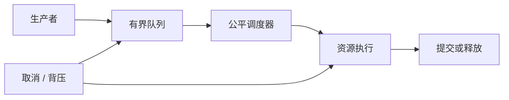

# 前端异步资源编排与生命周期手写题

<!-- Solution routes -->
先跟着代码写一遍，可读[浏览器异步](workshop-web-async.md)和[真线程池](workshop-node-workers-streams.md)。下方练习再增加新约束。

前端异步题的难点常在资源跨越多个 owner：一个任务可以被取消，已经发生的副作用却未必回滚；队列可有上限，生产者也未必能暂停。本篇每题都要求说清入队、执行、交付、取消和释放的责任，并给出竞态下可判定的结果。

沿流程检查容量在哪一层强制执行，取消在哪些边界可观察，资源由哪个 owner 最终关闭。

## 自测

??? question "AbortController.abort() 能否撤销已经成功发送的写请求？"
    不能承诺回滚远端副作用。客户端只可停止仍监听 signal 的本地处理；服务端需幂等键、撤销 API 或对账机制。

??? question "ReadableStream 队列 highWaterMark 是硬内存上限吗？"
    不是通用 hard byte cap；其计量取决于 queuing strategy，而且单块可能超出阈值，应用仍需限制 chunk 大小。

??? question "什么时候 generation token 比取消信号仍有用？"
    底层操作不可取消或取消不可靠时，token 仍可阻止旧结果提交到当前状态。

## 练习题

### H075. 多资源页面的原子快照提交

实现 `loadDashboard(keys, fetcher, signal): Promise<Snapshot>`；输入必须资源、可选资源和版本号，输出完整快照或带失败资源 ID 的结果。

必需资源全部通过校验才原子提交；可选资源可降级；新代次开始后旧代次不得提交部分结果。

- 用户、权限成功且推荐失败，输出 dashboard 含用户/权限及推荐降级标记，提交一次。
- 版本 2 先完成、版本 1 后完成，最终快照只含版本 2；版本 1 所有资源句柄均释放。

并行读取到临时 map，验证 schema 和共同 revision 后一次 replace；用 generation 与 AbortController 管理代次，不能逐资源写 UI。

权限资源更新晚到时，旧快照是否可短暂展示？怎样让缓存、UI 和安全决策使用一致版本？

难，45 分钟。

<!-- Question record (index metadata)
- **题目契约：**实现 `loadDashboard(keys, fetcher, signal): Promise<Snapshot>`；输入必须资源、可选资源和版本号，输出完整快照或带失败资源 ID 的结果。
- **约束与不变量：**必需资源全部通过校验才原子提交；可选资源可降级；新代次开始后旧代次不得提交部分结果。
- **用例 A：**用户、权限成功且推荐失败，输出 dashboard 含用户/权限及推荐降级标记，提交一次。
- **用例 B：**版本 2 先完成、版本 1 后完成，最终快照只含版本 2；版本 1 所有资源句柄均释放。
- **实现提示：**并行读取到临时 map，验证 schema 和共同 revision 后一次 replace；用 generation 与 AbortController 管理代次，不能逐资源写 UI。
- **进阶追问：**权限资源更新晚到时，旧快照是否可短暂展示？怎样让缓存、UI 和安全决策使用一致版本？
- **难度 / 建议时长：**难，45 分钟。
- **依据与状态：**作者原创派生练习，未实现/未实跑；取消传播参考 [DOM AbortSignal](https://dom.spec.whatwg.org/#aborting-ongoing-activities)（[S03](handwritten-practice-sources.md#s03)）。
-->

### H076. 大小不等请求的公平配额调度

实现 `scheduleByTenant(queues, limits): Dispatch[]`；队列任务声明估算字节与租户权重，输出下一批派发任务。

全局与租户并发/字节预算均不超限；持续有任务的租户每轮至少获得一次服务机会；超大任务不得永久阻塞小任务。

- A 队列有 4 个任务、B 队列 1 个任务，limit=2，第一轮各派一个而非 A 连发两项。
- 任务单项估算 12MB、硬上限 10MB，立即以 `TASK_TOO_LARGE` 拒绝，不占据队首等待。

按 tenant 做循环队列并保存游标，准入同时检查 active count 与 active bytes；权重可用 deficit round robin 累积 credit。

估算大小与实际响应大小差异很大时，怎样避免超额读取后才发现超预算？讨论流式 chunk 与预留额度。

挑战，55 分钟。

<!-- Question record (index metadata)
- **题目契约：**实现 `scheduleByTenant(queues, limits): Dispatch[]`；队列任务声明估算字节与租户权重，输出下一批派发任务。
- **约束与不变量：**全局与租户并发/字节预算均不超限；持续有任务的租户每轮至少获得一次服务机会；超大任务不得永久阻塞小任务。
- **用例 A：**A 队列有 4 个任务、B 队列 1 个任务，limit=2，第一轮各派一个而非 A 连发两项。
- **用例 B：**任务单项估算 12MB、硬上限 10MB，立即以 `TASK_TOO_LARGE` 拒绝，不占据队首等待。
- **实现提示：**按 tenant 做循环队列并保存游标，准入同时检查 active count 与 active bytes；权重可用 deficit round robin 累积 credit。
- **进阶追问：**估算大小与实际响应大小差异很大时，怎样避免超额读取后才发现超预算？讨论流式 chunk 与预留额度。
- **难度 / 建议时长：**挑战，55 分钟。
- **依据与状态：**作者原创派生练习，未实现/未实跑；流的 pull/backpressure 机制见 [Streams Standard](https://streams.spec.whatwg.org/)（[S04](handwritten-practice-sources.md#s04)）。
-->

### H077. 按字节预算的图片解码队列

实现 `enqueueDecode({ blob, width, height, signal }): Promise<Bitmap>`；输入尺寸和像素预算，输出 ImageBitmap 或拒绝原因。

排队和解码中的估算像素字节总和不超 cap；解码完成后额度由 bitmap owner 持有，close 后才归还。

- 前两张与第三张图片均估算 2MB，cap=4MB；前两张获额度，第三张等待，第一张 close 后第三张获额度。
- 超大图估算 12MB、cap 8MB，入列即拒绝；signal 在解码中 abort 后不交付 bitmap 且计数归零。

使用 `width*height*4` 的明示估算并设置安全整数边界；额度对象带 id 且 release 幂等，丢弃的 ImageBitmap 调用 close。

压缩 Blob 大小很小但解码像素巨大时，如何避免资源耗尽？浏览器解码尺寸不可预测如何校正预算？

难，45 分钟。

<!-- Question record (index metadata)
- **题目契约：**实现 `enqueueDecode({ blob, width, height, signal }): Promise<Bitmap>`；输入尺寸和像素预算，输出 ImageBitmap 或拒绝原因。
- **约束与不变量：**排队和解码中的估算像素字节总和不超 cap；解码完成后额度由 bitmap owner 持有，close 后才归还。
- **用例 A：**前两张与第三张图片均估算 2MB，cap=4MB；前两张获额度，第三张等待，第一张 close 后第三张获额度。
- **用例 B：**超大图估算 12MB、cap 8MB，入列即拒绝；signal 在解码中 abort 后不交付 bitmap 且计数归零。
- **实现提示：**使用 `width*height*4` 的明示估算并设置安全整数边界；额度对象带 id 且 release 幂等，丢弃的 ImageBitmap 调用 close。
- **进阶追问：**压缩 Blob 大小很小但解码像素巨大时，如何避免资源耗尽？浏览器解码尺寸不可预测如何校正预算？
- **难度 / 建议时长：**难，45 分钟。
- **依据与状态：**作者原创派生练习，未实现/未实跑；队列 demand 概念参考 [Streams Standard](https://streams.spec.whatwg.org/)（[S04](handwritten-practice-sources.md#s04)）。
-->

### H078. ReadableStream 分支的慢消费者隔离

实现 `fanout(source, consumers, policy): Promise<Report>`，每个消费者声明最大积压条数/字节，输出各分支接收和丢弃统计。

一支慢消费者不能令其余分支无界积压；策略明确为阻塞、断开或丢弃；每个 chunk 的所有分支引用都结束后释放。

- 快分支读完 20 个 chunk，慢分支 cap=3 只保留最近 3 个且 drop count=17。
- 慢分支策略为 disconnect，超限时只取消该分支，源仍交付其他消费者的 20 项。

不要假设 `tee()` 自动限制各分支内存；为每支建立有界 queue 和 owner refcount，关闭/取消独立处理。

共享 chunk 是可转移资源时，如何避免多个分支重复 close 或一支读取后使其他支失效？

挑战，55 分钟。

<!-- Question record (index metadata)
- **题目契约：**实现 `fanout(source, consumers, policy): Promise<Report>`，每个消费者声明最大积压条数/字节，输出各分支接收和丢弃统计。
- **约束与不变量：**一支慢消费者不能令其余分支无界积压；策略明确为阻塞、断开或丢弃；每个 chunk 的所有分支引用都结束后释放。
- **用例 A：**快分支读完 20 个 chunk，慢分支 cap=3 只保留最近 3 个且 drop count=17。
- **用例 B：**慢分支策略为 disconnect，超限时只取消该分支，源仍交付其他消费者的 20 项。
- **实现提示：**不要假设 `tee()` 自动限制各分支内存；为每支建立有界 queue 和 owner refcount，关闭/取消独立处理。
- **进阶追问：**共享 chunk 是可转移资源时，如何避免多个分支重复 close 或一支读取后使其他支失效？
- **难度 / 建议时长：**挑战，55 分钟。
- **依据与状态：**作者原创派生练习，未实现/未实跑；tee 与 pipe 背压参照 [Streams Standard](https://streams.spec.whatwg.org/)（[S04](handwritten-practice-sources.md#s04)）。
-->

### H079. 可暂停的 NDJSON 增量解析消费者

实现 `consumeNdjson(stream, onRecord, signal): Promise<Stats>`；输入 UTF-8 byte stream，输出记录数、字节数或行号错误。

任意 chunk 边界可切开 UTF-8 字符和 JSON 行；单行有字节上限；消费者慢时不预读无界数据。

- 一条中文 JSON 被拆成三个字节块，最终解析一条完整记录且计数为 1。
- 第 2 行超过 maxLineBytes，报告 line=2 并取消 reader；已消费首行结果保留但不报告整体成功。

使用流式 TextDecoder `{stream:true}`，保留未完成行 buffer 并统计 UTF-8 字节；逐行 await onRecord 形成自然背压。

取消发生在 `read()` 已 resolve 但回调尚未完成时，谁拥有该行数据，最终统计是否计入？

难，45 分钟。

<!-- Question record (index metadata)
- **题目契约：**实现 `consumeNdjson(stream, onRecord, signal): Promise<Stats>`；输入 UTF-8 byte stream，输出记录数、字节数或行号错误。
- **约束与不变量：**任意 chunk 边界可切开 UTF-8 字符和 JSON 行；单行有字节上限；消费者慢时不预读无界数据。
- **用例 A：**一条中文 JSON 被拆成三个字节块，最终解析一条完整记录且计数为 1。
- **用例 B：**第 2 行超过 maxLineBytes，报告 line=2 并取消 reader；已消费首行结果保留但不报告整体成功。
- **实现提示：**使用流式 TextDecoder `{stream:true}`，保留未完成行 buffer 并统计 UTF-8 字节；逐行 await onRecord 形成自然背压。
- **进阶追问：**取消发生在 `read()` 已 resolve 但回调尚未完成时，谁拥有该行数据，最终统计是否计入？
- **难度 / 建议时长：**难，45 分钟。
- **依据与状态：**作者原创派生练习，未实现/未实跑；reader 与 pull 合同参考 [Streams Standard](https://streams.spec.whatwg.org/)（[S04](handwritten-practice-sources.md#s04)）。
-->

### H080. ReadableStream cancel 与 lock 的关闭协议

实现 `readWithDeadline(stream, deadline, signal): Promise<ReadResult>`，输出 value、done、timeout 或 abort，并管理 reader lock。

所有终止路径释放 reader lock；timeout 会尝试取消底层 source；source cancel 拒绝时仍须报告原终止原因并保留清理错误。

- 流在期限内返回 value=7，随后释放锁，其他 reader 可获得 lock。
- 期限先到且 source.cancel 拒绝，输出 timeout 与 cleanupError，锁仍释放，不挂起返回。

以 try/finally 包围 reader 生命周期；监听 signal 与 timer 竞速统一到一次 settle，清除另一方并 await cancel 的受控清理。

上游忽略 cancel 永不结束，是否应等待 cancel Promise？定义有限等待与后台清理策略。

难，45 分钟。

<!-- Question record (index metadata)
- **题目契约：**实现 `readWithDeadline(stream, deadline, signal): Promise<ReadResult>`，输出 value、done、timeout 或 abort，并管理 reader lock。
- **约束与不变量：**所有终止路径释放 reader lock；timeout 会尝试取消底层 source；source cancel 拒绝时仍须报告原终止原因并保留清理错误。
- **用例 A：**流在期限内返回 value=7，随后释放锁，其他 reader 可获得 lock。
- **用例 B：**期限先到且 source.cancel 拒绝，输出 timeout 与 cleanupError，锁仍释放，不挂起返回。
- **实现提示：**以 try/finally 包围 reader 生命周期；监听 signal 与 timer 竞速统一到一次 settle，清除另一方并 await cancel 的受控清理。
- **进阶追问：**上游忽略 cancel 永不结束，是否应等待 cancel Promise？定义有限等待与后台清理策略。
- **难度 / 建议时长：**难，45 分钟。
- **依据与状态：**作者原创派生练习，未实现/未实跑；读取、取消和释放锁参考 [Streams Standard](https://streams.spec.whatwg.org/)（[S04](handwritten-practice-sources.md#s04)）。
-->

### H081. 多消费者订阅的最后一个 owner 关闭源

实现 `createSharedFeed(openSource): { subscribe(cb): unsubscribe; close() }`，输出每个订阅者的事件和底层源关闭次数。

0→1 个 subscriber 时启动一次；1→0 时立即 abort 并关闭底层源；unsubscribe 幂等，旧源事件不能投递到下一代订阅。

- 两个订阅者加入后底层只 open 一次；移除一个不关闭，移除最后一个关闭一次。
- 最后退订后立即重新订阅，旧源迟到消息被 generation 丢弃，新源只收到自己的消息。

引用计数只管理同一 generation；每个订阅以 token 存 map，关闭顺序先使 generation 失效再执行外部 close。

openSource 异步且第一个订阅在其完成前就退订，如何避免泄漏刚创建的资源？

难，40 分钟。

<!-- Question record (index metadata)
- **题目契约：**实现 `createSharedFeed(openSource): { subscribe(cb): unsubscribe; close() }`，输出每个订阅者的事件和底层源关闭次数。
- **约束与不变量：**0→1 个 subscriber 时启动一次；1→0 时立即 abort 并关闭底层源；unsubscribe 幂等，旧源事件不能投递到下一代订阅。
- **用例 A：**两个订阅者加入后底层只 open 一次；移除一个不关闭，移除最后一个关闭一次。
- **用例 B：**最后退订后立即重新订阅，旧源迟到消息被 generation 丢弃，新源只收到自己的消息。
- **实现提示：**引用计数只管理同一 generation；每个订阅以 token 存 map，关闭顺序先使 generation 失效再执行外部 close。
- **进阶追问：**openSource 异步且第一个订阅在其完成前就退订，如何避免泄漏刚创建的资源？
- **难度 / 建议时长：**难，40 分钟。
- **依据与状态：**作者原创派生练习，未实现/未实跑；取消信号模型参照 [DOM 标准](https://dom.spec.whatwg.org/#aborting-ongoing-activities)（[S03](handwritten-practice-sources.md#s03)）。
-->

### H082. Promise 结果的租约与引用计数缓存

实现 `acquire(key, loader): Promise<{ value; release() }>`，相同 key 共用加载，输出引用数和加载/释放统计。

同 key 在 loading/ready 期间只调用 loader 一次；最后一个 lease release 后立即 dispose ready 值或 abort loading；取消某消费者不误取消仍被其他消费者使用的共享加载。

- 两个调用者拿到同一 value，释放一个时 dispose=0，释放第二个时 dispose=1。
- A 的 signal abort、B 仍等待，底层 loader 继续并只向 B 交付；A 不收到值且租约数不泄漏。

entry 状态为 loading/ready/error/disposing，给每次 acquire 分发独立 lease token；只在等待者归零时尝试 abort loader。

dispose 异步失败、同 key 在 disposing 阶段再次 acquire 时复用还是等待？给出不会双重关闭的策略。

挑战，55 分钟。

<!-- Question record (index metadata)
- **题目契约：**实现 `acquire(key, loader): Promise<{ value; release() }>`，相同 key 共用加载，输出引用数和加载/释放统计。
- **约束与不变量：**同 key 在 loading/ready 期间只调用 loader 一次；最后一个 lease release 后立即 dispose ready 值或 abort loading；取消某消费者不误取消仍被其他消费者使用的共享加载。
- **用例 A：**两个调用者拿到同一 value，释放一个时 dispose=0，释放第二个时 dispose=1。
- **用例 B：**A 的 signal abort、B 仍等待，底层 loader 继续并只向 B 交付；A 不收到值且租约数不泄漏。
- **实现提示：**entry 状态为 loading/ready/error/disposing，给每次 acquire 分发独立 lease token；只在等待者归零时尝试 abort loader。
- **进阶追问：**dispose 异步失败、同 key 在 disposing 阶段再次 acquire 时复用还是等待？给出不会双重关闭的策略。
- **难度 / 建议时长：**挑战，55 分钟。
- **依据与状态：**作者原创派生练习，未实现/未实跑；共享取消机制参考 [DOM AbortSignal](https://dom.spec.whatwg.org/#aborting-ongoing-activities)（[S03](handwritten-practice-sources.md#s03)）。
-->

### H083. Worker RPC 的超时、取消与迟到响应

实现 `rpc(worker, method, args, { signal, timeout }): Promise<Value>`，协议含 requestId；输出唯一结果或超时/取消/worker 错误。

每个 requestId 只 settle 一次；取消消息不代表 worker 已停止；终止 worker 时所有 pending request 均拒绝并移除监听。

- 请求 1 在 t=100ms timeout 后结算，随后请求 2 入队；t=120ms 的 response 1 被丢弃，t=140ms 的 response 2 返回 `ok`，最终 pending map size=0。
- worker error 发生时三个 pending 请求全部以 WORKER_CRASHED 结算，监听器数量归零。

用 Map 保存 resolve/reject/timer/abort disposer；收到结果先 delete 再 settle；worker 生命周期拥有所有 pending promise。

Worker 执行有副作用的写任务时客户端超时重发，如何设计幂等 request key 和结果查询？

难，45 分钟。

<!-- Question record (index metadata)
- **题目契约：**实现 `rpc(worker, method, args, { signal, timeout }): Promise<Value>`，协议含 requestId；输出唯一结果或超时/取消/worker 错误。
- **约束与不变量：**每个 requestId 只 settle 一次；取消消息不代表 worker 已停止；终止 worker 时所有 pending request 均拒绝并移除监听。
- **用例 A：**请求 1 在 t=100ms timeout 后结算，随后请求 2 入队；t=120ms 的 response 1 被丢弃，t=140ms 的 response 2 返回 `ok`，最终 pending map size=0。
- **用例 B：**worker error 发生时三个 pending 请求全部以 WORKER_CRASHED 结算，监听器数量归零。
- **实现提示：**用 Map 保存 resolve/reject/timer/abort disposer；收到结果先 delete 再 settle；worker 生命周期拥有所有 pending promise。
- **进阶追问：**Worker 执行有副作用的写任务时客户端超时重发，如何设计幂等 request key 和结果查询？
- **难度 / 建议时长：**难，45 分钟。
- **依据与状态：**作者原创派生练习，未实现/未实跑；信号清理概念参照 [DOM 标准](https://dom.spec.whatwg.org/#aborting-ongoing-activities)（[S03](handwritten-practice-sources.md#s03)）。
-->

### H084. 图片资源引用计数与 object URL 回收

实现 `acquirePreview(blob): { url; release() }`；相同 Blob 可复用 URL，输出创建与 revoke 次数。

最后一个引用释放才 revoke；release 幂等；卸载竞态时不得给新租约返回已 revoke 的 URL。

- 两个预览 acquire 得到同 URL，release 第一个不 revoke，release 第二个 revoke 一次。
- 所有者释放后同 Blob 再 acquire，创建新 URL；旧租约重复 release 不影响新 URL。

WeakMap 以 Blob identity 找 entry，entry 加 generation 和 count；缓存淘汰先标记 disposing，旧 token 只可释放所属代次。

WeakMap 无法枚举清理全量 URL，应用关闭时怎样维护可控注册表并避免 Blob 长期被强引用？

中，35 分钟。

<!-- Question record (index metadata)
- **题目契约：**实现 `acquirePreview(blob): { url; release() }`；相同 Blob 可复用 URL，输出创建与 revoke 次数。
- **约束与不变量：**最后一个引用释放才 revoke；release 幂等；卸载竞态时不得给新租约返回已 revoke 的 URL。
- **用例 A：**两个预览 acquire 得到同 URL，release 第一个不 revoke，release 第二个 revoke 一次。
- **用例 B：**所有者释放后同 Blob 再 acquire，创建新 URL；旧租约重复 release 不影响新 URL。
- **实现提示：**WeakMap 以 Blob identity 找 entry，entry 加 generation 和 count；缓存淘汰先标记 disposing，旧 token 只可释放所属代次。
- **进阶追问：**WeakMap 无法枚举清理全量 URL，应用关闭时怎样维护可控注册表并避免 Blob 长期被强引用？
- **难度 / 建议时长：**中，35 分钟。
- **依据与状态：**作者原创派生练习，未实现/未实跑；对象生命周期与事件清理参照 [DOM 标准](https://dom.spec.whatwg.org/)（[S03](handwritten-practice-sources.md#s03)）。
-->

### H085. WebSocket 入站消息的有界批量消费

实现 `createSocketConsumer(socket, { maxItems, maxBytes, flushMs, onBatch })`，输出批次、溢出策略和统计。

积压条数与字节双重受限；一批回调未完成时不得无限并行 flush；单条消息超字节上限时以 WebSocket close code 1009 关闭，队列满时拒绝新消息并记录 overflow。

- 连续收到 10 个 100-byte 消息，maxItems=4，flush 批次大小始终不超过 4 且发送顺序保持。
- 单条 2KB 消息超 maxBytes=1KB，立刻触发 `MESSAGE_TOO_LARGE` 并调用 close(1009)，不留队列项。

累计 UTF-8 byteLength；用单个 flush loop 而非每条 setTimeout；onBatch await 完成后再 drain，统计 peak bytes。

WebSocket API 本身不提供接收端 pull 时，应用层 overflow 拒绝如何通过协议 ACK/窗口反馈给服务端并避免 TCP 缓冲继续增长？

挑战，50 分钟。

<!-- Question record (index metadata)
- **题目契约：**实现 `createSocketConsumer(socket, { maxItems, maxBytes, flushMs, onBatch })`，输出批次、溢出策略和统计。
- **约束与不变量：**积压条数与字节双重受限；一批回调未完成时不得无限并行 flush；单条消息超字节上限时以 WebSocket close code 1009 关闭，队列满时拒绝新消息并记录 overflow。
- **用例 A：**连续收到 10 个 100-byte 消息，maxItems=4，flush 批次大小始终不超过 4 且发送顺序保持。
- **用例 B：**单条 2KB 消息超 maxBytes=1KB，立刻触发 `MESSAGE_TOO_LARGE` 并调用 close(1009)，不留队列项。
- **实现提示：**累计 UTF-8 byteLength；用单个 flush loop 而非每条 setTimeout；onBatch await 完成后再 drain，统计 peak bytes。
- **进阶追问：**WebSocket API 本身不提供接收端 pull 时，应用层 overflow 拒绝如何通过协议 ACK/窗口反馈给服务端并避免 TCP 缓冲继续增长？
- **难度 / 建议时长：**挑战，50 分钟。
- **依据与状态：**作者原创派生练习，未实现/未实跑；有界流消费参考 [Streams Standard](https://streams.spec.whatwg.org/)（[S04](handwritten-practice-sources.md#s04)）。
-->

### H086. 搜索预取的可撤销额度占用

实现 `prefetchSearch(query, budget, signal): Promise<CacheEntry>`，输入优先级、响应字节预算和可见查询状态，输出缓存命中或跳过原因。

预取不得挤占可见请求的保留并发槽；隐藏页面或查询变更时释放尚未使用额度；迟到结果只能写其 canonical key。

- 可见请求占一个保留槽，预取任务只用剩余槽，页面查询改动后预取 abort 且额度归还。
- 旧 query 预取响应晚于新 query，写入旧 key 的缓存但不得覆盖当前 UI 状态。

分离 UI commit 与 cache commit；预算 token 可释放/转让；设置预取最大响应字节并在读流时逐 chunk 计量。

预取缓存被新用户权限撤销后，如何避免缓存命中绕过重新鉴权？

难，45 分钟。

<!-- Question record (index metadata)
- **题目契约：**实现 `prefetchSearch(query, budget, signal): Promise<CacheEntry>`，输入优先级、响应字节预算和可见查询状态，输出缓存命中或跳过原因。
- **约束与不变量：**预取不得挤占可见请求的保留并发槽；隐藏页面或查询变更时释放尚未使用额度；迟到结果只能写其 canonical key。
- **用例 A：**可见请求占一个保留槽，预取任务只用剩余槽，页面查询改动后预取 abort 且额度归还。
- **用例 B：**旧 query 预取响应晚于新 query，写入旧 key 的缓存但不得覆盖当前 UI 状态。
- **实现提示：**分离 UI commit 与 cache commit；预算 token 可释放/转让；设置预取最大响应字节并在读流时逐 chunk 计量。
- **进阶追问：**预取缓存被新用户权限撤销后，如何避免缓存命中绕过重新鉴权？
- **难度 / 建议时长：**难，45 分钟。
- **依据与状态：**作者原创派生练习，未实现/未实跑；读取背压参考 [Streams Standard](https://streams.spec.whatwg.org/)（[S04](handwritten-practice-sources.md#s04)）。
-->

### H087. 标签页可见性下的任务暂停与续约

实现 `visibilityPolicy(task, visibility, lease): Decision`，输入前台/后台状态与任务 checkpoint，输出 pause/resume/continue/expire。

后台暂停仅适用于可续约任务；租约过期后旧执行不能提交；可见性事件重复派发必须幂等。

- 任务已 checkpoint=40，页面 hidden 返回 pause；visible 后从 40 恢复，不重复计入已提交片段。
- 后台期间 lease 到期，回前台必须重新获取 lease；旧执行随后完成时结果被拒绝提交。

checkpoint 与 lease generation 分开；暂停事件请求协作取消并等待安全边界，无法暂停的任务标注 continue 或交由服务端。

浏览器进程被冻结而没有 visibilitychange 清理机会时，服务端怎样检测失效租约并避免重复工作？

难，45 分钟。

<!-- Question record (index metadata)
- **题目契约：**实现 `visibilityPolicy(task, visibility, lease): Decision`，输入前台/后台状态与任务 checkpoint，输出 pause/resume/continue/expire。
- **约束与不变量：**后台暂停仅适用于可续约任务；租约过期后旧执行不能提交；可见性事件重复派发必须幂等。
- **用例 A：**任务已 checkpoint=40，页面 hidden 返回 pause；visible 后从 40 恢复，不重复计入已提交片段。
- **用例 B：**后台期间 lease 到期，回前台必须重新获取 lease；旧执行随后完成时结果被拒绝提交。
- **实现提示：**checkpoint 与 lease generation 分开；暂停事件请求协作取消并等待安全边界，无法暂停的任务标注 continue 或交由服务端。
- **进阶追问：**浏览器进程被冻结而没有 visibilitychange 清理机会时，服务端怎样检测失效租约并避免重复工作？
- **难度 / 建议时长：**难，45 分钟。
- **依据与状态：**作者原创派生练习，未实现/未实跑；生命周期取消信号参考 [DOM 标准](https://dom.spec.whatwg.org/#aborting-ongoing-activities)（[S03](handwritten-practice-sources.md#s03)）。
-->

### H088. 取消后仍需释放的异步资源工厂

实现 `openResource(signal): Promise<Resource>` 与 `withResource(open, use, signal)`，输出使用结果和 cleanup 状态。

若 open 在 abort 后才 resolve，创建出来的资源必须立即释放且不得交付；use 完成、抛错或取消都调用 dispose 一次。

- abort 先发生，open 随后返回 R，R.dispose 调用一次，withResource 返回 AbortError。
- use 抛错后 dispose 也抛错，输出保留 use error 为主因并附 cleanup error。

在 open resolve 后立即复查 signal；以 owner flag 转移资源所有权，finally 执行幂等 disposal 并定义双错聚合结果。

资源 dispose 永不完成时，调用者如何确保页面卸载不被无限等待，同时又观测泄漏？

挑战，50 分钟。

<!-- Question record (index metadata)
- **题目契约：**实现 `openResource(signal): Promise<Resource>` 与 `withResource(open, use, signal)`，输出使用结果和 cleanup 状态。
- **约束与不变量：**若 open 在 abort 后才 resolve，创建出来的资源必须立即释放且不得交付；use 完成、抛错或取消都调用 dispose 一次。
- **用例 A：**abort 先发生，open 随后返回 R，R.dispose 调用一次，withResource 返回 AbortError。
- **用例 B：**use 抛错后 dispose 也抛错，输出保留 use error 为主因并附 cleanup error。
- **实现提示：**在 open resolve 后立即复查 signal；以 owner flag 转移资源所有权，finally 执行幂等 disposal 并定义双错聚合结果。
- **进阶追问：**资源 dispose 永不完成时，调用者如何确保页面卸载不被无限等待，同时又观测泄漏？
- **难度 / 建议时长：**挑战，50 分钟。
- **依据与状态：**作者原创派生练习，未实现/未实跑；AbortSignal 合同参考 [DOM 标准](https://dom.spec.whatwg.org/#aborting-ongoing-activities)（[S03](handwritten-practice-sources.md#s03)）。
-->

### H089. 一次性事件 Promise 的监听器竞态清理

实现 `waitForEvent(target, type, { signal, timeout, predicate }): Promise<Event>`，输出匹配事件或 abort/timeout 错误。

predicate 不匹配继续监听；匹配、超时、abort 和 target dispose 仅一条路径结算；任何结算后监听器与 timer 数量归零。

- 先收到 predicate=false 事件再 true 事件，Promise 返回第二个事件且 listener remove 一次。
- signal 在注册监听器前已 abort，拒绝 AbortError 且不注册 listener。

先检查 signal.aborted，再安装一次性统一 cleanup；回调中先标记 settled、移除监听，再调用 resolve，防止同步重入二次结算。

EventTarget 在 addEventListener 内同步触发定制 hook 的极端测试替身下，怎样确保注册与 cleanup 状态一致？

中，35 分钟。

<!-- Question record (index metadata)
- **题目契约：**实现 `waitForEvent(target, type, { signal, timeout, predicate }): Promise<Event>`，输出匹配事件或 abort/timeout 错误。
- **约束与不变量：**predicate 不匹配继续监听；匹配、超时、abort 和 target dispose 仅一条路径结算；任何结算后监听器与 timer 数量归零。
- **用例 A：**先收到 predicate=false 事件再 true 事件，Promise 返回第二个事件且 listener remove 一次。
- **用例 B：**signal 在注册监听器前已 abort，拒绝 AbortError 且不注册 listener。
- **实现提示：**先检查 signal.aborted，再安装一次性统一 cleanup；回调中先标记 settled、移除监听，再调用 resolve，防止同步重入二次结算。
- **进阶追问：**EventTarget 在 addEventListener 内同步触发定制 hook 的极端测试替身下，怎样确保注册与 cleanup 状态一致？
- **难度 / 建议时长：**中，35 分钟。
- **依据与状态：**作者原创派生练习，未实现/未实跑；signal 监听器选项参考 [DOM 标准](https://dom.spec.whatwg.org/#dom-eventtarget-addeventlistener)（[S03](handwritten-practice-sources.md#s03)）。
-->

### H090. 可重入通知系统的队列化派发

实现 `createNotifier(listeners): { emit(value); subscribe(fn) }`，回调可在派发时 emit、unsubscribe 或新增订阅，输出通知顺序。

嵌套 emit 按 FIFO 排入，不递归扩栈；当前事件使用派发开始时快照；移除监听对后续事件生效；listener 抛错会被收集，当前队列及重入排队事件全部派发后 `emit` 抛出 AggregateError。

- listener A 收到 1 时 emit(2)，B 对 1 的回调先执行，再按注册序执行 2 的 A/B。
- A 在事件 1 移除 B 并抛出 `Error('A')`，B 仍收到当前快照事件 1、不收到之后的 2；队列排空后 `emit(1)` 抛出含该错误的 AggregateError。

维护 queue 与 isDispatching；每次 shift 后遍历 listener snapshot；捕获 listener 错误并继续通知，再于队列完全排空后抛 AggregateError。

同步返回 emit 完成意味着嵌套事件都已派发吗？异步 listener rejection 如何有界处理？

难，40 分钟。

<!-- Question record (index metadata)
- **题目契约：**实现 `createNotifier(listeners): { emit(value); subscribe(fn) }`，回调可在派发时 emit、unsubscribe 或新增订阅，输出通知顺序。
- **约束与不变量：**嵌套 emit 按 FIFO 排入，不递归扩栈；当前事件使用派发开始时快照；移除监听对后续事件生效；listener 抛错会被收集，当前队列及重入排队事件全部派发后 `emit` 抛出 AggregateError。
- **用例 A：**listener A 收到 1 时 emit(2)，B 对 1 的回调先执行，再按注册序执行 2 的 A/B。
- **用例 B：**A 在事件 1 移除 B 并抛出 `Error('A')`，B 仍收到当前快照事件 1、不收到之后的 2；队列排空后 `emit(1)` 抛出含该错误的 AggregateError。
- **实现提示：**维护 queue 与 isDispatching；每次 shift 后遍历 listener snapshot；捕获 listener 错误并继续通知，再于队列完全排空后抛 AggregateError。
- **进阶追问：**同步返回 emit 完成意味着嵌套事件都已派发吗？异步 listener rejection 如何有界处理？
- **难度 / 建议时长：**难，40 分钟。
- **依据与状态：**作者原创派生练习，未实现/未实跑；DOM dispatch 重入概念参考 [DOM 标准](https://dom.spec.whatwg.org/#dispatching-events)（[S03](handwritten-practice-sources.md#s03)）。
-->

### H091. AbortSignal 合并器的原因优先级

实现 `combineSignals(inputs): { signal; dispose() }`，多信号任一触发时输出组合信号与选定 reason。

空输入返回永不 abort 的信号；预先 abort 的输入按数组顺序优先；组合 abort 后移除所有监听器，dispose 幂等。

- inputs=[A,B] 且两者均已 abort，reason 来自 A；组合信号立即 aborted。
- 组合尚未 abort 时 dispose，之后 A abort 不传播且 listener 计数归零。

逐个检查 `aborted` 再注册 once listener，并在同步窗口再次检查；集中清理函数，调用 controller.abort(reason) 前锁定 winner。

组合 signal 被提前 dispose 后，调用方仍持有 signal，如何表达“已停止观察但任务仍可继续”？

中，30 分钟。

<!-- Question record (index metadata)
- **题目契约：**实现 `combineSignals(inputs): { signal; dispose() }`，多信号任一触发时输出组合信号与选定 reason。
- **约束与不变量：**空输入返回永不 abort 的信号；预先 abort 的输入按数组顺序优先；组合 abort 后移除所有监听器，dispose 幂等。
- **用例 A：**inputs=[A,B] 且两者均已 abort，reason 来自 A；组合信号立即 aborted。
- **用例 B：**组合尚未 abort 时 dispose，之后 A abort 不传播且 listener 计数归零。
- **实现提示：**逐个检查 `aborted` 再注册 once listener，并在同步窗口再次检查；集中清理函数，调用 controller.abort(reason) 前锁定 winner。
- **进阶追问：**组合 signal 被提前 dispose 后，调用方仍持有 signal，如何表达“已停止观察但任务仍可继续”？
- **难度 / 建议时长：**中，30 分钟。
- **依据与状态：**作者原创派生练习，未实现/未实跑；AbortSignal 行为参考 [DOM 标准](https://dom.spec.whatwg.org/#interface-abortsignal)（[S03](handwritten-practice-sources.md#s03)）。
-->

### H092. 任务队列的背压通知与等待者取消

实现 `queue.put(item, signal): Promise<void>` 和 `queue.take(signal): Promise<Item>`，队列有 capacity，输出配对结果。

容量满时 put 等待，空时 take 等待；取消等待者不移除已配对项；关闭后 put 拒绝、take 排空后返回 done。

- capacity=1，put A 成功，put B 等待；take A 后 B 的 put resolve，下一次 take 得 B。
- 等待中的 take abort 后，后续 put X 仍存队列且不被取消者偷走。

分别维护 item FIFO、producer waiter FIFO、consumer waiter FIFO；匹配时先改变队列状态再 resolve waiter，避免同步 continuation 重入重复配对。

大量生产者取消造成 tombstone 堆积时，如何清理 waiter 队列且保持公平顺序？

挑战，50 分钟。

<!-- Question record (index metadata)
- **题目契约：**实现 `queue.put(item, signal): Promise<void>` 和 `queue.take(signal): Promise<Item>`，队列有 capacity，输出配对结果。
- **约束与不变量：**容量满时 put 等待，空时 take 等待；取消等待者不移除已配对项；关闭后 put 拒绝、take 排空后返回 done。
- **用例 A：**capacity=1，put A 成功，put B 等待；take A 后 B 的 put resolve，下一次 take 得 B。
- **用例 B：**等待中的 take abort 后，后续 put X 仍存队列且不被取消者偷走。
- **实现提示：**分别维护 item FIFO、producer waiter FIFO、consumer waiter FIFO；匹配时先改变队列状态再 resolve waiter，避免同步 continuation 重入重复配对。
- **进阶追问：**大量生产者取消造成 tombstone 堆积时，如何清理 waiter 队列且保持公平顺序？
- **难度 / 建议时长：**挑战，50 分钟。
- **依据与状态：**作者原创派生练习，未实现/未实跑；队列拉取模型参考 [Streams Standard](https://streams.spec.whatwg.org/)（[S04](handwritten-practice-sources.md#s04)）。
-->

### H093. 按优先级但防止低优先级饿死的调度器

实现 `pickNext(queues, budget, aging): Task | null`，输入优先级队列、任务成本与等待轮数，输出可运行任务。

高优先级优先但低级等待超过阈值后提升；aging 必须是正整数；成本大于预算不启动；相同有效优先级保持入队 FIFO。

- L 的 base priority=0 且等待 5 轮，H 的 base priority=5 且刚入队，aging=2 时 L effective priority=2、H=5，因此先选 H；到 L 等待第 11 轮时 effective priority=5，同级按更早入队序号先选 L。
- 所有任务成本都超过当前 budget，返回 null 且不改变任何等待轮数或任务顺序。

计算 effectivePriority=`base+floor(wait/aging)` 并以稳定序号做 tie break；预算变化单独触发重新挑选。

任务成本估算不准、执行中成本增长时如何暂停或降级？动态优先级会不会造成任务顺序不可复现？

难，45 分钟。

<!-- Question record (index metadata)
- **题目契约：**实现 `pickNext(queues, budget, aging): Task | null`，输入优先级队列、任务成本与等待轮数，输出可运行任务。
- **约束与不变量：**高优先级优先但低级等待超过阈值后提升；aging 必须是正整数；成本大于预算不启动；相同有效优先级保持入队 FIFO。
- **用例 A：**L 的 base priority=0 且等待 5 轮，H 的 base priority=5 且刚入队，aging=2 时 L effective priority=2、H=5，因此先选 H；到 L 等待第 11 轮时 effective priority=5，同级按更早入队序号先选 L。
- **用例 B：**所有任务成本都超过当前 budget，返回 null 且不改变任何等待轮数或任务顺序。
- **实现提示：**计算 effectivePriority=`base+floor(wait/aging)` 并以稳定序号做 tie break；预算变化单独触发重新挑选。
- **进阶追问：**任务成本估算不准、执行中成本增长时如何暂停或降级？动态优先级会不会造成任务顺序不可复现？
- **难度 / 建议时长：**难，45 分钟。
- **依据与状态：**作者原创派生练习，未实现/未实跑；背压与执行需求参考 [Streams Standard](https://streams.spec.whatwg.org/)（[S04](handwritten-practice-sources.md#s04)）。
-->

### H094. 网络响应体读取的绝对字节上限

实现 `readLimited(response, maxBytes, signal): Promise<Uint8Array>`，逐块读取 body，输出 bytes 或超限错误。

累计字节不能超过 maxBytes；越限后取消 reader 并释放锁；Content-Length 缺失或不可信时仍逐块检查。

- chunk 长度 3、4，max=7，输出 7 字节并正常 close。
- 累计 7 后再收到长度 1，报告 `BODY_LIMIT_EXCEEDED`，取消 source，绝不拼接第 8 字节。

每次 read 前后检查 signal，先比较 `received + chunk.byteLength` 再复制；避免无界 chunk 数组后再 concat。

一个 chunk 本身远超上限且已经由浏览器分配，应用还能控制哪些内存峰值？

难，40 分钟。

<!-- Question record (index metadata)
- **题目契约：**实现 `readLimited(response, maxBytes, signal): Promise<Uint8Array>`，逐块读取 body，输出 bytes 或超限错误。
- **约束与不变量：**累计字节不能超过 maxBytes；越限后取消 reader 并释放锁；Content-Length 缺失或不可信时仍逐块检查。
- **用例 A：**chunk 长度 3、4，max=7，输出 7 字节并正常 close。
- **用例 B：**累计 7 后再收到长度 1，报告 `BODY_LIMIT_EXCEEDED`，取消 source，绝不拼接第 8 字节。
- **实现提示：**每次 read 前后检查 signal，先比较 `received + chunk.byteLength` 再复制；避免无界 chunk 数组后再 concat。
- **进阶追问：**一个 chunk 本身远超上限且已经由浏览器分配，应用还能控制哪些内存峰值？
- **难度 / 建议时长：**难，40 分钟。
- **依据与状态：**作者原创派生练习，未实现/未实跑；ReadableStream 读取和 cancel 见 [Streams Standard](https://streams.spec.whatwg.org/)（[S04](handwritten-practice-sources.md#s04)）。
-->

### H095. 流式上传的确认窗口与重传队列

实现 `sendChunks(source, transport, { window, maxRetries, ackTimeout, signal }): Promise<UploadReport>`，每块含序号/校验和，输出确认位图与失败块。

window 为正整数、maxRetries 为非负整数、ackTimeout 为毫秒正数；未确认块数量不超过 window；ACK 可乱序且重复；超时重传不产生重复服务端提交；取消清理定时器与 transport listener。

- window=2 时仅发 chunk 0/1，ACK 1 后发送 chunk 2，最终按序报告 0–2 complete。
- chunk 0 ACK 重复两次只计一次；chunk 1 超过 retry limit 后停止发新块并报告其序号。

用 Map 管 in-flight chunk 和 attempt，滚动发送窗口；服务端按 uploadId+index 幂等，source pull 仅在空位时推进。

重试期间源数据已不可重读，如何确保校验和及内容可重发？讨论临时存储与 byte budget。

挑战，55 分钟。

<!-- Question record (index metadata)
- **题目契约：**实现 `sendChunks(source, transport, { window, maxRetries, ackTimeout, signal }): Promise<UploadReport>`，每块含序号/校验和，输出确认位图与失败块。
- **约束与不变量：**window 为正整数、maxRetries 为非负整数、ackTimeout 为毫秒正数；未确认块数量不超过 window；ACK 可乱序且重复；超时重传不产生重复服务端提交；取消清理定时器与 transport listener。
- **用例 A：**window=2 时仅发 chunk 0/1，ACK 1 后发送 chunk 2，最终按序报告 0–2 complete。
- **用例 B：**chunk 0 ACK 重复两次只计一次；chunk 1 超过 retry limit 后停止发新块并报告其序号。
- **实现提示：**用 Map 管 in-flight chunk 和 attempt，滚动发送窗口；服务端按 uploadId+index 幂等，source pull 仅在空位时推进。
- **进阶追问：**重试期间源数据已不可重读，如何确保校验和及内容可重发？讨论临时存储与 byte budget。
- **难度 / 建议时长：**挑战，55 分钟。
- **依据与状态：**作者原创派生练习，未实现/未实跑；pull/backpressure 思路参考 [Streams Standard](https://streams.spec.whatwg.org/)（[S04](handwritten-practice-sources.md#s04)）。
-->

### H096. Cache API 写入的取消与事务状态

实现 `cacheResponse(request, response, signal): Promise<CacheResult>`，对克隆响应做限额读取和缓存写入，输出 committed/aborted/failed。

取消不得留下半写响应；响应 body 单次消费规则需处理；缓存写入完成与 UI 状态提交分别记录。

- 响应完整且未取消，cache.put 完成后返回 committed，原响应仍按设计可消费。
- 读取第三块时 abort，删除临时缓存条目并返回 aborted；删除失败作为 cleanupError 保留。

先 clone 并流式校验尺寸，再通过受控临时 key 写入，成功原子切换正式 key；各 API 的取消能力单独检测。

Cache API 操作不能中止但组件已卸载时，如何避免写入错误租户/会话的共享缓存？

挑战，55 分钟。

<!-- Question record (index metadata)
- **题目契约：**实现 `cacheResponse(request, response, signal): Promise<CacheResult>`，对克隆响应做限额读取和缓存写入，输出 committed/aborted/failed。
- **约束与不变量：**取消不得留下半写响应；响应 body 单次消费规则需处理；缓存写入完成与 UI 状态提交分别记录。
- **用例 A：**响应完整且未取消，cache.put 完成后返回 committed，原响应仍按设计可消费。
- **用例 B：**读取第三块时 abort，删除临时缓存条目并返回 aborted；删除失败作为 cleanupError 保留。
- **实现提示：**先 clone 并流式校验尺寸，再通过受控临时 key 写入，成功原子切换正式 key；各 API 的取消能力单独检测。
- **进阶追问：**Cache API 操作不能中止但组件已卸载时，如何避免写入错误租户/会话的共享缓存？
- **难度 / 建议时长：**挑战，55 分钟。
- **依据与状态：**作者原创派生练习，未实现/未实跑；流体消费合同见 [Streams Standard](https://streams.spec.whatwg.org/)（[S04](handwritten-practice-sources.md#s04)）。
-->

### H097. 多路事件源的时间窗合并与水位线

实现 `mergeTimed(sources, windowMs, allowedLateness, latePolicy='side-output'): AsyncIterable<Batch>`，事件带 sourceId/time，输出时间窗批次与 late side output。

事件时间与到达时间分开；函数参数 `latePolicy` 固定为 `reject|side-output`，本题用例选择 `side-output`；每源至多一个未处理 read。

- 事件时间 10、12、11 乱序到达同一窗口，窗口关闭后按时间稳定排序输出 10/11/12。
- 窗口已关闭后迟到 9，进入 late side output，不得重开已提交批次。

每源维护 watermark 与缓冲最小堆；全局 watermark 由活跃源最小值决定；某源 30 秒无事件即标为 idle，后续事件恢复活跃并重新参与全局 watermark 计算。

后台标签页导致某源暂停读取并卡住全局 watermark，当前 30 秒 idle 规则会不会误标网络故障源？如何引入心跳而不让 watermark 越过仍可能到达的数据？

挑战，60 分钟。

<!-- Question record (index metadata)
- **题目契约：**实现 `mergeTimed(sources, windowMs, allowedLateness, latePolicy='side-output'): AsyncIterable<Batch>`，事件带 sourceId/time，输出时间窗批次与 late side output。
- **约束与不变量：**事件时间与到达时间分开；函数参数 `latePolicy` 固定为 `reject|side-output`，本题用例选择 `side-output`；每源至多一个未处理 read。
- **用例 A：**事件时间 10、12、11 乱序到达同一窗口，窗口关闭后按时间稳定排序输出 10/11/12。
- **用例 B：**窗口已关闭后迟到 9，进入 late side output，不得重开已提交批次。
- **实现提示：**每源维护 watermark 与缓冲最小堆；全局 watermark 由活跃源最小值决定；某源 30 秒无事件即标为 idle，后续事件恢复活跃并重新参与全局 watermark 计算。
- **进阶追问：**后台标签页导致某源暂停读取并卡住全局 watermark，当前 30 秒 idle 规则会不会误标网络故障源？如何引入心跳而不让 watermark 越过仍可能到达的数据？
- **难度 / 建议时长：**挑战，60 分钟。
- **依据与状态：**作者原创派生练习，未实现/未实跑；异步拉取与取消参考 [Streams Standard](https://streams.spec.whatwg.org/)（[S04](handwritten-practice-sources.md#s04)）。
-->

### H098. 页面卸载前的并行清理预算

实现 `disposeAll(resources, deadline): Promise<DisposeReport>`，每资源有 async dispose 和关键级别，输出完成、超时和失败项。

清理任务并发和总等待时间有上限；critical 项优先；一项失败不阻止其他项释放；重复 dispose 幂等。

- 三项清理中一项立即失败，剩余两项仍执行，报告包含 1 failure 与 2 completed。
- deadline 到达时未完成项标记 timeout，晚到完成仅更新诊断，不再次 resolve report。

资源注册时给稳定序号和优先级；使用共享 deadline 计算剩余时长，Promise.race 后继续观察迟到拒绝以避免 unhandled rejection。

浏览器 unload 生命周期不保证异步完成，哪些清理必须提前做、哪些可交给服务端租约回收？

难，45 分钟。

<!-- Question record (index metadata)
- **题目契约：**实现 `disposeAll(resources, deadline): Promise<DisposeReport>`，每资源有 async dispose 和关键级别，输出完成、超时和失败项。
- **约束与不变量：**清理任务并发和总等待时间有上限；critical 项优先；一项失败不阻止其他项释放；重复 dispose 幂等。
- **用例 A：**三项清理中一项立即失败，剩余两项仍执行，报告包含 1 failure 与 2 completed。
- **用例 B：**deadline 到达时未完成项标记 timeout，晚到完成仅更新诊断，不再次 resolve report。
- **实现提示：**资源注册时给稳定序号和优先级；使用共享 deadline 计算剩余时长，Promise.race 后继续观察迟到拒绝以避免 unhandled rejection。
- **进阶追问：**浏览器 unload 生命周期不保证异步完成，哪些清理必须提前做、哪些可交给服务端租约回收？
- **难度 / 建议时长：**难，45 分钟。
- **依据与状态：**作者原创派生练习，未实现/未实跑；信号和监听清理由 [DOM 标准](https://dom.spec.whatwg.org/#aborting-ongoing-activities)定义（[S03](handwritten-practice-sources.md#s03)）。
-->

### H099. 共享加载任务的优先级提升

实现 `requestResource(key, priority, signal): Promise<Resource>`，重复 key 合并加载，输出当前 owner、等待者和优先级变化记录。

后台预取可被可见请求提升；取消最后等待者才可停止 loader；已取消的低优先级 waiter 不得阻止高优先级交付。

- 预取 key=X 后可见调用加入，底层 load 次数为 1，priority 从 0 升为 10 并先于其他预取启动。
- 预取调用者取消但可见 waiter 存在，加载继续且只向可见 waiter 返回资源。

entry 保存 waiter Map 与当前最高优先级；队列位置可更新而不重复入队；loader signal 由 entry 所有，不直接由任一 waiter 控制。

高优先级流量持续涌入时怎样为后台任务保留最低服务份额？

挑战，55 分钟。

<!-- Question record (index metadata)
- **题目契约：**实现 `requestResource(key, priority, signal): Promise<Resource>`，重复 key 合并加载，输出当前 owner、等待者和优先级变化记录。
- **约束与不变量：**后台预取可被可见请求提升；取消最后等待者才可停止 loader；已取消的低优先级 waiter 不得阻止高优先级交付。
- **用例 A：**预取 key=X 后可见调用加入，底层 load 次数为 1，priority 从 0 升为 10 并先于其他预取启动。
- **用例 B：**预取调用者取消但可见 waiter 存在，加载继续且只向可见 waiter 返回资源。
- **实现提示：**entry 保存 waiter Map 与当前最高优先级；队列位置可更新而不重复入队；loader signal 由 entry 所有，不直接由任一 waiter 控制。
- **进阶追问：**高优先级流量持续涌入时怎样为后台任务保留最低服务份额？
- **难度 / 建议时长：**挑战，55 分钟。
- **依据与状态：**作者原创派生练习，未实现/未实跑；背压队列合同参考 [Streams Standard](https://streams.spec.whatwg.org/)（[S04](handwritten-practice-sources.md#s04)）。
-->

### H100. 可观测异步流水线的资源账本

实现 `tracePipeline(stages, sink): Report`，每 stage 发出 acquire/transfer/release/commit 事件，事件包含 resourceId 与 byteLength，输出未结清资源、峰值容量和结果。

每资源同一时刻只有一个 owner；transfer 必须成对改变 owner；异常终止后所有本地资源最终 release，远端 commit 单独列示。

- fetch 创建资源 A 且 byteLength=4096，依次 transfer 给 decode 与 render 后 release；末态 outstanding=0、peak bytes=4096。
- decode 抛错且一个资源转移未完成，报告指出 owner=decode 的泄漏及其 ID，不把远端已提交上传标成已回滚。

事件以 resourceId 做账本映射，校验 owner 前置条件和字节增减；用 try/finally 为每 stage 生成释放事件，trace 保留因果 parent ID。

worker 崩溃导致 release 事件永远缺席时，如何结合 lease timeout 估算泄漏并避免误回收仍在用资源？

挑战，55 分钟。

<!-- Question record (index metadata)
- **题目契约：**实现 `tracePipeline(stages, sink): Report`，每 stage 发出 acquire/transfer/release/commit 事件，事件包含 resourceId 与 byteLength，输出未结清资源、峰值容量和结果。
- **约束与不变量：**每资源同一时刻只有一个 owner；transfer 必须成对改变 owner；异常终止后所有本地资源最终 release，远端 commit 单独列示。
- **用例 A：**fetch 创建资源 A 且 byteLength=4096，依次 transfer 给 decode 与 render 后 release；末态 outstanding=0、peak bytes=4096。
- **用例 B：**decode 抛错且一个资源转移未完成，报告指出 owner=decode 的泄漏及其 ID，不把远端已提交上传标成已回滚。
- **实现提示：**事件以 resourceId 做账本映射，校验 owner 前置条件和字节增减；用 try/finally 为每 stage 生成释放事件，trace 保留因果 parent ID。
- **进阶追问：**worker 崩溃导致 release 事件永远缺席时，如何结合 lease timeout 估算泄漏并避免误回收仍在用资源？
- **难度 / 建议时长：**挑战，55 分钟。
- **依据与状态：**作者原创派生练习，未实现/未实跑；资源传输与取消边界参考 [DOM](https://dom.spec.whatwg.org/#aborting-ongoing-activities)（[S03](handwritten-practice-sources.md#s03)）和 [Streams](https://streams.spec.whatwg.org/)（[S04](handwritten-practice-sources.md#s04)）。
-->

## 深入阅读

- [WHATWG Streams Standard](https://streams.spec.whatwg.org/)：阅读 pull、desiredSize、cancel、pipe 与 tee 的队列语义，理解标准背压的边界。
- [WHATWG DOM Standard](https://dom.spec.whatwg.org/)：阅读 AbortController、AbortSignal 和带 signal 的事件监听器，核对取消与清理合同。
