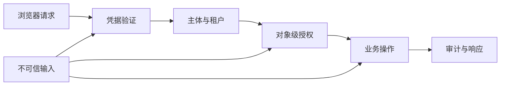

# 身份认证、授权与服务端安全手写题 H205–H230

一个用户打开管理控制台后，浏览器自动附带会话 Cookie，前端再读取项目详情并调用文件预览接口。登录成功只回答“请求代表谁”；它不回答“这个人能读哪个租户的哪份文件”。如果开发者只检查按钮、只解 JWT 签名、或把用户提供的 URL 交给服务器抓取，认证成功仍可能变成跨站请求、越权、内网探测或路径逃逸。本组题将信任边界写成输入输出明确的练习合同，不提供生产级密码/签名库，也不声称对应公司面试原题。

先看服务端每一层都需要自己的决策：

图中的主体、租户和对象授权不能合并为“已登录”。签名只证明令牌由受信任密钥签发且内容未被改；是否过期、是否给了当前服务、用户能否访问具体对象仍需独立验证。机制依据见 [OAuth 2.0 Security BCP RFC 9700](handwritten-practice-sources.md#s17)、[OWASP Cheat Sheet Series](handwritten-practice-sources.md#s18) 与 [HTTP 语义 RFC 9110](handwritten-practice-sources.md#s16)。

## 五层练习法

| 层次 | 练习动作 | 验收证据 |
|---|---|---|
| 现象 | 写出浏览器或攻击者提交的完整请求 | 方法、Origin、Cookie 与参数明确 |
| 规则 | 标出主体、资源、动作和租户 | 拒绝条件明确且默认拒绝 |
| 机制 | 说明签名、随机 nonce、约束或解析步骤 | 不以客户端显示状态代替授权 |
| 实现 | 写出校验顺序和错误合同 | 不可信数据进入业务前已收敛 |
| 边界 | 测伪造、过期、重放、重定向与异常编码 | 无旁路调用，日志不泄露凭据 |

## 浏览器凭据与令牌边界

### H205. Cookie 会话属性合同

- **题目契约：**实现 buildSessionCookie(sessionId, environment)，返回单条 Set-Cookie 字段；生产环境为 Secure、HttpOnly、Path=/、SameSite=Lax，并使用无 Domain 的 host-only Cookie。
- **约束与不变量：**sessionId 必须来自密码学安全随机源且不可包含分号/控制字符；Cookie 不存角色或其他可被客户端改写的权限；开发 HTTP 例外必须由显式环境参数控制。
- **用例 A：**生产 HTTPS 下生成的字段以 __Host- 前缀开头，包含 Secure、HttpOnly、Path=/、SameSite=Lax，不含 Domain。
- **用例 B：**sessionId 含 CRLF 或分号时拒绝构造，不能拼成第二个响应头；production + insecure transport 配置时返回配置错误。
- **实现提示：**调用标准库生成随机 session token，数据库只存其哈希或不可逆查找键；Cookie 序列化使用成熟框架，严格测试字段转义。
- **进阶追问：**SameSite=Lax 对顶层导航和子资源请求的差异是什么？为何 Cookie 前缀约束不能替代 CSRF 检查？
- **难度 / 建议时长：**中，30 分钟；检查 host-only、属性和头注入拒绝。
- **依据与状态：**作者原创派生练习，未实现/未实跑；Cookie 与会话控制参考 [OWASP Cheat Sheets](handwritten-practice-sources.md#s18)。

### H206. Cookie 会话的 CSRF 双重提交校验

- **题目契约：**实现 validateUnsafeCookieRequest(req, session)，仅对状态变更方法要求同源 Origin，且 csrfCookie 与 csrfHeader 均匹配服务端 session.csrfSecret 的 HMAC-SHA256 结果。
- **约束与不变量：**安全方法 GET/HEAD/OPTIONS 不修改状态；比较使用常量时间 API；token 绑定当前 session secret，匹配两个客户端字段但绑定另一 session 的 token 仍拒绝。
- **用例 A：**POST 带合法 session cookie、同源 Origin、csrf cookie 与相同 csrf header，通过校验并允许进入业务处理。
- **用例 B：**POST 的 Cookie/header 均带 session A 的合法 token，但当前认证会话为 B 时返回 403，handler 调用次数为 0；GET 不要求 token。
- **实现提示：**Origin 必须按规范解析并与精确 allowlist 比较；拒绝分支不把 token 写入日志，校验放在 body 副作用前。
- **进阶追问：**同步器 token 与 double-submit token 的绑定差异？SameSite=None 的集成场景为何更需要明确来源校验？
- **难度 / 建议时长：**难，35 分钟；测来源伪造、缺头和安全方法。
- **依据与状态：**作者原创派生练习，未实现/未实跑；CSRF 防护机制见 [OWASP Cheat Sheets](handwritten-practice-sources.md#s18) 与 [RFC 9110](handwritten-practice-sources.md#s16)。

### H207. CORS 凭据响应的精确 Origin 决策

- **题目契约：**实现 corsDecision(origin, method, requestedHeaders, policy)，返回 allow-origin、allow-credentials、allow-methods 与 vary 头集合。
- **约束与不变量：**带凭据请求不得返回通配符 Origin；Origin 必须和配置项精确匹配；预检失败不能附带宽松的 allow headers。
- **用例 A：**https://app.example 在白名单且 POST、X-CSRF-Token 获准时，返回精确 Origin、Allow-Credentials=true 和 Vary: Origin。
- **用例 B：**evil.example 不在白名单时不返回 ACAO；Origin 为 null 默认拒绝，不能因简单字符串 endsWith(example) 而误许子域。
- **实现提示：**使用 URL parser 规范化 scheme/host/port；allowlist 条目经启动时校验；CORS 仅控制浏览器读取，不等于服务端授权。
- **进阶追问：**允许子域通配时如何防止攻击者控制的用户子域？预检缓存 max-age 与策略撤销延迟如何权衡？
- **难度 / 建议时长：**中，30 分钟；精确区分协议、域名、端口。
- **依据与状态：**作者原创派生练习，未实现/未实跑；跨来源请求风险参考 [OWASP Cheat Sheets](handwritten-practice-sources.md#s18)。

### H208. OAuth 授权码回调 state 与 PKCE 绑定

- **题目契约：**实现 beginAuthorization(session) 与 completeCallback({state,code,verifier})，在回调时验证一次性 state 与 session 绑定，并用 PKCE verifier 兑换授权码。
- **约束与不变量：**state 至少 128 位不可预测并一次性消费；code 不可在 state 校验前兑换；redirect_uri 固定为注册回调地址，不接受 query 参数覆盖。
- **用例 A：**同一 session 使用正确 state 和 verifier 回调，state 消费一次后创建登录会话；token endpoint 收到预配置 redirect_uri。
- **用例 B：**攻击者 session 提交另一 session 的 state，返回 400 且 token endpoint 调用数为 0；重放已消费 state 同样拒绝。
- **实现提示：**state 存服务端并设短过期，PKCE 使用 S256；调用 OAuth SDK/标准 crypto，不自行实现签名或哈希算法。
- **进阶追问：**浏览器丢失 session cookie 但保留回调参数时如何恢复？授权码交换后本地会话创建失败如何收敛？
- **难度 / 建议时长：**难，40 分钟；跟踪 state、session、code 和 token endpoint 调用次数。
- **依据与状态：**作者原创派生练习，未实现/未实跑；授权码、PKCE 与回调安全见 [RFC 9700](handwritten-practice-sources.md#s17)。

### H209. OAuth redirect_uri 固定注册表

- **题目契约：**实现 resolveRedirect(clientId, requestedUri, registeredUris)，仅当规范化后的 URI 与已注册项精确匹配时返回可跳转目标。
- **约束与不变量：**不允许前缀、子串或主机后缀匹配；fragment 不作为重定向授权依据；协议、host、port、path 和必要 query 规则明确。
- **用例 A：**注册 https://app.example/callback，传入相同 URI 返回已注册值，授权码只发送到该目标。
- **用例 B：**https://app.example.evil.test/callback、http 降级或额外的 redirect=https://evil.test 均拒绝，不发 Location。
- **实现提示：**client_id 先定位自身注册列表，URL 解析后以配置化比较规则匹配完整组件；最终重定向使用注册项原文。
- **进阶追问：**移动应用 loopback redirect 的动态端口如何单独处理？开放重定向如何和授权码泄漏形成链路？
- **难度 / 建议时长：**难，35 分钟；覆盖伪造 host、降级协议与多余参数。
- **依据与状态：**作者原创派生练习，未实现/未实跑；redirect_uri 检查参考 [RFC 9700](handwritten-practice-sources.md#s17)。

### H210. JWT 声明验证器

- **题目契约：**实现 validateAccessToken(token, {issuer, audience, now, allowedAlgorithms})，通过受信任密钥验证签名后检查 exp、nbf、iss、aud，并返回最小主体对象。
- **约束与不变量：**算法来自服务器配置，不由 token header 决定；exp 必须存在且未过期；aud 至少包含当前 API；不得将 decode 当作 verify。
- **用例 A：**签名有效、iss 与 aud 精确匹配、exp 在未来且 nbf 已到的令牌返回 subject 与 scopes。
- **用例 B：**有效签名但 aud 指向另一个服务时拒绝；算法为 none 或不在 allowlist 时，在调用业务 handler 前拒绝。
- **实现提示：**JWT/JWS 验签用成熟库与标准 crypto provider；令牌头只用于选择固定 issuer 下的 key id，不可提供任意 URL。
- **进阶追问：**JWT 无状态校验与即时撤销如何折衷？时钟偏差 leeway 应如何设定和观测？
- **难度 / 建议时长：**难，40 分钟；覆盖签名、issuer、audience、时间声明。
- **依据与状态：**作者原创派生练习，未实现/未实跑；访问令牌安全见 [RFC 9700](handwritten-practice-sources.md#s17)。

### H211. JWKS key id 解析与缓存刷新

- **题目契约：**实现 selectVerificationKey(jwks, kid, alg)，只从配置的 issuer JWKS 集合中选一把允许用途的验证公钥。
- **约束与不变量：**kid 不得作为 URL 或文件路径；key 的 kty、use、alg 与令牌算法一致；未知 kid 最多触发有界刷新，不能无限请求远端。
- **用例 A：**JWKS 含两把不同 kid 的 RSA verify key，令牌 kid=b 且 alg=RS256 时唯一选中 b。
- **用例 B：**kid=../../secret 或无匹配 key 时只向固定 issuer 刷新一次，仍无匹配则拒绝且不泄漏内部文件内容。
- **实现提示：**缓存键包含 issuer；短期失败负缓存防未知 kid 洪泛；刷新使用并发合并及严格超时，不接受 token header 中的 jku/x5u。
- **进阶追问：**签名密钥轮换重叠期应保留多久？缓存刷新失败时旧 key 是否可继续用，撤销场景如何处理？
- **难度 / 建议时长：**难，40 分钟；验证固定来源、有界刷新与用途匹配。
- **依据与状态：**作者原创派生练习，未实现/未实跑；密钥与令牌防护参考 [RFC 9700](handwritten-practice-sources.md#s17)。

### H212. JWKS 轮换与未知 kid 洪泛保护

- **题目契约：**实现 getJwksForIssuer(issuer, kid, trustedIssuers, cache, fetcher)，issuer 必须先精确命中服务端 trustedIssuers，JWKS URL 只从该配置读取；支持缓存、单次刷新与失败负缓存。
- **约束与不变量：**并发相同 issuer 的刷新合并；未知 kid 请求不能形成一请求一 fetch；超过 stale 上限时必须拒绝旧密钥验证。
- **用例 A：**issuer=https://login.example 命中配置 URL=https://login.example/.well-known/jwks.json；缓存过期后 100 个并发请求只向该固定 URL fetch 一次。
- **用例 B：**issuer=https://evil.test 未命中 trustedIssuers 时不论 kid 如何，fetcher 调用 0 次并拒绝；可信 issuer 下的 1000 个随机 kid 受刷新限额约束。
- **实现提示：**对 issuer 维护 in-flight Promise、soft/hard expiry 与有限负缓存；刷新错误可服务已缓存且仍在 hard expiry 内的 key。
- **进阶追问：**key 撤销后 hard expiry 过长有什么影响？多租户 issuer 配置怎样防止攻击者创建任意 issuer 缓存项？
- **难度 / 建议时长：**挑战，45 分钟；要给并发数与刷新次数的可判定上限。
- **依据与状态：**作者原创派生练习，未实现/未实跑；令牌密钥管理参考 [RFC 9700](handwritten-practice-sources.md#s17)。

### H213. Refresh token 轮换与重放撤销

- **题目契约：**实现 rotateRefreshToken(familyId, presentedToken)，单次消费当前 refresh token 并签发下一枚；已消费旧 token 再次出现时撤销整个 token family。
- **约束与不变量：**refresh secret 使用密码学安全随机源，数据库只保存不可逆校验材料；旋转与旧 token 消费原子完成；并发双提交最多一方成功。
- **用例 A：**当前 token R1 首次兑换得到 R2，记录 R1 consumed_at，R2 成为唯一 active token。
- **用例 B：**R1 消费后再次出现，返回重放告警并撤销 R2 所在 family；不得再签发 token。
- **实现提示：**事务内用条件 UPDATE 或唯一状态约束争抢消费权；响应丢失导致客户端重试需清楚定义触发家族撤销的安全权衡。
- **进阶追问：**如何区分攻击者重放和合法客户端因网络超时重试？授权设备撤销与单家族撤销的审计字段如何设计？
- **难度 / 建议时长：**挑战，45 分钟；并发测试需使用两个真实数据库连接。
- **依据与状态：**作者原创派生练习，未实现/未实跑；refresh token 安全实践见 [RFC 9700](handwritten-practice-sources.md#s17)。

### H214. 会话固定攻击后的登录轮换

- **题目契约：**实现 completeLogin(preAuthSession, identity)，登录成功后生成新 session id、使旧 id 立即失效并返回新 Cookie。
- **约束与不变量：**不能把匿名 session 直接升级为认证 session；旧 session 任何并发请求都不能继续获得已登录权限；登录失败不得改变现有会话。
- **用例 A：**攻击者预先知道匿名 SID，用户成功登录后新 SID 不同；用旧 SID 请求账户页返回未认证。
- **用例 B：**登录凭据错误时匿名 SID 仍是匿名且不获得身份字段；并发提交旧 SID 的请求不应在轮换后建立权限。
- **实现提示：**事务或原子存储操作完成旧会话撤销和新会话创建；设置登录/权限变化时轮换的统一入口。
- **进阶追问：**多设备登录时如何分别撤销？安全退出和密码变更怎样让会话失效传播到所有服务节点？
- **难度 / 建议时长：**中，30 分钟；以旧 ID 重放作为核心证据。
- **依据与状态：**作者原创派生练习，未实现/未实跑；会话生命周期参考 [OWASP Cheat Sheets](handwritten-practice-sources.md#s18)。

### H215. Logout 的服务端失效语义

- **题目契约：**实现 revokeSession(cookie, response)，让服务端会话失效并返回过期 Set-Cookie；定义重复 logout 的结果。
- **约束与不变量：**仅清浏览器 cookie 不代表服务器端会话失效；撤销记录写入成功后旧凭据必须拒绝；响应设 Cache-Control: no-store。
- **用例 A：**有效 SID logout 后，浏览器收到 Max-Age=0 的同 scope Cookie；随后用旧 SID 请求受保护 API 返回 401。
- **用例 B：**重复 logout 返回 204 且不报泄漏会话存在性；撤销存储超时则不声称注销成功。
- **实现提示：**使撤销存储与认证查找路径一致；分布式缓存失效若有延迟，短有效期和版本校验要纳入合同。
- **进阶追问：**自包含 JWT 的 logout 如何实现？注销所有设备需要记录哪些会话族或用户版本？
- **难度 / 建议时长：**中，25 分钟；同时观察 Cookie 过期和服务端拒绝。
- **依据与状态：**作者原创派生练习，未实现/未实跑；会话撤销建议见 [OWASP Cheat Sheets](handwritten-practice-sources.md#s18)。

## 授权、多租户与访问控制

### H216. 对象级授权查询

- **题目契约：**实现 readProject(actor, projectId)，仅返回 actor 有权限访问的项目；SQL 查询需同时检查项目 ID 和成员/所有者关系。
- **约束与不变量：**UI 隐藏链接不是授权；不存在和无权访问统一返回 404；每个资源查询都从认证主体重新计算权限。
- **用例 A：**项目 owner 读取返回记录和 200；同租户普通成员按本题策略为只读时读取也返回 200。
- **用例 B：**其他租户猜中 projectId 得 404 且响应不包含标题、成员或存在性区别信息。
- **实现提示：**使用带 EXISTS 子查询的单条 SELECT，谓词包括 actor id、项目授权和 tenant id；不要先无条件查对象再在 controller 忘记判断。
- **进阶追问：**404 与 403 如何在审计里保留真实原因？批量读取多个 ID 时怎样保证逐项都通过同一授权谓词？
- **难度 / 建议时长：**难，30 分钟；使用跨租户对象 ID 作为强制拒绝用例。
- **依据与状态：**作者原创派生练习，未实现/未实跑；对象授权控制参考 [OWASP Cheat Sheets](handwritten-practice-sources.md#s18)。

### H217. 字段级写授权与 mass assignment 防护

- **题目契约：**实现 patchUser(actor, targetId, body)，普通用户只可改 displayName/timezone，管理员可改 locked 标志；响应包含最终允许字段。
- **约束与不变量：**输入 JSON 不可直接 spread 到数据库实体；身份、角色、租户、密码散列等敏感字段永不从该接口写入；未知字段一律拒绝。
- **用例 A：**普通用户提交 displayName 与 timezone 两字段后成功，返回值仅改变这两列。
- **用例 B：**普通用户额外带 isAdmin=true，整个请求 400 且数据库完全不变；管理员也只能在目标租户范围内更改 locked。
- **实现提示：**按主体角色选择字段 allowlist，构造固定 SQL 参数；校验字段类型与长度后再开启事务。
- **进阶追问：**只忽略未知字段为何会掩盖攻击？GraphQL input object 是否天然解决字段授权？
- **难度 / 建议时长：**中，30 分钟；检查非法字段导致无部分更新。
- **依据与状态：**作者原创派生练习，未实现/未实跑；授权与输入控制参考 [OWASP Cheat Sheets](handwritten-practice-sources.md#s18)。

### H218. 多租户复合键与跨租户写拒绝

- **题目契约：**实现 attachDocument(actorTenantId, folderId, documentId)，数据库模式用 tenant_id 组成复合主外键，保证 folder 和 document 属于同一租户。
- **约束与不变量：**租户 ID 来自已验证上下文而非 body；跨租户引用由 DB 外键再次阻止；读写谓词都显式含 tenant_id。
- **用例 A：**同一 tenant 的 folder 和 document 关联成功，并可按 (tenant_id, folder_id) 查询。
- **用例 B：**body 试图指定另一个 tenant 的 document，应用校验拒绝；绕过应用直接执行 SQL 也被复合外键拒绝。
- **实现提示：**将 tenant_id 纳入唯一键与关联外键；事务先校验授权，仍依赖数据库约束防竞态与代码遗漏。
- **进阶追问：**数据库 Row-Level Security 如何与显式租户过滤叠加？连接池 session variable 忘记清理会导致什么跨请求泄漏？
- **难度 / 建议时长：**难，35 分钟；同时测试应用层和数据库层拒绝。
- **依据与状态：**作者原创派生练习，未实现/未实跑；多租户控制实践参考 [OWASP Cheat Sheets](handwritten-practice-sources.md#s18)。

### H219. Row-Level Security 事务上下文

- **题目契约：**实现 withTenantTransaction(pool, tenantId, work)，在同一连接事务中设置本地 tenant context，再运行 work，提交或回滚并释放连接。
- **约束与不变量：**tenantId 经认证上下文验证；使用 transaction-local 设置而非 session 永久状态；任一失败路径都不会把 A 的 tenant 留给池中下一请求。
- **用例 A：**同一连接先运行 tenant A 查询、提交，再供 tenant B 使用，只返回 B 行，设置值在事务结束后复位。
- **用例 B：**A 的 work 中途抛错并 rollback，连接回池后 B 查询仍不可看见 A 的行。
- **实现提示：**RLS policy 与应用显式谓词都保留；用 set_config 的 local 语义，并确认驱动事务复用单连接。
- **进阶追问：**表 owner 或 BYPASSRLS 角色如何影响策略？超级用户测试为何无法证明应用账号受策略保护？
- **难度 / 建议时长：**难，40 分钟；必须复用真实池连接跨租户连续执行。
- **依据与状态：**作者原创派生练习，未实现/未实跑；纵深防御实践参考 [OWASP Cheat Sheets](handwritten-practice-sources.md#s18)。

### H220. RBAC 与资源属性组合判定

- **题目契约：**实现 authorize(actor, action, resource)，规则为 tenant admin 可管理本租户全部资源，项目 owner 可编辑自身项目，其他成员只可读。
- **约束与不变量：**默认 deny；role、tenant 与 project owner 均取服务端可信记录；不能让客户端传入 role 覆盖主体声明。
- **用例 A：**tenant admin 修改本租户项目获准；owner 修改自己的项目获准；普通 member 读取获准。
- **用例 B：**admin 访问其他 tenant 的项目被拒绝；owner 对非 owner 项目执行 edit 被拒绝，缺失 role 也默认 deny。
- **实现提示：**把判定拆为主体有效性、tenant 相等、action-role-resource 规则；查询资源时尽量将授权条件下推 SQL。
- **进阶追问：**角色继承与属性规则同时存在时如何防规则冲突？如何为每次拒绝留审计证据而不泄露资源详情？
- **难度 / 建议时长：**中，30 分钟；覆盖授权矩阵而非单角色 happy path。
- **依据与状态：**作者原创派生练习，未实现/未实跑；授权决策原则参考 [OWASP Cheat Sheets](handwritten-practice-sources.md#s18)。

### H221. 权限撤销与长请求的一致性

- **题目契约：**实现 updateDocument(actor, docId, body)，请求开始时读取权限版本，写入前检查权限未撤销；合同要求并发撤销后不得提交新内容。
- **约束与不变量：**仅在请求入口验一次权限会留下长操作竞态；授权版本和内容修改应处于同一事务或受同一锁保护。
- **用例 A：**更新事务先锁 document 权限行，随后管理员撤权等待；内容更新提交在撤权之前且操作时间序列明确。
- **用例 B：**管理员撤权先提交后，旧请求不能依据过期的入口快照更新文档，返回 403 且内容不变。
- **实现提示：**选择行锁或条件 UPDATE join 权限版本；定义线性化点，避免检查与写入之间出现无保护窗口。
- **进阶追问：**跨服务权限缓存如何传播撤销？若业务接受最多 30 秒延迟，要如何明确展示为产品合同？
- **难度 / 建议时长：**挑战，45 分钟；交错时序决定允许还是拒绝。
- **依据与状态：**作者原创派生练习，未实现/未实跑；访问控制纵深防护参考 [OWASP Cheat Sheets](handwritten-practice-sources.md#s18)。

### H222. 授权审计事件的最小披露

- **题目契约：**实现 recordAccessDecision(actor, resource, action, decision)，记录可关联审计日志并将拒绝返回统一外部响应。
- **约束与不变量：**日志不得含访问 token、Cookie、密码或完整敏感 payload；resource ID 按数据分类处理；未授权响应不泄露对象存在性。
- **用例 A：**授权成功日志含 requestId、actorId、resourceType、action 和 decision=allow，不含凭据。
- **用例 B：**跨租户拒绝时客户端统一收到 404；审计记录含拒绝类别和租户边界，但不写资源标题或个人内容。
- **实现提示：**定义结构化字段 allowlist 与日志脱敏；审计写入失败的业务策略需要明确，关键合规操作可采用同事务 outbox。
- **进阶追问：**若日志存储不可用，哪些高风险写操作应失败关闭？审计保留期限和访问权限如何本身受控？
- **难度 / 建议时长：**中，30 分钟；测试外部响应、审计记录及敏感字段集。
- **依据与状态：**作者原创派生练习，未实现/未实跑；日志与授权建议参考 [OWASP Cheat Sheets](handwritten-practice-sources.md#s18)。

## SSRF、路径和不可信数据

### H223. URL 抓取的 SSRF 目标校验

- **题目契约：**实现 validateFetchTarget(inputUrl, resolver)，仅允许 HTTPS 且主机在业务许可域内；解析 DNS 后拒绝 loopback、私网、link-local 和保留地址。
- **约束与不变量：**校验发生在连接目标确定之后；每次连接需绑定已验证解析结果，避免先校验后重新解析导致 DNS rebinding；拒绝用户名密码和非默认端口。
- **用例 A：**https://assets.partner.example/image.png 解析到公开 IPv4，host allowlist 命中后生成受控连接目标。
- **用例 B：**127.0.0.1、[::1]、169.254.169.254、10.0.0.4 或域名解析到任一私网地址均拒绝，fetcher 调用次数为 0。
- **实现提示：**使用标准 IP 地址分类能力与受控 DNS resolver；限制重定向并对每个跳转重新验证，禁止环境代理绕过目标绑定。
- **进阶追问：**IPv4-mapped IPv6、整数形式 IP 和多答案 DNS 如何规范化？云元数据地址过滤为何不能只靠 hostname 黑名单？
- **难度 / 建议时长：**挑战，45 分钟；覆盖域名、字面 IP、解析与重定向。
- **依据与状态：**作者原创派生练习，未实现/未实跑；SSRF 防护实践见 [OWASP Cheat Sheets](handwritten-practice-sources.md#s18)。

### H224. SSRF 重定向逐跳复验

- **题目契约：**实现 fetchWithPolicy(url, transport, maxRedirects)，每次 3xx 跳转解析新 Location，重新执行 scheme、host、DNS 和 IP 检查。
- **约束与不变量：**每次跳转计数受限；相对 Location 基于当前 URL 解析；不得把原始授权头或 Cookie 自动转给新主机。
- **用例 A：**允许 host 返回同一 allowlist 域的相对跳转，第二跳再次验证后成功，最多跟随指定的 3 次重定向。
- **用例 B：**允许域名 302 到 127.0.0.1 时第二请求不发送；跳转数超过上限返回明确错误。
- **实现提示：**关闭 transport 的隐式自动 redirect；逐跳构建新的请求头 allowlist，DNS 解析结果与 socket 目标一致。
- **进阶追问：**DNS 在校验和 TCP 连接间变化如何防御？代理服务的 HTTP_PROXY 环境变量会改变哪些信任假设？
- **难度 / 建议时长：**难，40 分钟；观察被拒目标的网络调用必须为零。
- **依据与状态：**作者原创派生练习，未实现/未实跑；SSRF 控制参考 [OWASP Cheat Sheets](handwritten-practice-sources.md#s18)。

### H225. 文件系统路径 containment

- **题目契约：**实现 resolveUploadPath(root, userPath)，把允许的相对路径映射到根目录下的规范路径，并保证最终目标仍位于 root。
- **约束与不变量：**拒绝绝对路径、NUL、编码分隔符和跨平台分隔符绕过；仅做字符串 startsWith 不足以证明路径包含；symlink 策略必须明确。
- **用例 A：**root=/srv/uploads，userPath=2026/a.png 返回规范路径 /srv/uploads/2026/a.png。
- **用例 B：**../../etc/passwd、%2e%2e%2fsecret 与包含 symlink 指向 /etc 的目标均拒绝，目标文件不可被创建。
- **实现提示：**先解码一次并拒绝歧义编码，再 path.resolve 与 path.relative 检查；写入使用不跟随 symlink 的安全打开选项或目录文件描述符方案。
- **进阶追问：**TOCTOU 发生在校验与打开之间时如何避免？Windows drive、UNC 路径需要单独测试什么？
- **难度 / 建议时长：**挑战，45 分钟；需在真实临时目录创建 symlink 验收。
- **依据与状态：**作者原创派生练习，未实现/未实跑；路径处理建议参考 [OWASP Cheat Sheets](handwritten-practice-sources.md#s18)。

### H226. Zip 解压的路径穿越拒绝

- **题目契约：**实现 validateArchiveEntry(root, entryName)，在解压每个归档条目前拒绝绝对路径、父级跳转、链接逃逸和冲突覆盖。
- **约束与不变量：**目录项与文件项均受根路径约束；符号链接默认拒绝；条目数、单文件字节数与总展开大小均设上限。
- **用例 A：**条目 reports/2026.csv 映射到根目录内，父目录创建在校验后完成。
- **用例 B：**条目 ../../outside、Unix 绝对路径、Windows drive 路径和指向根外的 symlink 均拒绝且根外无新文件。
- **实现提示：**归档名按 POSIX slash 解析，即使运行平台是 Windows；先校验全量元数据预算，再流式解压并用独占创建防覆盖。
- **进阶追问：**压缩炸弹怎样用压缩比、总字节和 CPU 时间界定？硬链接、设备节点和稀疏文件是否接受？
- **难度 / 建议时长：**难，40 分钟；需要真实临时目录外侧哨兵文件作为结果证据。
- **依据与状态：**作者原创派生练习，未实现/未实跑；文件输入安全实践参考 [OWASP Cheat Sheets](handwritten-practice-sources.md#s18)。

### H227. 反序列化对象键污染防线

- **题目契约：**实现 parsePublicObject(jsonText, schema)，只输出 schema 允许的普通数据字段；输入必须是合法 JSON 字符串，不接受 JS 对象字面量。
- **约束与不变量：**JSON.parse 结果不直接合并进配置/权限对象；__proto__、prototype、constructor 默认拒绝；嵌套深度与数组长度受限。
- **用例 A：**输入 JSON 字符串 {"displayName":"Lin","timezone":"Asia/Shanghai"} 时输出仅有两个经过类型校验的字段。
- **用例 B：**输入 JSON 字符串 {"__proto__":{"admin":true}} 时整体拒绝，Object.prototype 不发生改变；同样拒绝含 constructor.prototype 的键树。
- **实现提示：**按 schema 白名单逐字段构造 null-prototype 输出；拒绝未知字段；用深度计数避免递归耗尽。
- **进阶追问：**structuredClone 是否等价于 schema 验证？YAML、Java 反序列化等格式增加了哪些类型实例风险？
- **难度 / 建议时长：**难，35 分钟；用隔离进程或 pristine object 检查全局原型未污染。
- **依据与状态：**作者原创派生练习，未实现/未实跑；不可信输入防护见 [OWASP Cheat Sheets](handwritten-practice-sources.md#s18)。

### H228. JWT kid 到密钥映射的路径边界

- **题目契约：**实现 resolveKey(kid, configuredKeySet)，只在服务器启动加载的键集合中查找 kid，不允许 kid 访问文件系统、URL 或动态 secret store 路径。
- **约束与不变量：**kid 只作为精确 map key；必须同时校验 key type 和 allowed algorithm；未命中一律拒绝并限制告警频率。
- **用例 A：**kid=signing-2026 在已加载 map 中唯一命中 RSA 公钥，验证调用参数明确 alg=RS256。
- **用例 B：**kid=../../etc/passwd 或含 URL 字符串时只得到 KeyNotFound，文件读取和 HTTP 请求均为 0 次。
- **实现提示：**启动时验证 issuer 配置并建立不可变 Map；不要从 token header 拼文件名，也不要接受 jku/x5u 自动加载。
- **进阶追问：**多 issuer 如何命名隔离 kid 空间？配置热更新期间旧 token 验签如何保持原子切换？
- **难度 / 建议时长：**中，30 分钟；核心断言是未受信任输入不能引发外部取钥。
- **依据与状态：**作者原创派生练习，未实现/未实跑；令牌威胁模型参考 [RFC 9700](handwritten-practice-sources.md#s17) 与 [OWASP Cheat Sheets](handwritten-practice-sources.md#s18)。

### H229. 登录失败速率限制的原子键设计

- **题目契约：**登录前调用 checkLoginAttempt(normalizedAccount, clientNetwork, now)；凭据验证后调用 recordLoginOutcome(normalizedAccount, clientNetwork, now, outcome)，共享存储按账号和来源网络维护窗口，outcome 仅为 success 或 failure。
- **约束与不变量：**用户名规范化规则固定；并发失败不能丢计数；只有 outcome=failure 增计数，success 清零该账号失败窗口；外部响应不泄露账号是否存在。
- **用例 A：**同一规范化账号在 10 分钟内 5 次失败后第 6 次被拒，冷却截止时间输出为确定时间戳。
- **用例 B：**大小写折叠账号 A/a 进入同一计数键；一次 success 将账户失败计数清零而不增加网络失败计数；真实与不存在账号失败响应均为 401 和同一文本。
- **实现提示：**用 Redis 原子脚本或数据库事务更新窗口，而非进程内 Map；同时设置账户维度和网络维度以减轻分布式撞库。
- **进阶追问：**攻击者故意锁定他人账户如何避免拒绝服务？共享 NAT 用户如何设置网络限额与渐进挑战？
- **难度 / 建议时长：**难，40 分钟；需并发压力用例和隐私响应比对。
- **依据与状态：**作者原创派生练习，未实现/未实跑；认证防护实践参考 [OWASP Cheat Sheets](handwritten-practice-sources.md#s18)。

### H230. 安全重定向与登录后返回地址

- **题目契约：**实现 safeReturnTo(value, allowedOrigins)，登录成功后仅跳转到本站相对路径或明确允许的 origin。
- **约束与不变量：**拒绝协议相对 URL、javascript:、data:、反斜杠混淆和用户信息段；无效输入回落到固定 /home。
- **用例 A：**/projects/7?tab=members 保留为同源相对跳转；配置中允许的 https://app.example/settings 通过。
- **用例 B：**//evil.test、https://app.example.evil.test、javascript:alert(1) 与反斜杠路径均回落 /home，绝不产生外域 Location。
- **实现提示：**用 URL parser 以固定本站 origin 作 base，比较 origin 精确值，再只返回 pathname/search/hash；对反斜杠和控制字符提前拒绝。
- **进阶追问：**回调登录流程中 returnTo 如何和 OAuth state 绑定？经过多级代理后怎样确定本站可信 origin？
- **难度 / 建议时长：**中，30 分钟；测试编码形式与协议相对 URL。
- **依据与状态：**作者原创派生练习，未实现/未实跑；开放重定向与 OAuth 安全参考 [RFC 9700](handwritten-practice-sources.md#s17) 与 [RFC 9110](handwritten-practice-sources.md#s16)。

## 错误对比、口述与验收

| 错误做法 | 可观察后果 | 验收修正 |
|---|---|---|
| 只因 JWT 签名正确就放行 | 错 issuer/audience 令牌被接受 | 分别断言 alg、iss、aud、时间和主体 |
| 只隐藏无权按钮 | 直接请求对象 ID 仍读到数据 | 每个资源 SQL 都绑定主体与租户 |
| DNS 校验后让 HTTP 库自行重解析 | 验证地址与连接地址可能不同 | 绑定解析结果并逐跳复验 |
| 仅清除浏览器 Cookie | 旧会话仍在服务端有效 | 用旧凭据重放确认服务端拒绝 |
| 将用户 JSON 合并进权限对象 | 原型或敏感字段可能改变 | schema allowlist 重建数据对象 |

**30 秒回答：**认证证明请求主体，授权必须在每个服务端资源操作时依据主体、租户、动作和对象重新判定。Cookie 请求要有 CSRF 来源与 token 校验；JWT 除签名外还验证 issuer、audience 和时间；所有不可信 URL、路径和序列化数据都需有受限解析边界。

**2 分钟回答：**我会从请求入口分三步建立边界：先用固定算法和受信任 JWKS 校验凭据及声明，再从服务端会话得到主体和租户，最后把对象授权谓词放入实际 SQL 或原子更新。浏览器自动携带 Cookie 的写请求还要检查 Origin 与 CSRF token。代理抓取 URL 时逐跳校验 scheme、域名和解析 IP，并绑定实际连接目标。验收至少包含有效/过期/错误 audience 令牌、跨租户对象、伪造 Origin、DNS 内网答案、重定向到 loopback、路径穿越和原型污染；观测业务 handler 是否被调用、DB 行是否改变、网络 fetch 次数与审计日志字段。

真实验收边界：本页 runnable=false，题目展示可测接口合同，不是安全库或生产部署指南。正式实现须使用维护中的 OAuth/JWT/密码库与框架安全能力，不自行造 crypto；测试输入要覆盖浏览器 Cookie、多个数据库连接、受控 DNS 与真实临时目录。通过阈值是拒绝请求没有副作用、授权覆盖所有对象入口、密钥只从配置来源读取、日志不含凭据。失败证据需可还原请求、策略结果和调用次数；临时令牌、测试密钥和文件均在用例结束时清理。

## 自测

??? question "1. JWT 签名有效就代表令牌可给当前 API 用吗？"
    不代表。还必须检查服务器允许的算法、issuer、audience、有效时间和业务所需的主体/范围。

??? question "2. SameSite Cookie 能单独替代所有 CSRF 防护吗？"
    不能。嵌入式或跨站工作流可能需要不同策略，状态变更请求还应有明确来源/token 验证。

??? question "3. SSRF 校验域名后为什么还要校验 DNS 结果？"
    允许域名可解析到 loopback 或私网，也可能发生 DNS rebinding；实际连接地址必须仍在策略允许范围。

## 深入阅读

- [OAuth 2.0 Security BCP RFC 9700](handwritten-practice-sources.md#s17)：读授权码、重定向、令牌和 PKCE 建议，能解释回调状态为何需要绑定。
- [OWASP Cheat Sheet Series](handwritten-practice-sources.md#s18)：按 Authentication、Session、CSRF、Authorization、SSRF 与 Deserialization 阅读，能建立服务端纵深检查清单。
- [RFC 9110](handwritten-practice-sources.md#s16)：读方法安全性、状态码和重定向语义，能明确 HTTP 层合同。
