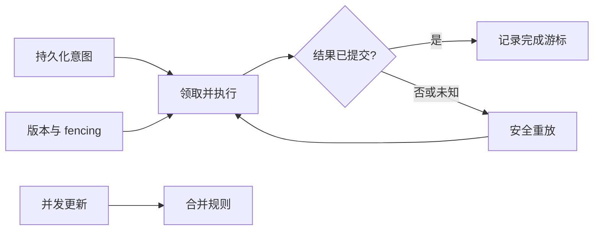

# 分布式幂等、队列与数据同步手写题 H231–H256

<!-- Solution routes -->
先跟着代码写一遍，可读[业务状态](workshop-web-business.md)和[场景专题](real-interview-scenarios.md)。下方练习再增加新约束。

支付服务已扣款，但 worker 在写“完成”前宕机；队列稍后重投同一事件，另一个 worker 也可能拿到过期租约。与此同时，离线编辑器把同一文档从两台设备改过，重连后必须合并而不是把后到的整个快照覆盖前一份。单纯“再试一次”无法定义外部副作用是否重复，也不能让过期持有者安全地写回。本组题按状态、持久化边界与恢复证据拆解这些问题。

先看常见恢复链路：

每个箭头都要说明崩溃位置、重复事件和记录的权威方。队列的 pending 状态不是业务完成，租约不是永久所有权，合并算法也不是“取最后一个包”。机制核验参考 [Redis Streams](handwritten-practice-sources.md#s19)、[Yjs Document Updates](handwritten-practice-sources.md#s20) 与 [PostgreSQL 事务隔离](handwritten-practice-sources.md#s14)。

## 幂等、投递与租约

### H231. 持久化幂等键与响应重放

实现 executeIdempotently(scope, key, requestHash, operation)，operation 接收同一数据库事务对象；幂等记录、业务写入和最终 HTTP 结果在该事务中提交，重复请求返回已存结果。

唯一键为 (scope,key)；同键不同 requestHash 返回冲突；操作不得在事务中执行外部副作用，外部消息写入 outbox；不能把普通响应缓存当作幂等协议。

- 首次 key=K 请求成功并保存 201 body；第二次同 scope、同 hash 请求返回同状态和 body，operation 调用次数仍为 1。
- key=K 已绑定 hash=A，后续 hash=B 返回 409 且不执行 operation；第一次事务在 COMMIT 前崩溃后回滚业务行与处理中行，新 worker 可用相同 K/A 重新执行并提交一次。

数据库唯一约束争抢所有权；事务内完成业务写和结果记录，外部副作用通过 outbox；存储响应需限制大小并排除敏感头。

幂等键过期窗口如何与客户端重试周期匹配？支付已成功但连接断开时，如何通过业务查询恢复确定结果？

挑战，45 分钟；观测唯一约束、operation 次数与重复响应字节。

<!-- Question record (index metadata)
- **题目契约：**实现 executeIdempotently(scope, key, requestHash, operation)，operation 接收同一数据库事务对象；幂等记录、业务写入和最终 HTTP 结果在该事务中提交，重复请求返回已存结果。
- **约束与不变量：**唯一键为 (scope,key)；同键不同 requestHash 返回冲突；操作不得在事务中执行外部副作用，外部消息写入 outbox；不能把普通响应缓存当作幂等协议。
- **用例 A：**首次 key=K 请求成功并保存 201 body；第二次同 scope、同 hash 请求返回同状态和 body，operation 调用次数仍为 1。
- **用例 B：**key=K 已绑定 hash=A，后续 hash=B 返回 409 且不执行 operation；第一次事务在 COMMIT 前崩溃后回滚业务行与处理中行，新 worker 可用相同 K/A 重新执行并提交一次。
- **实现提示：**数据库唯一约束争抢所有权；事务内完成业务写和结果记录，外部副作用通过 outbox；存储响应需限制大小并排除敏感头。
- **进阶追问：**幂等键过期窗口如何与客户端重试周期匹配？支付已成功但连接断开时，如何通过业务查询恢复确定结果？
- **难度 / 建议时长：**挑战，45 分钟；观测唯一约束、operation 次数与重复响应字节。
- **依据与状态：**作者原创派生练习，未实现/未实跑；持久化事务边界参考 [PostgreSQL Transaction Isolation](handwritten-practice-sources.md#s14)。
-->

### H232. Webhook 时间窗与事件重放防护

实现 acceptWebhook(rawBody, timestamp, signature, verifier, store)，先验证签名覆盖的原始字节，再从已验证 JSON body 取 eventId 并原子登记，返回 accepted 或 duplicate。

签名调用标准库或供应商 SDK，不自制 crypto；签名必须覆盖 timestamp 与完整 rawBody；只有签名有效且时差不超过 300 秒才登记；eventId 按供应商/租户唯一。

- 签名正确且覆盖 body 中 eventId=E、时间为 now-100 秒，首次登记 E 一次并进入后续处理。
- 同一签名 body 重放返回 duplicate 且处理次数不增加；eventId 仅从已验签 body 读取，外部不能覆盖；时差 301 秒拒绝且不写表。

原始字节先验签，时间戳参与签名输入；eventId insert 使用唯一约束；保留期限覆盖供应商重投窗口并有清理策略。

时钟偏差如何监测？若 provider event ID 不是全局唯一，去重键需附加哪些域？

难，35 分钟；验收签名顺序、边界 300/301 秒和唯一登记。

<!-- Question record (index metadata)
- **题目契约：**实现 acceptWebhook(rawBody, timestamp, signature, verifier, store)，先验证签名覆盖的原始字节，再从已验证 JSON body 取 eventId 并原子登记，返回 accepted 或 duplicate。
- **约束与不变量：**签名调用标准库或供应商 SDK，不自制 crypto；签名必须覆盖 timestamp 与完整 rawBody；只有签名有效且时差不超过 300 秒才登记；eventId 按供应商/租户唯一。
- **用例 A：**签名正确且覆盖 body 中 eventId=E、时间为 now-100 秒，首次登记 E 一次并进入后续处理。
- **用例 B：**同一签名 body 重放返回 duplicate 且处理次数不增加；eventId 仅从已验签 body 读取，外部不能覆盖；时差 301 秒拒绝且不写表。
- **实现提示：**原始字节先验签，时间戳参与签名输入；eventId insert 使用唯一约束；保留期限覆盖供应商重投窗口并有清理策略。
- **进阶追问：**时钟偏差如何监测？若 provider event ID 不是全局唯一，去重键需附加哪些域？
- **难度 / 建议时长：**难，35 分钟；验收签名顺序、边界 300/301 秒和唯一登记。
- **依据与状态：**作者原创派生练习，未实现/未实跑；HTTP 消息边界与签名载体参考 [RFC 9110](handwritten-practice-sources.md#s16)。
-->

### H233. Fencing token 防止租约过期者写入

实现 acquireLease(resource, owner, now, ttl) 与 writeIfCurrent(resource, fencingToken, value)，每次新授予租约产生严格递增 token，并在同一原子存储操作中登记为资源当前 token。

授予新 token 的瞬间起，写入端只接受与已登记当前 token 完全相等的写入；过期 worker 不能覆盖新 owner 的值；只靠本地时间和 owner 字符串不足以 fencing。

- A 获 token 11 后租约到期，B 获 token 12 并先写入；随后 A 用 11 写入被拒，值仍是 B 的结果。
- A 的租约尚未到期时 B 不能得到新 token；时间推进到到期点后 B 获 token 12，存储原子登记当前 token=12，之后 A 的 token=11 写入立即被拒。

token 由线性一致的持久计数器或数据库 sequence 发放；发放和登记当前 token 原子完成，资源写入以 token 与当前登记值相等作为条件。

sequence 回滚或灾备恢复后 token 重新变小怎么办？第三方存储不支持条件 token 写入时 fencing 如何落地？

挑战，45 分钟；测试必须模拟 A 超时后继续运行。

<!-- Question record (index metadata)
- **题目契约：**实现 acquireLease(resource, owner, now, ttl) 与 writeIfCurrent(resource, fencingToken, value)，每次新授予租约产生严格递增 token，并在同一原子存储操作中登记为资源当前 token。
- **约束与不变量：**授予新 token 的瞬间起，写入端只接受与已登记当前 token 完全相等的写入；过期 worker 不能覆盖新 owner 的值；只靠本地时间和 owner 字符串不足以 fencing。
- **用例 A：**A 获 token 11 后租约到期，B 获 token 12 并先写入；随后 A 用 11 写入被拒，值仍是 B 的结果。
- **用例 B：**A 的租约尚未到期时 B 不能得到新 token；时间推进到到期点后 B 获 token 12，存储原子登记当前 token=12，之后 A 的 token=11 写入立即被拒。
- **实现提示：**token 由线性一致的持久计数器或数据库 sequence 发放；发放和登记当前 token 原子完成，资源写入以 token 与当前登记值相等作为条件。
- **进阶追问：**sequence 回滚或灾备恢复后 token 重新变小怎么办？第三方存储不支持条件 token 写入时 fencing 如何落地？
- **难度 / 建议时长：**挑战，45 分钟；测试必须模拟 A 超时后继续运行。
- **依据与状态：**作者原创派生练习，未实现/未实跑；租约之外的持久一致性须由实现存储合同证明，事务机制参考 [PostgreSQL Transaction Isolation](handwritten-practice-sources.md#s14)。
-->

### H234. 租约续期与所有权代次

实现 renewLease(resource, owner, token, now, ttl)，仅当前未过期租约的 owner 和 token 能续租，返回新的 expiresAt。

续期不是重新授予，不改变 fencing token；过期后不能复活旧 token；续租与接管操作必须原子竞争。

- token=7 在 expiresAt 前 1ms 续租，expiresAt 从 now+ttl 重新计算，token 仍为 7。
- 时钟到 expiresAt 后旧 owner 续租被拒，接管者得到 token=8；旧请求之后到达也不能覆盖新租约。

以服务端存储时钟做条件更新，谓词含 resource、owner、token 和 expires_at>now；返回受影响行数作为判定。

客户端与存储时钟不一致时续租提早多少？续租请求响应丢失后如何查询当前租约状态？

难，35 分钟；精确测试过期边界与并发接管。

<!-- Question record (index metadata)
- **题目契约：**实现 renewLease(resource, owner, token, now, ttl)，仅当前未过期租约的 owner 和 token 能续租，返回新的 expiresAt。
- **约束与不变量：**续期不是重新授予，不改变 fencing token；过期后不能复活旧 token；续租与接管操作必须原子竞争。
- **用例 A：**token=7 在 expiresAt 前 1ms 续租，expiresAt 从 now+ttl 重新计算，token 仍为 7。
- **用例 B：**时钟到 expiresAt 后旧 owner 续租被拒，接管者得到 token=8；旧请求之后到达也不能覆盖新租约。
- **实现提示：**以服务端存储时钟做条件更新，谓词含 resource、owner、token 和 expires_at>now；返回受影响行数作为判定。
- **进阶追问：**客户端与存储时钟不一致时续租提早多少？续租请求响应丢失后如何查询当前租约状态？
- **难度 / 建议时长：**难，35 分钟；精确测试过期边界与并发接管。
- **依据与状态：**作者原创派生练习，未实现/未实跑；租约数据应依赖原子存储事务，参考 [PostgreSQL Transaction Isolation](handwritten-practice-sources.md#s14)。
-->

### H235. Redis Streams 消费组的 pending 恢复

实现 consumeBatch(stream, group, consumer, count)，读取新消息、处理并 ACK；另实现 recoverPending(minIdleMs)，把闲置超时消息交给新消费者。

消息只有业务效果持久成功后才 ACK；pending 仅代表已投递未确认；重新领取可能重复执行，处理端需要 eventId 去重。

- 消费者 C1 读取消息 M 并成功提交业务记录后 ACK，pending 数从 1 变 0。
- C1 读取 M 后崩溃且不 ACK，闲置超过 5000ms 后 C2 claim 到 M；C2 处理后只保留一条业务效果。

使用 Redis Streams consumer group 的 pending/claim 机制；监控 pending age、重领次数和死信数量，避免只看 stream 长度。

超大 pending 列表怎样分批扫描？慢处理超过 minIdleMs 时可能发生双消费者，fencing 或幂等如何兜底？

难，40 分钟；记录读取、claim、业务提交与 ACK 的顺序。

<!-- Question record (index metadata)
- **题目契约：**实现 consumeBatch(stream, group, consumer, count)，读取新消息、处理并 ACK；另实现 recoverPending(minIdleMs)，把闲置超时消息交给新消费者。
- **约束与不变量：**消息只有业务效果持久成功后才 ACK；pending 仅代表已投递未确认；重新领取可能重复执行，处理端需要 eventId 去重。
- **用例 A：**消费者 C1 读取消息 M 并成功提交业务记录后 ACK，pending 数从 1 变 0。
- **用例 B：**C1 读取 M 后崩溃且不 ACK，闲置超过 5000ms 后 C2 claim 到 M；C2 处理后只保留一条业务效果。
- **实现提示：**使用 Redis Streams consumer group 的 pending/claim 机制；监控 pending age、重领次数和死信数量，避免只看 stream 长度。
- **进阶追问：**超大 pending 列表怎样分批扫描？慢处理超过 minIdleMs 时可能发生双消费者，fencing 或幂等如何兜底？
- **难度 / 建议时长：**难，40 分钟；记录读取、claim、业务提交与 ACK 的顺序。
- **依据与状态：**作者原创派生练习，未实现/未实跑；消费组和 pending 机制见 [Redis Streams](handwritten-practice-sources.md#s19)。
-->

### H236. 持久队列的领取、租约与确认

实现 enqueue(payload)、claim(worker, now, leaseMs)、ack(jobId, token) 与 release(jobId, token, reason) 的 SQL 状态机。

payload 持久后才返回 enqueue 成功；claim 产生递增 fencing token；ack/release 只接受当前 token；任务处理在短领取事务外执行。

- 入队 J 后 worker A 领取 token=1，处理成功 ack，状态完成且消费者再次轮询拿不到 J。
- A 租约过期、B 以 token=2 接手；A 的迟到 ack(token=1) 影响 0 行，B ack 后才完成。

事务中锁定可领取行并更新 owner/lease/token；建立状态与 next_visible_at 索引；队列长度和单次批量设上限。

领取后进程崩溃和业务成功但 ack 前崩溃如何区分？租约时间过短会出现何种重复并发？

挑战，45 分钟；通过两个 worker 的交错事务测试 fencing。

<!-- Question record (index metadata)
- **题目契约：**实现 enqueue(payload)、claim(worker, now, leaseMs)、ack(jobId, token) 与 release(jobId, token, reason) 的 SQL 状态机。
- **约束与不变量：**payload 持久后才返回 enqueue 成功；claim 产生递增 fencing token；ack/release 只接受当前 token；任务处理在短领取事务外执行。
- **用例 A：**入队 J 后 worker A 领取 token=1，处理成功 ack，状态完成且消费者再次轮询拿不到 J。
- **用例 B：**A 租约过期、B 以 token=2 接手；A 的迟到 ack(token=1) 影响 0 行，B ack 后才完成。
- **实现提示：**事务中锁定可领取行并更新 owner/lease/token；建立状态与 next_visible_at 索引；队列长度和单次批量设上限。
- **进阶追问：**领取后进程崩溃和业务成功但 ack 前崩溃如何区分？租约时间过短会出现何种重复并发？
- **难度 / 建议时长：**挑战，45 分钟；通过两个 worker 的交错事务测试 fencing。
- **依据与状态：**作者原创派生练习，未实现/未实跑；事务领取边界参考 [PostgreSQL Transaction Isolation](handwritten-practice-sources.md#s14)。
-->

### H237. 延迟队列与死信转移原子性

实现 rescheduleOrDeadLetter(job, attempts, nextAt)，失败次数未达上限则设下次可见时间，达到上限则原子移入 dead-letter 表。

源任务更新与 dead-letter insert 同一事务；attempts 只在一次实际交付失败后加一；清理和重放操作保留原 job ID 与审计原因。

- attempts=2、max=5 的任务失败后变为 attempts=3、next_visible_at=指定时间，尚不可被 claim。
- attempts=4 的任务失败一次后同时从 active 移除并在 dead-letter 出现一条；事务失败时两边状态均不改变。

同一事务先将 active job 标为 delayed 或删除该活动行，再把 job_id、payload、失败次数和原因插入 dead-letter；指数间隔设定上限并注入 clock 与 jitter source。

手动重放死信如何避免生成重复业务副作用？永久错误与暂时错误分类依据应由谁提供？

难，40 分钟；验证阈值、可见时间与原子转移。

<!-- Question record (index metadata)
- **题目契约：**实现 rescheduleOrDeadLetter(job, attempts, nextAt)，失败次数未达上限则设下次可见时间，达到上限则原子移入 dead-letter 表。
- **约束与不变量：**源任务更新与 dead-letter insert 同一事务；attempts 只在一次实际交付失败后加一；清理和重放操作保留原 job ID 与审计原因。
- **用例 A：**attempts=2、max=5 的任务失败后变为 attempts=3、next_visible_at=指定时间，尚不可被 claim。
- **用例 B：**attempts=4 的任务失败一次后同时从 active 移除并在 dead-letter 出现一条；事务失败时两边状态均不改变。
- **实现提示：**同一事务先将 active job 标为 delayed 或删除该活动行，再把 job_id、payload、失败次数和原因插入 dead-letter；指数间隔设定上限并注入 clock 与 jitter source。
- **进阶追问：**手动重放死信如何避免生成重复业务副作用？永久错误与暂时错误分类依据应由谁提供？
- **难度 / 建议时长：**难，40 分钟；验证阈值、可见时间与原子转移。
- **依据与状态：**作者原创派生练习，未实现/未实跑；队列持久状态与恢复参考 [Redis Streams](handwritten-practice-sources.md#s19)。
-->

### H238. Saga 订单状态机与补偿

实现 runOrderSaga(orderId, steps)，步骤为 reserveInventory、chargePayment、createShipment；每步持久化 started/succeeded/compensated 状态。

每个 forward step 有独立 operationId；失败时按已成功步骤逆序执行补偿；补偿本身可重放且不能把原失败标成成功。

- 库存预留和扣款成功、创建物流失败，依次补偿退款、释放库存，最终 saga 状态为 compensated。
- 释放库存补偿首次超时，saga 标记 compensation_pending 并再次执行同一 compensationId，不能再扣库存或再退款。

每个步骤意图先落持久状态再调用服务，结果回写；外部操作必须提供幂等 key 或查询结果接口。

补偿不等于物理回滚时如何表达业务修正？长时间补偿失败如何告警及人工接管？

挑战，50 分钟；需画状态图并模拟每个崩溃点。

<!-- Question record (index metadata)
- **题目契约：**实现 runOrderSaga(orderId, steps)，步骤为 reserveInventory、chargePayment、createShipment；每步持久化 started/succeeded/compensated 状态。
- **约束与不变量：**每个 forward step 有独立 operationId；失败时按已成功步骤逆序执行补偿；补偿本身可重放且不能把原失败标成成功。
- **用例 A：**库存预留和扣款成功、创建物流失败，依次补偿退款、释放库存，最终 saga 状态为 compensated。
- **用例 B：**释放库存补偿首次超时，saga 标记 compensation_pending 并再次执行同一 compensationId，不能再扣库存或再退款。
- **实现提示：**每个步骤意图先落持久状态再调用服务，结果回写；外部操作必须提供幂等 key 或查询结果接口。
- **进阶追问：**补偿不等于物理回滚时如何表达业务修正？长时间补偿失败如何告警及人工接管？
- **难度 / 建议时长：**挑战，50 分钟；需画状态图并模拟每个崩溃点。
- **依据与状态：**作者原创派生练习，未实现/未实跑；Saga 步骤状态持久化机制需与事务边界结合，参考 [PostgreSQL Transaction Isolation](handwritten-practice-sources.md#s14)。
-->

### H239. Saga 超时与迟到成功竞态

实现 settleStep(sagaId, stepId, attemptId, outcome)，为超时结果与迟到成功结果提供单一状态裁决，并启动必要补偿。

终结状态只允许一次；超时不证明远端没执行；迟到成功必须记录并补偿，不能把已经取消的 saga 恢复到正常成功。

- 付款调用超时先记录 unknown，查询远端后确认成功，继续下一步骤且不再次扣款。
- 超时路径已开始退款后收到原付款成功回调，若退款 API 查询确认成功则状态为 compensated；若查询仍 unknown 则状态为 manual_review。

attemptId 标记每次远端操作；使用 CAS 状态版本和持久事件日志；未知结果进入 reconciliation 而非立即盲重试。

补偿与原操作同时在途时怎样防止重复退款？如何向用户呈现处理中而不提前承诺最终状态？

挑战，45 分钟；注入乱序回调、超时和进程恢复。

<!-- Question record (index metadata)
- **题目契约：**实现 settleStep(sagaId, stepId, attemptId, outcome)，为超时结果与迟到成功结果提供单一状态裁决，并启动必要补偿。
- **约束与不变量：**终结状态只允许一次；超时不证明远端没执行；迟到成功必须记录并补偿，不能把已经取消的 saga 恢复到正常成功。
- **用例 A：**付款调用超时先记录 unknown，查询远端后确认成功，继续下一步骤且不再次扣款。
- **用例 B：**超时路径已开始退款后收到原付款成功回调，若退款 API 查询确认成功则状态为 compensated；若查询仍 unknown 则状态为 manual_review。
- **实现提示：**attemptId 标记每次远端操作；使用 CAS 状态版本和持久事件日志；未知结果进入 reconciliation 而非立即盲重试。
- **进阶追问：**补偿与原操作同时在途时怎样防止重复退款？如何向用户呈现处理中而不提前承诺最终状态？
- **难度 / 建议时长：**挑战，45 分钟；注入乱序回调、超时和进程恢复。
- **依据与状态：**作者原创派生练习，未实现/未实跑；持久状态更新参考 [PostgreSQL Transaction Isolation](handwritten-practice-sources.md#s14)。
-->

### H240. Outbox relay 崩溃恢复与顺序游标

实现 relayPartition(partitionId, batchSize)，按 aggregate 和 sequence 读取待发 outbox，发布后持久化已确认 sequence。

消息发布与数据库标记不原子，允许重复但不允许静默跳过；同 aggregate 序号不得倒序确认；checkpoint 只能越过连续已确认项。

- sequence 10、11 发布后依次确认，checkpoint 推进至 11；新消息 12 留待下一批。
- 发布 10 后进程在 checkpoint 前崩溃，重启会重发 10，消费者按 eventId 去重后再处理 11。

以 partition lease 防多个 relay 同时发同分区；检查发布确认号；把待发扫描索引与保留/归档策略纳入设计。

一个 poison event 卡住聚合序列时怎样隔离而不越序？跨 aggregate 是否需要全局顺序？

难，40 分钟；断言重复可见、checkpoint 不跳号。

<!-- Question record (index metadata)
- **题目契约：**实现 relayPartition(partitionId, batchSize)，按 aggregate 和 sequence 读取待发 outbox，发布后持久化已确认 sequence。
- **约束与不变量：**消息发布与数据库标记不原子，允许重复但不允许静默跳过；同 aggregate 序号不得倒序确认；checkpoint 只能越过连续已确认项。
- **用例 A：**sequence 10、11 发布后依次确认，checkpoint 推进至 11；新消息 12 留待下一批。
- **用例 B：**发布 10 后进程在 checkpoint 前崩溃，重启会重发 10，消费者按 eventId 去重后再处理 11。
- **实现提示：**以 partition lease 防多个 relay 同时发同分区；检查发布确认号；把待发扫描索引与保留/归档策略纳入设计。
- **进阶追问：**一个 poison event 卡住聚合序列时怎样隔离而不越序？跨 aggregate 是否需要全局顺序？
- **难度 / 建议时长：**难，40 分钟；断言重复可见、checkpoint 不跳号。
- **依据与状态：**作者原创派生练习，未实现/未实跑；原子持久状态参考 [PostgreSQL Transaction Isolation](handwritten-practice-sources.md#s14)。
-->

## 事件顺序、离线同步与快照恢复

### H241. Webhook 单调版本更新器

实现 applyProviderEvent(objectId, providerVersion, payload)，仅应用比当前版本新的事件并记录已应用版本。

旧事件不得回滚新状态；相同版本重复事件幂等；版本比较在同一事务中进行，不按到达时间排序。

- 当前版本 8，收到版本 10 后状态更新为 payload10/currentVersion=10。
- 随后收到版本 9 与重复版本 10，均不修改最终状态；分别返回 stale 和 duplicate 可判定结果。

使用条件 UPDATE WHERE version < incomingVersion；若版本不可直接排序，应改用 provider cursor 或事件因果规则。

供应商版本字段重置或按对象分区时如何识别代次？缺版本事件能否安全处理？

中，30 分钟；用乱序序列验证最终值。

<!-- Question record (index metadata)
- **题目契约：**实现 applyProviderEvent(objectId, providerVersion, payload)，仅应用比当前版本新的事件并记录已应用版本。
- **约束与不变量：**旧事件不得回滚新状态；相同版本重复事件幂等；版本比较在同一事务中进行，不按到达时间排序。
- **用例 A：**当前版本 8，收到版本 10 后状态更新为 payload10/currentVersion=10。
- **用例 B：**随后收到版本 9 与重复版本 10，均不修改最终状态；分别返回 stale 和 duplicate 可判定结果。
- **实现提示：**使用条件 UPDATE WHERE version < incomingVersion；若版本不可直接排序，应改用 provider cursor 或事件因果规则。
- **进阶追问：**供应商版本字段重置或按对象分区时如何识别代次？缺版本事件能否安全处理？
- **难度 / 建议时长：**中，30 分钟；用乱序序列验证最终值。
- **依据与状态：**作者原创派生练习，未实现/未实跑；持久并发更新参考 [PostgreSQL Transaction Isolation](handwritten-practice-sources.md#s14)。
-->

### H242. 事件序列缺口缓冲与补拉

实现 receiveSequenced(event) 与 recoverGap(stream, expected, received)，接收每流严格递增的序号，遇到缺口时暂存后续事件并请求补拉。

只按连续序号应用；缓冲有条数与时间上限；重复旧号忽略；缺口无法补齐时进入显式 stalled 状态而不跳过。

- expected=5，收到 5、7、6，应用顺序仍为 5、6、7，最终 nextExpected=8。
- 收到 5、7，超过 gap timeout 且补拉无结果，状态 stalled、7 未应用，调用方收到可观测恢复错误。

每 stream 保存 nextExpected 和按 seq 索引的 pending Map；补拉游标持久化后再清理缓冲。

序号重置后如何区分新的 epoch？多分区流如何将局部顺序组合成全局读模型？

难，35 分钟；验证乱序补齐、重复与缓冲上限。

<!-- Question record (index metadata)
- **题目契约：**实现 receiveSequenced(event) 与 recoverGap(stream, expected, received)，接收每流严格递增的序号，遇到缺口时暂存后续事件并请求补拉。
- **约束与不变量：**只按连续序号应用；缓冲有条数与时间上限；重复旧号忽略；缺口无法补齐时进入显式 stalled 状态而不跳过。
- **用例 A：**expected=5，收到 5、7、6，应用顺序仍为 5、6、7，最终 nextExpected=8。
- **用例 B：**收到 5、7，超过 gap timeout 且补拉无结果，状态 stalled、7 未应用，调用方收到可观测恢复错误。
- **实现提示：**每 stream 保存 nextExpected 和按 seq 索引的 pending Map；补拉游标持久化后再清理缓冲。
- **进阶追问：**序号重置后如何区分新的 epoch？多分区流如何将局部顺序组合成全局读模型？
- **难度 / 建议时长：**难，35 分钟；验证乱序补齐、重复与缓冲上限。
- **依据与状态：**作者原创派生练习，未实现/未实跑；持久读写和版本边界参考 [PostgreSQL Transaction Isolation](handwritten-practice-sources.md#s14)。
-->

### H243. G-Counter 单调递增合并

实现 increment(counter, replicaId)、merge(a,b) 与 value(counter)，G-Counter 为每副本存储非负整数并按逐分量最大值合并。

副本只增加自己的分量；merge 满足交换、结合、幂等；副本 ID 稳定且不能被两台活跃节点共用。

- A 的向量 {A:2,B:0}、B 的 {A:1,B:3} 合并得到 {A:2,B:3}，总值为 5。
- 对结果重复 merge B 不改变任何分量；网络消息顺序交换后最终值相同。

用 Map<ReplicaId, bigint>，缺失分量视为 0；持久化 replica identity，节点重建需使用新 ID。

副本集合长期增长如何压缩？客户端伪造副本 ID 能否让计数膨胀，如何由服务端认证？

中，30 分钟；属性测试交换、结合、幂等三条代数性质。

<!-- Question record (index metadata)
- **题目契约：**实现 increment(counter, replicaId)、merge(a,b) 与 value(counter)，G-Counter 为每副本存储非负整数并按逐分量最大值合并。
- **约束与不变量：**副本只增加自己的分量；merge 满足交换、结合、幂等；副本 ID 稳定且不能被两台活跃节点共用。
- **用例 A：**A 的向量 {A:2,B:0}、B 的 {A:1,B:3} 合并得到 {A:2,B:3}，总值为 5。
- **用例 B：**对结果重复 merge B 不改变任何分量；网络消息顺序交换后最终值相同。
- **实现提示：**用 Map<ReplicaId, bigint>，缺失分量视为 0；持久化 replica identity，节点重建需使用新 ID。
- **进阶追问：**副本集合长期增长如何压缩？客户端伪造副本 ID 能否让计数膨胀，如何由服务端认证？
- **难度 / 建议时长：**中，30 分钟；属性测试交换、结合、幂等三条代数性质。
- **依据与状态：**作者原创派生练习，未实现/未实跑；分布式更新合并模型参考 [Yjs Document Updates](handwritten-practice-sources.md#s20)。
-->

### H244. PN-Counter 的增减分量

实现 increment、decrement、merge 和 value，PN-Counter 由每 replica 的 P、N 两个单调计数组成，值为 sum(P)-sum(N)。

本地 decrement 增加本副本 N，不直接降低旧分量；合并对 P、N 都逐分量取 max；结果允许负值除非业务层另加约束。

- A 加 5，B 减 2，双方交换状态后均得到值 3。
- 相同同步状态重复合并仍为 3；若产品不允许负数，单纯 PN 合并不能保证并发下不透支，题目需指出另加配额算法。

用两个 G-Counter 结构复用 merge；以 bigint 避免长时间累积溢出；保留每副本分量来源。

负值限制怎样分配可用额度？节点删档后用新 replica ID 的代价是什么？

中，30 分钟；覆盖本地增减及两种消息顺序。

<!-- Question record (index metadata)
- **题目契约：**实现 increment、decrement、merge 和 value，PN-Counter 由每 replica 的 P、N 两个单调计数组成，值为 sum(P)-sum(N)。
- **约束与不变量：**本地 decrement 增加本副本 N，不直接降低旧分量；合并对 P、N 都逐分量取 max；结果允许负值除非业务层另加约束。
- **用例 A：**A 加 5，B 减 2，双方交换状态后均得到值 3。
- **用例 B：**相同同步状态重复合并仍为 3；若产品不允许负数，单纯 PN 合并不能保证并发下不透支，题目需指出另加配额算法。
- **实现提示：**用两个 G-Counter 结构复用 merge；以 bigint 避免长时间累积溢出；保留每副本分量来源。
- **进阶追问：**负值限制怎样分配可用额度？节点删档后用新 replica ID 的代价是什么？
- **难度 / 建议时长：**中，30 分钟；覆盖本地增减及两种消息顺序。
- **依据与状态：**作者原创派生练习，未实现/未实跑；合并更新的幂等语义参考 [Yjs Document Updates](handwritten-practice-sources.md#s20)。
-->

### H245. OR-Set 并发 add/remove

实现 add(set, value, uniqueTag)、remove(set, value) 与 merge(a,b)，使用 add-wins observed-remove set：remove 只删除其观察到的 tags。

同值并发 add 用不同唯一 tag；remove 不抹掉未观察到的新 add；tag 全局或 replica-local 唯一；显示集合按至少一个存活 tag 判存在。

- A 已观察 value=x 的 tag a，A 执行 remove；B 并发 add tag b，合并后 x 存在，因为 b 不在 remove 的观察集合中。
- 移除后重复传输旧状态不复活已见 tag a；重复 merge 的元素集合和 tombstone 集都不变化。

保存 value 到 add-tag 集合及 remove tombstone；垃圾回收墓碑需要所有相关副本确认稳定水位。

副本永久离线时墓碑如何安全压缩？元素值可变对象如何定义 CRDT 相等性？

挑战，45 分钟；用并发 add/remove 事件图验收策略。

<!-- Question record (index metadata)
- **题目契约：**实现 add(set, value, uniqueTag)、remove(set, value) 与 merge(a,b)，使用 add-wins observed-remove set：remove 只删除其观察到的 tags。
- **约束与不变量：**同值并发 add 用不同唯一 tag；remove 不抹掉未观察到的新 add；tag 全局或 replica-local 唯一；显示集合按至少一个存活 tag 判存在。
- **用例 A：**A 已观察 value=x 的 tag a，A 执行 remove；B 并发 add tag b，合并后 x 存在，因为 b 不在 remove 的观察集合中。
- **用例 B：**移除后重复传输旧状态不复活已见 tag a；重复 merge 的元素集合和 tombstone 集都不变化。
- **实现提示：**保存 value 到 add-tag 集合及 remove tombstone；垃圾回收墓碑需要所有相关副本确认稳定水位。
- **进阶追问：**副本永久离线时墓碑如何安全压缩？元素值可变对象如何定义 CRDT 相等性？
- **难度 / 建议时长：**挑战，45 分钟；用并发 add/remove 事件图验收策略。
- **依据与状态：**作者原创派生练习，未实现/未实跑；文档更新交换及幂等机制参考 [Yjs Document Updates](handwritten-practice-sources.md#s20)。
-->

### H246. Yjs 更新的重复与乱序应用

实现 applyRemoteUpdates(doc, updates)，将来自远端的二进制更新应用到同一 Y.Doc，并收集 state vector 以请求缺失更新。

更新可重复且可乱序到达；重复 apply 不得重复插入文本；本练习调用 Yjs 官方 API，不手写内部 CRDT 编码。

- 两个副本离线分别插入文本，交换 update 后均包含两处插入，集合内容相同且不要求字节字符串顺序等于网络顺序。
- 同一 update 连续 apply 3 次，文档可见文本不变化；state vector 差异可用于生成缺失更新。

用 encodeStateAsUpdate、applyUpdate 和 encodeStateVector 等 API；把文档持久化与 provider 连接层分开测试。

一个副本永不再上线时 state vector 能否安全淘汰历史？Yjs 文档身份和用户授权如何在传输层约束？

难，40 分钟；以官方 API 验证交换、重复和缺失补齐。

<!-- Question record (index metadata)
- **题目契约：**实现 applyRemoteUpdates(doc, updates)，将来自远端的二进制更新应用到同一 Y.Doc，并收集 state vector 以请求缺失更新。
- **约束与不变量：**更新可重复且可乱序到达；重复 apply 不得重复插入文本；本练习调用 Yjs 官方 API，不手写内部 CRDT 编码。
- **用例 A：**两个副本离线分别插入文本，交换 update 后均包含两处插入，集合内容相同且不要求字节字符串顺序等于网络顺序。
- **用例 B：**同一 update 连续 apply 3 次，文档可见文本不变化；state vector 差异可用于生成缺失更新。
- **实现提示：**用 encodeStateAsUpdate、applyUpdate 和 encodeStateVector 等 API；把文档持久化与 provider 连接层分开测试。
- **进阶追问：**一个副本永不再上线时 state vector 能否安全淘汰历史？Yjs 文档身份和用户授权如何在传输层约束？
- **难度 / 建议时长：**难，40 分钟；以官方 API 验证交换、重复和缺失补齐。
- **依据与状态：**作者原创派生练习，未实现/未实跑；更新 API 参考 [Yjs Document Updates](handwritten-practice-sources.md#s20)。
-->

### H247. 离线操作队列与确认游标

实现 enqueueLocal(op)、sendPending(cursor) 和 acknowledge(serverCursor)，在 IndexedDB 中持久保存未确认操作并按服务端游标清理。

页面刷新后未确认 op 仍在；只因服务端明确 ack 才删除；相同 opId 重发必须由服务端幂等；权限失效时暂停同步并保留待处理内容。

- 本地保存 op1、op2，发送后服务端 ack 到 op1，重启客户端只重发 op2。
- 发送 op2 后断网并刷新，无 ack 时再次发送 op2 且 opId 相同；未授权响应不会清空队列。

IndexedDB transaction 保存操作和游标；服务端以 opId 唯一键去重并返回连续确认序号。

队列容量达到上限时如何提示用户并保护未同步内容？本地 schema 升级如何兼容老版本操作？

难，40 分钟；验证刷新恢复、部分 ack 和鉴权暂停。

<!-- Question record (index metadata)
- **题目契约：**实现 enqueueLocal(op)、sendPending(cursor) 和 acknowledge(serverCursor)，在 IndexedDB 中持久保存未确认操作并按服务端游标清理。
- **约束与不变量：**页面刷新后未确认 op 仍在；只因服务端明确 ack 才删除；相同 opId 重发必须由服务端幂等；权限失效时暂停同步并保留待处理内容。
- **用例 A：**本地保存 op1、op2，发送后服务端 ack 到 op1，重启客户端只重发 op2。
- **用例 B：**发送 op2 后断网并刷新，无 ack 时再次发送 op2 且 opId 相同；未授权响应不会清空队列。
- **实现提示：**IndexedDB transaction 保存操作和游标；服务端以 opId 唯一键去重并返回连续确认序号。
- **进阶追问：**队列容量达到上限时如何提示用户并保护未同步内容？本地 schema 升级如何兼容老版本操作？
- **难度 / 建议时长：**难，40 分钟；验证刷新恢复、部分 ack 和鉴权暂停。
- **依据与状态：**作者原创派生练习，未实现/未实跑；增量文档更新可参考 [Yjs Document Updates](handwritten-practice-sources.md#s20)。
-->

### H248. Snapshot 加增量日志恢复

实现 recoverDocument(snapshot, updates, targetVersion)，从最近快照重放后续连续更新，得到指定版本状态及新的 checkpoint。

snapshot 含版本号和校验和；缺少中间更新时不能假装恢复完整；重放幂等；checkpoint 只在状态持久化成功后前进。

- 快照 version=10，更新 11、12、13 连续存在，恢复到 13 并记录 checkpoint=13。
- 更新缺 12 但有 11、13，恢复必须返回 Gap(12)，不可应用 13 后报告 13 完整。

按 version 索引 updates，验证校验和及连续序列；先写新快照临时记录，再原子切换活跃指针。

快照写到对象存储、指针存数据库时如何处理跨存储崩溃？何时安全删除旧日志？

难，40 分钟；测试缺序号、坏校验和与切换崩溃点。

<!-- Question record (index metadata)
- **题目契约：**实现 recoverDocument(snapshot, updates, targetVersion)，从最近快照重放后续连续更新，得到指定版本状态及新的 checkpoint。
- **约束与不变量：**snapshot 含版本号和校验和；缺少中间更新时不能假装恢复完整；重放幂等；checkpoint 只在状态持久化成功后前进。
- **用例 A：**快照 version=10，更新 11、12、13 连续存在，恢复到 13 并记录 checkpoint=13。
- **用例 B：**更新缺 12 但有 11、13，恢复必须返回 Gap(12)，不可应用 13 后报告 13 完整。
- **实现提示：**按 version 索引 updates，验证校验和及连续序列；先写新快照临时记录，再原子切换活跃指针。
- **进阶追问：**快照写到对象存储、指针存数据库时如何处理跨存储崩溃？何时安全删除旧日志？
- **难度 / 建议时长：**难，40 分钟；测试缺序号、坏校验和与切换崩溃点。
- **依据与状态：**作者原创派生练习，未实现/未实跑；CRDT 更新与状态向量参考 [Yjs Document Updates](handwritten-practice-sources.md#s20)。
-->

### H249. Vector clock 因果关系比较

实现 compareClock(a,b)，返回 before、after、equal 或 concurrent；每个向量分量是副本计数。

所有分量都不大且至少一个小才是 before；反向定义 after；相等值是 equal；有大小交叉则 concurrent。

- A={x:2,y:1}、B={x:3,y:1} 返回 before；相同向量返回 equal。
- A={x:2,y:1}、B={x:1,y:2} 返回 concurrent，不能只取总和较大的一方判定因果先后。

缺失分量按 0；副本集合取两边 key 并同时计算 less/greater 标志；结果对象不修改输入。

vector clock 大小随副本数增长怎样压缩？因果并发如何映射到业务冲突 UI？

中，25 分钟；列出四种判定的最小反例。

<!-- Question record (index metadata)
- **题目契约：**实现 compareClock(a,b)，返回 before、after、equal 或 concurrent；每个向量分量是副本计数。
- **约束与不变量：**所有分量都不大且至少一个小才是 before；反向定义 after；相等值是 equal；有大小交叉则 concurrent。
- **用例 A：**A={x:2,y:1}、B={x:3,y:1} 返回 before；相同向量返回 equal。
- **用例 B：**A={x:2,y:1}、B={x:1,y:2} 返回 concurrent，不能只取总和较大的一方判定因果先后。
- **实现提示：**缺失分量按 0；副本集合取两边 key 并同时计算 less/greater 标志；结果对象不修改输入。
- **进阶追问：**vector clock 大小随副本数增长怎样压缩？因果并发如何映射到业务冲突 UI？
- **难度 / 建议时长：**中，25 分钟；列出四种判定的最小反例。
- **依据与状态：**作者原创派生练习，未实现/未实跑；协作更新因果关系可对照 [Yjs Document Updates](handwritten-practice-sources.md#s20)。
-->

### H250. Last-Write-Wins 寄存器的确定打破平局

实现 mergeRegister(a,b)，按 tuple (logicalTime, replicaId) 的字典序选择赢家；时间相同时以固定 replicaId 次序决胜。

不可依赖各机器墙上时钟完全同步；同一时间戳的 tie-break 必须稳定；LWW 会丢弃并发败者，必须在题面说明。

- A=(12,'a','blue')、B=(13,'b','green') 合并选择 green；重复 merge 结果不变。
- 两者 logicalTime=13，replicaId='a' 与 'b'，规则选字典序较大的 'b'，交换参数顺序结果仍一致。

logicalTime 可由 HLC 或受约束逻辑计数提供；比较器是全序，payload 与元数据一起持久化。

墙钟回拨和未来时间戳污染会怎样影响 LWW？哪些字段不适合静默丢弃并发写入？

中，30 分钟；测试交换律、幂等及平局规则。

<!-- Question record (index metadata)
- **题目契约：**实现 mergeRegister(a,b)，按 tuple (logicalTime, replicaId) 的字典序选择赢家；时间相同时以固定 replicaId 次序决胜。
- **约束与不变量：**不可依赖各机器墙上时钟完全同步；同一时间戳的 tie-break 必须稳定；LWW 会丢弃并发败者，必须在题面说明。
- **用例 A：**A=(12,'a','blue')、B=(13,'b','green') 合并选择 green；重复 merge 结果不变。
- **用例 B：**两者 logicalTime=13，replicaId='a' 与 'b'，规则选字典序较大的 'b'，交换参数顺序结果仍一致。
- **实现提示：**logicalTime 可由 HLC 或受约束逻辑计数提供；比较器是全序，payload 与元数据一起持久化。
- **进阶追问：**墙钟回拨和未来时间戳污染会怎样影响 LWW？哪些字段不适合静默丢弃并发写入？
- **难度 / 建议时长：**中，30 分钟；测试交换律、幂等及平局规则。
- **依据与状态：**作者原创派生练习，未实现/未实跑；文档同步更丰富的冲突语义见 [Yjs Document Updates](handwritten-practice-sources.md#s20)。
-->

### H251. 协作文本更新的权限与合并分层

实现 receiveDocumentUpdate(actor, docId, updateBytes)，先完成文档读写授权，再调用 Yjs applyUpdate，并持久化新状态或增量。

CRDT 合并保证结构协作，不提供身份认证或文档 ACL；未授权更新不得写入文档；update bytes 和文档大小有上限。

- 有 edit 权限的 actor 提交有效 update，服务端应用后 state vector 前进并持久化。
- 无权用户提交格式有效 update，固定返回 404，Y.Doc 状态与持久化写次数不变。

授权谓词与持久化事务分层；更新先验大小与文档身份，再用官方 Yjs API；把用户 ID 写入审计元数据而非信任 update 自报身份。

离线期间权限被撤销，重连带来旧 update 如何处理？CRDT 更新如何按文档分片与限流？

挑战，45 分钟；同时测试合法 merge 与越权零副作用。

<!-- Question record (index metadata)
- **题目契约：**实现 receiveDocumentUpdate(actor, docId, updateBytes)，先完成文档读写授权，再调用 Yjs applyUpdate，并持久化新状态或增量。
- **约束与不变量：**CRDT 合并保证结构协作，不提供身份认证或文档 ACL；未授权更新不得写入文档；update bytes 和文档大小有上限。
- **用例 A：**有 edit 权限的 actor 提交有效 update，服务端应用后 state vector 前进并持久化。
- **用例 B：**无权用户提交格式有效 update，固定返回 404，Y.Doc 状态与持久化写次数不变。
- **实现提示：**授权谓词与持久化事务分层；更新先验大小与文档身份，再用官方 Yjs API；把用户 ID 写入审计元数据而非信任 update 自报身份。
- **进阶追问：**离线期间权限被撤销，重连带来旧 update 如何处理？CRDT 更新如何按文档分片与限流？
- **难度 / 建议时长：**挑战，45 分钟；同时测试合法 merge 与越权零副作用。
- **依据与状态：**作者原创派生练习，未实现/未实跑；更新 API 见 [Yjs Document Updates](handwritten-practice-sources.md#s20)，授权实践见 [OWASP Cheat Sheets](handwritten-practice-sources.md#s18)。
-->

### H252. 服务端同步游标与快照分页

实现 pullChanges(documentId, cursor, maxBytes)，返回连续更新页、nextCursor 与 hasMore，单页按字节而非条数限额。

游标必须绑定文档和版本；单条更新不可被静默截断；并发追加只影响后续页；客户端确认后才能推进本地游标。

- cursor=20、三条更新大小 4KB/5KB/2KB、maxBytes=9KB，返回前两条、nextCursor=22、hasMore=true。
- cursor 属于另一 documentId 时拒绝；首条更新 10KB 大于上限 9KB 时返回明确单条过大错误，不返回空页假进展。

数据库按 document_id、sequence 复合键扫描；将 nextCursor 编码并签名或服务端存储，避免客户端改写跳过更新。

游标对应日志已清理时如何提示重新拉快照？加密文档更新服务端无法理解时如何验证大小与完整性？

难，35 分钟；边界按 UTF-8/二进制实际字节计算。

<!-- Question record (index metadata)
- **题目契约：**实现 pullChanges(documentId, cursor, maxBytes)，返回连续更新页、nextCursor 与 hasMore，单页按字节而非条数限额。
- **约束与不变量：**游标必须绑定文档和版本；单条更新不可被静默截断；并发追加只影响后续页；客户端确认后才能推进本地游标。
- **用例 A：**cursor=20、三条更新大小 4KB/5KB/2KB、maxBytes=9KB，返回前两条、nextCursor=22、hasMore=true。
- **用例 B：**cursor 属于另一 documentId 时拒绝；首条更新 10KB 大于上限 9KB 时返回明确单条过大错误，不返回空页假进展。
- **实现提示：**数据库按 document_id、sequence 复合键扫描；将 nextCursor 编码并签名或服务端存储，避免客户端改写跳过更新。
- **进阶追问：**游标对应日志已清理时如何提示重新拉快照？加密文档更新服务端无法理解时如何验证大小与完整性？
- **难度 / 建议时长：**难，35 分钟；边界按 UTF-8/二进制实际字节计算。
- **依据与状态：**作者原创派生练习，未实现/未实跑；增量更新与 state vector 见 [Yjs Document Updates](handwritten-practice-sources.md#s20)。
-->

### H253. Leader 切换后的持久写入 fencing

实现 electLeader(group) 与 commitCheckpoint(group, owner, signedLeaseToken, epoch, offset)，只接受存储端已登记的当前 leader owner、token 与 epoch 完全匹配的写入。

leader 身份只用于协调，不保证旧节点已停止；checkpoint 存储端在同一事务核验当前已签发 token 和 epoch 相等；较小 offset 不可覆盖已提交进度，未经签发的大 epoch 也必须拒绝。

- active_leader 记录 (owner=A,token=TA,epoch=4) 时 A 用 TA/4 提交 offset=80 成功；B 被选为 owner 后存储登记 (B,TB,5)，B 用 TB/5 提交 offset=81，checkpoint 为 (5,81)。
- A 用 TA/4 提交 offset=100 被拒；攻击者持伪造 epoch=9999 但无当前 token TB 也被拒，checkpoint 仍为 (5,81)。

事务中核验 active_leader 的 owner/token/epoch 三元组完全相等，再以该 epoch 更新 checkpoint；不能仅用 epoch>=currentEpoch。

灾备恢复使 epoch 倒退如何避免？外部对象存储无法条件更新时如何实现受 fencing 保护的写入？

挑战，40 分钟；测试旧 leader 迟到写入。

<!-- Question record (index metadata)
- **题目契约：**实现 electLeader(group) 与 commitCheckpoint(group, owner, signedLeaseToken, epoch, offset)，只接受存储端已登记的当前 leader owner、token 与 epoch 完全匹配的写入。
- **约束与不变量：**leader 身份只用于协调，不保证旧节点已停止；checkpoint 存储端在同一事务核验当前已签发 token 和 epoch 相等；较小 offset 不可覆盖已提交进度，未经签发的大 epoch 也必须拒绝。
- **用例 A：**active_leader 记录 (owner=A,token=TA,epoch=4) 时 A 用 TA/4 提交 offset=80 成功；B 被选为 owner 后存储登记 (B,TB,5)，B 用 TB/5 提交 offset=81，checkpoint 为 (5,81)。
- **用例 B：**A 用 TA/4 提交 offset=100 被拒；攻击者持伪造 epoch=9999 但无当前 token TB 也被拒，checkpoint 仍为 (5,81)。
- **实现提示：**事务中核验 active_leader 的 owner/token/epoch 三元组完全相等，再以该 epoch 更新 checkpoint；不能仅用 epoch>=currentEpoch。
- **进阶追问：**灾备恢复使 epoch 倒退如何避免？外部对象存储无法条件更新时如何实现受 fencing 保护的写入？
- **难度 / 建议时长：**挑战，40 分钟；测试旧 leader 迟到写入。
- **依据与状态：**作者原创派生练习，未实现/未实跑；checkpoint 原子性参考 [PostgreSQL Transaction Isolation](handwritten-practice-sources.md#s14)。
-->

### H254. 权威时钟过期与 worker 本地停工判断

实现 serverIsExpired(serverNow, expiresAt) 与 workerShouldStop(localMonotonicNow, localDeadline, safetyMargin)，分别判断存储端到期与 worker 提前停工。

两函数不互相换算墙钟；serverNow 来自权威存储时钟且相等即过期；worker 使用启动时保存的单调时钟 deadline，并在 deadline-safetyMargin 停止有副作用工作。

- serverNow=1000、expiresAt=1100 返回 false；worker localDeadline=5000、safetyMargin=200、localMonotonicNow=4799 返回 false，推进到 4800 返回 true。
- serverNow=1100、expiresAt=1100 返回 true，旧 owner renew 被拒；localMonotonicNow=5100 超过 deadline 时 workerShouldStop 返回 true，即使本地墙钟回拨。

单位统一毫秒；持久绝对期限用数据库 clock 产生，本地超时用 performance.now 一类单调时钟测量。

NTP 大步校时会影响哪些计时器？如何观测 skewBudget 是否覆盖真实时钟误差？

中，30 分钟；明确等号边界与服务端/客户端不同职责。

<!-- Question record (index metadata)
- **题目契约：**实现 serverIsExpired(serverNow, expiresAt) 与 workerShouldStop(localMonotonicNow, localDeadline, safetyMargin)，分别判断存储端到期与 worker 提前停工。
- **约束与不变量：**两函数不互相换算墙钟；serverNow 来自权威存储时钟且相等即过期；worker 使用启动时保存的单调时钟 deadline，并在 deadline-safetyMargin 停止有副作用工作。
- **用例 A：**serverNow=1000、expiresAt=1100 返回 false；worker localDeadline=5000、safetyMargin=200、localMonotonicNow=4799 返回 false，推进到 4800 返回 true。
- **用例 B：**serverNow=1100、expiresAt=1100 返回 true，旧 owner renew 被拒；localMonotonicNow=5100 超过 deadline 时 workerShouldStop 返回 true，即使本地墙钟回拨。
- **实现提示：**单位统一毫秒；持久绝对期限用数据库 clock 产生，本地超时用 performance.now 一类单调时钟测量。
- **进阶追问：**NTP 大步校时会影响哪些计时器？如何观测 skewBudget 是否覆盖真实时钟误差？
- **难度 / 建议时长：**中，30 分钟；明确等号边界与服务端/客户端不同职责。
- **依据与状态：**作者原创派生练习，未实现/未实跑；持久租约更新机制参考 [PostgreSQL Transaction Isolation](handwritten-practice-sources.md#s14)。
-->

### H255. Poison message 隔离与可审计重放

实现 quarantineMessage(message, failure, attempts)，超过 5 次同类处理失败后将原 payload、eventId、失败类别与来源移入隔离区。

隔离转移可重入且不丢原始消息；敏感 payload 按数据分类加密/脱敏；人工重放必须有审计主体和新的 replayId。

- attempts=4 的第 5 次失败在同一事务中标记 quarantined 并保存一份隔离记录。
- 隔离记录写入失败时原消息仍保持待处理，不可先 ACK 后丢内容；人工重放两次使用不同 replayId，但原 eventId 仍用于业务幂等。

数据库或 stream dead-letter 采用稳定唯一键；保留 failure code 与 schema 版本，不保存未经清理的秘密字段。

自动恢复后如何关闭告警？人工修改原 payload 会怎样破坏签名、审计与幂等语义？

难，35 分钟；观测原始记录、隔离记录与 ACK 原子顺序。

<!-- Question record (index metadata)
- **题目契约：**实现 quarantineMessage(message, failure, attempts)，超过 5 次同类处理失败后将原 payload、eventId、失败类别与来源移入隔离区。
- **约束与不变量：**隔离转移可重入且不丢原始消息；敏感 payload 按数据分类加密/脱敏；人工重放必须有审计主体和新的 replayId。
- **用例 A：**attempts=4 的第 5 次失败在同一事务中标记 quarantined 并保存一份隔离记录。
- **用例 B：**隔离记录写入失败时原消息仍保持待处理，不可先 ACK 后丢内容；人工重放两次使用不同 replayId，但原 eventId 仍用于业务幂等。
- **实现提示：**数据库或 stream dead-letter 采用稳定唯一键；保留 failure code 与 schema 版本，不保存未经清理的秘密字段。
- **进阶追问：**自动恢复后如何关闭告警？人工修改原 payload 会怎样破坏签名、审计与幂等语义？
- **难度 / 建议时长：**难，35 分钟；观测原始记录、隔离记录与 ACK 原子顺序。
- **依据与状态：**作者原创派生练习，未实现/未实跑；消息 pending 与恢复参考 [Redis Streams](handwritten-practice-sources.md#s19)。
-->

### H256. 断线重连后的同步恢复裁决

实现 reconnectSync(clientCursor, serverCursor, documentState)，决定继续增量、请求缺失更新或下发快照，并返回新的确认游标。

客户端确认游标不得超过已持久应用位置；服务器日志已压缩时不能伪造连续增量；快照落地前旧本地状态保留可恢复。

- client cursor=40，server cursor=43 且 41–43 更新齐全，返回增量 41–43，确认后客户端 cursor=43。
- 客户端 cursor=10、服务端只保留从 30 开始的日志，返回 snapshot version=43；客户端应用并持久化快照前不得删除旧队列。

state vector 或序列游标先比对可用历史范围；快照带 checksum/version；持久化新状态与游标需原子提交。

快照下载完成后又有新更新到达怎样避免丢写？多标签页并发同步如何协调同一 IndexedDB 队列？

挑战，45 分钟；注入日志压缩、下载中断与并发追加。

<!-- Question record (index metadata)
- **题目契约：**实现 reconnectSync(clientCursor, serverCursor, documentState)，决定继续增量、请求缺失更新或下发快照，并返回新的确认游标。
- **约束与不变量：**客户端确认游标不得超过已持久应用位置；服务器日志已压缩时不能伪造连续增量；快照落地前旧本地状态保留可恢复。
- **用例 A：**client cursor=40，server cursor=43 且 41–43 更新齐全，返回增量 41–43，确认后客户端 cursor=43。
- **用例 B：**客户端 cursor=10、服务端只保留从 30 开始的日志，返回 snapshot version=43；客户端应用并持久化快照前不得删除旧队列。
- **实现提示：**state vector 或序列游标先比对可用历史范围；快照带 checksum/version；持久化新状态与游标需原子提交。
- **进阶追问：**快照下载完成后又有新更新到达怎样避免丢写？多标签页并发同步如何协调同一 IndexedDB 队列？
- **难度 / 建议时长：**挑战，45 分钟；注入日志压缩、下载中断与并发追加。
- **依据与状态：**作者原创派生练习，未实现/未实跑；文档增量和 state vector 参考 [Yjs Document Updates](handwritten-practice-sources.md#s20)。
-->

## 常见错误

| 看似合理的实现 | 可观察故障 | 合同应补充 |
|---|---|---|
| 收到消息就 ACK | 业务写入前崩溃后事件永久丢失 | 业务提交点与 ACK 顺序 |
| 只比较 lease owner 字符串 | 过期 worker 仍能迟到覆盖 | 持久递增 fencing token |
| 超时即认定远端操作失败 | 付款已成功却再次扣款 | unknown 状态与对账查询 |
| 以最后到达更新覆盖文档 | 离线并发编辑互相丢失 | CRDT/版本冲突规则 |
| 以队列长度代表处理完成 | pending 消息和业务状态脱节 | 已应用游标及消费者效果 |

## 自测

??? question "1. 租约超时能证明旧 worker 已停止吗？"
    不能。旧 worker 可能暂停后恢复，所以存储端还要校验递增 fencing token。

??? question "2. Redis Stream 消息处于 pending 就表示业务失败吗？"
    不表示。它说明已交付但未确认；可能正在处理、处理后 ACK 前崩溃或已超时，需结合业务去重状态判断。

??? question "3. CRDT 合并可以代替服务端授权吗？"
    不可以。合并规则解决并发状态收敛，不证明提交者有权修改该文档。

## 深入阅读

- [Redis Streams](handwritten-practice-sources.md#s19)：读 consumer group、pending entries 与 claim，能解释投递、确认和失联恢复的状态差别。
- [Yjs Document Updates](handwritten-practice-sources.md#s20)：读 update、state vector 和合并 API，能用官方机制实现增量同步和重复应用。
- [PostgreSQL Transaction Isolation](handwritten-practice-sources.md#s14)：读并发更新和事务快照，能为 fencing、幂等登记与 outbox 的原子边界设计 SQL。
