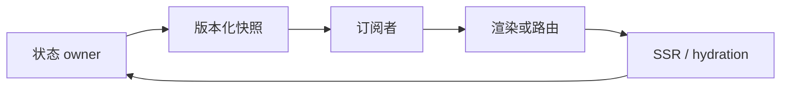

# 框架状态所有权、路由与 SSR 手写题

<!-- Solution routes -->
先跟着代码写一遍，可读[业务状态](workshop-web-business.md)和[缓存实现](workshop-web-engineering.md)。下方练习再增加新约束。

框架集成题关注状态属于谁、订阅者何时看到哪个版本，以及请求边界如何映射到组件树。一个组件局部 state 正确，不代表多个 root、服务端请求和 hydration 共享状态仍正确。以下练习不重复响应式最小实现，而是强调 owner、版本与隔离。

每个转移都要问：谁能写，谁负责通知，快照是否稳定，服务端与客户端是否针对同一请求和版本。

## 自测

??? question "为什么外部 store 的 getSnapshot 不能每次都返回新对象？"
    订阅消费者会把引用变化视为快照变化，可能导致重复渲染或无限更新；应缓存当前不可变快照，数据变化时才替换。

??? question "SSR 中模块级 store 会带来什么风险？"
    并发请求可能共享并污染用户状态；按请求创建 store 并显式传递依赖，避免跨请求缓存身份混合。

??? question "路由取消旧 fetch 后还需要导航 ID 吗？"
    需要。底层可能忽略取消或响应已进入回调队列，提交前检查代次才能保证旧导航不覆盖新状态。

## 练习题

### H101. 外部 store 的稳定不可变快照

实现 `createStore(initial): { getSnapshot(); subscribe(fn); update(reducer) }`，向多个 React root 提供快照并输出通知次数。

无语义变化时 snapshot 引用稳定；提交新快照后再通知；unsubscribe 后不再回调；reducer 重入更新需排队。

- 两 root 订阅后 `update` 将 count 从 0 改为 1，两者读到同一快照对象且每个通知一次。
- reducer 返回与当前完全相同的对象引用时按 `Object.is` 判定无变化，snapshot 引用保持且通知 0 次；listener 内再次 update 进入队列，不造成递归栈增长。

存储单一冻结/不可变 snapshot 和 listener Set；先比较 reducer 结果，再替换 snapshot，使用 dispatching 标志和待处理更新队列。

快照含 Map、Date 等可变对象时怎样保证引用稳定不掩盖内部突变？

难，40 分钟。

<!-- Question record (index metadata)
- **题目契约：**实现 `createStore(initial): { getSnapshot(); subscribe(fn); update(reducer) }`，向多个 React root 提供快照并输出通知次数。
- **约束与不变量：**无语义变化时 snapshot 引用稳定；提交新快照后再通知；unsubscribe 后不再回调；reducer 重入更新需排队。
- **用例 A：**两 root 订阅后 `update` 将 count 从 0 改为 1，两者读到同一快照对象且每个通知一次。
- **用例 B：**reducer 返回与当前完全相同的对象引用时按 `Object.is` 判定无变化，snapshot 引用保持且通知 0 次；listener 内再次 update 进入队列，不造成递归栈增长。
- **实现提示：**存储单一冻结/不可变 snapshot 和 listener Set；先比较 reducer 结果，再替换 snapshot，使用 dispatching 标志和待处理更新队列。
- **进阶追问：**快照含 Map、Date 等可变对象时怎样保证引用稳定不掩盖内部突变？
- **难度 / 建议时长：**难，40 分钟。
- **依据与状态：**作者原创派生练习，未实现/未实跑；React 外部订阅合同参考 [useSyncExternalStore](https://react.dev/reference/react/useSyncExternalStore)（[S06](handwritten-practice-sources.md#s06)）。
-->

### H102. React 外部订阅的 render 间隙一致性

实现 `useVersionedStore(store): Snapshot` 的伪 Hook 适配器，输入 render snapshot、commit 阶段 subscribe 与 store version，输出组件可见值。

render 与订阅安装之间若 store 更新，组件必须重新检查；读取同一版本时不撕裂；卸载后无通知。

- render 读 v1，commit 前 store 更新到 v2，订阅安装后的检查触发一次补偿更新，最终显示 v2。
- 组件甲在 v1 render、组件乙在 store 已更新到 v2 后 render；提交前一致性检查发现版本不同，丢弃本轮两者结果并让两者都基于 v2 重渲染，随后同一帧提交，不允许一帧同时显示 v1/v2。

subscribe 后立即 getSnapshot 重查，变化则通知；快照比较用 Object.is 或明确版本；真实 Hook 实现交给官方原语而不复制调度器。

transition 与外部 store 同步更新为何需要不同处理？如何测试 tearing 而非只断言最终文本？

挑战，55 分钟。

<!-- Question record (index metadata)
- **题目契约：**实现 `useVersionedStore(store): Snapshot` 的伪 Hook 适配器，输入 render snapshot、commit 阶段 subscribe 与 store version，输出组件可见值。
- **约束与不变量：**render 与订阅安装之间若 store 更新，组件必须重新检查；读取同一版本时不撕裂；卸载后无通知。
- **用例 A：**render 读 v1，commit 前 store 更新到 v2，订阅安装后的检查触发一次补偿更新，最终显示 v2。
- **用例 B：**组件甲在 v1 render、组件乙在 store 已更新到 v2 后 render；提交前一致性检查发现版本不同，丢弃本轮两者结果并让两者都基于 v2 重渲染，随后同一帧提交，不允许一帧同时显示 v1/v2。
- **实现提示：**subscribe 后立即 getSnapshot 重查，变化则通知；快照比较用 Object.is 或明确版本；真实 Hook 实现交给官方原语而不复制调度器。
- **进阶追问：**transition 与外部 store 同步更新为何需要不同处理？如何测试 tearing 而非只断言最终文本？
- **难度 / 建议时长：**挑战，55 分钟。
- **依据与状态：**作者原创派生练习，未实现/未实跑；并发一致性参考 [React useSyncExternalStore](https://react.dev/reference/react/useSyncExternalStore)（[S06](handwritten-practice-sources.md#s06)）。
-->

### H103. 按选择器订阅且防止相等比较漂移

实现 `subscribeSelector(store, selector, equal, listener)`，只在选择结果不相等时通知，返回 dispose。

selector 抛错不丢失后续订阅；equal 规则固定；store 更新时先更新已缓存选择值再调用外部 listener。

- store 的 theme 变化但 selector 取 count，listener 不调用；count 变化调用一次。
- selector 返回 `{x}` 新对象但 equal 按 x 比较，值相等不通知；listener 重入 update 不重复消费旧缓存。

闭包保存 previousSelection 和 disposed；通知时快照 store version，计算新选择结果并先写缓存，随后调用 listener。

equal 本身不纯或抛错会怎样破坏订阅顺序？API 是否应要求纯函数并隔离异常？

难，40 分钟。

<!-- Question record (index metadata)
- **题目契约：**实现 `subscribeSelector(store, selector, equal, listener)`，只在选择结果不相等时通知，返回 dispose。
- **约束与不变量：**selector 抛错不丢失后续订阅；equal 规则固定；store 更新时先更新已缓存选择值再调用外部 listener。
- **用例 A：**store 的 theme 变化但 selector 取 count，listener 不调用；count 变化调用一次。
- **用例 B：**selector 返回 `{x}` 新对象但 equal 按 x 比较，值相等不通知；listener 重入 update 不重复消费旧缓存。
- **实现提示：**闭包保存 previousSelection 和 disposed；通知时快照 store version，计算新选择结果并先写缓存，随后调用 listener。
- **进阶追问：**equal 本身不纯或抛错会怎样破坏订阅顺序？API 是否应要求纯函数并隔离异常？
- **难度 / 建议时长：**难，40 分钟。
- **依据与状态：**作者原创派生练习，未实现/未实跑；snapshot 订阅合同参考 [React useSyncExternalStore](https://react.dev/reference/react/useSyncExternalStore)（[S06](handwritten-practice-sources.md#s06)）。
-->

### H104. Vue effect 的动态依赖退订

实现 `runEffect(effectId, fn)` 的依赖收集适配层：每次执行记录新依赖并输出订阅图差异。

条件分支变化后移除不再读取的依赖；嵌套 effect 恢复父 active effect；停止 effect 后不再触发。

- effect 先读 flag 与 left，flag 改为 false 后下一轮改读 right，left 更新不再运行 effect。
- 嵌套 effect 执行期间更新父依赖，依赖记入正确 owner，不交叉污染子 effect。

使用 effect stack；每轮建立 newDeps，执行前收集并在 finally 恢复 active effect，执行后差集清理旧依赖。

运行中同步触发自身依赖时应忽略、排队还是递归？给出可重入限制及错误语义。

挑战，50 分钟。

<!-- Question record (index metadata)
- **题目契约：**实现 `runEffect(effectId, fn)` 的依赖收集适配层：每次执行记录新依赖并输出订阅图差异。
- **约束与不变量：**条件分支变化后移除不再读取的依赖；嵌套 effect 恢复父 active effect；停止 effect 后不再触发。
- **用例 A：**effect 先读 flag 与 left，flag 改为 false 后下一轮改读 right，left 更新不再运行 effect。
- **用例 B：**嵌套 effect 执行期间更新父依赖，依赖记入正确 owner，不交叉污染子 effect。
- **实现提示：**使用 effect stack；每轮建立 newDeps，执行前收集并在 finally 恢复 active effect，执行后差集清理旧依赖。
- **进阶追问：**运行中同步触发自身依赖时应忽略、排队还是递归？给出可重入限制及错误语义。
- **难度 / 建议时长：**挑战，50 分钟。
- **依据与状态：**作者原创派生练习，未实现/未实跑；Vue 响应式依赖跟踪参照 [Reactivity in Depth](https://vuejs.org/guide/extras/reactivity-in-depth.html)（[S07](handwritten-practice-sources.md#s07)）。
-->

### H105. Vue effect scope 的组件 owner 释放

实现 `createScope(parent?): { run(fn); stop() }`，注册 effect 与子 scope，输出停止时调用的 cleanup 记录。

stop 幂等并递归停止子 scope；stop 后新 effect 不得悄悄挂到已关闭 scope；异常 cleanup 不阻断其余释放。

- 父 scope 下有 effect E 和子 scope F，stop 父后 E/F cleanup 各一次，后续 source 更新无回调。
- F 的 cleanup 抛错时，其余 sibling scope 仍停止，报告包含该错误且状态 closed。

scope 保存 effect、cleanup、children 集合；停止前标记 inactive，再逆序遍历快照；cleanup 错误聚合后统一报告。

组件 Suspense 暂停但未卸载时 scope 是否停止？暂停、缓存停用和永久销毁如何区分 owner 状态？

难，45 分钟。

<!-- Question record (index metadata)
- **题目契约：**实现 `createScope(parent?): { run(fn); stop() }`，注册 effect 与子 scope，输出停止时调用的 cleanup 记录。
- **约束与不变量：**stop 幂等并递归停止子 scope；stop 后新 effect 不得悄悄挂到已关闭 scope；异常 cleanup 不阻断其余释放。
- **用例 A：**父 scope 下有 effect E 和子 scope F，stop 父后 E/F cleanup 各一次，后续 source 更新无回调。
- **用例 B：**F 的 cleanup 抛错时，其余 sibling scope 仍停止，报告包含该错误且状态 closed。
- **实现提示：**scope 保存 effect、cleanup、children 集合；停止前标记 inactive，再逆序遍历快照；cleanup 错误聚合后统一报告。
- **进阶追问：**组件 Suspense 暂停但未卸载时 scope 是否停止？暂停、缓存停用和永久销毁如何区分 owner 状态？
- **难度 / 建议时长：**难，45 分钟。
- **依据与状态：**作者原创派生练习，未实现/未实跑；Vue effect 生命周期概念参考 [Vue 响应式深入指南](https://vuejs.org/guide/extras/reactivity-in-depth.html)（[S07](handwritten-practice-sources.md#s07)）。
-->

### H106. 跨框架 store 的 SSR 请求隔离

实现 `createRequestContext(requestId, tenantId): Context` 和 `serializeBootstrap(context)`，输出每个请求独立状态与安全客户端快照。

store/cache 不跨请求共享；序列化只包含客户端允许字段；tenant 与权限身份参与缓存分区。

- 并发请求 A/B 对同 key 返回不同租户数据，两个 HTML 快照与脚本 bootstrap 均只含各自数据。
- 序列化输入含 `serverSecret` 时按 allowlist 剥离该字段，客户端 snapshot 中不存在该 key，日志也不打印其值。

请求入口工厂创建 store、cache、AbortController；组件树通过依赖注入获取 context；响应完成后 dispose 请求级资源。

Streaming SSR 在 shell 发出后权限检查失败，已发送 HTML 如何处理？是否应延后敏感片段或阻断流？

挑战，55 分钟。

<!-- Question record (index metadata)
- **题目契约：**实现 `createRequestContext(requestId, tenantId): Context` 和 `serializeBootstrap(context)`，输出每个请求独立状态与安全客户端快照。
- **约束与不变量：**store/cache 不跨请求共享；序列化只包含客户端允许字段；tenant 与权限身份参与缓存分区。
- **用例 A：**并发请求 A/B 对同 key 返回不同租户数据，两个 HTML 快照与脚本 bootstrap 均只含各自数据。
- **用例 B：**序列化输入含 `serverSecret` 时按 allowlist 剥离该字段，客户端 snapshot 中不存在该 key，日志也不打印其值。
- **实现提示：**请求入口工厂创建 store、cache、AbortController；组件树通过依赖注入获取 context；响应完成后 dispose 请求级资源。
- **进阶追问：**Streaming SSR 在 shell 发出后权限检查失败，已发送 HTML 如何处理？是否应延后敏感片段或阻断流？
- **难度 / 建议时长：**挑战，55 分钟。
- **依据与状态：**作者原创派生练习，未实现/未实跑；订阅快照参考 [React useSyncExternalStore](https://react.dev/reference/react/useSyncExternalStore)（[S06](handwritten-practice-sources.md#s06)）。
-->

### H107. Hydration 初始快照与客户端首更对齐

实现 `getServerSnapshot(requestKey)` 与客户端 `hydrate(snapshot, store)` 协议，输入服务端序列化版本和首个客户端版本，输出一致或 mismatch 报告。

hydration 首次读取必须对应服务端 HTML 的状态版本；客户端新鲜数据只能在首次匹配后提交；每个请求身份独立。

- HTML 标记 version=5、bootstrap=5、store 后续 v6，首次 hydration 输出 v5，之后更新为 v6。
- HTML 是用户 A 而 bootstrap key 指向用户 B，拒绝 hydration snapshot 并报告 identity mismatch，不渲染混合数据。

bootstrap 带 request/tenant/version 签名元数据；store 缓存 server snapshot，在 hydrate boundary 完成后订阅 live version。

非确定性时间戳、随机 ID 和 locale 对首屏 DOM 造成差异时，哪些值必须注入快照？

挑战，55 分钟。

<!-- Question record (index metadata)
- **题目契约：**实现 `getServerSnapshot(requestKey)` 与客户端 `hydrate(snapshot, store)` 协议，输入服务端序列化版本和首个客户端版本，输出一致或 mismatch 报告。
- **约束与不变量：**hydration 首次读取必须对应服务端 HTML 的状态版本；客户端新鲜数据只能在首次匹配后提交；每个请求身份独立。
- **用例 A：**HTML 标记 version=5、bootstrap=5、store 后续 v6，首次 hydration 输出 v5，之后更新为 v6。
- **用例 B：**HTML 是用户 A 而 bootstrap key 指向用户 B，拒绝 hydration snapshot 并报告 identity mismatch，不渲染混合数据。
- **实现提示：**bootstrap 带 request/tenant/version 签名元数据；store 缓存 server snapshot，在 hydrate boundary 完成后订阅 live version。
- **进阶追问：**非确定性时间戳、随机 ID 和 locale 对首屏 DOM 造成差异时，哪些值必须注入快照？
- **难度 / 建议时长：**挑战，55 分钟。
- **依据与状态：**作者原创派生练习，未实现/未实跑；服务端快照 API 见 [React useSyncExternalStore](https://react.dev/reference/react/useSyncExternalStore)（[S06](handwritten-practice-sources.md#s06)）。
-->

### H108. 路由导航的 latest-wins 事务

实现 `navigate(url, loaders): Promise<NavigationResult>`，加载 route data 后原子提交 URL、data 与 focus intent。

每次导航有 ID；仅最新成功导航提交；loader 失败保留当前 URL 和页面树，在当前树外显示导航错误提示，不出现半新半旧状态。

- 导航 A 慢、B 快，B 提交后 A 晚到返回 stale，不覆盖 B 的 URL/data。
- 当前页 A 导航到 B 且 B loader 失败时，原子保留 A 的 URL 与页面树，返回 `{ committed:false, target:'/b', errorBoundary:'B' }` 并在 A 页显示导航错误提示；不把 URL 改成 B。

创建 navigation record 保存 controller、from snapshot、target URL；loader 完成后在单个 reducer action 中提交，旧导航只取消并释放临时数据。

浏览器 popstate 已改变 URL 但 loader 失败，怎样选择恢复历史条目或保留失败 URL？

难，45 分钟。

<!-- Question record (index metadata)
- **题目契约：**实现 `navigate(url, loaders): Promise<NavigationResult>`，加载 route data 后原子提交 URL、data 与 focus intent。
- **约束与不变量：**每次导航有 ID；仅最新成功导航提交；loader 失败保留当前 URL 和页面树，在当前树外显示导航错误提示，不出现半新半旧状态。
- **用例 A：**导航 A 慢、B 快，B 提交后 A 晚到返回 stale，不覆盖 B 的 URL/data。
- **用例 B：**当前页 A 导航到 B 且 B loader 失败时，原子保留 A 的 URL 与页面树，返回 `{ committed:false, target:'/b', errorBoundary:'B' }` 并在 A 页显示导航错误提示；不把 URL 改成 B。
- **实现提示：**创建 navigation record 保存 controller、from snapshot、target URL；loader 完成后在单个 reducer action 中提交，旧导航只取消并释放临时数据。
- **进阶追问：**浏览器 popstate 已改变 URL 但 loader 失败，怎样选择恢复历史条目或保留失败 URL？
- **难度 / 建议时长：**难，45 分钟。
- **依据与状态：**作者原创派生练习，未实现/未实跑；中止异步活动参考 [DOM 标准](https://dom.spec.whatwg.org/#aborting-ongoing-activities)（[S03](handwritten-practice-sources.md#s03)）。
-->

### H109. 路由 loader 的共享请求与导航取消

实现 `loadRouteData(cache, routeKey, navSignal): Promise<Data>`，同资源可被多个导航引用，输出共享数据和等待者状态。

一个导航取消不影响仍引用该加载的另一个导航；最后等待者离开才可 abort；用户/权限上下文变化使 cache key 改变。

- 导航 A/B 同时读取 key K，底层 fetch 只执行一次；A abort 后 B 收到数据。
- 租户从 T1 切换 T2，key 不得命中 T1 项；T1 的迟到结果不会进入 T2 store。

cache entry 持有 loader controller 和 waiter token map；key 使用规范化 route+tenant+auth revision，entry 归零后按 TTL dispose。

权限撤销时如何同步清除已交付到组件 memo/cache 的旧数据？

挑战，50 分钟。

<!-- Question record (index metadata)
- **题目契约：**实现 `loadRouteData(cache, routeKey, navSignal): Promise<Data>`，同资源可被多个导航引用，输出共享数据和等待者状态。
- **约束与不变量：**一个导航取消不影响仍引用该加载的另一个导航；最后等待者离开才可 abort；用户/权限上下文变化使 cache key 改变。
- **用例 A：**导航 A/B 同时读取 key K，底层 fetch 只执行一次；A abort 后 B 收到数据。
- **用例 B：**租户从 T1 切换 T2，key 不得命中 T1 项；T1 的迟到结果不会进入 T2 store。
- **实现提示：**cache entry 持有 loader controller 和 waiter token map；key 使用规范化 route+tenant+auth revision，entry 归零后按 TTL dispose。
- **进阶追问：**权限撤销时如何同步清除已交付到组件 memo/cache 的旧数据？
- **难度 / 建议时长：**挑战，50 分钟。
- **依据与状态：**作者原创派生练习，未实现/未实跑；取消语义参考 [DOM AbortSignal](https://dom.spec.whatwg.org/#aborting-ongoing-activities)（[S03](handwritten-practice-sources.md#s03)）。
-->

### H110. 嵌套路由的错误边界回滚范围

实现 `resolveRouteTree(matches, loaderResults): RenderPlan`，输入父子路由 loader 结果，输出正常节点、最近错误边界和未渲染子树。

子 loader 错误只回滚到最近声明的 boundary；父级已确认数据可保留；资源清理仅覆盖被丢弃子树。

- root 和 layout 成功、child 失败，输出 root/layout 与 child boundary 错误视图。
- layout 自身失败且 boundary 位于 root，layout/child 均不渲染，root boundary 收到原始 error ID。

先建立匹配链的 boundary index，再从错误节点向上寻找最近边界；渲染计划与 loader side effects 分离。

父 loader 的数据包含子组件访问的授权对象，子边界切换后这些对象是否继续保留？说明生命周期与敏感数据清理。

难，45 分钟。

<!-- Question record (index metadata)
- **题目契约：**实现 `resolveRouteTree(matches, loaderResults): RenderPlan`，输入父子路由 loader 结果，输出正常节点、最近错误边界和未渲染子树。
- **约束与不变量：**子 loader 错误只回滚到最近声明的 boundary；父级已确认数据可保留；资源清理仅覆盖被丢弃子树。
- **用例 A：**root 和 layout 成功、child 失败，输出 root/layout 与 child boundary 错误视图。
- **用例 B：**layout 自身失败且 boundary 位于 root，layout/child 均不渲染，root boundary 收到原始 error ID。
- **实现提示：**先建立匹配链的 boundary index，再从错误节点向上寻找最近边界；渲染计划与 loader side effects 分离。
- **进阶追问：**父 loader 的数据包含子组件访问的授权对象，子边界切换后这些对象是否继续保留？说明生命周期与敏感数据清理。
- **难度 / 建议时长：**难，45 分钟。
- **依据与状态：**作者原创派生练习，未实现/未实跑；框架 owner 模型参考 [Vue 响应式深入指南](https://vuejs.org/guide/extras/reactivity-in-depth.html)（[S07](handwritten-practice-sources.md#s07)）。
-->

### H111. Streaming SSR 的资源边界与尾部错误

实现 `renderStream(tree, requestContext): ReadableStream<Uint8Array>` 协议，输出 shell、边界片段、错误标记和最终结束信号。

响应背压传播到 renderer；request abort 关闭未发送资源；shell 发送后错误不得伪装为未发生，需有客户端可识别边界标记。

- shell 后两个边界片段按可用次序发出，慢消费者暂停读取时队列不超过 2 个片段。
- shell 已发、边界 loader 抛错，输出该 boundary 的错误模板和终止状态，request context 最终 dispose。

producer 以 pull 驱动生成 chunk；各 Suspense boundary 使用 request-local state；错误序列化只带稳定 code，不泄露内部堆栈。

客户端收到片段后网络断开，服务端如何停止昂贵子树渲染并回收已创建资源？

挑战，60 分钟。

<!-- Question record (index metadata)
- **题目契约：**实现 `renderStream(tree, requestContext): ReadableStream<Uint8Array>` 协议，输出 shell、边界片段、错误标记和最终结束信号。
- **约束与不变量：**响应背压传播到 renderer；request abort 关闭未发送资源；shell 发送后错误不得伪装为未发生，需有客户端可识别边界标记。
- **用例 A：**shell 后两个边界片段按可用次序发出，慢消费者暂停读取时队列不超过 2 个片段。
- **用例 B：**shell 已发、边界 loader 抛错，输出该 boundary 的错误模板和终止状态，request context 最终 dispose。
- **实现提示：**producer 以 pull 驱动生成 chunk；各 Suspense boundary 使用 request-local state；错误序列化只带稳定 code，不泄露内部堆栈。
- **进阶追问：**客户端收到片段后网络断开，服务端如何停止昂贵子树渲染并回收已创建资源？
- **难度 / 建议时长：**挑战，60 分钟。
- **依据与状态：**作者原创派生练习，未实现/未实跑；流的 pull/close 行为参考 [Streams Standard](https://streams.spec.whatwg.org/)（[S04](handwritten-practice-sources.md#s04)）。
-->

### H112. React 外部 store 与 Suspense 边界的版本隔离

实现 `readResource(key, version): Value | Promise<Value>` 与订阅 adapter，输入 pending/ready/error 状态，输出对应 Suspense 可读结果。

同一 key/version 返回同一 pending Promise；新 version 不被旧 Promise 填充；error 清除/重试规则明确。

- key K v1 pending 后切 v2，v2 成功先显示；v1 后成功仅填充 v1 cache，不触发 v2 UI 更新。
- 同 key/version 两组件读取，loader 次数=1；失败后按 retry token 再读创建新 Promise。

entry key 为资源 ID+version，缓存 pending promise/value/error；commit 前比对读取版本，subscription 按 entry identity 通知。

transition 中 store 同步变更造成 Suspense fallback 闪烁，如何选择延迟提交或保留旧快照？

挑战，55 分钟。

<!-- Question record (index metadata)
- **题目契约：**实现 `readResource(key, version): Value | Promise<Value>` 与订阅 adapter，输入 pending/ready/error 状态，输出对应 Suspense 可读结果。
- **约束与不变量：**同一 key/version 返回同一 pending Promise；新 version 不被旧 Promise 填充；error 清除/重试规则明确。
- **用例 A：**key K v1 pending 后切 v2，v2 成功先显示；v1 后成功仅填充 v1 cache，不触发 v2 UI 更新。
- **用例 B：**同 key/version 两组件读取，loader 次数=1；失败后按 retry token 再读创建新 Promise。
- **实现提示：**entry key 为资源 ID+version，缓存 pending promise/value/error；commit 前比对读取版本，subscription 按 entry identity 通知。
- **进阶追问：**transition 中 store 同步变更造成 Suspense fallback 闪烁，如何选择延迟提交或保留旧快照？
- **难度 / 建议时长：**挑战，55 分钟。
- **依据与状态：**作者原创派生练习，未实现/未实跑；外部订阅快照参考 [React useSyncExternalStore](https://react.dev/reference/react/useSyncExternalStore)（[S06](handwritten-practice-sources.md#s06)）。
-->

### H113. Keyed 列表的最小移动 diff 计划

实现 `planKeyedDiff(oldKeys, newKeys): Operation[]`，key 唯一且稳定；输出按序应用可得到新列表的 insert/remove/move 操作，并让保留项移动次数最少。

操作执行期间索引按当前列表即时计算；删除先于插入和移动；最小移动集合由最长递增子序列（LIS）决定；多解时选择旧索引字典序最小的保留序列。

- old=`[a,b,c,d]`、new=`[b,d,a,c]`，保留 LIS `[a,c]`，删除 0、插入 0，生成将 b 移到索引 0、d 移到索引 1 的两次 move。
- old=`[a,b,c]`、new=`[c,a,d]`，输出 remove(b)、insert(d, index=2)，将 c 移到索引 0；执行后严格得到 `[c,a,d]`。

先映射 key→旧索引，求新序列中保留项的 LIS 并标记稳定节点；从新列表尾向前构造 anchor-relative 插入/移动计划，使用稳定 tie-break。

新旧 keys 含重复值或 key 在更新中被复用给不同实体时，应该在规划前怎样诊断并拒绝？

挑战，55 分钟。

<!-- Question record (index metadata)
- **题目契约：**实现 `planKeyedDiff(oldKeys, newKeys): Operation[]`，key 唯一且稳定；输出按序应用可得到新列表的 insert/remove/move 操作，并让保留项移动次数最少。
- **约束与不变量：**操作执行期间索引按当前列表即时计算；删除先于插入和移动；最小移动集合由最长递增子序列（LIS）决定；多解时选择旧索引字典序最小的保留序列。
- **用例 A：**old=`[a,b,c,d]`、new=`[b,d,a,c]`，保留 LIS `[a,c]`，删除 0、插入 0，生成将 b 移到索引 0、d 移到索引 1 的两次 move。
- **用例 B：**old=`[a,b,c]`、new=`[c,a,d]`，输出 remove(b)、insert(d, index=2)，将 c 移到索引 0；执行后严格得到 `[c,a,d]`。
- **实现提示：**先映射 key→旧索引，求新序列中保留项的 LIS 并标记稳定节点；从新列表尾向前构造 anchor-relative 插入/移动计划，使用稳定 tie-break。
- **进阶追问：**新旧 keys 含重复值或 key 在更新中被复用给不同实体时，应该在规划前怎样诊断并拒绝？
- **难度 / 建议时长：**挑战，55 分钟。
- **依据与状态：**作者原创派生练习，未实现/未实跑；键与列表身份是框架状态协调问题，可对照 [Vue reactivity](https://vuejs.org/guide/extras/reactivity-in-depth.html)（[S07](handwritten-practice-sources.md#s07)）。
-->

### H114. 缓存键的租户、权限与语言隔离

实现 `makeCacheKey({ route, tenant, authRevision, locale, query }): string`，输入语义请求字段，输出 canonical key。

会影响响应内容的字段必须参与 key；参数序列化顺序稳定；敏感 token 不直接写入可观测 key。

- query 参数顺序不同但语义相同，输出同一 key；locale=en 与 locale=zh 输出不同 key。
- authRevision 改变后不命中旧缓存；key 字符串中不包含 bearer token 原文。

对允许字段做 schema 规范化、排序和稳定编码，再使用非可逆摘要；cache entry 另存隔离维度用于失效。

权限变化无法立即获知时，如何设置 stale-while-revalidate 边界避免敏感旧数据短暂展示？

难，40 分钟。

<!-- Question record (index metadata)
- **题目契约：**实现 `makeCacheKey({ route, tenant, authRevision, locale, query }): string`，输入语义请求字段，输出 canonical key。
- **约束与不变量：**会影响响应内容的字段必须参与 key；参数序列化顺序稳定；敏感 token 不直接写入可观测 key。
- **用例 A：**query 参数顺序不同但语义相同，输出同一 key；locale=en 与 locale=zh 输出不同 key。
- **用例 B：**authRevision 改变后不命中旧缓存；key 字符串中不包含 bearer token 原文。
- **实现提示：**对允许字段做 schema 规范化、排序和稳定编码，再使用非可逆摘要；cache entry 另存隔离维度用于失效。
- **进阶追问：**权限变化无法立即获知时，如何设置 stale-while-revalidate 边界避免敏感旧数据短暂展示？
- **难度 / 建议时长：**难，40 分钟。
- **依据与状态：**作者原创派生练习，未实现/未实跑；框架 snapshot 对照 [React useSyncExternalStore](https://react.dev/reference/react/useSyncExternalStore)（[S06](handwritten-practice-sources.md#s06)）。
-->

### H115. React provider 重挂载时的状态所有权

实现 `ProviderBoundary({ identity, createStore, children })` 的状态切换规则，输入 identity 变化和订阅者，输出 store 实例与释放记录。

identity 相同复用 store；identity 变化创建新 owner 并使旧异步写入失效；切换顺序固定为先 detach 全部旧订阅、再标记旧 owner inactive、最后 dispose 旧 store。

- identity=userA 连续 render 两次只创建 store 一次；变 userB 后创建第二个且旧订阅停止。
- userA 延迟请求晚到，userB 已接管，旧结果不得写入当前 store。

store 生命周期绑定 provider key；异步 action 捕获 owner generation；cleanup 置 inactive 后解除订阅，再释放资源。

React Strict Mode 开发期重复挂载/清理时，createStore 和 dispose 如何保持可重放且不泄漏？

挑战，50 分钟。

<!-- Question record (index metadata)
- **题目契约：**实现 `ProviderBoundary({ identity, createStore, children })` 的状态切换规则，输入 identity 变化和订阅者，输出 store 实例与释放记录。
- **约束与不变量：**identity 相同复用 store；identity 变化创建新 owner 并使旧异步写入失效；切换顺序固定为先 detach 全部旧订阅、再标记旧 owner inactive、最后 dispose 旧 store。
- **用例 A：**identity=userA 连续 render 两次只创建 store 一次；变 userB 后创建第二个且旧订阅停止。
- **用例 B：**userA 延迟请求晚到，userB 已接管，旧结果不得写入当前 store。
- **实现提示：**store 生命周期绑定 provider key；异步 action 捕获 owner generation；cleanup 置 inactive 后解除订阅，再释放资源。
- **进阶追问：**React Strict Mode 开发期重复挂载/清理时，createStore 和 dispose 如何保持可重放且不泄漏？
- **难度 / 建议时长：**挑战，50 分钟。
- **依据与状态：**作者原创派生练习，未实现/未实跑；订阅清理参考 [React useSyncExternalStore](https://react.dev/reference/react/useSyncExternalStore)（[S06](handwritten-practice-sources.md#s06)）。
-->

### H116. Vue computed 失效时的惰性缓存边界

实现 `computed(getter): { value; subscribe(fn) }` 的状态机合同，输入依赖变化、读取和停止事件，输出 getter 执行次数与缓存值。

失效只标记 dirty，不在无人读取时重复计算；同一 dirty 周期首次读取仅计算一次；停止后不再订阅依赖。

- 依赖连续变化三次但未读取 computed，getter 执行次数保持 1；随后读取时总次数变 2。
- 两次读取无依赖变化返回同值且不再执行；stop 后修改依赖不触发 getter。

维护 dirty/value/dep subscriptions；触发时 dirty 由 false 转 true 后通知下游一次，读取时重新收集依赖并刷新缓存。

computed getter 内部抛错后 dirty 与缓存如何处理？嵌套 computed 如何避免重复向下游通知？

难，40 分钟。

<!-- Question record (index metadata)
- **题目契约：**实现 `computed(getter): { value; subscribe(fn) }` 的状态机合同，输入依赖变化、读取和停止事件，输出 getter 执行次数与缓存值。
- **约束与不变量：**失效只标记 dirty，不在无人读取时重复计算；同一 dirty 周期首次读取仅计算一次；停止后不再订阅依赖。
- **用例 A：**依赖连续变化三次但未读取 computed，getter 执行次数保持 1；随后读取时总次数变 2。
- **用例 B：**两次读取无依赖变化返回同值且不再执行；stop 后修改依赖不触发 getter。
- **实现提示：**维护 dirty/value/dep subscriptions；触发时 dirty 由 false 转 true 后通知下游一次，读取时重新收集依赖并刷新缓存。
- **进阶追问：**computed getter 内部抛错后 dirty 与缓存如何处理？嵌套 computed 如何避免重复向下游通知？
- **难度 / 建议时长：**难，40 分钟。
- **依据与状态：**作者原创派生练习，未实现/未实跑；计算属性与依赖缓存参考 [Vue 响应式深入指南](https://vuejs.org/guide/extras/reactivity-in-depth.html)（[S07](handwritten-practice-sources.md#s07)）。
-->

### H117. 同步 store 更新的批处理与提交边界

实现 `batchUpdates(store, fn): void`，输入多个同步 update，输出一次提交版本与订阅事件序列。

batch 内读取可见 working snapshot 中此前已执行的更新；任何嵌套异常都会将最外层事务标记为 abort，全部修改回滚；batch 嵌套只在最外层通知。

- 一次 batch 将 x/y 分别加一，订阅者只收到一个版本，snapshot 同时包含新 x/y。
- batch 为原子事务；内层 batch 抛错即标记整批 abort，即使外层捕获异常并继续调用 update，最外层结束时仍回滚 x/y 全部修改且不通知订阅者，错误报告为 aborted。

维护 depth、working snapshot、dirty 和失败标记；外层结束时原子替换 snapshot 再通知；避免回调读半提交状态。

订阅者在通知中再次启动 batch，当前事件快照和新批次如何排序？

挑战，50 分钟。

<!-- Question record (index metadata)
- **题目契约：**实现 `batchUpdates(store, fn): void`，输入多个同步 update，输出一次提交版本与订阅事件序列。
- **约束与不变量：**batch 内读取可见 working snapshot 中此前已执行的更新；任何嵌套异常都会将最外层事务标记为 abort，全部修改回滚；batch 嵌套只在最外层通知。
- **用例 A：**一次 batch 将 x/y 分别加一，订阅者只收到一个版本，snapshot 同时包含新 x/y。
- **用例 B：**batch 为原子事务；内层 batch 抛错即标记整批 abort，即使外层捕获异常并继续调用 update，最外层结束时仍回滚 x/y 全部修改且不通知订阅者，错误报告为 aborted。
- **实现提示：**维护 depth、working snapshot、dirty 和失败标记；外层结束时原子替换 snapshot 再通知；避免回调读半提交状态。
- **进阶追问：**订阅者在通知中再次启动 batch，当前事件快照和新批次如何排序？
- **难度 / 建议时长：**挑战，50 分钟。
- **依据与状态：**作者原创派生练习，未实现/未实跑；外部快照通知合同参照 [React useSyncExternalStore](https://react.dev/reference/react/useSyncExternalStore)（[S06](handwritten-practice-sources.md#s06)）。
-->

### H118. 路由查询参数更新的合并导航

实现 `updateSearch(patch, { replace, sourceId }): Promise<URL>`，输入并发筛选器 patch，输出合并后的 URL 和 history 操作数。

同一微任务多组件 patch 合并为一次导航；不同 sourceId 对同键冲突按确定策略；popstate 不回写循环。

- 筛选组件加 `q=cat`、分页组件加 `page=2`，最终 URL 同时含两项且只调用一次 replaceState。
- 两个 source 修改 page 冲突，后者按队列顺序胜出；popstate 导入参数不触发同值写回。

以 canonical URL snapshot 为基准收集待提交 patch；微任务 flush 前应用固定排序和冲突规则，提交后通知订阅者。

浏览器 history 上限、hash 路由与服务端 loader 重验证如何协调一次合并更新？

难，45 分钟。

<!-- Question record (index metadata)
- **题目契约：**实现 `updateSearch(patch, { replace, sourceId }): Promise<URL>`，输入并发筛选器 patch，输出合并后的 URL 和 history 操作数。
- **约束与不变量：**同一微任务多组件 patch 合并为一次导航；不同 sourceId 对同键冲突按确定策略；popstate 不回写循环。
- **用例 A：**筛选组件加 `q=cat`、分页组件加 `page=2`，最终 URL 同时含两项且只调用一次 replaceState。
- **用例 B：**两个 source 修改 page 冲突，后者按队列顺序胜出；popstate 导入参数不触发同值写回。
- **实现提示：**以 canonical URL snapshot 为基准收集待提交 patch；微任务 flush 前应用固定排序和冲突规则，提交后通知订阅者。
- **进阶追问：**浏览器 history 上限、hash 路由与服务端 loader 重验证如何协调一次合并更新？
- **难度 / 建议时长：**难，45 分钟。
- **依据与状态：**作者原创派生练习，未实现/未实跑；导航事件底层参考 [DOM 标准](https://dom.spec.whatwg.org/#events)（[S03](handwritten-practice-sources.md#s03)）。
-->

### H119. 浏览器返回时的滚动位置 owner

实现 `scrollStore.beginNavigation(entryId): ScrollLease` 与 `restore(entryId)`，输入 history entry ID 和异步页面内容就绪事件，输出滚动坐标。

每个 history entry 单独保存坐标；新导航与 popstate 恢复优先级不同；只在目标内容稳定后恢复一次。

- entry A 保存 y=840，导航到 B 后 popstate 回 A，内容 ready 后 scrollTo(0,840) 调用一次。
- A 尚未 ready 又快速返回 B，A 的迟到 ready 不得覆盖当前页面滚动位置。

entry map 保存位置、navigation generation 与恢复状态；组件内容完成信号带 entry ID，匹配当前 active entry 才执行。

浏览器原生 scroll restoration 与应用恢复同时启用时如何避免双重跳动？

难，40 分钟。

<!-- Question record (index metadata)
- **题目契约：**实现 `scrollStore.beginNavigation(entryId): ScrollLease` 与 `restore(entryId)`，输入 history entry ID 和异步页面内容就绪事件，输出滚动坐标。
- **约束与不变量：**每个 history entry 单独保存坐标；新导航与 popstate 恢复优先级不同；只在目标内容稳定后恢复一次。
- **用例 A：**entry A 保存 y=840，导航到 B 后 popstate 回 A，内容 ready 后 scrollTo(0,840) 调用一次。
- **用例 B：**A 尚未 ready 又快速返回 B，A 的迟到 ready 不得覆盖当前页面滚动位置。
- **实现提示：**entry map 保存位置、navigation generation 与恢复状态；组件内容完成信号带 entry ID，匹配当前 active entry 才执行。
- **进阶追问：**浏览器原生 scroll restoration 与应用恢复同时启用时如何避免双重跳动？
- **难度 / 建议时长：**难，40 分钟。
- **依据与状态：**作者原创派生练习，未实现/未实跑；事件与节点树变化模型参考 [DOM 标准](https://dom.spec.whatwg.org/)（[S03](handwritten-practice-sources.md#s03)）。
-->

### H120. 错误状态在 store 与 Error Boundary 间去重

实现 `reportError(error, source, boundaryId): ErrorRecord`，输入异步订阅错误与 render 错误，输出一次报告和恢复状态。

相同 error ID 不重复上报；边界重试会创建新 attempt；旧 attempt 错误不能覆盖恢复后的成功状态。

- store listener 和 Error Boundary 同时报告 id=E1，日志计数为 1，UI 显示一个错误边界。
- retry attempt 2 成功后 attempt 1 晚到失败事件忽略，状态保持 recovered。

错误 record 带 source、boundary、attempt、timestamp；去重表按 request scope 限期清理，UI 状态由 latest attempt reducer 决定。

跨 SSR/client hydration 的同一错误 ID 是否共享？如何避免用户可见 ID 泄漏内部实现信息？

难，40 分钟。

<!-- Question record (index metadata)
- **题目契约：**实现 `reportError(error, source, boundaryId): ErrorRecord`，输入异步订阅错误与 render 错误，输出一次报告和恢复状态。
- **约束与不变量：**相同 error ID 不重复上报；边界重试会创建新 attempt；旧 attempt 错误不能覆盖恢复后的成功状态。
- **用例 A：**store listener 和 Error Boundary 同时报告 id=E1，日志计数为 1，UI 显示一个错误边界。
- **用例 B：**retry attempt 2 成功后 attempt 1 晚到失败事件忽略，状态保持 recovered。
- **实现提示：**错误 record 带 source、boundary、attempt、timestamp；去重表按 request scope 限期清理，UI 状态由 latest attempt reducer 决定。
- **进阶追问：**跨 SSR/client hydration 的同一错误 ID 是否共享？如何避免用户可见 ID 泄漏内部实现信息？
- **难度 / 建议时长：**难，40 分钟。
- **依据与状态：**作者原创派生练习，未实现/未实跑；订阅生命周期参考 [Vue reactivity](https://vuejs.org/guide/extras/reactivity-in-depth.html)（[S07](handwritten-practice-sources.md#s07)）。
-->

### H121. 服务端组件边界的序列化引用图

实现 `serializeProps(value, boundary): Payload | Error`，输入 Server/Client 边界 props 图，输出可传输数据或带路径的错误。

普通对象重复引用和循环引用均编码为 `$ref` ID；函数、DOM 节点拒绝；跨边界不传服务端 secret；编码采用 DFS 首次出现分配递增 ID。

- props 的 `left` 与 `right` 指向同一对象，输出 `left` 的完整节点及 `right:{$ref:leftId}`；反序列化后 `left === right`。
- props path=`user.onClick` 是函数，输出 `NON_SERIALIZABLE` 与精确路径，不泄露其源码。

用 WeakMap 管理 visited/reference IDs，按允许类型白名单编码；边界 schema 在传输前审查敏感字段。

流式 server component 在编码中途错误，已发送的引用表如何作废或恢复？

挑战，55 分钟。

<!-- Question record (index metadata)
- **题目契约：**实现 `serializeProps(value, boundary): Payload | Error`，输入 Server/Client 边界 props 图，输出可传输数据或带路径的错误。
- **约束与不变量：**普通对象重复引用和循环引用均编码为 `$ref` ID；函数、DOM 节点拒绝；跨边界不传服务端 secret；编码采用 DFS 首次出现分配递增 ID。
- **用例 A：**props 的 `left` 与 `right` 指向同一对象，输出 `left` 的完整节点及 `right:{$ref:leftId}`；反序列化后 `left === right`。
- **用例 B：**props path=`user.onClick` 是函数，输出 `NON_SERIALIZABLE` 与精确路径，不泄露其源码。
- **实现提示：**用 WeakMap 管理 visited/reference IDs，按允许类型白名单编码；边界 schema 在传输前审查敏感字段。
- **进阶追问：**流式 server component 在编码中途错误，已发送的引用表如何作废或恢复？
- **难度 / 建议时长：**挑战，55 分钟。
- **依据与状态：**作者原创派生练习，未实现/未实跑；JS 值语义参考 [ECMAScript](https://tc39.es/ecma262/)（[S11](handwritten-practice-sources.md#s11)）。
-->

### H122. 持久化 store 的迁移与并发写入版本

实现 `hydrateStore(raw, schemaVersion, migrate): State` 与 `persist(snapshot, revision)`，输出迁移状态和写入顺序。

迁移必须纯且版本单调；旧异步 persist 不覆盖新 revision；无法迁移时回退默认值并保留可诊断错误。

- v1 数据迁移到 v3，步骤 v1→v2→v3 各一次并输出 schema=3。
- revision 2 写入慢于 revision 3，最终持久层仍是 revision 3；损坏 JSON 不使应用启动失败。

数据包带 schemaVersion/revision/checksum；串行化写入或持久层 CAS，迁移结果验证后再替换 store。

两个标签页同时从同一 revision 更新，如何检测冲突并避免 last-writer-wins 静默丢数据？

挑战，55 分钟。

<!-- Question record (index metadata)
- **题目契约：**实现 `hydrateStore(raw, schemaVersion, migrate): State` 与 `persist(snapshot, revision)`，输出迁移状态和写入顺序。
- **约束与不变量：**迁移必须纯且版本单调；旧异步 persist 不覆盖新 revision；无法迁移时回退默认值并保留可诊断错误。
- **用例 A：**v1 数据迁移到 v3，步骤 v1→v2→v3 各一次并输出 schema=3。
- **用例 B：**revision 2 写入慢于 revision 3，最终持久层仍是 revision 3；损坏 JSON 不使应用启动失败。
- **实现提示：**数据包带 schemaVersion/revision/checksum；串行化写入或持久层 CAS，迁移结果验证后再替换 store。
- **进阶追问：**两个标签页同时从同一 revision 更新，如何检测冲突并避免 last-writer-wins 静默丢数据？
- **难度 / 建议时长：**挑战，55 分钟。
- **依据与状态：**作者原创派生练习，未实现/未实跑；语言值与比较机制参考 [ECMAScript](https://tc39.es/ecma262/)（[S11](handwritten-practice-sources.md#s11)）。
-->

### H123. 订阅快照的 SSR 序列化与脱水

实现 `dehydrate(snapshot, allowlist): string` 与 `rehydrate(serialized): Snapshot`，输入状态对象和允许字段，输出确定性 JSON 及恢复报告。

键顺序稳定、非 JSON 值明确编码或拒绝；脱水后 snapshot identity 新建但内容版本匹配；不可序列化值返回路径。

- 相同 snapshot 两次 dehydrate 输出字节一致，rehydrate 后字段值一致、revision 保留。
- `actions.count=3n` 编码为 `{"$bigint":"3"}`，函数 `actions.save` 拒绝并输出 `NON_SERIALIZABLE` 与精确路径 `actions.save`。

先 schema 投影，再稳定序列化；rehydrate 验签并生成 immutable snapshot，客户端 store 在首个 live 更新前返回该快照。

HTML 内嵌 JSON 如何防止 `</script>` 注入？内容哈希是否包含用户身份和版本？

难，45 分钟。

<!-- Question record (index metadata)
- **题目契约：**实现 `dehydrate(snapshot, allowlist): string` 与 `rehydrate(serialized): Snapshot`，输入状态对象和允许字段，输出确定性 JSON 及恢复报告。
- **约束与不变量：**键顺序稳定、非 JSON 值明确编码或拒绝；脱水后 snapshot identity 新建但内容版本匹配；不可序列化值返回路径。
- **用例 A：**相同 snapshot 两次 dehydrate 输出字节一致，rehydrate 后字段值一致、revision 保留。
- **用例 B：**`actions.count=3n` 编码为 `{"$bigint":"3"}`，函数 `actions.save` 拒绝并输出 `NON_SERIALIZABLE` 与精确路径 `actions.save`。
- **实现提示：**先 schema 投影，再稳定序列化；rehydrate 验签并生成 immutable snapshot，客户端 store 在首个 live 更新前返回该快照。
- **进阶追问：**HTML 内嵌 JSON 如何防止 `</script>` 注入？内容哈希是否包含用户身份和版本？
- **难度 / 建议时长：**难，45 分钟。
- **依据与状态：**作者原创派生练习，未实现/未实跑；状态快照合同参考 [React useSyncExternalStore](https://react.dev/reference/react/useSyncExternalStore)（[S06](handwritten-practice-sources.md#s06)）。
-->

### H124. 多 root 应用间的共享 store 版本屏障

实现 `commitAtBarrier(roots, nextSnapshot): Promise<CommitReport>`，输入多个 root 的 prepare/commit 通知器，输出共同可见版本。

所有仍注册 root 都 ready 才提交；root 卸载立即移除其 lease；任一 root 等待超过 2 秒则整屏障超时、保留旧版本并返回 timedOut root IDs；共享 store 不留永久等待。

- 三个 root 两个先准备，第三个到达后共同 version 从 4 切换为 5，所有 observer 看到 5。
- 第三个 root 在屏障期间卸载，屏障移除其 lease 后其余两个 ready root 提交 v5，报告 activeRoots=2，卸载 root 不接收通知。

维护 barrier generation、root lease set 和待提交 snapshot；加入/离开更新目标集合，commit 一次性替换当前版本。

不同框架 root 的 commit 时序无法真正原子时，可以承诺哪种一致性？如何呈现短暂混合版本？

挑战，60 分钟。

<!-- Question record (index metadata)
- **题目契约：**实现 `commitAtBarrier(roots, nextSnapshot): Promise<CommitReport>`，输入多个 root 的 prepare/commit 通知器，输出共同可见版本。
- **约束与不变量：**所有仍注册 root 都 ready 才提交；root 卸载立即移除其 lease；任一 root 等待超过 2 秒则整屏障超时、保留旧版本并返回 timedOut root IDs；共享 store 不留永久等待。
- **用例 A：**三个 root 两个先准备，第三个到达后共同 version 从 4 切换为 5，所有 observer 看到 5。
- **用例 B：**第三个 root 在屏障期间卸载，屏障移除其 lease 后其余两个 ready root 提交 v5，报告 activeRoots=2，卸载 root 不接收通知。
- **实现提示：**维护 barrier generation、root lease set 和待提交 snapshot；加入/离开更新目标集合，commit 一次性替换当前版本。
- **进阶追问：**不同框架 root 的 commit 时序无法真正原子时，可以承诺哪种一致性？如何呈现短暂混合版本？
- **难度 / 建议时长：**挑战，60 分钟。
- **依据与状态：**作者原创派生练习，未实现/未实跑；跨 root 订阅参考 [React useSyncExternalStore](https://react.dev/reference/react/useSyncExternalStore)（[S06](handwritten-practice-sources.md#s06)）。
-->

### H125. 可中断渲染遍历的 continuation 与提交边界

实现 `renderSlice(tree, continuation, budget): SliceResult`，输出完成节点、待续 continuation 或错误；另实现 `commit(result, host)` 将完整工作单元写入宿主树。

yield 只发生在节点边界；恢复从 continuation 的下一个未处理节点继续；取消丢弃未提交 work-in-progress；commit 前宿主树保持原样。

- 树按 preorder 为 `[A,B,C,D]`，budget=2 时首片处理 A/B、宿主 DOM 仍为空；恢复后处理 C/D，完整结果 commit 后宿主顺序为 A/B/C/D。
- 第一片处理 A 后收到 cancel，continuation 被标记无效且 commit 返回 `CANCELLED`；宿主树保持旧快照 `[X]`，没有 A 节点。

continuation 保存 work stack、tree revision 和下一个节点游标；每片输出独立 work-in-progress list，commit 校验 revision 后一次替换宿主子树。

恢复前 tree revision 已变化，怎样判断 continuation 可重用、需重启或局部修补？副作用何时才能执行？

挑战，60 分钟。

<!-- Question record (index metadata)
- **题目契约：**实现 `renderSlice(tree, continuation, budget): SliceResult`，输出完成节点、待续 continuation 或错误；另实现 `commit(result, host)` 将完整工作单元写入宿主树。
- **约束与不变量：**yield 只发生在节点边界；恢复从 continuation 的下一个未处理节点继续；取消丢弃未提交 work-in-progress；commit 前宿主树保持原样。
- **用例 A：**树按 preorder 为 `[A,B,C,D]`，budget=2 时首片处理 A/B、宿主 DOM 仍为空；恢复后处理 C/D，完整结果 commit 后宿主顺序为 A/B/C/D。
- **用例 B：**第一片处理 A 后收到 cancel，continuation 被标记无效且 commit 返回 `CANCELLED`；宿主树保持旧快照 `[X]`，没有 A 节点。
- **实现提示：**continuation 保存 work stack、tree revision 和下一个节点游标；每片输出独立 work-in-progress list，commit 校验 revision 后一次替换宿主子树。
- **进阶追问：**恢复前 tree revision 已变化，怎样判断 continuation 可重用、需重启或局部修补？副作用何时才能执行？
- **难度 / 建议时长：**挑战，60 分钟。
- **依据与状态：**作者原创派生练习，未实现/未实跑；语言执行与迭代边界可参考 [ECMAScript](https://tc39.es/ecma262/)（[S11](handwritten-practice-sources.md#s11)）。
-->

### H126. Diamond 派生图的无毛刺版本传播

实现 `propagate(graph, changedSources, version): Commit[]`，输入有向派生 DAG 和源节点变更，输出按拓扑序的派生值提交列表。

一个版本内每个派生节点最多计算和提交一次；所有上游输入先更新再计算下游；同层 ready 节点按 ID 字典序处理；图含环时返回 cycle 路径且不提交任何节点。

- `S→A`、`S→B`、`A,B→D`，定义 A=S+1、B=S-1、D=A+B；S 从 1 变 2 后输出提交顺序 A、B、D，D 只计算一次并得到 4，不出现只更新一侧的中间值。
- 边加入 `D→A` 形成环，按 DFS 起点和邻接 ID 字典序检测后返回 cycle `[A,D,A]`，A/B/D 的上次值与版本均保持不变。

变更前拓扑排序并检测环；按源版本建立 dirty set，以入度计数确保节点所有 dirty parents 已更新后计算；先在临时 map 求完，再原子提交。

动态边在传播过程中改变时，当前版本应冻结哪一份图快照？拓扑排序同层节点如何稳定 tie-break？

挑战，55 分钟。

<!-- Question record (index metadata)
- **题目契约：**实现 `propagate(graph, changedSources, version): Commit[]`，输入有向派生 DAG 和源节点变更，输出按拓扑序的派生值提交列表。
- **约束与不变量：**一个版本内每个派生节点最多计算和提交一次；所有上游输入先更新再计算下游；同层 ready 节点按 ID 字典序处理；图含环时返回 cycle 路径且不提交任何节点。
- **用例 A：**`S→A`、`S→B`、`A,B→D`，定义 A=S+1、B=S-1、D=A+B；S 从 1 变 2 后输出提交顺序 A、B、D，D 只计算一次并得到 4，不出现只更新一侧的中间值。
- **用例 B：**边加入 `D→A` 形成环，按 DFS 起点和邻接 ID 字典序检测后返回 cycle `[A,D,A]`，A/B/D 的上次值与版本均保持不变。
- **实现提示：**变更前拓扑排序并检测环；按源版本建立 dirty set，以入度计数确保节点所有 dirty parents 已更新后计算；先在临时 map 求完，再原子提交。
- **进阶追问：**动态边在传播过程中改变时，当前版本应冻结哪一份图快照？拓扑排序同层节点如何稳定 tie-break？
- **难度 / 建议时长：**挑战，55 分钟。
- **依据与状态：**作者原创派生练习，未实现/未实跑；响应式依赖图机制参考 [Vue Reactivity in Depth](https://vuejs.org/guide/extras/reactivity-in-depth.html)（[S07](handwritten-practice-sources.md#s07)）。
-->

## 深入阅读

- [React `useSyncExternalStore`](https://react.dev/reference/react/useSyncExternalStore)：检查稳定快照、订阅清理和服务端快照 API 合同。
- [Vue Reactivity in Depth](https://vuejs.org/guide/extras/reactivity-in-depth.html)：理解依赖收集、失效、effect 生命周期与调试入口。
- [WHATWG DOM Standard](https://dom.spec.whatwg.org/)：核对路由异步操作的 AbortSignal 与事件生命周期边界。
- S03、S06、S07 是机制文档标签，不作为招聘题真实来源证明。
