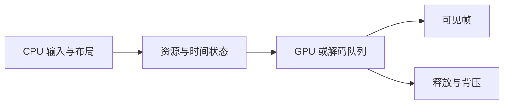

# 前端高阶手写题：图形与媒体 26 题

<!-- Solution routes -->
先跟着代码写一遍，可读[命中检测与帧调度](workshop-web-engineering.md)和[动画引擎](animation-engine-handwritten.md)。下方练习再增加新约束。

图形题的难点常在生命周期、坐标空间和资源预算，而不是画出一个三角形。GPU 命令提交、媒体帧所有权、索引数据和时间戳都需要显式合同。

五层练题法：描述可观察画面；列格式和状态规则；画资源/时间机制；实现简化模型；验证失败和上限。练习只模拟调度合同，不声称在真实 GPU 上测得吞吐或帧率。

## GPU 资源、上传与拾取

### H309. WebGPU 动态 vertex buffer 子分配器

实现 createUploadArena(device, capacity, alignment) 的 allocate(byteLength): {buffer,offset,write(bytes)} 与 resetAfter(submission)，用于同一帧动态顶点数据。

offset 按 alignment 对齐；不跨越 capacity；分配只在对应 queue.submit 后可复用；单次请求大于 capacity 抛 RangeError。

- capacity=1024、alignment=256，先分 100 得 offset 0，再分 20 得 offset 256；写入只改各自范围。
- 再申请 800 超剩余容量时抛错且 cursor 不变；提交前调用 reset 抛 StateError。

单调 bump pointer 与 submission serial 绑定；write 使用 queue.writeBuffer 并校验源 view 的 byteOffset/byteLength。

多个 in-flight frame 如何用多页避免覆盖仍被 GPU 读取的数据；WebGPU buffer usage flag 如何约束用途？

难，45 分钟；仅实现生命周期模型，不测 GPU 性能。

<!-- Question record (index metadata)
- **题目契约：**实现 createUploadArena(device, capacity, alignment) 的 allocate(byteLength): {buffer,offset,write(bytes)} 与 resetAfter(submission)，用于同一帧动态顶点数据。
- **约束与不变量：**offset 按 alignment 对齐；不跨越 capacity；分配只在对应 queue.submit 后可复用；单次请求大于 capacity 抛 RangeError。
- **用例 A：**capacity=1024、alignment=256，先分 100 得 offset 0，再分 20 得 offset 256；写入只改各自范围。
- **用例 B：**再申请 800 超剩余容量时抛错且 cursor 不变；提交前调用 reset 抛 StateError。
- **实现提示：**单调 bump pointer 与 submission serial 绑定；write 使用 queue.writeBuffer 并校验源 view 的 byteOffset/byteLength。
- **进阶追问：**多个 in-flight frame 如何用多页避免覆盖仍被 GPU 读取的数据；WebGPU buffer usage flag 如何约束用途？
- **难度 / 建议时长：**难，45 分钟；仅实现生命周期模型，不测 GPU 性能。
- **依据与状态：**作者原创派生练习，未实现/未实跑；buffer 合同参考[WebGPU](handwritten-practice-sources.md#s21)和[ECMAScript TypedArray](handwritten-practice-sources.md#s11)。
-->

### H310. 多帧安全的 GPU ring allocator

实现 reserve(size, frameSerial) 与 retire(completedSerial)，在固定 GPU buffer 中环形分配并返回 offset；未退役范围不得重叠。

容量 64 KiB..64 MiB、size 对齐 256；serial 单调递增；容量不足返回 need-wait，不覆盖未完成区间。

- 容量 1024，保留 [0,512) serial 1 后 reserve 600 返回 need-wait；retire(1) 后可从 0 分 600。
- 请求 1025 返回 RangeError 且状态不变；retire 未来 serial 报 RangeError。

维护 head/tail 与按 serial 排序的 in-flight span；环绕时检查尾到容量及 0 到 head 两个连续空间。

GPU fence 可见性如何决定 retire；不连续洞是否值得用 free list，需承担何种碎片成本？

挑战，55 分钟；按字节区间画出重叠证明。

<!-- Question record (index metadata)
- **题目契约：**实现 reserve(size, frameSerial) 与 retire(completedSerial)，在固定 GPU buffer 中环形分配并返回 offset；未退役范围不得重叠。
- **约束与不变量：**容量 64 KiB..64 MiB、size 对齐 256；serial 单调递增；容量不足返回 need-wait，不覆盖未完成区间。
- **用例 A：**容量 1024，保留 [0,512) serial 1 后 reserve 600 返回 need-wait；retire(1) 后可从 0 分 600。
- **用例 B：**请求 1025 返回 RangeError 且状态不变；retire 未来 serial 报 RangeError。
- **实现提示：**维护 head/tail 与按 serial 排序的 in-flight span；环绕时检查尾到容量及 0 到 head 两个连续空间。
- **进阶追问：**GPU fence 可见性如何决定 retire；不连续洞是否值得用 free list，需承担何种碎片成本？
- **难度 / 建议时长：**挑战，55 分钟；按字节区间画出重叠证明。
- **依据与状态：**作者原创派生练习，未实现/未实跑；GPU 队列参考[WebGPU](handwritten-practice-sources.md#s21)和[Node worker threads](handwritten-practice-sources.md#s27)作异步生命周期对照。
-->

### H311. 按预算调度纹理上传

实现 scheduleUploads(jobs, byteBudget)，每帧取一组纹理切片上传任务，返回待执行批次和剩余队列。

单帧字节总量≤budget；每个 job 的切片保持 mip/layer 顺序；取消 job 后后续切片不提交。

- budget=10，任务大小 4、7、3，首批选 4，次帧选 7 和 3；顺序与输入队列一致。
- 首任务大小 11 时返回超预算错误且不丢队列头；budget=0 时无任务出队。

每任务拆成有限字节块，用队列游标追踪切片；调度决策与实际 queue.writeTexture 分开，便于单测。

以字节而非耗时做预算有什么偏差；如何让重要首屏纹理优先又防止低优先级饥饿？

中，35 分钟；模型预算，不宣称真实帧耗时。

<!-- Question record (index metadata)
- **题目契约：**实现 scheduleUploads(jobs, byteBudget)，每帧取一组纹理切片上传任务，返回待执行批次和剩余队列。
- **约束与不变量：**单帧字节总量≤budget；每个 job 的切片保持 mip/layer 顺序；取消 job 后后续切片不提交。
- **用例 A：**budget=10，任务大小 4、7、3，首批选 4，次帧选 7 和 3；顺序与输入队列一致。
- **用例 B：**首任务大小 11 时返回超预算错误且不丢队列头；budget=0 时无任务出队。
- **实现提示：**每任务拆成有限字节块，用队列游标追踪切片；调度决策与实际 queue.writeTexture 分开，便于单测。
- **进阶追问：**以字节而非耗时做预算有什么偏差；如何让重要首屏纹理优先又防止低优先级饥饿？
- **难度 / 建议时长：**中，35 分钟；模型预算，不宣称真实帧耗时。
- **依据与状态：**作者原创派生练习，未实现/未实跑；纹理上传参考[WebGPU](handwritten-practice-sources.md#s21)和[glTF 2.0](handwritten-practice-sources.md#s22)。
-->

### H312. Bind group 布局兼容性缓存

实现 layoutKey(descriptor) 与 getOrCreateLayout(device,descriptor)，为结构相同的资源布局复用缓存对象。

key 包含 binding、visibility、buffer type/minBindingSize、texture sampleType/viewDimension；字段顺序不影响 key，数组绑定顺序影响。

- 两个 descriptor 字段次序不同但规范化结构相同，命中同一缓存项；binding 不同创建新项。
- descriptor 含函数或循环引用时报 TypeError；device 失效后不得返回旧 device 对象。

递归规范化允许字段并排序对象键，显式区分 undefined/default；缓存按 device WeakMap 隔离。

API 默认值在版本演进时如何纳入 key；如何防不同设备共享句柄？

难，40 分钟；缓存身份与布局相等性需分开定义。

<!-- Question record (index metadata)
- **题目契约：**实现 layoutKey(descriptor) 与 getOrCreateLayout(device,descriptor)，为结构相同的资源布局复用缓存对象。
- **约束与不变量：**key 包含 binding、visibility、buffer type/minBindingSize、texture sampleType/viewDimension；字段顺序不影响 key，数组绑定顺序影响。
- **用例 A：**两个 descriptor 字段次序不同但规范化结构相同，命中同一缓存项；binding 不同创建新项。
- **用例 B：**descriptor 含函数或循环引用时报 TypeError；device 失效后不得返回旧 device 对象。
- **实现提示：**递归规范化允许字段并排序对象键，显式区分 undefined/default；缓存按 device WeakMap 隔离。
- **进阶追问：**API 默认值在版本演进时如何纳入 key；如何防不同设备共享句柄？
- **难度 / 建议时长：**难，40 分钟；缓存身份与布局相等性需分开定义。
- **依据与状态：**作者原创派生练习，未实现/未实跑；布局机制参考[WebGPU](handwritten-practice-sources.md#s21)和[ECMAScript](handwritten-practice-sources.md#s11)。
-->

### H313. GPU 异步拾取请求序列化

实现 requestPick(x,y,frameId) 与 resolvePick(readback)，管理像素 ID readback 的异步结果并忽略过期帧。

坐标为 backing-store 整数像素；同一 buffer 同时最多一笔 mapAsync；请求 ID 唯一；销毁后所有结果失效。

- frame 1 请求后 frame 2 请求，frame 1 先回传不得覆盖当前选择，frame 2 命中 ID 7 后选中 7。
- 坐标等于 width 或 height 越界拒绝；destroy 后 resolvePick 不得恢复状态。

双 readback buffer 轮换，映射状态逐 buffer 记录；每次请求携带 generation，完成后核验 generation 并跳过过期响应。

如何降低每像素读取同步成本；ID attachment 位宽、抗锯齿和透明物体如何影响命中定义？

难，45 分钟；只验收异步状态，不执行真实 GPU。

<!-- Question record (index metadata)
- **题目契约：**实现 requestPick(x,y,frameId) 与 resolvePick(readback)，管理像素 ID readback 的异步结果并忽略过期帧。
- **约束与不变量：**坐标为 backing-store 整数像素；同一 buffer 同时最多一笔 mapAsync；请求 ID 唯一；销毁后所有结果失效。
- **用例 A：**frame 1 请求后 frame 2 请求，frame 1 先回传不得覆盖当前选择，frame 2 命中 ID 7 后选中 7。
- **用例 B：**坐标等于 width 或 height 越界拒绝；destroy 后 resolvePick 不得恢复状态。
- **实现提示：**双 readback buffer 轮换，映射状态逐 buffer 记录；每次请求携带 generation，完成后核验 generation 并跳过过期响应。
- **进阶追问：**如何降低每像素读取同步成本；ID attachment 位宽、抗锯齿和透明物体如何影响命中定义？
- **难度 / 建议时长：**难，45 分钟；只验收异步状态，不执行真实 GPU。
- **依据与状态：**作者原创派生练习，未实现/未实跑；映射与设备生命周期参考[WebGPU](handwritten-practice-sources.md#s21)和[ECMAScript Promise](handwritten-practice-sources.md#s11)。
-->

### H314. GPU 错误作用域栈模型

实现 ErrorScopeModel.push(filter)、pop() 的教学模型；模型以 LIFO 配对并约定 destroy 时取消未决等待，不声明为真实 GPUDevice 行为。

filter 只能 validation/out-of-memory/internal；pop 与 push 顺序匹配；无 scope 时 pop 抛 StateError。

- 依次 push validation、out-of-memory，pop 顺序返回第二个再返回第一个 scope 结果。
- 设备 destroy 后未决 pop 全部拒绝 AbortError；多余 pop 不能吞错。

scope token 保存 deferred Promise 和捕获错误集合；push/pop 即使异步完成也按栈纪律配对。

并发任务共享 device 时全局栈为何可能串错作用域；真实 API 调用怎样避免异步交错？

中，30 分钟；本题是 API 机制模型，不替代浏览器实现。

<!-- Question record (index metadata)
- **题目契约：**实现 ErrorScopeModel.push(filter)、pop() 的教学模型；模型以 LIFO 配对并约定 destroy 时取消未决等待，不声明为真实 GPUDevice 行为。
- **约束与不变量：**filter 只能 validation/out-of-memory/internal；pop 与 push 顺序匹配；无 scope 时 pop 抛 StateError。
- **用例 A：**依次 push validation、out-of-memory，pop 顺序返回第二个再返回第一个 scope 结果。
- **用例 B：**设备 destroy 后未决 pop 全部拒绝 AbortError；多余 pop 不能吞错。
- **实现提示：**scope token 保存 deferred Promise 和捕获错误集合；push/pop 即使异步完成也按栈纪律配对。
- **进阶追问：**并发任务共享 device 时全局栈为何可能串错作用域；真实 API 调用怎样避免异步交错？
- **难度 / 建议时长：**中，30 分钟；本题是 API 机制模型，不替代浏览器实现。
- **依据与状态：**作者原创派生练习，未实现/未实跑；错误作用域参考[WebGPU](handwritten-practice-sources.md#s21)与[ECMAScript Promise](handwritten-practice-sources.md#s11)。
-->

### H315. 分层材质纹理的 mip 依赖图

实现 planMipUpload(image, levels, layers)，输出每个纹理子资源上传依赖及完成条件。

mip 层级尺寸向下取整且最小 1；每 layer 每 level 恰一次；生成 mip 前基础 level 已可用。

- 8×4、3 levels、2 layers 生成尺寸 8×4、4×2、2×1，共 6 个 upload 节点。
- levels=0、layers=0 或超过合法 mip count 拒绝，不能创建空但报告成功的纹理。

节点 ID 为 layer/level 组合，边由前一级指向下一级；按预算做拓扑批次。

压缩纹理如何改变可生成 mip 的假设；sRGB 格式 mip 滤波是否可逐通道平均？

中，35 分钟；明确题目只规划依赖，不实现滤波器。

<!-- Question record (index metadata)
- **题目契约：**实现 planMipUpload(image, levels, layers)，输出每个纹理子资源上传依赖及完成条件。
- **约束与不变量：**mip 层级尺寸向下取整且最小 1；每 layer 每 level 恰一次；生成 mip 前基础 level 已可用。
- **用例 A：**8×4、3 levels、2 layers 生成尺寸 8×4、4×2、2×1，共 6 个 upload 节点。
- **用例 B：**levels=0、layers=0 或超过合法 mip count 拒绝，不能创建空但报告成功的纹理。
- **实现提示：**节点 ID 为 layer/level 组合，边由前一级指向下一级；按预算做拓扑批次。
- **进阶追问：**压缩纹理如何改变可生成 mip 的假设；sRGB 格式 mip 滤波是否可逐通道平均？
- **难度 / 建议时长：**中，35 分钟；明确题目只规划依赖，不实现滤波器。
- **依据与状态：**作者原创派生练习，未实现/未实跑；资源层级参考[WebGPU](handwritten-practice-sources.md#s21)与[glTF 2.0](handwritten-practice-sources.md#s22)。
-->

### H316. Indirect draw 参数缓冲校验

实现 validateIndirectDraw(buffer, offset, vertexCountLimit)，解析 4 个 uint32 参数并检查 vertexCount、instanceCount、firstVertex。

offset 满足 4 字节对齐且 16 字节可读；所有字段 little-endian；无效范围在提交命令前失败。

- offset 0 写 [3,2,5,0] 得合法绘制描述，vertexCount=3、instanceCount=2。
- offset=2 抛 RangeError；vertexCount 超上限拒绝，不发起 GPU 工作。

用 DataView 明确 endian 与 byteOffset；读取前验证 view 覆盖范围，结果返回不可变普通对象。

draw 参数与索引缓冲边界如何共同验证；间接绘制能减少何种 CPU 提交工作，代价是什么？

中，30 分钟；本题验收主机端字节布局。

<!-- Question record (index metadata)
- **题目契约：**实现 validateIndirectDraw(buffer, offset, vertexCountLimit)，解析 4 个 uint32 参数并检查 vertexCount、instanceCount、firstVertex。
- **约束与不变量：**offset 满足 4 字节对齐且 16 字节可读；所有字段 little-endian；无效范围在提交命令前失败。
- **用例 A：**offset 0 写 [3,2,5,0] 得合法绘制描述，vertexCount=3、instanceCount=2。
- **用例 B：**offset=2 抛 RangeError；vertexCount 超上限拒绝，不发起 GPU 工作。
- **实现提示：**用 DataView 明确 endian 与 byteOffset；读取前验证 view 覆盖范围，结果返回不可变普通对象。
- **进阶追问：**draw 参数与索引缓冲边界如何共同验证；间接绘制能减少何种 CPU 提交工作，代价是什么？
- **难度 / 建议时长：**中，30 分钟；本题验收主机端字节布局。
- **依据与状态：**作者原创派生练习，未实现/未实跑；命令缓冲约束参考[WebGPU](handwritten-practice-sources.md#s21)与[ECMAScript DataView](handwritten-practice-sources.md#s11)。
-->

### H317. 动态实例批次分桶器

实现 bucketInstances(instances)，按 pipeline、材质布局、mesh 与透明性形成可绘制批次，并返回稳定实例索引。

不可跨 pipeline/layout 合并；不透明可按状态排序，透明项保持原绘制顺序；实例 ID 不重复。

- 相同 mesh/pipeline/layout 的 3 个不透明实例合一批；另一个 pipeline 单独一批。
- 两个透明实例输入序号 4、1，输出顺序仍按原输入 4、1；重复 ID 拒绝。

不透明批次用规范化复合 key 分组，透明队列独立稳定排列；批次只引用源索引不复制 geometry。

透明排序与批处理冲突时如何权衡；材质 bind group 数量如何改变实例批次边界？

难，40 分钟；输出需能直接对应原数组。

<!-- Question record (index metadata)
- **题目契约：**实现 bucketInstances(instances)，按 pipeline、材质布局、mesh 与透明性形成可绘制批次，并返回稳定实例索引。
- **约束与不变量：**不可跨 pipeline/layout 合并；不透明可按状态排序，透明项保持原绘制顺序；实例 ID 不重复。
- **用例 A：**相同 mesh/pipeline/layout 的 3 个不透明实例合一批；另一个 pipeline 单独一批。
- **用例 B：**两个透明实例输入序号 4、1，输出顺序仍按原输入 4、1；重复 ID 拒绝。
- **实现提示：**不透明批次用规范化复合 key 分组，透明队列独立稳定排列；批次只引用源索引不复制 geometry。
- **进阶追问：**透明排序与批处理冲突时如何权衡；材质 bind group 数量如何改变实例批次边界？
- **难度 / 建议时长：**难，40 分钟；输出需能直接对应原数组。
- **依据与状态：**作者原创派生练习，未实现/未实跑；绘制布局参考[WebGPU](handwritten-practice-sources.md#s21)和[glTF 2.0](handwritten-practice-sources.md#s22)。
-->

## 空间查询、剔除与 glTF 布局

### H318. 动态 AABB 树空间索引

实现 insert(id,aabb)、remove(id)、queryAabb(aabb)，返回与查询盒相交的活动 ID 并按 ID 排序。

坐标有限且 min≤max；节点包围盒包含全部后代；每 ID 唯一；删除未知 ID 返回 false。

- 盒 [0,0,0]-[2,2,2] 与 [2,1,1]-[4,3,3] 按闭边界相交，query 返回两个 ID。
- NaN 坐标构建拒绝；删除一项后树根 bounds 不得残留已删范围。

动态二叉 BVH 用 surface-area heuristic 选兄弟并更新祖先 bounds；定期旋转改善失衡。

移动物体采用 fat AABB 的更新阈值怎么决定；最坏退化时如何重建？

挑战，60 分钟；不把它简化成屏幕坐标命中测试。

<!-- Question record (index metadata)
- **题目契约：**实现 insert(id,aabb)、remove(id)、queryAabb(aabb)，返回与查询盒相交的活动 ID 并按 ID 排序。
- **约束与不变量：**坐标有限且 min≤max；节点包围盒包含全部后代；每 ID 唯一；删除未知 ID 返回 false。
- **用例 A：**盒 [0,0,0]-[2,2,2] 与 [2,1,1]-[4,3,3] 按闭边界相交，query 返回两个 ID。
- **用例 B：**NaN 坐标构建拒绝；删除一项后树根 bounds 不得残留已删范围。
- **实现提示：**动态二叉 BVH 用 surface-area heuristic 选兄弟并更新祖先 bounds；定期旋转改善失衡。
- **进阶追问：**移动物体采用 fat AABB 的更新阈值怎么决定；最坏退化时如何重建？
- **难度 / 建议时长：**挑战，60 分钟；不把它简化成屏幕坐标命中测试。
- **依据与状态：**作者原创派生练习，未实现/未实跑；空间与资产结构参考[glTF 2.0](handwritten-practice-sources.md#s22)和[算法资料](handwritten-practice-sources.md#s29)。
-->

### H319. BVH 射线最近命中查询

实现 castRay(bvh,origin,direction,maxT)，返回最近三角形 ID、t 与 barycentric coordinates 或 null。

direction 归一化；maxT 有限非负；节点 slab test 与三角形相交使用同一 t 参数；边界命中策略固定为包含。

- 射线从 (0,0,0) 沿 +Z 穿过 z=2 与 z=5 三角形，返回 z=2 的命中与 t=2。
- maxT=1 返回 null；方向含 NaN 或零向量抛 RangeError。

近先遍历 BVH 子节点，当前最佳 t 收紧后剪枝远节点；三角形采用 Möller–Trumbore 并明确 epsilon。

双面材质是否改变背面剔除；大规模动态顶点如何更新 BVH 而不全量重建？

挑战，55 分钟；报告坐标空间和浮点边界。

<!-- Question record (index metadata)
- **题目契约：**实现 castRay(bvh,origin,direction,maxT)，返回最近三角形 ID、t 与 barycentric coordinates 或 null。
- **约束与不变量：**direction 归一化；maxT 有限非负；节点 slab test 与三角形相交使用同一 t 参数；边界命中策略固定为包含。
- **用例 A：**射线从 (0,0,0) 沿 +Z 穿过 z=2 与 z=5 三角形，返回 z=2 的命中与 t=2。
- **用例 B：**maxT=1 返回 null；方向含 NaN 或零向量抛 RangeError。
- **实现提示：**近先遍历 BVH 子节点，当前最佳 t 收紧后剪枝远节点；三角形采用 Möller–Trumbore 并明确 epsilon。
- **进阶追问：**双面材质是否改变背面剔除；大规模动态顶点如何更新 BVH 而不全量重建？
- **难度 / 建议时长：**挑战，55 分钟；报告坐标空间和浮点边界。
- **依据与状态：**作者原创派生练习，未实现/未实跑；三角网格参考[glTF 2.0](handwritten-practice-sources.md#s22)与[算法资料](handwritten-practice-sources.md#s29)。
-->

### H320. 视锥体层级剔除器

实现 cullScene(root, planes)，对层级 AABB 做视锥剔除，返回可见叶节点；父盒完全在外时不得访问子树。

平面已归一化；AABB 坐标有限；相交边界按可见处理；层级树无环且 child bounds 包在 parent 内。

- 父盒完全位于左平面外，其 1,000 个子节点零次测试且均不输出。
- 盒一面恰落平面上仍可见；非法法线长度为零时报 RangeError。

用正顶点/负顶点符号快速分类；继承父级 inside 状态时子节点可跳过对应平面测试。

移动物体 stale bounds 会造成漏渲染还是多渲染；视锥外的阴影投射对象是否能直接剔除？

难，40 分钟；提供节点测试次数而非假造帧率。

<!-- Question record (index metadata)
- **题目契约：**实现 cullScene(root, planes)，对层级 AABB 做视锥剔除，返回可见叶节点；父盒完全在外时不得访问子树。
- **约束与不变量：**平面已归一化；AABB 坐标有限；相交边界按可见处理；层级树无环且 child bounds 包在 parent 内。
- **用例 A：**父盒完全位于左平面外，其 1,000 个子节点零次测试且均不输出。
- **用例 B：**盒一面恰落平面上仍可见；非法法线长度为零时报 RangeError。
- **实现提示：**用正顶点/负顶点符号快速分类；继承父级 inside 状态时子节点可跳过对应平面测试。
- **进阶追问：**移动物体 stale bounds 会造成漏渲染还是多渲染；视锥外的阴影投射对象是否能直接剔除？
- **难度 / 建议时长：**难，40 分钟；提供节点测试次数而非假造帧率。
- **依据与状态：**作者原创派生练习，未实现/未实跑；层级与坐标参考[glTF 2.0](handwritten-practice-sources.md#s22)和[WebGPU](handwritten-practice-sources.md#s21)。
-->

### H321. 屏幕空间瓦片光源分桶

实现 binLights(camera, viewport, lights, tileSize)，为每屏幕瓦片生成相交光源 ID 列表。

视口尺寸正整数、tileSize=16 或 32；光源半径非负；瓦片按行优先输出且每列表 ID 稳定去重。

- 视口 32×16、tileSize 16，覆盖左半屏的一个光源仅进入第 0 瓦片。
- 半径 0 的光源仍进入投影中心所属瓦片；视口宽 0 拒绝。

先将球投影为保守屏幕矩形，再计算瓦片整数范围；投影跨近裁剪面时保守加入全部可能瓦片。

每瓦片光源列表有容量上限时如何避免静默丢光；深度分桶怎样缩小列表？

难，45 分钟；只模拟 CPU 分桶，不测 shader。

<!-- Question record (index metadata)
- **题目契约：**实现 binLights(camera, viewport, lights, tileSize)，为每屏幕瓦片生成相交光源 ID 列表。
- **约束与不变量：**视口尺寸正整数、tileSize=16 或 32；光源半径非负；瓦片按行优先输出且每列表 ID 稳定去重。
- **用例 A：**视口 32×16、tileSize 16，覆盖左半屏的一个光源仅进入第 0 瓦片。
- **用例 B：**半径 0 的光源仍进入投影中心所属瓦片；视口宽 0 拒绝。
- **实现提示：**先将球投影为保守屏幕矩形，再计算瓦片整数范围；投影跨近裁剪面时保守加入全部可能瓦片。
- **进阶追问：**每瓦片光源列表有容量上限时如何避免静默丢光；深度分桶怎样缩小列表？
- **难度 / 建议时长：**难，45 分钟；只模拟 CPU 分桶，不测 shader。
- **依据与状态：**作者原创派生练习，未实现/未实跑；布局与视口参考[WebGPU](handwritten-practice-sources.md#s21)和[glTF 2.0](handwritten-practice-sources.md#s22)。
-->

### H322. glTF accessor 交错步长解包

实现 readAccessor(buffer, view, accessor)，读取 componentType、count、type、byteOffset 与 byteStride，输出规范化元素。

所有偏移/长度在 buffer 范围内；stride 至少元素字节数且满足组件对齐；访问器 count 不越过 view。

- 每顶点 16 字节步长存 VEC3 FLOAT，读取两个位置忽略每条记录的 4 字节填充。
- 最后一项超出 view.byteLength 或 stride=8 小于 VEC3 float 大小时拒绝。

按字节偏移逐组件 DataView 读取，显式 little-endian；normalized 整数按类型范围映射到浮点。

稀疏 accessor 如何覆盖基础值；大端主机上 DataView 参数为何仍需明确？

难，45 分钟；区别 buffer、bufferView、accessor 三层范围。

<!-- Question record (index metadata)
- **题目契约：**实现 readAccessor(buffer, view, accessor)，读取 componentType、count、type、byteOffset 与 byteStride，输出规范化元素。
- **约束与不变量：**所有偏移/长度在 buffer 范围内；stride 至少元素字节数且满足组件对齐；访问器 count 不越过 view。
- **用例 A：**每顶点 16 字节步长存 VEC3 FLOAT，读取两个位置忽略每条记录的 4 字节填充。
- **用例 B：**最后一项超出 view.byteLength 或 stride=8 小于 VEC3 float 大小时拒绝。
- **实现提示：**按字节偏移逐组件 DataView 读取，显式 little-endian；normalized 整数按类型范围映射到浮点。
- **进阶追问：**稀疏 accessor 如何覆盖基础值；大端主机上 DataView 参数为何仍需明确？
- **难度 / 建议时长：**难，45 分钟；区别 buffer、bufferView、accessor 三层范围。
- **依据与状态：**作者原创派生练习，未实现/未实跑；二进制布局参考[glTF 2.0](handwritten-practice-sources.md#s22)与[ECMAScript](handwritten-practice-sources.md#s11)。
-->

### H323. glTF sparse accessor 合并器

实现 materializeSparse(base, sparse)，把稀疏 indices/values 覆盖到 accessor 基础数组并返回新结果。

indices 严格递增、唯一且小于 count；component type 仅允许 unsigned byte/short/int；输入 buffer 不得被修改。

- 基础 [0,0,0,0]，indices [1,3]、values [5,9]，输出 [0,5,0,9]。
- indices 重复或越界时报 RangeError；无基础 buffer 时用全零值起始。

先验证全部索引，再分配输出并覆盖，避免中途异常留下部分结果；将值和索引的字节范围分别校验。

巨大 count 极稀疏时是否必须 materialize；GPU shader 能否直接读取稀疏表示，代价如何？

难，40 分钟；对照 dense 与 sparse 语义。

<!-- Question record (index metadata)
- **题目契约：**实现 materializeSparse(base, sparse)，把稀疏 indices/values 覆盖到 accessor 基础数组并返回新结果。
- **约束与不变量：**indices 严格递增、唯一且小于 count；component type 仅允许 unsigned byte/short/int；输入 buffer 不得被修改。
- **用例 A：**基础 [0,0,0,0]，indices [1,3]、values [5,9]，输出 [0,5,0,9]。
- **用例 B：**indices 重复或越界时报 RangeError；无基础 buffer 时用全零值起始。
- **实现提示：**先验证全部索引，再分配输出并覆盖，避免中途异常留下部分结果；将值和索引的字节范围分别校验。
- **进阶追问：**巨大 count 极稀疏时是否必须 materialize；GPU shader 能否直接读取稀疏表示，代价如何？
- **难度 / 建议时长：**难，40 分钟；对照 dense 与 sparse 语义。
- **依据与状态：**作者原创派生练习，未实现/未实跑；稀疏布局参考[glTF 2.0](handwritten-practice-sources.md#s22)和[ECMAScript](handwritten-practice-sources.md#s11)。
-->

### H324. glTF scene 节点世界矩阵

实现 computeWorldMatrices(nodes, sceneRoots)，返回每节点父矩阵乘本地矩阵结果。

矩阵为列主序 4×4；TRS 与 matrix 同时出现时拒绝；节点图无环且单父；未从 scene root 到达节点不输出。

- 父平移 x=2、子平移 y=3，子世界平移为 (2,3,0)。
- 子节点回指父节点报循环路径；根节点自身矩阵恒等时世界矩阵为单位阵。

DFS 进入时 world=parentWorld×local；TRS 顺序依规范约定，避免把平移与缩放次序调换。

多 scene 节点共享是否允许；动画更新单节点后如何只重算后代？

难，45 分钟；测试非交换的旋转和平移组合。

<!-- Question record (index metadata)
- **题目契约：**实现 computeWorldMatrices(nodes, sceneRoots)，返回每节点父矩阵乘本地矩阵结果。
- **约束与不变量：**矩阵为列主序 4×4；TRS 与 matrix 同时出现时拒绝；节点图无环且单父；未从 scene root 到达节点不输出。
- **用例 A：**父平移 x=2、子平移 y=3，子世界平移为 (2,3,0)。
- **用例 B：**子节点回指父节点报循环路径；根节点自身矩阵恒等时世界矩阵为单位阵。
- **实现提示：**DFS 进入时 world=parentWorld×local；TRS 顺序依规范约定，避免把平移与缩放次序调换。
- **进阶追问：**多 scene 节点共享是否允许；动画更新单节点后如何只重算后代？
- **难度 / 建议时长：**难，45 分钟；测试非交换的旋转和平移组合。
- **依据与状态：**作者原创派生练习，未实现/未实跑；scene 与变换参考[glTF 2.0](handwritten-practice-sources.md#s22)和[WebGPU](handwritten-practice-sources.md#s21)。
-->

### H325. 纹理块尺寸与行对齐规划

实现 planTextureCopy(width,height,bytesPerPixel,alignment)，返回 paddedBytesPerRow 与总上传字节数。

尺寸正整数、bytesPerPixel 正整数、alignment 为正二次幂；行 padding 不能被解释成像素数据。

- 宽 3、高 2、每像素 4 字节、对齐 256，bytesPerRow=256、分配区总字节数 512；有效像素 payload 仅 24 字节。
- 宽 0 或非二次幂 alignment 拒绝；乘法超过安全整数报 RangeError。

用 ceil(rowBytes/alignment)*alignment，逐步做安全乘法；输出有效 row bytes 与 padding 分列。

压缩纹理按 block 宽高计算如何改变行长；上传缓冲与 texture copy 对齐要求不能混为一谈。

中，25 分钟；只验证算术合同。

<!-- Question record (index metadata)
- **题目契约：**实现 planTextureCopy(width,height,bytesPerPixel,alignment)，返回 paddedBytesPerRow 与总上传字节数。
- **约束与不变量：**尺寸正整数、bytesPerPixel 正整数、alignment 为正二次幂；行 padding 不能被解释成像素数据。
- **用例 A：**宽 3、高 2、每像素 4 字节、对齐 256，bytesPerRow=256、分配区总字节数 512；有效像素 payload 仅 24 字节。
- **用例 B：**宽 0 或非二次幂 alignment 拒绝；乘法超过安全整数报 RangeError。
- **实现提示：**用 ceil(rowBytes/alignment)*alignment，逐步做安全乘法；输出有效 row bytes 与 padding 分列。
- **进阶追问：**压缩纹理按 block 宽高计算如何改变行长；上传缓冲与 texture copy 对齐要求不能混为一谈。
- **难度 / 建议时长：**中，25 分钟；只验证算术合同。
- **依据与状态：**作者原创派生练习，未实现/未实跑；纹理 copy 参考[WebGPU](handwritten-practice-sources.md#s21)与[glTF 2.0](handwritten-practice-sources.md#s22)。
-->

### H326. GPU 资源引用计数释放队列

实现 retain(resource)、release(resource,serial)，最后引用释放后只在 completedSerial 达到 serial 时销毁。

引用数非负；已销毁不可 retain；同一资源只能销毁一次；serial 单调且不可早于最近提交使用序号。

- 资源两次 retain、分别在 serial 3/5 release，完成 3 时未销毁，完成 5 时恰销毁一次。
- 对零引用 release 抛 StateError；completedSerial 回退报 RangeError 且队列不变。

资源记录 refCount、lastUseSerial、destroyRequested；pending heap 按安全释放 serial 排序。

引用计数循环如何处理；WebGPU 对象销毁何时可观察，模型能保证到哪层？

难，40 分钟；区分 JS 对象回收与 GPU 资源逻辑释放。

<!-- Question record (index metadata)
- **题目契约：**实现 retain(resource)、release(resource,serial)，最后引用释放后只在 completedSerial 达到 serial 时销毁。
- **约束与不变量：**引用数非负；已销毁不可 retain；同一资源只能销毁一次；serial 单调且不可早于最近提交使用序号。
- **用例 A：**资源两次 retain、分别在 serial 3/5 release，完成 3 时未销毁，完成 5 时恰销毁一次。
- **用例 B：**对零引用 release 抛 StateError；completedSerial 回退报 RangeError 且队列不变。
- **实现提示：**资源记录 refCount、lastUseSerial、destroyRequested；pending heap 按安全释放 serial 排序。
- **进阶追问：**引用计数循环如何处理；WebGPU 对象销毁何时可观察，模型能保证到哪层？
- **难度 / 建议时长：**难，40 分钟；区分 JS 对象回收与 GPU 资源逻辑释放。
- **依据与状态：**作者原创派生练习，未实现/未实跑；资源生命周期参考[WebGPU](handwritten-practice-sources.md#s21)与[ECMAScript](handwritten-practice-sources.md#s11)。
-->

## 媒体时钟、解码与队列

### H327. Watermark 驱动的帧呈现重排模型

实现 enqueue(frame)、drainUntil(watermark) 与 end()，仅输出 presentation timestamp≤watermark 的帧并按时间戳排序。

timestamp 为微秒安全整数；同 PTS 按输入序号稳定；最多缓存 32 帧；watermark 单调不减；新帧 PTS≤已发布 watermark 时拒绝。

- enqueue PTS 0、2 后 drainUntil(0) 仅输出 0；再 enqueue 1、drainUntil(2) 输出 1、2。
- end 后 enqueue 报 StateError；watermark 回退报 RangeError；容量满时返回 need-drain 且不丢帧。

小顶堆按 PTS、序号排序；只有上游给出 watermark 才能证明较早帧不会再到达。

普通 WebCodecs VideoDecoder 输出何种顺序；本模型为何不能仅看到两帧就断定排序完成？

难，40 分钟；这是显式重排模型，不代表浏览器解码器输出合同。

<!-- Question record (index metadata)
- **题目契约：**实现 enqueue(frame)、drainUntil(watermark) 与 end()，仅输出 presentation timestamp≤watermark 的帧并按时间戳排序。
- **约束与不变量：**timestamp 为微秒安全整数；同 PTS 按输入序号稳定；最多缓存 32 帧；watermark 单调不减；新帧 PTS≤已发布 watermark 时拒绝。
- **用例 A：**enqueue PTS 0、2 后 drainUntil(0) 仅输出 0；再 enqueue 1、drainUntil(2) 输出 1、2。
- **用例 B：**end 后 enqueue 报 StateError；watermark 回退报 RangeError；容量满时返回 need-drain 且不丢帧。
- **实现提示：**小顶堆按 PTS、序号排序；只有上游给出 watermark 才能证明较早帧不会再到达。
- **进阶追问：**普通 WebCodecs VideoDecoder 输出何种顺序；本模型为何不能仅看到两帧就断定排序完成？
- **难度 / 建议时长：**难，40 分钟；这是显式重排模型，不代表浏览器解码器输出合同。
- **依据与状态：**作者原创派生练习，未实现/未实跑；时间戳参考[WebCodecs](handwritten-practice-sources.md#s23)与[ECMAScript](handwritten-practice-sources.md#s11)。
-->

### H328. 音视频主时钟同步器

实现 syncFrame(videoPts,audioClock,driftLimit)，返回 present、drop 或 wait 与校正量；drift 定义为 videoPts-audioClock。

时间均为微秒整数；音频时钟为主钟；drift>limit 表示视频领先需 wait，drift<−limit 表示落后需 drop，其余 present。

- video PTS=1,020,000、audio=1,000,000、limit=50,000，返回 present 且 drift=20,000。
- video=1,100,000、audio=1,000,000、limit=50,000 返回 wait；video=900,000 返回 drop；负时间戳拒绝。

用有符号 BigInt 差值避免精度溢出；策略纯函数化，呈现调度由外层时钟执行。

音频设备采样时钟漂移怎样估计；掉帧会否改变媒体时间轴？

中，30 分钟；明确阈值比较为严格大于还是大于等于。

<!-- Question record (index metadata)
- **题目契约：**实现 syncFrame(videoPts,audioClock,driftLimit)，返回 present、drop 或 wait 与校正量；drift 定义为 videoPts-audioClock。
- **约束与不变量：**时间均为微秒整数；音频时钟为主钟；drift>limit 表示视频领先需 wait，drift<−limit 表示落后需 drop，其余 present。
- **用例 A：**video PTS=1,020,000、audio=1,000,000、limit=50,000，返回 present 且 drift=20,000。
- **用例 B：**video=1,100,000、audio=1,000,000、limit=50,000 返回 wait；video=900,000 返回 drop；负时间戳拒绝。
- **实现提示：**用有符号 BigInt 差值避免精度溢出；策略纯函数化，呈现调度由外层时钟执行。
- **进阶追问：**音频设备采样时钟漂移怎样估计；掉帧会否改变媒体时间轴？
- **难度 / 建议时长：**中，30 分钟；明确阈值比较为严格大于还是大于等于。
- **依据与状态：**作者原创派生练习，未实现/未实跑；时间戳参考[WebCodecs](handwritten-practice-sources.md#s23)和[ECMAScript](handwritten-practice-sources.md#s11)。
-->

### H329. WebCodecs VideoFrame 所有权队列

实现 enqueue(frame)、consumeOne() 与 closeAll()，队列负责在消费结束或丢弃时 close 每一 VideoFrame 恰一次。

最大 4 帧；满时按合同丢弃最旧帧；外部传入后所有权转给队列；closed 后拒绝新帧。

- 连续入队 1..5，队列留 2..5，帧 1 立即 close；consume 2 后帧 2 close 一次。
- closeAll 后所有残余 frame 各 close 一次；重复 closeAll 不重复关闭。

用状态包装避免同一帧多路径 close；消费回调 finally 释放，即使渲染抛错也不会泄漏。

clone 是否共享底层资源；转移 VideoFrame 到 Worker 与对象引用队列差异是什么？

中，30 分钟；记录每帧 close 次数验收。

<!-- Question record (index metadata)
- **题目契约：**实现 enqueue(frame)、consumeOne() 与 closeAll()，队列负责在消费结束或丢弃时 close 每一 VideoFrame 恰一次。
- **约束与不变量：**最大 4 帧；满时按合同丢弃最旧帧；外部传入后所有权转给队列；closed 后拒绝新帧。
- **用例 A：**连续入队 1..5，队列留 2..5，帧 1 立即 close；consume 2 后帧 2 close 一次。
- **用例 B：**closeAll 后所有残余 frame 各 close 一次；重复 closeAll 不重复关闭。
- **实现提示：**用状态包装避免同一帧多路径 close；消费回调 finally 释放，即使渲染抛错也不会泄漏。
- **进阶追问：**clone 是否共享底层资源；转移 VideoFrame 到 Worker 与对象引用队列差异是什么？
- **难度 / 建议时长：**中，30 分钟；记录每帧 close 次数验收。
- **依据与状态：**作者原创派生练习，未实现/未实跑；帧资源语义参考[WebCodecs](handwritten-practice-sources.md#s23)与[Node worker threads](handwritten-practice-sources.md#s27)。
-->

### H330. 解码队列背压阈值控制器

实现 DecodeController.onQueueSize(size)，超过 highWater 暂停输入，低于 lowWater 恢复，输出 pause/resume 转换事件。

0≤lowWater<highWater≤64；状态边沿触发一次；关闭状态不得 resume；重复尺寸不产生重复事件。

- high=8、low=3，size 8 发 pause，size 5 无变化，size 3 发 resume。
- pause 后 close 再输入 size 0 不发 resume；配置 low=high 拒绝。

两态 hysteresis 控制器；将队列观察与读取生产者信号分离，避免每次尺寸变化反复启停。

高低水位如何根据帧大小和解码延迟估算；生产者无法暂停时采取丢帧还是降采样？

中，25 分钟；这是离散状态模型。

<!-- Question record (index metadata)
- **题目契约：**实现 DecodeController.onQueueSize(size)，超过 highWater 暂停输入，低于 lowWater 恢复，输出 pause/resume 转换事件。
- **约束与不变量：**0≤lowWater<highWater≤64；状态边沿触发一次；关闭状态不得 resume；重复尺寸不产生重复事件。
- **用例 A：**high=8、low=3，size 8 发 pause，size 5 无变化，size 3 发 resume。
- **用例 B：**pause 后 close 再输入 size 0 不发 resume；配置 low=high 拒绝。
- **实现提示：**两态 hysteresis 控制器；将队列观察与读取生产者信号分离，避免每次尺寸变化反复启停。
- **进阶追问：**高低水位如何根据帧大小和解码延迟估算；生产者无法暂停时采取丢帧还是降采样？
- **难度 / 建议时长：**中，25 分钟；这是离散状态模型。
- **依据与状态：**作者原创派生练习，未实现/未实跑；队列控制参考[WebCodecs](handwritten-practice-sources.md#s23)与[Node worker threads](handwritten-practice-sources.md#s27)。
-->

### H331. WebCodecs 配置探测缓存

实现 probeCodec(config, supportCheck)，缓存 isConfigSupported 结果并支持同 key 请求合并。

key 包含 codec、codedWidth、codedHeight、hardwareAcceleration、latencyMode；拒绝的 Promise 不缓存；同 key 并发只探测一次。

- 两个并发相同配置调用 supportCheck 一次并共享结果；同 codec 不同宽度触发第二次探测。
- 首次探测 reject 后再次调用重新执行；配置字段非法在调用 API 前拒绝。

规范化配置后 key 序列化；in-flight map 与 fulfilled cache 分离，finally 仅删除当前 Promise。

浏览器版本变化如何使持久化支持结果失效；supported 不代表实际 decode 成功的原因？

中，30 分钟；区分能力探测和播放验收。

<!-- Question record (index metadata)
- **题目契约：**实现 probeCodec(config, supportCheck)，缓存 isConfigSupported 结果并支持同 key 请求合并。
- **约束与不变量：**key 包含 codec、codedWidth、codedHeight、hardwareAcceleration、latencyMode；拒绝的 Promise 不缓存；同 key 并发只探测一次。
- **用例 A：**两个并发相同配置调用 supportCheck 一次并共享结果；同 codec 不同宽度触发第二次探测。
- **用例 B：**首次探测 reject 后再次调用重新执行；配置字段非法在调用 API 前拒绝。
- **实现提示：**规范化配置后 key 序列化；in-flight map 与 fulfilled cache 分离，finally 仅删除当前 Promise。
- **进阶追问：**浏览器版本变化如何使持久化支持结果失效；supported 不代表实际 decode 成功的原因？
- **难度 / 建议时长：**中，30 分钟；区分能力探测和播放验收。
- **依据与状态：**作者原创派生练习，未实现/未实跑；配置探测参考[WebCodecs](handwritten-practice-sources.md#s23)与[ECMAScript](handwritten-practice-sources.md#s11)。
-->

### H332. 视频片段时间范围裁剪器

实现 selectFrames(frames,start,end)，选出 presentation timestamp 落在左闭右开 [start,end) 的帧并保留原顺序。

时间为整数微秒且 start≤end；输入 frame 顺序可乱；相同 PTS 全部保留；不修改原数组。

- PTS [0,10,20,30]，范围 [10,30) 返回 10、20 两帧。
- start=end 返回空；start>end 抛 RangeError；PTS=30 不得误入。

无序输入先按 PTS 与原序号稳定排序，再二分定位范围，输出仍按时间顺序。

关键帧约束怎样改变可解码起点；剪切时间与封装时间基准不一致如何处理？

易，20 分钟；定义区间边界即可。

<!-- Question record (index metadata)
- **题目契约：**实现 selectFrames(frames,start,end)，选出 presentation timestamp 落在左闭右开 [start,end) 的帧并保留原顺序。
- **约束与不变量：**时间为整数微秒且 start≤end；输入 frame 顺序可乱；相同 PTS 全部保留；不修改原数组。
- **用例 A：**PTS [0,10,20,30]，范围 [10,30) 返回 10、20 两帧。
- **用例 B：**start=end 返回空；start>end 抛 RangeError；PTS=30 不得误入。
- **实现提示：**无序输入先按 PTS 与原序号稳定排序，再二分定位范围，输出仍按时间顺序。
- **进阶追问：**关键帧约束怎样改变可解码起点；剪切时间与封装时间基准不一致如何处理？
- **难度 / 建议时长：**易，20 分钟；定义区间边界即可。
- **依据与状态：**作者原创派生练习，未实现/未实跑；帧时间参考[WebCodecs](handwritten-practice-sources.md#s23)与[ECMAScript Array](handwritten-practice-sources.md#s11)。
-->

### H333. 简单凹多边形耳切三角剖分

实现 triangulate(points)，输入单一简单凹多边形的二维顶点，输出稳定顺序的三角形索引列表。

顶点按逆时针给出、无洞、无自交、无重复相邻点、非零面积；非法输入返回 GeometryError，不自动修复。

- 五点凹箭头 [(0,0),(3,0),(3,3),(1,1),(0,3)] 输出 3 个三角形，索引在 0..4，面积和等于多边形面积 6。
- 自交蝴蝶结和重复相邻点均拒绝；三角形输入返回单个 [0,1,2]。

维护循环 prev/next 索引，依序寻找凸耳并检查其他顶点是否落在耳内；删耳后续找，平局选最小原始顶点索引。

浮点 epsilon 如何造成面积偏差；有洞多边形如何桥接而不产生自交？

挑战，55 分钟；以稳定索引、三角数 n−2 和面积和验收。

<!-- Question record (index metadata)
- **题目契约：**实现 triangulate(points)，输入单一简单凹多边形的二维顶点，输出稳定顺序的三角形索引列表。
- **约束与不变量：**顶点按逆时针给出、无洞、无自交、无重复相邻点、非零面积；非法输入返回 GeometryError，不自动修复。
- **用例 A：**五点凹箭头 [(0,0),(3,0),(3,3),(1,1),(0,3)] 输出 3 个三角形，索引在 0..4，面积和等于多边形面积 6。
- **用例 B：**自交蝴蝶结和重复相邻点均拒绝；三角形输入返回单个 [0,1,2]。
- **实现提示：**维护循环 prev/next 索引，依序寻找凸耳并检查其他顶点是否落在耳内；删耳后续找，平局选最小原始顶点索引。
- **进阶追问：**浮点 epsilon 如何造成面积偏差；有洞多边形如何桥接而不产生自交？
- **难度 / 建议时长：**挑战，55 分钟；以稳定索引、三角数 n−2 和面积和验收。
- **依据与状态：**作者原创派生练习，未实现/未实跑；几何资源参考[glTF 2.0](handwritten-practice-sources.md#s22)与[算法资料](handwritten-practice-sources.md#s29)。
-->

### H334. Canvas 导出像素的有界流水线

实现 exportTiles(canvas, tileSize, writer)，按行优先逐块读取像素，await 每块 writer 完成后才读取下一块，不同时持有多块 ImageData。

tileSize 为 1..2048；输出行列按从上到下、从左到右；writer 拒绝时停止后续读取并传播原错误。

- 5×3 图像、tile=2，依次处理 2×2、2×2、1×2、2×1、2×1、1×1 共 6 块。
- writer 第 2 块 reject 后只读取前两块；宽高为 0 返回空结果且不调用 writer。

双循环计算裁边尺寸，每块读取后 await writer 再继续；不积累所有 ImageData。

何时使用 OffscreenCanvas 转 Worker；跨域污染 Canvas 会在哪个 API 阶段失败？

中，30 分钟；通过最大同时持有块数验收背压。

<!-- Question record (index metadata)
- **题目契约：**实现 exportTiles(canvas, tileSize, writer)，按行优先逐块读取像素，await 每块 writer 完成后才读取下一块，不同时持有多块 ImageData。
- **约束与不变量：**tileSize 为 1..2048；输出行列按从上到下、从左到右；writer 拒绝时停止后续读取并传播原错误。
- **用例 A：**5×3 图像、tile=2，依次处理 2×2、2×2、1×2、2×1、2×1、1×1 共 6 块。
- **用例 B：**writer 第 2 块 reject 后只读取前两块；宽高为 0 返回空结果且不调用 writer。
- **实现提示：**双循环计算裁边尺寸，每块读取后 await writer 再继续；不积累所有 ImageData。
- **进阶追问：**何时使用 OffscreenCanvas 转 Worker；跨域污染 Canvas 会在哪个 API 阶段失败？
- **难度 / 建议时长：**中，30 分钟；通过最大同时持有块数验收背压。
- **依据与状态：**作者原创派生练习，未实现/未实跑；Canvas 与像素生命周期参考[HTML Standard](handwritten-practice-sources.md#s28)和[WebCodecs](handwritten-practice-sources.md#s23)。
-->

## 常见误区

| 误区 | 可观察失败 | 修正 |
|---|---|---|
| GPU submit 后立刻复用 buffer | 尚未完成的帧读到新数据 | 按完成 serial 或多页隔离 |
| 用 Canvas 坐标直接作 GPU 像素 | DPR、视口或裁剪后命中偏移 | 标注每个变换空间 |
| 队列只设最大容量 | 高低水位抖动与资源堆积 | 定义暂停、恢复、丢弃合同 |

## 自测

展开 3 道自测题与验收要点

1. 为什么 GPU ring allocator 不能只按 CPU 写入结束复用？GPU 命令仍可能引用该区域。
2. VideoFrame 为什么要显式 close？队列保留帧会延长媒体资源占用，丢弃与消费都需确定释放。
3. mip 上传为什么有依赖？高层 mip 的生成或拷贝依赖低层数据已准备好。

## 深入阅读

- [WebGPU 规范](handwritten-practice-sources.md#s21)：核对 buffer、纹理、队列和资源生命周期机制。
- [glTF 2.0 规范](handwritten-practice-sources.md#s22)：核对 bufferView、accessor、scene 和变换布局。
- [WebCodecs](handwritten-practice-sources.md#s23)：核对帧、时间戳、配置与解码队列语义。
- [WHATWG HTML Standard](handwritten-practice-sources.md#s28)：查阅 Canvas、ImageBitmap 与浏览器媒体对象接口。
