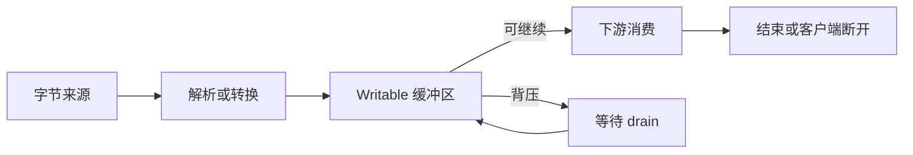

# Node.js HTTP 与流式服务手写题 H153–H178

<!-- Solution routes -->
先跟着代码写一遍，可读[HTTP 实现](workshop-node-http-lifecycle.md)和[流与背压](workshop-node-workers-streams.md)。下方练习再增加新约束。

导出接口需要把数百万行查询结果逐行编码为 NDJSON，再经 HTTP 返回。若先拼成一个大字符串，内存随结果总量增长；若忽略客户端断开，数据库游标仍继续读取；若把请求 chunk 当成业务记录，UTF-8 多字节字符可能被切坏。下面将这类问题拆成可判定的协议与流状态机练习。

先看典型数据路径：

阅读时跟踪三件事：字节边界不等于业务记录边界；写入返回 false 代表生产端应暂停；结束、错误与取消必须汇入唯一清理路径。机制出处见 [Node.js Stream](handwritten-practice-sources.md#s12)、[Node.js HTTP](handwritten-practice-sources.md#s13) 与 [HTTP 语义 RFC 9110](handwritten-practice-sources.md#s16)，这些链接解释机制，不证明招聘题源。

## 字节流与 HTTP 报文

### H153. 跨 chunk 解码 UTF-8 行记录

实现 decodeLines(source: AsyncIterable<Buffer>): AsyncIterable<string>，将 UTF-8 流按 LF 分成文本行，CRLF 去掉 CR，默认忽略最后一个空行。

Buffer 边界可落在多字节字符、CRLF 中间或行内；不得假设一次 data 事件对应一行；只保留当前未完成行，且单行上限固定为 64 KiB。解码采用 fatal=true，非法 UTF-8 拒绝整条流。

- 输入字节块依次为 E4 B8、AD 0A 41 0D、0A，输出严格为“中”和“A”，证明字符与 CRLF 可跨块。
- 输入 x 后正常结束，输出 x；输入以 LF 结尾不得凭空多产出一行空记录；非法 UTF-8 必须以 InvalidUtf8 拒绝，不能输出 U+FFFD。

使用 TextDecoder('utf-8',{fatal:true}) 的流式解码选项；在连续文本中识别 LF，对超长未完成行销毁来源并抛有类型错误。

行内容允许裸 CR 时如何区分数据字符与 CRLF？若必须保留末尾空记录，结束状态应如何改写？

难，35 分钟；要测 UTF-8 分片与末尾状态，不只是 ASCII。

<!-- Question record (index metadata)
- **题目契约：**实现 decodeLines(source: AsyncIterable<Buffer>): AsyncIterable<string>，将 UTF-8 流按 LF 分成文本行，CRLF 去掉 CR，默认忽略最后一个空行。
- **约束与不变量：**Buffer 边界可落在多字节字符、CRLF 中间或行内；不得假设一次 data 事件对应一行；只保留当前未完成行，且单行上限固定为 64 KiB。解码采用 fatal=true，非法 UTF-8 拒绝整条流。
- **用例 A：**输入字节块依次为 E4 B8、AD 0A 41 0D、0A，输出严格为“中”和“A”，证明字符与 CRLF 可跨块。
- **用例 B：**输入 x 后正常结束，输出 x；输入以 LF 结尾不得凭空多产出一行空记录；非法 UTF-8 必须以 InvalidUtf8 拒绝，不能输出 U+FFFD。
- **实现提示：**使用 TextDecoder('utf-8',{fatal:true}) 的流式解码选项；在连续文本中识别 LF，对超长未完成行销毁来源并抛有类型错误。
- **进阶追问：**行内容允许裸 CR 时如何区分数据字符与 CRLF？若必须保留末尾空记录，结束状态应如何改写？
- **难度 / 建议时长：**难，35 分钟；要测 UTF-8 分片与末尾状态，不只是 ASCII。
- **依据与状态：**作者原创派生练习，未实现/未实跑；增量解码机制参考 [Node Stream](handwritten-practice-sources.md#s12)。
-->

### H154. 内存阈值溢写临时文件的请求体 spooler

实现 spoolRequestBody(req, {memoryThreshold, hardLimit, tempDir})，返回 {size, openReadStream(), cleanup()}；阈值内保存在内存，越过阈值后把已有字节和后续 chunk 写入独占临时文件。

限制按实际收到字节计数且 hardLimit 大于 memoryThreshold；返回对象独占临时文件生命周期；成功、超限、请求错误或取消后 cleanup 幂等，异常路径自动删除文件。

- memoryThreshold=4、hardLimit=10，输入 3+3 字节后落盘，openReadStream 读回的 6 字节与输入完全相同，cleanup 后文件不存在。
- 声明 Content-Length=1、实际达到 11 字节时以 BodyTooLarge 拒绝且删除临时文件；声明 99、实际结束 2 字节则保留 2 字节并由上层报告协议长度不符。

首次溢出时安全创建临时文件，将已有内存块按序写入后释放数组；每块计 Buffer.length，写入遵循 Writable 背压。

落盘期间磁盘满或权限错误时如何 drain/销毁 IncomingMessage？成功返回后调用者异常退出时怎样确保 cleanup？

难，40 分钟；同时验收阈值切换、字节一致性、hard limit 和文件清理。

<!-- Question record (index metadata)
- **题目契约：**实现 spoolRequestBody(req, {memoryThreshold, hardLimit, tempDir})，返回 {size, openReadStream(), cleanup()}；阈值内保存在内存，越过阈值后把已有字节和后续 chunk 写入独占临时文件。
- **约束与不变量：**限制按实际收到字节计数且 hardLimit 大于 memoryThreshold；返回对象独占临时文件生命周期；成功、超限、请求错误或取消后 cleanup 幂等，异常路径自动删除文件。
- **用例 A：**memoryThreshold=4、hardLimit=10，输入 3+3 字节后落盘，openReadStream 读回的 6 字节与输入完全相同，cleanup 后文件不存在。
- **用例 B：**声明 Content-Length=1、实际达到 11 字节时以 BodyTooLarge 拒绝且删除临时文件；声明 99、实际结束 2 字节则保留 2 字节并由上层报告协议长度不符。
- **实现提示：**首次溢出时安全创建临时文件，将已有内存块按序写入后释放数组；每块计 Buffer.length，写入遵循 Writable 背压。
- **进阶追问：**落盘期间磁盘满或权限错误时如何 drain/销毁 IncomingMessage？成功返回后调用者异常退出时怎样确保 cleanup？
- **难度 / 建议时长：**难，40 分钟；同时验收阈值切换、字节一致性、hard limit 和文件清理。
- **依据与状态：**作者原创派生练习，未实现/未实跑；请求体语义参考 [Node HTTP](handwritten-practice-sources.md#s13) 与 [RFC 9110](handwritten-practice-sources.md#s16)。
-->

### H155. Accept-Encoding 加权协商器

实现 negotiateEncoding(header, available)，从服务器支持集合中返回一种 Content-Encoding 或 identity；解析 Accept-Encoding token、q 参数与 wildcard。

q 值范围 0 到 1 且最多三位小数；同权重按固定优先级 br > gzip > identity；缺失 header 视为任意编码可接受，空 header 仅接受 identity；显式 q=0 覆盖 wildcard。

- available={br,gzip,identity}，header=gzip;q=0.8, br;q=0.8 时返回 br；header 缺失时按服务器优先级返回 br。
- header 为空字符串时返回 identity；header=*;q=1, identity;q=0 且可用 gzip 时返回 gzip；若所有候选均 q=0 则返回 NotAcceptable。

先规范化编码 token 与 q 值，再计算候选有效质量；identity 默认可接受，wildcard 不覆盖显式条目。

重复 token 如何归并？缓存压缩和未压缩响应时为何需 Vary: Accept-Encoding？

难，35 分钟；覆盖缺失/空 header、wildcard、identity=0 和同权重。

<!-- Question record (index metadata)
- **题目契约：**实现 negotiateEncoding(header, available)，从服务器支持集合中返回一种 Content-Encoding 或 identity；解析 Accept-Encoding token、q 参数与 wildcard。
- **约束与不变量：**q 值范围 0 到 1 且最多三位小数；同权重按固定优先级 br > gzip > identity；缺失 header 视为任意编码可接受，空 header 仅接受 identity；显式 q=0 覆盖 wildcard。
- **用例 A：**available={br,gzip,identity}，header=gzip;q=0.8, br;q=0.8 时返回 br；header 缺失时按服务器优先级返回 br。
- **用例 B：**header 为空字符串时返回 identity；header=*;q=1, identity;q=0 且可用 gzip 时返回 gzip；若所有候选均 q=0 则返回 NotAcceptable。
- **实现提示：**先规范化编码 token 与 q 值，再计算候选有效质量；identity 默认可接受，wildcard 不覆盖显式条目。
- **进阶追问：**重复 token 如何归并？缓存压缩和未压缩响应时为何需 Vary: Accept-Encoding？
- **难度 / 建议时长：**难，35 分钟；覆盖缺失/空 header、wildcard、identity=0 和同权重。
- **依据与状态：**作者原创派生练习，未实现/未实跑；字节流机制参考 [Node Stream](handwritten-practice-sources.md#s12)。
-->

### H156. 代理响应的分帧冲突判定

实现 validateFraming(headers, context): { mode, length? }，对解析后的响应头判断 length、chunked 或无消息体；冲突与无效长度返回协议错误。

头名大小写无关且保留重复字段语义；不得同时按 Content-Length 与 chunked 终止；context 明确包含 method 与 status。

- headers={Content-Length:12}、context={method:GET,status:200} 返回 length=12；同一 headers 配 context={method:HEAD,status:200} 返回 none；context={method:GET,status:204} 也返回 none。
- Transfer-Encoding: chunked 同时出现 Content-Length: 12 时拒绝转发，映射为约定 502，不静默猜边界。

先规范化头名，再按 RFC 规则判重复值与优先级；策略函数不冒充线上 HTTP parser。

代理两端对非法报文采用不同宽容度会怎样影响请求走私风险？如何保证两端认定同一消息边界？

挑战，45 分钟；列清接受、拒绝和无 body 三种结果。

<!-- Question record (index metadata)
- **题目契约：**实现 validateFraming(headers, context): { mode, length? }，对解析后的响应头判断 length、chunked 或无消息体；冲突与无效长度返回协议错误。
- **约束与不变量：**头名大小写无关且保留重复字段语义；不得同时按 Content-Length 与 chunked 终止；context 明确包含 method 与 status。
- **用例 A：**headers={Content-Length:12}、context={method:GET,status:200} 返回 length=12；同一 headers 配 context={method:HEAD,status:200} 返回 none；context={method:GET,status:204} 也返回 none。
- **用例 B：**Transfer-Encoding: chunked 同时出现 Content-Length: 12 时拒绝转发，映射为约定 502，不静默猜边界。
- **实现提示：**先规范化头名，再按 RFC 规则判重复值与优先级；策略函数不冒充线上 HTTP parser。
- **进阶追问：**代理两端对非法报文采用不同宽容度会怎样影响请求走私风险？如何保证两端认定同一消息边界？
- **难度 / 建议时长：**挑战，45 分钟；列清接受、拒绝和无 body 三种结果。
- **依据与状态：**作者原创派生练习，未实现/未实跑；消息 framing 参考 [RFC 9110](handwritten-practice-sources.md#s16) 与 [Node HTTP](handwritten-practice-sources.md#s13)。
-->

### H157. Range 请求单区间计算器

实现 resolveRange(size: bigint, header: string)，只接受 bytes= 单区间，支持 start-end、start- 与 -suffix 三种写法。

索引用 BigInt；end 是包含式；结果满足 0≤start≤end<size；多区间、语法错误与不可满足应分别处理。

- size=100，bytes=10-19 得到 10 到 19 共 10 字节；bytes=-5 得到 95 到 99。
- size=0 或 size=100 时 bytes=100- 不可满足；多区间 bytes=1-2,4-5 因合同只支持单区间而拒绝，调用层返回 416。

十进制解析不转 Number；分离语法解析与裁剪计算，测试超大文件长度与 end 越界。

If-Range 验证器过期后为何可能退回完整 200？支持多区间会增加哪些缓冲和响应生成要求？

难，35 分钟；覆盖开区间、后缀和空文件。

<!-- Question record (index metadata)
- **题目契约：**实现 resolveRange(size: bigint, header: string)，只接受 bytes= 单区间，支持 start-end、start- 与 -suffix 三种写法。
- **约束与不变量：**索引用 BigInt；end 是包含式；结果满足 0≤start≤end<size；多区间、语法错误与不可满足应分别处理。
- **用例 A：**size=100，bytes=10-19 得到 10 到 19 共 10 字节；bytes=-5 得到 95 到 99。
- **用例 B：**size=0 或 size=100 时 bytes=100- 不可满足；多区间 bytes=1-2,4-5 因合同只支持单区间而拒绝，调用层返回 416。
- **实现提示：**十进制解析不转 Number；分离语法解析与裁剪计算，测试超大文件长度与 end 越界。
- **进阶追问：**If-Range 验证器过期后为何可能退回完整 200？支持多区间会增加哪些缓冲和响应生成要求？
- **难度 / 建议时长：**难，35 分钟；覆盖开区间、后缀和空文件。
- **依据与状态：**作者原创派生练习，未实现/未实跑；Range/206/416 语义参考 [RFC 9110](handwritten-practice-sources.md#s16)。
-->

### H158. 条件请求 ETag 决策器

实现 evaluateGet({method, ifNoneMatch, etag})，对 GET/HEAD 选择 200 或 304；非这两类方法返回“不适用”。

支持 * 与逗号分隔标签；If-None-Match 用弱比较；304 不带表示 body，但缓存元数据由响应层维护。

- 当前标签 W/"v7"，请求标签 "v7" 时返回 304；没有头或列表不匹配则返回 200。
- 资源存在且头为 * 时返回 304；POST 使用此 GET 决策器应明确不适用，不能误发 304。

先解析实体标签语法，再比较；不得对原始头做子串搜索，也不能将 ETag 当作授权凭据。

If-None-Match 与 If-Modified-Since 同时出现时的优先级是什么？弱标签适合验证字节完全相同吗？

中，30 分钟；验收标签列表、通配符与方法范围。

<!-- Question record (index metadata)
- **题目契约：**实现 evaluateGet({method, ifNoneMatch, etag})，对 GET/HEAD 选择 200 或 304；非这两类方法返回“不适用”。
- **约束与不变量：**支持 * 与逗号分隔标签；If-None-Match 用弱比较；304 不带表示 body，但缓存元数据由响应层维护。
- **用例 A：**当前标签 W/"v7"，请求标签 "v7" 时返回 304；没有头或列表不匹配则返回 200。
- **用例 B：**资源存在且头为 * 时返回 304；POST 使用此 GET 决策器应明确不适用，不能误发 304。
- **实现提示：**先解析实体标签语法，再比较；不得对原始头做子串搜索，也不能将 ETag 当作授权凭据。
- **进阶追问：**If-None-Match 与 If-Modified-Since 同时出现时的优先级是什么？弱标签适合验证字节完全相同吗？
- **难度 / 建议时长：**中，30 分钟；验收标签列表、通配符与方法范围。
- **依据与状态：**作者原创派生练习，未实现/未实跑；条件请求参考 [RFC 9110](handwritten-practice-sources.md#s16)。
-->

### H159. Writable 背压下的异步复制器

实现 copyWithLimit(src: Readable, dst: Writable, signal?): Promise<void>，按序复制字节；目标 write 返回 false 时等待 drain。

未确认的源数据最多一个 chunk；目标 error、源 error、目标 close、取消均只能结束 Promise 一次；成功要等目标完成，而非只等源 end。

- FakeWritable 首次 write 返回 false，发出 drain 后才允许读取第二块；最终字节与输入一致，最大待处理块数为 1。
- 等待 drain 时 AbortSignal 取消，Promise 以 AbortError 结束并 destroy 源和目标；随后 drain 不得恢复复制。

优先用 pipeline 接 AbortSignal；手写时需观察 finish、close、error 并明确半开流策略。

highWaterMark 是硬内存上限吗？广播场景下一个慢消费者是否应拖住其他消费者？

挑战，45 分钟；证明慢消费者能阻止继续读取。

<!-- Question record (index metadata)
- **题目契约：**实现 copyWithLimit(src: Readable, dst: Writable, signal?): Promise<void>，按序复制字节；目标 write 返回 false 时等待 drain。
- **约束与不变量：**未确认的源数据最多一个 chunk；目标 error、源 error、目标 close、取消均只能结束 Promise 一次；成功要等目标完成，而非只等源 end。
- **用例 A：**FakeWritable 首次 write 返回 false，发出 drain 后才允许读取第二块；最终字节与输入一致，最大待处理块数为 1。
- **用例 B：**等待 drain 时 AbortSignal 取消，Promise 以 AbortError 结束并 destroy 源和目标；随后 drain 不得恢复复制。
- **实现提示：**优先用 pipeline 接 AbortSignal；手写时需观察 finish、close、error 并明确半开流策略。
- **进阶追问：**highWaterMark 是硬内存上限吗？广播场景下一个慢消费者是否应拖住其他消费者？
- **难度 / 建议时长：**挑战，45 分钟；证明慢消费者能阻止继续读取。
- **依据与状态：**作者原创派生练习，未实现/未实跑；write/drain/pipeline 参考 [Node Stream](handwritten-practice-sources.md#s12)。
-->

### H160. Transform 有界批量聚合

实现 createBatchTransform({maxItems, flushMs})，最多 maxItems 条一批输出；不足一批在计时到期或流结束时输出。

批次不超限；flush 后 timer 不可重复输出；下游背压时不能继续无限接收；flush 与 destroy 竞态时 callback 只能一次。

- maxItems=3，输入 1、2、3、4，先输出 [1,2,3]，到期或 end 后输出 [4]。
- 未到期即 destroy，合同规定不输出未完成批次并清 timer；如果选择销毁时 flush，也需由另一合同明确验证。

实现 _transform 与 _flush 时严格一次调用 callback；用可控时钟测试；只保留一个有界窗口。

连续高流量时如何避免不断重置 timer？单条超大记录是否也要独立字节上限？

难，40 分钟；检查定时器、flush 与背压。

<!-- Question record (index metadata)
- **题目契约：**实现 createBatchTransform({maxItems, flushMs})，最多 maxItems 条一批输出；不足一批在计时到期或流结束时输出。
- **约束与不变量：**批次不超限；flush 后 timer 不可重复输出；下游背压时不能继续无限接收；flush 与 destroy 竞态时 callback 只能一次。
- **用例 A：**maxItems=3，输入 1、2、3、4，先输出 [1,2,3]，到期或 end 后输出 [4]。
- **用例 B：**未到期即 destroy，合同规定不输出未完成批次并清 timer；如果选择销毁时 flush，也需由另一合同明确验证。
- **实现提示：**实现 _transform 与 _flush 时严格一次调用 callback；用可控时钟测试；只保留一个有界窗口。
- **进阶追问：**连续高流量时如何避免不断重置 timer？单条超大记录是否也要独立字节上限？
- **难度 / 建议时长：**难，40 分钟；检查定时器、flush 与背压。
- **依据与状态：**作者原创派生练习，未实现/未实跑；Transform 与销毁机制参考 [Node Stream](handwritten-practice-sources.md#s12)。
-->

### H161. 客户端断开时关闭数据库游标

实现 streamRows(req, res, cursor, encode)，逐行写 NDJSON；请求或响应提前断开时调用 cursor.close 并停止读取。

每次只持有一行及一个待写块；响应关闭后不能再次 write/end；cursor.close 只调用一次，清理失败不能覆盖首个错误。

- 第三行 write 触发背压，客户端消费并 drain 后才读取第四行；正常结束时每行恰有一个 JSON 和 LF。
- 第二行等待 drain 时 response close，close 调用一次且 read 次数不再增加，记录为取消而非成功导出。

配合 write 布尔结果和 drain；绑定 aborted/close，区分正常 finish 与提前 close，在 finally 移除监听器。

游标一次预取 1000 行时如何控制内存？应用退出如何让导出有界收敛？

挑战，50 分钟；观测 read、close 次数与输出顺序。

<!-- Question record (index metadata)
- **题目契约：**实现 streamRows(req, res, cursor, encode)，逐行写 NDJSON；请求或响应提前断开时调用 cursor.close 并停止读取。
- **约束与不变量：**每次只持有一行及一个待写块；响应关闭后不能再次 write/end；cursor.close 只调用一次，清理失败不能覆盖首个错误。
- **用例 A：**第三行 write 触发背压，客户端消费并 drain 后才读取第四行；正常结束时每行恰有一个 JSON 和 LF。
- **用例 B：**第二行等待 drain 时 response close，close 调用一次且 read 次数不再增加，记录为取消而非成功导出。
- **实现提示：**配合 write 布尔结果和 drain；绑定 aborted/close，区分正常 finish 与提前 close，在 finally 移除监听器。
- **进阶追问：**游标一次预取 1000 行时如何控制内存？应用退出如何让导出有界收敛？
- **难度 / 建议时长：**挑战，50 分钟；观测 read、close 次数与输出顺序。
- **依据与状态：**作者原创派生练习，未实现/未实跑；响应生命周期见 [Node HTTP](handwritten-practice-sources.md#s13) 与 [Node Stream](handwritten-practice-sources.md#s12)。
-->

### H162. HTTP Server 优雅关闭协调器

实现 shutdown(server, {graceMs, abortActive})，停止接新连接，等待请求结束，超时后按配置取消剩余请求。

重复调用返回同一个关闭 Promise；新连接不进入 handler；空闲 keep-alive socket 与活动连接分开处理；强制关闭数可观察。

- 请求 100ms 内结束、宽限 500ms，关闭完成且 forced=0；关闭开始后不接新业务请求。
- 请求不结束、宽限 20ms 且 abortActive=true，超时后销毁 socket 并完成，不能伪报业务成功。

区分 server.close、closeIdleConnections 与 closeAllConnections；活动集合按 request/socket 生命周期增删，强制路径只运行一次。

HTTP/2 连接关闭与拒绝新 stream 有何差异？SIGTERM 后如何为日志 flush 留时间？

挑战，45 分钟；验收宽限与强制两条时序。

<!-- Question record (index metadata)
- **题目契约：**实现 shutdown(server, {graceMs, abortActive})，停止接新连接，等待请求结束，超时后按配置取消剩余请求。
- **约束与不变量：**重复调用返回同一个关闭 Promise；新连接不进入 handler；空闲 keep-alive socket 与活动连接分开处理；强制关闭数可观察。
- **用例 A：**请求 100ms 内结束、宽限 500ms，关闭完成且 forced=0；关闭开始后不接新业务请求。
- **用例 B：**请求不结束、宽限 20ms 且 abortActive=true，超时后销毁 socket 并完成，不能伪报业务成功。
- **实现提示：**区分 server.close、closeIdleConnections 与 closeAllConnections；活动集合按 request/socket 生命周期增删，强制路径只运行一次。
- **进阶追问：**HTTP/2 连接关闭与拒绝新 stream 有何差异？SIGTERM 后如何为日志 flush 留时间？
- **难度 / 建议时长：**挑战，45 分钟；验收宽限与强制两条时序。
- **依据与状态：**作者原创派生练习，未实现/未实跑；Server 关闭 API 参考 [Node HTTP](handwritten-practice-sources.md#s13)。
-->

### H163. SSE 心跳与慢客户端隔离

实现 openEventStream(req, res, events, {heartbeatMs})，按 SSE 输出事件与心跳注释，返回关闭函数并在断开后取消订阅。

事件字段换行必须编码；每客户端最多排队 20 个事件，产生第 21 个待写事件时立即以 SlowConsumer 销毁该响应并解除订阅；每连接队列独立。

- 事件 id=8、name=price、data 含换行，输出两条 data 行和正确字段；定时到期输出注释行。
- 客户端不消费，队列超 20 项后连接结束且订阅解除一次；另一个客户端继续收到事件。

每连接维护写入状态和有界队列；close/finish 清理单个心跳 timer，按 UTF-8 bytes 限制单条事件大小。

代理缓冲会如何影响实时性？Last-Event-ID 重放可能重复，客户端怎样去重？

难，40 分钟；同时验证格式、队列上限与资源释放。

<!-- Question record (index metadata)
- **题目契约：**实现 openEventStream(req, res, events, {heartbeatMs})，按 SSE 输出事件与心跳注释，返回关闭函数并在断开后取消订阅。
- **约束与不变量：**事件字段换行必须编码；每客户端最多排队 20 个事件，产生第 21 个待写事件时立即以 SlowConsumer 销毁该响应并解除订阅；每连接队列独立。
- **用例 A：**事件 id=8、name=price、data 含换行，输出两条 data 行和正确字段；定时到期输出注释行。
- **用例 B：**客户端不消费，队列超 20 项后连接结束且订阅解除一次；另一个客户端继续收到事件。
- **实现提示：**每连接维护写入状态和有界队列；close/finish 清理单个心跳 timer，按 UTF-8 bytes 限制单条事件大小。
- **进阶追问：**代理缓冲会如何影响实时性？Last-Event-ID 重放可能重复，客户端怎样去重？
- **难度 / 建议时长：**难，40 分钟；同时验证格式、队列上限与资源释放。
- **依据与状态：**作者原创派生练习，未实现/未实跑；响应写入参考 [Node HTTP](handwritten-practice-sources.md#s13)。
-->

### H164. 可取消的上游代理请求

实现 proxyRequest(inReq, outRes, target, transport)，转发允许头和 body，并流式传递上游状态、允许头和 body。

target 来自路由配置而非用户 Host；任一端断开时取消另一端；过滤 hop-by-hop 字段；headersSent 后不可再改状态。

- 上游返回 201 与分块 4KB body，客户端得到相同状态和有序字节，代理不缓存整个响应。
- 首块到达前客户端断开，transport 收到取消信号；上游 503 且下游尚未发头时按合同映射 502。

使用双方共享的取消控制器，按 allowlist 复制头，区分 header、body、finish、close 事件。

Upgrade、Trailer、重定向和压缩如何处理？target 经 DNS 解析到内网时还需哪些网络约束？

挑战，50 分钟；重点在生命周期与头部策略，不写完整代理产品。

<!-- Question record (index metadata)
- **题目契约：**实现 proxyRequest(inReq, outRes, target, transport)，转发允许头和 body，并流式传递上游状态、允许头和 body。
- **约束与不变量：**target 来自路由配置而非用户 Host；任一端断开时取消另一端；过滤 hop-by-hop 字段；headersSent 后不可再改状态。
- **用例 A：**上游返回 201 与分块 4KB body，客户端得到相同状态和有序字节，代理不缓存整个响应。
- **用例 B：**首块到达前客户端断开，transport 收到取消信号；上游 503 且下游尚未发头时按合同映射 502。
- **实现提示：**使用双方共享的取消控制器，按 allowlist 复制头，区分 header、body、finish、close 事件。
- **进阶追问：**Upgrade、Trailer、重定向和压缩如何处理？target 经 DNS 解析到内网时还需哪些网络约束？
- **难度 / 建议时长：**挑战，50 分钟；重点在生命周期与头部策略，不写完整代理产品。
- **依据与状态：**作者原创派生练习，未实现/未实跑；代理语义参考 [Node HTTP](handwritten-practice-sources.md#s13) 与 [RFC 9110](handwritten-practice-sources.md#s16)。
-->

## 路由与响应适配

### H165. 无歧义的路由模板匹配器

实现 matchRoute(method, pattern, requestUrl)，支持字面段和 :name 单段参数，不支持任意 regex 通配。

方法大小写无关；百分号解码失败要拒绝；编码斜杠不得静默变成路径分隔符；静态/参数冲突有确定优先级。

- GET /teams/:teamId/members/:id 匹配 /teams/a/members/7，参数分别为 a、7；忽略 pathname 尾部一个斜杠，因此 /teams/a/members/7/ 也匹配。
- /teams/a%2Fb/members/7 不可解码成跨段权限边界；%ZZ 返回 400 类错误，不视作普通字符串。

将模板编译为已转义段数组；先解析 pathname，再逐段解码校验，不把原始路由拼入 regex。

重复参数名、可选段和通配如何保持优先级稳定？HEAD 如何复用 GET 又抑制 body？

中，30 分钟；测编码分隔符、方法和路由冲突。

<!-- Question record (index metadata)
- **题目契约：**实现 matchRoute(method, pattern, requestUrl)，支持字面段和 :name 单段参数，不支持任意 regex 通配。
- **约束与不变量：**方法大小写无关；百分号解码失败要拒绝；编码斜杠不得静默变成路径分隔符；静态/参数冲突有确定优先级。
- **用例 A：**GET /teams/:teamId/members/:id 匹配 /teams/a/members/7，参数分别为 a、7；忽略 pathname 尾部一个斜杠，因此 /teams/a/members/7/ 也匹配。
- **用例 B：**/teams/a%2Fb/members/7 不可解码成跨段权限边界；%ZZ 返回 400 类错误，不视作普通字符串。
- **实现提示：**将模板编译为已转义段数组；先解析 pathname，再逐段解码校验，不把原始路由拼入 regex。
- **进阶追问：**重复参数名、可选段和通配如何保持优先级稳定？HEAD 如何复用 GET 又抑制 body？
- **难度 / 建议时长：**中，30 分钟；测编码分隔符、方法和路由冲突。
- **依据与状态：**作者原创派生练习，未实现/未实跑；请求解析入口参考 [Node HTTP](handwritten-practice-sources.md#s13)。
-->

### H166. 中间件组合与 next 双调用检测

实现 compose(middleware) 返回 handler(ctx)，中间件为 (ctx, next) => Promise<void>，按注册顺序进入、逆序退出。

每个 next 至多调用一次；漏 await 的行为要写明；下游异常向外传播，不能因遗漏 await 而丢失。

- 三个中间件记录 a+、b+、c+ 并等待 next，日志精确为 a+、b+、c+、c-、b-、a-。
- 第二层调用 next 两次，handler 以明确错误拒绝；下游 reject 可被最外层 catch 观察到同一个原因。

递归 dispatch(index) 并记录最高已进入索引，禁止索引倒退；本题测请求控制流，不实现并发池。

next 返回值是否传递？请求结束后的 timer 再调用 next 应怎样处理？响应已提交后异常能否转成 500？

中，25 分钟；顺序日志可直接判正确性。

<!-- Question record (index metadata)
- **题目契约：**实现 compose(middleware) 返回 handler(ctx)，中间件为 (ctx, next) => Promise<void>，按注册顺序进入、逆序退出。
- **约束与不变量：**每个 next 至多调用一次；漏 await 的行为要写明；下游异常向外传播，不能因遗漏 await 而丢失。
- **用例 A：**三个中间件记录 a+、b+、c+ 并等待 next，日志精确为 a+、b+、c+、c-、b-、a-。
- **用例 B：**第二层调用 next 两次，handler 以明确错误拒绝；下游 reject 可被最外层 catch 观察到同一个原因。
- **实现提示：**递归 dispatch(index) 并记录最高已进入索引，禁止索引倒退；本题测请求控制流，不实现并发池。
- **进阶追问：**next 返回值是否传递？请求结束后的 timer 再调用 next 应怎样处理？响应已提交后异常能否转成 500？
- **难度 / 建议时长：**中，25 分钟；顺序日志可直接判正确性。
- **依据与状态：**作者原创派生练习，未实现/未实跑；请求和响应生命周期参考 [Node HTTP](handwritten-practice-sources.md#s13)。
-->

### H167. HEAD、OPTIONS 与 405 判定器

实现 resolveMethod(path, method, routes)，返回 200/204/405/404、Allow 列表及实际 handler 方法。

路径存在而 method 不支持返回 405 和 Allow；路径不存在为 404；HEAD 可复用 GET 逻辑但必须无 body。

- 仅注册 GET /items，HEAD 复用 GET，表示头一致且 body 为空；OPTIONS Allow 含 GET、HEAD、OPTIONS。
- POST /unknown 为 404；POST /items 为 405，Allow 精确列出方法且不改变状态。

先判路径再判方法；Allow 用固定顺序输出；在统一 response adapter 抑制 HEAD body。

CORS 预检与通用 OPTIONS 有何区别？隐式 HEAD 回退会给审计带来什么误解？

中，25 分钟；覆盖 404、405、HEAD body。

<!-- Question record (index metadata)
- **题目契约：**实现 resolveMethod(path, method, routes)，返回 200/204/405/404、Allow 列表及实际 handler 方法。
- **约束与不变量：**路径存在而 method 不支持返回 405 和 Allow；路径不存在为 404；HEAD 可复用 GET 逻辑但必须无 body。
- **用例 A：**仅注册 GET /items，HEAD 复用 GET，表示头一致且 body 为空；OPTIONS Allow 含 GET、HEAD、OPTIONS。
- **用例 B：**POST /unknown 为 404；POST /items 为 405，Allow 精确列出方法且不改变状态。
- **实现提示：**先判路径再判方法；Allow 用固定顺序输出；在统一 response adapter 抑制 HEAD body。
- **进阶追问：**CORS 预检与通用 OPTIONS 有何区别？隐式 HEAD 回退会给审计带来什么误解？
- **难度 / 建议时长：**中，25 分钟；覆盖 404、405、HEAD body。
- **依据与状态：**作者原创派生练习，未实现/未实跑；方法和 Allow 语义参考 [RFC 9110](handwritten-practice-sources.md#s16)。
-->

### H168. headersSent 边界的统一错误响应

实现 handleRouteError(err, req, res, log)，已知错误映射稳定状态码和安全 body，未知错误映射通用 500。

客户端不收到 stack、SQL 或内部路径；每请求只响应一次；取消错误单独计数；已发头后不能重写状态。

- 抛 NotFound 且 headersSent=false，返回 404 JSON code=NOT_FOUND，日志含 requestId 与错误类别。
- 写出部分 200 body 再抛错，不得再 writeHead(500)；连接销毁并记录 response_started=true。

用白名单映射错误类；依据 ServerResponse.headersSent 选择状态响应或终止连接；request-local settled 防双写。

如何在不泄漏 token 时保留排错上下文？异步事件回调抛错为何可能绕开 handler Promise？

中，30 分钟；验收响应次数、状态和日志字段。

<!-- Question record (index metadata)
- **题目契约：**实现 handleRouteError(err, req, res, log)，已知错误映射稳定状态码和安全 body，未知错误映射通用 500。
- **约束与不变量：**客户端不收到 stack、SQL 或内部路径；每请求只响应一次；取消错误单独计数；已发头后不能重写状态。
- **用例 A：**抛 NotFound 且 headersSent=false，返回 404 JSON code=NOT_FOUND，日志含 requestId 与错误类别。
- **用例 B：**写出部分 200 body 再抛错，不得再 writeHead(500)；连接销毁并记录 response_started=true。
- **实现提示：**用白名单映射错误类；依据 ServerResponse.headersSent 选择状态响应或终止连接；request-local settled 防双写。
- **进阶追问：**如何在不泄漏 token 时保留排错上下文？异步事件回调抛错为何可能绕开 handler Promise？
- **难度 / 建议时长：**中，30 分钟；验收响应次数、状态和日志字段。
- **依据与状态：**作者原创派生练习，未实现/未实跑；headersSent 与响应状态参考 [Node HTTP](handwritten-practice-sources.md#s13)。
-->

### H169. HTTP 请求超时分层策略

实现 configureTimeouts(server, {headersMs, requestMs, idleMs, handlerMs}) 和 withDeadline(handler, ms)，区分报头、body、空闲与业务超时。

头读取超时不等于 handler 超时；deadline 从入口开始，完成后 timer 清理；客户端断开应取消业务工作。

- 头 100ms 到齐、handler 50ms 完成，headersMs=200、handlerMs=100，返回 200 且 timer 数归零。
- 头慢于 headersMs 时 handler 不启动；handler 超 deadline 映射 504 并触发下游 AbortSignal。

使用单调时钟算剩余时间；Node server timeout 与业务 deadline 分开配置并记录命中层。

数据库超时、handler deadline 和代理超时应如何排序以免留下孤儿查询？

难，40 分钟；假时钟验证清理和取消顺序。

<!-- Question record (index metadata)
- **题目契约：**实现 configureTimeouts(server, {headersMs, requestMs, idleMs, handlerMs}) 和 withDeadline(handler, ms)，区分报头、body、空闲与业务超时。
- **约束与不变量：**头读取超时不等于 handler 超时；deadline 从入口开始，完成后 timer 清理；客户端断开应取消业务工作。
- **用例 A：**头 100ms 到齐、handler 50ms 完成，headersMs=200、handlerMs=100，返回 200 且 timer 数归零。
- **用例 B：**头慢于 headersMs 时 handler 不启动；handler 超 deadline 映射 504 并触发下游 AbortSignal。
- **实现提示：**使用单调时钟算剩余时间；Node server timeout 与业务 deadline 分开配置并记录命中层。
- **进阶追问：**数据库超时、handler deadline 和代理超时应如何排序以免留下孤儿查询？
- **难度 / 建议时长：**难，40 分钟；假时钟验证清理和取消顺序。
- **依据与状态：**作者原创派生练习，未实现/未实跑；Server 超时参考 [Node HTTP](handwritten-practice-sources.md#s13)。
-->

### H170. 安全的响应头白名单复制

实现 copyResponseHeaders(upstream, allowlist, context)，代理复制允许的 end-to-end header，并剔除 Connection 声明的 hop-by-hop 字段。

头名不区分大小写；Connection 所列字段也必须删；Set-Cookie 多值不可错误逗号合并；body 被转换后不可沿用旧 Content-Length。

- allowlist 含 Content-Type、Cache-Control、Set-Cookie，Connection 声明 x-hop，上游 X-Hop 不出现在结果。
- 本题 allowlist 明确含 Set-Cookie；两个 Set-Cookie 保持数组。代理解压 body 后不得保留原 Content-Length。

先收集 Connection tokens，再合并固定 hop-by-hop 集合过滤；allowlist 由服务配置提供。

修改 Content-Encoding 后 ETag 是否仍有效？哪些响应头会影响缓存或跨域边界，应另设业务策略？

难，35 分钟；检查动态 token 与多值头。

<!-- Question record (index metadata)
- **题目契约：**实现 copyResponseHeaders(upstream, allowlist, context)，代理复制允许的 end-to-end header，并剔除 Connection 声明的 hop-by-hop 字段。
- **约束与不变量：**头名不区分大小写；Connection 所列字段也必须删；Set-Cookie 多值不可错误逗号合并；body 被转换后不可沿用旧 Content-Length。
- **用例 A：**allowlist 含 Content-Type、Cache-Control、Set-Cookie，Connection 声明 x-hop，上游 X-Hop 不出现在结果。
- **用例 B：**本题 allowlist 明确含 Set-Cookie；两个 Set-Cookie 保持数组。代理解压 body 后不得保留原 Content-Length。
- **实现提示：**先收集 Connection tokens，再合并固定 hop-by-hop 集合过滤；allowlist 由服务配置提供。
- **进阶追问：**修改 Content-Encoding 后 ETag 是否仍有效？哪些响应头会影响缓存或跨域边界，应另设业务策略？
- **难度 / 建议时长：**难，35 分钟；检查动态 token 与多值头。
- **依据与状态：**作者原创派生练习，未实现/未实跑；头字段语义参考 [RFC 9110](handwritten-practice-sources.md#s16) 与 [Node HTTP](handwritten-practice-sources.md#s13)。
-->

### H171. Expect 头的早期准入

实现 checkContinue(req, res, authorize, maxBytes)，先检查身份与预估体积，再发送 100 Continue 或最终拒绝。

拒绝前不调用 writeContinue；缺失或伪造 Content-Length 时仍计量真实字节；失败鉴权不能先吞完整大 body。

- 授权通过且长度 2048、上限 4096，先发一次 100 Continue 再收完 body，handler 收到 2048 bytes。
- 鉴权失败时直接发 401；授权通过但声明长度 5000 且上限 4096 时发 413；两种分支 writeContinue 次数均为 0，body parser 不运行。

接 Server 的 checkContinue，避免普通 request handler 重复接管；准入与真实流量限制都保留。

客户端没发 Expect 时如何维持相同限制？100 Continue 后客户端不发 body，谁负责回收连接？

中，30 分钟；按事件序列断言写头顺序。

<!-- Question record (index metadata)
- **题目契约：**实现 checkContinue(req, res, authorize, maxBytes)，先检查身份与预估体积，再发送 100 Continue 或最终拒绝。
- **约束与不变量：**拒绝前不调用 writeContinue；缺失或伪造 Content-Length 时仍计量真实字节；失败鉴权不能先吞完整大 body。
- **用例 A：**授权通过且长度 2048、上限 4096，先发一次 100 Continue 再收完 body，handler 收到 2048 bytes。
- **用例 B：**鉴权失败时直接发 401；授权通过但声明长度 5000 且上限 4096 时发 413；两种分支 writeContinue 次数均为 0，body parser 不运行。
- **实现提示：**接 Server 的 checkContinue，避免普通 request handler 重复接管；准入与真实流量限制都保留。
- **进阶追问：**客户端没发 Expect 时如何维持相同限制？100 Continue 后客户端不发 body，谁负责回收连接？
- **难度 / 建议时长：**中，30 分钟；按事件序列断言写头顺序。
- **依据与状态：**作者原创派生练习，未实现/未实跑；checkContinue 机制见 [Node HTTP](handwritten-practice-sources.md#s13) 与 [RFC 9110](handwritten-practice-sources.md#s16)。
-->

### H172. 请求 ID 异步上下文关联

实现 withRequestContext(server, makeId, handler)，每个请求创建或校验 requestId，使 handler 子 Promise 与日志函数读取同一 ID。

外部 ID 限制字符和长度，阻止日志控制字符注入；并发请求隔离；上下文不能被长期队列任务意外保留。

- 并发 A/B 请求各启动两个延时 Promise，四条日志分别使用各自 ID，响应头回显规范化 ID。
- 输入含 CRLF 的 x-request-id 时一律拒绝该 header，并由 makeId 生成服务端 ID；日志仍一行一事件且含 rejected_external_id=true。

可用 AsyncLocalStorage，说明 run 的生命周期；请求结束后不可把 store 放在全局 Map 泄漏。

worker thread 与消息队列是否自动传上下文？跨服务 trace ID 和客户端 request ID 有何区别？

难，35 分钟；测隔离、头校验和请求后引用清理。

<!-- Question record (index metadata)
- **题目契约：**实现 withRequestContext(server, makeId, handler)，每个请求创建或校验 requestId，使 handler 子 Promise 与日志函数读取同一 ID。
- **约束与不变量：**外部 ID 限制字符和长度，阻止日志控制字符注入；并发请求隔离；上下文不能被长期队列任务意外保留。
- **用例 A：**并发 A/B 请求各启动两个延时 Promise，四条日志分别使用各自 ID，响应头回显规范化 ID。
- **用例 B：**输入含 CRLF 的 x-request-id 时一律拒绝该 header，并由 makeId 生成服务端 ID；日志仍一行一事件且含 rejected_external_id=true。
- **实现提示：**可用 AsyncLocalStorage，说明 run 的生命周期；请求结束后不可把 store 放在全局 Map 泄漏。
- **进阶追问：**worker thread 与消息队列是否自动传上下文？跨服务 trace ID 和客户端 request ID 有何区别？
- **难度 / 建议时长：**难，35 分钟；测隔离、头校验和请求后引用清理。
- **依据与状态：**作者原创派生练习，未实现/未实跑；HTTP 生命周期见 [Node HTTP](handwritten-practice-sources.md#s13)。
-->

## multipart 与 BFF 边界

### H173. multipart/form-data 境界扫描器

实现 parseMultipart(source, boundary, limits): AsyncIterable<Part>，输出每段 headers 和可消费 body stream；不要求完整 MIME 实现。

boundary 可跨 chunk；body 可能含 boundary 的部分前缀；header、段数和总字节各有上限；文件 body 不整段聚合。

- boundary 切在 --bo 与 undary 后仍解析出字段和文件，字段文本与文件字节完全一致。
- 文件含像 boundary 的部分前缀、后续却非合法结束时，候选字节保留在文件内容；超限 header 在产出 part 前失败。

状态分为 preamble、headers、body、closing；扫描时保留最多 boundary 长度减一的尾部。

嵌套 multipart 是否在合同内？客户端断连时 part consumer 与 parser 如何共同取消？

挑战，60 分钟；证明伪匹配不丢字节。

<!-- Question record (index metadata)
- **题目契约：**实现 parseMultipart(source, boundary, limits): AsyncIterable<Part>，输出每段 headers 和可消费 body stream；不要求完整 MIME 实现。
- **约束与不变量：**boundary 可跨 chunk；body 可能含 boundary 的部分前缀；header、段数和总字节各有上限；文件 body 不整段聚合。
- **用例 A：**boundary 切在 --bo 与 undary 后仍解析出字段和文件，字段文本与文件字节完全一致。
- **用例 B：**文件含像 boundary 的部分前缀、后续却非合法结束时，候选字节保留在文件内容；超限 header 在产出 part 前失败。
- **实现提示：**状态分为 preamble、headers、body、closing；扫描时保留最多 boundary 长度减一的尾部。
- **进阶追问：**嵌套 multipart 是否在合同内？客户端断连时 part consumer 与 parser 如何共同取消？
- **难度 / 建议时长：**挑战，60 分钟；证明伪匹配不丢字节。
- **依据与状态：**作者原创派生练习，未实现/未实跑；流机制参考 [Node Stream](handwritten-practice-sources.md#s12)。
-->

### H174. multipart 元数据先行校验导入

实现 ingestForm(parts, validateMeta, writeTemp, commit)，要求一个 JSON 元数据段先出现，后接最多一个文件段，完成后提交。

元数据未过 schema 前不创建临时文件；超限、中断或校验失败删除临时文件；commit 是唯一成功点。

- 合法 meta 后接三块文件字节、boundary 和 EOF 完整，临时写入按序发生且 commit 一次。
- 文件早于 meta 或出现第二个 meta 必须拒绝；如已建临时文件，cleanup 一次且 commit=0。

parser 与业务用 async iterator 衔接；meta 上限小于文件上限；临时名由服务生成，cleanup 放 finally。

文件 rename 成功、数据库事务失败怎样避免孤儿文件？非原子存储之间如何设计补偿？

难，45 分钟；关注顺序约束、临时资源与提交交界。

<!-- Question record (index metadata)
- **题目契约：**实现 ingestForm(parts, validateMeta, writeTemp, commit)，要求一个 JSON 元数据段先出现，后接最多一个文件段，完成后提交。
- **约束与不变量：**元数据未过 schema 前不创建临时文件；超限、中断或校验失败删除临时文件；commit 是唯一成功点。
- **用例 A：**合法 meta 后接三块文件字节、boundary 和 EOF 完整，临时写入按序发生且 commit 一次。
- **用例 B：**文件早于 meta 或出现第二个 meta 必须拒绝；如已建临时文件，cleanup 一次且 commit=0。
- **实现提示：**parser 与业务用 async iterator 衔接；meta 上限小于文件上限；临时名由服务生成，cleanup 放 finally。
- **进阶追问：**文件 rename 成功、数据库事务失败怎样避免孤儿文件？非原子存储之间如何设计补偿？
- **难度 / 建议时长：**难，45 分钟；关注顺序约束、临时资源与提交交界。
- **依据与状态：**作者原创派生练习，未实现/未实跑；流消费见 [Node Stream](handwritten-practice-sources.md#s12)，HTTP 语义见 [RFC 9110](handwritten-practice-sources.md#s16)。
-->

### H175. GraphQL BFF 字段授权与批取

实现 resolveDashboard(ctx, userId, loaders)，读取可见 dashboard、项目和成员；loader.load(key) 按请求批量查询。

授权发生于服务端数据返回前；loader 缓存只限单请求；同批重复 key 可复用结果，但输出与输入 key 顺序相同。

- 一个 query 的 20 个项目查 owner，loader 只执行一次批查询；删除项对应 null，其他项顺序不变。
- 用户 A 的请求结束后，用户 B 查询相同 projectId 不得读取 A 的 loader 缓存；无权字段固定为 null，其他有权字段仍可返回。

收集同 tick keys，用批量 SQL 查询后建 key 索引；授权谓词要含 tenant/user 条件。

怎样限制 query depth/cost？部分 resolver 失败时如何兼顾字段可用和错误信息安全？

难，45 分钟；验证批次数、顺序、授权和缓存作用域。

<!-- Question record (index metadata)
- **题目契约：**实现 resolveDashboard(ctx, userId, loaders)，读取可见 dashboard、项目和成员；loader.load(key) 按请求批量查询。
- **约束与不变量：**授权发生于服务端数据返回前；loader 缓存只限单请求；同批重复 key 可复用结果，但输出与输入 key 顺序相同。
- **用例 A：**一个 query 的 20 个项目查 owner，loader 只执行一次批查询；删除项对应 null，其他项顺序不变。
- **用例 B：**用户 A 的请求结束后，用户 B 查询相同 projectId 不得读取 A 的 loader 缓存；无权字段固定为 null，其他有权字段仍可返回。
- **实现提示：**收集同 tick keys，用批量 SQL 查询后建 key 索引；授权谓词要含 tenant/user 条件。
- **进阶追问：**怎样限制 query depth/cost？部分 resolver 失败时如何兼顾字段可用和错误信息安全？
- **难度 / 建议时长：**难，45 分钟；验证批次数、顺序、授权和缓存作用域。
- **依据与状态：**作者原创派生练习，未实现/未实跑；HTTP 边界参考 [Node HTTP](handwritten-practice-sources.md#s13)。
-->

### H176. BFF 聚合总 deadline 与部分结果

实现 getCompositePage(ctx, clients, deadlineMs)，请求 profile、permissions、recommendations，按依赖分级返回完整或标明降级结果。

总 deadline 从入口统一计算；权限服务超时则失败，推荐服务超时可返回空数组和 degraded 标记；取消后不得继续写响应。

- 依赖分别在 20、30、70ms 完成，deadline 100ms，返回完整对象并记录各自耗时。
- deadline=50ms、推荐 80ms 超时则降级；权限服务超时则 503 并取消其他未完成调用。

共享 AbortSignal，按剩余预算派生子 deadline；归类 settled 结果，不做无条件重试。

取消能否真正中断下游？遗留 client 不支持取消时如何避免占满连接？

难，40 分钟；以可控时钟与 fake client 验证依赖等级。

<!-- Question record (index metadata)
- **题目契约：**实现 getCompositePage(ctx, clients, deadlineMs)，请求 profile、permissions、recommendations，按依赖分级返回完整或标明降级结果。
- **约束与不变量：**总 deadline 从入口统一计算；权限服务超时则失败，推荐服务超时可返回空数组和 degraded 标记；取消后不得继续写响应。
- **用例 A：**依赖分别在 20、30、70ms 完成，deadline 100ms，返回完整对象并记录各自耗时。
- **用例 B：**deadline=50ms、推荐 80ms 超时则降级；权限服务超时则 503 并取消其他未完成调用。
- **实现提示：**共享 AbortSignal，按剩余预算派生子 deadline；归类 settled 结果，不做无条件重试。
- **进阶追问：**取消能否真正中断下游？遗留 client 不支持取消时如何避免占满连接？
- **难度 / 建议时长：**难，40 分钟；以可控时钟与 fake client 验证依赖等级。
- **依据与状态：**作者原创派生练习，未实现/未实跑；请求生命周期参考 [Node HTTP](handwritten-practice-sources.md#s13) 与 [RFC 9110](handwritten-practice-sources.md#s16)。
-->

### H177. Webhook 原始 body 签名接收器

实现 receiveWebhook(req, verifyWithStandardCrypto, dispatch)，JSON 解析前按原始字节和签名头验签，成功才交付事件。

调用标准 crypto API 或成熟库，不手写密码学；原始 body 有大小限制；签名比较用常量时间 API；失败不解析、不分发。

- 标准库依据固定测试密钥生成的签名对应原始字节，接收器通过验证且 dispatch 一次，Unicode 字节未被改写。
- 仅 JSON 空格不同但签名未更新时拒绝；缺签名、编码无效或超限均不调用 dispatch。

先有界收集 Buffer，再验签，再 JSON.parse；key id 与算法按固定白名单选择，不由请求决定。

怎样防重放？验签后进程在落库前崩溃，如何恢复事件处理？

难，40 分钟；只验接收顺序，不替代供应商 SDK 安全策略。

<!-- Question record (index metadata)
- **题目契约：**实现 receiveWebhook(req, verifyWithStandardCrypto, dispatch)，JSON 解析前按原始字节和签名头验签，成功才交付事件。
- **约束与不变量：**调用标准 crypto API 或成熟库，不手写密码学；原始 body 有大小限制；签名比较用常量时间 API；失败不解析、不分发。
- **用例 A：**标准库依据固定测试密钥生成的签名对应原始字节，接收器通过验证且 dispatch 一次，Unicode 字节未被改写。
- **用例 B：**仅 JSON 空格不同但签名未更新时拒绝；缺签名、编码无效或超限均不调用 dispatch。
- **实现提示：**先有界收集 Buffer，再验签，再 JSON.parse；key id 与算法按固定白名单选择，不由请求决定。
- **进阶追问：**怎样防重放？验签后进程在落库前崩溃，如何恢复事件处理？
- **难度 / 建议时长：**难，40 分钟；只验接收顺序，不替代供应商 SDK 安全策略。
- **依据与状态：**作者原创派生练习，未实现/未实跑；原始请求及响应语义参考 [Node HTTP](handwritten-practice-sources.md#s13)。
-->

### H178. HTTP 适配器协议验收桩

实现 assertHttpExchange(server, scenario): Promise<Observation>，启动本地服务并记录状态、headers、chunks 与 finish/close 次序。

区分完整结束、客户端取消和超时；端口由系统分配；不依赖公网或毫秒级精确调度假设。

- GET /health 返回 200，Content-Length 等于 body 字节数；测试结束关闭监听 socket 且无活动句柄。
- 客户端收到首块后 destroy，Observation 标记 clientClosed，取消钩子触发一次，不把未完成响应记为成功。

用 Node http.request 观测 response/socket 生命周期；事件日志用单调序号；结束时 await server.close 清理。

如何模拟慢读造成的背压？协议测试与单测边界在哪些断言上不同？

中，30 分钟；验收重复执行、无端口冲突和无资源泄漏。

<!-- Question record (index metadata)
- **题目契约：**实现 assertHttpExchange(server, scenario): Promise<Observation>，启动本地服务并记录状态、headers、chunks 与 finish/close 次序。
- **约束与不变量：**区分完整结束、客户端取消和超时；端口由系统分配；不依赖公网或毫秒级精确调度假设。
- **用例 A：**GET /health 返回 200，Content-Length 等于 body 字节数；测试结束关闭监听 socket 且无活动句柄。
- **用例 B：**客户端收到首块后 destroy，Observation 标记 clientClosed，取消钩子触发一次，不把未完成响应记为成功。
- **实现提示：**用 Node http.request 观测 response/socket 生命周期；事件日志用单调序号；结束时 await server.close 清理。
- **进阶追问：**如何模拟慢读造成的背压？协议测试与单测边界在哪些断言上不同？
- **难度 / 建议时长：**中，30 分钟；验收重复执行、无端口冲突和无资源泄漏。
- **依据与状态：**作者原创派生练习，未实现/未实跑；HTTP 与流事件参考 [Node HTTP](handwritten-practice-sources.md#s13)、[Node Stream](handwritten-practice-sources.md#s12)。
-->

## 常见错误边界

| 看似合理的做法 | 可判定的错误 | 应观察 |
|---|---|---|
| 收齐所有 bytes 再解析 | 内存随总量增长、编码跨界 | 增量状态及行上限 |
| 无视 write 返回值 | 慢客户端时队列持续增大 | false 后是否暂停 |
| 只监听 request end | close 时游标或 timer 遗留 | close、error、finish 的终止状态 |
| 代理复制全部 headers | framing 或 cookie 语义破坏 | allowlist 和多值字段 |
| 相信 Content-Length | 声明与实际 body 不符 | 按真实字节计量 |

## 自测

??? question "1. write 返回 false 后应等待什么？"
    等待 drain 或终止信号；继续写会破坏背压。目标先 close/error 时复制应失败并清理监听器。

??? question "2. 为什么 Content-Length 不能单独作为 body 上限？"
    它是对端声明，实际字节可能更多或更少；限制按真实流量计数，再把不一致作为协议错误处理。

??? question "3. headersSent 后 handler 抛错还能返回 500 吗？"
    不能重写已经提交的状态与头；应终止连接并记录部分响应已发出的事实。

## 深入阅读

- [Node.js Stream](handwritten-practice-sources.md#s12)：读 backpressure、pipeline、destroy 与 async iterator，练习给每个流转移指定结束责任。
- [Node.js HTTP](handwritten-practice-sources.md#s13)：读 Server、IncomingMessage、ServerResponse 与 timeout API，区分 body、socket 和响应生命周期。
- [RFC 9110](handwritten-practice-sources.md#s16)：读消息语义、条件请求、Range、方法与状态码，识别应用框架以外的协议约束。
