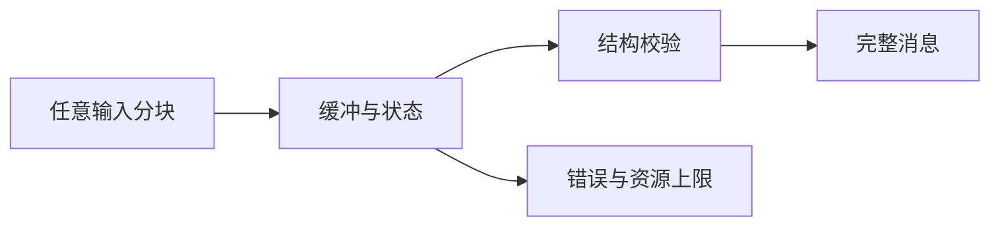

# 前端高阶手写题：解析器与协议 26 题

解析器的核心工作是把任意分块的输入变成有限、可验证的状态变化。网络 chunk 不等于消息边界；必须明确偏移、最大长度、终止行为和失败后能否继续。本页是原创派生练习，不代表真实面试题；只有 H283 对应另页实跑实现，其余题目未实现、未实跑。

按五层练题法依次讲现象、语法规则、状态机制、实现和边界。对流式解析尤其要区分“暂时缺数据”和“输入已结束但数据不完整”，这两种状态不能使用同一种返回值。

## 增量文本与二进制帧

### H283. 长度前缀二进制增量解码器

- **题目契约：**实现 lengthPrefixedDecoder(maxBytes)，返回 feed(Uint8Array): Uint8Array[] 与 end(): void；帧格式为 4 字节 unsigned big-endian 长度，后接 payload，feed 可切任意边界。
- **约束与不变量：**maxBytes 为 0..16 MiB 的整数；允许零长度帧；长度超过上限时立即 RangeError 并永久 failed；end 可重复成功，仅残缺 header/body 抛 SyntaxError。
- **用例 A：**帧 00 00 00 03 61 62 63 分成 [00],[00 00],[03 61],[62 63] 输入，第四次 feed 只输出 payload abc，end 成功。
- **用例 B：**00 00 00 00 00 00 00 01 78 输出空 payload 与 x；长度 maxBytes+1 立即抛 RangeError，之后 feed 一律抛 Error。
- **实现提示：**状态分 header 已读字节、目标长度、payload 已读字节；只复制当前帧所需片段，单次 feed 如后续坏帧则整次调用抛错，不返回此前暂存结果。
- **进阶追问：**如何证明内部未完成帧暂存不超过 maxBytes 加固定 header，而不把多个已输出帧也计入此界；若扩展输出回调且回调抛错，是否污染协议状态？
- **难度 / 建议时长：**难，40 分钟；逐字节检查跨 chunk、空帧和失败终态。
- **依据与状态：**作者原创派生练习，Node 教学模型已实现并实跑，10 项拆帧测试通过；[完整源码与验收](handwritten-challenge-solutions.md)包含 256 种短流分块组合，不代表真实连接与背压已验收；机制参考[WHATWG Encoding](handwritten-practice-sources.md#s25)和[WebSocket 帧格式](handwritten-practice-sources.md#s26)。

### H284. 分块 UTF-8 严格解码器

- **题目契约：**实现 createUtf8Decoder() 的 write(bytes): string 与 end(): string，解码连续 UTF-8 字节流，保留跨 chunk 的不完整码点状态。
- **约束与不变量：**只接受 Unicode 标量值编码；overlong、代理区编码、超 U+10FFFF、孤立 continuation 均报 TypeError 并进入 failed；空输入输出空串。
- **用例 A：**字符“猫”的 UTF-8 字节 E7 8C AB 拆为 E7 8C 与 AB，write 分别返回空串和“猫”，end 返回空串。
- **用例 B：**写入 C0 80 报非法起始字节 TypeError；写入 E2 后 end 报截断 TypeError，之后不能继续写入。
- **实现提示：**使用小于 4 字节的 pending 缓存，记录预期续字节数；优先复用标准 TextDecoder 的 fatal 模式，手写版本需验证最短形式与标量范围。
- **进阶追问：**替换模式与 fatal 模式为何是不同 API 合同；字符串索引若用 UTF-16 如何换算到 byte offset？
- **难度 / 建议时长：**难，40 分钟；题目验收要包含非法和跨块路径。
- **依据与状态：**作者原创派生练习，未实现/未实跑；UTF-8 状态机参考[WHATWG Encoding](handwritten-practice-sources.md#s25)与[ECMAScript 字符串](handwritten-practice-sources.md#s11)。

### H285. 可分块 UTF-8 编码器

- **题目契约：**实现 encodeChunks(strings, byteLimit) 将字符串按完整 UTF-8 码点编码并装入不超过 byteLimit 的 Uint8Array 分块。
- **约束与不变量：**byteLimit 为 1..1,048,576；不拆分码点；输入含未配对 surrogate 时按 U+FFFD 编码；空字符串返回零块。
- **用例 A：**文本 A猫、byteLimit=4，输出 [41 E7 8C AB] 一个块，解码后仍为 A猫。
- **用例 B：**文本“猫”、byteLimit=2 返回 RangeError，不得产出半个三字节码点。
- **实现提示：**先遍历 code point 计算编码长度，再按长度切块；控制峰值内存，可采用两遍遍历而不先构造完整大 Uint8Array。
- **进阶追问：**流式输入中 surrogate pair 刚好跨字符串块怎样保留；编码规范化与编码本身为何要分层？
- **难度 / 建议时长：**中，30 分钟；说明编码、分块和 surrogate 策略。
- **依据与状态：**作者原创派生练习，未实现/未实跑；编码规则参考[WHATWG Encoding](handwritten-practice-sources.md#s25)和[ECMAScript](handwritten-practice-sources.md#s11)。

### H286. 有深度与字节预算的 JSON SAX tokenizer

- **题目契约：**实现 tokenizeJsonChunks(chunks, limits, onEvent)，以 startObject/endObject/key/scalar 事件增量扫描 JSON 字节流，不构造整棵对象树。
- **约束与不变量：**depth≤128、总字节≤8 MiB、单字符串≤1 MiB；事件顺序遵循输入结构；非法 UTF-8、尾逗号和截断 token 报错并停止。
- **用例 A：**输入 {"a":[1,true]}，事件依序为 startObject、key(a)、startArray、scalar(1)、scalar(true)、endArray、endObject。
- **用例 B：**第 129 层对象在超限位置报 RangeError；输入 {"a": 结束时报 SyntaxError，不能发出 endObject。
- **实现提示：**状态包含结构栈、字符串转义、数值词法和 UTF-8 decoder；事件回调抛错时终止扫描且不吞异常。
- **进阶追问：**重复 key 是否由 tokenizer 决定；下游早停后如何停止读取网络源？
- **难度 / 建议时长：**挑战，60 分钟；增量 tokenizer 不能靠 JSON.parse 分行替代。
- **依据与状态：**作者原创派生练习，未实现/未实跑；JSON 与编码语义参考[ECMAScript](handwritten-practice-sources.md#s11)和[WHATWG Encoding](handwritten-practice-sources.md#s25)。

### H287. RFC 风格 CSV 状态机

- **题目契约：**实现 parseCsvChunks(chunks): string[][]，支持逗号字段、双引号包裹字段、双引号转义与 CRLF 记录分隔。
- **约束与不变量：**引号字段内换行保留；闭引号后仅接受逗号、CRLF 或 EOF；空字段保留；限制单字段 1 MiB、总记录 100,000。
- **用例 A：**输入 a,"b,b","c""d"\r\nx,y,z 得两行，第一行值为 a、b,b、c"d。
- **用例 B：**输入 a,"b"x\r\n 报 SyntaxError 并指出字节偏移；EOF 在引号内也报 SyntaxError。
- **实现提示：**状态为 field-start、unquoted、quoted、after-quote，CR 需等待后续 LF；chunk 边界不改变状态。
- **进阶追问：**BOM 是否剥除应由哪层合同决定；如何支持反斜线转义而不让语法产生歧义？
- **难度 / 建议时长：**难，45 分钟；不可用按行 split 替代状态机。
- **依据与状态：**作者原创派生练习，未实现/未实跑；文本字节处理参考[WHATWG Encoding](handwritten-practice-sources.md#s25)及[HTML 解析状态思想](handwritten-practice-sources.md#s28)。

### H288. 并发文本编辑操作位置变换

- **题目契约：**实现 transform(opA, opB)，输入同一文档版本上的 insert(pos,text,clientId) 或 delete(start,end)，输出把 A 变换到先应用 B 后仍语义一致的操作。
- **约束与不变量：**位置按 Unicode code point；删除区间半开；同位置插入按 clientId 字典序先后；本题仅支持非重叠删除，冲突删除裁成交集。
- **用例 A：**文档 abc，A 在 1 插 X、client a，B 在 1 插 Y、client b，应用 A 后变换的 B 得 aXYbc。
- **用例 B：**A 删除 [1,3)、B 删除 [2,4)，在原文 abcde 上先 A 后 transform(B) 后最终删除 bcd，不能删除 e。
- **实现提示：**将每个操作位置相对另一操作映射；插入增加后续位置，删除裁剪交叠范围；同时插入只按稳定 clientId 排序。
- **进阶追问：**多操作并发如何组合转换并保证收敛；为何服务端版本号和去重仍然必要？
- **难度 / 建议时长：**挑战，55 分钟；本题为简化 OT 合同，不代表通用协作编辑算法。
- **依据与状态：**作者原创派生练习，未实现/未实跑；字符串索引参考[ECMAScript](handwritten-practice-sources.md#s11)和[算法资料](handwritten-practice-sources.md#s29)。

## HTTP 与事件流协议

### H289. HTTP 请求行与头部边界解析

- **题目契约：**实现 parseRequestHead(bytes)，解析 method、target、HTTP/version 和 headers，遇 CRLFCRLF 返回头部与 body 起始偏移。
- **约束与不变量：**最大头部 32 KiB、最多 100 字段；拒绝裸 LF、折叠头、多 Host；头名大小写无关但保留原始值。
- **用例 A：**GET /x HTTP/1.1 与 Host、Accept 两字段得到方法 GET、target /x、bodyOffset 指向首个 body 字节。
- **用例 B：**两个 Host 字段返回 SyntaxError；CRLFCRLF 前长度超限返回 RangeError。
- **实现提示：**先按 CRLF 切行并校验语法，再建立规范化索引；重复字段需按字段语义合并，不可统一拼接。
- **进阶追问：**代理与后端对重复 Content-Length 理解不一致会造成什么风险；为何 parser 边界属于安全边界？
- **难度 / 建议时长：**难，40 分钟；明确本练习不是完整 HTTP 服务器。
- **依据与状态：**作者原创派生练习，未实现/未实跑；消息语义参考[HTML Standard](handwritten-practice-sources.md#s28)与[WHATWG Encoding](handwritten-practice-sources.md#s25)。

### H290. Protocol Buffers wire 子集解码器

- **题目契约：**实现 decodeProto(bytes, schema)，支持 wire type 0 varint、1 fixed64、2 length-delimited、5 fixed32，输出字段号到有序值列表。
- **约束与不变量：**field number 在 1..2^29-1；组 wire type 拒绝；未知字段按 wire type 正确跳过；总输入≤8 MiB。
- **用例 A：**schema 指定 field 1 为 varint，字节 08 96 01 解出字段 1 值 150；未知 field 2 的长度字段仍跳过准确。
- **用例 B：**length-delimited 声明超出剩余输入报 SyntaxError；wire type 3 报 UnsupportedWireType。
- **实现提示：**先读 key 的 varint 得 fieldNo 与 wireType，再依据 wire type 消费；length 在分配前检查安全范围和剩余字节。
- **进阶追问：**重复 scalar 字段如何按 schema 合并；为何 unknown field 保留/跳过影响前向兼容？
- **难度 / 建议时长：**难，45 分钟；题目仅实现常用 wire 子集。
- **依据与状态：**作者原创派生练习，未实现/未实跑；编码规则参考[Protocol Buffers Encoding](handwritten-practice-sources.md#s32)和[ECMAScript](handwritten-practice-sources.md#s11)。

### H291. HTTP chunked body 解码器

- **题目契约：**实现 feedChunked(bytes) 增量解析十六进制 chunk 长度、扩展、数据、CRLF、零块和 trailer，返回 body bytes 与完成状态。
- **约束与不变量：**chunk 合计≤64 MiB，trailer≤8 KiB；长度溢出、缺 CRLF、重复禁止 trailer 字段均报 ProtocolError 并终止。
- **用例 A：**4\r\nWiki\r\n5\r\npedia\r\n0\r\n\r\n 解码为 Wikipedia，状态 complete。
- **用例 B：**长度 3 却只给 ab 后 end 报截断错误；数据后缺 CRLF 不得把下一字节吞作正文。
- **实现提示：**状态依次为 size-line、data、data-CRLF、trailers、done；累计数用安全整数并先校验再分配。
- **进阶追问：**扩展字段如何保留但不影响 framing；输出背压如何避免累积整个 64 MiB body？
- **难度 / 建议时长：**挑战，55 分钟；按任意字节分割运行每个用例。
- **依据与状态：**作者原创派生练习，未实现/未实跑；增量 framing 参考[WHATWG Encoding](handwritten-practice-sources.md#s25)与[HTML Standard](handwritten-practice-sources.md#s28)。

### H292. SSE 事件块解析与重连游标

- **题目契约：**实现 parseSseLines(lines) 产出 event、data、id、retry；空行提交一条事件，注释行不产生事件。
- **约束与不变量：**多 data 行以 LF 连接；id 含 NUL 忽略；retry 仅接受非负十进制整数；EOF 不自动提交未空行终止事件。
- **用例 A：**data: one、data: two、空行后输出 data 为 one\ntwo；id: 7 更新最后事件 ID。
- **用例 B：**id 含 NUL 不覆盖旧游标；retry: -1 忽略，带冒号后首个空格只剥一个。
- **实现提示：**按字段前缀解析，保存 event buffer 与 lastEventId 分离；注释行可用于心跳但不进入应用队列。
- **进阶追问：**断线重连如何携带 Last-Event-ID；服务端重复事件如何由应用幂等处理？
- **难度 / 建议时长：**中，35 分钟；区别字段缓冲和已提交事件。
- **依据与状态：**作者原创派生练习，未实现/未实跑；文本流和 HTML event 机制参考[HTML Standard](handwritten-practice-sources.md#s28)与[WHATWG Encoding](handwritten-practice-sources.md#s25)。

### H293. WebSocket frame 长度与掩码

- **题目契约：**实现 decodeFrame(buffer, role) 解析 FIN、opcode、mask、扩展长度和 payload，返回完整 frame 或 need-more。
- **约束与不变量：**客户端发往服务器必须 masked、服务端帧必须 unmasked；控制帧≤125 字节且不可分片；64 位长度最高位必须为零。
- **用例 A：**masked text payload 为 hi、mask 01 02 03 04，解码后恢复 hi，消费字节数精确到帧尾。
- **用例 B：**长度标记 126 却编码数值 125 属非最短形式，报 ProtocolError；fragmented ping 也拒绝。
- **实现提示：**先确认完整 header，再计算总长度并检查上限；mask 以 payload 内偏移模 4 XOR，不修改输入 buffer。
- **进阶追问：**多个 fragment 的消息状态放在哪层；UTF-8 校验何时完成，单 frame 还是重组后？
- **难度 / 建议时长：**挑战，50 分钟；说明 framing 与消息组装是两层状态。
- **依据与状态：**作者原创派生练习，未实现/未实跑；帧规则参考[RFC 6455](handwritten-practice-sources.md#s26)和[WHATWG Encoding](handwritten-practice-sources.md#s25)。

### H294. WebSocket fragment 消息重组

- **题目契约：**实现 MessageAssembler.accept(frame)，重组 text/binary 消息并产出一条消息，控制帧可穿插而不结束消息。
- **约束与不变量：**最大消息 8 MiB；新 text/binary frame 不能打断未完成消息；continuation 无活动消息时错误；UTF-8 跨 fragment 连续验证。
- **用例 A：**text 首片 “你”、ping、continuation “好” 得消息“你好”，ping 另作为控制事件返回。
- **用例 B：**continuation 开头报 ProtocolError；消息累积超 8 MiB 立即失败并释放缓存。
- **实现提示：**维护 active opcode、片段 buffer 与长度；FIN 时才提交消息；控制帧独立校验长度。
- **进阶追问：**零拷贝片段数组会延长底层大 buffer 生命周期吗；慢消费者的背压由 assembler 还是调度器负责？
- **难度 / 建议时长：**难，45 分钟；区分帧边界和消息边界。
- **依据与状态：**作者原创派生练习，未实现/未实跑；分片规则参考[RFC 6455](handwritten-practice-sources.md#s26)与[WHATWG Encoding](handwritten-practice-sources.md#s25)。

### H295. HTTP Range 多段响应解析

- **题目契约：**实现 parseMultipartByteRanges(contentType, body)，解析 multipart/byteranges 每段的 Content-Range 与原始 bytes。
- **约束与不变量：**boundary ≤70 ASCII 字符；段数≤1,000；每段字节数必须等于 end-start+1；总 buffer≤32 MiB。
- **用例 A：**boundary x 的两段分别为 bytes 0-1/4 和 3-3/4，输出片段 [ab]、[d]，不含分隔符。
- **用例 B：**声明长度 2 但正文仅 1 字节时报 SyntaxError；boundary 相似但不完全匹配不能切分。
- **实现提示：**boundary 识别需遵守行边界和 CRLF，不可全局字符串 split；每段头部与数据长度独立核验。
- **进阶追问：**二进制正文可包含 boundary 子串时如何避免误切；是否应优先按已知 Content-Range 长度读取？
- **难度 / 建议时长：**挑战，55 分钟；说明 MIME framing 与 byte offsets。
- **依据与状态：**作者原创派生练习，未实现/未实跑；协议 framing 参考[HTML Standard](handwritten-practice-sources.md#s28)及[WHATWG Encoding](handwritten-practice-sources.md#s25)。

### H296. RFC 6570 URI Template 子集展开

- **题目契约：**实现 expand(template,values)，支持简单变量 {var}、保留展开 {+path} 和查询展开 {?x,y}，返回完整字符串。
- **约束与不变量：**缺失变量和空字符串不同；简单展开百分号编码保留集外字符，保留展开保留路径分隔符；数组仅支持逗号分隔标量。
- **用例 A：**模板 /users/{id}{?q}，id=a b、q=cat，输出 /users/a%20b?q=cat。
- **用例 B：**模板 /{+path}、path=a/b 输出 /a/b；变量缺失时 {id} 展开为空串且不额外编码 null。
- **实现提示：**先词法解析操作符和变量名，再按操作符选择编码器；不要用全局正则替换混淆保留与简单展开。
- **进阶追问：**哪些 Unicode 字符按 UTF-8 百分号编码；嵌套变量和 explode 修饰符如何扩展语法？
- **难度 / 建议时长：**中，35 分钟；只实现声明的 RFC 子集并拒绝未知修饰符。
- **依据与状态：**作者原创派生练习，未实现/未实跑；模板规则参考[RFC 6570](handwritten-practice-sources.md#s33)及[WHATWG Encoding](handwritten-practice-sources.md#s25)。

### H297. URL 百分号编码的增量校验器

- **题目契约：**实现 validatePercentEncoding(chunks) 返回解码字节，并验证所有 % 后恰有两位十六进制数。
- **约束与不变量：**百分号的 1-2 个十六进制字符可跨 chunk；原始非 ASCII 字符先按 UTF-8 处理；输出 byte buffer 有 4 MiB 上限。
- **用例 A：**输入 /a%2F猫，输出字节对应 /a/猫，结果再 UTF-8 解码一致。
- **用例 B：**chunk 尾为 %、下一块为 2、end 时仍缺一位报 SyntaxError；%GG 立即失败。
- **实现提示：**状态保存 percentDigits 和半字节；区分 URI 组件解码与 form-urlencoded 的加号空格规则。
- **进阶追问：**为什么先 decode 再路径分段会改变安全边界；双重编码如何避免重复解码？
- **难度 / 建议时长：**中，30 分钟；逐块与一次性结果做等价验收。
- **依据与状态：**作者原创派生练习，未实现/未实跑；URI 与字节规则参考[ECMAScript](handwritten-practice-sources.md#s11)及[WHATWG Encoding](handwritten-practice-sources.md#s25)。

### H298. 结构化日志行解析器

- **题目契约：**实现 parseLog(line): Record，格式为 RFC3339 时间、级别、请求 ID、JSON payload 四字段，payload 可含空格。
- **约束与不变量：**字段分隔符为首三个 tab；时间需带时区，级别限定 INFO/WARN/ERROR；请求 ID 1..64 个可见 ASCII 字符。
- **用例 A：**合法 ERROR 行解析出固定时间、ID req-7 与 payload {"message":"slow request"}。
- **用例 B：**缺少 JSON 闭括号返回 SyntaxError 且携带字段偏移；未知级别报 RangeError。
- **实现提示：**只按前三个 tab 切分，校验时间和字段后单独 JSON.parse；日志 payload 不是任意字符串拼接。
- **进阶追问：**如何防止换行注入伪造第二条记录；敏感字段脱敏应该在解析前还是输出前？
- **难度 / 建议时长：**中，30 分钟；区分语法正确与业务字段合法。
- **依据与状态：**作者原创派生练习，未实现/未实跑；JSON 与字符串语义参考[ECMAScript](handwritten-practice-sources.md#s11)和[HTML Standard](handwritten-practice-sources.md#s28)。

### H299. 多行堆栈 trace 分组器

- **题目契约：**实现 groupTraces(lines) 将时间戳头行与后续缩进行合并为事件，保留原始文本和起止行号。
- **约束与不变量：**新头由严格时间戳加级别识别；空行附着当前事件；文件首行非头行报错；事件最大 256 KiB。
- **用例 A：**ERROR 头行后两条缩进行组成一个 trace，下一时间头开始新事件，行号连续。
- **用例 B：**首行缩进文本无前置事件时报 SyntaxError；超限 trace 在追加前 RangeError。
- **实现提示：**单遍扫描维护 current event；新头提交旧项，EOF 提交末项；行拆分前先统一 CRLF 和 LF。
- **进阶追问：**日志头中的时区和本地日期如何统一；若单行输入流无限，如何向消费者施加背压？
- **难度 / 建议时长：**中，25 分钟；需要定义末尾换行对行号的影响。
- **依据与状态：**作者原创派生练习，未实现/未实跑；文本解析参考[WHATWG Encoding](handwritten-practice-sources.md#s25)与[ECMAScript](handwritten-practice-sources.md#s11)。

### H300. 二进制 TLV 扩展字段解析

- **题目契约：**实现 parseTlv(bytes)，字段编码为 1 字节 type、2 字节 BE length、length 字节 payload，返回有序条目和未知 type 原始值。
- **约束与不变量：**payload 总量≤4 MiB；重复 type 保留顺序；截断 header/body 报 SyntaxError；每种已知 type 独立校验载荷长度。
- **用例 A：**type 1 length 2 值 AB、未知 type 9 length 1 值 FF，输出两个有序记录且未知字节不丢。
- **用例 B：**声明 length=3 但仅 2 字节时失败；length=0 合法且下一 TLV 起点不偏移。
- **实现提示：**DataView 用 view.byteOffset 与 view.byteLength 构造，并按大端读取 length、littleEndian 参数传 false；先验边界再切 subarray。
- **进阶追问：**零拷贝 subarray 如何保留整个原始 buffer；何时需复制未知扩展以缩短生命周期？
- **难度 / 建议时长：**中，30 分钟；包含非零 byteOffset 的视图验收。
- **依据与状态：**作者原创派生练习，未实现/未实跑；二进制编码参考[WebSocket 协议](handwritten-practice-sources.md#s26)和[ECMAScript](handwritten-practice-sources.md#s11)。

### H301. 多字节 varint 流式解码器

- **题目契约：**实现 decodeVarints(bytes)，按 base-128 小端 7-bit 续位编码解出无符号整数，并返回每项起止 byte offset。
- **约束与不变量：**只接受 53 位安全整数；最多 8 字节；不允许非最短编码；输入尾部半个值可保留到下一 chunk。
- **用例 A：**字节 AC 02 解出 300，offset [0,2)；00 解出 0。
- **用例 B：**80 00 是非最短编码报 SyntaxError；第 9 个续位字节报 RangeError。
- **实现提示：**以乘 128 累积并检查 Number 安全范围，或用 BigInt 后显式裁剪；终止字节清零 pending 状态。
- **进阶追问：**有符号 zigzag 编码如何改变映射；恶意超长 varint 怎样造成 CPU 或内存消耗？
- **难度 / 建议时长：**中，30 分钟；验证跨块与最短形式。
- **依据与状态：**作者原创派生练习，未实现/未实跑；整数语义参考[ECMAScript](handwritten-practice-sources.md#s11)和[WebSocket 帧格式](handwritten-practice-sources.md#s26)。

### H302. 位字段消息头校验器

- **题目契约：**实现 parseHeader(word)，将 32 位头解析为版本 3 位、类型 5 位、长度 16 位、标志 8 位，并验证版本与保留位。
- **约束与不变量：**输入必须为 0..0xFFFFFFFF 整数；版本仅 1 或 2；保留 flag 位必须 0；位序按网络字节顺序。
- **用例 A：**按位字段构造版本 1、类型 3、长度 12、flags 1，解析返回对应值。
- **用例 B：**版本 7 报 ProtocolError；负数和超过 32 位值报 RangeError。
- **实现提示：**用无符号位运算前先规范为 uint32，掩码和移位集中成常量；不要混淆字节序与位序。
- **进阶追问：**JavaScript 位运算为何有符号 32 位转换；怎样用 DataView 避免隐藏强制转换？
- **难度 / 建议时长：**易，20 分钟；为每个字段写反向编码性质测试。
- **依据与状态：**作者原创派生练习，未实现/未实跑；位操作参考[ECMAScript](handwritten-practice-sources.md#s11)与[WebSocket 协议](handwritten-practice-sources.md#s26)。

### H303. 增量 Base64 解码器

- **题目契约：**实现 createBase64Decoder({urlSafe}) 的 write(text)、end()，接受标准或 URL-safe 字母表并输出 Uint8Array。
- **约束与不变量：**padding 仅可在末尾且最多两个；字符集不可混用；单次输入总解码≤16 MiB；chunk 可在任意字符边界切分。
- **用例 A：**SGVsbG8= 分成 SG、Vsb、G= 输入，输出 Hello；urlSafe 模式下 -_8 解出对应 2 字节。
- **用例 B：**A=== 或 padding 后再有有效字符时报 SyntaxError；标准模式遇下划线立即拒绝。
- **实现提示：**保留不足 4 字符的 quartet；输出长度先估算再检查上限；end 校验 padding 和残余长度。
- **进阶追问：**无 padding 的 URL-safe 变体采用何种长度规则；字符串 UTF-16 非 ASCII 如何处理？
- **难度 / 建议时长：**中，30 分钟；不把 Base64 字符串直接当文本 UTF-8。
- **依据与状态：**作者原创派生练习，未实现/未实跑；字符串和字节机制参考[ECMAScript](handwritten-practice-sources.md#s11)与[WHATWG Encoding](handwritten-practice-sources.md#s25)。

### H304. 增量 SHA-256 消息分块

- **题目契约：**实现教学用 Sha256.update(bytes)、digest()，支持任意块更新并按 SHA-256 规范输出 32 字节摘要。
- **约束与不变量：**输入长度以 bit 计必须可表示；digest 后禁止 update；重复 digest 返回同样 32 字节；摘要不声明抗侧信道。
- **用例 A：**分块输入 abc 与一次性输入 abc 的 digest 相同，且等于标准向量 ba7816bf8f01cfea414140de5dae2223b00361a396177a9cb410ff61f20015ad。
- **用例 B：**digest 后 update 抛 StateError；长度字段边界按 64 位 big-endian 写入，不能只记录最后一块长度。
- **实现提示：**维护 64 字节 block、总字节数和 8 个状态字；只在压缩完整块时更新状态，末尾补位一次。
- **进阶追问：**为何生产安全用途必须使用平台密码库；HMAC 与裸哈希在认证能力上差异是什么？
- **难度 / 建议时长：**挑战，70 分钟；教学目标为理解分块状态，不用于安全产品。
- **依据与状态：**作者原创派生练习，未实现/未实跑；字节处理参考[ECMAScript](handwritten-practice-sources.md#s11)与[WHATWG Encoding](handwritten-practice-sources.md#s25)。

### H305. WebSocket 握手头字段校验

- **题目契约：**实现 validateUpgrade(request)，校验 Upgrade、Connection、Sec-WebSocket-Key、Version 并返回握手材料摘要。
- **约束与不变量：**版本必须为 13；key 解码后恰 16 字节；Connection token 大小写无关；本练习不计算网络响应或授权策略。
- **用例 A：**合法 key 与 Upgrade: websocket、Connection: keep-alive, Upgrade 返回 valid=true。
- **用例 B：**key 解码长度 15 或版本 12 返回 ProtocolError；头字段缺失也拒绝。
- **实现提示：**token 列表逗号分割后 trim/lowercase；Base64 校验需严格，禁止宽松解码接受坏 padding。
- **进阶追问：**Origin 校验属于哪个层；为何只看到 Upgrade 头不能证明连接可信？
- **难度 / 建议时长：**中，30 分钟；区分握手校验和应用鉴权。
- **依据与状态：**作者原创派生练习，未实现/未实跑；握手合同参考[RFC 6455](handwritten-practice-sources.md#s26)与[ECMAScript](handwritten-practice-sources.md#s11)。

### H306. SSE 字段序列化器与注入防护

- **题目契约：**实现 serializeSse({event,id,retry,data}) 输出一条完整事件，以空行结束并返回 UTF-8 字节。
- **约束与不变量：**data 按 LF 拆为多行；id 含 NUL 拒绝；retry 为非负整数；所有字段值中的 CR/LF 需按本题合同拆行而非拼进字段名。
- **用例 A：**data 为 a\nb、event update 输出 event: update、data: a、data: b 和空行。
- **用例 B：**id 含 NUL 返回 TypeError；空 data 输出一条 data: 字段且帧仍以空行结束。
- **实现提示：**字段名由代码固定，event/id 含 CR 或 LF 时拒绝，data 按换行拆成多个固定 data 字段；序列化后再 UTF-8 编码，禁止用户值改写字段名。
- **进阶追问：**代理缓冲影响实时性时需哪些响应头；断线重连时事件 ID 是否等于恰好一次投递？
- **难度 / 建议时长：**中，25 分钟；给出逐行预期输出。
- **依据与状态：**作者原创派生练习，未实现/未实跑；事件流语义参考[HTML Standard](handwritten-practice-sources.md#s28)与[WHATWG Encoding](handwritten-practice-sources.md#s25)。

### H307. RFC 8785 JSON 确定性规范化

- **题目契约：**实现 canonicalize(value) 输出 RFC 8785 约定的紧凑 JSON UTF-8 字节序列，用于跨实现内容摘要前的确定性表示。
- **约束与不变量：**对象键按 UTF-16 code unit 排序；数字按 ECMAScript JSON 数字序列化；拒绝 NaN、Infinity、BigInt 与孤立 surrogate。
- **用例 A：**对象键输入顺序 b,a 输出 {"a":1,"b":2}；数组顺序保持；字符串中的引号和反斜杠按 JSON 转义。
- **用例 B：**数值 -0 序列化为 0；孤立 high surrogate 抛 TypeError，不替换为 U+FFFD。
- **实现提示：**递归生成 tokens 而非先依赖不稳定属性顺序；对象键排序后逐项编码，最终使用严格 UTF-8。
- **进阶追问：**为什么不同语言的浮点格式可能破坏签名；Unicode NFC 规范化是否属于 RFC 8785 合同？
- **难度 / 建议时长：**挑战，55 分钟；必须按规范边界验证，不把普通 JSON.stringify 等同 canonicalization。
- **依据与状态：**作者原创派生练习，未实现/未实跑；规范参考[RFC 8785](handwritten-practice-sources.md#s34)与[RFC 8259](handwritten-practice-sources.md#s31)。

### H308. ETag 条件请求解析器

- **题目契约：**实现 parseIfNoneMatch(header) 返回 wildcard 或弱/强 entity tag 列表，并实现 matches(etag,condition) 的 GET/HEAD 弱比较。
- **约束与不变量：**逗号可出现在带引号 opaque tag 中；非法引号结构报 SyntaxError；本题只处理 If-None-Match，不推断资源是否已授权。
- **用例 A：**W/"abc", "x,y" 解析为两个 tag；当前 tag "abc" 对 W/"abc" 的 GET 弱匹配为 true。
- **用例 B：*** 对任意已存在资源匹配；未闭合引号报 SyntaxError，不能直接 split 逗号。
- **实现提示：**用有限状态扫描识别引号和逗号；比较时 GET/HEAD 忽略弱标记，其他方法语义需另定。
- **进阶追问：**强比较用于何类条件请求；ETag 是否天然是内容哈希或隐私安全标识？
- **难度 / 建议时长：**难，35 分钟；区分语法扫描与条件求值。
- **依据与状态：**作者原创派生练习，未实现/未实跑；协议解析机制参考[HTML Standard](handwritten-practice-sources.md#s28)与[ECMAScript](handwritten-practice-sources.md#s11)。

## 常见误区

| 误区 | 可观察失败 | 修正 |
|---|---|---|
| 把网络 chunk 当消息 | 跨块 header/body 被误判 | 保存状态并支持任意切分 |
| EOF 等同于暂缺输入 | 截断帧被悄悄忽略 | end 独立验证完整性 |
| 超限后继续解析 | 后续数据污染同步状态 | 明确 failed 终态并释放缓存 |

## 面试作答

**30 秒：**声明输入是否增量、消息边界是什么、资源上限是多少，再说明状态机如何区分 need-more、完成和错误。

**2 分钟：**手推一个跨块合法样例和一个截断/超限样例，指出错误偏移、失败后能否继续、缓冲峰值及 UTF-8 解码时机。

## 自测

展开 3 道自测题与验收要点

1. 为什么 EOF 残缺头与普通 chunk 边界不同？EOF 表示不再有未来字节，残缺状态已成为语法错误。
2. CSV 字段为何不能直接用逗号切分？引号字段可合法含逗号和换行。
3. WebSocket frame 与 message 有何差别？消息可能由多个 continuation frame 拼接，控制帧可插入其中。

## 未实现题面的验收边界

除 H283 对应仓库已单独验收的实现外，本页其他 25 题均为未实现题面。需用每个输入的所有单字节切分位置做等价测试，并额外验收最大值、超限、错误偏移及失败后行为；该标准是未来实现建议，不表示当前代码已通过。

## 深入阅读

- [WHATWG Encoding](handwritten-practice-sources.md#s25)：理解 UTF-8 状态、错误模式与字节接口。
- [RFC 6455](handwritten-practice-sources.md#s26)：核对 WebSocket frame、控制帧和分片约束。
- [WHATWG HTML Standard](handwritten-practice-sources.md#s28)：查阅 URL、事件与 Web 平台解析语义。
