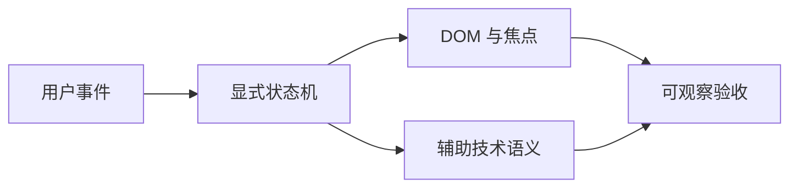

# 组合式 UI 交互与可访问性手写题

<!-- Solution routes -->
先跟着代码写一遍，可读[DOM 与键盘交互](workshop-web-dom.md)。下方练习再增加新约束。

这组题把组件当成一份对用户、DOM 和辅助技术共同生效的交互合同。练习时先定义状态，再枚举输入事件和可观察输出；原生语义、焦点归属、异步关闭与卸载清理都属于合同。

读图时把一次操作看成从事件到状态转移，再同时检查视觉 DOM、键盘焦点和读屏语义；只看点击后的像素不算完成。

## 自测

??? question "为什么 aria-expanded 与真实展开状态必须来自同一状态源？"
    因为它们描述同一交互事实；分别维护会出现视觉已关闭但辅助技术仍报告展开，验收应同时断言可见面板与属性。

??? question "关闭弹层时触发器已被删除，焦点应如何处理？"
    先检查原触发节点是否仍连接且可聚焦；否则按调用方提供的后备焦点策略处理，不能 focus 已脱离树的节点。

??? question "IME 组合输入中按 Enter 为什么不能直接提交？"
    组合输入期间 Enter 可能用于确认候选词；提交合同应区分 composing 状态，并以完整 composition 事件序列验收。

## 练习题

### H049. 多层弹层的 Escape 与焦点归还协调器

实现 `createOverlayStack(document): { push(entry): () => void; handleKey(event): boolean }`；entry 含 `id`、根节点、触发节点、关闭回调和 modal 标志，输出顶层可关闭项与焦点归还行为。

同一文档按打开顺序压栈，只有最顶层响应 Escape；回调重入时先完成栈状态迁移；卸载 entry 后不得持有其节点引用或重复关闭。

- 依次打开 dialog A、popover B，按 Escape 一次只调用 B 的 close，第二次才关闭 A；焦点依次返回 B 的 trigger、A 的 trigger。
- B 的 close 内同步再次 dispatch 同一 Event 对象时，事件已登记为 handled，A 不关闭；若 B 的 trigger 已移除，焦点保持在当前活动元素并返回 `restored:false`。

按 document 用 WeakMap 保存 stack，并用 WeakSet 记录已处理 Event 对象；事件处理先快照顶层项并 pop/标记关闭，再调用用户回调；每个 push 返回幂等 dispose。

多个独立 modal、跨 ShadowRoot 的 composedPath、原生 dialog 的 cancel 事件如何避免重复关闭？说明事件优先级与 owner。

难，45 分钟。

<!-- Question record (index metadata)
- **题目契约：**实现 `createOverlayStack(document): { push(entry): () => void; handleKey(event): boolean }`；entry 含 `id`、根节点、触发节点、关闭回调和 modal 标志，输出顶层可关闭项与焦点归还行为。
- **约束与不变量：**同一文档按打开顺序压栈，只有最顶层响应 Escape；回调重入时先完成栈状态迁移；卸载 entry 后不得持有其节点引用或重复关闭。
- **用例 A：**依次打开 dialog A、popover B，按 Escape 一次只调用 B 的 close，第二次才关闭 A；焦点依次返回 B 的 trigger、A 的 trigger。
- **用例 B：**B 的 close 内同步再次 dispatch 同一 Event 对象时，事件已登记为 handled，A 不关闭；若 B 的 trigger 已移除，焦点保持在当前活动元素并返回 `restored:false`。
- **实现提示：**按 document 用 WeakMap 保存 stack，并用 WeakSet 记录已处理 Event 对象；事件处理先快照顶层项并 pop/标记关闭，再调用用户回调；每个 push 返回幂等 dispose。
- **进阶追问：**多个独立 modal、跨 ShadowRoot 的 composedPath、原生 dialog 的 cancel 事件如何避免重复关闭？说明事件优先级与 owner。
- **难度 / 建议时长：**难，45 分钟。
- **依据与状态：**作者原创派生练习，未实现/未实跑；事件路径与监听取消参考 [DOM 标准](https://dom.spec.whatwg.org/#events)（[S03](handwritten-practice-sources.md#s03)）。
-->

### H050. 可访问的命令面板键盘路由

实现 `reduceCommandKey(state, KeyboardEvent): { state; effects }`，支持打开、关闭、上下移动、执行和分组跳转；给定命令树输出选中命令 ID 与焦点策略。

忽略输入框中的普通字符快捷键；方向移动跳过 disabled 项；执行只触发一次，执行后是否关闭由命令元数据决定。

- 三条命令中第二条 disabled，打开后 ArrowDown 选择第三条，Enter 执行其 ID，回调计数为 1。
- 输入法 `isComposing=true` 时 Enter 不执行命令；弹板打开期间重复快捷键不得创建第二个 dialog。

将展平后的可执行项和分组索引独立于 DOM；reducer 只返回状态，effect 层负责 focus、执行回调和关闭，避免处理键盘时同步改写 DOM。

命令列表异步过滤后选中项消失、结果为空或执行回调卸载面板时，如何防止陈旧焦点和双执行？

难，40 分钟。

<!-- Question record (index metadata)
- **题目契约：**实现 `reduceCommandKey(state, KeyboardEvent): { state; effects }`，支持打开、关闭、上下移动、执行和分组跳转；给定命令树输出选中命令 ID 与焦点策略。
- **约束与不变量：**忽略输入框中的普通字符快捷键；方向移动跳过 disabled 项；执行只触发一次，执行后是否关闭由命令元数据决定。
- **用例 A：**三条命令中第二条 disabled，打开后 ArrowDown 选择第三条，Enter 执行其 ID，回调计数为 1。
- **用例 B：**输入法 `isComposing=true` 时 Enter 不执行命令；弹板打开期间重复快捷键不得创建第二个 dialog。
- **实现提示：**将展平后的可执行项和分组索引独立于 DOM；reducer 只返回状态，effect 层负责 focus、执行回调和关闭，避免处理键盘时同步改写 DOM。
- **进阶追问：**命令列表异步过滤后选中项消失、结果为空或执行回调卸载面板时，如何防止陈旧焦点和双执行？
- **难度 / 建议时长：**难，40 分钟。
- **依据与状态：**作者原创派生练习，未实现/未实跑；菜单与对话框键盘模式参照 [WAI-ARIA APG](https://www.w3.org/WAI/ARIA/apg/)（[S05](handwritten-practice-sources.md#s05)）。
-->

### H051. 嵌套菜单的方向键与 RTL 导航

实现 `moveMenuFocus(tree, activeId, key, direction): string | null`，输入树形菜单、当前节点、按键和 `ltr|rtl`，返回下一焦点节点。

上下键只在当前层环绕；左右键按文字方向打开子菜单或返回父层；disabled 节点永不成为目标，空层返回 null。

- LTR 父菜单当前项有子菜单，ArrowRight 返回其首个 enabled 子项；在子项按 ArrowLeft 返回父菜单触发项。
- RTL 中 ArrowLeft 打开子菜单；子菜单所有项 disabled 时保持焦点在父项并返回无可移动结果。

先建立 parent、children、enabled sibling 的映射，再由方向映射表决定本层或跨层转换；不要依赖 DOM 的视觉顺序推断数据关系。

动态插入菜单项或菜单项因权限撤销而卸载时，如何重定位焦点且不跳到另一个菜单层？

中，35 分钟。

<!-- Question record (index metadata)
- **题目契约：**实现 `moveMenuFocus(tree, activeId, key, direction): string | null`，输入树形菜单、当前节点、按键和 `ltr|rtl`，返回下一焦点节点。
- **约束与不变量：**上下键只在当前层环绕；左右键按文字方向打开子菜单或返回父层；disabled 节点永不成为目标，空层返回 null。
- **用例 A：**LTR 父菜单当前项有子菜单，ArrowRight 返回其首个 enabled 子项；在子项按 ArrowLeft 返回父菜单触发项。
- **用例 B：**RTL 中 ArrowLeft 打开子菜单；子菜单所有项 disabled 时保持焦点在父项并返回无可移动结果。
- **实现提示：**先建立 parent、children、enabled sibling 的映射，再由方向映射表决定本层或跨层转换；不要依赖 DOM 的视觉顺序推断数据关系。
- **进阶追问：**动态插入菜单项或菜单项因权限撤销而卸载时，如何重定位焦点且不跳到另一个菜单层？
- **难度 / 建议时长：**中，35 分钟。
- **依据与状态：**作者原创派生练习，未实现/未实跑；菜单键盘模式参考 [WAI-ARIA APG](https://www.w3.org/WAI/ARIA/apg/)（[S05](handwritten-practice-sources.md#s05)）。
-->

### H052. 组合输入安全的表单提交门控

实现 `createSubmitGate(onSubmit): { onKeyDown(e); onSubmit(e); reset() }`，表单含文本、IME 输入与提交按钮，输出提交次数和状态。

composition 期间 Enter 不触发提交；通过原生 submit 路径完成键盘与按钮提交；pending 状态的重复提交按合同忽略。

- compositionstart、Enter、compositionend 后仅在用户再次按 Enter 时提交一次，值为已确认文本。
- pending 时快速点击按钮三次只调用一次；submit 回调拒绝后状态恢复 idle，下一次可提交。

以 composing 与 pending 两个独立状态门控；处理 `submit` 而不只绑定 keydown，记录一次性请求 token，并在 finally 清除 pending。

浏览器在 compositionend 前后派发 Enter 的差异怎样纳入跨浏览器验收？怎样避免阻止密码管理器或辅助技术提交？

难，40 分钟。

<!-- Question record (index metadata)
- **题目契约：**实现 `createSubmitGate(onSubmit): { onKeyDown(e); onSubmit(e); reset() }`，表单含文本、IME 输入与提交按钮，输出提交次数和状态。
- **约束与不变量：**composition 期间 Enter 不触发提交；通过原生 submit 路径完成键盘与按钮提交；pending 状态的重复提交按合同忽略。
- **用例 A：**compositionstart、Enter、compositionend 后仅在用户再次按 Enter 时提交一次，值为已确认文本。
- **用例 B：**pending 时快速点击按钮三次只调用一次；submit 回调拒绝后状态恢复 idle，下一次可提交。
- **实现提示：**以 composing 与 pending 两个独立状态门控；处理 `submit` 而不只绑定 keydown，记录一次性请求 token，并在 finally 清除 pending。
- **进阶追问：**浏览器在 compositionend 前后派发 Enter 的差异怎样纳入跨浏览器验收？怎样避免阻止密码管理器或辅助技术提交？
- **难度 / 建议时长：**难，40 分钟。
- **依据与状态：**作者原创派生练习，未实现/未实跑；表单事件与取消模型参考 [DOM 标准](https://dom.spec.whatwg.org/#events)（[S03](handwritten-practice-sources.md#s03)）。
-->

### H053. 异步校验下的表单提交快照

实现 `submitForm(values, validate, save): Promise<Result>`；输入字段快照和异步校验器，输出校验错误或保存回执。

一次提交只验证其快照；编辑代次改变后旧校验不得标记新值有效；保存期间新的提交如何处理须明确为排队或拒绝。

- 值 `a` 的校验延迟较长，随后值改成 `ab` 并通过；旧 `a` 失败晚到不能覆盖 `ab` 的无错误状态。
- 校验通过后保存失败，字段值保留、提交状态回到可重试，错误被归类为表单级而非字段级。

给每次编辑递增 revision，提交捕获 revision 与不可变 values；校验返回前比较 revision，再决定展示错误；保存副作用绑定提交 ID。

服务端已写入但响应丢失后重试，如何用幂等键避免创建重复记录？

难，40 分钟。

<!-- Question record (index metadata)
- **题目契约：**实现 `submitForm(values, validate, save): Promise<Result>`；输入字段快照和异步校验器，输出校验错误或保存回执。
- **约束与不变量：**一次提交只验证其快照；编辑代次改变后旧校验不得标记新值有效；保存期间新的提交如何处理须明确为排队或拒绝。
- **用例 A：**值 `a` 的校验延迟较长，随后值改成 `ab` 并通过；旧 `a` 失败晚到不能覆盖 `ab` 的无错误状态。
- **用例 B：**校验通过后保存失败，字段值保留、提交状态回到可重试，错误被归类为表单级而非字段级。
- **实现提示：**给每次编辑递增 revision，提交捕获 revision 与不可变 values；校验返回前比较 revision，再决定展示错误；保存副作用绑定提交 ID。
- **进阶追问：**服务端已写入但响应丢失后重试，如何用幂等键避免创建重复记录？
- **难度 / 建议时长：**难，40 分钟。
- **依据与状态：**作者原创派生练习，未实现/未实跑；事件与 abort 信号机制参考 [DOM 标准](https://dom.spec.whatwg.org/#aborting-ongoing-activities)（[S03](handwritten-practice-sources.md#s03)）。
-->

### H054. 字段错误与 aria-describedby 有序合并

实现 `composeDescriptionIds(helpIds, errorId, pendingId): string` 并设计字段组件 props；输出唯一、有序的关联 ID 列表和 invalid 状态。

帮助、错误、异步提示节点可能分别缺席；不得输出重复 ID 或指向不存在节点；清除错误时保留帮助文字关联。

- help 为 `email-help`、error 为 `email-error`，输出按 help/error 顺序连接，且 `aria-invalid=true`。
- error 消失但 help 保留，输出仅 `email-help`、invalid 为 false；重复传入同一 help ID 只出现一次。

先将可用 ID 按优先序过滤再稳定去重；用同一错误状态派生 `aria-invalid` 与错误节点，避免字符串拼接状态漂移。

动态错误如何通知屏幕阅读器而不每次键入都打断？说明 aria-live 区域策略和批量校验时机。

中，30 分钟。

<!-- Question record (index metadata)
- **题目契约：**实现 `composeDescriptionIds(helpIds, errorId, pendingId): string` 并设计字段组件 props；输出唯一、有序的关联 ID 列表和 invalid 状态。
- **约束与不变量：**帮助、错误、异步提示节点可能分别缺席；不得输出重复 ID 或指向不存在节点；清除错误时保留帮助文字关联。
- **用例 A：**help 为 `email-help`、error 为 `email-error`，输出按 help/error 顺序连接，且 `aria-invalid=true`。
- **用例 B：**error 消失但 help 保留，输出仅 `email-help`、invalid 为 false；重复传入同一 help ID 只出现一次。
- **实现提示：**先将可用 ID 按优先序过滤再稳定去重；用同一错误状态派生 `aria-invalid` 与错误节点，避免字符串拼接状态漂移。
- **进阶追问：**动态错误如何通知屏幕阅读器而不每次键入都打断？说明 aria-live 区域策略和批量校验时机。
- **难度 / 建议时长：**中，30 分钟。
- **依据与状态：**作者原创派生练习，未实现/未实跑；关联属性与模式说明见 [WAI-ARIA APG](https://www.w3.org/WAI/ARIA/apg/)（[S05](handwritten-practice-sources.md#s05)）。
-->

### H055. 多选列表框的锚点范围选择

实现 `selectRange(ids, selection, anchor, target, additive): Selection`，支持 Shift 范围与 Ctrl/Meta 补选，输出选中 ID 集与锚点。

范围按当前可见有序 ID 计算；隐藏或删除 ID 从结果移除；单击更新锚点，拖动不重复翻转范围内状态。

- 顺序 `[a,b,c,d]`，先选 b，再 Shift 选 d，结果为 b/c/d 且 anchor 仍是 b。
- 列表过滤为 `[a,c,d]` 后，旧 b 锚点已不可见；Shift 选 d 从最近有效锚点 c 开始，不产生幽灵 b。

Selection 用 Set，另存 anchor 和基准 selection；范围每次从基准重算，而不是对每个 pointermove 反复 toggle。

键盘 Shift+Arrow 与指针拖选同时发生、数据重排时，如何定义锚点身份与可预期焦点？

难，40 分钟。

<!-- Question record (index metadata)
- **题目契约：**实现 `selectRange(ids, selection, anchor, target, additive): Selection`，支持 Shift 范围与 Ctrl/Meta 补选，输出选中 ID 集与锚点。
- **约束与不变量：**范围按当前可见有序 ID 计算；隐藏或删除 ID 从结果移除；单击更新锚点，拖动不重复翻转范围内状态。
- **用例 A：**顺序 `[a,b,c,d]`，先选 b，再 Shift 选 d，结果为 b/c/d 且 anchor 仍是 b。
- **用例 B：**列表过滤为 `[a,c,d]` 后，旧 b 锚点已不可见；Shift 选 d 从最近有效锚点 c 开始，不产生幽灵 b。
- **实现提示：**Selection 用 Set，另存 anchor 和基准 selection；范围每次从基准重算，而不是对每个 pointermove 反复 toggle。
- **进阶追问：**键盘 Shift+Arrow 与指针拖选同时发生、数据重排时，如何定义锚点身份与可预期焦点？
- **难度 / 建议时长：**难，40 分钟。
- **依据与状态：**作者原创派生练习，未实现/未实跑；列表框键盘交互参考 [WAI-ARIA APG](https://www.w3.org/WAI/ARIA/apg/)（[S05](handwritten-practice-sources.md#s05)）。
-->

### H056. 可编辑表格的单元格编辑事务

实现 `editCell(model, cellId, event): EditTransition`，支持进入、提交、取消和异步保存，输出编辑器焦点目标及数据变更。

Escape 丢弃未提交草稿；Enter 仅在非 composing 时提交；保存失败保留草稿与编辑上下文，不能静默跳格。

- 进入单元格输入 `42` 后按 Escape，模型仍为旧值且焦点回到该单元格。
- 保存请求期间按 Tab，焦点和编辑状态保持在当前单元格；保存失败后仍显示 `42` 草稿和错误，不写入模型。

区分 committed value、draft、saving revision；编辑器以 cell ID 做稳定身份，成功后才提交模型并计算下一焦点。

排序或虚拟化使当前行卸载时，保存成功应恢复哪个焦点？如何避免把草稿写进重用 DOM 节点？

挑战，50 分钟。

<!-- Question record (index metadata)
- **题目契约：**实现 `editCell(model, cellId, event): EditTransition`，支持进入、提交、取消和异步保存，输出编辑器焦点目标及数据变更。
- **约束与不变量：**Escape 丢弃未提交草稿；Enter 仅在非 composing 时提交；保存失败保留草稿与编辑上下文，不能静默跳格。
- **用例 A：**进入单元格输入 `42` 后按 Escape，模型仍为旧值且焦点回到该单元格。
- **用例 B：**保存请求期间按 Tab，焦点和编辑状态保持在当前单元格；保存失败后仍显示 `42` 草稿和错误，不写入模型。
- **实现提示：**区分 committed value、draft、saving revision；编辑器以 cell ID 做稳定身份，成功后才提交模型并计算下一焦点。
- **进阶追问：**排序或虚拟化使当前行卸载时，保存成功应恢复哪个焦点？如何避免把草稿写进重用 DOM 节点？
- **难度 / 建议时长：**挑战，50 分钟。
- **依据与状态：**作者原创派生练习，未实现/未实跑；键盘网格模式参考 [WAI-ARIA APG](https://www.w3.org/WAI/ARIA/apg/)（[S05](handwritten-practice-sources.md#s05)）。
-->

### H057. 可撤销的内容编辑器选区映射

实现 `applyEdit(doc, selection, operation): { doc; selection; inverse }`，输入文本、UTF-16 选区及替换操作，输出新文本、映射选区和撤销操作。

选区端点始终在 `[0, doc.length]`；替换两端相同的插入点需明确偏移方向；撤销恢复原文和原选区。

- `abc` 的 `[1,2]` 替换为 `XYZ`，输出 `aXYZc`、选区 `[1,4]`，inverse 可恢复 `abc` 与 `[1,2]`。
- 选区 `[1,3]` 删除后撤销恢复；给定代理对 emoji 的 code unit 边界输入，若违反字素边界合同则返回可判定错误。

operation 保存起点、删除片段、插入片段和前后 selection；映射用替换长度差计算，撤销栈存 inverse 而不是整份无界文档快照。

远端协作操作恰好插入在本地选区端点时，如何选择左/右粘附性并保证 redo 顺序？

挑战，55 分钟。

<!-- Question record (index metadata)
- **题目契约：**实现 `applyEdit(doc, selection, operation): { doc; selection; inverse }`，输入文本、UTF-16 选区及替换操作，输出新文本、映射选区和撤销操作。
- **约束与不变量：**选区端点始终在 `[0, doc.length]`；替换两端相同的插入点需明确偏移方向；撤销恢复原文和原选区。
- **用例 A：**`abc` 的 `[1,2]` 替换为 `XYZ`，输出 `aXYZc`、选区 `[1,4]`，inverse 可恢复 `abc` 与 `[1,2]`。
- **用例 B：**选区 `[1,3]` 删除后撤销恢复；给定代理对 emoji 的 code unit 边界输入，若违反字素边界合同则返回可判定错误。
- **实现提示：**operation 保存起点、删除片段、插入片段和前后 selection；映射用替换长度差计算，撤销栈存 inverse 而不是整份无界文档快照。
- **进阶追问：**远端协作操作恰好插入在本地选区端点时，如何选择左/右粘附性并保证 redo 顺序？
- **难度 / 建议时长：**挑战，55 分钟。
- **依据与状态：**作者原创派生练习，未实现/未实跑；DOM Range 概念见 [DOM 标准](https://dom.spec.whatwg.org/#ranges)（[S03](handwritten-practice-sources.md#s03)）。
-->

### H058. Markdown 编辑器的 IME 与快捷键仲裁

实现 `routeEditorKey(event, editorState): Action | null`，识别组合输入、撤销、加粗和列表快捷键，返回命令而不直接改 DOM。

composition 期间普通快捷键不执行；浏览器保留的编辑行为除题目明确覆盖外不 preventDefault；同一 keydown 至多产生一个 Action。

- 按下 Ctrl+B 且非 composing 返回 toggle-bold；调用方应用后原选区不变且文本标记范围明确。
- IME composing 时按 Ctrl+B 返回 null，调用 preventDefault 为 false；AltGraph 组合字符不误判为 Ctrl 快捷键。

先按 composing、repeat、modifier 决策树筛选，再匹配 key/code；命令层接收 selection snapshot，执行后显式回传新 selection。

浏览器原生 undo 栈和应用自建事务栈并存时怎样避免一次 Cmd+Z 撤销两次？

难，45 分钟。

<!-- Question record (index metadata)
- **题目契约：**实现 `routeEditorKey(event, editorState): Action | null`，识别组合输入、撤销、加粗和列表快捷键，返回命令而不直接改 DOM。
- **约束与不变量：**composition 期间普通快捷键不执行；浏览器保留的编辑行为除题目明确覆盖外不 preventDefault；同一 keydown 至多产生一个 Action。
- **用例 A：**按下 Ctrl+B 且非 composing 返回 toggle-bold；调用方应用后原选区不变且文本标记范围明确。
- **用例 B：**IME composing 时按 Ctrl+B 返回 null，调用 preventDefault 为 false；AltGraph 组合字符不误判为 Ctrl 快捷键。
- **实现提示：**先按 composing、repeat、modifier 决策树筛选，再匹配 key/code；命令层接收 selection snapshot，执行后显式回传新 selection。
- **进阶追问：**浏览器原生 undo 栈和应用自建事务栈并存时怎样避免一次 Cmd+Z 撤销两次？
- **难度 / 建议时长：**难，45 分钟。
- **依据与状态：**作者原创派生练习，未实现/未实跑；DOM 键盘事件与派发参考 [DOM 标准](https://dom.spec.whatwg.org/#events)（[S03](handwritten-practice-sources.md#s03)）。
-->

### H059. 拖放排序的键盘等价操作

实现 `reorderByIntent(ids, activeId, intent): Result`，intent 为向前、向后、移至容器或取消，并设计 DOM 焦点与公告输出。

键盘和指针共用同一数据重排函数；取消不改变顺序；被移动项身份稳定，完成后焦点仍在该项。

- `[a,b,c]` 中 b 向后一步输出 `[a,c,b]`；焦点 ID 为 b，公告说明新位置 3/3。
- 移动期间列表项 c 被远端删除，提交时从当前顺序 `[a,b,d]` 将 b 向后一步，输出 `[a,d,b]`、焦点仍为 b 且公告位置为 3/3；取消时列表内容与开始前逐项相同且无数据写入。

将 pointer geometry 只用于产生 intent；DOM 顺序由 ID 数组作为唯一来源，公告文本从最终索引派生，取消保留初始快照且不调用提交回调。

虚拟化列表中目标项未挂载时，如何使键盘焦点与可见滚动位置一致？

难，40 分钟。

<!-- Question record (index metadata)
- **题目契约：**实现 `reorderByIntent(ids, activeId, intent): Result`，intent 为向前、向后、移至容器或取消，并设计 DOM 焦点与公告输出。
- **约束与不变量：**键盘和指针共用同一数据重排函数；取消不改变顺序；被移动项身份稳定，完成后焦点仍在该项。
- **用例 A：**`[a,b,c]` 中 b 向后一步输出 `[a,c,b]`；焦点 ID 为 b，公告说明新位置 3/3。
- **用例 B：**移动期间列表项 c 被远端删除，提交时从当前顺序 `[a,b,d]` 将 b 向后一步，输出 `[a,d,b]`、焦点仍为 b 且公告位置为 3/3；取消时列表内容与开始前逐项相同且无数据写入。
- **实现提示：**将 pointer geometry 只用于产生 intent；DOM 顺序由 ID 数组作为唯一来源，公告文本从最终索引派生，取消保留初始快照且不调用提交回调。
- **进阶追问：**虚拟化列表中目标项未挂载时，如何使键盘焦点与可见滚动位置一致？
- **难度 / 建议时长：**难，40 分钟。
- **依据与状态：**作者原创派生练习，未实现/未实跑；键盘交互模式参照 [WAI-ARIA APG](https://www.w3.org/WAI/ARIA/apg/)（[S05](handwritten-practice-sources.md#s05)）。
-->

### H060. 菜单按钮的指针离开延迟与触摸规则

实现 `transitionMenu(state, event, now): State`，覆盖 pointerenter/leave、focusin/out、Escape 与 touch click；显示延迟固定 500ms，输出打开项和 timer effect。

焦点在触发器或菜单内时不因指针离开关闭；每次重新进入使旧关闭 timer 失效；触摸不依赖 hover。

- 鼠标离开触发器后 150ms 进入菜单，关闭计时被取消，菜单保持 open。
- 触摸点击触发器打开一次；pointerleave 随后发生不关闭菜单，Escape 关闭并将焦点回触发器。

timer effect 带 generation token，状态机不保存浏览器 timer ID；cleanup 取消对应 token，pointer type 决策与 hover 状态分离。

指针经过两个相邻菜单项时如何避免误触发两个异步子菜单？是否需空间容错区？写出阈值合同。

难，40 分钟。

<!-- Question record (index metadata)
- **题目契约：**实现 `transitionMenu(state, event, now): State`，覆盖 pointerenter/leave、focusin/out、Escape 与 touch click；显示延迟固定 500ms，输出打开项和 timer effect。
- **约束与不变量：**焦点在触发器或菜单内时不因指针离开关闭；每次重新进入使旧关闭 timer 失效；触摸不依赖 hover。
- **用例 A：**鼠标离开触发器后 150ms 进入菜单，关闭计时被取消，菜单保持 open。
- **用例 B：**触摸点击触发器打开一次；pointerleave 随后发生不关闭菜单，Escape 关闭并将焦点回触发器。
- **实现提示：**timer effect 带 generation token，状态机不保存浏览器 timer ID；cleanup 取消对应 token，pointer type 决策与 hover 状态分离。
- **进阶追问：**指针经过两个相邻菜单项时如何避免误触发两个异步子菜单？是否需空间容错区？写出阈值合同。
- **难度 / 建议时长：**难，40 分钟。
- **依据与状态：**作者原创派生练习，未实现/未实跑；事件生命周期参考 [DOM 标准](https://dom.spec.whatwg.org/#events)（[S03](handwritten-practice-sources.md#s03)）。
-->

### H061. 弹出式列表的虚拟焦点与真实焦点切换

实现 `focusModel(items, mode, action): FocusState`，支持 roving tabindex 和 aria-activedescendant 两种模式，输出 tabIndex、active ID 与 DOM focus 命令。

每种模式仅有一个键盘入口；logicalActiveId 对应 enabled 项，aria-activedescendant 只输出当前已渲染节点的 ID；切模式时保留逻辑项身份。

- roving 模式中 ArrowDown 将焦点从 i1 移到 i2，i1 tabindex=-1、i2 tabindex=0。
- activedescendant 模式中 DOM 焦点留在容器，i2 已卸载时暂时不输出 aria-activedescendant；i2 重新挂载后输出 `i2`，若数据项被删除则回退到其后第一个 enabled 项，否则回退到前一个。

将 logicalActiveId、exposedActiveId 与 DOM 焦点 owner 分开；渲染阶段验证引用目标存在，再发出焦点/滚动副作用。

目标项被虚拟化延迟挂载时，如何避免短暂引用不存在的 ID 并保持读屏上下文？

挑战，50 分钟。

<!-- Question record (index metadata)
- **题目契约：**实现 `focusModel(items, mode, action): FocusState`，支持 roving tabindex 和 aria-activedescendant 两种模式，输出 tabIndex、active ID 与 DOM focus 命令。
- **约束与不变量：**每种模式仅有一个键盘入口；logicalActiveId 对应 enabled 项，aria-activedescendant 只输出当前已渲染节点的 ID；切模式时保留逻辑项身份。
- **用例 A：**roving 模式中 ArrowDown 将焦点从 i1 移到 i2，i1 tabindex=-1、i2 tabindex=0。
- **用例 B：**activedescendant 模式中 DOM 焦点留在容器，i2 已卸载时暂时不输出 aria-activedescendant；i2 重新挂载后输出 `i2`，若数据项被删除则回退到其后第一个 enabled 项，否则回退到前一个。
- **实现提示：**将 logicalActiveId、exposedActiveId 与 DOM 焦点 owner 分开；渲染阶段验证引用目标存在，再发出焦点/滚动副作用。
- **进阶追问：**目标项被虚拟化延迟挂载时，如何避免短暂引用不存在的 ID 并保持读屏上下文？
- **难度 / 建议时长：**挑战，50 分钟。
- **依据与状态：**作者原创派生练习，未实现/未实跑；列表框焦点模式参考 [WAI-ARIA APG](https://www.w3.org/WAI/ARIA/apg/)（[S05](handwritten-practice-sources.md#s05)）。
-->

### H062. 单选组的方向键与表单值同步

实现 `moveRadio(options, checkedId, key, orientation, direction): RadioResult`，返回新选中值、焦点目标和是否阻止默认行为。

方向键遵从水平/垂直与 RTL 配置；disabled 选项跳过；表单提交值必须与选中项一致，组内 Tab 顺序只有一个入口。

- LTR 水平组中选中 x，ArrowRight 选择下一个 enabled y，并返回 focusId=y。
- 候选均 disabled 时值与焦点不变；垂直组收到 ArrowLeft/ArrowRight 时值与焦点均不改变且不 preventDefault。

预计算 enabled 索引序列并用模运算环绕；原生 input 若保留则同步 checked/name/value，不以纯样式状态代替表单值。

服务端回填值已禁用或不存在时，如何展示无效数据而不悄悄替用户选择另一个选项？

中，30 分钟。

<!-- Question record (index metadata)
- **题目契约：**实现 `moveRadio(options, checkedId, key, orientation, direction): RadioResult`，返回新选中值、焦点目标和是否阻止默认行为。
- **约束与不变量：**方向键遵从水平/垂直与 RTL 配置；disabled 选项跳过；表单提交值必须与选中项一致，组内 Tab 顺序只有一个入口。
- **用例 A：**LTR 水平组中选中 x，ArrowRight 选择下一个 enabled y，并返回 focusId=y。
- **用例 B：**候选均 disabled 时值与焦点不变；垂直组收到 ArrowLeft/ArrowRight 时值与焦点均不改变且不 preventDefault。
- **实现提示：**预计算 enabled 索引序列并用模运算环绕；原生 input 若保留则同步 checked/name/value，不以纯样式状态代替表单值。
- **进阶追问：**服务端回填值已禁用或不存在时，如何展示无效数据而不悄悄替用户选择另一个选项？
- **难度 / 建议时长：**中，30 分钟。
- **依据与状态：**作者原创派生练习，未实现/未实跑；radio 模式与键盘规则参照 [WAI-ARIA APG](https://www.w3.org/WAI/ARIA/apg/)（[S05](handwritten-practice-sources.md#s05)）。
-->

### H063. 可取消的自定义确认对话框

实现 `confirmAction({ signal, onConfirm }): Promise<'confirmed'|'cancelled'>`，输出唯一结算值，并管理对话框打开、确认中、关闭状态。

Escape/取消/外部 AbortSignal 均最多结算一次；确认进行中关闭策略固定；清理监听器、焦点陷阱和 inert 状态。

- 打开后按 Escape，Promise 返回 cancelled，焦点回到触发器，后续 confirm 点击无效。
- 确认回调 pending 时 signal abort，Promise 立即以 `cancelled` 结算；若回调之后成功，结果被忽略但其 rejection 仍被捕获，不能产生未处理拒绝或第二次结算。

用 settleOnce 闭包保护结果，状态转换先标记 closing 再执行用户回调；每次打开建立独立 controller 并将清理集中在 finally；abort 不承诺回滚已发出的确认副作用。

回调已产生服务端副作用而本地被 abort，UI 如何呈现不确定提交状态和后续对账？

难，45 分钟。

<!-- Question record (index metadata)
- **题目契约：**实现 `confirmAction({ signal, onConfirm }): Promise<'confirmed'|'cancelled'>`，输出唯一结算值，并管理对话框打开、确认中、关闭状态。
- **约束与不变量：**Escape/取消/外部 AbortSignal 均最多结算一次；确认进行中关闭策略固定；清理监听器、焦点陷阱和 inert 状态。
- **用例 A：**打开后按 Escape，Promise 返回 cancelled，焦点回到触发器，后续 confirm 点击无效。
- **用例 B：**确认回调 pending 时 signal abort，Promise 立即以 `cancelled` 结算；若回调之后成功，结果被忽略但其 rejection 仍被捕获，不能产生未处理拒绝或第二次结算。
- **实现提示：**用 settleOnce 闭包保护结果，状态转换先标记 closing 再执行用户回调；每次打开建立独立 controller 并将清理集中在 finally；abort 不承诺回滚已发出的确认副作用。
- **进阶追问：**回调已产生服务端副作用而本地被 abort，UI 如何呈现不确定提交状态和后续对账？
- **难度 / 建议时长：**难，45 分钟。
- **依据与状态：**作者原创派生练习，未实现/未实跑；AbortSignal 与事件清理机制参考 [DOM 标准](https://dom.spec.whatwg.org/#aborting-ongoing-activities)（[S03](handwritten-practice-sources.md#s03)）。
-->

### H064. Toast 队列的读屏公告节流

实现 `enqueueAnnouncement(queue, item, now): AnnouncementState`，输入消息等级、去重键和显示时间，输出可见通知及 live region 公告；相同 key 在 1000ms 窗口合并。

通知可并排展示但公告串行；重复 key 增加 count 且不新增公告；关闭或卸载取消未发出的公告。

- 100ms 内加入两条提示，视觉队列保留两项，公告队列按序输出且无文本交错。
- 错误公告优先级为 10、普通提示为 1；错误插在尚未播放的队首但不打断当前公告，剩余普通提示仍按 FIFO 播放；已关闭项移出队列且不公告。

将 visual queue 与 announcement queue 分开；用单调时钟计算合并窗口和过期，不以每条 Toast 各自创建无界 live region。

浏览器或读屏器合并重复 live region 更新时如何判定实际公告？哪些验收必须人工完成？

挑战，50 分钟。

<!-- Question record (index metadata)
- **题目契约：**实现 `enqueueAnnouncement(queue, item, now): AnnouncementState`，输入消息等级、去重键和显示时间，输出可见通知及 live region 公告；相同 key 在 1000ms 窗口合并。
- **约束与不变量：**通知可并排展示但公告串行；重复 key 增加 count 且不新增公告；关闭或卸载取消未发出的公告。
- **用例 A：**100ms 内加入两条提示，视觉队列保留两项，公告队列按序输出且无文本交错。
- **用例 B：**错误公告优先级为 10、普通提示为 1；错误插在尚未播放的队首但不打断当前公告，剩余普通提示仍按 FIFO 播放；已关闭项移出队列且不公告。
- **实现提示：**将 visual queue 与 announcement queue 分开；用单调时钟计算合并窗口和过期，不以每条 Toast 各自创建无界 live region。
- **进阶追问：**浏览器或读屏器合并重复 live region 更新时如何判定实际公告？哪些验收必须人工完成？
- **难度 / 建议时长：**挑战，50 分钟。
- **依据与状态：**作者原创派生练习，未实现/未实跑；状态公告与 widget 模式参考 [WAI-ARIA APG](https://www.w3.org/WAI/ARIA/apg/)（[S05](handwritten-practice-sources.md#s05)）。
-->

### H065. 日期区间选择器的日历键盘模型

实现 `moveCalendar(date, key, locale, min, max): Date | null`，支持日/周/月移动、Home/End 与范围选择，输出焦点日期和区间值。

日期按本地日历日期运算而非固定毫秒；禁用日不能被提交；时区夏令切换不改变日历步数。

- 2026-03-08 按 ArrowDown 得到下一周同星期日期，即 2026-03-15，而非加固定毫秒导致日期偏移。
- 选择 2026-03-10 至 2026-03-12，且 2026-03-11 为 disabled 时拒绝整次区间提交，保留上一次已提交范围，并报告 `2026-03-11`。

使用年月日三元组或 Temporal/polyfill 适配层做日历运算；独立保存 focusDate、anchorDate、selectedRange。

用户更改时区、locale 的周首日或历法后，已打开面板如何保持所选日期身份？

挑战，55 分钟。

<!-- Question record (index metadata)
- **题目契约：**实现 `moveCalendar(date, key, locale, min, max): Date | null`，支持日/周/月移动、Home/End 与范围选择，输出焦点日期和区间值。
- **约束与不变量：**日期按本地日历日期运算而非固定毫秒；禁用日不能被提交；时区夏令切换不改变日历步数。
- **用例 A：**2026-03-08 按 ArrowDown 得到下一周同星期日期，即 2026-03-15，而非加固定毫秒导致日期偏移。
- **用例 B：**选择 2026-03-10 至 2026-03-12，且 2026-03-11 为 disabled 时拒绝整次区间提交，保留上一次已提交范围，并报告 `2026-03-11`。
- **实现提示：**使用年月日三元组或 Temporal/polyfill 适配层做日历运算；独立保存 focusDate、anchorDate、selectedRange。
- **进阶追问：**用户更改时区、locale 的周首日或历法后，已打开面板如何保持所选日期身份？
- **难度 / 建议时长：**挑战，55 分钟。
- **依据与状态：**作者原创派生练习，未实现/未实跑；日历网格交互参照 [WAI-ARIA APG](https://www.w3.org/WAI/ARIA/apg/)（[S05](handwritten-practice-sources.md#s05)）。
-->

### H066. 文件拖入区的键盘与粘贴统一入口

实现 `normalizeFileInput(event): File[]` 并设计上传 dropzone；支持 file input、drop 和 clipboard paste，输出文件列表或拒绝原因。

三种入口共享 MIME/大小/数量校验；不可只靠扩展名信任类型；拖放提示不遮挡可聚焦 input。

- 同一 PNG 从选择器和拖放输入，归一化结果均含同名 File 且校验通过。
- 拖入两个文件但 maxFiles=1，整体拒绝并报告数量超限；不启动任何上传副作用。

先提取 FileList，再跑纯校验器；UI 显示 accept 仅作提示，边界校验由应用和服务端分别负责，释放 object URL。

粘贴事件同时含文本和图像时如何定义优先级？图片预览卸载后如何确保 URL revoke？

中，35 分钟。

<!-- Question record (index metadata)
- **题目契约：**实现 `normalizeFileInput(event): File[]` 并设计上传 dropzone；支持 file input、drop 和 clipboard paste，输出文件列表或拒绝原因。
- **约束与不变量：**三种入口共享 MIME/大小/数量校验；不可只靠扩展名信任类型；拖放提示不遮挡可聚焦 input。
- **用例 A：**同一 PNG 从选择器和拖放输入，归一化结果均含同名 File 且校验通过。
- **用例 B：**拖入两个文件但 maxFiles=1，整体拒绝并报告数量超限；不启动任何上传副作用。
- **实现提示：**先提取 FileList，再跑纯校验器；UI 显示 accept 仅作提示，边界校验由应用和服务端分别负责，释放 object URL。
- **进阶追问：**粘贴事件同时含文本和图像时如何定义优先级？图片预览卸载后如何确保 URL revoke？
- **难度 / 建议时长：**中，35 分钟。
- **依据与状态：**作者原创派生练习，未实现/未实跑；DOM 事件和节点生命周期参考 [DOM 标准](https://dom.spec.whatwg.org/)（[S03](handwritten-practice-sources.md#s03)）。
-->

### H067. 文件上传行的撤销与迟到响应

实现 `uploadRowReducer(state, event): State`，事件包含 start/progress/success/failure/cancel/remove，输出每行状态与可见操作。

每行有稳定 uploadId 和 attempt 代次；取消后旧 attempt 进度/成功事件不能复活行；删除不等同服务器端回滚。

- attempt 1 取消后启动 attempt 2，attempt 1 的 success 晚到必须忽略，attempt 2 成功转为 complete。
- 用户移除行后服务端完成响应到达，列表仍无该行，但结果账本可记录需清理的远端文件 ID。

reducer 比较 uploadId 与 generation；AbortController 只通知客户端任务，服务器对象清理由显式 compensating action 处理。

断网导致取消结果未知，如何通过幂等上传 ID、查询接口和对账流程恢复一致性？

难，45 分钟。

<!-- Question record (index metadata)
- **题目契约：**实现 `uploadRowReducer(state, event): State`，事件包含 start/progress/success/failure/cancel/remove，输出每行状态与可见操作。
- **约束与不变量：**每行有稳定 uploadId 和 attempt 代次；取消后旧 attempt 进度/成功事件不能复活行；删除不等同服务器端回滚。
- **用例 A：**attempt 1 取消后启动 attempt 2，attempt 1 的 success 晚到必须忽略，attempt 2 成功转为 complete。
- **用例 B：**用户移除行后服务端完成响应到达，列表仍无该行，但结果账本可记录需清理的远端文件 ID。
- **实现提示：**reducer 比较 uploadId 与 generation；AbortController 只通知客户端任务，服务器对象清理由显式 compensating action 处理。
- **进阶追问：**断网导致取消结果未知，如何通过幂等上传 ID、查询接口和对账流程恢复一致性？
- **难度 / 建议时长：**难，45 分钟。
- **依据与状态：**作者原创派生练习，未实现/未实跑；取消信号语义参考 [DOM 标准](https://dom.spec.whatwg.org/#aborting-ongoing-activities)（[S03](handwritten-practice-sources.md#s03)）。
-->

### H068. 筛选器面板的即时草稿与应用值

实现 `filterPanelReducer(state, event): State`，管理 applied filters、draft filters、apply、reset 与外部 URL 更新。

关闭未应用面板保留草稿，Reset 才丢弃；URL 外部导航覆盖草稿并成为新权威输入；应用值更新后结果查询只发起一次。

- 勾选两个草稿条件后点 Apply，applied 同时更新且查询参数只生成一个版本。
- 面板打开时浏览器后退带来新 URL，草稿策略明确为覆盖并显示新值，不能继续提交旧草稿。

状态中保留 URL revision；关闭时草稿继续留在面板状态，Reset 显式恢复 applied 值；apply 先规范化、比较结构值，再写 URL，结果请求以序列化后的 canonical key 驱动。

URL 写入触发自身订阅回调时如何避免循环更新，同时支持前进/后退恢复？

难，40 分钟。

<!-- Question record (index metadata)
- **题目契约：**实现 `filterPanelReducer(state, event): State`，管理 applied filters、draft filters、apply、reset 与外部 URL 更新。
- **约束与不变量：**关闭未应用面板保留草稿，Reset 才丢弃；URL 外部导航覆盖草稿并成为新权威输入；应用值更新后结果查询只发起一次。
- **用例 A：**勾选两个草稿条件后点 Apply，applied 同时更新且查询参数只生成一个版本。
- **用例 B：**面板打开时浏览器后退带来新 URL，草稿策略明确为覆盖并显示新值，不能继续提交旧草稿。
- **实现提示：**状态中保留 URL revision；关闭时草稿继续留在面板状态，Reset 显式恢复 applied 值；apply 先规范化、比较结构值，再写 URL，结果请求以序列化后的 canonical key 驱动。
- **进阶追问：**URL 写入触发自身订阅回调时如何避免循环更新，同时支持前进/后退恢复？
- **难度 / 建议时长：**难，40 分钟。
- **依据与状态：**作者原创派生练习，未实现/未实跑；DOM 事件通知机制可参考 [DOM 标准](https://dom.spec.whatwg.org/#events)（[S03](handwritten-practice-sources.md#s03)）。
-->

### H069. 组合框的异步结果与活动项保持

实现 `comboReducer(state, event): State`，输入 query、异步结果 ID 列表、键盘事件和选中事件，输出 activeId、expanded 和 committed value。

活动项只能来自当前结果代次；文本编辑值与已提交值分离；Escape 恢复打开前快照，Enter 不重复提交。

- 查询 `ca` 返回 c1/c2，ArrowDown 选中 c1；查询改成 `cat` 后旧 `ca` 响应晚到不能覆盖结果或 activeId。
- 打开前 committed=`Cedar`，输入新 query 后按 Escape，恢复 `Cedar` 且关闭列表；未选择结果不写入 committed。

维护 queryRevision、openSnapshot 与 result IDs；结果替换时若旧 activeId 仍存在且 enabled 则保留，否则选择首个 enabled 项，无 enabled 项时 activeId=null；DOM option ID 从稳定数据 ID 派生。

结果超过虚拟渲染窗口时，aria-activedescendant 指向未挂载项如何处理？

挑战，50 分钟。

<!-- Question record (index metadata)
- **题目契约：**实现 `comboReducer(state, event): State`，输入 query、异步结果 ID 列表、键盘事件和选中事件，输出 activeId、expanded 和 committed value。
- **约束与不变量：**活动项只能来自当前结果代次；文本编辑值与已提交值分离；Escape 恢复打开前快照，Enter 不重复提交。
- **用例 A：**查询 `ca` 返回 c1/c2，ArrowDown 选中 c1；查询改成 `cat` 后旧 `ca` 响应晚到不能覆盖结果或 activeId。
- **用例 B：**打开前 committed=`Cedar`，输入新 query 后按 Escape，恢复 `Cedar` 且关闭列表；未选择结果不写入 committed。
- **实现提示：**维护 queryRevision、openSnapshot 与 result IDs；结果替换时若旧 activeId 仍存在且 enabled 则保留，否则选择首个 enabled 项，无 enabled 项时 activeId=null；DOM option ID 从稳定数据 ID 派生。
- **进阶追问：**结果超过虚拟渲染窗口时，aria-activedescendant 指向未挂载项如何处理？
- **难度 / 建议时长：**挑战，50 分钟。
- **依据与状态：**作者原创派生练习，未实现/未实跑；combobox 模式参照 [WAI-ARIA APG](https://www.w3.org/WAI/ARIA/apg/)（[S05](handwritten-practice-sources.md#s05)）。
-->

### H070. 虚拟化树的展开、选择与焦点保留

实现 `flattenVisibleTree(root, expanded, selected): Row[]` 与 `moveTreeFocus(rows, activeId, key): string`，输出可见行、层级和焦点 ID。

展开态决定可见投影但不删除源树；折叠祖先时活动后代转移到祖先；行复用以节点 ID 为身份。

- 树 A 展开含 B/C，活动 B 时折叠 A，输出只含 A 且 activeId=A。
- 虚拟窗口滚动使活动行卸载，状态仍保留 ID；重新挂载后恢复正确 `aria-level` 与焦点目标。

用 DFS 生成可见投影并携带 depth/parent；键盘移动在投影上操作，选择模型与渲染窗口解耦。

懒加载子节点失败、重试中再次折叠时，加载结果应缓存、丢弃还是继续填充？定义 owner 与取消语义。

挑战，55 分钟。

<!-- Question record (index metadata)
- **题目契约：**实现 `flattenVisibleTree(root, expanded, selected): Row[]` 与 `moveTreeFocus(rows, activeId, key): string`，输出可见行、层级和焦点 ID。
- **约束与不变量：**展开态决定可见投影但不删除源树；折叠祖先时活动后代转移到祖先；行复用以节点 ID 为身份。
- **用例 A：**树 A 展开含 B/C，活动 B 时折叠 A，输出只含 A 且 activeId=A。
- **用例 B：**虚拟窗口滚动使活动行卸载，状态仍保留 ID；重新挂载后恢复正确 `aria-level` 与焦点目标。
- **实现提示：**用 DFS 生成可见投影并携带 depth/parent；键盘移动在投影上操作，选择模型与渲染窗口解耦。
- **进阶追问：**懒加载子节点失败、重试中再次折叠时，加载结果应缓存、丢弃还是继续填充？定义 owner 与取消语义。
- **难度 / 建议时长：**挑战，55 分钟。
- **依据与状态：**作者原创派生练习，未实现/未实跑；tree view 键盘模型参照 [WAI-ARIA APG](https://www.w3.org/WAI/ARIA/apg/)（[S05](handwritten-practice-sources.md#s05)）。
-->

### H071. 轮播器的自动播放暂停原因计数

实现 `autoplayReducer(state, event): State`，事件包含 focus、hover、hidden、userPause、userPlay、tick，输出活动 slide 与 timer 是否可运行。

任何暂停原因存在时不自动切换；用户显式播放只能清除 userPause，不能覆盖 hidden 或 focus；每次暂停/恢复/手动切换递增 timer revision，重复事件幂等。

- hover 与 hidden 同时存在，pointerleave 后仍暂停；visibility 恢复后仅在没有其他原因时继续。
- 用户手动切到 slide 4，旧 timer tick 迟到时不能立刻覆盖手动选择。

暂停理由用 Set 而非单布尔；timer effect 携带 slide revision，手动导航递增 revision 使旧 tick 失效。

减少动态效果偏好在会话中变化时，默认自动播放策略如何与用户手动选择共同确定？

难，40 分钟。

<!-- Question record (index metadata)
- **题目契约：**实现 `autoplayReducer(state, event): State`，事件包含 focus、hover、hidden、userPause、userPlay、tick，输出活动 slide 与 timer 是否可运行。
- **约束与不变量：**任何暂停原因存在时不自动切换；用户显式播放只能清除 userPause，不能覆盖 hidden 或 focus；每次暂停/恢复/手动切换递增 timer revision，重复事件幂等。
- **用例 A：**hover 与 hidden 同时存在，pointerleave 后仍暂停；visibility 恢复后仅在没有其他原因时继续。
- **用例 B：**用户手动切到 slide 4，旧 timer tick 迟到时不能立刻覆盖手动选择。
- **实现提示：**暂停理由用 Set 而非单布尔；timer effect 携带 slide revision，手动导航递增 revision 使旧 tick 失效。
- **进阶追问：**减少动态效果偏好在会话中变化时，默认自动播放策略如何与用户手动选择共同确定？
- **难度 / 建议时长：**难，40 分钟。
- **依据与状态：**作者原创派生练习，未实现/未实跑；轮播交互建议参考 [WAI-ARIA APG](https://www.w3.org/WAI/ARIA/apg/)（[S05](handwritten-practice-sources.md#s05)）。
-->

### H072. 尺寸变化下的容器多列分栏约束解算器

实现 `resolveWidths(total, requested, min, max, weights): Result`，四个数组长度均为列数；输出满足约束的宽度数组，或不可满足原因及总下/上界。

total 与 `requested/min/max` 为有限非负数且 `min[i] <= max[i]`，weights 为有限正数；可行时每列位于区间内且宽度和与 total 的绝对误差不超过 `1e-9`；先将 requested 夹到区间，再按权重分配差额，触及边界的列冻结并将余量按剩余权重重分。

- 输入 total=1000、requested=[200,300,300]、min=[150,180,160]、max=[400,420,380]、weights=[1,2,1]，初值夹取后总宽 800，差额按权重分配，输出 `[250,400,350]` 且总和为 1000。
- 输入 total=400、requested=[200,300,300]、min=[200,180,160]、max=[500,420,380]、weights=[1,2,1]，因最小宽度总和 540 大于 total，返回 `{ ok:false, reason:'below-min', minTotal:540, maxTotal:1300 }`，不输出部分宽度。

先校验数组长度一致和有限数，不合法返回 `INVALID_SHAPE`/`INVALID_BOUNDS`，再计算 minTotal/maxTotal；差额循环只在未冻结列中按正权重分配，若本轮触边则冻结并继续，最终按列索引从小到大将浮点残差加到首个仍有容量的列。

容器总宽在 resize observer 的一帧内多次变化时怎样合并计算？设备像素取整后如何保证视觉列宽之和不溢出容器？

挑战，50 分钟。

<!-- Question record (index metadata)
- **题目契约：**实现 `resolveWidths(total, requested, min, max, weights): Result`，四个数组长度均为列数；输出满足约束的宽度数组，或不可满足原因及总下/上界。
- **约束与不变量：**total 与 `requested/min/max` 为有限非负数且 `min[i] <= max[i]`，weights 为有限正数；可行时每列位于区间内且宽度和与 total 的绝对误差不超过 `1e-9`；先将 requested 夹到区间，再按权重分配差额，触及边界的列冻结并将余量按剩余权重重分。
- **用例 A：**输入 total=1000、requested=[200,300,300]、min=[150,180,160]、max=[400,420,380]、weights=[1,2,1]，初值夹取后总宽 800，差额按权重分配，输出 `[250,400,350]` 且总和为 1000。
- **用例 B：**输入 total=400、requested=[200,300,300]、min=[200,180,160]、max=[500,420,380]、weights=[1,2,1]，因最小宽度总和 540 大于 total，返回 `{ ok:false, reason:'below-min', minTotal:540, maxTotal:1300 }`，不输出部分宽度。
- **实现提示：**先校验数组长度一致和有限数，不合法返回 `INVALID_SHAPE`/`INVALID_BOUNDS`，再计算 minTotal/maxTotal；差额循环只在未冻结列中按正权重分配，若本轮触边则冻结并继续，最终按列索引从小到大将浮点残差加到首个仍有容量的列。
- **进阶追问：**容器总宽在 resize observer 的一帧内多次变化时怎样合并计算？设备像素取整后如何保证视觉列宽之和不溢出容器？
- **难度 / 建议时长：**挑战，50 分钟。
- **依据与状态：**作者原创派生练习，未实现/未实跑；尺寸变化属于 DOM 布局测量机制，事件与节点测量边界可从 [DOM 标准](https://dom.spec.whatwg.org/)理解（[S03](handwritten-practice-sources.md#s03)）。
-->

### H073. Shadow DOM 内外事件的组件边界

实现 `resolveAction(event, host): Action | null`，输入 composed event 与 Shadow host，输出组件内动作和可信目标 ID。

不假设 `event.target` 是内部源节点；只接受白名单动作；外部页面不能通过伪造 data 属性触发内部特权操作。

- 点击 shadow 内嵌按钮，使用 composedPath 找到组件内部 action=save，输出 save。
- 事件从 slotted 外部节点冒泡且 target 被 retarget 到 host，未列入内部映射时返回 null。

在组件封装边界读取 composedPath 并映射节点身份；使用私有 WeakMap 标识内部节点，不将 DOM 属性作为授权凭据。

closed shadow root 下可观察路径不同，组件如何提供稳定的公开事件合同且避免泄漏内部节点？

难，40 分钟。

<!-- Question record (index metadata)
- **题目契约：**实现 `resolveAction(event, host): Action | null`，输入 composed event 与 Shadow host，输出组件内动作和可信目标 ID。
- **约束与不变量：**不假设 `event.target` 是内部源节点；只接受白名单动作；外部页面不能通过伪造 data 属性触发内部特权操作。
- **用例 A：**点击 shadow 内嵌按钮，使用 composedPath 找到组件内部 action=save，输出 save。
- **用例 B：**事件从 slotted 外部节点冒泡且 target 被 retarget 到 host，未列入内部映射时返回 null。
- **实现提示：**在组件封装边界读取 composedPath 并映射节点身份；使用私有 WeakMap 标识内部节点，不将 DOM 属性作为授权凭据。
- **进阶追问：**closed shadow root 下可观察路径不同，组件如何提供稳定的公开事件合同且避免泄漏内部节点？
- **难度 / 建议时长：**难，40 分钟。
- **依据与状态：**作者原创派生练习，未实现/未实跑；事件路径与 Shadow DOM 参考 [DOM 标准](https://dom.spec.whatwg.org/#events)（[S03](handwritten-practice-sources.md#s03)）。
-->

### H074. 组件卸载时的监听与资源盘点

实现 `mountWidget(root, services): () => void`，注册 document 监听、观察器、计时器和 object URL，返回幂等 disposer。

dispose 可重复调用；dispose 后回调不再改状态；一个 widget 的清理不影响共享 service 的其他订阅者。

- 挂载后触发一次事件更新状态，dispose 两次，再派发事件，更新次数仍为 1。
- 两组件共享一个 service，卸载其一后另一仍收到更新；所有本地 URL 已 revoke，service 仅在最后订阅者离开时关闭。

用 AbortController 管理本地 DOM listener，另用 disposer 栈按逆序清理非 signal 资源；共享 owner 与组件 owner 分开。

dispose 与正在执行的异步回调交错、回调又注册新资源时，如何保证清理闭包覆盖新资源？

挑战，50 分钟。

<!-- Question record (index metadata)
- **题目契约：**实现 `mountWidget(root, services): () => void`，注册 document 监听、观察器、计时器和 object URL，返回幂等 disposer。
- **约束与不变量：**dispose 可重复调用；dispose 后回调不再改状态；一个 widget 的清理不影响共享 service 的其他订阅者。
- **用例 A：**挂载后触发一次事件更新状态，dispose 两次，再派发事件，更新次数仍为 1。
- **用例 B：**两组件共享一个 service，卸载其一后另一仍收到更新；所有本地 URL 已 revoke，service 仅在最后订阅者离开时关闭。
- **实现提示：**用 AbortController 管理本地 DOM listener，另用 disposer 栈按逆序清理非 signal 资源；共享 owner 与组件 owner 分开。
- **进阶追问：**dispose 与正在执行的异步回调交错、回调又注册新资源时，如何保证清理闭包覆盖新资源？
- **难度 / 建议时长：**挑战，50 分钟。
- **依据与状态：**作者原创派生练习，未实现/未实跑；监听器 signal 清理见 [DOM 标准](https://dom.spec.whatwg.org/#dom-eventtarget-addeventlistener)（[S03](handwritten-practice-sources.md#s03)）。
-->

## 深入阅读

- [DOM Standard：Events、AbortSignal 与 Ranges](https://dom.spec.whatwg.org/)：核对事件路径、监听取消、焦点相关节点和选区 API 的平台合同。
- [WAI-ARIA Authoring Practices Guide](https://www.w3.org/WAI/ARIA/apg/)：按 widget 模式对照角色、状态、键盘操作和焦点行为。
