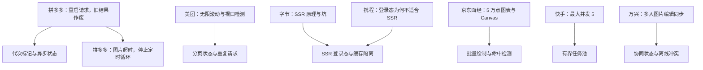
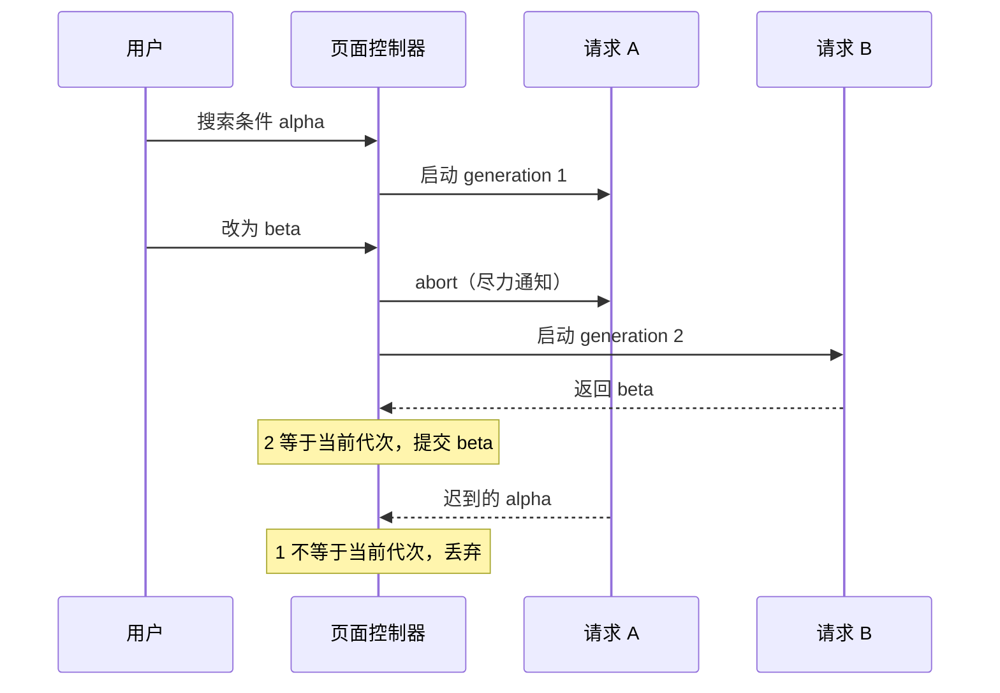
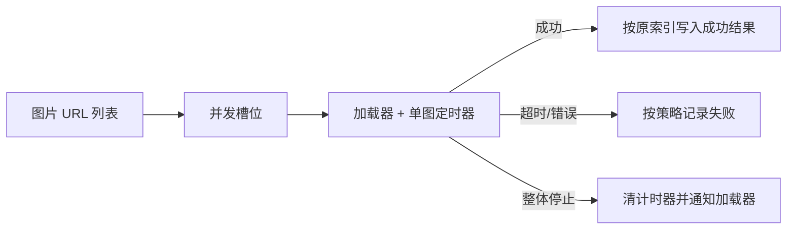
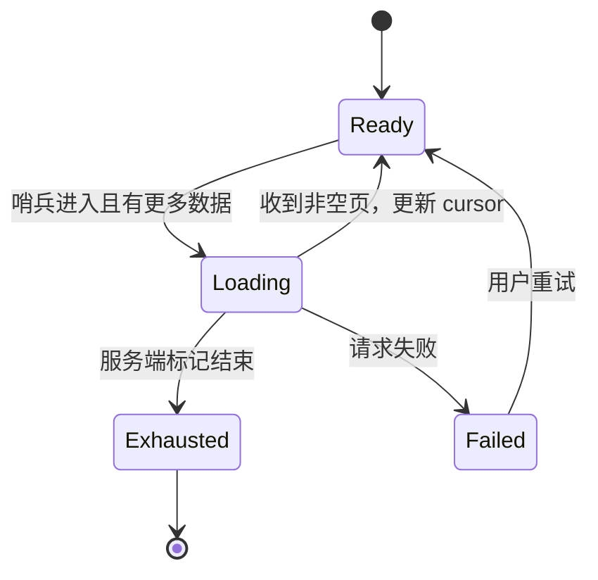
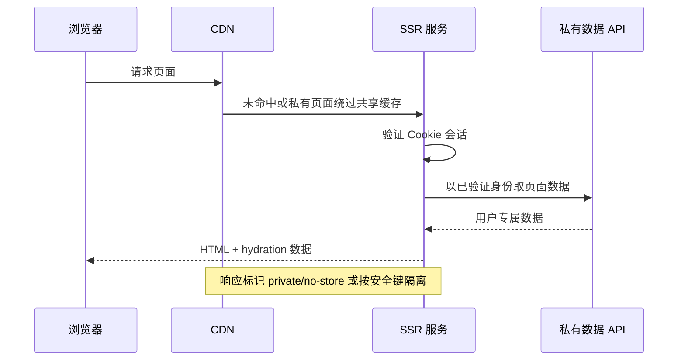
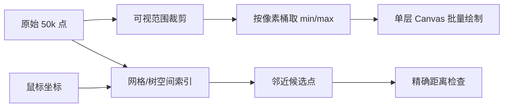
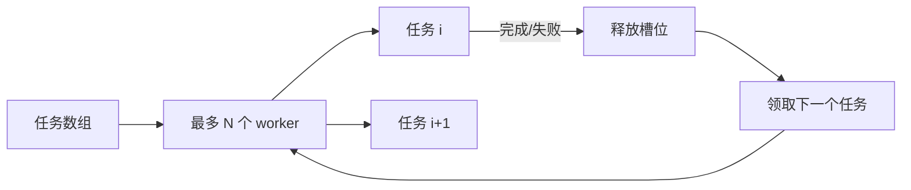
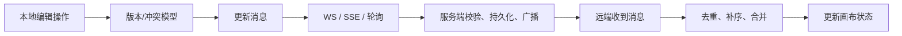

# 大厂前端真实场景题：从面经到可验证实现

面经里的“一道场景题”通常只记录一句话，真正要评估的却是你如何补齐约束、找到竞态或资源边界、写出可检查的实现。本文把七道公开记录过的前端面试场景重构成练习题。原始报告是候选人个人回忆，不代表公司官方题库；题干的补充限制、图、追问树和验收标准是本文为练习所作的改写，不冒称面试原话。

配套手写异步实验位于仓库文件 `scripts/content-labs/interview/stale-generation.mjs`。它覆盖“新请求先返回、旧请求后返回”的常见竞态，并用手动 deferred 控制时序，无需 sleep 或外部服务。

## 0. 阅读地图与证据边界

图中实线节点代表原始面经实际出现过的主题；下面的具体验收输入和追问树是教学重构，用于把模糊记录变成可练习的题目。



读图时先由左侧的公开回忆确认“实际报告过什么”，再沿箭头看本文抽取的工程主题。图不表示各公司采用了本文方案，也不表示这些追问都曾在该场面试中出现。

| 公开报告 | 日期、岗位与轮次（按正文核对） | 报告中确实出现的题目线索 | 原始来源 |
|---|---|---|---|
| 拼多多笔试记录 | 2026-09-13；正文明确为笔试，场次序号与届别未说明；完整职位名称未披露，前端方向来自上下文 | Promise 并发重启时让旧结果作废 | [拼多多笔试原文](https://www.nowcoder.com/feed/main/detail/f184630a893040e4acbf929f8eb0f2c5) |
| 拼多多前端春招面经 | 页面当前显示 2023-05-24（已编辑）；作者职业标签为前端工程师；正文列出 3/1、3/8、3/10 三轮，轮次日期未单独标年份 | 一组图片加载超时抛错；可停止的 setTimeout 循环；超时请求 | [《非科班前端的春招结束了》](https://www.nowcoder.com/discuss/479016572799942656?sourceSSR=subject) |
| 美团前端面经 | 发布于 2024-11-23；前端工程师；自述标题日期为 4/15，题目归于一面 | 无限滚动、视口检测及所用 API | [《4.15美团一面（实习-前端）》](https://www.nowcoder.com/discuss/689797806030163968) |
| 字节前端经验汇总 | 发布于 2020-04-29；前端工程师；文章整理多轮面试题，SSR 题未标明具体轮次 | SSR 原理、解决的问题及 CPU/内存、缓存、TTFB 等坑 | [《两年半字节前端面经分享》](https://www.nowcoder.com/discuss/353156391919624192) |
| 携程前端实习面经 | 面试时间 2026-08-13；实习前端；文章未逐项标注轮次 | SSR/CSR 区别、适用场景及登录态为何不适合 SSR | [《携程前端面经》](https://www.nowcoder.com/feed/main/detail/77fd82067ded4d09a8fe21682d6d5204) |
| 京东场景题汇总 | 页面自述为五年前端面试总结，京东部分未给每题对应轮次；作者标注京东面试 | 长列表、ECharts 五万条数据、Canvas/SVG、离屏渲染与性能监控 | [《五年前端面试总结》](https://www.nowcoder.com/discuss/792083064158507008) |
| 快手前端面经 | 页面当前显示 2023-05-24（已编辑）；作者职业标签为前端工程师；正文列出 4/4 一面、4/10 二面、4/17 三面，轮次日期未单独标年份 | 实现最大并发数为 5 的 `addTask` 类 | [《非科班前端的春招结束了》](https://www.nowcoder.com/discuss/479016572799942656?sourceSSR=subject) |
| 万兴科技前端面经 | 页面显示 03-23；前端一面；年份未在可访问正文顶部完整显示 | 图库协同编辑，以及不使用 WebSocket 时是否还能保持图片状态一致 | [《万兴科技前端一面》](https://www.nowcoder.com/discuss/865618997453123584?sourceSSR=enterprise) |

日期只代表原帖页面给出的发布时间或面试时间，不推断招聘届别。最后一条的来源时间字段在可访问页面中不含年份，因此明确保留为未知。报告者经历属于第一人称回忆，不是公司发布的正式题目说明。

## 1. 异步代次：重新搜索后旧响应不能覆盖新结果

**真实题目线索：** 拼多多 2026-09-13 的公开记录明确写到“Promise 并发重启与老结果作废”。这里把它作为竞态控制练习，不声称这段详细规格出现在原题中。

### 先问清输入和保证

用户快速改筛选条件时，请求 A 先发，随后请求 B 发出，但 B 可能先返回。需要明确题目要求的是“最后一次发起的请求胜出”，还是“最后一次成功的响应胜出”。这里采用前者：只允许当前代次提交结果；当前代次失败则显示错误，不回退显示已过期请求的数据。

还要问是否能真正中断底层工作。Promise 本身没有通用的取消协议；`AbortSignal` 只对明确支持它的 API 有效，而且取消不等于撤销已经写入的服务端副作用。本文实现用 signal 尽力通知旧任务，同时用代次检查保护 UI 状态。

| 输入与状态 | 约束 |
|---|---|
| 每次用户动作 | 启动一个新代次，并使之前的代次失去提交资格 |
| 响应 | 仅当前代次写入数据或错误状态 |
| 旧任务 | 可以忽略 AbortSignal；迟到 resolve/reject 仍不能更新 UI |
| 组件卸载/用户取消 | 使当前代次失效，清理活动标记；不能假装撤销已发生副作用 |
| 结果顺序 | 由请求发起代次决定，不由响应到达顺序决定 |

### 时序图与不变量

图里重点看请求 B 发起时的代次变化。A 可以继续在网络层运行；它的问题不是仍占用资源，而是它已经不再拥有写 UI 的资格。



不变量是“可提交的代次始终只有一个”。只在 `await` 之后核对代次，能防止旧成功结果覆盖状态；在 `catch` 里做同样检查，能防止旧错误覆盖新成功；在 `finally` 里比较请求 ID，能防止旧任务清理掉新任务的活动标记。

### 手写实现的取舍

运行下面的实验会触发完整的竞态测试，文件同时导出可供复用的控制器。`launch(work)` 把 signal 和代次交给任务；任务可以检查取消，也可以忽略它。两种情况下结果都由 `generation` 兜底。

```sh
node scripts/content-labs/interview/stale-generation.mjs
```

预期输出：

```text
stale-generation: 48 assertions passed
```

Node 的 `assert/strict` 会在任一行为不符时抛错并返回非零退出码。数字是脚本实际累计的断言数；如果后续调整了断言，输出应随实际运行更新。

实现中没有全局 sleep。测试通过 `deferred()` 手动决定哪一个 Promise 先 resolve 或 reject，所以旧新交错的执行顺序是确定的。特别地，旧 A 会分别在新 B 仍 pending 时先 resolve 和先 reject；每次 A 的 `finally` 完成后都断言活动状态仍为 true，再让 B 成功提交。并发限制器测试同样手动释放工作槽，检查最大活跃任务数不超过上限。

### 失败反例与追问树

常见失败是每个请求都无条件 `setState(data)`。第二种失败是仅在成功分支检查代次，却让旧请求的 `catch` 显示“网络错误”；第三种失败是旧请求的 `finally` 总把 `loading` 设成 `false`，让仍在进行的新请求看起来已结束。

面试官可以按下面路径继续追问。分支上的答案需建立在题目业务保证之上，不能把示例决策说成面试原题的隐藏标准。

| 先问 | 如果是 | 如果不是 |
|---|---|---|
| 最后发起者获胜吗？ | resolve 与 reject 都检查代次 token；旧请求支持 abort 时传 signal，不支持时仍以 token 防写 | 先定最后成功者或按输入顺序提交的规则 |
| 请求按输入顺序提交吗？ | 缓冲完成项，等前序索引就绪后再发布 | 按字段定义合并策略，不能直接“最后响应覆盖” |
| finally 如何清理？ | 只有同一代次能清理当前请求状态 | 若规则不同，按明确的活动任务身份清理 |

30 秒回答可以这样组织：“这题是异步竞态，我用递增代次标记最后一次发起的任务。响应和错误提交前都检查代次，旧任务即便忽略 abort 也不能写 UI；finally 仅清理相同代次的状态。”

2 分钟回答要补充失效边界：“AbortSignal 是资源节省手段，不是正确性保证，接口可能不支持，或请求已经到服务端。正确性由 token 校验保障。取消也不能撤回服务端已经完成的写入，所以写操作要靠幂等键或业务补偿；本题搜索是读请求。测试用 deferred 固定让 B 先成功、A 后成功/失败，确认 UI 只出现 B。”

### 验收指标

| 检查项 | 验收输入 | 通过条件 | 失败证据 |
|---|---|---|---|
| 旧成功迟到 | A、B 同时挂起，先 resolve B，再 resolve A | 状态只提交 B | 可见状态变为 A |
| 旧失败迟到 | B 成功后再 reject A | 只展示 B，错误列表为空 | 旧错误覆盖成功状态 |
| 当前失败 | 当前请求 reject | 恰好展示当前错误，活动状态归零 | 错误丢失或 loading 卡住 |
| 取消语义 | 任务先计数一次外部副作用，再取消并完成 | UI 不提交；副作用计数不回滚 | 声称取消“撤销”了副作用 |
| 并发上限 | 5 个任务、限制值 2 | 峰值活动数为 2，返回数组仍按输入顺序 | 峰值超过 2 或结果错位 |

## 2. 图片批量加载：单张超时、整体失败与停止轮询

**真实题目线索：** 拼多多前端一面回忆包含“一组图片加载，超时抛错”；二面记载了“写可停止的 setTimeout 循环”和“超时请求错误”。本文将这些记录组合为两阶段练习。原帖没有说明并发策略、超时范围或成功率指标。

### 澄清批次的失败策略

先问图片要全部成功，还是允许部分成功。对于头像墙或商品卡片，常见策略是单图超时后记录失败占位，其他图片继续；对于必须齐全的拼图预览，才可能使用整体失败。还要问是否限制并发、是否要保留输入顺序，以及“停止”是停止创建未来计时器、取消正在进行的请求，还是只忽略未来回调。

逐张 `Promise.race([load(), timeout()])` 只决定哪个结果先被观察，不会自动清除 timeout，也不必然停止 `load()`。超时拒绝后任务仍可能继续工作；应清理计时器，并在底层支持时传 AbortSignal。



图中“失败”不必然等于“整批失败”。选择部分成功时，结果数组仍与输入一一对应；整体失败时，必须说清楚第一处失败是否会停止尚未开始的任务。

### 可解释的实现路径

浏览器原生 `Image` 没有通用的 AbortSignal 接口。可以在超时后将监听器移除并把 `src` 清空作为尽力停止，但这不是服务器端取消保证。对 `fetch` 图片流可使用 `AbortController`，但跨域策略、解码成本和缓存行为仍会影响端到端时间。

如果在白板上手写，先写好“单张加载器”，明确 resolve/reject；再包一层超时并在 `finally` 清理 timer；最后包并发池。不要先写一个难以定位的嵌套 `Promise.all`。用 `Promise.allSettled` 表达“每张都要有结果”；用 `Promise.all` 表达“任一拒绝使批次 Promise 拒绝”，但注意它同样不会自动取消其余任务。

### 失败反例与追问树

超时定时器不清理会让已经成功的图片仍挂着计时任务。未做并发上限时，几百张图片会同时占用网络连接与解码资源。按完成顺序 push 结果会破坏输入和缩略图索引的对应关系。

| 先问 | 决策分支 | 实现检查 |
|---|---|---|
| 业务允许部分图片缺失吗？ | 允许则用 allSettled 或逐项 `{status, url, image/error}`；不允许则定义首错停止策略 | 需要停止时，尽量取消仍可取消的任务 |
| 图片数很多吗？ | 很多则限并发、按优先级或视口加载；不多则批次加载 | 每张都要超时与清理；离屏暂停应避免无意重启 |
| 定时轮询能停止吗？ | 正在 schedule 时保存 timer id，stop 后不再 schedule | 已排队 callback 执行时也检查 stopped token |

30 秒回答：“我先确定批次是全成功还是允许部分成功。单张加载封装超时并在 finally 清 timer，批量层再加并发上限；如果支持 AbortSignal 就传给底层。停止循环要阻止下一次 schedule，也要让已排队的回调检查 stopped 标记。”

2 分钟回答：“Promise.race 只是让调用方先拿到超时结果，本身不会取消慢任务。单张超时、批次失败、整体 stop 是三个层次；需要分别定义状态与清理。结果按输入索引保存，避免完成顺序造成错位。验收时要同时造出快图、慢图和失败图，并确认超时误差、计时器清理、并发峰值及 stop 后不再发起任务。”

### 可量化验收

为浏览器练习设定 8 张图、并发限制 3、单图超时 1 秒、测试服务器分别提供 100 ms 成功、1.5 s 慢响应和 404。通过条件为：任一时刻活动请求不超过 3；慢图在 1.0 s ± 100 ms 被标记超时；其他图片按既定部分成功策略结束；批次完成 100 ms 后 0 个 timeout 仍待执行。按下 Stop 后，等待 2 秒，未启动任务数保持不变。失败时保留网络面板和活动请求计数，停止后清理页面、timer、观察器与测试服务器。

## 3. 无限滚动：观察触底、分页去重与加载背压

**真实题目线索：** 美团前端一面报告在 2024-11-23 发布，作者将这题列入其“4.15”实习前端一面题目，其中明确追问如何实现无限滚动、如何判断元素在视口内、用什么 API。本文将游标分页、重复请求与反压补充为工程化扩展。

### 先明确分页协议

“到底就加载下一页”依赖后端分页契约。先确认用 offset/page 还是 cursor，接口怎样告知结束，以及同一个 cursor 重复请求应返回怎样的数据。若列表可能在分页期间发生新插入或排序变化，offset 可能跳项或重复；稳定排序加 cursor 通常更容易定义边界，但 cursor 本身也要由服务端保证稳定。

观察器负责发现加载哨兵进入根视口附近，不负责请求去重。请求控制状态至少需要 `loading`、`hasMore`、当前 cursor 和已接收记录 ID；只靠 `IntersectionObserver` 会在哨兵一直可见时连续触发。



进入 `Loading` 后先锁住重复触发，再发请求；成功或失败都要回到可解释的状态。服务端返回空页时如何处理取决于契约：可能表示结束，也可能是过滤后的中间页。

### 方案与边界

`IntersectionObserver` 的 `rootMargin: "0px 0px 500px"` 可提前半屏左右预取，减少用户看到空白的概率，但会提前消耗流量。列表超过数千行时，无限追加本身会积累 DOM；应组合虚拟列表或分段清理，并确保键盘和屏幕阅读器仍能浏览内容。

如果排序筛选条件改变，旧游标不再适用。重置列表时应启动新 generation，清空旧 cursor 和分页状态；迟到的旧页不可 append 到新条件结果。这个细节与第一题的“旧代次不能提交”共用一个机制。

### 手写核心与失败反例

示意代码：未通过自动验证。白板上先定义分页状态与去重提交，再按题目要求连接真实 API：

```js
let loading = false;
let hasMore = true;
let cursor = null;
const seen = new Set();

function publishItems(items) {
  for (const item of items) {
    if (seen.has(item.id)) continue;
    seen.add(item.id);
    append(item);
  }
}
```

同一示意程序的加载步骤先门控、再提交，最后清理活动状态；本次未运行浏览器分页 API：

```js
async function loadNext() {
  if (loading || !hasMore) return;
  loading = true;
  try {
    const page = await fetchPage({ cursor });
    publishItems(page.items);
    cursor = page.nextCursor;
    hasMore = page.hasMore;
  } finally {
    loading = false;
  }
}
```

这是面试伪代码，缺少 `catch` 错误 UI、重复 cursor 检测、卸载时 disconnect、筛选 generation 与虚拟化，因此不要将它描述为生产完成版。真实验收还要区分网络失败和“没有更多数据”，避免失败后 `hasMore=false` 永远无法重试。

失败反例包括：哨兵留在视口导致重复发请求；每个分页都直接 append 造成重复项；offset 因排序变动跳过记录；页面卸载后 observer 仍持有回调；筛选变更后旧请求把前一个列表追加回来。

追问树先判断后端协议，再决定前端机制：

| 条件 | 设计方向 | 验收重点 |
|---|---|---|
| 页面数据会变化 | 询问稳定排序、唯一 ID、cursor 语义与快照边界 | 不跳项、不重复，版本边界可解释 |
| 内容会不断增长 | 使用虚拟化与观察器，设 DOM 上限和滚动锚点策略 | 节点数、滚动位置与可访问性 |
| 过滤或路由会变化 | 尽量中止旧任务；用代次校验并重置 cursor | 旧结果不追加到新列表 |
| 数据稳定且总量有限 | offset/page 也可行，仍需去重和 end 条件 | 边界页与空页的含义 |

30 秒回答：“哨兵进入视口时尝试加载，但 `loading` 锁和 `hasMore` 是防重、停止条件；分页结果按 ID 去重并遵从 cursor 契约。筛选变化重置游标并让旧代次失效。数据长到一定规模时加虚拟列表，页面销毁时断开 observer。”

2 分钟回答需补充可观察指标：按设备测首屏时间、每页返回量、重复触发数、重复 ID 数和 DOM 节点数；例如测试目标可定为 20 页滚动中每个 cursor 最多发一次请求，重复 ID 为 0，列表 DOM 节点保持在虚拟窗口上限加缓冲范围内。具体阈值应由产品目标给出，面试中明确这是建议验收值而不是原题要求。

## 4. SSR 与登录态：首屏、缓存隔离和水合一致

**真实题目线索：** 字节前端公开经验总结记录了 SSR 原理、解决的问题以及 CPU/内存、缓存、TTFB 等风险；携程 2026-08-13 的实习前端面经直接列出 SSR/CSR、使用场景及“登录态为什么不适合 SSR”。下面把两条回忆合成一个系统设计练习。

### 约束澄清

先问首屏内容是否必须被搜索引擎读取、服务端是否持有可信用户身份、个性化数据能否公共缓存，以及页面是否要求首屏交互。SSR 可以先输出 HTML，再由浏览器加载脚本并 hydrate（绑定客户端交互）；它不会自动让数据最新，也不会自动让登录数据安全。

登录态 SSR 不是绝对“不可以”。服务器能从安全 Cookie 验证会话并按用户渲染，但缓存必须按身份隔离，页面 HTML 也不能进入共享公共缓存。若身份只在浏览器本地存储，服务端请求时无法读取它；把访问令牌塞进 URL 则会进入日志、历史和 referrer 等路径，不能作为补救。

| 约束 | 设计结果 |
|---|---|
| 公共页面、SEO/分享预览重要 | SSR 或静态生成可提供可索引 HTML；明确缓存与更新策略 |
| 私有页面、服务器可安全读取 HttpOnly Cookie | 服务端认证后渲染用户内容，并使用私有/禁止共享缓存 |
| 认证只在浏览器存储 | 服务端只能给匿名壳，再客户端请求私有数据；衡量闪烁与首屏成本 |
| 首屏高度交互、SEO 无要求 | CSR 常更简单；仍需骨架、错误状态与性能预算 |

### 请求链和租户边界

图中要检查数据在哪个缓存边界停下。HTML、数据请求和 CDN 页面缓存都可能泄漏用户专属内容；仅在 API 路由校验登录，并不能修复共享 HTML 缓存已命中其他用户页面的问题。



同一个服务进程可能同时处理多个用户，因此请求对象、缓存 key、数据加载器不能放在未经隔离的全局可变状态里。缓存公共 HTML 时要证明其中没有个性化字段；缓存私有响应则应按框架、CDN 和代理的实际规则配置并验证，不能只靠口头约定。

### 性能权衡和反例

SSR 把一部分渲染工作移到服务器，可能提升可见文本首屏，却增加服务端 CPU 和内存；数据必须串行拉取时 TTFB 可能上升，服务器故障也可能让用户直接遇到白屏。静态生成适合变化频率低且不含私有数据的页面；流式 SSR 能更早发送部分 HTML，但要处理边界加载、错误与 hydration 对齐。

失败反例：用全局单例缓存当前用户数据；把个人 HTML 缓在公共 CDN；服务端和首屏脚本拿到不同 locale/feature flag 导致 hydration mismatch；只看 Lighthouse 单次结果，不拆 TTFB、首字节之后的流式内容和客户端交互时间。

追问树：

| 先问 | 设计方向 | 需要说明的边界 |
|---|---|---|
| 内容需要 SEO 或分享预览吗？ | 需要则评估 SSR/静态生成；不需要则比较 CSR 的 JS 体积、首屏延迟和实现成本 | 动态频率、缓存与失效策略 |
| 内容含用户数据吗？ | 有则说明服务端认证来源、响应缓存和每请求状态隔离；无则可共享缓存 | 公共响应不得包含 token、账号字段或私有内容 |
| 服务端慢或失败怎么办？ | 设置限时、错误页、降级数据和客户端恢复 | 缓存边界、CPU/内存容量与监控 |

30 秒回答：“SSR 在服务端生成首屏 HTML，客户端 hydrate 后接管交互。登录页是否能 SSR 取决于服务端能否安全验证身份，以及 HTML/API/CDN 缓存是否按用户隔离。如果只有 localStorage 里的身份，服务端看不到；公有内容和个性化数据要分缓存策略。”

2 分钟回答补指标：“对匿名页面看 TTFB、LCP 和 HTML 缓存命中；对私有页面检查跨用户缓存串读为 0、认证失败无私有片段、服务端内存和 CPU 在目标并发下留有余量。压测两种不同账号并检查 CDN 响应头和正文；再用禁用 JS、启用 JS 的截图对比水合前后内容一致。SSR 的选择最终由 SEO、首屏、服务端容量与个性化边界共同决定。”

## 5. 海量图表：五万条数据、Canvas 命中和帧预算

**真实题目线索：** 牛客《五年前端面试总结》的京东部分记录了长列表优化、ECharts 五万条数据、Canvas/SVG、离屏渲染、性能监控等问题。报告没有说明数据形状、目标设备或实际图表类型。以下验收参数是练习设定，不声称来自该面试。

### 先定义“支持五万条”

五万条输入不代表画布上要逐一展示五万个独立 DOM 节点。先问屏幕像素宽度、交互是缩放还是 hover、tooltip 是否要求命中原始记录，以及聚合是否可接受。若 1200 CSS 像素宽的折线有 50,000 个采样点，水平像素数远少于数据点数；视图分桶或按像素列保留 min/max，通常比“一点一 DOM”更合适。

还要确认设备像素比。画布 backing store 的像素宽高通常按 CSS 像素乘 DPR 增长，像素总量近似按 DPR² 增长；4 倍 DPR 画布的每层像素面积极约是 1 倍的 16 倍。渲染和命中检测都要考虑缩放转换。

### 从数据到像素的流水线

图先帮助区分“显示采样”和“原始数据查询”。显示层可降采样，交互层仍能使用原始索引或空间索引找候选点；两者不能混成“扔掉大部分数据”。



50,000 点数仅是数据输入规模。验收对象是经过视口裁剪和像素级降采样后绘制了多少图元、一次交互检查了多少候选，以及屏幕更新是否在预算内。

### 可比较的实现方案

Canvas 将大量图元集中画在位图上，DOM 数量低，但浏览器不会替每个点做 DOM 事件分发。简单 hover 可以在鼠标移动时做网格候选查询，再进行精确距离平方比较。SVG 每个点独立表达、易绑定语义和事件，但五万元素的 DOM 和布局/绘制成本需要实测。WebGL 适用于更大量且批量 GPU 绘制的场景，但开发复杂度和上下文丢失恢复也要计入。

命中检测可以先把点映射到固定大小网格：建立索引约 O(n)，鼠标查询只访问所在格及邻格候选。数据密度不均时，四叉树或 R-tree 更灵活，但维护成本更高。若图表是连续曲线，命中曲线可用空间邻近和局部线段距离，不应拿鼠标距离每一个原始点暴力扫描。

### 失败反例与追问树

把 50,000 个点都创建成 SVG 圆形并绑定独立事件，可能造成 DOM 和事件处理负担；把所有点每帧重画且不节流 pointermove，交互处理可能超过一帧；只用颜色或面积粗看“流畅”，无法复现特定设备下的掉帧。

| 先问 | 设计方向 | 边界 |
|---|---|---|
| 五万数据都必须可见吗？ | 不必则按视口读取；必须可见则判断聚合/降采样是否符合业务 | 聚合可用像素桶、min/max、LOD；不能聚合时考虑 WebGL、分块画布或分层渲染 |
| 鼠标要定位原始点吗？ | 要则用空间索引找候选，再精确命中；不要则命中聚合桶 | 聚合桶提示返回统计范围，不能伪装为原始点 |

30 秒回答：“先分离输入规模和可见图元数。根据可视窗口裁剪，再按像素列保留趋势与极值；Canvas 批量绘制减少 DOM，鼠标命中用空间索引找候选后做距离检查。验收看目标设备帧耗时、命中延迟和数据完整性，SVG/WebGL 按语义与规模取舍。”

2 分钟回答补足采样和边界：“如果业务要求任意原始点精确 hover，降采样只作用于显示，原始数据或分块索引仍保留。坐标要从 CSS 像素映射到 backing store，并处理 DPR、缩放和平移。交互频繁时在 animation frame 中合并 pointermove；超过帧预算时再评估 OffscreenCanvas/Worker，注意数据传输与浏览器支持。最终要以目标设备的 95 分位帧耗时及命中误差作判断。”

### 可复现验收

在 1280×720 CSS 像素、DPR=1 和 DPR=2 的浏览器环境加载 50,000 点固定种子数据，分别运行 SVG、Canvas 与降采样 Canvas。练习阈值设为：连续 10 秒拖动缩放期间帧耗时 p95 不高于 16.7 ms；点命中查询 p95 不高于 8 ms；误差半径 6 CSS px 内命中率至少 99%；输出显示图元数、DOM 节点数、脚本耗时与帧分布。阈值是本练习基准，应按业务设备重定，不是原帖要求。关闭页面并清除观察器、Worker 和动画帧。

## 6. 并发任务池：限制同时开始的工作数

**真实题目线索：** 拼多多二面记录可停止的定时循环和 timeout 请求；快手前端二面记录“实现 addTask 类，最大并发量 5”。本节把它们区分为“限制同时执行的任务数”和“可以停止后续调度”两个可组合能力。

### 约束和顺序

需要先定义任务何时启动、失败后是否继续、返回结果是按完成顺序还是输入顺序，以及 stop 对运行中任务和队列中任务分别意味着什么。并发上限约束活动任务数；它不自动限制任务总量、内存占用、重试风暴或请求速率。

一个最小池维护 `nextIndex` 和固定 worker 数。worker 每完成一个任务就领取下一个索引，任务从而按输入顺序分配，但结束顺序可以不同。结果数组用原始索引写入，才能保留输入顺序。



图中每个 worker 都会循环领取任务直到没有任务。若失败策略是 fail-fast，必须明确是否取消其他 worker；简单 `Promise.all` 拒绝并不会自动停止它们。

### 实现选择

仓库脚本的 `runWithConcurrency(tasks, limit)` 是一个最小实现：参数为惰性任务函数数组和正整数上限，返回按输入顺序排好的结果 Promise。它不做重试、取消、速率限制或 UI 状态管理。超过 15 行的实际代码放在单独脚本，方便运行和逐断点检查。

生产队列可能还需要优先级、公平性、超时、暂停/继续、失败重试退避和信号传播。把所有任务一次性包装成已启动 Promise 再交给池子，已经失去延迟启动的机会；应传函数而非 Promise。本文的池子对空数组返回空数组，非正整数限制值会以 `RangeError` 拒绝。任务函数 reject 时，池 Promise 会按 `Promise.all` 的语义尽早 reject；这个实现不会自动取消其他运行中的 worker，且它们完成后还可能继续领取排队任务。若要求 fail-fast 停止新任务，需额外加 stopped 标记，并按底层能力取消运行任务；当前实验验证了“不自动取消”的行为。

### 失败反例与追问树

`Promise.all(tasks.map(task => task()))` 会在构造数组时立刻启动全部任务。每完成一个任务都开启 interval 而不清除旧 interval，会重复调度。即使队列停下来了，已启动的任务仍可能继续写数据；还需在提交点应用失效 token，或由任务配合 AbortSignal。

| 先问 | 方案 | 边界 |
|---|---|---|
| 任务失败怎样处理？ | 继续则收集 allSettled 风格结果；停止则不再分配下一个 index | 已运行任务若支持则传 AbortSignal；不支持则等待完成并阻止过期状态提交 |
| 要求 QPS 上限吗？ | 要则增加令牌桶/漏桶；不要则并发池即可 | 并发限制不能替代时间窗口速率限制 |

30 秒回答：“我让池子接收惰性函数，用最多 N 个 worker 共享 next index，每个完成后领取下一个；结果写回原始索引以维持输入顺序。失败继续或停止调度先按要求决定。并发数不等于每秒速率，若有 QPS 要另加令牌桶。”

2 分钟回答：“需要分别定义池的三类状态：排队、运行、完成/失败。stop 通常只阻止领取新任务；对运行任务，要看底层 API 能否 abort。并行 Promise.all 的拒绝不是 cancellation，fail-fast 要显式通知其他 worker。测试用 deferred 同步放行任务，观察活跃计数峰值、结果顺序、异常后是否补槽及 stop 后启动数。”

## 7. 协同图片编辑：传输、并发修改与恢复

**真实题目线索：** 万兴科技前端一面公开回忆写到图库项目的协同编辑功能，并问“不用 WebSocket 能否让多个用户图片状态一致”。作者还记录了 WebSocket 的缺点与图片裁剪/旋转。本文只把这些作为面试主题证据；CRDT/OT 比较、断线协议和验收均为教学扩展。

### 先把“一致”说具体

两人编辑同一图片时，“状态一致”可能指所有人最后看到相同结果，也可能要求每次拖动都实时看到、能离线编辑、保留历史或支持撤销。需要问哪些字段可同时编辑：图片整体变换、裁剪框、文字标注、图层顺序还是光标。字段冲突决定方案，不是先选 WebSocket 再硬套同步模型。

WebSocket 是双向长连接传输，不是冲突解决算法。SSE、长轮询或定时拉取也能传输更新，但延迟、带宽、服务端推送能力和双向交互体验不同。多人同时更新时还要有版本、操作顺序或可合并的数据模型。

### 同步流水线与选择

图里把“传输方式”与“状态合并”拆成两层。WebSocket 换成 SSE 只改变传输路径，不会自动定义同一用户先后操作或两人同时旋转同一图层时谁胜出。



常见扩展方案包括：单服务器为操作编号并串行广播；以操作日志重放并用版本检测冲突；允许离线并发编辑时用 OT 或 CRDT 一类合并模型。选择前需评估冲突语义、存储增长、离线要求和实现复杂度。

### 失败反例与追问树

盲目使用“最后写入胜出”会让较早但后到网络的操作覆盖新操作。断线重连直接发送全部本地快照可能覆盖别人刚保存的数据；至少要带文档版本或操作 ID，服务端识别重复消息。只广播而不持久化会丢失刷新后的状态；只保存最终图片 URL 又无法恢复可编辑对象模型。

| 约束 | 候选设计 | 应追问的边界 |
|---|---|---|
| 双向低延迟且常驻连接 | 评估 WebSocket | 鉴权、重连、房间隔离、消息顺序 |
| 服务端单向推送 | SSE 可满足通知，客户端改动仍用 HTTP | 代理缓冲和断线恢复 |
| 低频更新 | 轮询或条件请求可能更简单 | 请求间隔、负载和更新延迟 |
| 多人很少改同一字段 | 服务端版本检查与冲突提示可能足够 | 乐观锁冲突如何向用户呈现 |
| 多人会同时编辑或需要离线 | 定义操作语义，再比较串行化、OT 或 CRDT | 操作日志、补发、去重、合并及冲突 UI |

30 秒回答：“WebSocket 只提供双向传输，不负责合并冲突。不用它也能借 SSE、轮询或长轮询同步，只是延迟、连接成本和服务端复杂度不同。先定义对象模型、同时编辑范围、断线恢复和一致性目标，再决定服务端版本排序还是 OT/CRDT。”

2 分钟回答补故障处理：“每个操作带文档 ID、客户端 ID、单调操作序号和基础版本；服务端校验权限、去重、持久化后广播。客户端发现序号缺口时请求补齐或拉快照。重连补发操作日志，不直接覆盖全量快照。验收多浏览器并发修改、重复消息、乱序消息、断网恢复和服务端重启，检查最终状态一致、操作不丢失且不会重复应用。”

## 8. 把面试题答成一套可检查的交付物

这七题可统一使用四步答法：复述题意并补缺失约束；画状态或数据流；指出正确性不变量与最坏路径；给一个能用输入、指标、失败证据复现的验收。这样既能写题，也能解释为什么某个简短实现还不够生产化。

当面经只有一句话时，不要自动补写成“公司规定答案”。可把练习拆成两列：**报告者原文确认的题目主题**与**为了验证理解新增的工程条件**。比如“图片超时错误”有来源，“并发必须为 3”是我们设置的验收参数，两者要明确区分。

## 真实验收：运行异步代次实验

在 Node.js 24.16.0 下，于仓库根目录运行：

```sh
node scripts/content-labs/interview/stale-generation.mjs
```

实验以手动 deferred 控制旧任务、新任务的完成次序，包含至少以下断言：新成功结果覆盖旧代次；旧成功结果不会回写；旧失败不会污染新成功；当前失败会被上报；当前活动标记在成功、失败、取消后归零；组件 dispose 后不接受新任务且屏蔽迟到结果；取消不会回滚此前发生的外部副作用；2 槽位任务池峰值不超过 2 且结果顺序与输入一致。

通过阈值是进程退出码 0，输出断言总数。如果失败，Node 会指出首个不符合预期的断言和调用栈。该脚本不启动网络、不依赖真实时间等待；任何断言失败均可重复运行。清理方式为进程结束即释放所有 deferred Promise；脚本不创建文件、端口或后台服务。

| 真实验收字段 | 值 |
|---|---|
| 输入 | 两组可控 deferred Promise；一个已发生副作用的任务；5 个惰性任务 |
| 环境 | Node.js 24.16.0，仓库根目录 |
| 命令 | `node scripts/content-labs/interview/stale-generation.mjs` |
| 通过阈值 | 断言全通过、退出码 0；最大并发观测值为 2 |
| 可观察输出 | `stale-generation: 48 assertions passed`（本次实际运行值；计数由脚本运行时统计） |
| 失败证据 | 非零退出、assert 错误位置与实际/预期状态 |
| 清理 | 无需清理；进程退出后脚本内存释放 |

## 面试回答速记

### 30 秒

场景题先把结果排序、取消语义、失败策略和资源上限问清楚；再指出核心不变量。例如异步请求“只有最新代次能提交”，无限滚动“同一个 cursor 不重复请求”，图片加载“每张单独超时且总并发有上限”。最后给一个失败路径和验证指标。

### 2 分钟

先陈述默认假设并请面试官确认；画出请求/状态/资源流；把正确性机制与资源优化分开；比较一个替代方案并说明代价；最后说如何用可控输入和观测指标证明结果。对于只有个人回忆的面经，不能把扩展出的条件包装成公司原话。

## 自测题

??? question "为什么 abort 不能替代请求代次校验？"
    底层 API 可能不支持取消，请求可能已完成服务端副作用，或者响应已经排入任务队列。代次校验在提交时保证旧任务没有更新当前状态的资格；abort 主要用于尽量节省资源。

??? question "Promise.race 的超时为什么不代表慢请求已停止？"
    race 只决定外层 Promise 最先采用哪个结算结果，不会自动清除 timer、关闭网络请求或终止解码。必须分别清理定时器，并在底层支持时传 AbortSignal。

??? question "无限滚动为什么要同时维护 loading 和 hasMore？"
    哨兵可能持续处于视口，引发重复观察回调；loading 阻止同页并发请求，hasMore 在服务端声明结束后永久挡住后续调度。二者职责不同。

??? question "五万点图表如果降采样，怎样还能找到原始点？"
    只降采样绘制数据，原始数据仍保留或通过分块接口可查；以空间索引将鼠标坐标映射到少量原始候选，再执行准确距离检查。若产品只要求聚合桶提示，就直接命中桶并返回统计范围。

??? question "最大并发数为 5 是否意味着每秒最多发 5 个请求？"
    否。它表示同时未完成的任务最多 5 个。若每个任务 10 ms 就完成，短时间启动速率可能远大于每秒 5 个；QPS 限制需要时间窗口、令牌桶或漏桶策略。

## 深入阅读

- [前端系统设计题：虚拟列表、无限滚动、拖拽、富文本与低代码](frontend-system-design.md)：读第 3 节理解观察器与分页策略，第 6 节理解 OT/CRDT 的状态模型。
- [手写 Promise 与异步控制](promise-implementations.md)：读 Promise 静态方法和并发控制，比较本文“结果代次”和“任务池槽位”的不同职责。
- [浏览器特性手写](browser-features.md)：读 IntersectionObserver 与虚拟列表实现，查看浏览器资源释放的代码路径。
- [手写工具函数](utility-functions.md)：复习缓存、数组结构及如何给工具补上边界行为。
- [真实前端面试题库：按公司与轮次复盘](../resources/real-interview-question-bank.md)：对照更广的题目目录，查看来源类别和轮次披露边界。
- [面经来源与证据清单](../assets/research/interview-provenance-20261012.json)：核对公开帖子、日期、岗位、轮次与正文锚点。
