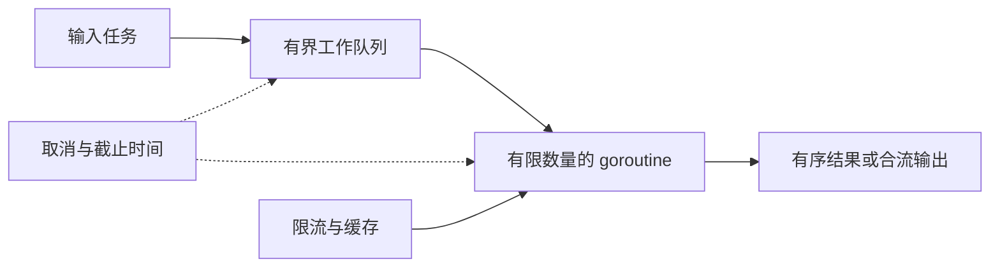

# Go 并发实战 工作池、流水线与共享状态

接口服务经常要并行访问多个下游，但并发开太多会挤满连接池；其中一个请求失败时，其他工作还可能继续占资源。本页用十个问题练习“工作由谁拥有、何时取消、谁负责关闭”这三个工程判断。



读图时先沿实线看数据所有权，再沿虚线检查停止信号是否能抵达每个阻塞点。生产者关闭自己创建的输入，合流协调者在所有发送者退出后关闭输出；接收者通常不应抢先关闭发送方拥有的 channel。

## 运行与验收

从仓库根目录运行：

```sh
cd scripts/teaching-labs/go
go test ./...
go test -race ./...
```

通过标准是两条命令都以 `ok example.com/teaching-labs/go` 结束。测试中的并发取消不依赖外部网络；临时资源只在测试进程内创建。失败时先看失败的 `TestGxxx` 名称，再读对应实现和输入边界；race 报告给出并发读写的调用栈。

## G001–G010 并发任务、请求限制与缓存 {#g001}

### G001 有界订单工作池 {#g001}

输入订单编号，最多同时运行 `workers` 个补全任务，输出必须与输入顺序一致。输入 `[1,2,3]` 和平方函数应得到 `[1,4,9]`；worker 数为 0 必须报错。

#### 先定并发上限，再安排结果位置

结果长度与输入相同，每个输入索引预留一个槽位。worker 数量无效时提前返回，不启动 goroutine。切片不会在并发过程中 append，因此长度固定。

~~~go
if workers < 1 { return nil, ErrInvalidWorkers }
if len(in) == 0 { return []R{}, nil }
if workers > len(in) { workers = len(in) }
out := make([]R, len(in))
errs := make([]error, len(in))
type job struct{ i int }
jobs := make(chan job)
var wg sync.WaitGroup
~~~

#### 让固定数量的 worker 共享任务队列

每个 worker 从 jobs 读索引，再处理对应输入。不同索引只会被派发一次，所以每个结果槽位只有一个写者；这避免了共享 append 所需的额外锁。

~~~go
for w := 0; w < workers; w++ {
  wg.Add(1)
  go func() {
    defer wg.Done()
    for j := range jobs {
      if err := ctx.Err(); err != nil { errs[j.i] = err; continue }
      out[j.i], errs[j.i] = fn(ctx, in[j.i])
    }
  }()
}
~~~

#### 由生产者投递，再等待全部结果写完

投递也要响应取消，否则所有 worker 都退出后，生产者可能永远卡在 channel 发送。关闭任务队列后等待 worker，随后检查每个错误槽位。

~~~go
for i := range in {
  select {
  case jobs <- job{i}:
  case <-ctx.Done(): close(jobs); wg.Wait(); return nil, ctx.Err()
  }
}
close(jobs)
wg.Wait()
~~~

处理结束后逐个检查错误槽位。只有全部任务成功才返回结果，防止调用方把部分结果当成完整订单清单。

~~~go
for _, err := range errs {
  if err != nil { return nil, err }
}
return out, nil
~~~

完整实现见 [WorkerMap](https://github.com/Shyu-x/frontend-interview/blob/f682da9816e3f5454a3f1d8d8cb074d0de53236b/scripts/teaching-labs/go/concurrency.go)，对应测试见 [TestG001WorkerMap](https://github.com/Shyu-x/frontend-interview/blob/f682da9816e3f5454a3f1d8d8cb074d0de53236b/scripts/teaching-labs/go/concurrency_test.go)。让每个 goroutine append 同一个切片会产生数据竞争，也会按完成顺序改变输出。下一步可让某个 worker 失败后取消剩余订单处理。

### G002 多源遥测合流 {#g002}

把两个关闭时机不同的事件 channel 合并为一个输出；所有输入结束时，消费者的 `range` 必须结束。输入 `1,2` 与 `3`，输出集合应包含三项且总和为 6。

#### 让每个输入各自前进

函数先创建一个共享输出 channel 和等待计数器。每条输入各启动一个转发 goroutine；每个 goroutine 只读自己的输入，收到值后尝试写到 out。

~~~go
out := make(chan T)
var wg sync.WaitGroup
~~~

读取和发送都用 select 监听取消，保证接收端提前退出时，发送者也有办法结束。

~~~go
for _, input := range inputs {
  wg.Add(1)
  go func(ch <-chan T) {
    defer wg.Done()
    for {
      var v T
      var ok bool
      select {
      case <-ctx.Done(): return
      case v, ok = <-ch:
        if !ok { return }
      }
~~~

读到一条之后，再单独等待输出端接收。输出端提前停止时，取消分支会让转发者退出，不会遗留在发送操作上。

~~~go
      select {
      case out <- v:
      case <-ctx.Done(): return
      }
    }
  }(input)
}
~~~

#### 等所有发送者退出后再关闭输出

每个转发任务完成时调用 Done。协调 goroutine 等待计数归零后关闭 out，因此不会出现发送仍在进行时关闭 channel 的竞态。

~~~go
go func() {
  wg.Wait()
  close(out)
}()
~~~

完整实现见 [FanIn](https://github.com/Shyu-x/frontend-interview/blob/f682da9816e3f5454a3f1d8d8cb074d0de53236b/scripts/teaching-labs/go/concurrency.go)，对应测试见 [TestG002FanIn](https://github.com/Shyu-x/frontend-interview/blob/f682da9816e3f5454a3f1d8d8cb074d0de53236b/scripts/teaching-labs/go/concurrency_test.go)。若每个转发者都关闭 out，第二个完成者会 panic。下一步可在转发值中加入数据源名称，便于定位异常分区。

### G003 供应商报价扇出 {#g003}

并行请求多个供应商，将各自结果放回对应输入位置；一个供应商报错后，取消其他请求并返回错误。成功输入 `[2,3]` 得到 `[4,9]`。

#### 先定义任务结果和共同取消范围

结果需要带回输入索引，收集端才能恢复输入顺序。buffer 按任务数分配，worker 返回结果时不会因收集端暂时未调度而卡住。

~~~go
child, cancel := context.WithCancel(ctx)
defer cancel()
type result struct { i int; v R; err error }
jobs := make(chan int)
results := make(chan result, len(in))
if workers < 1 { return nil, ErrInvalidWorkers }
if workers > len(in) { workers = len(in) }
var wg sync.WaitGroup
~~~

#### 固定数量 worker 消费索引

每个 worker 从 jobs 取一个索引，调用供应商函数并把值和错误放进结果。错误结果先送达收集端，再取消同组其他调用，这样能返回具体下游错误。

~~~go
for w := 0; w < workers; w++ {
  wg.Add(1)
  go func() {
    defer wg.Done()
    for i := range jobs {
      v, err := fn(child, in[i])
      select {
      case results <- result{i: i, v: v, err: err}:
      case <-child.Done(): return
      }
      if err != nil { cancel(); return }
    }
  }()
}
~~~

#### 停止派发，等 worker 退出后再收集完成

派发器遇到取消就停止并关闭 jobs。协调者等待 worker 全部退出后关闭 results；主 goroutine 收集到关闭后再判断错误和缺失结果。

~~~go
go func() { defer close(jobs); for i := range in {
  select { case jobs <- i: case <-child.Done(): return }
} }()
go func() { wg.Wait(); close(results) }()
~~~

主 goroutine 持续读取 results，把值放回对应索引并记下错误。results 关闭意味着所有 worker 都退出；到这一步再检查缺失结果，才不会和仍在运行的写入并发。

~~~go
out := make([]R, len(in))
seen := make([]bool, len(in))
var first error
for r := range results {
  out[r.i], seen[r.i] = r.v, true
  if r.err != nil && first == nil { first = r.err }
}
if first != nil { return nil, first }
if err := ctx.Err(); err != nil { return nil, err }
~~~

如果没有 worker 返回失败，还要确认每个输入都收到结果；否则把部分报价当成完整集合会造成错误决策。

~~~go
for _, ok := range seen {
  if !ok { return nil, context.Canceled }
}
return out, nil
~~~

完整实现见 [FanOut](https://github.com/Shyu-x/frontend-interview/blob/f682da9816e3f5454a3f1d8d8cb074d0de53236b/scripts/teaching-labs/go/concurrency.go)，对应测试见 [TestG003FanOut](https://github.com/Shyu-x/frontend-interview/blob/f682da9816e3f5454a3f1d8d8cb074d0de53236b/scripts/teaching-labs/go/concurrency_test.go)。只取消、不等待会让函数返回后仍有下游工作。下一步可规定多个供应商同时失败时是返回首错还是聚合错误。

### G004 并发处理但保持报表顺序 {#g004}

输入记录可以乱序完成，输出仍按原始顺序排列。`[3,1,2]` 映射乘 10 后必须是 `[30,10,20]`。非正 worker 数应被拒绝，worker 多于输入时可以缩到任务数量。

#### 让 worker 直接写回任务索引

先创建索引队列和定长结果切片，再启动有限数量的 worker。worker 完成后写入同一索引的槽位，因此完成顺序不会影响最终输出。

~~~go
indices := make(chan int)
out := make([]R, len(in))
for w := 0; w < workers; w++ {
  wg.Add(1)
  go func() {
    defer wg.Done()
    for i := range indices { out[i] = fn(ctx, in[i]) }
  }()
}
~~~

主 goroutine 逐个发送索引，取消时关闭队列并等待当前 worker 结束。回调收到原始 context，可以配合停止昂贵转换。

~~~go
for i := range in {
  select { case indices <- i: case <-ctx.Done(): close(indices); wg.Wait(); return nil, ctx.Err() }
}
close(indices)
wg.Wait()
~~~

完整实现见 [OrderedMap](https://github.com/Shyu-x/frontend-interview/blob/f682da9816e3f5454a3f1d8d8cb074d0de53236b/scripts/teaching-labs/go/concurrency.go)，对应测试见 [TestG004OrderedMap](https://github.com/Shyu-x/frontend-interview/blob/f682da9816e3f5454a3f1d8d8cb074d0de53236b/scripts/teaching-labs/go/concurrency_test.go)。append 会按完成顺序改变结果。下一步可给每项结果保存原始输入 ID，方便定位处理失败的报表行。

### G005 可取消的流水线 {#g005}

把一批事件送入逐条消费阶段并求和；正常输入 `[1,2,3]` 输出 `6`，预先取消时返回 `context.Canceled`。

#### 给阻塞的发送者一个出口

生产阶段在每次发送时都检查 context，并用 `defer close` 结束它拥有的 channel。先把创建与关闭责任放在同一个生产者里，再在每次阻塞发送时加取消出口。

```go
stage := make(chan int)
go func() {
  defer close(stage)
  for _, v := range values {
    select {
    case stage <- v:
    case <-ctx.Done(): return
    }
  }
}()
```

消费端也监听取消，并在输入关闭后正常返回总数。这样取消信号和 channel 关闭都能结束整个流水线。

~~~go
for {
  select {
  case <-ctx.Done(): return 0, ctx.Err()
  case v, ok := <-stage:
    if !ok { return total, nil }
    total += v
  }
}
~~~

完整实现见 [PipelineSum](https://github.com/Shyu-x/frontend-interview/blob/f682da9816e3f5454a3f1d8d8cb074d0de53236b/scripts/teaching-labs/go/concurrency.go)，对应测试见 [TestG005PipelineSum](https://github.com/Shyu-x/frontend-interview/blob/f682da9816e3f5454a3f1d8d8cb074d0de53236b/scripts/teaching-labs/go/concurrency_test.go)。容易出错的是消费者只取一条后返回、生产者又没有取消分支，生产者会卡在下一次发送。下一步可以把求和替换成按批次聚合，并规定批次边界。

### G006 带截止时间的后端查询 {#g006}

给一次后端查询传入截止时间；回调收到超时信号后返回 deadline 错误，并释放定时器资源。Go 的 context 取消是协作式信号，回调若忽略它，调用方无法强制杀死 goroutine。

#### 超时先通知，工作函数配合停止

用 `context.WithTimeout` 创建单次操作的子 context。`cancel` 既释放仍在运行的计时资源，也在正常提前完成时停止计时器。

```go
ctx, cancel := context.WithTimeout(parent, timeout)
defer cancel() // 成功和失败路径都会清理
```

具体工作在回调里等待结果或停止信号。回调也必须监听 `ctx.Done()`；超时只发出信号，不会强行杀死 goroutine。

~~~go
select {
case <-ctx.Done():
  return zero, ctx.Err()
case value := <-reply:
  return value, nil
}
~~~

完整实现见 [WithDeadline](https://github.com/Shyu-x/frontend-interview/blob/f682da9816e3f5454a3f1d8d8cb074d0de53236b/scripts/teaching-labs/go/concurrency.go)，对应测试见 [TestG006Deadline](https://github.com/Shyu-x/frontend-interview/blob/f682da9816e3f5454a3f1d8d8cb074d0de53236b/scripts/teaching-labs/go/concurrency_test.go)。容易出错的是把请求 context 存进长期服务对象会把不同请求的生命周期混在一起。下一步可以让回调检查剩余 deadline，在预算不足时不启动昂贵查询。

### G007 登录接口令牌桶 {#g007}

容量 2、每秒补充 1 个令牌的桶，初始允许两次请求，第三次拒绝；经过一秒后再允许一次。

#### 让时间流逝恢复令牌

用互斥锁保护令牌数和最近更新时间。每次调用先按经过时间补充、封顶，再决定是否扣除一个令牌；不能让令牌数超过容量。

```go
b.tokens += now.Sub(b.last).Seconds() * b.rate
if b.tokens > b.capacity { b.tokens = b.capacity }
```

完整实现见 [TokenBucket](https://github.com/Shyu-x/frontend-interview/blob/f682da9816e3f5454a3f1d8d8cb074d0de53236b/scripts/teaching-labs/go/concurrency.go)，对应测试见 [TestG007TokenBucket](https://github.com/Shyu-x/frontend-interview/blob/f682da9816e3f5454a3f1d8d8cb074d0de53236b/scripts/teaching-labs/go/concurrency_test.go)。容易出错的是无上限地累计令牌会令长时间空闲后的突发无限放大。下一步可以为 `Allow` 增加下一次可重试时间。

### G008 过期缓存 {#g008}

缓存键在 TTL 内命中，到期后读取返回未命中并删除旧项。过期边界采用 `now >= expires`。

#### 读缓存时同时处理过期

锁同时保护 map 读写和过期判定，避免一个 goroutine 删除时另一个并发读写 map。时间通过函数字段注入，测试可以推进时间而不等待真实秒数。

```go
if !c.now().Before(e.expires) { delete(c.items, key); return zero, false }
```

完整实现见 [TTLCache](https://github.com/Shyu-x/frontend-interview/blob/f682da9816e3f5454a3f1d8d8cb074d0de53236b/scripts/teaching-labs/go/concurrency.go)，对应测试见 [TestG008TTLCache](https://github.com/Shyu-x/frontend-interview/blob/f682da9816e3f5454a3f1d8d8cb074d0de53236b/scripts/teaching-labs/go/concurrency_test.go)。容易出错的是仅用 `RWMutex` 读 map，却在过期命中时不加写锁删除，会产生竞态。下一步可以添加定时清扫，但保证读取仍会检查 TTL。

### G009 合并相同键的并发回源 {#g009}

12 个并发调用同时请求同一客户资料，底层读取只执行一次；所有调用得到同一个值或同一个错误。

#### 只合并进行中的相同请求

用键到进行中调用的 map 协调请求。先加锁查表，找到进行中任务的调用方解锁后等待 `done`；只有第一个调用负责执行回源。

~~~go
g.mu.Lock()
if c := g.calls[key]; c != nil {
  g.mu.Unlock()
  <-c.done
  return c.value, c.err
}
c := &sharedCall[V]{done: make(chan struct{})}
g.calls[key] = c
g.mu.Unlock()
~~~

回源不持有全局锁，所以不同键仍能同时读取。完成后重新加锁，从进行中表移除该键并关闭 done；关闭 channel 让等待者能看到之前写入的结果。

~~~go
c.value, c.err = fn()
g.mu.Lock()
delete(g.calls, key)
close(c.done)
g.mu.Unlock()
return c.value, c.err
~~~

完整实现见 [CallGroup](https://github.com/Shyu-x/frontend-interview/blob/f682da9816e3f5454a3f1d8d8cb074d0de53236b/scripts/teaching-labs/go/concurrency.go)，对应测试见 [TestG009CallGroup](https://github.com/Shyu-x/frontend-interview/blob/f682da9816e3f5454a3f1d8d8cb074d0de53236b/scripts/teaching-labs/go/concurrency_test.go)。容易出错的是将已完成结果永久保留会把“合并并发请求”误变成“无过期缓存”。下一步可以增加调用方取消等待，但不能误取消共享回源。

### G010 外部 RPC 并发信号量 {#g010}

并发名额为 1 时，第一个调用持有名额；已取消的第二个调用不能无限等待。

#### 让名额释放和调用退出配对

缓冲 channel 容量就是并发上限。获取时用 `select` 同时等待可用名额与 context 取消，完成任务后由持有者释放。

```go
select { case s.slots <- struct{}{}: return nil; case <-ctx.Done(): return ctx.Err() }
```

完整实现见 [Semaphore](https://github.com/Shyu-x/frontend-interview/blob/f682da9816e3f5454a3f1d8d8cb074d0de53236b/scripts/teaching-labs/go/concurrency.go)，对应测试见 [TestG010Semaphore](https://github.com/Shyu-x/frontend-interview/blob/f682da9816e3f5454a3f1d8d8cb074d0de53236b/scripts/teaching-labs/go/concurrency_test.go)。容易出错的是忘记 `Release` 会永久耗尽名额；可在调用点用 `defer` 绑定释放。下一步可以实现一个 `WithPermit(ctx, func() error)`，保证所有返回路径释放。

## 面试回答与真实场景

30 秒回答：Go 并发先确定工作所有权，再选择 channel 传递任务或锁保护共享状态；并发上限由 worker 数或信号量表达，context 负责取消，WaitGroup 确认 goroutine 退出。

2 分钟回答：订单补全用固定 worker 控制下游连接数，按输入索引写回结果来保持顺序；多个数据源用 fan-in 汇流，但输出关闭责任必须等所有发送者结束；请求取消要一路传给每个阻塞收发和下游 API。失败测试验证取消和错误传播，`go test -race` 验证已触发路径是否存在数据竞争。channel 并不自动使共享切片安全，独立索引是这里的写入所有权规则。

真实验收输入是测试中的 12 个并发同键请求、取消后的流水线和令牌桶时间推进；运行上述命令，要求所有断言通过且 race 输出无报告。失败证据是 `TestGxxx` 失败或 race detector 的读写栈；清理由测试 `WaitGroup` 与 Go 测试进程完成。

真实实现可继续对照 [Go 官方 pipeline 与取消示例](https://go.dev/blog/pipelines) 和 [Kubernetes client-go workqueue](https://github.com/kubernetes/client-go/tree/master/util/workqueue)：前者讲清发送者如何响应取消，后者可观察真实任务队列怎样区分并发处理与队列状态。选择锁还是 channel 时参考 [Go Wiki 的 Mutex 与 Channel 指引](https://go.dev/wiki/MutexOrChannel)。

## 自测与深入阅读

1. 哪个 goroutine 有权关闭一个 fan-in 输出 channel？
2. worker pool 的并发上限与任务总数分别由什么控制？
3. 有错误的任务组为什么还必须等待 sibling goroutine 退出？

答案：等待所有发送者结束的合流协调者；worker 数和输入任务数；确保资源已释放且没有遗留工作。进一步阅读 [Context 并发模式](https://go.dev/blog/context)，可把 request-scoped deadline 和取消向调用链传播。
