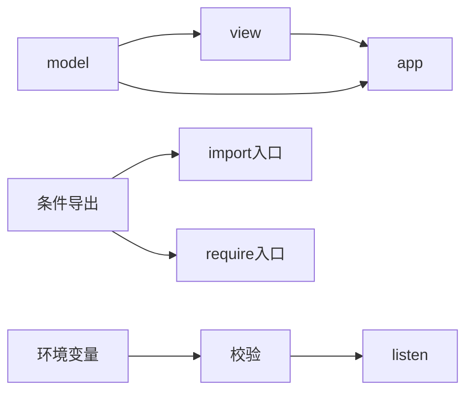

# Node 构建与模块配置

monorepo 要构建 `app` 前必须先构建它依赖的 `view` 和 `model`；包作者还要区分 ESM 与 CommonJS 入口；服务要在创建监听 socket 前拒绝无效端口。三题都把隐式配置变成显式图或合同，这样问题在启动阶段暴露，而不是部署运行到一半才发现。



图从左往右表示先满足依赖，右边动作才允许执行。`model` 既是 `view` 的依赖也是 `app` 的依赖，所以它只构建一次；任何回边表示模块依赖循环。

## N020 · 按依赖先后排序构建任务 {#n020}

monorepo 构建多个包。输入为 `node -> dependencies[]`；输出是每个依赖在消费者之前出现的确定顺序；循环时报出冲突节点。

深度优先访问每个依赖，访问完成再把当前节点压入输出，因此先依赖后消费者。`permanent` 防止重复构建，`temporary` 检测当前递归栈回边；遍历 root key 排序，让同一图总得到同一顺序。

```js
if (permanent.has(node)) return;
if (temporary.has(node)) throw new Error(`dependency cycle at ${node}`);
temporary.add(node);
for (const dependency of graph[node] ?? []) visit(dependency);
temporary.delete(node);
permanent.add(node);
output.push(node);
```

测试检查 `model < view < app` 的必要关系和 `a → b → a` 循环错误。孤立依赖节点也会进入结果，避免漏构建它。

## N021 · 明确选择 package exports 条件 {#n021}

库同时发布 ESM 和 CommonJS 文件，但不想允许用户 import 内部实现。输入 exports map、subpath 与有序条件；输出首个命中条件目标，未导出的 subpath 失败。

包的物理文件存在，不代表消费者可以跨越公开 API 边界访问。先取准确 subpath 对象，再按 exports 对象声明的 key 顺序选择第一个激活条件；不能匹配时失败关闭，不猜测拼文件路径。这里只实现最小字符串目标子集，Node 真实 resolver 还支持 pattern、数组、nested conditions 等分支。

```js
for (const condition of conditions) {
  if (typeof target[condition] === 'string') return target[condition];
}
throw new Error(`no export condition matched for ${subpath}`);
```

示例对象 `{ import: './index.mjs', require: './index.cjs' }` 分别可选；内部 `./internal` 没有键时立即拒绝。测试通过 import/require 两种顺序、私有子路径和空条件覆盖。

## N022 · Listen 之前验证部署配置 {#n022}

容器部署传 `PORT`、`HOST`。输入 env 对象；输出标准化 `{ port, host }`；端口必须是整数 0 到 65535，空 host 拒绝；端口 0 用于让系统分配临时端口。

`Number('')` 会得到 0，`parseInt('3000oops')` 会得到 3000，这两种宽松转换会把错配当合法配置。完整转换后验证整数范围，host 修剪空格并拒绝空值。

```js
const port = Number(env.PORT ?? 3000);
if (!Number.isInteger(port) || port < 0 || port > 65_535) throw new RangeError('PORT must be an integer from 0 to 65535');
```

测试接受端口 `0`，拒绝 `70000` 和小数 `3.5`。真正的 server 只在 config 校验返回后调用 `listen`，所以坏环境变量不会留下半启动进程。

## 实际运行与验收

运行 `node --test scripts/teaching-labs/node/labs.test.mjs`。预期 `tests 30 / pass 30 / fail 0`。失败证据为构建顺序颠倒、依赖循环、未公开子路径、无匹配 export 条件和无效 PORT。

完整实现分别链接 [topologicalOrder](https://github.com/Shyu-x/frontend-interview/blob/27ac651e0a1ac3d53eee663fe2d6e5b0d45f00eb/scripts/teaching-labs/node/labs.mjs)、[resolveExport](https://github.com/Shyu-x/frontend-interview/blob/27ac651e0a1ac3d53eee663fe2d6e5b0d45f00eb/scripts/teaching-labs/node/labs.mjs)、[parseServerConfig](https://github.com/Shyu-x/frontend-interview/blob/27ac651e0a1ac3d53eee663fe2d6e5b0d45f00eb/scripts/teaching-labs/node/labs.mjs)；题目与业务场景索引在 [catalog.json](https://github.com/Shyu-x/frontend-interview/blob/27ac651e0a1ac3d53eee663fe2d6e5b0d45f00eb/scripts/teaching-labs/node/catalog.json)。
