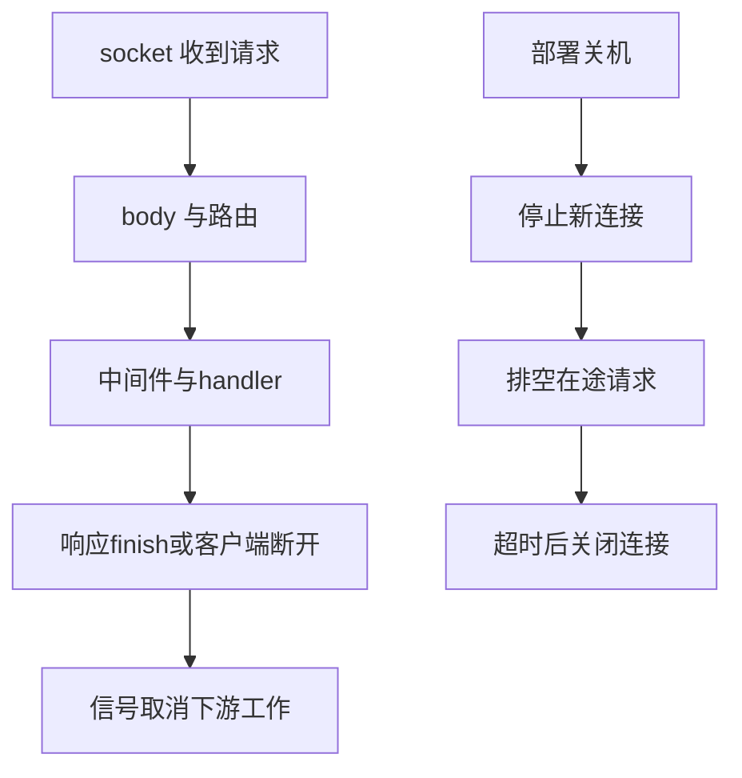

# Node HTTP 服务与连接生命周期

订单服务从收到请求到发出响应，不止一个 handler：请求体可能无限大，客户端会中途断开，上游也可能永远不返回。先用 loopback 上真实 HTTP server 把输入输出跑通，再逐题处理控制流、字节边界、可取消工作、连接关闭。图中的两条链分别描述“请求读到响应”和“服务停止接新请求后排空连接”。



Express 的 `next()` 将控制权传到下一个 middleware；Fastify 把解析、验证、handler、序列化分成 lifecycle 阶段。这里保留这些工程事实，用更小的标准库实现使每个分支都能实测。[项目实践来源集中在参考资料](workshop-node-sources.md#工程项目实践)。

## N005 · 在真实本地端口上跑 JSON API {#n005}

库存查询 API 使用 `127.0.0.1:0` 获取系统分配端口。输入是请求和异步 handler，输出是 JSON 响应；handler 抛带 `statusCode` 的错误时映射为对应 HTTP 状态。

HTTP 行为要由真 `fetch` 和真 `http.Server` 验证，不能拿手写 request 对象代替。监听完成后读取 `server.address().port`，测试清理时调用关机函数。

```js
const server = createServer(async (request, response) => {
  try { response.writeHead(200, { 'content-type': 'application/json' }).end(JSON.stringify(await handler(request))); }
  catch (error) { response.writeHead(error.statusCode ?? 500).end(JSON.stringify({ error: error.message })); }
});
```

测试对 `/orders` 和 404 错误各发送一次真实请求，验证 status、JSON body 和最后 close。

## N006 · 路由 handler 前后的中间件 {#n006}

结账请求依次做租户鉴权、计时、业务 handler。输入为有序函数列表和共享 context；输出是可等待的完整 onion 执行，重复 `next()` 必须拒绝。

同步递增索引无法表达“下游返回后继续收尾”。递归 dispatch 并 `await next()`，即可形成入栈顺序正序、出栈顺序逆序；记录最高执行索引检测重复调用。

```js
const dispatch = async (index) => {
  if (index <= highest) throw new Error('next() called more than once');
  highest = index;
  if (middleware[index]) await middleware[index](context, () => dispatch(index + 1));
};
```

测试断言精确事件序列 `before A → before B → handler → after B → after A`，还验证错误路径不会悄悄跑第二次。

## N007 · 增量解析 SSE 网络块 {#n007}

管理台订阅订单状态。输入可以是任意切片的 Buffer；输出为 `{ data, event, id }` 帧，多行 data 用换行合并，UTF-8 字符被切开也必须还原。

网络 chunk 边界不等于 SSE 行边界，更不等于 Unicode 字符边界。`TextDecoder` 用 `{ stream: true }` 保存半个字符，`pending` 保存半行；空行才提交一帧。

```js
pending += decoder.decode(chunk, { stream: true });
const lines = pending.split(/\r?\n/);
pending = lines.pop(); // 最后一段可能还没收完整
```

测试把中文 SSE 按字节中间切成两片输入，并验证 multiline data 与 event/id；空评论行不能生成业务消息。

## N008 · 安全输出 SSE 帧 {#n008}

上传进度推送包含 event 名、序号、retry 间隔和文本。输入的 event/id 不能含 CR、LF 或 NUL，data 的每行各生成一条 `data:`。

如果把未经验证的 `event` 直接拼到协议头，攻击者可插入 `id:` 或伪造下一帧。先验证控制字段，再格式化字段；data 的换行是合法多行正文，所以拆行而不是拒绝。

```js
if (/[\r\n\0]/.test(String(value))) throw new TypeError('SSE field contains a line break');
for (const line of data.split(/\r?\n/)) rows.push(`data: ${line}`);
```

测试覆盖多行正文、合法 retry 和字段注入拒绝。

## N009 · 限制 JSON body 的实际字节数 {#n009}

checkout API 只接收最多 64 KiB JSON。输入是可读请求流，输出为解析对象；超限为 413，JSON 不合法为 400。

`Content-Length` 可以缺省，也不能作为唯一信任来源。逐块累计 Buffer 长度，一旦超阈值立刻失败，不把剩余 body 收进内存；读完后才拼接解析。

```js
for await (const part of request) {
  const chunk = Buffer.from(part);
  total += chunk.length;
  if (total > maxBytes) throw Object.assign(new Error('request body too large'), { statusCode: 413 });
  parts.push(chunk);
}
```

测试分别走合法 body、长度限制和语法错误，并检查错误状态，不能只捕获“任意失败”。

## N010 · 断连时让请求工作可取消 {#n010}

用户关闭订单详情页时，服务不应继续等待下游调用。输入为真实 Server request/response 生命周期，输出为 active 计数和可 abort 信号；finish 与 close 都只能计数一次。

`IncomingMessage` 自带 Node 管理的只读 `signal` getter，应用不能覆盖它。每个 request 对应一个 `AbortController`，通过 WeakMap 与请求关联；`aborted`/未完成的 response `close` 会发出取消。

```js
const controller = new AbortController();
trackedSignals.set(request, controller.signal);
request.once('aborted', () => controller.abort(new Error('client aborted request')));
```

测试发真实 fetch 后等响应结束，检查 active 归零和信号未误取消；应用 handler 可通过 `getTrackedSignal(request)` 把 signal 传给 `fetch` 或数据库。

## N019 · 部署时排空 HTTP 连接 {#n019}

版本切换时先停止接收新连接，保留在途响应，超过 deadline 才关闭剩余连接。输入为已监听 Server，输出为 close 完成 Promise；重复关闭可安全调用。

立即 `closeAllConnections()` 会切断正在返回的响应。先创建 `server.close()` 完成 Promise，再调用 `closeIdleConnections()`；定时器只负责 deadline 后的兜底并 `unref()`，最后总是清 timer。

```js
const closed = new Promise((resolveClose, rejectClose) => server.close((error) => error ? rejectClose(error) : resolveClose()));
server.closeIdleConnections?.();
const timeout = setTimeout(() => server.closeAllConnections?.(), timeoutMs);
```

真实测试启动服务、关机两次，验证监听句柄已结束。若应用有 WebSocket/升级协议，必须单独跟踪并关掉它们。

## N024 · 只重试可重放的幂等请求 {#n024}

商品 GET 遇到 503 可重试；支付 POST 即使超时也不能盲目重放。输入 method、最大次数和 fetch 实现，输出最终 Response 或最后错误。

网络错误不证明服务端没执行写操作。先白名单 GET/HEAD/PUT/DELETE/OPTIONS，再对响应 5xx 或网络失败按次数重试；请求 body 若是一次性流，本题的接口就拒绝扩展，不能假装它可重放。

```js
if (!['GET', 'HEAD', 'PUT', 'DELETE', 'OPTIONS'].includes(method.toUpperCase())) throw new TypeError('automatic retry requires an idempotent method');
```

测试以 stub 先返回 503 再 200，确认总计两次；POST 在任何网络调用前失败。

## N025 · 用 deadline 取消本地 fetch {#n025}

BFF 查询用户画像最多等 20 ms。输入 URL、正 deadline 和可选父 signal；输出 Response，deadline 到期时 rejection 并中止 socket 请求。

Promise.race 只让调用方提前得到超时，底层网络工作仍在跑。`AbortSignal.timeout()` 直接传入内置 fetch，让取消进入传输层；与调用者取消信号通过 `AbortSignal.any()` 合并。

```js
const signal = AbortSignal.any([options.signal, AbortSignal.timeout(milliseconds)].filter(Boolean));
return fetch(url, { ...options, signal });
```

测试连接只接受请求、不写响应的真实本地 server，等 20 ms 后断言 `TimeoutError`/`AbortError`，并在测试结束关闭 socket。

## N026 · 静态资源 ETag 与路径边界 {#n026}

前端资源按内容哈希缓存。输入可信根目录和 URL 相对路径；输出是 200 + ETag、命中 304，路径越界为 400，缺文件为 404。

在访问磁盘前做 `decodeURIComponent` 和根目录包含检查；读文件后以内容 SHA-256 计算 ETag。304 不发送 body，避免传输同一资源。

```js
const target = safeResolve(root, decodeURIComponent(requestPath));
const etag = `"${createHash('sha256').update(body).digest('hex')}"`;
if (response.req.headers['if-none-match'] === etag) response.writeHead(304, { etag }).end();
```

用响应替身直接验收状态和 header；文件本身在测试专用 scratch directory 中真实写入。

## N027 · 等一次事件并在中断时清监听器 {#n027}

测试或连接管理器等待 socket `close`，也可能先接到 `error` 或 AbortSignal。输入 EventEmitter、事件名和可选 signal；输出 Promise，任一终止条件命中后所有 listener 数变 0。

裸 `once()` 不会自动响应业务 AbortSignal。让 success、error、abort 都调用同一个 cleanup，防止长生命周期 emitter 积累旧监听器。

```js
const cleanup = () => {
  emitter.removeListener(eventName, onEvent);
  emitter.removeListener('error', onError);
  signal?.removeEventListener('abort', onAbort);
};
```

测试分别触发正常事件和 abort，检查结果及 listenerCount。完整实现在 [onceEvent](https://github.com/Shyu-x/frontend-interview/blob/27ac651e0a1ac3d53eee663fe2d6e5b0d45f00eb/scripts/teaching-labs/node/labs.mjs)，验收在 [N027 测试](https://github.com/Shyu-x/frontend-interview/blob/27ac651e0a1ac3d53eee663fe2d6e5b0d45f00eb/scripts/teaching-labs/node/labs.test.mjs)。

## 实际运行与验收

运行 `node --test scripts/teaching-labs/node/labs.test.mjs`。测试通过阈值是 `pass 30 / fail 0`；失败证据包括超限 413、SSE 字段注入拒绝、超时 Abort、handler 错误状态和 close 后 server 不再 listening。N005、N010、N019、N025 都开真实 loopback server；测试完成关闭各自 server。

实现和每题测试入口见 [catalog.json](https://github.com/Shyu-x/frontend-interview/blob/27ac651e0a1ac3d53eee663fe2d6e5b0d45f00eb/scripts/teaching-labs/node/catalog.json)。Node API 版本和 Fastify/Express/Undici 的工程依据集中列在[参考资料](workshop-node-sources.md)。
