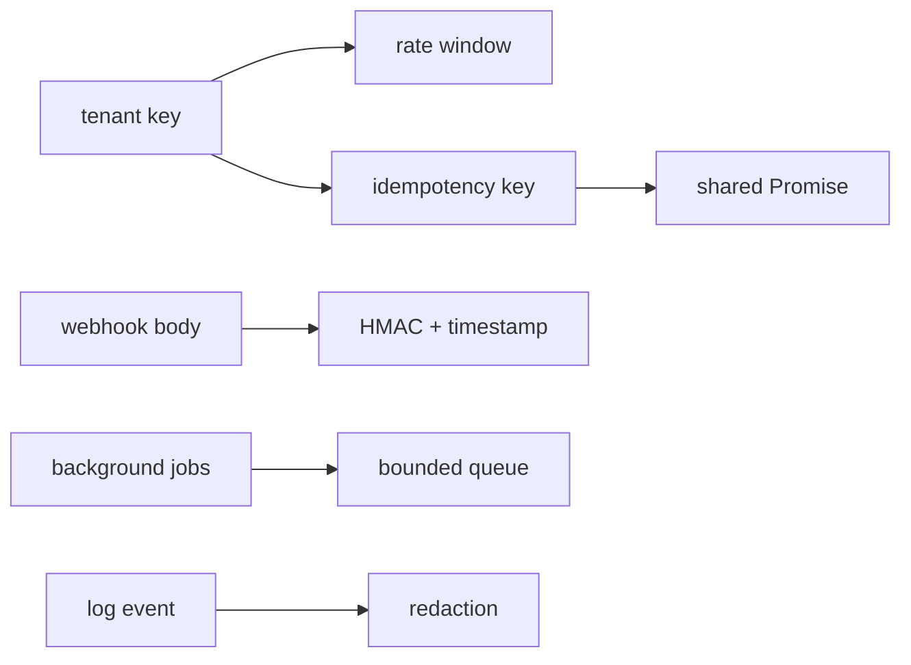

# Node 服务韧性实验

在订单服务中，限流键如果只用 IP 会把公司 NAT 后的客户误伤；支付重试如果各自执行会重复扣款；没有队列上限的任务调度会把内存压力藏起来直到进程被杀。本页从业务身份和时间边界开始，再推导幂等、缓存和签名协议，最后把日志与本地 CPU 工作放进显式资源边界。



## N014 · 每租户登录限流窗口 {#n014}

输入 tenant/account key；输出 allowed、remaining、resetAt。每个 key 单独计数，窗口到期的请求成为新窗口第一条。

key 粒度来自业务身份，避免共享出口 IP 把多个账号绑定在一起。注入 `now()` 让边界测试无需真实等待；窗口范围采用 `start <= now < start + windowMs`。

```js
if (!state || time >= state.start + windowMs) state = { start: time, count: 0 };
state.count++;
return { allowed: state.count <= limit, remaining: Math.max(0, limit - state.count), resetAt: state.start + windowMs };
```

测试覆盖上限正好命中、第三次拒绝、其他租户隔离、窗口边界重置。

## N015 · 合并相同支付幂等键 {#n015}

输入幂等 key 和 async operation；输出同一个结果。同一进程、TTL 内的并发相同 key 只执行一次；业务失败时删除缓存，让明确重试可再执行。

将 Promise 存入 Map 必须早于 `await`，这样第二个调用能看到尚在执行的工作。只缓存成功/进行中结果；catch 中仅在 Map 仍指向当前 Promise 时删除，避免旧失败清除新一代请求。

```js
const promise = Promise.resolve().then(operation);
entries.set(key, { promise, expires: now() + ttlMs });
try { return await promise; }
catch (error) { if (entries.get(key)?.promise === promise) entries.delete(key); throw error; }
```

测试发两个并发请求，断言 operation 调用次数恰为 1，并验证失败后同 key 能成功恢复。本题的 Map 只约束单个进程和 TTL 窗口；真实支付要把幂等键与结果写入共享数据库，并用唯一约束处理跨进程重试。

## N016 · 把相同缓存未命中折叠成一次 {#n016}

输入 cache key 和 load 函数；输出缓存期内相同数据。并发请求共享一个 loader，TTL 到期后重新加载，loader 失败不污染缓存。

缓存值不是唯一选项；缓存“正在加载的 Promise”能挡住同一时间的请求风暴。设过期边界时建立新 Promise，旧 Promise 失败不能删掉新条目，所以清除前比较 Promise 身份。

```js
const entry = entries.get(key);
if (entry && entry.expires > now()) return entry.promise;
```

测试三并发仅触发一次 load，再把人工时钟推进到 TTL 边界并验证第二次调用。

## N017 · 验证账单 Webhook 与重放窗口 {#n017}

输入原始 body、时间戳、签名与 secret；输出布尔值。任一字节被改或时间过期均拒绝。

先验证时间窗，降低捕获请求被长期重放的风险；再对完全相同的字节序列和 timestamp 算 HMAC-SHA256。签名长度相同才调用 `timingSafeEqual`，因为该 API 不接受不等长输入。

```js
const expected = createHmac('sha256', secret).update(`${timestamp}.`).update(body).digest();
return provided.length === expected.length && timingSafeEqual(provided, expected);
```

测试有效签名、篡改 body 和过期 timestamp。验签后仍应使用幂等事件 ID 防止时间窗内重放。

## N018 · 结构化记录中去掉凭据 {#n018}

输入一个普通事件对象和写入函数；输出 JSON 行。authorization、cookie、token 字段被遮盖，源对象不被改写。

日志序列化是凭据离开内存进入终端/采集器的边界。先拷贝字段再以大小写无关名单替换值，避免调用者共享对象被静默修改。

```js
for (const [key, value] of Object.entries(event)) {
  clean[key] = hidden.has(key.toLowerCase()) ? '[REDACTED]' : value;
}
```

测试解析写出的 JSON 并单独检查原始对象仍保留其输入值；生产系统还应按字段 allowlist 和嵌套结构递归处理。

## N023 · HMAC 签名分页游标 {#n023}

输入 JSON cursor payload；输出不透明字符串；解码后恢复 after/tenant。修改任一 token 字节都失败。

base64url 只是编码，不提供完整性。把 payload 编码后用 HMAC-SHA256 绑定，再在解析 JSON 之前验证签名；因此客户端无法改 tenant 或 sort position。

```js
const mac = createHmac('sha256', secret).update(body).digest('base64url');
return `${body}.${mac}`;
```

测试正常往返、尾字符篡改和不符合格式的路径输入。游标不是授权凭据，服务端仍要校验当前用户对 tenant 的访问权。

## N028 · 限制缩略图后台队列 {#n028}

输入 concurrency 与 capacity；每次提交工作函数返回其 Promise。运行数最多 concurrency，等待项最多 capacity，已取消或溢出任务拒绝。

并发上限与排队上限回答不同问题：一个控制 CPU 同时消耗，另一个控制内存等待。任务结束时在 `finally` 归还 slot 并继续 pump，保证成功失败路径都前进。

```js
running++;
Promise.resolve().then(item.work).then(item.resolve, item.reject)
  .finally(() => { running--; pump(); });
```

测试用一个可控 Promise 占住唯一 slot，再提交等待任务和溢出任务；输入 signal 已经取消时工作函数不能开始。队列满拒绝比静默积累更容易让调用方降级。

## 实际运行与验收

运行 `node --test scripts/teaching-labs/node/labs.test.mjs`，预期 30 项全通过。核心边界包含租户隔离、时钟过期、同进程并发请求合并、Webhook 篡改拒绝、游标篡改拒绝以及队列溢出。

实现入口和每题业务场景见 [catalog.json](https://github.com/Shyu-x/frontend-interview/blob/27ac651e0a1ac3d53eee663fe2d6e5b0d45f00eb/scripts/teaching-labs/node/catalog.json)；HMAC、HTTP 和项目关机实践依据集中在[参考资料](workshop-node-sources.md)。
