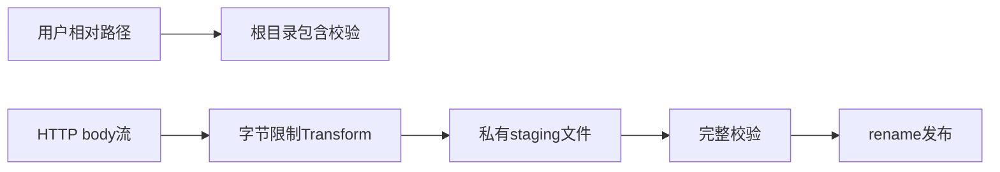

# Node 上传与本地存储

用户上传合同扫描件时，文件名不可信、网络速度不稳定、客户端会重试、磁盘写入可能失败。如果直接按用户路径写最终文件，失败时读者会看到半成品，路径字段也可能越出存储目录。本页从“先验证地址，再限制流量，再验证内容，最后发布成品”推导五个存储合同。



临时文件和目标文件必须位于同一文件系统，原子 rename 才能避免读者观察到半写文件。题解使用同目录临时名，并在任一异常分支删除 staging 文件；跨设备移动需要复制/校验等另一份合同。

## N013 · 把相对路径约束在存储根目录 {#n013}

合同服务将租户键 `2026/a.pdf` 映射到存储目录。输入必须是相对字符串且不含 NUL；输出为规范化绝对路径；路径穿越、绝对路径都拒绝。

只对字符串做 `startsWith(root)` 会误把 `/safe-extra` 当作 `/safe` 的子目录。用 `relative(base, target)` 取路径差，再检查 `..` 分量或绝对结果。

```js
const escaped = relative(base, target);
if (escaped === '..' || escaped.startsWith(`..${sep}`) || isAbsolute(escaped)) {
  throw new RangeError('path escapes storage root');
}
```

测试 `2026/a.csv` 成功，`../secrets`、`/etc/passwd` 与含 NUL 路径都失败。若威胁模型包含可被攻击者并发替换的符号链接，还需 `realpath`/打开文件句柄等额外防护；字符串规范化本身不能证明符号链接目标。

## N011 · 限额、staging、原子发布的上传链 {#n011}

合同 API 接收最大 1 MiB 文件。输入是 Node Readable 和目标路径；输出为字节计数及目标路径。超过上限、源流错误或磁盘写错时最终文件不可见且 `.part` 会删除。

先把请求接到 Transform，实际累计 chunk 字节而不是相信客户端长度。再用 `flags: 'wx'` 创建权限 0600 的临时文件；pipeline 成功后同目录 rename 到目标。pipeline 失败则删除 staging。

```js
await pipeline(request, limiter, createWriteStream(tempPath, { flags: 'wx', mode: 0o600 }));
await rename(tempPath, destination);
```

测试真实创建文件，4 字节输入成功；5 字节输入触发 413，且 uploads 目录不存在残留 `.part`。已有同名目标时再发生上传失败，旧版字节必须保留。唯一临时名使用随机 UUID，避免同进程同毫秒的并发上传互删 staging。超过 15 行的实现按入口校验、限速 Transform、成功发布、失败清理四段读 [atomicUpload](https://github.com/Shyu-x/frontend-interview/blob/27ac651e0a1ac3d53eee663fe2d6e5b0d45f00eb/scripts/teaching-labs/node/labs.mjs)。

## N012 · 对分片重试建立内容合同 {#n012}

移动网络上传视频会重试任意分片。输入分片序号、bytes 和客户端 SHA-256；输出未完成状态或已按序重组文件。相同内容重复提交幂等，不同内容占用同序号要失败。

先校验 index 范围，再用服务器计算的摘要核对当前 chunk。只有字节完全相同才把重复 index 当成功重试。分片齐全后按 index 排列并验证整文件摘要，避免每片各自正确但顺序被换。

```js
const actual = createHash('sha256').update(body).digest('hex');
if (actual !== sha256) throw new Error('chunk checksum mismatch');
const old = chunks.get(index);
if (old && !old.equals(body)) throw new Error('conflicting retry for chunk');
```

测试错误摘要、重复请求、冲突 index、越界 index、最终整文件摘要；仅测试最终长度无法检测错序。

## N029 · 原子更新 JSON 检查点 {#n029}

后台任务每完成一步更新 JSON 检查点。输入目标路径和 JSON 可序列化值，输出新文件；进程若在写入中途退出，读者要么读旧版要么读新版，而不是半截 JSON。

同目录新建 `.tmp` 文件、限制权限、完整写入后 rename 覆盖最终路径。失败要删除临时文件。原子可见性不代表断电后的持久性；若需要 durability，还需 fsync 文件及父目录。

```js
await writeFile(temporary, JSON.stringify(value), { flag: 'wx', mode: 0o600 });
await rename(temporary, path);
```

测试从空路径写入再覆盖，最终内容必须可解析且 mode 为 0600；序列化失败时旧文件仍保持可读。测试目录由 `t.after` 清理。rename 提供同文件系统内的原子可见性，不保证掉电后数据已持久写入；需要耐久性时，还要 fsync 文件和父目录。

## N030 · 全文件校验通过才完成上传 {#n030}

分片服务的所有块已经到齐，客户端给出期望全文件摘要。输入有序 chunks、最终路径和 SHA-256；输出 byte count/digest，摘要不符则不发布目标文件。

分片摘要各自通过不等于整体内容符合会话预期。把块按序送进 Readable，再由 Transform 增量更新总摘要并写入 staging；一致才 rename 发布。组装和校验任一步失败都清理 `.assembling`，同时保留原目标。

```js
const hash = createHash('sha256');
const meter = new Transform({ transform(chunk, _encoding, callback) { hash.update(chunk); callback(null, chunk); } });
await pipeline(Readable.from(chunks), meter, createWriteStream(temporary, { flags: 'wx', mode: 0o600 }));
const actual = hash.digest('hex');
if (actual !== expectedSha256) throw new Error('assembled checksum mismatch');
```

验收正确摘要后读取成品并逐字节比较；错误摘要时确认目录里没有 staging 文件，也没有目标成品。

## 实际运行与验收

在仓库根目录运行 `node --test scripts/teaching-labs/node/labs.test.mjs`，通过阈值为 `pass 30 / fail 0`。失败证据包含 413、错误 chunk digest、路径越界、最终哈希不符和 staging 残留断言。所有文件都写入测试生成的临时目录，`t.after` 负责递归删除。

函数映射、业务场景与测试名在 [catalog.json](https://github.com/Shyu-x/frontend-interview/blob/27ac651e0a1ac3d53eee663fe2d6e5b0d45f00eb/scripts/teaching-labs/node/catalog.json)；官方文件系统 API 及原子 rename 的适用边界列在[参考资料](workshop-node-sources.md#nodejs-官方文档)。
