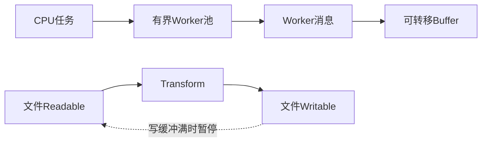

# Node Worker 与流式数据实验

当服务收到大量图片元数据计算或导出请求时，主线程若执行长循环，HTTP 回调也会等它结束；如果把整个文件读入内存再压缩，峰值内存又会随文件增长。四题沿着“工作在哪执行、数据如何交接、生产者何时暂停、错误如何清理”逐层推导。Worker 只拿来跑 CPU 计算；标准异步文件 I/O 仍留在主线程事件循环。



先看上半边的任务分发和所有权转移，再看下半边的背压与 pipeline。Worker 和流都不是“多开几个 Promise”就能替代的机制：前者真的创建线程，后者用缓冲状态把速度反馈给上游。

## N001 · CPU 任务交给可复用线程池 {#n001}

缩略图服务按批计算像素统计。输入为数字数组，输出其总和；Worker 固定为 2 个，等待队列最多 32 项，关闭后不再接收任务。错误任务要拒绝 Promise，同时线程继续接收下一题。

先把“单次计算”放到 Worker 文件，再让主线程保留 `resolve/reject` 回调；消息只携带可结构化克隆的数据。每个 slot 同时最多占用一个任务，池满时在入口拒绝，避免无限排队。最后关闭时拒绝未开始的任务、等在途任务结束、逐个 `terminate()`。

关键片段（完整实现见 [WorkerPool](https://github.com/Shyu-x/frontend-interview/blob/f682da9816e3f5454a3f1d8d8cb074d0de53236b/scripts/teaching-labs/node/labs.mjs) 与 [Worker 入口](https://github.com/Shyu-x/frontend-interview/blob/f682da9816e3f5454a3f1d8d8cb074d0de53236b/scripts/teaching-labs/node/workers/compute-worker.mjs)）：

```js
const task = this.queue.shift();
slot.current = task;
// 只跨线程传可克隆数据；函数闭包留在父线程。
slot.worker.postMessage({ id: task.id, operation: task.operation, input: task.input });
```

`postMessage` 回来时以 `id` 对应父线程任务，之后清空 slot 并分发下一题。Node 官方明确 Worker 适合 CPU 密集任务，对 I/O 密集工作收益有限；所以数据库或文件等待不应无条件改成线程池。[Worker 文档](workshop-node-sources.md#nodejs-官方文档)

自动验收还让真实 Worker 抛出未捕获异常、无响应退出，并在 error/exit 间隔提交新任务；新任务等替代 Worker 启动后完成。测试同时覆盖 `postMessage` 结构化克隆同步异常、`maxQueue: 0` 满队列，以及两次并发 `close()` 返回同一个完成 Promise 并等待在途任务。每个 Worker 最后都必须 `terminate()`；`t.after` 负责异常时兜底清理。

## N002 · 转移二进制所有权 {#n002}

影像任务把 8 字节缓冲交给编码 Worker。输入必须为 `ArrayBuffer`，输出是接收方拥有的同一字节内容；转移完成后发送方缓冲区长度变为 0。

复制大型 buffer 会占用双份内存；共享可写内存又需要同步所有权。这里选 transfer：调用者明确失去 buffer，接收者独占其数据。`structuredClone` 的 transfer list 让这个所有权变化可直接观察。

```js
export function transferBuffer(buffer) {
  if (!(buffer instanceof ArrayBuffer)) throw new TypeError('expected ArrayBuffer');
  return structuredClone(buffer, { transfer: [buffer] });
}
```

验收同时检查原缓冲 `byteLength === 0`、新缓冲前 3 个字节和错误输入；仅比较内容相等不足以证明发生过转移。

## N003 · 写入变慢时暂停报表生产 {#n003}

每行报表可能比磁盘吞吐快。输入是一个 Writable 和有序 chunks；输出是完整写入后的结束状态。每当 `write()` 返回 `false` 必须等 `drain` 才能继续。

Writable 的 `highWaterMark` 是反馈阈值，不是硬内存上限。返回 `false` 表示缓冲已超过可继续写的水位，生产者若不暂停仍能无限追加。最后显式 `end()`，并等待 `finish`，才代表目标确实消费完。

```js
for (const chunk of chunks) {
  if (!writable.write(chunk)) await once(writable, 'drain');
}
writable.end();
await once(writable, 'finish');
```

测试使用 `highWaterMark: 1` 和延迟 `_write`，强制走到 drain 分支；另用同步 Writable 检查 finish 监听先于写入注册，并注入磁盘错误确认 Promise 会拒绝而不挂起。

## N004 · 多 GB 文件用 pipeline 压缩 {#n004}

审计归档从磁盘读入、gzip 后新建目标文件。输入为源/目标路径，输出为目标路径；缺源文件或目标已存在都要失败，所有流在错误后都关闭。

Readable → gzip Transform → Writable 用 `pipeline()` 连接，数据按块前进，错误时销毁链路资源。目标用 `flags: 'wx'` 避免误覆盖已有归档。与手写 `pipe()` 链相比，Promise 版 `pipeline` 把背压、错误和清理收在一个可等待的完成点。

```js
await pipeline(
  createReadStream(source),
  createGzip(),
  createWriteStream(destination, { flags: 'wx' }),
);
```

测试将真实文件压缩后再 `gunzipSync` 读回原文，也断言缺源路径拒绝。输出目录由测试创建并在结束钩子递归清理。

## 实际运行与验收

在仓库根目录运行 `node --test scripts/teaching-labs/node/labs.test.mjs`。预期末尾为 `tests 30`、`pass 30`、`fail 0`。N001 创建的每个 Worker 在测试结束时 `terminate()`；N004 的临时文件由测试 `t.after` 删除。

输入边界包括错误类型、满队列、Worker 操作失败、只读错误路径、已存在目标文件和慢 Writable；这些证据分别由 [测试文件](https://github.com/Shyu-x/frontend-interview/blob/f682da9816e3f5454a3f1d8d8cb074d0de53236b/scripts/teaching-labs/node/labs.test.mjs) 的 N001–N004 测试直接断言。API 核对入口集中在[参考资料](workshop-node-sources.md#nodejs-官方文档)。
