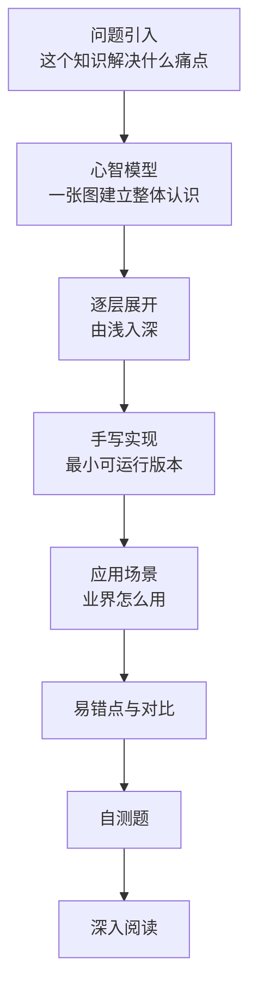

# 教程写作规范

这是一个教程仓库，读者的目标是学会、能复述、能动手、能面试。一篇合格的教程让读者在不查其他资料的前提下读懂它。

## 页面元数据与验证状态

每篇新文章的 frontmatter 必须声明学习边界和验证状态；没有这些字段的旧文可以保留，但不能被标为课程路线中的“可运行验收”。字段不是装饰：它们告诉读者能否运行、需要什么、事实核验到何时。

```yaml
---
title: 页面标题
description: 60 到 160 字，说明读者要解决的问题和可交付结果。
tags: [agent, tools]
date: 2026-10-11
level: intermediate # entry | intermediate | advanced | reference
prerequisites:
  - Promise 与 async/await
  - Node.js 20+
runnable: true
tested_with:
  - node@22.14.0
  - typescript@5.7.3
verified_at: 2026-10-11
source_commit: 0123456789abcdef # 有源码快照、产品行为或外部仓库分析时必填
---
```

| 字段 | 规则 |
|---|---|
| `level` | 只能使用 `entry`、`intermediate`、`advanced`、`reference`；`reference` 不能作为主线验收的唯一材料。 |
| `prerequisites` | 写出可检查的知识、工具版本或已完成页面；不能写“有一定基础”。 |
| `runnable` | 只有代码、依赖和命令在干净环境实际跑过时才为 `true`。示意代码写 `false`，并在正文说明不可运行的原因。 |
| `tested_with` | `runnable: true` 时必填，列出语言/运行时/关键依赖的精确版本。 |
| `verified_at` | 事实、API、价格、产品行为或外部链接最后实际核对的日期；过期后重新核验，不能只写“以原文为准”。 |
| `source_commit` | 源码分析、目录数量、实现细节或案例快照必须给出 tag/commit；没有稳定提交则降级为一般参考并明确不确定性。 |

可运行教程还必须在正文给出：安装命令、运行命令、预期输出、失败时的诊断入口和自动测试命令。文档中的命令应指向仓库内真实源码或锁文件，而不是复制一段无法追踪的代码块。

## 标准结构



| 部分 | 篇幅占比 | 必须包含 |
|---|---|---|
| 问题引入 | 5% | 一个具体场景，说明没有它会发生什么 |
| 心智模型 | 10% | 至少一张概览图，加一段"怎么读这张图" |
| 逐层展开 | 40% | 按下节"五层递进"组织 |
| 手写实现 | 20% | 可运行代码，带预期输出 |
| 应用场景 | 10% | 至少两个真实项目或产品的做法，附链接 |
| 易错点与对比 | 10% | 错误现象、原因、修正 |
| 自测题 | 5% | 3 到 5 题，答案折叠 |

## 面试回答与真实验收

涉及面试高频概念的页面必须提供两种回答，不用空泛的“熟悉即可”。

| 回答层级 | 必须包含 | 不合格示例 |
|---|---|---|
| 30 秒回答 | 一句结论、核心机制、一个边界或风险 | 只罗列定义或 API 名称 |
| 2 分钟回答 | 场景、机制/权衡、具体实现或证据、失败模式与验证方式 | “项目里用过，效果很好”但没有指标、trace、测试或源码位置 |

每篇可运行或工程设计页面都要有一个“真实验收”小节，至少列出：输入/环境、执行命令、可观察输出、通过阈值、失败证据和清理方式。验收必须检验行为，不得用“把预先写好的数字相加后断言相等”冒充验证。

当正文解释仓库代码时，在关键段落链接到实际文件、函数或稳定提交；当示例是从课程项目抽取时，注明源码路径与对应测试。修改源码后应先修改/运行测试，再更新文档中的命令和预期输出。

## 五层递进

同一个概念按下面五层讲，每一层只回答一个问题，下一层建立在上一层之上。

| 层 | 回答的问题 | 手段 |
|---|---|---|
| 1 现象 | 看得见的行为是什么 | 最小例子加输出 |
| 2 规则 | 行为遵循什么规则 | 规则列表，每条配一个例子 |
| 3 机制 | 规则为什么成立 | 流程图或数据结构图 |
| 4 实现 | 自己怎么写出来 | 手写简化实现 |
| 5 边界 | 什么时候不成立 | 对比表、反例 |

示例：讲"闭包"。第一层给出计数器函数与输出；第二层写出"函数能访问其定义时所在的作用域"；第三层画作用域链与变量环境；第四层手写一个带私有状态的模块；第五层讲循环中 `var` 的陷阱与内存泄漏的条件。

## 配图规则

1. **密度：每 400 到 600 字至少一张图、表或代码块。** 连续超过 800 字纯文字的段落必须拆开或配图。
2. **图先于解释。** 图的上方一句话说"看什么"，下方编号列表逐步解释。
3. **一图一事。** 一张图只表达一个结构或一个流程。节点超过 15 个就拆。
4. **图中文字就是正文的一部分**，措辞与正文一致，不引入正文没有的术语。
5. **选型见** [图标与图表工具箱](icons-and-diagrams.md)。

## 段落与句子

1. 一段只讲一个概念，三到六句。
2. 第一句给结论，后面的句子给依据。
3. 术语第一次出现时给出定义和英文原名，之后保持写法一致。
4. 每个断言能被验证：给出数字、版本号、规范条目、源码位置或可运行的代码。
5. 列表项是完整的判断，不是名词堆。

## 代码规则

1. `runnable: true` 的代码必须运行过，输出写在注释里或紧随其后的代码块中，并给出完整命令、工作目录和 `tested_with` 版本。
2. 超过 15 行的代码分段，每段前一句话说明这一段的职责，段后解释关键行。
3. 注释解释"为什么这样写"。对每个陌生 API，第一次出现时说明参数与返回值。
4. 示例用真实的业务命名，如 `fetchOrders`，不用 `foo` `bar`。
5. 未验证的示意代码在代码块前明确标注 `runnable: false`，不能写“可直接运行”。
6. 外部 API、模型、价格和产品行为必须锁定版本或核验日期；源码结论链接到 `source_commit`，不以“当前实现”作无日期断言。

## 禁用表述

读者无法据此做任何判断的句子不得出现。

| 不允许 | 改成 |
|---|---|
| "性能更好" | "首屏脚本体积从 240 KB 降到 90 KB" |
| "很容易出问题" | "并发两个请求时，后返回的旧响应会覆盖新响应" |
| "业界普遍使用" | "Next.js、Remix 默认采用该做法（附链接）" |
| "可以适当优化" | 写出具体手段与适用阈值 |
| "原理比较复杂，这里略过" | 讲到能手写简化版为止，或给出源码位置与阅读指引 |

## 引用与外链

1. 事实性断言附来源：规范、官方文档、源码仓库、论文。
2. 链接指向稳定地址，优先使用带版本或提交号的链接。
3. 文末"深入阅读"每条写明读什么、读完能得到什么。
4. 不复制受版权保护的长段原文，用自己的话概括并给出链接。

## 提交前自检

!!! tip "逐条核对"
    - [ ] 开头有具体的问题场景
    - [ ] 有一张概览图，且图上下各有一句引导与解释
    - [ ] 五层递进每一层都出现过
    - [ ] 没有连续 800 字的纯文字
    - [ ] 所有代码块带语言标记，长代码已分段解释
    - [ ] `level`、`prerequisites`、`runnable`、`tested_with`、`verified_at` 已填写；源码/案例文章有 `source_commit`
    - [ ] 可运行代码已在声明环境运行，命令、输出和自动测试已核对
    - [ ] 有真实验收：输入、命令、通过阈值、失败证据与清理方式齐全
    - [ ] 有 30 秒和 2 分钟面试回答，且后者包含权衡与可验证证据
    - [ ] 文档结论关联到真实源码路径、测试或稳定提交
    - [ ] 没有"禁用表述"表中的句子
    - [ ] 至少两个真实应用案例，附链接
    - [ ] 有易错点与对比
    - [ ] 有自测题与答案
    - [ ] 有"深入阅读"
    - [ ] `description` 在 60 到 160 字之间
    - [ ] Mermaid 本地渲染无报错
