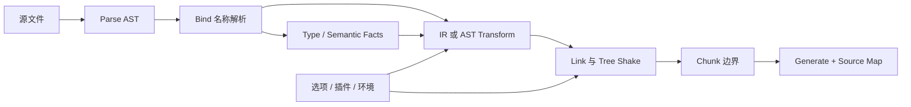
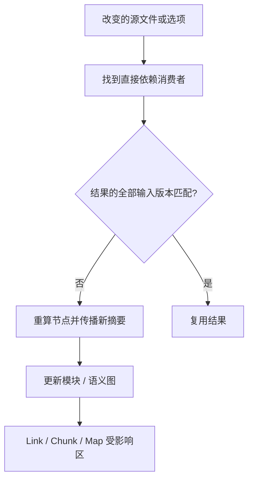

# 编译器 IR 与增量分析：从绑定解析到可缓存的构建图

开发者常把“编译器”想成 parser 接 transformer。真实工具链还要处理名字绑定、类型事实、模块解析、插件副作用、代码切块、source map 链接和缓存失效。只缓存文件内容 hash 往往不够：同一文件的输出可能依赖 compiler options、导入模块的类型、环境变量或插件版本。

本文承接 [Babel AST 手写](babel-ast-handwritten.md)、[编译链路](compile-pipeline.md)、[ESM bundling](esm-bundling-principles.md)、[source map](sourcemap-vlq.md) 与 [Rolldown 内部](rolldown-internals.md)，重点解释这些阶段如何共享事实、建立依赖并判断失效。

## 心智模型：一个产物是依赖图上的纯函数结果

先把输入事实、转换阶段和产物连起来，再看某一输入改变时应该使哪一部分失效。



1. Parse 回答“语法结构是什么”，不一定知道标识符指向哪个声明。
2. Bind 回答“这个名字解析到哪里”，是安全改名与引用分析的基础。
3. Type / semantic analysis 加入类型或控制流事实，是否存在取决于工具。
4. Transform 把语义结构变为目标语法；Linker 连接模块并决定可达性。
5. Chunk 与 map 受边界、压缩、文件路径和上游 map 影响。

## 第一层：现象——编辑一行后，为什么不是只重编一个文件

假设 `app.ts` 导入 `User` 类型和 `format.ts` 的运行时函数。改 `format.ts` 函数体通常要重做其代码与下游 chunk；只改未被使用的类型成员，运行时代码可能不变，但 declaration emit 或类型诊断可能变；改 `tsconfig` 的 `paths` 会影响模块解析；改插件选项可能令所有被插件处理的文件失效。

因此至少存在两类图：**构建图**描述模块、资源、chunk 和产物；**语义依赖图**描述类型、符号、配置和分析结果之间的引用。它们可以共享节点，但不能假设完全相同。

| 变化 | 可能失效的结果 | 常见错误缓存 |
|---|---|---|
| 文件字节改变 | 文件 AST、绑定、该文件下游模块与 chunk | 只按文件路径缓存 |
| 被导入声明改变 | 引用者的类型分析、诊断、声明输出 | 仅使导入方源文件字节命中缓存 |
| compiler option 改变 | 受该选项控制的 parse / transform / emit | 缓存 key 漏掉 `target` / `jsx` 等 |
| 插件代码或版本改变 | 插件参与的模块、meta、chunk | 只 hash 输入源代码 |
| 包导出条件改变 | resolver 结果、模块图与下游产物 | 只缓存裸包名解析 |
| chunk 手工边界改变 | linker 输出、chunk、map | 重用旧 chunk 分组 |

## 第二层：规则——哪些阶段能安全复用

### 语法树不等于带作用域信息的程序

AST 记录语法节点。`let count = 1; function f(){ return count }` 中两个 `count` 的绑定关系，需要作用域分析才能确认。`obj.count` 的 `count` 是属性名，不应和变量重命名规则混淆。解析可复用的条件通常包括源码字节、语法插件、语言版本和 parse options 一致。

### IR 是为后续问题服务的表示

IR（Intermediate Representation，中间表示）没有唯一形式。Babel 插件通常在 Babel AST 上遍历；SWC / Oxc 的 transform 各有 AST、semantic model 与 lowering 过程；TypeScript compiler 维护自己的 Node / Symbol / Type 结构并 emit；bundler 还会有 module graph、linking metadata 和 chunk graph。把“有 IR”泛化成“都有 SSA”是错误的，必须检查项目的实际 pass 和数据结构。

### 失效规则由依赖完整性决定

若结果 `R` 依赖输入集合 `D`，只有所有影响 `R` 的依赖身份和版本都匹配，才可复用 `R`。内容 hash 是其中一个输入，其他输入可能包括解析上下文、解析出的模块身份、编译参数、插件注册顺序、环境变量白名单、平台和输出格式。缓存不变量要写清楚，而不是只说“增量编译”。

### Tree shaking 的边界受副作用与 chunk 影响

静态 ESM import/export 为可达性分析提供结构，但保留/删除还依赖语义副作用判断和包作者声明。`sideEffects: false` 是工具链输入，不是证明模块纯净的定理；顶层注册、polyfill、CSS import 都可能有副作用。动态导入和手动 chunk 会改变异步边界，不能只按导出符号计数决定整个文件可删除。

### Source map 是转换链的映射组合

若 A→B 有映射 `M1`，B→C 有 `M2`，最终 C→A 需要把位置经过 `M2` 反查到 B，再经 `M1` 反查到 A。任何阶段丢 map 或使用不同代码版本，最终映射都可能漂移。压缩器重排、模板生成、虚拟模块与 banner 拼接尤其要单独验证。

## 第三层：机制——增量分析、缓存 key 与 chunk

变化沿依赖图逆向传播。仅使可达消费者失效，可保留无关分支；有环的模块 / 类型图要用 SCC（强连通分量）或固定点算法处理。把图缩成“文件 import 文件”可能漏掉选项、插件和 resolver 条件这类非文件节点。



### 一个实用的缓存键分层

解析缓存：`source hash + parser version + syntax options`。绑定缓存：解析摘要 + module identity + resolver context。转换缓存：输入语义摘要 + pass 顺序 + transform options + plugin fingerprints。链接缓存：导出 / side-effect 摘要 + graph edges + platform / conditions。生成缓存：chunk membership + format + minifier options + map inputs。

分层不是标准 API，而是定位失效范围的思考方式。真实系统可能合并阶段或缓存中间文件。任何引用外部文件的插件若不声明 dependency，都可能造成“看似增量、实际 stale”的错误；若过度失效，构建正确但没有增量收益。

### Chunk 边界会改变运行时拓扑

静态导入是初始依赖闭包；动态导入创建异步边界。共享依赖可被提升到公共 chunk，但拆分还要权衡请求数、缓存复用和执行顺序。tree shaking 的可达模块集合先影响 linker，chunk 分组再影响资源文件图；“模块删除了”与“最终字节减少”之间还隔着压缩、重复代码、runtime 辅助和 source map。

## 第四层：实现——显式反向失效图

下面脚本演示最小依赖图失效：修改叶节点后，让所有可达消费者重算，并断言无关节点未进入集合。它不是 TypeScript、Oxc、SWC、Rolldown 或任意生产工具的缓存实现。

```sh
node scripts/content-labs/frameworks/incremental-invalidation.mjs
```

预期输出：

```text
incremental-invalidation: reverse edges invalidate exactly the reachable consumers
```

脚本把消费者反向图预先构建，遍历时以 `Set` 去重，因此环也不会造成无限循环。生产系统还要处理节点版本、并发计算、失败缓存、文件系统事件合并和被删边；单纯 BFS 只表达“谁可能受影响”。

真实验收：输入图包含 `app → view → model` 和 `app → format → locale`；执行命令见上；通过阈值是两种叶子修改分别只失效对应路径，以及新增边后集合包含新增消费者；失败证据是断言显示的集合差；清理方式是 Node 进程退出，图只存在内存中。

## 第五层：边界——Babel、SWC、Oxc、Rolldown 与 TypeScript 的职责

| 工具 | 主要职责 | 观察源码的位置 | 不应推断 |
|---|---|---|---|
| Babel | JS AST 解析、插件式 transform、代码生成 | `packages/babel-parser`、`packages/babel-traverse`、`packages/babel-core` | 不自带完整 bundler 模块图 |
| SWC | Rust 实现的 JS/TS parser、transform、代码生成等工具 | `crates/swc_ecma_parser`、`crates/swc_ecma_transforms`、`crates/swc` | 实现语言不能证明任意工作负载都更快 |
| Oxc | Rust 工具链组件，包括 parser、semantic、transform、minifier 等 | `crates/oxc_parser`、`crates/oxc_semantic`、`crates/oxc_transformer` | 单独 parser benchmark 不等同端到端构建 |
| Rolldown | bundler，使用 Oxc 多个组件构建、链接、生成模块产物 | `crates/rolldown`、`crates/rolldown_common` | Rollup 兼容不表示每个插件行为完全相同 |
| TypeScript | 类型分析、语言服务与 JS/declaration emit | `src/compiler`、`src/services` | `tsc` 默认不是 TS-to-JS 之外的通用 optimizer |

“Rust 必然快”并非有效结论。端到端时间还受插件兼容层、磁盘 I/O、缓存命中、冷启动、并行度、模块数量、source map 和压缩影响。可复现实验应分别测 cold build、单文件编辑、公共类型改动、插件参与编辑和大范围 config 改动，并公布机器、版本、输入图及多次统计。

TypeScript 版本必须单独核对。`src/compiler`、`src/services` 和增量构建测试属于该仓库的主要源码入口，但不能从目录结构推断用户已安装版本具有某项新 API。实践中要查看仓库 release、`tsc --version`、官方发布说明和锁文件；不要把实验分支功能写成稳定承诺。

## 常见误区

1. **只按文件内容 hash 缓存。** 将配置、解析条件、插件和依赖身份也纳入结果输入。
2. **认为类型不进入运行代码便不影响构建。** 类型改变仍会影响诊断、声明文件和下游语义分析。
3. **把 `sideEffects: false` 当作纯度证明。** 它是包元数据，错误声明会改变产物语义。
4. **把 chunking 等同于 tree shaking。** 前者组织已保留模块的加载边界，后者判断哪些内容可消除。
5. **只测 parser 吞吐量下结论。** 插件、link、minify、source map 才是实际用户路径的一部分。
6. **map 文件存在就认为堆栈准确。** 必须用生成产物的已知位置做正反向定位验证。

## 30 秒与 2 分钟回答

**30 秒：** 增量构建的核心是完整依赖图和正确失效：AST、绑定、类型、转换、链接、chunk 与 map 各有不同输入。缓存只在所有输入版本匹配时可复用；插件副作用、模块条件和 source map 经常是被漏掉的依赖。

**2 分钟：** 我会先把 build graph 和 semantic dependency 分开梳理，再列出阶段结果及其输入摘要。源文件改变时逆向遍历消费者；配置、插件与 resolver 条件也必须作为图节点或 cache key。Link 阶段基于模块可达性与副作用信息做裁剪，chunk 再决定加载拓扑；source map 需要逐层组合并用已知位置实测。选择工具时按项目插件兼容性和本地冷/热构建数据评估，不从 Rust 或单项 benchmark 推断端到端优势。

## 自测题

??? question "1. 为什么同一源码在不同 `jsx` 选项下不能直接命中 transform 缓存？"
    **答案：** 选项改变了转换输出，属于缓存结果依赖。

??? question "2. 类型定义文件不生成运行时代码，为什么仍会使消费者失效？"
    **答案：** 类型检查、声明生成或语义分析可能读取该声明；这些结果需重新验证。

??? question "3. `sideEffects: false` 能否证明模块无副作用？"
    **答案：** 不能。它是作者提供的打包元数据，错误标注可能删除必要执行。

??? question "4. 为什么代码生成后仍需 source map 验收？"
    **答案：** 映射需经过各转换阶段组合，插入 / 删除代码或 map 版本错配都会使定位偏移。

## 固定提交与阅读路线

下面 commit 是 2026-10-12 查询的仓库 HEAD 快照。先读一条真实命令对应的入口，再追节点结构和测试；若要复现实验，checkout 下列 commit，避免 `main` 后续变化。

| 仓库 | 固定 commit | 阅读入口 |
|---|---|---|
| Babel | [b8bcd42](https://github.com/babel/babel/tree/b8bcd42f43759c5eec8516a85a82eabee8750f68) | `packages/babel-parser` → `packages/babel-traverse` → `packages/babel-core` |
| SWC | [410ae3a](https://github.com/swc-project/swc/tree/410ae3a0750e2d218eaabc2686d29f08b1e20482) | `crates/swc_ecma_parser`、`crates/swc_ecma_transforms` |
| Oxc | [d6fff87](https://github.com/oxc-project/oxc/tree/d6fff87f9982227ffd24177981e99f5008f9f616) | `crates/oxc_parser` → `oxc_semantic` → `oxc_transformer` |
| Rolldown | [f989992](https://github.com/rolldown/rolldown/tree/f989992cece3078d43f0fb210b8efb300d5a459f) | `crates/rolldown` 与对应 integration tests |
| TypeScript | [aa81492](https://github.com/microsoft/TypeScript/tree/aa8149273b23401f0a79a5f0384c42de51888693) | `src/compiler`、`src/services` 与 incremental build tests |

这次记录的是 2026-10-12 查询到的各仓库 HEAD，不等同于稳定 release。正式核验应结合 package release、版本号和对应标签；这里的源码入口是继续阅读路线，未对特定函数行号做断言。

## 深入阅读

- [ECMAScript Modules](https://tc39.es/ecma262/#sec-modules)：理解静态 import/export 语义边界。
- [Babel parser package](https://github.com/babel/babel/tree/main/packages/babel-parser)：沿 parser options 到 AST。
- [Oxc 仓库](https://github.com/oxc-project/oxc)：比较 parser、semantic 与 transformer 的边界。
- [Rolldown 仓库](https://github.com/rolldown/rolldown)：跟踪 scan、link 与 generate 实际任务。
- [TypeScript 项目](https://github.com/microsoft/TypeScript)：读 incremental builder 与语言服务测试。
