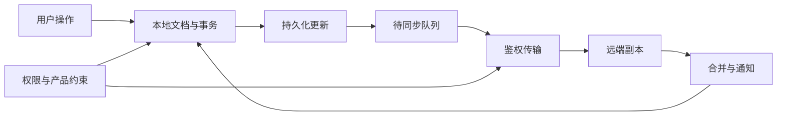
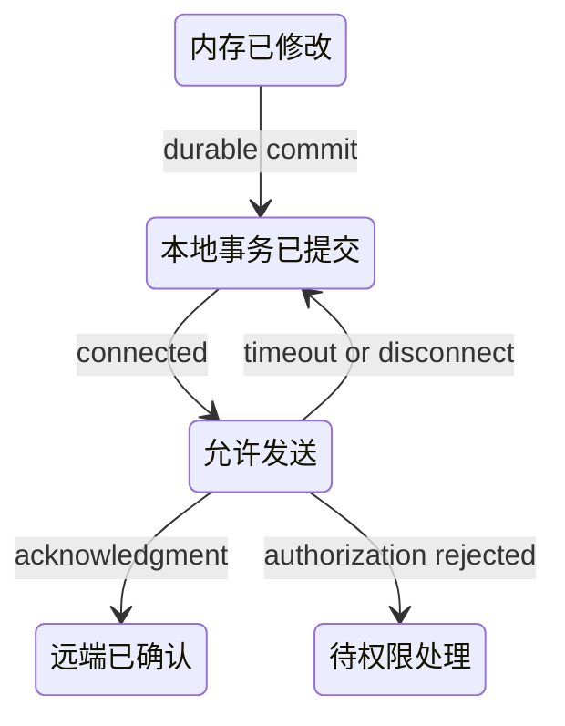

# 本地优先与协同同步：从收敛性质到权限、存储和恢复

两个人离线修改同一张看板，重连时服务器先收到旧设备的完整快照。若“最后一个 HTTP 请求覆盖整个对象”，另一人的修改会消失。把请求放进重试队列只能保证再发送，不能决定两个合法修改应该如何合并。

本章不再从零介绍富文本编辑器，而是把已有 [系统设计题](../coding/frontend-system-design.md) 中的协同概念贯通为一个可恢复系统。真正的目标不是“接入 CRDT”，而是让离线操作、持久化、同步、权限和产品语义共同成立。

## 1. 是什么：本地副本不等于缓存

看数据的三个生命周期，不要把传输层误当合并器。



1. 本地提交应先得到明确的持久化结果，再将“已保存”展示给用户。
2. 同步传输不定义数据意义；同样的更新可以通过 WebSocket、HTTP 或其他通道交换。
3. 收敛不代表授权成功，也不代表余额、库存等业务约束成立。

| 层 | 回答的问题 | 它不负责什么 |
| --- | --- | --- |
| UI 状态 | 用户现在看到什么 | 保证刷新后不丢失 |
| 本地存储 | 已提交的数据能否恢复 | 自动与其他设备合并 |
| CRDT | 合法更新怎样达到一致状态 | 身份、资源权限与商业规则 |
| 同步协议 | 对端缺少哪些更新 | 选择“正确”的产品语义 |
| 服务端治理 | 谁可写、保留多久、怎样撤销 | 自动替代本地故障恢复 |

## 2. 为什么：重复、乱序与断网不是例外

无冲突复制数据类型（Conflict-free Replicated Data Type，CRDT）不是单一算法。状态型实现通过合并状态工作；操作型实现发送操作，并可能要求因果交付等前提。不能概括成“任何操作都能随便乱序”。

状态合并通常要求交换律、结合律和幂等性：交换输入、改变分组、重复合并，不改变最终结果。还要明确增长关系和合并规则，否则三个等式只是口号。[CRDT 原始研究报告](https://inria.hal.science/inria-00555588)

下面看一个只增不减的 G-Counter。每个副本只能增长自己的分量，合并时对每个副本取最大值，总值为分量之和。这与“收到一次请求就加一”不同：相同状态重复交付不会重复计数。

已验证片段，完整实现位于仓库 `scripts/content-labs/systems/crdt-counter.mjs`：

```js
const merge = (a, b) => Object.fromEntries(
  [...new Set([...Object.keys(a), ...Object.keys(b)])].sort()
    .map(replica => [replica, Math.max(a[replica] ?? 0, b[replica] ?? 0)]),
);
const value = state => Object.values(state).reduce((sum, n) => sum + n, 0);
```

片段解释的是状态型计数器，不是 Yjs 的字符序列算法。副本身份必须稳定且不能被不同写者同时复用；删除、递减、字符顺序和历史回收都不在这个模型中。

| 输入变化 | 合并之后 | 为什么 |
| --- | --- | --- |
| Alice=3，Bob=2 | 总值 5 | 不同副本分量保留 |
| 再次收到 Alice=3 | 仍为 5 | 按分量最大值合并 |
| 收到更旧 Alice=1 | 仍为 5 | 旧状态不能覆盖新分量 |
| Alice 离线增长为 5 | 与 Bob 合并总值 7 | 不是把 Alice 的两个快照相加 |

## 3. 怎么样：使用真实 Yjs 更新，而不是排序字符 ID

Yjs 的二进制 document update 可交换、结合、幂等；它的 state vector 描述各客户端已知时钟位置，发送方可以据此编码缺失部分。这里说的是 **Yjs 更新 API 的性质**，不是所有 CRDT 网络协议的共同交付要求。[Document Updates](https://docs.yjs.dev/api/document-updates)

本仓库固定 `yjs@13.6.33`。实验从同一初始文档创建两个副本，各自插入文本，再以不同顺序、包含重复包，交给两个新的接收副本：

已验证片段，完整文件为 `scripts/content-labs/integrations/yjs-convergence.mjs`：

```js
const updateA = Y.encodeStateAsUpdate(a), updateB = Y.encodeStateAsUpdate(b);
const left = new Y.Doc(), right = new Y.Doc();
for (const update of [updateA, updateB, updateA]) Y.applyUpdate(left, update);
for (const update of [updateB, updateA]) Y.applyUpdate(right, update);
assert.equal(left.getText('body').toString(), right.getText('body').toString());
```

实验不断言谁的文字一定排在前面：并发位置的具体顺序取决于实现和客户端标识。产品要接受这个规则，或设计不同操作；收敛并不会自动保留人类写作意图。

状态向量实验还断言两端没有缺失更新。此固定版本将空差量编码为两个字节；这是本次版本实验的输出，不是未来协议长度的规范保证。不要拿空包大小当大型文档同步性能。

## 4. 数据模型决定产品代价

| 决策 | 可行方案 | 必须讨论的代价 |
| --- | --- | --- |
| 计数与累计 | 各副本分量、去重操作 | 副本数量增长，不能直接实现负库存约束 |
| 文本与列表 | 序列 CRDT、相对位置 | 历史和结构元数据、并发意图、删除语义 |
| 状态标量 | 冲突寄存器或确定性胜者 | 一致并不等于双方修改都可见 |
| 光标与在线状态 | Awareness 等临时状态通道 | 超时、重连与隐私，不宜永久保存每次移动 |
| 财务与库存 | 权威服务端事务或明确配额 | 离线可用性与严格全局约束无法无条件兼得 |

“每个字符永久带时间戳，删除永远不回收”不是所有 CRDT 的通用定义。Yjs 有垃圾回收设置和删除结构处理；Automerge 有自己的历史与压缩模型。要核对具体库，而不是从教学字符数组推断真实内存布局。

[Y.Doc API](https://docs.yjs.dev/api/y.doc) · [Automerge 概念](https://automerge.org/docs/reference/concepts/) · [Automerge 数据建模](https://automerge.org/docs/cookbook/modeling-data/)

## 5. 持久化、同步与恢复的最小协议

先给每次本地提交明确状态，再设计重连；这是工程协议示意，不是 CRDT 库内部状态机。



1. 保存更新和同步进度时，避免“更新落盘但进度先推进”的双写失配。
2. 重试必须容忍重复交付；服务端 ACK 含义需要说明是接收、持久化还是被业务接受。
3. 快照与增量要有兼容版本、完整性校验和恢复测试，不能只保存一个随意截断的 update 数组。
4. 未同步操作不能静默删除。权限撤销后可隔离本地草稿，并明确导出、丢弃或申请恢复的用户路径。

Automerge 将合并引擎、同步协议与 `automerge-repo` 的存储／网络适配器分开；Yjs 将 shared types、updates 和 provider 分开。两者都说明：选一个 CRDT 包并未完成整个系统。[Automerge 存储适配器](https://automerge.org/docs/reference/repositories/storage/) · [Yjs Providers](https://docs.yjs.dev/ecosystem/connection-provider)

## 6. 安全与隐私不能交给合并算法

客户端拥有副本，不意味着客户端可以决定权限。服务端要在同步入口验证用户、文档与租户归属，并限制包大小、频率和可扩张资源。攻击者可以绕过 UI 构造更新；验证不了业务意义的任意二进制更新，不能直接写入高权限数据模型。

撤销权限也不会使已经下载的副本自动消失。敏感内容要先确定允许离线保留的范围，设计加密密钥、设备退出、历史保留、导出与删除策略。历史中删除一个字段不必然意味着旧值被物理清除。

| 故障 | 错误处理 | 可验证修正 |
| --- | --- | --- |
| 重连覆盖他人内容 | 完整对象最后写入胜出 | 并发与重复交付测试，明确字段合并语义 |
| 本地保存成功却刷新丢失 | 只更新内存状态 | 事务提交后关闭进程，再启动恢复 |
| 撤权后继续自动同步 | 只在连接建立时鉴权 | 写入时重新校验并隔离未获准操作 |
| 历史越来越大 | 随意删除旧更新 | 按库的历史／GC 机制执行并验证老副本重连 |
| 跨租户混用文档 ID | 信任客户端文档路径 | 服务端按身份查资源归属，不靠难猜 ID |

## 7. 真实验收

工作目录为仓库根目录，Node 为 24.16.0；安装仅影响隔离的实验目录。命令已执行，依赖由 lockfile 固定：

```bash
npm ci --prefix scripts/content-labs/integrations --ignore-scripts
node scripts/content-labs/systems/crdt-counter.mjs
node scripts/content-labs/integrations/yjs-convergence.mjs
```

预期输出分别为 `G-Counter: convergence, duplicate delivery, stale state: PASS` 与 `Yjs 13.6.33: concurrent insert, reordered/duplicate updates, state-vector delta: PASS`。

通过阈值是断言全部成功、退出码为 0，不是总耗时“足够快”。失败时保留错误堆栈、Node 版本、依赖锁文件，检查输入是否源自同一文档历史。脚本内存实例在结束时销毁，不修改用户数据；实验依赖目录可保留供重跑，不要以删除真实文档当清理步骤。

这一验收证明合并模型与固定版本更新 API 的性质；不证明 IndexedDB 崩溃恢复、服务器鉴权、网络可靠性或 GDPR 删除要求。生产验收还必须注入断网、重复包、进程终止、撤权和旧版本恢复。

## 8. 面试回答与自测

**30 秒回答：** 本地优先把本地副本当工作的数据源，但还需要持久化和同步。CRDT 在具体前提下帮助合法更新收敛；它不提供权限、全局约束或自动历史删除。

**2 分钟回答：** 先用离线并发编辑解释完整覆盖为何丢数据，再划分本地事务、更新日志、state vector、鉴权传输与合并通知。用乱序和重复包测试合并，用关闭进程测试保存。最后解释产品冲突语义、历史体积、撤权后本地副本和严格库存约束的取舍。

??? question "幂等合并与幂等 HTTP 请求是同一回事吗？"
    不是。前者是合并算子的数学性质；后者是重试同一业务请求是否重复产生副作用。CRDT 数据收敛不保证收费、邮件或外部 API 调用只执行一次。

??? question "为什么不能把所有 CRDT 都描述为任意操作乱序到达即可？"
    状态型与操作型的交付前提不同；具体协议可能要求因果关系或可靠有序通道。应指出自己讨论的是哪个模型、哪种更新 API。

??? question "本地数据库存在，为什么仍然可能丢编辑？"
    应用可能在事务完成前展示“已保存”，或写入与进度不原子。需验证关闭进程和恢复，而不是只读回同一个内存实例。

??? question "权限撤销后，怎样处理离线草稿？"
    先阻止未获授权的远端写入，保留或隔离草稿，并展示明确的导出／丢弃／申请恢复路径。不能承诺追回已经下载的数据。

## 深入阅读

- [Yjs 固定源码快照](https://github.com/yjs/yjs/tree/d01eefc997cf12d29d5aabea804df5f69c659a79)：从 `src/utils/encoding.js` 的 update 编码入口追到 state vector，不把教学排序数组当真实实现。
- [Yjs 文档更新](https://docs.yjs.dev/api/document-updates)：读交换、结合、幂等和差量 API，区分文档与 provider。
- [Automerge 官方概念](https://automerge.org/docs/reference/concepts/)：观察 CRDT、同步与 repository 适配器的边界。
- [浏览器数据库与查询](../browser/browser-databases-query-plans.md)：将收敛后的数据投影为可查询、可持久化的本地视图。
