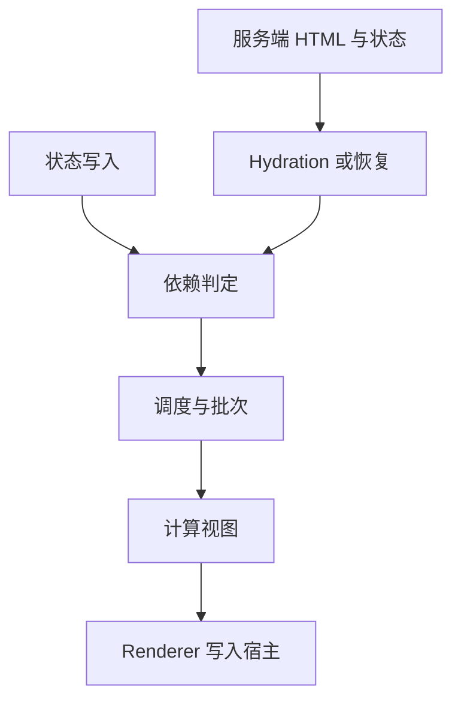
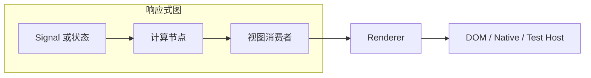

# 前端框架运行时设计：追踪、所有权、调度与渲染边界

同一个购物车把数量从 1 改到 2，React 可能重新执行组件函数；Vue 通常让依赖该字段的 effect 失效；Solid 让订阅这个 signal 的计算重新运行；Svelte 5 通过 rune 建立更新关系；Qwik 则尽量把事件处理延迟到需要时再恢复。只比较“虚拟 DOM 还是 signals”会漏掉真正影响应用行为的五个问题：谁知道依赖、谁拥有副作用、何时执行更新、谁操作宿主节点、服务端状态如何交给客户端。

本文只比较设计边界，不重复讲 Fiber、signals、编译器或 hydration 的入门实现。已有专题分别见 [React Fiber](../react/architecture/fiber.md)、[Vue 响应式](../vue/reactivity.md)、[Svelte 与 Solid](svelte-solid-compile-time.md)、[React 19 虚拟 DOM / signals / compiler](../react/r19/virtual-dom-vs-signals-compiler.md) 和 [SSR / hydration](../engineering/ssr-ssg-isr-hydration.md)。

## 心智模型：五条轴比“框架类别”更有解释力

图中自上而下看一次状态更新如何从依赖传播到屏幕，再横向比较服务端交接的策略。



1. 依赖判定回答“谁需要更新”，从组件级到属性级都有不同成本。
2. 调度回答“什么时候可以更新”，批量、优先级和一致性不是同一概念。
3. renderer 把框架内部描述翻译成 DOM、原生视图或测试宿主操作。
4. 服务端交接决定客户端必须重建多少状态与事件闭包。

| 设计轴 | 关键问题 | 观察指标 |
|---|---|---|
| 追踪粒度 | 依赖记录在组件、表达式、字段还是显式编译产物？ | 一次写入触发多少计算与组件函数 |
| 所有权 | effect、订阅、定时器由谁销毁？ | 条件卸载后仍存活的 listener 数 |
| 调度 | 写入同步可见吗？多次写入合并吗？ | flush 次数、可观察中间状态 |
| 宿主边界 | 如何从 view 描述生成节点操作？ | 同一逻辑能否接 DOM / SSR / Native |
| 服务端交接 | 下载 JS 后是重跑、hydrate，还是恢复事件？ | 初始字节、交互延迟、状态一致性 |

## 第一层：现象——更新范围不同，不等同于 DOM 改动范围

用 `price * count` 派生总价。React 的组件函数是状态快照的计算入口；函数重新执行不表示整棵 DOM 都重建，reconciler 会比较结果。Vue 的 proxy 追踪读写并将相关 effect 排队，组件 render effect 最终仍返回虚拟节点。Solid 在计算执行时收集 signal 读取，值变化只通知订阅者。Svelte 5 的 `$state`、`$derived`、`$effect` 是编译器可识别的 rune，编译器生成的依赖关系与运行时信号共同工作。

Qwik 的主要目标不同：它把组件及事件处理序列化成可恢复的边界，按交互加载代码；这并不表示没有运行时、没有状态追踪或所有计算都发生在编译期。Angular Signals 则把 signal 作为显式响应式值，并由框架视图系统消费；与 Zone.js 历史更新触发方式需区分。

| 家族 | 典型失效单位 | 描述 / 执行方式 | 常见误读 |
|---|---|---|---|
| React | 更新路径上的组件工作单元 | render 得到元素，reconciler 对比并提交 | “组件重跑”不等于“每个 DOM 节点重建” |
| Vue | 响应式 effect，常见为组件 render effect | VNode 与 patch renderer | proxy 追踪不代表所有对象访问都免费 |
| Solid | signal 订阅的 memo / effect / DOM 表达式 | JSX 编译后挂接细粒度计算 | 细粒度不自动解决异步竞争或生命周期管理 |
| Svelte 5 | rune 构成的依赖网络 | 编译器输出与运行时协作 | “编译型”不表示没有运行时状态 |
| Qwik | 可序列化边界与按需恢复的事件 / 状态 | resumability 加 lazy loading | 恢复不代表服务器状态永不需校验 |
| Angular | signal 消费者及模板视图 | 编译模板、视图运行时与 renderer | Signals 与变更检测模式是相关但不同层 |

## 第二层：规则——追踪、生命周期与调度必须一起看

### 依赖追踪的粒度与动态依赖

依赖追踪粒度越细，理论上越少无关计算，但图的维护、调度和内存成本会增加。组件级重算拥有简单的局部推理模型；细粒度依赖图减少重复表达式计算，却让条件分支和销毁语义更重要。依赖通常是动态的：`if (showTax) total = price * count + tax` 在分支改变后，应停止订阅旧分支读取的值。

工程上要同时检查三件事：依赖何时收集、旧依赖何时移除、多个来源同时改变时是否稳定。只问“是不是 fine-grained”不足以判断代码执行范围。

### 所有权与销毁

副作用有创建者，也要有明确 owner。组件卸载、条件分支消失、路由切换、请求取消，都会要求定时器、DOM listener、订阅和异步任务停止或失效。React effect cleanup 按 effect 生命周期执行；Vue effect scope 绑定响应式 effect；Solid owner 树让 computation 与 cleanup 有层级；Svelte 有 `$effect` 清理回调；Angular 有 `DestroyRef` / 生命周期 hook。名称不同，审查问题相同：销毁由谁触发、是否幂等、异步回调如何判断过期。

### 调度与 glitch

假设 `subtotal = price * count` 且 `total = subtotal + tax`。若 price 与 tax 一次事务内连续改变，观察者可能看到旧 subtotal 配新 tax 这样的中间组合，这类不一致常称为 glitch。系统可用批处理、拓扑排序、事务或版本快照降低它，但“batch”并不保证所有副作用同一时刻执行，也不代表副作用顺序可任意依赖。

React concurrent rendering 允许 render 工作被中断、恢复或放弃，提交才会写入宿主；Vue scheduler 合并队列中的更新；Solid `batch` 延后反应传播；Svelte scheduler 管理更新 flush；Angular effect/signal 更新遵循框架视图调度。比较时要区分：状态写入何时可读、derived 何时稳定、DOM 何时提交、effect 何时运行。

## 第三层：机制——从读取集合到宿主操作

组件级模型常用“状态快照 → 重新计算视图 → 差异比较 → commit”；细粒度模型常用“执行计算时记录读取 → 写入时查订阅者 → 重新计算消费者 → 更新对应节点”。两者可混合：Vue 有响应式跟踪和 VDOM；Solid 细粒度 DOM 更新仍有组件抽象；Svelte 编译减少运行时通用工作但保留调度和响应状态管理。



Renderer host 边界是平台扩展点。React DOM 与 React Native 共享 reconciler 思想但有不同 host config；Vue runtime-dom 基于 runtime-core renderer 接口；Angular 的 renderer 抽象 DOM 写入；Solid 通过 DOM runtime 插入并更新节点。宿主抽象不会让所有平台语义相同：焦点、布局、事件委托和原生控件行为依然由 host 决定。

源码观察时，追踪“谁创建 element、谁执行 patch / commit、谁删除旧节点”比搜 `render` 更有效。声明式 API 是入口，不是执行机制的完整描述。

## 第四层：实现——可断言的调度与 owner 教学模型

下面的脚本是通用教学模型，不是 React、Vue、Solid、Svelte、Qwik 或 Angular 的实现。它展示显式事务 flush 如何合并重复 job、scope 如何让 cleanup 幂等。

```sh
node scripts/content-labs/frameworks/scheduler-ownership.mjs
```

预期输出：

```text
scheduler-ownership: 1 batched run; cleanup exactly once
```

脚本中的队列用 `Set` 去重，`flush()` 在显式事务边界执行。生产框架会使用各自的微任务队列、优先级、渲染阶段或同步路径；这个脚本只验证“同一 flush 中重复入队去重”与“资源析构幂等”。

真实验收：输入是两次状态写入和两次同一 render job 入队；命令见上方；通过阈值是断言全部通过且 render 次数为 1、清理事件只出现一次；失败证据是 Node assertion 的实际 / 期望差异；清理方式为脚本结束，无后台资源。测试运行时记录在本文验证状态中。

## 第五层：边界——编译、hydration 与 resumability 的取舍

| 策略 | 服务端输出 | 客户端工作 | 主要成本 |
|---|---|---|---|
| CSR | 通常只发壳或部分 HTML | 下载代码、执行组件、创建 DOM | 首次 JS 与主线程工作 |
| Hydration | 服务端先生成 HTML | 加载对应组件并把事件 / 状态连接到既有节点 | HTML 与客户端树必须匹配；仍要加载代码 |
| Partial / selective hydration | 只 hydrate 部分边界 | 交互区域按需激活 | 边界设计与跨岛共享状态 |
| Resumability | 序列化恢复所需状态和引用 | 尽量恢复而非从根重跑 | 可序列化约束、闭包拆分、部署版本兼容 |
| Compiler-heavy | 编译时生成专用更新逻辑 | 执行专用代码与少量运行时 | 编译时间、动态模式 fallback、调试映射 |

“HTML 已存在”不意味着页面已可交互；“恢复”不意味着传输没有成本；“细粒度”也不意味着首屏更快。测量时分别记录 HTML 大小、初始 JS、hydration / resume CPU、首次可交互时刻、交互后更新成本，并使用同一页面和网络条件。SSR 之后从服务端 hydrate 的客户端可能仍需付出初始化时间。

### 两个真实项目对照

React 的 `packages/react-reconciler/src/ReactFiberWorkLoop.js` 是 render / commit 与调度协作的入口；DOM 操作进入 `packages/react-dom-bindings/src/client/ReactFiberConfigDOM.js`。Vue 的 `packages/runtime-core/src/renderer.ts` 定义 renderer 与 patch 主干，响应式依赖在 `packages/reactivity/src/effect.ts` 和 `dep.ts`。比较这两者可看出：组件级 reconciliation 与响应式依赖追踪并非互斥设计。

Solid 的 `packages/solid/src/reactive/signal.ts` 包含 signal 与 computation 的传播逻辑，`packages/solid/web/src/client.ts` 负责 DOM 侧绑定。Svelte 的 `packages/svelte/src/compiler/phases/3-transform/client/visitors` 展示编译器生成 client 代码的节点级转换；`packages/svelte/src/internal/client` 是运行时支撑。源码目录结构会随提交变化，固定 commit 后再引用路径。

Qwik 的 `packages/qwik/src/core` 是 runtime 入口；该快照将 optimizer-facing code 与 Rust optimizer 分在 `packages/qwik-vite/src`、`packages/optimizer/src`，不要按旧目录结构猜实现路径。Angular 的 `packages/core/src/render3` 包含视图运行时，signal primitives 位于 `packages/core/primitives/signals/src`。不要把 README 的“无需 hydration”宣传句直接等价为无需客户端校验或任意闭包可序列化。

## 常见误区

1. **把重算次数当作 DOM 写入次数。** 记录 render/computation、patch 和宿主 mutation 三个计数。
2. **把细粒度等同于零开销。** 订阅图也需要分配、清理、调度与错误传播。
3. **把 batch 理解为数据库事务。** 验证中途读取、异常回滚、异步边界是否有事务保证。
4. **把组件卸载当成全部资源自动清理。** 手工 `addEventListener`、裸 Promise 和外部订阅仍要核查 owner。
5. **把编译器理解为没有运行时。** 状态、调度、事件和 renderer 通常仍需要 runtime。
6. **把 resumability 当成通用序列化。** 闭包、平台对象、任意 class 实例有可恢复限制。

## 30 秒与 2 分钟回答

**30 秒：** 框架运行时可按依赖粒度、资源 owner、调度、renderer host 和服务端交接五条轴比较；组件重跑、DOM 写入和 hydration 是不同工作，具体成本要用执行次数、字节和交互耗时测量。

**2 分钟：** 对购物车更新，我先看依赖如何建立以及条件分支变化后旧依赖是否移除，再看多次写入的 flush 时序和 effect cleanup 的 owner。React/Vue 可以通过不同组合把更新从状态推进到 host；Solid/Svelte强调更细的计算或编译生成；Qwik把恢复边界和代码加载放入首屏权衡。验证我会固定页面、提交和浏览器，采集计算次数、DOM mutation、初始 JS、交互前主线程耗时，并在路由卸载后检查 listener / subscription 是否残留。抽象分类不代替源码和生产测量。

## 自测题

??? question "1. 组件函数执行一次，是否必然产生 DOM 操作？"
    **答案：** 不必然。reconciliation / patch 可能判断宿主输出相同；要单独观测计算与 host mutation。

??? question "2. 为什么条件分支改变时需要移除旧依赖？"
    **答案：** 否则非当前分支的值变化仍会触发无关计算，且旧订阅可能延长对象生命周期。

??? question "3. batch 一定提供原子事务语义吗？"
    **答案：** 不一定。需要检查批次边界内的读取、回滚、异常和异步行为。

??? question "4. hydration 与 resumability 的客户端工作有何不同？"
    **答案：** hydration 通常把运行时代码连接到服务端节点；resumability 目标是恢复序列化边界所需的状态 / 引用，减少从根重做，但仍可能加载代码并校验。

## 可读源码路线

先分别固定下面 commit，再按“状态读取 → 依赖收集 → 调度 → 视图生成 → host mutation → 销毁”跟一条真实用例。不要一开始横跳整个仓库。

| 项目 | 固定源码 | 第一站 |
|---|---|---|
| React | [b618bbb](https://github.com/facebook/react/tree/b618bbb4422693bbb8d387180687b3f510300f42) | `packages/react-reconciler/src/ReactFiberWorkLoop.js` |
| Vue | [4ab865a](https://github.com/vuejs/core/tree/4ab865a848a1da3d10fb674f857e5fff13094644) | `packages/runtime-core/src/renderer.ts` |
| Solid | [25138e1](https://github.com/solidjs/solid/tree/25138e1c2a32712ddff683374e1a257b8bf8b5a8) | `packages/solid/src/reactive/signal.ts` |
| Svelte | [707c281](https://github.com/sveltejs/svelte/tree/707c28146b0f0a6d5404a1bd4769874c3c24851a) | `packages/svelte/src/compiler/phases/3-transform/client` |
| Qwik | [a0721b0](https://github.com/QwikDev/qwik/tree/a0721b0c20d00d46096db6a9a7eded131e9a0c1b) | `packages/qwik/src/core` |
| Angular | [78d2a67](https://github.com/angular/angular/tree/78d2a67d922b2a2af29d50aed587bc78a99a5450) | `packages/core/src/render3` 与 `packages/core/primitives/signals/src` |

阅读时先跑对应目录测试，找到同一概念的测试断言，再追实现。若路径在该快照不存在，以 commit 下实际文件为准并记录变化，不要拿 `main` 文档推断旧实现。

## 深入阅读

- React reconciler 源码：看 work loop 如何切换 render 与 commit 阶段。
- Vue renderer 与 reactivity 源码：看 host API 与 effect 调度如何分层。
- Solid signal 与 Svelte client transform：对比运行时依赖记录和编译生成依赖。
- Qwik optimizer / core：跟踪序列化边界如何恢复交互。
- Angular render3 与 reactivity：看 signal 消费者如何进入视图更新。
