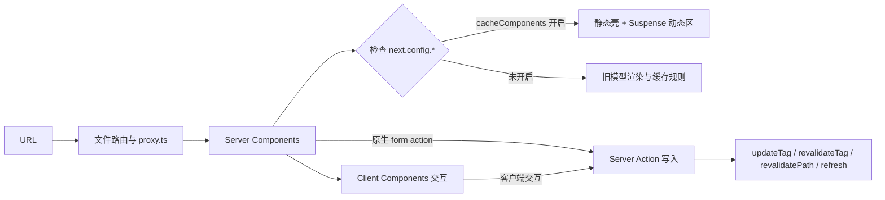

# Next.js 16.x App Router：组件边界、双缓存模型与请求生命周期

假设商品详情页需要显示共享的商品描述、用户专属的库存预留状态，以及“加入购物车”按钮。面试官问“这页是静态还是动态”“数据会不会缓存”“谁负责鉴权”时，不能只回答“Next.js 会自动处理”：16.4 同时有两种缓存模型，而组件边界、请求时 API、Suspense 与显式缓存共同决定答案。

本章以 **Next.js 16.4.0** 为基准，版本资料核对日期为 **2026-10-11**；面向 App Router。App Router 从 Next.js 13.4 起稳定；本文涉及的 16.x 配置和 API 均按对应官方版本说明。先记住总路线：URL 命中文件路由，服务端组件组织页面，动态请求值在请求时读取，缓存边界声明可复用部分，Suspense 标出等待边界，Server Action 完成写入和失效。参见 [App Router 入门](https://nextjs.org/docs/app/getting-started)、[Next.js 16.4 发布说明](https://nextjs.org/blog/next-16-4)。

## 心智模型：一次请求的边界

下图展示一条商品页请求的关键节点。缓存分为“显式 Cache Components”与“旧模型”两种配置路径，项目只会采用其中一种。



1. `app/` 目录映射页面与布局；`proxy.ts` 可在路由处理前改写、重定向或拒绝请求。
2. Server Component 是默认组件，负责安全地读取数据并生成 UI；Client Component 提供浏览器交互。
3. 读取 `cookies()`、`headers()` 等请求值意味着需要请求上下文；Cache Components 下通常把这类读取放进 Suspense 边界。
4. 写入由 Server Action 执行，按数据标签或页面路径处理缓存；没被缓存的数据可单独刷新。

## 1. 路由和组件：服务端是默认值

### 文件夹对应 URL

`app/blog/[slug]/page.tsx` 匹配 `/blog/hello`，并把 `slug` 放在 `params` 里。`page.tsx` 是可访问页面，`layout.tsx` 是跨子页面共享的 UI；路由组 `(shop)` 不会成为 URL 的一段，动态段 `[slug]` 会成为一段。详见 [Layouts and Pages](https://nextjs.org/docs/app/getting-started/layouts-and-pages) 与 [Dynamic Segments](https://nextjs.org/docs/app/api-reference/file-conventions/dynamic-routes)。

| 文件或约定 | 作用 | 面试时要指出的边界 |
| --- | --- | --- |
| `page.tsx` / `layout.tsx` | 路由页面 / 持久共享布局 | 子页面导航时共享 layout 可以保留状态；layout 不会收到可直接用来读取 query 的 `searchParams` |
| `[id]`、`[...slug]`、`[[...slug]]` | 单段、一个或多个剩余段、可选 catch-all | 文件夹名成为 `params` 的键；catch-all 的值是数组 |
| `(marketing)`、`@modal` | 路由组不进 URL；`@slot` 创建 parallel route 插槽 | parallel route 所有 slot 都要有 `default.tsx` 兜底；Next 16 缺少时 build 会失败 |
| `(.)photo`、`(..)photo`、`(...)photo` | intercepting route 从同级、父级、根级拦截目标路由 | 常见于点击后弹出图片详情、刷新后又能直接访问图片 URL 的 modal 路由 |
| `loading.tsx`、`error.tsx`、`not-found.tsx` | 路由级等待、错误、找不到内容边界 | `error.tsx` 必须是 Client Component；调用 `notFound()` 进入 not-found UI |
| `route.ts` | Web Request/Response API 的 HTTP endpoint | 同一 segment 不能同时放 `page.tsx` 和 `route.ts`；Route Handler 不参与 layout 或客户端页面导航 |

这些约定来自 [Parallel Routes](https://nextjs.org/docs/app/api-reference/file-conventions/parallel-routes)、[Intercepting Routes](https://nextjs.org/docs/app/api-reference/file-conventions/intercepting-routes)、[loading.js](https://nextjs.org/docs/app/api-reference/file-conventions/loading)、[error.js](https://nextjs.org/docs/app/api-reference/file-conventions/error)、[not-found.js](https://nextjs.org/docs/app/api-reference/file-conventions/not-found) 与 [route.js](https://nextjs.org/docs/app/api-reference/file-conventions/route)。Next 16 要求 parallel route slot 有 `default.tsx`，详见[版本 16 迁移项](https://nextjs.org/docs/app/guides/upgrading/version-16#parallel-routes-defaultjs-requirement)。

Next.js 15 起 `params`、`searchParams` 是 Promise；16 中同步访问方式已移除。下面用异步组件 `PostContent` 读取参数，并让 `page.tsx` 提供 Cache Components 需要的 Suspense 边界。**示意代码：未通过自动验证。**

```tsx
// app/blog/[slug]/page.tsx：静态壳和异步参数内容分开
import { Suspense } from 'react'
import PostContent from './post-content'

type Props = {
  params: Promise<{ slug: string }>
  searchParams: Promise<{ tab?: string }>
}

export default function BlogPage(props: Props) {
  return <Suspense fallback={<p>正在读取文章…</p>}><PostContent {...props} /></Suspense>
}
```

页面定义 Suspense 边界；真正使用 `params` 和 `searchParams` 的异步子组件可在请求时完成。

**示意代码：未通过自动验证。**

```tsx
// app/blog/[slug]/post-content.tsx
type Props = {
  params: Promise<{ slug: string }>
  searchParams: Promise<{ tab?: string }>
}

export default async function PostContent({ params, searchParams }: Props) {
  const { slug } = await params
  const { tab = 'content' } = await searchParams
  return <h1>文章：{slug}，当前页签：{tab}</h1>
}
```

### Server Component 与 Client Component

App Router 中组件默认是 Server Component。它可以在服务器读取数据库、文件或服务端密钥；组件代码不会以客户端模块的形式发送。需要 `useState`、事件处理器或浏览器 API 时，在模块顶部写 `'use client'`，该模块及其客户端依赖构成客户端边界。服务端父组件可以把可序列化数据传给客户端子组件。这个边界不是“组件里某一行代码”的边界。参见 [Server and Client Components](https://nextjs.org/docs/app/getting-started/server-and-client-components)。

**示意代码：未通过自动验证。**

```tsx
// app/products/[id]/page.tsx — Cache Components 下的静态壳
import { Suspense } from 'react'
import ProductDetails from './product-details'

type ProductProps = { params: Promise<{ id: string }> }

export default function ProductPage({ params }: ProductProps) {
  return <Suspense fallback={<p>正在读取商品…</p>}><ProductDetails params={params} /></Suspense>
}
```

异步子组件解析 ID 并在服务端读取商品。**示意代码：未通过自动验证。**

```tsx
// app/products/[id]/product-details.tsx
import AddToCart from './add-to-cart'

type ProductProps = { params: Promise<{ id: string }> }

export default async function ProductDetails({ params }: ProductProps) {
  const { id } = await params
  const product = await getProduct(id) // 服务端读取
  return <><h1>{product.name}</h1><AddToCart productId={product.id} /></>
}
```

交互叶子组件单独标记为客户端模块。**示意代码：未通过自动验证。**

```tsx
// app/products/[id]/add-to-cart.tsx — Client Component
'use client'

export default function AddToCart({ productId }: { productId: string }) {
  return <button onClick={() => console.log(productId)}>加入购物车</button>
}
```

前段负责取商品，后段只拿到可序列化的商品 ID 并处理点击。不要把数据库客户端或 secret 环境变量导入客户端模块。更多边界规则见官方 [Server and Client Components](https://nextjs.org/docs/app/getting-started/server-and-client-components)。

### 首次访问与后续导航

首次文档请求中，服务器生成 HTML 供浏览器尽早显示，同时发送 RSC Payload 描述服务端组件树和客户端组件位置；浏览器用客户端 JavaScript 对 Client Components 做 hydration，让事件处理器开始工作。后续由 `<Link>` 触发的客户端导航主要交换 RSC Payload，而不是再请求完整 HTML 文档；未变化的共享 layout 可留在客户端树里，保留状态。参见 [Server and Client Components](https://nextjs.org/docs/app/getting-started/server-and-client-components) 与 [Linking and Navigating](https://nextjs.org/docs/app/getting-started/linking-and-navigating)。

这也解释了为什么“服务端渲染过”不等于“客户端没有 JavaScript”：Client Component 仍需加载与 hydration；Server Component 的 JSX 不会作为客户端组件代码发送，但其结果会进入 HTML/RSC 响应。

## 2. Next.js 16 的两个缓存模型

### 先检查项目用了哪套

Next.js 16.0 引入 Cache Components，作为可选的新模型；`cacheComponents: true` 会启用它，并启用部分预渲染（Partial Prerendering，PPR）的编程模型。没开这个配置的存量项目仍使用旧模型。16.4 的 `create-next-app` 新项目默认打开 Cache Components；官方对存量项目的推荐配置是同时设置 `cacheComponents: true` 与 `partialPrefetching: true`。所以不能从“Next 16”直接推断缓存行为，先读项目的 `next.config.*`。参见 [Next.js 16](https://nextjs.org/blog/next-16)、[Next.js 16.4](https://nextjs.org/blog/next-16-4)。

**示意代码：未通过自动验证。**

```ts
// next.config.ts — Next.js 16.4 推荐的 Cache Components 配置
import type { NextConfig } from 'next'

const nextConfig: NextConfig = {
  cacheComponents: true,
  partialPrefetching: true,
}

export default nextConfig
```

| 模型 | 如何启用 | 缓存思路 | 读代码时先检查 |
| --- | --- | --- | --- |
| Cache Components | `cacheComponents: true`；16.4 新建项目默认启用 | 默认不缓存动态工作；用 `'use cache'` 明确选择缓存边界，配合 Suspense 生成静态壳与动态区 | `'use cache'`、`cacheLife`、`cacheTag`、Suspense 边界 |
| 旧缓存模型 | 不启用 `cacheComponents` | 按 `fetch` 选项、路由配置与请求 API 推导缓存及静态/动态行为 | `fetch` 的 `cache` / `next.revalidate`、`dynamic`、`revalidate` 等配置 |

不要把两套模型的 API 混写成一个模糊的“四层缓存”。例如，旧文章常用的 Full Route Cache / Data Cache / Router Cache 图解并不等价于 Cache Components 的显式缓存与静态壳。Next.js 官方将未启用新模型的文档标为 [Caching (Previous Model)](https://nextjs.org/docs/app/guides/caching-without-cache-components)。该模型中 `fetch` 默认不缓存，可显式传 `{ cache: 'force-cache' }`；这是与 Cache Components 的主要区别之一。

### Cache Components：缓存函数、组件或页面

在新模型中，`'use cache'` 可以放在函数或组件体顶部。`cacheLife()` 设置缓存生命周期配置档，`cacheTag()` 添加供失效调用的标签。函数参数会参与缓存键，使用闭包值时闭包值也会影响键，因此要谨慎处理用户身份、租户 ID 等数据，避免共享缓存跨用户泄露。文档见 [Caching](https://nextjs.org/docs/app/getting-started/caching)、[`use cache`](https://nextjs.org/docs/app/api-reference/directives/use-cache)、[`cacheLife`](https://nextjs.org/docs/app/api-reference/functions/cacheLife)、[`cacheTag`](https://nextjs.org/docs/app/api-reference/functions/cacheTag)。

以下函数缓存可公开共享的商品目录数据，并打上 `catalog` 标签；`hours` 是内置生命周期配置档，具体 stale/revalidate/expire 值以文档为准。**示意代码：未通过自动验证。**

```ts
// app/lib/catalog.ts
import { cacheLife, cacheTag } from 'next/cache'

export async function getCatalog() {
  'use cache'
  cacheLife('hours')
  cacheTag('catalog')

  const response = await fetch('https://store.example/api/catalog')
  if (!response.ok) throw new Error('商品目录读取失败')
  return response.json() as Promise<{ id: string; name: string }[]>
}
```

`cacheLife('hours')` 不是“永久保存一小时后立刻删掉”的简单 TTL。它采用缓存配置档定义 stale、revalidate、expire 等时长；遇到特定时效要求，应读 [cacheLife 参考](https://nextjs.org/docs/app/api-reference/functions/cacheLife)。需要每次请求实时读取的值不要放进这个共享函数体。

高阶边界也要说清楚：Cache Components 要求 Node.js runtime；官方明确说明 `runtime: 'edge'` 不受支持。`'use cache'` 也不支持 `output: 'export'`。默认缓存是进程内存，不能假设多实例或 serverless 请求间共享；要共享/持久化需配置合适的 cache handler。React `cache()` 是服务器渲染期间的请求记忆化，不是持久化缓存。参见 [Cache Components 的 runtime 限制](https://nextjs.org/docs/app/getting-started/partial-prerendering#runtime-edge)、[`use cache` 运行时与静态导出限制](https://nextjs.org/docs/app/api-reference/directives/use-cache)、[`cacheHandlers`](https://nextjs.org/docs/app/api-reference/config/next-config-js/cacheHandlers) 和 [React `cache`](https://react.dev/reference/react/cache)。

| 边界 | 面试中的准确表述 |
| --- | --- |
| Runtime / 导出 | Cache Components 不能运行于 Edge；`'use cache'` 不适用于纯静态导出。 |
| 部署拓扑 | 默认缓存按 Next.js 进程隔离；多实例共享需外部/自定义 cache handler，不能依赖单机内存。 |
| 身份与缓存键 | 把 `tenantId` 或 `userId` 作为缓存参数可隔离键空间，但不能代替服务端认证、授权或租户归属检查。 |
| React `cache()` | 同一服务器渲染请求中的重复调用可去重；它不是跨请求的持久缓存。 |

### 动态值、静态壳与 Suspense

`cookies()`、`headers()` 是请求时 API，必须异步读取，例如 `const requestHeaders = await headers()`。Cache Components 下，把读请求值的组件放在 `<Suspense>` 里，可让静态部分预渲染成 shell，动态内容在请求到达时流式补上。要缓存“基于当前用户”的数据，先在未缓存范围读取会话，再把必要值当参数传给缓存函数；该参数会参与缓存键。不要在 `'use cache'` 函数内部直接读取动态请求 API。参见 [cookies()](https://nextjs.org/docs/app/api-reference/functions/cookies)、[headers()](https://nextjs.org/docs/app/api-reference/functions/headers)、[Cache Components: Working with runtime APIs](https://nextjs.org/docs/app/getting-started/caching#working-with-runtime-apis) 与 [Streaming uncached data](https://nextjs.org/docs/app/getting-started/caching#streaming-uncached-data)。

**示意代码：未通过自动验证。**

```tsx
// app/account/page.tsx — 静态 shell 与请求时子树
import { Suspense } from 'react'
import AccountStatus from './account-status'

export default function AccountPage() {
  return (
    <main>
      <h1>账户</h1>
      <Suspense fallback={<p>正在读取账户状态…</p>}>
        <AccountStatus />
      </Suspense>
    </main>
  )
}

```

把请求时读取隔离在子组件。**示意代码：未通过自动验证。**

```tsx
// app/account/account-status.tsx
import { cookies } from 'next/headers'

export default async function AccountStatus() {
  const session = (await cookies()).get('session')?.value
  return <p>{session ? '已登录' : '访客'}</p>
}
```

页面标题可进入预渲染 shell；读取 cookie 的内容留在 Suspense 边界里，在请求时完成。此处代码仅展示边界，不实现会话验证。`loading.tsx` 也会为对应路由段创建 Suspense 边界；需要把慢任务压缩到更小区域时，显式 `<Suspense>` 更直观。参见 [loading.js 文件约定](https://nextjs.org/docs/app/api-reference/file-conventions/loading)。

### 旧模型：缓存选项仍要显式判断

对未开启 Cache Components 的现有应用，Next.js 16 的 `fetch` 默认不缓存。需要跨请求缓存时，可以给请求使用 `cache: 'force-cache'` 或设置 `next: { revalidate: 秒数 }`；`next.tags` 可供 `revalidateTag` 失效。不要把旧版 Next.js 对默认缓存的记忆套到 16.x。完整的旧模型 API 与路由配置说明见 [Caching (Previous Model)](https://nextjs.org/docs/app/guides/caching-without-cache-components)。

**示意代码：未通过自动验证。**

```tsx
// 旧模型项目中的显式 fetch 缓存
export async function getFeaturedProducts() {
  const response = await fetch('https://store.example/api/featured', {
    cache: 'force-cache',
    next: { revalidate: 300, tags: ['featured-products'] },
  })
  if (!response.ok) throw new Error('精选商品读取失败')
  return response.json()
}
```

此片段属于旧模型，不要因为函数名叫 `getFeaturedProducts` 就误以为它使用了 Cache Components。旧模型里 request memoization（请求级记忆化）用于一次渲染中的相同 `fetch` 调用去重；React 的 `cache()` 可记忆化非 `fetch` 函数，但它不是跨请求持久缓存。官方分别说明了 [请求去重与预加载](https://nextjs.org/docs/app/guides/caching-without-cache-components#deduplicating-requests) 和 [React `cache`](https://react.dev/reference/react/cache)。

### 在 Node 中模拟 tag 失效

下面纯 Node 脚本只模拟“`revalidateTag(tag, 'max')` 允许先提供旧值，再更新”与“`updateTag(tag)` 让下一次读取取新值”这两种可观察语义；它不是 Next.js 的缓存实现。此脚本已用 Node 运行，预期输出写在代码后。

第一段建立缓存、数据源和 SWR 读取流程：命中 stale 条目时先返回旧值，再模拟后台更新。**纯 Node 教学脚本：已运行；非 Next.js 内部实现。**

```js
const cache = new Map([['articles', 'v1']])
let stale = false
const origin = () => 'v2'
function read() {
  const value = cache.get('articles')
  if (stale) {
    stale = false
    cache.set('articles', origin()) // 模拟请求触发后台更新完成
    return `served stale ${value}`
  }
  if (value) return `served ${value}`
  const fresh = origin()
  cache.set('articles', fresh)
  return `loaded ${fresh}`
}
```

第二段应用两种失效语义并打印结果。**纯 Node 教学脚本：已运行；非 Next.js 内部实现。**

```js
function revalidateTag(profile) {
  if (profile === 'max') stale = true
  else cache.delete('articles')
}
function updateTag() { cache.delete('articles') }

revalidateTag('max')
console.log(read()) // 先提供 v1，同时更新缓存
console.log(read()) // 随后读取 v2
updateTag()
console.log(read()) // updateTag 之后不返回旧缓存
```

本地执行输出：

```text
served stale v1
served v2
loaded v2
```

该模型省略了标签索引、并发、分布式存储和实际网络延迟，只用于复述两种 API 的目标语义。真实项目的 API 参数与适用位置以 [revalidateTag](https://nextjs.org/docs/app/api-reference/functions/revalidateTag) 和 [updateTag](https://nextjs.org/docs/app/api-reference/functions/updateTag) 为准。

## 3. 缓存失效：五种 API 不能互换

| API | 在哪里调用 | 改变什么 | 常见用途 |
| --- | --- | --- | --- |
| `updateTag(tag)` | 仅 Server Action | 立即过期带该 tag 的缓存数据（`cacheTag` 或 tagged `fetch`），支持 read-your-writes | 用户保存资料后立刻看到自己的新值 |
| `revalidateTag(tag, 'max')` | Server Action 或 Route Handler | 以 stale-while-revalidate 策略处理带 tag 的缓存；通常先返回旧值，再后台更新 | 新闻、目录等可容忍短暂旧值的共享内容 |
| `revalidatePath(path)` | Server Action 或 Route Handler | 让指定路径重新验证；作用按路径定位 | 页面本身需要重新验证时 |
| `refresh()` | 仅 Server Action | 刷新当前路由中的未缓存数据，不使缓存失效 | 通知计数等动态数据更新，而页面缓存保持有效 |
| `router.refresh()` | Client Component | 发起当前路由的新 RSC 请求并刷新客户端路由视图；本身不使服务器缓存失效 | 客户端要求重新取当前 RSC 树时 |

Next.js 16 中单参 `revalidateTag(tag)` 已弃用。一般 stale-while-revalidate 用第二参 `'max'`；需要写后立即读新值时在 Server Action 里用 `updateTag`。`refresh` 是服务端 Action API，`router.refresh()` 是客户端导航 API，两者都不等价于缓存失效。逐项核对官方 [revalidateTag](https://nextjs.org/docs/app/api-reference/functions/revalidateTag)、[updateTag](https://nextjs.org/docs/app/api-reference/functions/updateTag)、[refresh](https://nextjs.org/docs/app/api-reference/functions/refresh)、[revalidatePath](https://nextjs.org/docs/app/api-reference/functions/revalidatePath) 与 [useRouter](https://nextjs.org/docs/app/api-reference/functions/use-router)。

下面展示旧模型中带 tag 的数据由 Server Action 失效。**示意代码：未通过自动验证。**

```ts
// app/actions/publish.ts
'use server'

import { revalidatePath, revalidateTag } from 'next/cache'

export async function publishArticle(formData: FormData) {
  const title = String(formData.get('title') ?? '').trim()
  if (!title) throw new Error('标题不能为空')
  await saveArticle(title)

  revalidateTag('articles', 'max') // 旧模型 tagged fetch：允许后台刷新
  revalidatePath('/articles') // 指定列表路径也重新验证
}
```

若同一操作在 Cache Components 中要求立刻让该用户看到刚写入的数据，给缓存内容加 `cacheTag('article-' + id)`，写入后调用 `updateTag('article-' + id)`。选择失效 API 前先回答两个问题：内容能否短暂返回旧值？缓存是按数据标签还是按路径定位？

## 4. Server Actions：服务端写入与安全边界

Server Action 是可从客户端触发的异步服务端函数，适合表单和 mutation。它不是“天然安全的私有函数”：调用方可以构造请求，因此 Action 必须验证输入、会话、授权和业务约束；使用绑定的用户 ID 也要在服务器核实归属。官方安全说明见 [Mutating Data](https://nextjs.org/docs/app/getting-started/updating-data) 与 [Data Security](https://nextjs.org/docs/app/guides/data-security)。

**示意代码：未通过自动验证。**

```ts
// app/actions/cart.ts
'use server'

import { updateTag } from 'next/cache'

export async function addToCart(formData: FormData) {
  const productId = String(formData.get('productId') ?? '')
  const user = await requireAuthenticatedUser()
  if (!/^[a-z0-9-]+$/i.test(productId)) throw new Error('商品编号无效')

  await cartRepository.add(user.id, productId)
  updateTag(`cart-${user.id}`) // 该用户写后立即读新购物车
}
```

`updateTag` 面向“刚写完就读”的交互；如果是无缓存的动态数据，可改用 `refresh()`；如果共享静态数据可后台更新，则用 `revalidateTag(tag, 'max')`。授权不能只在按钮显示时检查，也不能只靠 `proxy.ts` 检查，Action 和数据访问入口还要做服务器端授权。

Server Action 可以直接交给 HTML 表单的 `action` prop，不必先写客户端组件；需要提交状态、pending UI 或客户端交互时，再用 React 的 `useActionState` 等 API。详见 [Forms](https://nextjs.org/docs/app/guides/forms)。**示意代码：未通过自动验证。**

```tsx
// app/articles/new/page.tsx — server action 可直接接到表单
import { publishArticle } from '@/app/actions/publish'

export default function NewArticlePage() {
  return <form action={publishArticle}><input name="title" /><button>发布</button></form>
}
```

### Route Handler 与 Server Action 怎么选

Route Handler 是公开的 HTTP endpoint，适合给移动端、第三方客户端或 webhook 提供协议边界；文件名是 `app/api/items/route.ts`，导出 `GET`、`POST` 等方法并用标准 `Request` / `Response` 工作。Server Action 更适合由当前 Next.js UI 触发的 mutation，框架负责表单/Action 调用与 UI 更新。两者都需要输入验证、身份认证和授权。

Cache Components 开启时，Route Handler 的 `GET` 默认在请求时执行；没有运行时数据时可在构建时预渲染；要把动态数据纳入静态响应，可将带 `'use cache'` 的读取逻辑抽到 handler 外的 helper。旧模型中 Route Handler 默认不缓存，可对 `GET` 显式选择静态配置；`POST` 等写方法不会缓存。详见 [Route Handlers](https://nextjs.org/docs/app/getting-started/route-handlers)。**示意代码：未通过自动验证。**

```ts
// app/api/items/route.ts
export async function GET() {
  return Response.json(await listPublicItems())
}

export async function POST(request: Request) {
  const input = await request.json()
  const item = await createItem(validateItem(input))
  return Response.json(item, { status: 201 })
}
```

## 5. `proxy.ts`：请求拦截不是最终鉴权

Next.js 16 将 `middleware.ts` 更名为 `proxy.ts`；`proxy` 运行在 Node.js runtime。该文件适合根据请求快速重定向、改写 URL、设置请求或响应头，以及粗粒度的入口判断。它运行在入口位置，不代表它一定能替代每个数据操作的授权检查。官方明确建议使用 Proxy 进行乐观检查，真正的数据访问控制应放在靠近数据源的 DAL（Data Access Layer，数据访问层）或页面/Action 中。参见 [Proxy 文件约定](https://nextjs.org/docs/app/api-reference/file-conventions/proxy) 与 [Authentication](https://nextjs.org/docs/app/guides/authentication)。

下面仅示意保护路径入口；生产代码还需校验 session 的签名、有效期和用户状态。**示意代码：未通过自动验证。**

```ts
// proxy.ts
import { NextResponse, type NextRequest } from 'next/server'

export function proxy(request: NextRequest) {
  const token = request.cookies.get('session')?.value
  if (!token && request.nextUrl.pathname.startsWith('/dashboard')) {
    return NextResponse.redirect(new URL('/login', request.url))
  }
  return NextResponse.next()
}

export const config = {
  matcher: ['/dashboard/:path*'],
}
```

“有 cookie”不等同于“已授权”。代理拦截用于减少明显无效访问或提供快捷跳转；Server Component、Route Handler、Server Action 和 DAL 在访问私有数据前都必须执行对应授权检查。16.0 发布说明确认 `proxy.ts` 使用 Node.js runtime，同时说明旧 `middleware.ts` 已弃用。详见 [Next.js 16 Proxy 说明](https://nextjs.org/blog/next-16#proxyts-formerly-middlewarets)。

## 6. Turbopack、React Compiler 与 React Server Components

Next.js 16 起，Turbopack 是 `next dev` 和 `next build` 默认 bundler；需要 Webpack 时可运行 `next dev --webpack` 或 `next build --webpack`。16.1 让 Turbopack 开发文件系统缓存稳定并默认启用。参见 [Next.js 16](https://nextjs.org/blog/next-16#turbopack-stable)、[Next.js 16.1](https://nextjs.org/blog/next-16-1#turbopack-file-system-caching-for-next-dev) 与 [升级到 16](https://nextjs.org/docs/app/guides/upgrading/version-16#turbopack-by-default)。

React Compiler 在 Next.js 16 获得稳定集成，但默认不启用；设置 `reactCompiler: true` 后，它通过编译期分析减少不必要的 React 重渲染。它与 RSC、Cache Components 是三种不同机制：React Compiler 不会把 Server Component 输出变成跨请求缓存，也不会替代 `'use cache'`、`cacheLife` 或 `cacheTag`。参见 [Next.js 16 React Compiler](https://nextjs.org/blog/next-16#react-compiler-support-stable) 与 [升级说明](https://nextjs.org/docs/app/guides/upgrading/version-16#react-compiler-support)。

面试时可这样区分：RSC 决定组件在哪里执行、如何向客户端描述服务端树；React Compiler 优化 React 组件的重渲染；Cache Components 决定哪些渲染结果或数据按明确缓存键复用。

## 7. Next.js 16.x 版本变化

| 版本 | 官方变化 | 面试/迁移时检查 |
| --- | --- | --- |
| 16.0 | Cache Components 首次发布并可选启用；`proxy.ts` 取代 `middleware.ts`；Turbopack 默认；加入 `updateTag` 与带 profile 的 `revalidateTag`；异步请求 API 成为强制写法 | `cacheComponents` 配置、代理文件名、`params`/`cookies()` Promise、Webpack 自定义配置 |
| 16.1 | Turbopack `next dev` 文件系统缓存稳定并默认开启 | 本地重启后的编译缓存；`next experimental-analyze` 仍为实验功能 |
| 16.2 | 性能、调试和 AI 工作流改进；Next.js 包含与安装版本匹配的本地文档 | 本地依赖中的 `node_modules/next/dist/docs/` |
| 16.3 | `next dev` 维护指向本地文档的 `AGENTS.md` 托管指令；改进预取、流式渲染等 | 理解项目级 Agent 指令和版本对应文档 |
| 16.4 | 新项目 `create-next-app` 默认启用 Cache Components；官方建议存量项目配置 `cacheComponents: true`、`partialPrefetching: true` | 新项目默认值不代表升级项目的配置也自动改变 |

官方版本依据：[16.0 发布](https://nextjs.org/blog/next-16)、[16.1 发布](https://nextjs.org/blog/next-16-1)、[16.2 发布](https://nextjs.org/blog/next-16-2)、[16.3 发布](https://nextjs.org/blog/next-16-3)、[16.4 发布](https://nextjs.org/blog/next-16-4)。

### 16.4 的静态保证与按导航阶段加载

`ensureStatic` 是 Cache Components 下的 route segment 配置，可放在 `page.tsx` 或 `layout.tsx`：`'shell'` 保证 App Shell 静态；`'prefetch'` 同时保证 shell 和 per-link prefetch 静态；`'navigation'` 要求完整服务端路由也静态，若出现请求时动态内容则构建报错。`'shell'` 与 `'prefetch'` 的阶段区分依赖 Partial Prefetching，`'navigation'` 不要求该配置。详见 [ensureStatic 参考](https://nextjs.org/docs/app/api-reference/file-conventions/route-segment-config/ensureStatic) 和 16.4 [发布说明](https://nextjs.org/blog/next-16-4#ensuring-shells-prefetches-or-pages-are-static)。

对单个子树，`await navigation()` 延后该处之后的工作，直到完整导航；`await prefetch()` 把该子树推迟到显式 `<Link prefetch>` 或 `router.prefetch()` 阶段。适合消息正文先预取、长线程等点击后再取的页面。两者必须放在 Cache Components 服务端渲染流程里理解，不是客户端路由 hook，也不代替 `Suspense` 的 fallback。参考 [`navigation()`](https://nextjs.org/docs/app/api-reference/functions/navigation)、[`prefetch()`](https://nextjs.org/docs/app/api-reference/functions/prefetch)、[16.4 按阶段延迟工作](https://nextjs.org/blog/next-16-4#excluding-content-from-a-prefetch)。

### Next.js 16 升级清单

- 运行时最低版本为 Node.js 20.9.0，最低 TypeScript 版本为 5.1。
- `next lint` 已移除；在项目脚本中直接调用 ESLint 或 Biome。
- `params`、`searchParams`、`cookies()`、`headers()` 与 `draftMode()` 需异步访问。
- 默认 bundler 是 Turbopack；自定义 Webpack 配置暂不兼容时，可用 `--webpack` 暂时回退。
- `next/image` 多个默认值有变化，本章不逐项复述；升级前核对 [Next.js 16 image 迁移说明](https://nextjs.org/docs/app/guides/upgrading/version-16#image-component-changes)。

完整要求与代码迁移见 [官方 Version 16 升级指南](https://nextjs.org/docs/app/guides/upgrading/version-16)。

### “This is NOT the Next.js you know” 是什么

这句话是 Next.js 16.3 的官方 managed agent instructions 中的提示语。16.2 起 npm 包附带匹配该版本的文档，位于 `node_modules/next/dist/docs/`；16.3 开始，`next dev` 检测到 coding agent 时，会在项目 `AGENTS.md` 中维护一个托管区块，指向这些本地文档。它提醒 Agent 不要按训练语料猜旧 API，而应先读取当前安装版本文档；它本身不是运行时功能，也不是 App Router 的渲染或缓存 API。具体机制见 [16.2 AI 改进](https://nextjs.org/blog/next-16-2#ai-improvements)、[16.3 版本化 Agent 文档](https://nextjs.org/blog/next-16-3#versioned-docs-for-ai-agents) 与 [AI Coding Agents 指南](https://nextjs.org/docs/app/guides/ai-agents)。本文仅解释其用途，不复述整段指令原文。

项目自行编写的指令保留在托管区块之外；不要手工覆盖 Next.js 管理的部分。若项目需要自行管理此机制，可通过 `agentRules: false` 关闭自动指令；monorepo 中应从实际 Next.js 应用目录解析依赖，避免读到别的应用或版本的文档。16.4 的 `next upgrade --agent` 提供版本化升级指导，但升级后仍要检查配置、构建和业务行为，不能将 Agent 执行等同于验收通过。[16.3 AI 工作流说明](https://nextjs.org/blog/next-16-3-ai-improvements) · [16.4 升级工具说明](https://nextjs.org/blog/next-16-4)

## 8. 常见面试误区

| 容易说错 | 准确说法 |
| --- | --- |
| “Next 16 默认总是缓存 `fetch`。” | 旧模型中 `fetch` 默认不缓存；Cache Components 中用 `'use cache'` 声明缓存。先看 `next.config.*`。 |
| “Next 16.4 所有项目默认 Cache Components。” | `create-next-app` 新项目默认启用；升级来的现有项目要检查或迁移配置。 |
| “整页静态或整页动态只能二选一。” | Cache Components 配合 Suspense 支持静态 shell 与请求时动态内容共存。 |
| “`revalidateTag('posts')` 立即删掉并重新请求。” | 单参形式已弃用；`revalidateTag('posts', 'max')` 使用 stale-while-revalidate。写后立即读用 Server Action 的 `updateTag`。 |
| “`refresh()` 和 `router.refresh()` 都清缓存。” | 两者都不等于服务器缓存失效；`refresh()` 更新未缓存数据，`router.refresh()` 请求当前路由新的 RSC payload。 |
| “proxy 里验证 token 就完成鉴权。” | Proxy 是入口快速判断；每个读写私有数据的服务端入口还要检查身份与资源授权。 |
| “React Compiler 开了就有 RSC 缓存。” | Compiler 优化 React 渲染/重渲染；RSC 是组件执行与序列化模型；缓存要由对应缓存 API 配置。 |
| “params 一直是普通对象。” | Next.js 15 起为 Promise；Next.js 16 移除同步访问。`await params`、`await searchParams`。 |

## 9. 真实参考项目

这两个官方仓库可以用于观察真实的文件结构与边界；它们是可运行示例或模板，不代表所有生产系统都会采用完全相同架构。

1. [Next.js Commerce](https://github.com/vercel/commerce)：Vercel 官方电商 App Router 模板，README 明确列出 React Server Components、Server Actions、Suspense 与 `useOptimistic`。适合沿着商品展示、交互和购物车 mutation 找边界。
2. [Next.js `with-supabase` 示例](https://github.com/vercel/next.js/tree/canary/examples/with-supabase)：官方 examples 中的认证模板，包含 App Router、Proxy、客户端和服务端模块；可对照 cookie 会话如何贯穿路由与服务端数据访问。其 [受保护页面](https://github.com/vercel/next.js/blob/canary/examples/with-supabase/app/protected/page.tsx) 使用服务端验证后重定向，并将账户数据放在 Suspense 子树中。

## 10. 面试练习（折叠答案）

??? question "1. 访问 `/blog/hello?tab=comments`，页面如何拿到 slug 和 tab？"
    `app/blog/[slug]/page.tsx` 中 `params` 是 `{ slug: 'hello' }`，`searchParams` 是查询参数对象。
    Next.js 16 中两者是 Promise：`const { slug } = await params`、`const { tab } = await searchParams`。
    页面读取 `searchParams` 会使其依赖请求时 URL；如果需要静态 shell，把依赖查询参数的内容放进 Suspense 边界。

??? question "2. 新项目启用 Cache Components 后，怎么给商品列表选用 hours 生命周期配置档、个人欢迎语每次按 cookie 变化？"
    商品查询函数顶部写 `'use cache'`，并通过 `cacheLife('hours')` 声明采用内置 hours 配置档；不要简单复述成固定的一小时 TTL。
    个人欢迎语从未缓存的组件中调用 `await cookies()`，再按需把安全且必要的值传给组件；请求时内容放进 Suspense。
    不要在 `'use cache'` 范围内直接读取 cookies。用户特定参数参与缓存键，仍需检查共享边界和隐私。

??? question "3. 用户编辑商品后，`updateTag`、`revalidateTag` 和 `revalidatePath` 怎么选？"
    用户提交后要在同一交互中看到刚写的数据，用 Server Action 的 `updateTag(tag)`。
    可容忍先读旧内容、后台刷新时用 `revalidateTag(tag, 'max')`。
    页面路径级刷新需求用 `revalidatePath(path)`；它按路由定位，不等同于按数据标签失效。

??? question "4. `proxy.ts` 中检测到 session cookie，是否可以直接信任用户身份？"
    不可以。cookie 存在只适合做快速入口判断，必须在服务端验证它的真实性、有效期和用户状态。
    访问具体租户或资源时还要核对当前用户是否拥有权限。
    `proxy.ts` 运行在 Node.js runtime，但 runtime 能力不改变鉴权职责边界。

??? question "5. 为什么有人说 `'use cache'` 不生效？先看哪两处？"
    先看 `next.config.*` 是否启用了 `cacheComponents: true`，并确认读者理解的是 Cache Components 还是旧缓存模型。
    再看缓存函数有没有 `'use cache'`、缓存参数和闭包值是否预期、`cacheLife` 与失效 tag 是否匹配。
    旧模型下，`'use cache'` 不会替代 `fetch` 的 `cache` / `next.revalidate` 选项。

??? question "6. React Compiler 能否替代 Server Component 或 Cache Components？"
    不能。React Compiler 关注组件的编译期优化；RSC 关注组件在服务器还是客户端执行；Cache Components 负责显式复用渲染/数据结果。
    一个应用可以使用其中一种或多种机制，但启用 Compiler 并不会自动缓存服务端取数。

## 深入阅读

- [Next.js 16.4 发布说明](https://nextjs.org/blog/next-16-4)：核对 16.4 新项目默认值与缓存模型建议。
- [Caching with Cache Components](https://nextjs.org/docs/app/getting-started/caching)：按 `'use cache'`、`cacheLife`、动态请求 API 与 Suspense 示例，构造可解释的页面缓存边界。
- [Caching (Previous Model)](https://nextjs.org/docs/app/guides/caching-without-cache-components)：维护未迁移项目时查 `fetch`、路由配置和旧缓存失效行为。
- [Upgrading to Next.js 16](https://nextjs.org/docs/app/guides/upgrading/version-16)：检查异步请求 API、Turbopack 默认与 `revalidateTag` 签名变更。
- [Proxy](https://nextjs.org/docs/app/api-reference/file-conventions/proxy) 与 [Authentication](https://nextjs.org/docs/app/guides/authentication)：区分入口代理和服务端授权。
