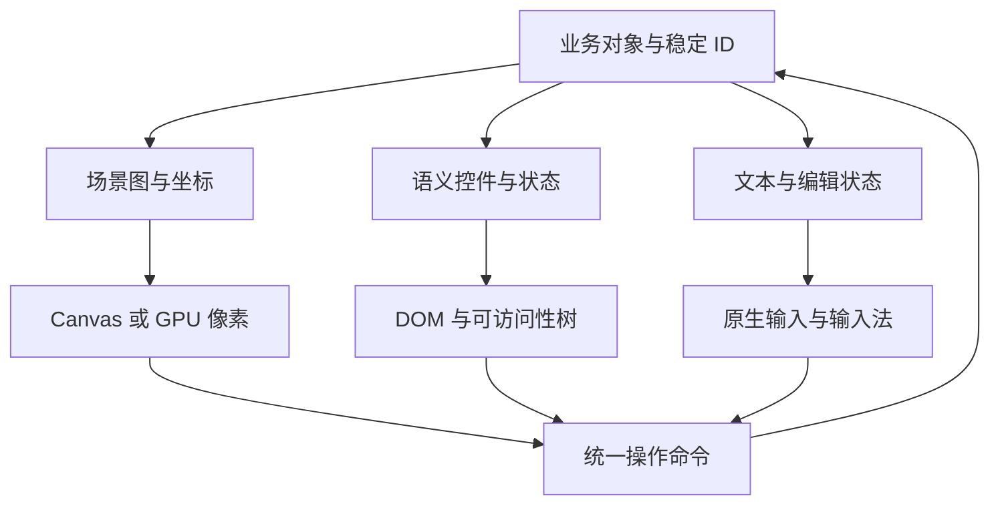

# 非 DOM 界面的可访问性：Canvas、Web3D 与文本输入的语义桥

一个分析工具把图表、图例和筛选按钮全部画进 Canvas，鼠标可以点中每条曲线。键盘用户却只能 Tab 到一个没有说明的画布，读屏器不知道选中了什么；中文输入候选框也无法定位到自绘标签。提升帧率并不能解决这些故障。

本章延续 [场景图与命中测试](../browser/canvas-scene-graph-hit-testing.md) 和 [Pretext 文本排版](../browser/text-layout-pretext.md)，讨论自绘界面怎样保留语义与操作。页面 `runnable: true` 只对应 Node 焦点状态实验；真实浏览器焦点、输入法与读屏器 **未在本次验证**。

## 1. 是什么：像素不是控件

看一个业务对象如何形成三个投影，不能让它们各自拥有不同事实：



1. 渲染树回答位置、颜色、裁剪和遮挡；它不会自动生成控件名称或键盘行为。
2. 语义树回答角色、名称、状态和关系；这些信息应来自业务模型，不从截图猜测。
3. 输入层负责焦点、选区、组合输入和命令；鼠标拾取只是其中一种入口。

HTML 标准要求 Canvas 提供等价功能或目的的内容，也描述了交互区域与可聚焦 fallback 内容的一一映射。不能把一个 `aria-label="图表"` 当作所有内部交互的替代。[HTML Canvas](https://html.spec.whatwg.org/multipage/canvas.html#the-canvas-element)

## 2. 为什么：浏览器无法从像素还原你的模型

可访问性树是浏览器向平台辅助技术暴露的语义结构，不等于 DOM 原样拷贝，更不等于每个 draw call。原生按钮、输入框和列表提供已有的语义与交互约定；自绘矩形不会因此成为按钮。[HTML-AAM](https://www.w3.org/TR/html-aam-1.0/)

| 可见内容 | 用户需要的意义 | 自绘后必须补什么 |
| --- | --- | --- |
| 一个可点矩形 | 按钮的名称、禁用、激活 | 原生控件或正确的角色、焦点与操作 |
| 曲线与数值 | 趋势、系列、单位、精确值 | 摘要、可导航数据表或其他等价路径 |
| 3D 模型 | 可选择对象及属性 | 语义对象列表、选中状态、变换命令 |
| 标签文字 | 内容、选区、编辑状态 | 原生文本输入／编辑桥、复制与撤销 |
| 拖动手柄 | 可改变的位置或数值 | 不依赖拖动的等价操作和可见反馈 |

等价并不要求让读屏器逐个朗读每个像素或三角形。目标是用户能完成同一任务：选择对象、理解结果、修改属性、撤销和退出。装饰性几何不应挤进语义树。

## 3. 怎么样：把操作命令做成单一事实源

先定义 `selectObject(id)`、`moveObject(id, delta)`、`renameObject(id, text)` 等业务命令，再让拾取、键盘、属性面板和读屏器控件调用同一路径。这是架构设计，不是某个通用 ARIA 角色的定义。

| 入口 | 负责什么 | 不应独立做什么 |
| --- | --- | --- |
| 指针拾取 | 坐标转对象 ID | 单独改一份 GPU 选中状态 |
| 键盘导航 | 选择下一个语义对象 | 依赖临时数组下标当身份 |
| 属性面板 | 编辑精确值与文本 | 绕开主模型的校验和撤销 |
| DOM 语义层 | 名称、角色、状态、关系 | 用读屏器专属状态掩盖视觉错误 |

把“选中对象”与“DOM 焦点”分开。一次多选可能有多个选中对象，却只有一个键盘操作位置；打开模态属性编辑时，焦点属于对话框，而画布选择应保留。关闭后回到仍存在的触发对象或明确定义的替代位置。

### 3.1 DOM 镜像、叠加控件与独立列表

| 方案 | 适合任务 | 必须验证的代价 |
| --- | --- | --- |
| 随图形定位的 DOM 控件 | 数量可控的按钮、节点 | 相机／滚动／CSS 缩放变化后位置与焦点环是否一致 |
| 稳定对象列表或树 | 大量图形、三维对象管理 | 排序、层级、过滤和视口之外对象的意义 |
| 图表数据表与摘要 | 精确读值与趋势理解 | 单位、空值、筛选和选中系列是否同步 |
| 原生 HTML/SVG | 语义优先且规模允许 | 布局与渲染成本，不能只用元素数量判断 |

不必给一百万点创建一百万 Tab 停靠点。导航粒度应对齐任务，例如系列、区间、当前搜索结果；需要详情时再展开。虚拟化必须保证当前活动项可被引用，不能留下指向已卸载节点的 `aria-activedescendant`。

## 4. 更底层：坐标、焦点与事件桥

GPU 像素、Canvas bitmap 坐标、CSS 布局坐标和语义对象身份是不同量。定位叠加层时要处理 CSS 缩放、相机、容器滚动和变换；不能只把世界坐标乘一次 DPR。读 [场景图章节](../browser/canvas-scene-graph-hit-testing.md) 的逆变换，再给焦点环定义同一条坐标链。

焦点环应有真实操作对象作为依据。不能只在鼠标悬浮时绘制，也不能用 `outline: none` 消掉浏览器焦点而没有等价可见反馈。键盘焦点可見性和拖动替代操作的要求，可对照 WCAG 2.2 的相应成功准则。[WCAG 2.2](https://www.w3.org/TR/WCAG22/)

### 4.1 最小焦点状态实验

已验证片段，完整实验为 `scripts/content-labs/systems/focus-state.mjs`。它只维护稳定 ID，不声称实现 DOM 的焦点算法。

```js
function reconcileFocus(previousIds, nextIds, focusedId) {
  if (nextIds.includes(focusedId)) return focusedId;
  if (focusedId === null) return null;
  const oldIndex = previousIds.indexOf(focusedId);
  if (oldIndex < 0 || nextIds.length === 0) return null;
  return nextIds[Math.min(oldIndex, nextIds.length - 1)];
}
```

重排不改变 ID；删除当前对象后选择原索引附近的存活对象，删除最后对象后返回空。该策略是一种产品决策，不是规范唯一要求。完整脚本还拒绝重复 ID，检查连续删除，并验证用户原来不在画布时不能抢焦点。

从模型结果到 DOM 还需一次提交：先渲染替代控件，确认节点仍存在，再移动焦点；异步恢复不能把旧对象的操作送到新复用的 DOM 节点。删除、撤销、过滤、重新排序和远端更新都要走同一恢复规则。

## 5. 文本不是一串 keydown

输入法组合过程不等于“按一个键插入一个字符”。拼音候选、重音组合、语音输入、移动端编辑和辅助技术可能通过不同输入事件工作；自绘文字仍应借助原生输入／textarea 或经过验证的编辑器宿主。

| 状态 | 应保留的信息 | 常见错误 |
| --- | --- | --- |
| composition 中 | 暂存组合文本与选区 | 把每次 keydown 当最终提交 |
| composition 提交 | 已提交文本、撤销边界 | 重复写入候选结果 |
| 选区变化 | 文本位置与视觉映射 | 用测量宽度代替真实文本位置 |
| 光标定位 | CSS 坐标与滚动关系 | 候选窗离编辑对象很远 |
| 复制／粘贴 | 语义文本与格式策略 | 只复制截图或破坏 Unicode 边界 |

Pretext 的测量与排版帮助计算文字几何，不自动实现 IME、文本编辑、选区或平台可访问性。Wasm shaping 库也只是管线中的一层。要分别验证文本位置、换行、双向文本、字体替换与输入状态，不能拿排版速度证明编辑正确性。

## 6. 两个真实源码入口

### PixiJS：为图形对象构造 DOM 语义桥

固定提交的 `AccessibilitySystem` 创建并维护 DOM 元素，设置名称与 tabIndex，并把点击和焦点事件转到图形事件系统。源码还处理复用元素遗留的 ARIA 状态；对应测试检查复用后的名称、类型和 tabIndex。这说明对象池的生命周期也会影响可访问性，不只是影响内存。

- [AccessibilitySystem.ts](https://github.com/pixijs/pixijs/blob/65552017d23255c1442a7d4ac7f0d49e3225fb1d/src/accessibility/AccessibilitySystem.ts)：追 `createElement`、元素池、状态更新和焦点桥。
- [真实测试](https://github.com/pixijs/pixijs/blob/65552017d23255c1442a7d4ac7f0d49e3225fb1d/src/accessibility/__tests__/AccessibilitySystem.test.ts)：看回收后元数据是否清除，不从默认示例推断所有场景可访问。

### React Aria：焦点作用域与原生输入的职责分离

`FocusScope` 提供 containment、restoreFocus 和程序化导航；`useTextField` 基于原生 input／textarea 合并标签、状态和事件属性。它不是 Canvas 排版器，但可用来理解语义桥应委托哪些平台能力。

- [FocusScope.tsx](https://github.com/adobe/react-spectrum/blob/740c6c5c4a717ca8c82fc4d15d199f6166cd42dc/packages/react-aria/src/focus/FocusScope.tsx)：追 scope tree 与恢复时机。
- [useTextField.ts](https://github.com/adobe/react-spectrum/blob/740c6c5c4a717ca8c82fc4d15d199f6166cd42dc/packages/react-aria/src/textfield/useTextField.ts)：看原生控件、标签、验证与 ARIA 属性怎样分工。

这两个案例是已核对的源码设计，不是本次运行了它们的浏览器套件或读屏器认证。

## 7. 易错点与边界

| 错误 | 为什么不成立 | 修正与验证 |
| --- | --- | --- |
| 整个编辑器加一个 aria-label | 名称不能替代内部操作 | 按任务提供控件、对象列表与状态 |
| 所有图形都 tabindex=0 | Tab 顺序变成大量低价值停靠点 | 定义导航粒度与复合控件规则 |
| 用 role=application 自动解决 | 角色不实现键盘与输入行为 | 优先原生语义，只有匹配设计才采用特殊模式 |
| DOM 镜像各自维护选择 | 像素与语义状态会分叉 | 统一业务 ID 与命令路径 |
| 隐藏控件 display:none | 通常不参与交互与语义暴露 | 核对隐藏策略、名称和焦点可见性 |
| live region 每帧播报 | 高频消息挤掉重要反馈 | 仅播报任务结果与状态变化 |

## 8. 真实验收

仓库根目录、Node `24.16.0`，不安装第三方依赖；以下命令已实跑：

```bash
node scripts/content-labs/systems/focus-state.mjs
```

通过阈值：全部断言成功，输出 `PASS focus-state: stable IDs, deletion fallback, empty state, no focus stealing`。失败时检查对象 ID 唯一性、删除前后的顺序和当前焦点。实验不创建文件或监听器，无需清理。

浏览器／辅助技术验收协议尚未执行，不能声称 WCAG 达标：

| 输入与环境 | 操作 | 应观察的结果与证据 |
| --- | --- | --- |
| 明确浏览器与读屏器版本 | 仅键盘完成选择、变换、删除、撤销与退出 | 所有关键任务可完成；记录角色／名称／状态和阻塞步骤 |
| 相机变换、CSS 缩放与滚动 | 焦点对象移动到视口边界 | 可见焦点环对齐且不被遮挡；保存截图 |
| 中文 IME 与双向文本 | 连续组合输入、移动选区、撤销 | 不重复提交、不丢字、候选位置合理；保存事件日志 |
| 对象远端删除、模态编辑取消 | 当前对象消失或关闭对话框 | 焦点到明确存活位置，不跳 body 或抢其他区域焦点 |

清理浏览器用例时移除自己添加的镜像节点、事件监听与编辑宿主，销毁图形资源；不要在测试结束后留下可聚焦的透明控件。

## 9. 面试回答

**30 秒：** Canvas/Web3D 只输出像素，不自动获得控件语义、键盘行为和文本输入能力。把业务对象作为单一事实源，分别投影成图形和 DOM 语义／输入层，共享命令和稳定 ID；还要验证焦点恢复与等价操作。

**2 分钟：** 以图表编辑器为例，先区分选择、DOM 焦点和编辑选区。鼠标拾取、对象列表和键盘都调用同一命令；大数据只暴露有任务意义的导航粒度，文本委托原生输入。删除对象时保持稳定 ID 并选择明确的替代焦点。用模型断言检验重排、删除、空状态和不抢焦点，但它不能证明读屏器体验；还要在声明浏览器、IME 和辅助技术版本下验证角色、名称、状态、任务完成与焦点可见性。

## 10. 自测

<details><summary>为什么 aria-label 不能让 Canvas 内部每个图形可访问？</summary>

它为元素提供名称，不创建内部对象的角色、状态、焦点顺序和操作行为。
</details>

<details><summary>为什么把数组下标作为对象 ID 会影响焦点？</summary>

删除或排序后同一下标代表不同对象，焦点和操作可能落到错误业务实体；使用稳定身份并显式处理对象消失。
</details>

<details><summary>为什么高性能文字排版仍不等于正确的中文编辑器？</summary>

测量几何不定义组合输入、选区、撤销、复制与平台输入上下文；必须保留并验证输入宿主的职责。
</details>

<details><summary>CPU 焦点模型测试通过后还缺什么证据？</summary>

真实 DOM 提交与 focus、辅助技术语义、键盘任务、焦点可见性、输入法和设备环境的验证。
</details>

## 深入阅读

- [HTML Canvas fallback 与可聚焦区域](https://html.spec.whatwg.org/multipage/canvas.html#the-canvas-element)：读像素与等价功能的责任分配。
- [HTML-AAM](https://www.w3.org/TR/html-aam-1.0/)：区分 HTML、ARIA 与平台可访问性映射。
- [WCAG 2.2](https://www.w3.org/TR/WCAG22/)：把操作、焦点和替代路径变成验收条件。
- [原有 HTML 无障碍教程](accessibility-aria-deep.md)：先补语义与 ARIA 基础，再设计自绘语义桥。
