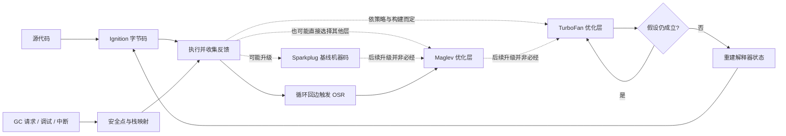
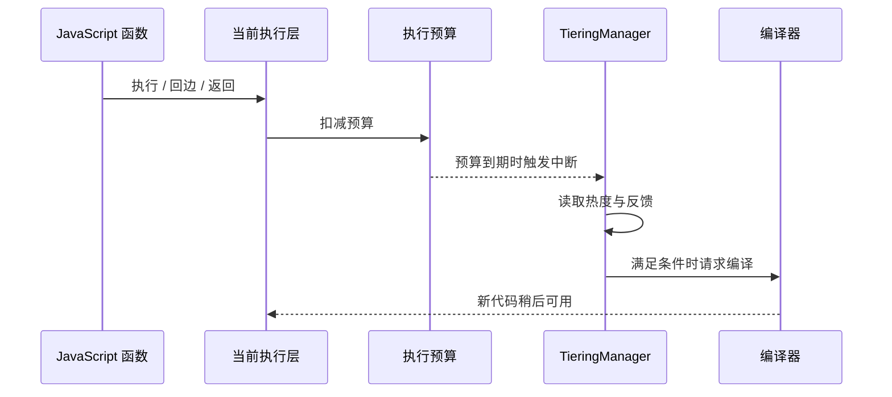

# V8 执行分层、OSR 与去优化

线上一个函数可能只跑一次，也可能每个请求跑数千次。V8 必须在“立刻开始执行”和“花时间生成更快代码”之间做选择；优化代码还可能建立在类型、对象形状等假设上，一旦假设失效，就要安全回退。本文跟踪这条执行路径，不重讲隐藏类与普通内联缓存的基础概念，相关前置材料见[对象模型](v8-object-model.md)。

## 先看全程

下面的图展示一种常见路径。它不是每个函数都必须走完的固定状态机。



读图时关注两件事：tier-up 决策依赖运行时反馈和预算；deopt 是从优化代码恢复到可继续执行的低层状态，不是异常，也不保证回到某个固定 tier。虚线表示源码中存在的候选层级关系，不表示每个函数按 Sparkplug→Maglev→TurboFan 顺序逐层经过；具体可选路径、阈值和 tier 名称由固定 V8 版本与构建决定。

## 五层递进：执行现象

### 1. 现象：同一段代码会被多次编译

V8 官方架构说明把 Ignition、Sparkplug、Maglev 与 TurboFan 列为不同执行层。Ignition 执行字节码并积累反馈，Sparkplug 快速把字节码编译成机器码，Maglev 与 TurboFan 利用反馈生成更积极优化的代码。某函数可以长期停留在较低 tier；冷代码通常不值得承担高成本编译。

这不是 ECMAScript 语义。规范约束计算结果和可观察行为，不规定解释器、JIT 数量、触发次数或某次运行必然达到的 tier。[V8 架构概览](https://github.com/v8/v8/blob/a74948bb81a597a6affabff4a867cc661f5c2e69/docs/overview.md)描述的是 V8 实现选择。

### 2. 规则：反馈用于推测，检查负责守住正确性

一次调用点观察到的类型、属性访问形状、调用目标等会进入运行时反馈结构。优化编译器可据此生成快速路径，并为不确定前提插入 guard。guard 成功走快路；guard 失败时，运行时可以走慢路，也可能让已编译代码失效并 deopt。

不要把“反馈”理解为规范承诺的单一数据结构。V8 具体使用 feedback vector、反馈单元以及多个关联元数据；字段、策略和触发阈值会随版本变化。源码入口包括 [`src/feedback/`](https://github.com/v8/v8/tree/a74948bb81a597a6affabff4a867cc661f5c2e69/src/feedback) 与 [`src/execution/tiering-manager.cc`](https://github.com/v8/v8/blob/a74948bb81a597a6affabff4a867cc661f5c2e69/src/execution/tiering-manager.cc)。

| 观测到的事实 | 可以支持的优化 | 需要保留的边界 |
|---|---|---|
| 调用点常见某一目标 | 内联该目标或专用化调用 | 未来可能出现另一个目标 |
| 算术输入通常是小整数 | 生成整数快速路径 | 输入可变成浮点数、BigInt 或非数值 |
| 属性读取常见某种形状 | 快速加载固定偏移字段 | 属性添加、原型变化可能使前提失效 |
| 循环稳定且频繁 | 提前编译循环入口 | 逃逸路径、异常和检查仍需保留 |

### 3. 机制：tiering manager 与 interrupt budget

V8 的 tiering 文档描述了 interrupt budget：函数执行时在返回点、循环回边等位置扣减预算，预算耗尽后进入 tiering manager 检查。它结合当前 tier、调用/循环热度与已有反馈决定是否编译。预算机制让运行时不用为每条字节码都做昂贵判断，也能在热点达到时响应。

当前源码阅读路线：先读[运行时 tiering 说明](https://github.com/v8/v8/blob/a74948bb81a597a6affabff4a867cc661f5c2e69/docs/runtime/tiering.md)，再跟踪 [`TieringManager::OnInterruptTick`](https://github.com/v8/v8/blob/a74948bb81a597a6affabff4a867cc661f5c2e69/src/execution/tiering-manager.cc)，最后查看 Ignition 的回边预算处理 [`interpreter-assembler.cc`](https://github.com/v8/v8/blob/a74948bb81a597a6affabff4a867cc661f5c2e69/src/interpreter/interpreter-assembler.cc)。具体函数名和分支以链接页面的源码快照为准。



编译请求不等于立即替换正在执行的机器码。不同 tier、并发编译状态、调试模式和实验开关会影响路径。观察一次 trace 只能说明本次运行的实际结果，不能反推规范规则。

### 4. 机制：OSR 把正在运行的帧切换到循环入口

On-stack replacement（OSR，栈上替换）处理长循环的特殊情况：外层函数调用次数很少，但一次调用内部循环极热。等待函数返回再优化意味着热点可能已经结束，所以运行时可以针对循环入口生成代码，并在回边处把当前帧映射到新执行状态。

OSR 要解决的是“程序计数器在哪、局部变量当前值是什么、优化代码需要哪些寄存器值”。优化器保留从机器状态映射回字节码帧的元数据。切换时必须恢复循环头所需的值；若条件不成立，旧执行状态仍可继续。

OSR 不是递归调用、不是新建 Worker，也不是代码热替换 API。不同层之间也可能有多次 OSR，且诊断输出可能只显示其中部分事件。[Sparkplug 设计文章](https://v8.dev/blog/sparkplug)解释了与解释器兼容的栈帧为何能简化 tier-up 和 OSR。

### 5. 机制：deopt 是带状态重建的正确性路径

优化代码依赖可撤销或可检查的假设。假设被 guard 否定后，deoptimizer 根据 safepoint / deoptimization metadata 还原 JavaScript 可观察状态，包括寄存器、栈槽、已虚拟化对象和当前字节码位置，然后继续执行。

一些无效化可由运行时依赖触发，例如被编译器视为稳定的全局条件改变；另一些在执行 guard 时发现。deopt 成本并非仅仅跳回解释器：可能有状态重建、代码失效和再次编译。高频反复 deopt 常提示输入形态不稳定或过度专用化，但单次 deopt 并不代表代码“有 bug”。

Maglev 官方文章说明其节点附带抽象解释器帧状态，供后续生成重建映射；并指出其与 TurboFan 共用部分 deoptimization 机制。[Maglev 设计与去优化](https://v8.dev/blog/maglev#deoptimization)。

## GC、safepoint 与优化代码

JIT 代码不能假设 GC 只在 JavaScript 函数之间发生。分配可能触发 GC；后台编译、调试中断、栈溢出检查也需与执行协调。运行时必须知道哪些栈槽/寄存器位置含有可移动对象引用，哪些位置是 tagged value，哪些机器码位置允许安全停顿。

安全点（safepoint）和栈映射（stack map）描述可暂停位置及活跃引用。移动式收集器更新对象地址时，根引用也必须被修正；若优化器把对象标量替换或将值放进寄存器，deopt 元数据还要能恢复语言层状态。这里与[垃圾回收教程](garbage-collection.md)互补：该文讲回收器策略，本节讲编译代码如何参与 GC 协议。

GC、tiering 和 deopt 并非同一机制，但会相遇：预算回边可同时检查中断/栈限制；GC 需要遍历当前帧根；代码移动或失效后，执行还要在可恢复状态继续。V8 的内部细节持续演变，阅读当前 checkout 的 [`src/heap/`](https://github.com/v8/v8/tree/a74948bb81a597a6affabff4a867cc661f5c2e69/src/heap)、[`src/deoptimizer/`](https://github.com/v8/v8/tree/a74948bb81a597a6affabff4a867cc661f5c2e69/src/deoptimizer) 与 [`src/compiler/`](https://github.com/v8/v8/tree/a74948bb81a597a6affabff4a867cc661f5c2e69/src/compiler) 时，应先锁定 commit。

## 手写模型：假设检查与通用路径

示意代码：未通过自动验证。下面的模型只展示概念关系，不模拟 V8 的编译器、反馈向量布局、编译阈值或 deopt 帧重建。

```js
function add(left, right) {
  const integerInputs = Number.isInteger(left) && Number.isInteger(right);
  if (integerInputs) return left + right;
  return left + right;
}
console.log(add(2, 3));
console.log(add(2.5, 3));
```

这段最小模型展示 guard 所检查的输入条件，但同一条 JavaScript 加法路径使它本身没有优化效果。它不代表 V8 编译、反馈向量或 deopt 的实现，只帮助说明“先检查假设，再选路径且语义不变”。完整机制需结合前面的源码路径阅读。

## 实验：观察 trace，但断言语义

仓库实验 `scripts/content-labs/engine-runtime/tiering-observe.mjs` 运行一个可预测的热点循环。它不依赖某条编译日志必须出现，因为 tiering 决策会受 CPU 架构、V8 构建参数和系统负载影响。

在仓库根目录执行：

```sh
node scripts/content-labs/engine-runtime/tiering-observe.mjs
```

预期输出为 `runs=20000 result=8128`。通过条件是进程退出码为 0 且断言通过。若希望额外观察当前 Node/V8 的编译事件，可尝试：

```sh
node --trace-opt --trace-deopt scripts/content-labs/engine-runtime/tiering-observe.mjs
```

本机验证环境为 Node.js v24.16.0；普通运行输出 `runs=20000 result=8128`。带 trace 的日志是诊断输出，编译事件格式不是稳定 API；若 flag 在发行版中不可用，先看 `node --v8-options`。清理无需文件操作。

在本机带 trace 的一次观察中，`sumNumbers` 先被标记为 MAGLEV，随后出现 TURBOFAN_JS 编译；外围驱动函数还出现了 Maglev OSR 与 TurboFan OSR。进程也输出两条去优化信息，原因分别涉及 OSR 状态切换和 generic named access 的反馈不足。这些是该次 Node/V8 构建与执行状态的结果；代码不通过人为改变输入去保证特定 deopt，也不把这两条日志纳入测试断言。

可复现实验命令与解释：

| 命令 | 本机观察 | 稳定保证 |
|---|---|---|
| `node .../tiering-observe.mjs` | 输出结果断言通过 | 只保证语义结果 |
| `node --trace-opt --trace-deopt ...` | 当前 build 输出热点编译信息 | 不保证 tier、顺序或行格式 |
| `node --v8-options` | 可查 build 暴露的 V8 flags | 选项受发行版配置影响 |

如果 trace 中没有显示 OSR，而普通语义断言仍通过，实验依然成功。减少循环次数、改变 Node 版本或运行在不同 CPU 上都可能改变观测；反过来，出现 OSR 也不意味着业务代码的端到端延迟一定下降。

这份脚本固定数组形状和数值输入，使它适合观察一个稳定热点，但它没有模拟真实服务的请求分布、并发或 GC 压力。要研究输入多态的影响，应另写有正确性断言的 workload，并清楚区分“稳定输入组”和“变化输入组”；不应把输入抖动悄悄加入这份基线脚本，因为那会让读者无法复现文中观察。

trace 日志中出现 `marking` 说明运行时将函数视为优化候选；`compiling` 表示进入编译过程；`completed optimizing` 表示代码生成结束。`bailout` / `deoptimizing` 指向状态回退，后面的 reason 描述触发路径。词汇及展示会随 V8 版本改变，诊断时要和脚本输出、版本号一起保存。

Trace 上显示“优化完成”也不等于采样器已经观察到该机器码执行足够时间。并发编译可能稍后完成，脚本也可能很快结束；若要量化优化收益，单独构造足够长的 steady-state workload，并把预热过程与计时段分离。

### 如何把 trace 变成可用的证据

1. 记录 `node --version` 与 `node -p 'process.versions.v8'`，因为 Node 版本号不能唯一代表所有定制发行版的 V8 配置。
2. 将 trace 与 CPU profile 时间段对应，确认热点函数是否占墙钟时间，而不是只看它被编译。
3. 分别运行冷启动、稳定输入和生产输入分布；混合输入可能触发不同反馈路径。
4. 以输出断言保证编译前后语义一致，避免把“更快但结果变了”当成成功。
5. 保存日志时把它作为人工诊断附件，不要在 CI 里匹配具体内存地址、编译毫秒数或日志顺序。

### 版本边界：V8 tier 名称不是永久 API

V8 架构概览和源码 tiering 文档链接到 `main` 分支。本页引用的源码快照在 frontmatter 中记录 commit；后续源码可能新增 tier、改变 TurboFan/Turboshaft 内部路径、调整开关或预算。Node LTS 分支通常会固定某个 V8 版本，因此要将本页模型应用到生产时，应查 Node 对应发布分支中的 V8 子模块/依赖版本，而非套用 HEAD 的函数细节。

构建方式也会影响可见 trace：发行版可能关闭诊断 flag；debug build 和 release build 的优化行为可能不同；平台后端可能输出不同 tier 名称。V8 trace 适合作为“这个 build 发生了什么”的证据，不能代替规范语义或跨平台承诺。

### 源码阅读路线：从一个可观察事件往里追

读 V8 大仓库时不妨以一次 trace 中的事件为锚点，而不是试图从入口读完整个编译器：

1. 在 `docs/runtime/tiering.md` 中找 interrupt budget、回边和 tiering manager 的概念图。
2. 进入 `src/execution/tiering-manager.cc`，找到决策入口和当前 tier 的分支。
3. 进入 `src/interpreter/interpreter-assembler.cc`，追踪解释器回边如何扣 budget。
4. 对 Maglev 编译请求，查看 `src/maglev/maglev-compiler.cc` 和 `src/maglev/` 中 IR 节点。
5. 对 deopt 还原，阅读 `src/deoptimizer/` 的 frame translation 与 safepoint 相关代码。
6. 用 `git blame` 和 commit permalink 固定解释所依赖的代码版本。

看到一个函数名时，继续确认调用方、触发条件和后续分支。仅凭 `OnInterruptTick` 名字不能得出所有函数每次回边都会进入 tiering manager，因为预算、tier 状态和编译任务状态都会影响路径。

源码阅读也要区分机制与参数：函数调用关系、数据结构角色可能相对稳定；budget 数值、函数内联策略和后台任务调度则更可能受版本/平台调优。引用源码时优先说明“该 commit 中这条路径怎样工作”，不要把某个常量推广成 V8 永久规则。

### 与优化正确性的联系

JIT 优化的首要约束是语言语义一致。编译器可能把某些中间对象消除、把字段访问直接化或把数值放进机器寄存器，但只要控制流走到需要观察这些值的地方，程序必须看到符合 JavaScript 语义的结果。

因此 deopt 元数据不只是诊断工具。它也是动态语言优化正确性的一部分：若之后发生异常、调试器暂停或 guard 失败，运行时需要恢复足够的抽象状态继续求值。查看 deopt 时关注触发点之前的假设和输入，而不要将其简化成“JIT 编译错了”。

## 真实项目如何使用这套机制

1. **Node.js** 把 V8 嵌入宿主进程。`node --trace-opt --trace-deopt` 将 V8 的诊断能力暴露给开发者，适合把热函数与生产 profiling 对照；它不会让应用代码控制优化阈值。[Node CLI](https://nodejs.org/api/cli.html#--trace-opt)与[V8选项](https://nodejs.org/api/cli.html#v8-options)列出版本相关选项。
2. **Chromium / Chrome** 使用 V8 执行网页 JavaScript。DevTools CPU profiler 和性能轨迹观察的是应用层耗时及线程活动，不承诺直接呈现完整 tiering 状态；需要结合 V8 trace 才能回答“是否优化/为何 deopt”。[V8 官方文档](https://v8.dev/docs)提供更深的引擎资料。

## 常见误区与故障定位

| 误区 | 实际边界 | 诊断方法 |
|---|---|---|
| “代码跑热就一定进 TurboFan” | 目标 tier 与触发受反馈、构建选项和状态影响 | 采集该版本 trace，记录 Node/V8 版本 |
| “看到 deopt 就要改代码” | 偶发回退可能是正确的动态语言语义处理 | 看频率、调用栈、输入变化及端到端耗时 |
| “优化 tier 的结果不同” | 合规引擎必须保持语言可观察语义 | 为边界输入写断言，检查异常和副作用 |
| “--trace-opt 输出是稳定接口” | 输出格式、flag 和 tier 命名可能变更 | 只用于本地诊断，不做生产解析协议 |
| “GC 只会在函数调用时发生” | 分配与显式运行时检查都可能成为协调点 | 检查分配热点、停顿与根扫描配合情况 |

发生性能回退时先按顺序确认：基准是否包含启动/编译时间；热函数是否占端到端关键路径；样本是否混合冷启动与稳态；去优化是否高频；GC 或 I/O 是否已占主导。不要仅凭一次 trace 推导业务层结论。

## 30 秒与 2 分钟回答

**30 秒：** V8 分层执行是先用解释器快速启动，再依据反馈将热点升级到不同 JIT tier。优化代码会用守卫保护推测，假设失效时通过 deopt 元数据恢复 JavaScript 状态继续执行；tier 和触发策略是 V8 实现细节，不是语言规范。

**2 分钟：** 以长循环为例，函数可能调用次数少但回边很热。interrupt budget 在回边/返回处触发 tiering manager；运行时结合反馈与当前状态决定是否编译，OSR 允许把活跃帧映射到循环优化入口。优化机器码依赖类型或形状等前提，所以编译器同时保存重建帧所需信息，guard 失败后 deoptimizer 恢复字节码位置和变量。验证时锁定 Node/V8 版本，用 trace 看编译与 deopt，再用多轮真实输入测端到端延迟，并确保正确性测试覆盖类型变化；trace 顺序和触发次数不能当规范保证。

## 自测

??? question "1. 为什么 V8 不在第一次调用时总是生成最高 tier 代码？"
    解析与优化有成本，冷代码未必重复运行。低成本层让短命代码较快启动，反馈足够时才可能值得进一步编译。

??? question "2. OSR 与普通函数调用时 tier-up 有何不同？"
    普通 tier-up 可从下一次进入函数时采用新代码；OSR 面向当前栈上的热点循环帧，需要在循环入口重建运行状态。

??? question "3. deopt 是否意味着执行出错？"
    不是。它是推测失效后的正确性路径；是否值得处理取决于频率、重编译成本和真实负载。

??? question "4. 为什么 trace 输出不能用作跨版本断言？"
    tier、flag、日志格式和触发条件是 V8 实现细节，可能随版本、架构、构建选项改变。

## 深入阅读

- [V8 tiering 文档](https://github.com/v8/v8/blob/a74948bb81a597a6affabff4a867cc661f5c2e69/docs/runtime/tiering.md)：沿 interrupt budget 与 OSR 入口读源码。
- [V8 Maglev 设计](https://v8.dev/blog/maglev)：理解 SSA、反馈、帧状态及 deoptimization。
- [V8 Sparkplug 设计](https://v8.dev/blog/sparkplug)：看基线编译如何保持解释器兼容帧。
- [V8 overview](https://github.com/v8/v8/blob/a74948bb81a597a6affabff4a867cc661f5c2e69/docs/overview.md)：建立当前仓库列出的编译器目录地图。
- [现有 V8 对象模型教程](v8-object-model.md)：复习反馈所关联的对象形状、IC 和 elements kinds。
