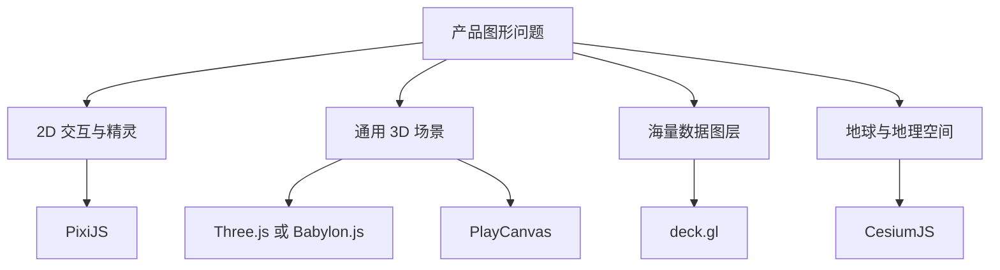

# 图形引擎源码地图：Three.js、Babylon.js、PixiJS、deck.gl、Cesium 与 PlayCanvas

“图形引擎”从轻量渲染库到完整编辑器 runtime 含义差异很大。选型不能只按 demo 截图，要看核心抽象是否贴合产品：你的数据是 2D sprite、通用 3D scene、地图瓦片还是海量地理点？以下源码入口固定到 2026-10-12 检索到的仓库 HEAD commit，目录与内部 API 只代表该快照，不构成稳定公共接口承诺。

## 心智模型：先按问题域分组

图中分类是阅读起点，不是排他边界。Three.js 也可画 2D，deck.gl 也可叠加到地图，Babylon.js 也有编辑和 GUI 能力；应该按主要数据模型与需要自行建设的产品部分选。

## 1. Three.js：通用场景对象与可组合 renderer

**源码快照：** [`mrdoob/three.js` f12e786](https://github.com/mrdoob/three.js/tree/f12e7868b4cb9d491512d7f0f372e329a5d2bc0f)

**入口路线：** `src/Three.Core.js` 与 `src/Three.js` 看导出面；`src/scenes/Scene.js`、`src/core/Object3D.js` 看场景对象树和变换；`src/renderers/WebGLRenderer.js` 进入 WebGL 渲染；`src/renderers/webgl` 看 state、program、buffer、texture 等后端细节；`src/renderers/webgpu` 看 WebGPU 路线。目录以固定 commit 为准。

**心智模型：** 场景节点和资源对象组成可复用的 3D 描述，renderer 将描述转换成后端命令。材质与几何体组合支持快速建立场景；要进入 shader 细节仍需理解 renderer 的缓存、编译和绑定。

**适合：** 产品已有自有 UI/编辑器，只需要成熟的浏览器 3D runtime；需要广泛 loader、几何体、材质和生态插件；希望逐步从高层对象下沉到 shader。

**成本：** API 是渲染库，不等同完整游戏编辑器、网络同步或资产管理平台；复杂 WebGPU 功能和 WebGL 支持边界需锁定版本检查。若大量依赖内部 `renderer.*` 字段，自身升级测试成本会上升。

## 2. Babylon.js：完整 engine 概念与可选工具链

**源码快照：** [`Babylon.js` a6b8e22](https://github.com/BabylonJS/Babylon.js/tree/a6b8e226d46464328197447f9fc93054c7b494fb)

**入口路线：** 从 `packages/dev/core/src/Engines/engine.ts` 找 Engine 生命周期；`packages/dev/core/src/scene.ts` 看 Scene；`packages/dev/core/src/Meshes` 看 mesh；`packages/dev/core/src/Materials` 看材质；`packages/dev/loaders/src/glTF` 跟资产加载。若固定提交目录有调整，应从 `packages/dev/core/src` 的公开导出和 `Engine` 类型继续定位。

**心智模型：** Babylon 把 Engine、Scene、Camera、Mesh、Material、Loader 等作为一套连贯的 engine API；配套 inspector、GUI、序列化和 Playground 等工具生态可缩短完整产品链路。

**适合：** 需要更多现成引擎级功能、可视化调试工具、相机/材质/loader 一体体验；团队更重视完整工作流而不只是 renderer 最小体积。

**成本：** 功能面更宽，团队要管 bundle 分包、插件装载和所用子系统的生命周期；API 广度不等于所有模块都适合一次性加载。按实际 import、tree shaking 和部署产物验证成本。

## 3. PixiJS：以 2D scene 与渲染批次为核心

**源码快照：** [`pixijs/pixijs` 6555201](https://github.com/pixijs/pixijs/tree/65552017d23255c1442a7d4ac7f0d49e3225fb1d)

**入口路线：** `src/scene/container` 追踪子树和变换；`src/rendering/renderers` 看 renderer backend 初始化；`src/rendering/renderPipes` 看 display object 到绘制批次的转换；`src/events` 看事件映射。公开 `Application` / `Container` / `Sprite` 用来理解用户面 API，内部 pipe 更适合研究具体版本提交策略。

**心智模型：** 大量 2D display objects 保留在 container 树，由 render pipes 按对象类型转换为可提交内容。它是 2D 内容渲染引擎的抽象，不能把对象很多时的表现当作硬件无关的保证。

**适合：** 游戏 HUD、sprite/粒子动画、富交互 2D canvas 内容；产品对象和纹理本身是主要输入。

**成本：** 高阶滤镜、纹理 atlas、文本纹理刷新、对象更新频率都会影响批次；WebGL/WebGPU/Canvas backend 的功能与成熟度按版本分别核验。要无障碍语义仍由 DOM 层承担。

## 4. deck.gl：声明式地理/大数据图层

**源码快照：** [`visgl/deck.gl` 539eeac](https://github.com/visgl/deck.gl/tree/539eeac1b80d27ed6ce846d43b7cd33f6f7a4533)

**入口路线：** `modules/core/src/lib/deck.ts` 看 Deck 生命周期；`modules/core/src/lib/layer.ts` 看 Layer 更新协议；`modules/core/src/lib/layer-manager.ts` 看 layer reconcile；`modules/layers/src` 看 Scatterplot/Path/Polygon 等标准层；`modules/geo-layers/src` 看 TileLayer、MVT、Terrain 等领域层。

**心智模型：** 应用给出 layer 描述和数据，框架比较新旧描述、管理 attribute 与 viewport，再调用底层 GPU layer。CompositeLayer 可把高层概念拆为子图层。定位性能时需要区分数据预处理、attribute 更新、GPU draw 和 picking。

**适合：** 地理可视化、轨迹、点云、聚合网格和需大量数据图层组合的分析工具；团队接受 layer/viewport 作为主要扩展点。

**成本：** 不是通用 3D DCC/editor；自定义图层通常需懂 shader、attribute lifecycle 与坐标投影。地图底图集成、数据 tile 缓存和业务选择状态仍需搭建。CPU 侧数据更新不当也会反复触发属性重建。

## 5. CesiumJS：地球尺度世界与 3D Tiles

**源码快照：** [`CesiumGS/cesium` df52c78](https://github.com/CesiumGS/cesium/tree/df52c781de3491a4b76839d420f7ca90a032efb6)

**入口路线：** `packages/engine/Source/Scene/Scene.js` 看帧与场景；`packages/engine/Source/Scene/Cesium3DTileset.js` 看 tileset 管理；`packages/engine/Source/Scene/Cesium3DTile.js` 看 tile 状态；`packages/engine/Source/Core/` 看坐标与数学；`packages/widgets/Source/Viewer/Viewer.js` 看更高层 viewer 集成。

**心智模型：** 以椭球/地球坐标、摄像机和流式 tile 数据为核心，而非普通局部场景放大到地球。3D Tiles 树通过 screen-space error 等策略选择当前细节，并随相机视锥请求、缓存和淘汰 tile。

**适合：** 地球、城市级倾斜摄影、地形、地理空间资产和需按视角流式加载的大型 3D Tiles 场景。

**成本：** 对非地理产品可能引入多余概念与包袱；数据发布/tileset 生成、服务端缓存、坐标精度、token/服务合规需一起设计。性能必须结合 tile 分层、网络条件和视角做实际资产测试。

## 6. PlayCanvas Engine：组件式 runtime 与编辑器链路

**源码快照：** [`playcanvas/engine` 0770903](https://github.com/playcanvas/engine/tree/0770903fb0d65d5753b31a3f1d69ad611ebb0666)

**入口路线：** `src/framework/application.js` 看 Application 运行循环；`src/framework/entity.js` 与 `src/framework/components` 看 Entity/component；`src/scene/` 看材质、模型、光照与场景资源；`src/platform/graphics` 看图形设备和后端抽象。应用加载管线还需连同 asset registry 及该版本公开 API 阅读。

**心智模型：** engine runtime 与在线编辑器/资产工作流紧密配合；Entity 组合组件形成场景行为，GraphicsDevice 隔离底层 WebGL/WebGPU 能力。编辑器产出的资源和 runtime 之间要明确构建、版本及发布边界。

**适合：** 网页游戏、交互式产品展示，尤其希望用可视化编辑器协作并将场景发布到 Web runtime 的团队。

**成本：** 需要接受其 Entity/component 与资产管理模型；定制底层渲染仍要下沉到 shader/device 抽象。在线编辑服务、资产托管和 runtime 是不同决策，应分别评估，不从开源 engine 直接推断托管方案。

## 横向选择：比较需要自建的那部分

| 项目 | 主要数据模型 | 首要阅读问题 | 典型自建部分 |
|---|---|---|---|
| Three.js | Object3D / geometry / material | renderer 如何缓存状态、映射对象到 draw | 编辑器、资产治理、游戏系统 |
| Babylon.js | Engine / Scene / Mesh | 使用哪些模块、如何分包与扩展 | 业务 UI、定制工作流 |
| PixiJS | 2D Container / DisplayObject | 如何更新对象树并形成 render batch | DOM 语义、内容编辑工具 |
| deck.gl | Layer / Viewport / Attribute | 数据变化如何触发属性更新与 picking | 地图数据服务、业务交互 |
| CesiumJS | Globe / tileset / camera | tile refine/cache 与精度如何协作 | 数据生产、服务和领域 UI |
| PlayCanvas | Entity / component / asset | 编辑器资源怎样成为 runtime entity | 游戏逻辑、业务服务 |

不要用未经测量的“支持百万对象”作为选择依据。建立自己的 workload：同一目标设备、同一数据规模、相同画质/交互，记录启动体积、首帧、稳定帧、CPU/GPU 时间、显存和开发者实现工作量。

## 两个真实项目案例

- **deck.gl 与大型地图数据层**：官方文档把 Deck 作为 layer instances、viewport 与 event handling 的协调点；[固定提交文档](https://github.com/visgl/deck.gl/blob/539eeac1b80d27ed6ce846d43b7cd33f6f7a4533/docs/api-reference/core/deck.md) 可结合 `Layer` 源码研究差分更新与 picking。产品案例需区分库能力和底图服务能力。
- **Cesium 3D Tiles 流式世界**：官方 3D Tiles 规范定义层级 tile、内容和误差驱动选择；Cesium 源码中的 `Cesium3DTileset` 管运行时加载策略。用固定 tileset、网络 throttle 与相机路径验证 tile 请求和缓存，而不是把一个静态模型测试当作流式体验。
- **PlayCanvas Engine 与 Editor 工作流**：公开 Engine 源码与在线编辑器是关联但不同的产品面；从 Application、Entity 和 asset loader 建立 runtime 关系。团队需要额外验证编辑器导出物能否纳入自己的 CI 与版本控制。

## 常见误区

| 误区 | 说明 |
|---|---|
| Star 数等于场景适配度 | 维护热度不能替代数据模型、输入设备、无障碍和授权检查 |
| 都是 WebGL 库，切换成本很低 | 对象树、材质、资源 loader、坐标系统、更新协议可能完全不同 |
| 引擎提供 renderer 就提供完整产品 | 网络、编辑器、语义 UI、资产处理和业务状态通常仍需自建 |
| 看源码只需要读 render loop | 插件、缓存、失效协议和资产路径决定真实扩展成本 |
| 当前主分支描述永久适用 | 内部文件快速变动，引用固定到具体 commit 再讨论 |

## 真实验收与源码阅读练习

本页是源码地图，`runnable: false`。选一个目标项目后，可建立同一验收场景：例如 10 万个散点、同样的相机和 hover picking；或同一 glTF 场景、相同纹理和阴影设定。

1. **输入/环境：** 锁定引擎 commit、浏览器/GPU、屏幕尺寸、数据文件哈希和交互步骤。
2. **执行：** 使用仓库官方 demo/build 脚本；勿把本教程伪造为任何仓库的可执行命令。
3. **输出：** 记录初始 bundle、首次可交互时间、稳定帧时间、GPU/CPU profile、选择正确率和键盘/辅助技术行为。
4. **通过标准：** 由项目定义首帧/帧预算、交互延迟和视觉容差；引擎功能表不能替代阈值。
5. **失败证据：** trace、错误日志、错选目标、资源未释放、目标设备不支持必需 feature。
6. **清理：** 停止渲染循环、销毁 renderer/scene、释放输入监听和测试资产。

## 面试回答

**30 秒：** 我按主要数据模型选图形引擎：PixiJS 偏 2D scene，Three.js/Babylon/PlayCanvas 是通用 3D runtime，deck.gl 针对数据 layer，Cesium 针对地理世界与流式 tiles。下一步不是比星数，而是锁定源码版本、追踪对象更新到 draw 的链路，并用产品 workload 验证性能和开发成本。

**2 分钟：** 先把需求拆成资产模型、坐标/投影、交互/picking、渲染后端、编辑工作流和无障碍 UI。读引擎入口与真实扩展点，比如 deck 的 Layer/Attribute、Cesium 的 tileset、Pixi 的 render pipes；测定同设备下 bundle、首帧、稳定帧、显存和更新成本。若选择完整 editor/runtime，需要确认导出资产、CI、许可及在线服务是否可独立部署。源码结论固定 commit，内部 API 只用于理解，不作为升级承诺。

## 自测

??? question "1. deck.gl 的 Layer 模型带来的首要工程问题是什么？"
    需要理解数据/props 更新何时导致 attribute 或子 layer 更新，并测 CPU/GPU/picking，而不仅是看声明式代码。

??? question "2. 为什么 Cesium 不只是普通 Three.js scene 放大？"
    它围绕地球坐标精度、地理相机和层级流式 tiles 构建核心模型。

??? question "3. 什么情况下优先检查 PixiJS 而非通用 3D 引擎？"
    主体是大量交互 2D sprite/display objects、纹理和动画，而不需要通用空间 3D 场景。

??? question "4. 源码文档为什么要锁 commit？"
    引擎内部目录和行为持续演化；commit 使路径、机制和结论可复核。

## 深入阅读

1. [Three.js f12e786](https://github.com/mrdoob/three.js/tree/f12e7868b4cb9d491512d7f0f372e329a5d2bc0f)：从 Object3D 到 renderer backend。
2. [Babylon.js a6b8e22](https://github.com/BabylonJS/Babylon.js/tree/a6b8e226d46464328197447f9fc93054c7b494fb)：从 Engine/Scene 到 loader 与材质。
3. [PixiJS 6555201](https://github.com/pixijs/pixijs/tree/65552017d23255c1442a7d4ac7f0d49e3225fb1d)：从 Container 更新到 render pipes/events。
4. [deck.gl 539eeac](https://github.com/visgl/deck.gl/tree/539eeac1b80d27ed6ce846d43b7cd33f6f7a4533)：从 Deck 到 LayerManager 和标准 layer。
5. [Cesium df52c78](https://github.com/CesiumGS/cesium/tree/df52c781de3491a4b76839d420f7ca90a032efb6)：从 Scene 到 Cesium3DTileset。
6. [PlayCanvas 0770903](https://github.com/playcanvas/engine/tree/0770903fb0d65d5753b31a3f1d69ad611ebb0666)：从 Application 到 Entity/GraphicsDevice。

固定源码 HEAD 核验日期：2026-10-12。对于具体选型，还需读取所选 commit 的 license、发布说明、浏览器支持声明和包导出配置。
