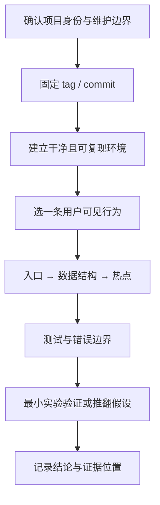
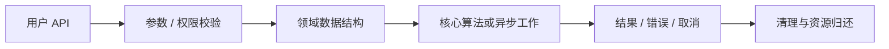

# 开源项目源码阅读实战：从固定提交到可复现实验

读源码最常见的低效方式，是从 README 的宣传句跳到一个看起来熟悉的文件，然后按文件名猜整个系统。可靠的阅读结论需要闭环：**确认仓库身份 → 固定快照 → 建立可运行环境 → 从调用入口追踪关键数据 → 找测试和错误路径 → 做一个能推翻猜想的实验**。

本文提供一套可反复使用的调查流程。它不深入分析某个库的内部实现；[Pretext 专题](https://github.com/chenglou/pretext/tree/bac1774c0f8b7a92e44b9da43b6d5443d55d0d9b) 关注的是 `chenglou/pretext` 这个 JavaScript 文本处理库。这里会明确辨别它和名字相近的出版系统项目，避免搜索结果串线。

## 心智模型：源码阅读是证据链，不是文件导览



1. 一条用户行为给阅读范围设上限，例如“订阅一次后，更新怎样送达观察者”。
2. 数据结构说明信息怎样存储，测试说明维护者认为哪些边界必须成立。
3. 实验负责验证可观察结果；源码只说明机制，不替代运行证据。

## 第一层：现象——先写下能被观察的行为

把问题写成输入、输出和边界，而不是“研究一下架构”。例如：

> 输入：同一 key 连续写入值 A、B。输出：订阅者在一次任务内收到几次通知？异常时是否仍能移除订阅？

这个描述同时给出可测量对象与边界。其他示例：文件增量构建时哪些产物 mtime 改变；CRDT 两端交换更新后是否收敛；worker 被 terminate 后待处理 Promise 如何结束；数据库连接关闭后查询如何失败。

| 模糊目标 | 可调查问题 |
|---|---|
| “看懂状态管理库” | state 存在哪个对象；订阅者如何索引；unsubscribe 移除哪些引用？ |
| “理解构建工具” | 文件变化事件怎样变为 invalidation；哪一级 cache key 被检查？ |
| “研究数据库 wasm” | 初始化加载哪些 wasm / worker 资产；查询结果如何编码；内存如何释放？ |
| “看懂 CRDT” | 更新如何编码、交换和合并；冲突规则在哪个函数中实现？ |

## 第二层：规则——固定版本、许可与身份

### 固定源码快照

分析源码时先选择 release tag 或完整 commit SHA，并将路径写成固定链接。`main` URL 会漂移；引用目录结构、性能或当前 API 时尤其危险。建议在笔记顶部记录：仓库 URL、commit、日期、Node / Rust / Go 等版本、系统依赖、执行命令和是否有未提交补丁。

示意命令：将占位值替换为选定项目的完整 commit SHA 后，在临时目录运行。

```sh
git clone https://github.com/owner/project.git
cd project
git checkout --detach FULL_COMMIT_SHA
git rev-parse HEAD
```

最后一行必须和记录的 SHA 完全一致。不要在阅读途中 `git pull` 后继续引用旧行号。

### 验证同名仓库

至少使用三个身份线索：owner / 组织、README 的项目定位、包名或 import 路径、license、release / tag、关联官方文档域名。GitHub stars、搜索排序、短视频介绍都不能单独证明官方身份。发现 fork 或改名时，要确认当前主仓库和历史来源。

例如 `chenglou/pretext` 的 README 描述的是可组合的 JavaScript 文本布局库，源码与 npm 包沿 `pretext` 名称关联；大写 `PreTeXt` 常见于使用 XML 的学术出版平台，属于不同项目。搜索教程或引用代码时，必须检查 GitHub owner 和 package metadata，不能仅按字符串 `pretext` 合并资料。

### 先确保可运行

优先用锁文件所声明的包管理器和版本。记录安装命令、测试命令、目标测试名和失败日志。首次运行完整 suite 可能受本机环境影响；将“项目测试失败”分成依赖安装失败、测试断言失败和环境差异，不能把无法运行解释成代码缺陷。

## 第三层：机制——从入口追到数据结构、热点与错误边界

| 要追什么 | 具体问题 | 有用证据 |
|---|---|---|
| 公共入口 | 包导出哪个 API？参数经何处校验？ | package exports、index 文件、API 测试 |
| 控制流 | 调用经过哪些层？异步在哪创建？ | 调用栈、trace、事件记录 |
| 数据结构 | key / node / task 存在哪？增删复杂度如何？ | Map、树、图、队列、arena 定义 |
| 热点 | 时间 / 分配成本来自哪里？ | profiler、benchmark fixture、算法循环 |
| 错误边界 | 取消、重试、部分失败、清理如何传播？ | catch/finally、abort、dispose、fault injection 测试 |
| 兼容边界 | 浏览器、Node、worker、文件系统有什么分支？ | adapter、feature detection、CI matrix |

用一条调用链横穿代码，而不是读完 `src/` 所有文件。`rg "公开方法名"` 找声明和测试，再从最接近输入的调用点向下跟到状态变更；每遇到异步边界或可变数据结构，就记录“谁创建、谁修改、谁清理”。



读图时重点追两条支线：失败是否能到达 cleanup，取消是否能从用户 API 穿透到底层工作。很多缺陷不在 happy path，而在 finally 未执行、worker 消息丢失、旧请求覆盖新请求、文件临时产物没有关闭等边界。

### 测试不是附属材料

测试名常能揭示设计约束。先跑与目标行为相邻的测试，阅读它的 fixture、断言和 teardown，再追实现。若测试只覆盖 happy path，应明确标为未覆盖而不要推断行为。基准测试则要检查输入数据、热身策略、迭代次数、设备环境和输出统计；benchmark 里的 synthetic case 不代表真实应用。

### 识别错误边界

逐个列出可能失败的阶段：输入校验、解析、分配、远端调用、提交、序列化、释放。问这几个问题：异常如何表示？部分写入是否回滚？调用方是否能取消？重试是否安全？cleanup 是否幂等？报错是否包含足以定位的上下文？

## 第四层：实现——用最小实验检验一个机制

假设源码看起来像“重复通知会被批处理”。不要只读函数名。设计一个探针，在一次同步任务里连续变更两次，记录 observer 调用次数，并比较显式 batch 与无 batch。实验应包含：

1. 固定 commit，复制官方最小安装步骤。
2. 记录 Node 和依赖的精确版本。
3. 只运行最小脚本，不修改包源码。
4. 每个 scenario 独立重置状态，防止前次订阅残留。
5. 在结论中写实测输出、命令和任何非确定因素。

如果安装整个仓库太重，可在同一 commit 的 package workspace 运行其官方单测。若用自己的简化代码复现概念，必须标注“教学模型”，不能将它的输出冒充上游实现行为。

### 一个实验记录模板

```text
问题：连续两次写入是否合并通知？
快照：owner/repo@完整 SHA
环境：OS、Node、包管理器、依赖版本
命令：完整可复制命令
输入：初始值与写入序列
观测：调用计数、事件顺序、输出或 profile
结论：在此快照 / 此路径下观察到什么
边界：未覆盖哪些 scheduler / worker / host 场景
反例：什么测试可以推翻当前结论
```

## 第五层：边界——源码阅读能证明什么

源码可以证明某个 commit 中分支、数据结构、算法调用和测试断言如何实现；它不能自动证明实际生产流量下的性能、未覆盖平台的行为、未来 release 的 API 或维护者没写进代码的意图。README 适合建立定位，正式文档解释支持契约，源码和测试验证内部机制，生产 benchmark 验证工作负载表现。

| 证据 | 能支持 | 不能独立支持 |
|---|---|---|
| README | 项目自述定位、安装入口 | 性能胜出、完整兼容承诺 |
| API 文档 | 用户可依赖的公开合同 | 所有内部执行路径 |
| 固定 commit 源码 | 该快照中的具体机制 | 所有版本、所有配置行为 |
| 测试 | 被覆盖输入下的断言 | 未覆盖的失败模式 |
| Benchmark | 指定环境 / 输入的测量 | 泛化到任意应用或机器 |
| Issue / Discussion | 已报告问题、设计讨论 | 已合并实现或稳定合同 |

### 小心依赖实现偶然性

内部对象形状、文件路径、未导出函数都可能在 patch release 改变。若读者要基于该行为写应用，应优先使用公开 API；若给维护者提交修复，则应保留复现脚本和回归测试，不只贴一段内部调用链。

## 常见误区

1. **从搜索摘要直接下结论。** 打开 owner、版本和原始文档。
2. **不锁 commit 就引用路径。** 路径可能变，行号更会漂移。
3. **只看 README 不跑测试。** 快速开始不是边界定义。
4. **只读 happy path。** 失败、取消和析构经常藏有关键语义。
5. **把局部 benchmark 说成普遍性能结论。** 先陈述 fixture 与设备，再给数值。
6. **把教学实现说成上游实现。** 标明模型边界，并分别给源码入口。
7. **把 fork 与官方仓库混为一谈。** 核对组织、包名、文档域名与 release。

## 30 秒与 2 分钟回答

**30 秒：** 我把源码阅读当成可复现的证据链：固定 commit，选一条可观察行为，从 API 入口追到数据结构和错误路径，用上游测试与最小实验验证，再明确该证据适用的版本和边界。

**2 分钟：** 我先写输入、输出、时序和失败条件，锁定完整 SHA 并验证仓库身份。然后建立官方测试环境，沿公共入口跟调用链，记录数据结构的创建 / 修改 / 清理，并对照目标测试。关键结论用最小脚本或 fault injection 复现，保留命令、版本和输出。最后区分文档合同、源码实现、测试覆盖和生产测量，不把某个提交的实现推广到全部版本。这样别人可以在同一快照复验，也能用反例推翻结论。

## 自测题

??? question "1. 为什么 README 不能作为内部性能结论的唯一来源？"
    **答案：** 它是项目自述，通常不涵盖可比较的输入、设备和测量流程。

??? question "2. 锁定 tag 与完整 SHA 哪个更适合源码路径结论？"
    **答案：** 完整 SHA 指向唯一快照；tag 也可移动，引用时最好同时记录解析后的 commit。

??? question "3. 如何区分项目缺陷和本机环境问题？"
    **答案：** 保存安装 / 测试输出，在另一干净环境或 CI 相同版本复验，并看失败是否发生于断言、依赖解析还是系统配置。

??? question "4. 一段简化脚本能证明框架调度行为吗？"
    **答案：** 不能。它能展示假设机制；真实行为要在固定上游版本和真实 API 上跑测。

## 项目身份示例与深入阅读

| 名称 | 身份线索 | 建议起点 |
|---|---|---|
| Pretext（小写） | GitHub owner 为 `chenglou`，定位为文本布局 JavaScript 库 | [chenglou/pretext @ bac1774](https://github.com/chenglou/pretext/tree/bac1774c0f8b7a92e44b9da43b6d5443d55d0d9b) |
| PreTeXt（大小写有差异） | XML / 出版工作流项目，GitHub owner 与网站组织不同 | [PreTeXtBook/PreTeXt @ 60230db](https://github.com/PreTeXtBook/PreTeXt/tree/60230db2f0117c2e629e06e5c7a2515f73228edf) |
| TanStack DB | `TanStack/db`，文档称 reactive client-side store | 从 collections 与 live query 文档起步，核对 package 版本 |
| PGlite | `electric-sql/pglite`，Postgres WASM 客户端 | 从 README 的 Node / Browser 初始化和存储边界起步 |

深入阅读顺序：先选行为，再读公开 API 文档；随后跳到固定提交的实现和相邻测试；最后运行最小实验。项目快照应写在笔记或教程页面 frontmatter，依赖安装按仓库锁文件执行。
