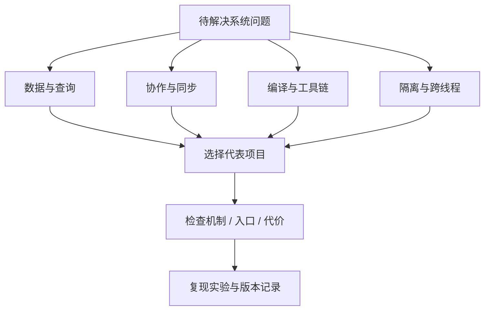
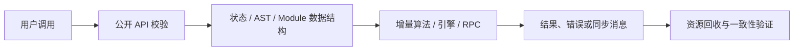

# 系统型开源项目深读：数据、协作、运行时与工具链

挑项目不应只问“现在热不热”。系统型项目更值得按问题选择：是否需要可靠并发模型、客户端可增量更新的数据视图、本地 SQL、离线协作、源码级语义分析、跨线程 RPC 或隔离的 JavaScript 执行？本文按这些问题提供十二个可深读样本。仓库定位、源码路径和许可证都在 2026-10-12 查询的固定 commit 上核对；这不是 stars 排名，也不声称这些项目在该日“最新”或“最热门”。

既有教程已经覆盖 Zustand、SWR、shadcn/ui、Axios 等应用层工具，参见 [前端库与服务生态](frontend-libraries.md)。这里转向更底层的运行时、数据引擎、协作协议和编译基础设施。

## 心智模型：按问题选项目，再沿机制找代价

1. 先从业务约束选类别，再从表中选代表实现。
2. “机制”解释项目如何达成目标；“代价”要落到 CPU、内存、网络、bundle、兼容或运维上。
3. 固定提交可使源码结论可复查；license 要同时看主仓库与依赖 / vendored 文件。

## 项目矩阵：问题、机制、入口与代价

| 类别 / 项目 | 要解决的问题与已核验能力 | 源码入口 | 主要代价 / 需要验证的限制 | 固定 commit 与许可证 |
|---|---|---|---|---|
| Effect | TypeScript 程序的 effect、typed error、依赖注入、并发与资源管理 | `packages/effect/src/Effect.ts`、`Scope.ts`、`Layer.ts` | 学习成本较高；必须验证 fiber 取消、资源 finalizer 与错误通道是否符合具体服务边界 | [844a77b](https://github.com/Effect-TS/effect/tree/844a77b18c03b4faa386cf04bf94908d3d37abc7) · MIT |
| TanStack DB | 客户端 collections、live query 与 optimistic transaction；官方文档描述多数据源 collection 和增量查询 | `packages/db/src`，优先追 collection、transaction、live query | 同步一致性、后台同步源和 optimistic rollback 需要实际网络故障测试；不能把本地响应快推断为服务端一致 | [fd13e3c](https://github.com/TanStack/db/tree/fd13e3cc9d3302e7598a78ac8f49d06dbbde7e08) · MIT |
| PGlite | 将 PostgreSQL 以 WASM + TypeScript client 运行在浏览器 / Node 等环境 | `packages/pglite/src`、extension packages | WASM 初始化、持久化接口、扩展二进制和内存占用；不是任意 Postgres 部署的零差异替代品 | [d9eadc6](https://github.com/electric-sql/pglite/tree/d9eadc63cf16db6d40fd13b5cf2c06e2e645fbd9) · Apache-2.0 |
| DuckDB-Wasm | 浏览器内分析 SQL，可读取 Parquet / CSV / JSON 并与 Arrow 配合 | `packages/duckdb-wasm/src`、worker bundle 与 wasm 文件 | 浏览器内存、worker / wasm 下载体积、单线程或 worker 限制、文件访问权限；大文件需测峰值内存 | [448ec38](https://github.com/duckdb/duckdb-wasm/tree/448ec38a52238ad2aacde514f0ee3acfd9515b6c) · MIT（扩展需另看许可） |
| Automerge | JSON-like CRDT、压缩格式与 sync protocol，面向 local-first 数据 | `javascript/src`、`rust/automerge/src`、binary format spec | 多副本冲突策略、历史 / 保存空间与同步协议运维；测试实际 schema 演化 | [7118d9c](https://github.com/automerge/automerge/tree/7118d9cfd3611f71af44538793816881c5305562) · MIT |
| Yjs | shared types CRDT，网络 provider 与 editor binding 分层 | `src/structs`、`src/utils`、`INTERNALS.md` | tombstone / update 历史、provider 生命周期、数据校验与协作服务器；CRDT 不能解决权限策略 | [d01eefc](https://github.com/yjs/yjs/tree/d01eefc997cf12d29d5aabea804df5f69c659a79) · MIT |
| ts-morph | TypeScript compiler API 的高层封装，适合项目级 AST 查询 / 改写 | `packages/ts-morph/src`、`packages/ts-morph/test` | AST wrapper 对象和 program 内存成本；修改后格式、类型正确性与跨文件引用需单独验证 | [f288183](https://github.com/dsherret/ts-morph/tree/f288183ddb496adc6f4c5b6929830b5b73437185) · MIT |
| Oxc | JS/TS 工具链组件：parser、semantic、transform、linter / minifier 等 | `crates/oxc_parser`、`oxc_semantic`、`oxc_transformer` | Rust binding / Node API 边界、语法覆盖和 source map；单包速度不能代表完整 build | [d6fff87](https://github.com/oxc-project/oxc/tree/d6fff87f9982227ffd24177981e99f5008f9f616) · MIT |
| SWC | Rust-based JS/TS compiler platform，可从 Rust 或 JS 侧使用 | `crates/swc_ecma_parser`、`swc_ecma_transforms`、`crates/swc` | 插件兼容与 native addon 分发平台矩阵；仓库声明主要采用 Apache-2.0，依赖仍需审计 | [410ae3a](https://github.com/swc-project/swc/tree/410ae3a0750e2d218eaabc2686d29f08b1e20482) · Apache-2.0 |
| Rolldown | Rust bundler，提供 Rollup-compatible APIs / plugin interface，目标整合到 Vite 工具链 | `crates/rolldown`、`crates/rolldown_common`、integration tests | 兼容性按插件与 hook 逐项验证；native binding、source map 与 chunk 行为也影响集成 | [f989992](https://github.com/rolldown/rolldown/tree/f989992cece3078d43f0fb210b8efb300d5a459f) · MIT |
| Comlink | 把 Worker `postMessage` 包装成基于 Proxy 的 RPC API | `src/comlink.ts`，测试中检查 transfer / proxy / endpoint | 远程调用仍有序列化和消息往返成本；Proxy 易隐藏 async 与取消，生命周期需显式终止 | [114a4a6](https://github.com/GoogleChromeLabs/comlink/tree/114a4a6448a855a613f1cb9a7c89290606c003cf) · Apache-2.0 |
| quickjs-emscripten | 用 WASM 嵌入 QuickJS，给宿主 JS 提供独立 runtime / context | `packages/quickjs-emscripten-core/src`、`c/interface.c`、variant build scripts | 手动释放 QuickJS handles / context；同步和 Asyncify 构建有不同体积与性能；sandbox 还要设资源上限 | [7b7af98](https://github.com/justjake/quickjs-emscripten/tree/7b7af98e4e69757c64c27aac46a74e1e07229545) · MIT（上游 QuickJS 条款另核） |

许可证列描述仓库顶层 `LICENSE` / README 声明的主许可，不是法律意见或完整依赖许可证清单。Oxc、SWC、DuckDB-Wasm、QuickJS 相关项目包含依赖、捆绑组件或运行时，发布前应在固定提交检查 `LICENSE`、`NOTICE`、`THIRD-PARTY-LICENSE` 和发布产物清单。

## 第一层：现象——系统项目的用户可见差异

Effect 让错误和资源作用域进入程序结构；TanStack DB 让 query 结果能够随 collection 增量变更；PGlite / DuckDB-Wasm 把数据库执行放进本地运行时；Automerge / Yjs 处理副本并发编辑；ts-morph / Oxc / SWC / Rolldown 操作源码和模块图；Comlink 抽象线程消息；quickjs-emscripten 在宿主中嵌入另一个 JS 引擎。

它们并非同类竞品。比较应该以失败模型和可观测结果为准：同步冲突怎样收敛、worker 调用怎样超时、构建改变了哪些输出、wasm 数据何时释放、Effect scope 是否关闭资源。

## 第二层：规则——以实际用户问题归类

### 数据查询与离线优先

TanStack DB 的 live query 是客户端数据层抽象，依赖 collection source；PGlite / DuckDB-Wasm 则承载数据库引擎，前者面向 PostgreSQL 能力与扩展，后者主要针对分析型 SQL。若需求是事务型业务数据或复杂 analytical query，先看数据量、初始化延迟、持久化能力和同步权威源，再决定放客户端还是服务端。

### 协作与 CRDT

Automerge、Yjs 都使用 CRDT 思路处理并发操作，并提供不同的数据模型、协议和生态。同步算法不会替应用决定 ACL、身份验证、数据保留周期或业务层的“哪个值更可信”。实验至少包含乱序、重复消息、断线离线编辑、同时删除 / 插入与长期 tombstone / history 存储。

### 源码与构建基础设施

ts-morph 利用 TypeScript compiler model 做语义查询和批量改写；Oxc / SWC 提供语言工具链部件；Rolldown 聚焦模块图、linking 和 bundle。Parser benchmark 只回答 parse 子任务，不回答变更一次后开发服务器恢复时间，也不覆盖 plugin compatibility。

### 线程与隔离

Comlink 将 RPC 形式的 API 映射到消息通道，但每次远端函数调用仍异步且有 structured clone / transfer 规则。quickjs-emscripten 运行独立 JS context，能分离堆与值生命周期，但宿主仍需限制内存 / 时间、审查 host function 代理并释放句柄。WASM sandbox 不是自动安全产品。

## 第三层：机制——从入口跟一条具体路径

使用表中入口时先搜索公开 API 名称，然后找它对应的测试，再跟到共享状态变更位置。对于“系统能力”至少定位：数据结构定义、核心算法、错误/取消路径、对应测试与 teardown。目录名字只说明作者组织代码，不自动说明调用顺序。

### 真实项目路径示例

* TanStack DB 官方文档将 query collections、sync collections 与 local collections 分开；live query 文档描述 query 被编译成增量维护 pipeline。阅读时把 `createCollection`、transaction draft 和 live query 更新追在同一提交中，检查失败时 rollback 的测试。
* PGlite 官方 README 描述 WASM Postgres，可在 browser / Node 等运行并通过不同存储方式持久化。验证应测首次实例化、一次真实查询、关闭 / 重开持久化和扩展加载，而非只运行 hello world。
* DuckDB-Wasm 官方 README 明确是 browser in-process analytical SQL，并展示 bundle / worker 初始化流程。关注 worker URL、WASM bundle、filesystem access 和 query result 的 Arrow / JS 转换。
* Yjs README 指向 shared types、provider/editor integrations 与 `INTERNALS.md`；其网络 provider 与 CRDT data type 是分层的。检验时分开测 update 编码、provider 传递和 editor binding。
* Comlink README 明确基于 `postMessage` 与 ES Proxy 的 RPC；transferable 对象、proxy callback 和 endpoint close 都应有针对性实验。
* quickjs-emscripten README 区分 sync 与 Asyncify runtime variants，并展示 context / runtime 的 dispose。用 debug variant 检查 handle leak，再用生产 variant 测体积和时延。

## 第四层：实现——如何设计一个系统项目实验

每个实验要先定义可反驳假设。比如“live query 只处理 delta”就准备固定 N 行表格，对单行 update 计数，记录被重新计算的 row 数；若无公开 instrumentation，使用 profiler 或 instrumented adapter，不根据 UI 变快猜内部机制。

### 查询 / 数据实验

* 固定输入集和行数，分别测 cold start 与热查询。
* 修改一行，观察 query 消费者收到的变化集合；另测全表 sort / join，避免只测最简单的 where。
* 记录 WASM 编译 / 初始化时间、worker 消息、峰值内存和持久化文件大小。
* 注入 quota exceeded、worker crash、扩展缺失，检查错误回传与重建路径。

### 协作实验

* 从相同初始文档复制两个客户端，断网并分别编辑同一列表项。
* 交换 update，重复发送一次，再反转顺序；断言收敛到相同内容。
* 做删除与并发插入，记录最终序列和 update 大小。
* 在固定数据集多轮编辑后压缩 / snapshot，比较存储增长与重新加载时延。

### 工具链实验

* 基线冷构建；编辑无关 leaf；编辑被许多入口导入的公共模块；改 parser / plugin 配置。
* 对每次记录总时长、CPU / RSS、产物 hash、chunk 数、map 定位准确率。
* plugin suite 选真实项目使用的 hook，并测试顺序与错误传播。
* 清空缓存后复跑，避免把上次缓存当成工具本身性能。

### Worker / 隔离实验

* Comlink 比较一次小 scalar RPC 与 transferable ArrayBuffer 批量传输。
* terminate worker 时同时有 pending RPC，记录 reject / hang 状态和释放时机。
* QuickJS 执行无限循环和持续分配脚本，确认中断 / memory limit 机制；仅能评估仓库暴露的机制，不宣称未经审计的 sandbox 安全。
* 每次创建 Runtime / Context 后明确 dispose，并以 debug variant 或 heap profile 检查未释放资源。

本页不把示意伪代码冒充上游 API 验证；要把其中任一实验变成 runnable 教程，需在锁定 commit 的干净 checkout 中运行并记录精确依赖版本。

## 第五层：边界——能力不是承诺，许可证也不是一个字符串

| 误读 | 校正方式 |
|---|---|
| “12 个系统项目都是最新趋势” | 它们是多类别研究样本，不按 stars / release 活跃度排名；先看 commit 与 release 日期 |
| “CRDT 自动解决所有冲突” | CRDT 解决收敛规则；授权、业务约束、删除政策仍需应用处理 |
| “浏览器里有 Postgres 就能替代后端数据库” | 校验持久化、同步、多标签页、并发、扩展和设备资源边界 |
| “WASM 执行不可信 JS 一定安全” | 必须审 host capabilities、超时、内存、异常、句柄释放与逃逸通道 |
| “工具链用 Rust 就能保证更快” | 测整条用户工作流和插件兼容；实现语言只是一个变量 |
| “仓库是 MIT 就所有产物可按 MIT 发布” | 检查子目录、嵌入组件、生成 wasm 和第三方 notice |

选择项目时也要问维护风险：release cadence、bus factor、漏洞响应、安全政策、浏览器 / OS CI 覆盖和迁移策略。GitHub stars 只是某时点的注意力信号，不是正确性、安全或生产支持证明。

## 30 秒与 2 分钟回答

**30 秒：** 我按问题分类系统项目：数据查询、local-first 协作、编译工具、线程 RPC 和隔离运行时；随后对固定提交追机制与资源边界，并用故障注入或 workload 实验验证，不把流行度或语言实现当作质量证明。

**2 分钟：** 若做离线协作，我会比较 Automerge / Yjs 的数据模型、更新协议、editor/provider 分层、删除与压缩策略，然后测试乱序、重复、断网冲突和存储增长。若做客户端查询，会比较 TanStack DB 的 collection/live query 与 PGlite / DuckDB-Wasm 这类内嵌数据库，并测首次启动、热更新、内存和持久化。每次锁定 commit、核对 license / 依赖、从测试追到数据结构，最后按项目真实 workload 得出适用范围。

## 自测题

??? question "1. 为什么 TanStack DB 与 PGlite 不是同类项目？"
    **答案：** 前者是客户端 collections / query / mutation 数据层；后者嵌入 PostgreSQL 引擎能力，承担数据库执行。

??? question "2. CRDT 收敛是否等同于业务数据正确？"
    **答案：** 否。收敛只保证副本按算法达成一致；权限和业务不变量仍需设计。

??? question "3. Comlink 的 Proxy 是否让 worker 调用变成同步本地函数？"
    **答案：** 否。调用仍通过消息通道异步返回，且有序列化 / transferable 语义。

??? question "4. quickjs-emscripten 测试最重要的资源边界是什么？"
    **答案：** Context、Runtime 和 handle 的创建 / 消费 / dispose，以及脚本超时与内存限制。

## 固定提交与官方来源

下面链接均指向固定 commit，阅读目录、README、测试和该提交中的许可证文件。若要比较今日 release，请重新解析 tag 与 package version；本文快照结论不随 `main` 漂移。

| 项目 | 固定入口 |
|---|---|
| Effect | [commit](https://github.com/Effect-TS/effect/tree/844a77b18c03b4faa386cf04bf94908d3d37abc7) · `packages/effect/src/Effect.ts` |
| TanStack DB | [commit](https://github.com/TanStack/db/tree/fd13e3cc9d3302e7598a78ac8f49d06dbbde7e08) · `packages/db/src`；[官方 live query 文档](https://github.com/TanStack/db/blob/main/docs/overview.md) |
| PGlite | [commit](https://github.com/electric-sql/pglite/tree/d9eadc63cf16db6d40fd13b5cf2c06e2e645fbd9) · `packages/pglite/src`；[官方 README](https://github.com/electric-sql/pglite/blob/main/README.md) |
| DuckDB-Wasm | [commit](https://github.com/duckdb/duckdb-wasm/tree/448ec38a52238ad2aacde514f0ee3acfd9515b6c) · `packages/duckdb-wasm`；[官方 README](https://github.com/duckdb/duckdb-wasm/blob/main/packages/duckdb-wasm/README.md) |
| Automerge | [commit](https://github.com/automerge/automerge/tree/7118d9cfd3611f71af44538793816881c5305562) · JS and Rust workspace |
| Yjs | [commit](https://github.com/yjs/yjs/tree/d01eefc997cf12d29d5aabea804df5f69c659a79) · `src`、`tests`、`INTERNALS.md` |
| ts-morph | [commit](https://github.com/dsherret/ts-morph/tree/f288183ddb496adc6f4c5b6929830b5b73437185) · `packages/ts-morph` |
| Oxc | [commit](https://github.com/oxc-project/oxc/tree/d6fff87f9982227ffd24177981e99f5008f9f616) · parser / semantic / transformer crates |
| SWC | [commit](https://github.com/swc-project/swc/tree/410ae3a0750e2d218eaabc2686d29f08b1e20482) · parser / transform crates |
| Rolldown | [commit](https://github.com/rolldown/rolldown/tree/f989992cece3078d43f0fb210b8efb300d5a459f) · crates and integration tests |
| Comlink | [commit](https://github.com/GoogleChromeLabs/comlink/tree/114a4a6448a855a613f1cb9a7c89290606c003cf) · source and transfer tests |
| quickjs-emscripten | [commit](https://github.com/justjake/quickjs-emscripten/tree/7b7af98e4e69757c64c27aac46a74e1e07229545) · C interface, TypeScript binding, variants |

官方能力描述核对源：Effect、TanStack DB、PGlite、DuckDB-Wasm、Automerge、Yjs、Comlink、quickjs-emscripten 的 GitHub README / 官方文档；工具链能力与许可以固定提交的仓库说明、LICENSE / NOTICE 为准。README 用词是项目维护者描述，不构成独立性能评估。

## 深入阅读

- Effect：追 `Scope` finalizer 和 interruption 测试，回答资源在失败时是否恰好释放。
- TanStack DB：追 transaction 到 live query change propagation，找到 rollback 测试。
- PGlite / DuckDB-Wasm：对照 worker 初始化、wasm bundle 和持久化 adapter，记录冷启动。
- Automerge / Yjs：读 binary format 或 `INTERNALS.md`，再做乱序 / 重复 update 实验。
- ts-morph：找一个跨文件 rename / reference 测试，观察 TypeScript program 生命周期。
- Oxc / SWC / Rolldown：从 CLI 进入 parse / semantic / link，运行一项目标 integration test。
- Comlink / quickjs-emscripten：跑 transfer、close、dispose 测试并主动构造 pending / leak 场景。
