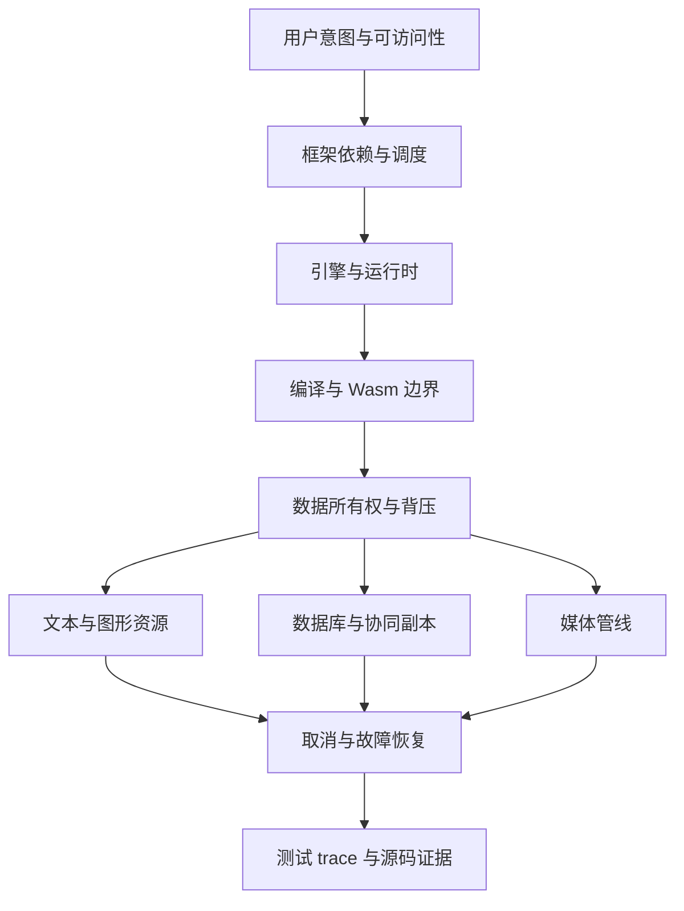

# 全仓内容地图与深入路线：从知识点到可验证的系统

“知道 API”与“能解释故障”之间，往往隔着资源所有权、调度、缓存失效和恢复协议。一个页面同时用了 React、Worker、Wasm 和 Canvas，卡顿可能发生在数据复制或 GPU 上传，而不是组件渲染。本路线从这些跨层边界组织学习，不按流行项目名字堆目录。

本页的 `runnable: false` 表示它是一份研究与课程地图，不是一项完整系统的可运行验收。下文明确区分本轮实跑的实验与仍需设备、浏览器或外部系统的验证。

## 1. 调研范围与方法

基线固定为 `707ea4929bbb84c67bd637f92360b002a2b23cf7`，包含 **480 个已跟踪 Markdown 文件**。逐文件结构清单记录路径、标题、行数、字符数、标题层级数量、外链数量、代码围栏数量、模板场景标记和 SHA-256；见 [完整清单 JSON](../assets/research/content-inventory-20261012.json)。它不是准确率评分。

研究分三层：

1. **全量结构盘点**：遍历固定 Git 快照内每个 Markdown，而不是统计当前并发写作中的目录。
2. **专题抽样精读**：核对已有 V8、GC、Node、事件循环、Wasm 互操作与性能、Canvas、Fiber、Signals、协同和数据库的章节，避免再写一套入门定义。
3. **新增内容事实核验**：以规范、官方文档和固定源码提交为依据；安装锁定版本的 Yjs、PGlite 做真实库实验。没有独立逐条核验旧文所有事实，不声称全仓已经技术纠错完毕。

结构扫描发现：298 个文件包含至少两个固定场景短语；374 个文件缺少 `title/description/tags/date` 中至少一项。这只是人工复核入口。出现相同场景不自动意味着内容错误，字段齐全也不证明实验通过。

## 2. 全仓主题地图：已有材料与缺失的连接

页数是基线目录统计，不是新增加的页数；资源索引也计入。

| 领域 | 基线页数 | 已有基础 | 本轮重点或后续具体问题 |
| --- | ---: | --- | --- |
| HTML / CSS | 20 / 20 | 语义、布局、响应式、可访问性 | 自绘界面如何保留语义、焦点、输入法与等价操作 |
| JavaScript / TypeScript | 46 / 14 | 语言、对象、GC、类型、编译器 | tiering、推测与反优化；类型擦除和运行时边界 |
| 浏览器 / Web API | 15 / 11 | 渲染、存储、消息、Wasm、Canvas、媒体 | 数据库执行计划、文本排版、资源恢复、媒体背压 |
| 网络 / API / 安全 | 19 / 20 / 10 | 协议、缓存、鉴权、安全模型 | 流式协议取消、离线撤权与副本残留；后续协议实验 |
| React / Vue / 其他框架 | 40 / 6 / 13 | Fiber、响应式、SSR、水合和路由 | 把依赖图、owner、scheduler、host、compiler 分开比较 |
| 工程化 / 构建 / 包管理 | 39 / 3 / 3 | AST、模块图、插件、HMR、供应链 | IR、失效传播、语义保持与增量分析证据 |
| 运行时 / 性能 | 12 / 16 | libuv、流、Node/Bun/Deno/边缘 | Isolate、Context、进程、FFI 的隔离与生命周期 |
| 手写 / 算法 | 11 / 11 | 异步、系统设计、数据结构 | 所有权与队列预算；把正确性、不变量和故障注入结合 |
| 开源赏析 | 15 | 框架、构建、数据层、AI 生态 | 从固定源码、测试与提交历史提炼机制，不用热度代替证据 |
| AI Agent / MiniCode | 98 / 9 | Agent 系统、课程、上下文和工具 | 本轮不复写；后续应与 Web 沙箱、确定性回放和资源治理交叉 |
| 学习资源 / 设计 | 20 / 7 | 资料目录、学习路线与写作系统 | 可验证课程地图、版本保鲜、实验边界与复现清单 |
| 根页 / Mermaid 规则 | 2 | 站点入口、图语法 | 导航串联与真正的解析器检查 |

这里的缺口主要不是“没有长文章”。已有不少单页超过千行。继续增长同义段落不能弥补缺失的因果链；新页应回答一个不同的系统问题，并链接已有基础。

## 3. 深度如何定义

看同一个用户操作从语义到执行再到恢复的边界：



图不是实现调用栈；它展示研究问题之间的依赖。每篇深入教程都应能回答：

| 层 | 具体提问 | 合格产物 |
| --- | --- | --- |
| 是什么 | 输入、输出、状态和行为是什么 | 一个可观察现象与边界 |
| 为什么 | 解决哪个约束，为什么规则成立 | 因果链、数据结构或不变量 |
| 怎么样 | 谁拥有数据，谁调度，何时失效 | 最小实现、协议或稳定源码路径 |
| 更底层 | 引擎、内存、IO、GPU 怎样协作 | trace、执行计划、字节布局或资源图 |
| 什么时候不成立 | 取消、乱序、丢设备、缺字体、断网怎样处理 | 反例、故障注入与恢复验收 |

## 4. 本轮已写入的深入路线

按路线学习，不必连续阅读全部页面。每条最后都有可交付证据；具体命令和环境以各页为准。

### 路线 A：框架、编译器与引擎

1. [框架运行时设计](../frameworks/framework-runtime-design.md)：依赖图、owner/disposal、批处理、调度和宿主提交。
2. [编译器 IR 与增量分析](../engineering/compiler-ir-incremental-analysis.md)：语义、模块图、缓存键与失效边界。
3. [V8 分层执行与反优化](../js/v8-execution-tiering-deopt.md)：Ignition、Sparkplug、Maglev、TurboFan 与反馈，避免背固定热度阈值。
4. [运行时边界与 FFI](../runtime/runtime-boundaries-isolates-ffi.md)：进程、Isolate、Context、Worker 和原生指针不是一种隔离。

验收产物：调度去重与销毁测试、增量失效集合、实际引擎 trace 的环境记录，以及不能从一次 trace 推导的结论。

### 路线 B：Wasm 到浏览器数据系统

1. [Wasm Component Model 与 WASI](../browser/wasm-component-model-wasi.md)：core module、组件、WIT、canonical ABI 与宿主能力的不同层级。
2. [Wasm 性能诊断](../browser/wasm-performance-debugging.md)：冷启动、互操作、内存增长、复制和稳态测量。
3. [浏览器数据库与查询计划](../browser/browser-databases-query-plans.md)：PGlite、DuckDB-Wasm、SQLite 的执行与存储边界。
4. [本地优先与协同](../engineering/local-first-sync-crdt.md)：持久化、收敛、同步、权限与恢复不能互相替代。
5. [数据所有权与背压](../coding/data-ownership-backpressure.md)：批次、传输、取消与资源预算贯通整个链路。

验收产物：真实 PGlite 事务回滚与参数绑定、真实 Yjs 乱序／重复更新收敛，以及结构化复制和 transfer 的不同后置条件。浏览器磁盘崩溃恢复不属于上述 Node 实验的覆盖范围。

### 路线 C：文本、2D、GPU 与 Web3D

1. [Pretext 文本排版](../browser/text-layout-pretext.md)：`chenglou/pretext` 的测量与 layout 分离、缓存、字体和语言边界。
2. [Canvas 场景图与命中测试](../browser/canvas-scene-graph-hit-testing.md)：局部／世界坐标、空间索引与交互。
3. [WebGL/WebGPU 资源生命周期](../browser/webgl-webgpu-resource-lifecycle.md)：CPU 描述、GPU 实例、generation 和设备丢失恢复。
4. [glTF 资产与流式加载](../browser/web3d-assets-gltf-streaming.md)：accessor、stride、索引、稀疏数据、解码与上传预算。
5. [非 DOM 界面的可访问性](../html/non-dom-accessibility.md)：像素、语义和输入不能只保留其中一个。
6. [图形引擎源码地图](../open-source/engineering-libs/graphics-engines-source-map.md)：从资源管理和渲染提交入口比较真实项目。

验收产物：仿射逆变换与奇异矩阵测试、glTF 数据布局预算；字体 shaping、真实 GPU 和读屏器仍需要另外的设备验收。

### 路线 D：媒体与工程化研究方法

1. [WebCodecs 媒体管线](../web-apis/webcodecs-media-pipelines.md)：容器、编码、时间戳、帧生命周期与音画同步。
2. [源码阅读工作法](../open-source/engineering-libs/source-reading-playbook.md)：固定提交、入口、状态、不变量、测试和复现。
3. [系统型开源项目深入挖掘](../open-source/trending/systems-projects-deep-dive.md)：12 个研究入口，分别说明机制、许可证和选型代价。

验收产物：有界队列与释放测试，以及一份可追到具体实现和反例的源码笔记；不以 README 的跑分、Star 或“一行替换”宣传作为结论。

## 5. 实验登记：实跑不等于全系统验证

这些路径都位于仓库根目录的 `scripts/content-labs/`；本次基础环境为 Node `24.16.0`。实验是理解不变量的证据，不是硬件性能排行。

| 脚本 | 检验什么 | 明确不检验什么 |
| --- | --- | --- |
| `frameworks/scheduler-ownership.mjs` | 调度与 owner 清理 | React/Vue 的生产调度实现 |
| `frameworks/incremental-invalidation.mjs` | 反向依赖的失效传播 | 完整编译器语义与构建性能 |
| `engine-runtime/tiering-observe.mjs` | 本机 tiering trace 的观察入口 | 所有 V8 版本的固定阈值 |
| `engine-runtime/context-ownership.mjs` | Context 与 transfer 行为 | 安全隔离、真实 FFI |
| `graphics/scene-hit-test.mjs` | 坐标变换与奇异矩阵 | 浏览器事件分发与真实光栅化 |
| `graphics/gltf-budget.mjs` | 交错 float32 accessor 的真实字节读取、越界与预算 | 全 glTF 验证器、解码和上传耗时 |
| `systems/crdt-counter.mjs` | G-Counter 合并性质 | 文本 CRDT 与业务约束 |
| `systems/frame-budget.mjs` | 队列上限、关闭与释放 | 真正 VideoFrame、GPU 内存和码率 |
| `systems/transfer-ownership.mjs` | 复制与转移的后置条件 | 浏览器跨线程传输性能 |
| `integrations/yjs-convergence.mjs` | Yjs 真实更新的收敛与差量 | 网络鉴权、持久化与意图保留 |
| `integrations/pglite-transactions.mjs` | 真实数据库回滚、分页、参数绑定 | 浏览器配额、多标签与掉电恢复 |
| `systems/focus-state.mjs` | 自绘对象删除后焦点模型 | DOM 焦点、输入法和读屏器体验 |

两个外部依赖固定为 `yjs@13.6.33` 与 `@electric-sql/pglite@0.5.8`；用实验目录的 lockfile 安装，不向教程站点引入运行依赖。

仓库根目录执行全部 12 个实验；只运行无外部依赖的 10 个模型时，不加 `--integrations`，也无需安装该依赖目录：

```bash
npm ci --prefix scripts/content-labs/integrations --ignore-scripts
node scripts/content-labs/run.mjs --integrations
```

通过阈值为全部子进程退出码 0，最后输出 `PASS 12 content labs on v24.16.0`；任何断言、依赖缺失或超时都会让总入口非零退出。失败先看标记为 `LAB` 的具体脚本和断言，不跳过失败用例。实验不写持久业务数据；数据库和 Yjs 文档由脚本关闭，安装依赖留在被 Git 忽略的实验 `node_modules`，可按需清理该精确目录。

## 6. 广度继续发散，但不把计划冒充交付

以下是下一轮研究候选，不是本轮已完成的教程。每项明确一个机制问题和验收产物，避免“再加几十个名词”。

| 方向 | 深入问题 | 应交付的实验证据 |
| --- | --- | --- |
| 网络与流式协议 | HTTP/3、WebTransport 与应用 ACK 怎样影响取消、重连和队头阻塞 | 不同丢包／断网条件的可重复时序与恢复测试 |
| CSS 与排版引擎 | 包含块、约束求解、shaping、双向文本、滚动锚定如何影响增量布局 | 相同字体／语言下 DOM 几何与选择行为对照 |
| Web 安全与插件沙箱 | capability、权限撤销、Origin、供应链与不可信执行的信任边界 | 恶意输入、跨租户请求、资源耗尽与退出测试 |
| 数据与计算 | SIMD、WasmGC、WebGPU compute、Arrow 零拷贝在哪些边界仍要复制 | 分阶段 CPU／GPU 时间、字节流量和正确性对照 |
| 服务端与边缘 | 冷启动、连接池、限流、缓存一致性、尾延迟与故障域 | 可控负载、超时／重试、幂等和容量预算 |
| 地理／科学可视化 | 空间索引、LOD、坐标精度、瓦片调度与拾取怎样协同 | 大坐标误差、取消加载、资源回收和交互测试 |
| 编辑器／IDE | 增量解析、LSP、Tree-sitter、文本 rope 与协同位置的结合 | 增量编辑后的语义差异与全量结果对照 |
| 确定性与可观测性 | 回放、逻辑时钟、跨 Worker trace、源映射与性能归因 | 同一输入的可重复故障、跨边界关联和最小复现 |

广度优先跨领域接口；深度优先失败原因与验证方法。扩展前先在清单中定位已有文章，再决定补旧页、写新页还是只建立链接。

## 7. 内容维护与真实验收

复现本次结构盘点，在仓库根目录执行以下已验证命令；不带第三参数只输出 JSON，不修改文件：

```bash
node scripts/content-audit.mjs 707ea4929bbb84c67bd637f92360b002a2b23cf7
```

通过阈值是 `pages=480`，每条路径与该 Git 快照对应；这不是全仓正确性阈值。失败先检查是否已获取该提交、Git 是否可用、Node 是否支持 `Object.groupBy`。清理只涉及自己重定向生成的结果；仓库内固定基线 JSON 应保留。

研究笔记最低要求：环境／提交、输入、机制假设、源码路径、实际观察、反例、限制。`runnable: true` 只属于在声明环境实际运行的教程；对浏览器、GPU、读屏器和崩溃恢复的未测行为写清验证协议，不用 CPU 教学模型替代。

## 8. 自测

<details><summary>为什么全量扫描不能证明 480 篇全部准确？</summary>

扫描验证路径和结构，无法证明运行输出、版本行为、因果解释或外部来源；这些需要逐项事实核验与实验。
</details>

<details><summary>同样是卡顿，怎样决定阅读 React、Wasm 还是 GPU 章节？</summary>

先分阶段观测主线程任务、数据复制、互操作、解码和上传；追到具体边界再选择教程，不先按技术名字归因。
</details>

<details><summary>为什么不能给所有新页标 runnable:true？</summary>

未运行浏览器或设备依赖的代码不能据此承诺复现。已执行 Node 队列模型不证明真实 codec 或 GPU 行为。
</details>

<details><summary>如何研究下一个热门项目？</summary>

固定提交，确认它解决的问题；追入口、数据结构、资源归属、调度、测试和失败模式，再做最小实验，最后讨论选型代价。
</details>

## 深入阅读

- [现有学习路线](learning-paths.md)：补齐语言、浏览器和工程基础再进入本路线。
- [写作规范](../design/writing-standard.md)：检查元数据、递进、证据和验收边界。
- [源码阅读路线](source-code-reading.md)：与本轮工作法互补，选择已有框架／构建入口。
- [实验源码目录](https://github.com/Shyu-x/frontend-interview/tree/docs/frontend-systems-deep-expansion/scripts/content-labs)：结合具体脚本与断言阅读，不把示意模型等同于真实系统。
