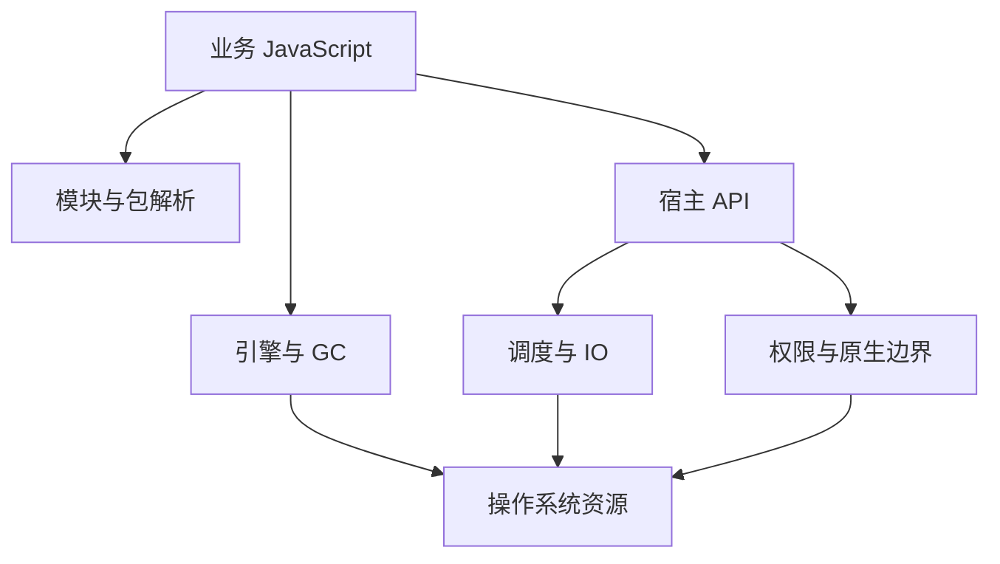

# 运行时全景图：引擎、宿主能力与兼容边界

同一段业务 JavaScript 换一个运行时，语法可能不变，文件权限、模块加载、原生扩展、流和网络行为却可能变化。选型不应从“哪个更快”开始，而应先写出依赖的宿主能力和正确性条件。

本页为学习索引，不包含已运行的服务示例，故标为 `runnable: false`。外部产品状态核验于 2026-10-12；`source_commit` 是本次仓库研究基线，不代表三种运行时共享实现提交。API 兼容与生命周期仍需按部署版本复核。

## 1. 是什么：运行时不等于引擎

看 JavaScript 代码分别依赖哪些层：

引擎负责语言执行和内存管理；宿主提供文件、网络、定时器、线程和其他能力。相同引擎不保证相同宿主 API；Web API 名字相同也不保证所有扩展行为相同。

| 层 | 需要核对的证据 | 典型失败 |
| --- | --- | --- |
| 语言／引擎 | 语法、GC、编译与 trace | 将启动成本误认成稳态吞吐 |
| 模块／包 | ESM/CJS、exports、原生依赖 | 开发可运行，部署解析失败 |
| 宿主 API | 具体方法、错误与取消语义 | 用兼容列表代替行为测试 |
| 资源／安全 | 权限、隔离、FFI、IO | 把 Context 当安全沙箱 |
| 交付环境 | OS、架构、部署平台、版本 | 本机支持的能力在边缘被禁止 |

## 2. 为什么：版本和宣传不能作为能力证明

截至核验日，官方发布表将 Node 24、22 列为 LTS，26 列为 Current，20 已 EOL。原页的“Node 20.x LTS”不能再用于新部署选择。[Node 发布状态](https://nodejs.org/en/about/previous-releases)

Bun 官方文档页面显示 1.4.3；旧文章的“Bun 2.x”标题不能证明已存在对应稳定版本。本索引使用无主版本的名称，实际命令与 API 按目标版本测试。[Bun 文档](https://bun.sh/docs/runtime/nodejs-compat)

兼容性是多维度的：解析、导出、返回值、错误、流生命周期、原生插件和操作系统边界都需检验。Bun 官方逐项列出 Node API 差异，因此不能写“100% Node/npm 兼容”。Deno 的 Node/npm 兼容也说明它不是“ESM only”。[Deno 兼容文档](https://docs.deno.com/runtime/fundamentals/node/)

## 3. 怎么样：用能力表建立回归计划

| 问题 | Node.js | Bun | Deno |
| --- | --- | --- | --- |
| TypeScript 执行 | 支持可擦除语法的 type stripping；不自动类型检查或完整读取 tsconfig | 支持 TS 执行；执行与类型检查分开 | 支持 TS 执行；类型检查使用相应检查命令 |
| 模块与包 | CJS/ESM 与 package 条件解析 | Node 兼容与自身解析行为需验证 | ESM 与 Node/npm 兼容行为需验证 |
| 内置测试 | `node:test` | `bun test` | `deno test` |
| 数据库能力 | 存在 `node:sqlite`；按版本核对 API 与稳定性 | SQLite、SQL 等宿主能力按版本核对 | 不把第三方 ORM 误写成内置 ORM |
| 权限边界 | 有可启用的 permission model，不能据此视为恶意代码完整沙箱 | 默认宿主权限与 FFI 风险需设计 | 默认限制部分敏感宿主能力，显式授权也需最小化 |
| Node API 兼容 | 自身目标版本基线 | 按官方兼容页与应用测试 | 按 Node/npm 兼容文档与应用测试 |

这张表纠正能力分类，不承诺全版本行为一致。Node 的类型擦除不是转译、类型检查和打包的统称；“支持数据库访问”也不等于运行时内置某个 ORM。

[Node TypeScript](https://nodejs.org/docs/latest-v24.x/api/typescript.html) · [SQLite](https://nodejs.org/api/sqlite.html) · [Test runner](https://nodejs.org/api/test.html) · [Permissions](https://nodejs.org/api/permissions.html) · [Deno 安全模型](https://docs.deno.com/runtime/fundamentals/security/)

## 4. 学习路径：先边界，再实现

| 路线 | 页面 | 读完应能解释 |
| --- | --- | --- |
| Node 基础 | [核心原理](nodejs-core.md) | V8、libuv、模块、流与 Buffer 的分工 |
| Node 调度 | [事件循环与 libuv](nodejs-event-loop-libuv.md) | JS 回调、IO 完成与工作线程的关系 |
| 数据流 | [Stream 与背压](nodejs-streams-backpressure.md) | 为什么无限生产会变成内存问题 |
| 模块 | [模块加载内部](nodejs-modules-loader.md) | 缓存、解析与执行阶段 |
| Bun | [使用指南](bun-guide.md)／[内部原理](bun-internals.md) | JavaScriptCore 与宿主工具链的职责 |
| Deno | [使用指南](deno-guide.md)／[内部原理](deno-internals.md) | Rust 宿主、权限与兼容层的边界 |
| 全景 | [运行时对比](js-runtimes-comparison.md)／[Node 架构](node-architecture-overview.md) | 引擎不是整套运行时 |
| 隔离 | [Isolate、Context、Worker 与 FFI](runtime-boundaries-isolates-ffi.md) | 谁拥有堆与句柄，什么不是安全隔离 |
| 边缘 | [Workers 的限制](edge-runtimes-workers.md) | 与长期驻留 Node 进程不同的故障域 |
| 引擎 | [V8 分层执行](../js/v8-execution-tiering-deopt.md) | 反馈、推测、反优化与 trace 的版本边界 |

旧深度文章中仍可能存在待独立复核的版本陈述；本索引不把修正导航等同于全量迁移测试。新增 [全仓深入路线](../resources/content-map-and-roadmap.md) 将运行时连到 Wasm、数据库、图形和媒体。

## 5. 选型与工程验收

这是**尚未执行的应用迁移验收协议**，不是跑分结论。先定义真实输入、目标运行时精确版本、部署 OS/架构、依赖锁文件，再做以下检查：

| 输入与操作 | 通过阈值 | 失败证据 |
| --- | --- | --- |
| 固定应用回归套件 | 所有关键行为断言通过 | 模块解析、返回值和错误差异 |
| 并发、取消、连接关闭 | 无挂起任务与遗留句柄 | 活跃连接、资源计数和退出超时 |
| 原生依赖、文件、数据库 | 所需能力可用且权限最小 | 缺符号、拒绝权限、数据损坏 |
| 冷启动与稳态负载分开 | 满足应用预先定义的延迟／容量预算 | 带环境的分阶段 trace 与分位数 |
| 部署失败与恢复 | 健康检查、回滚和数据恢复可执行 | 重启后资源和状态不一致 |

执行命令应来自应用自己的锁文件和测试脚本，不能虚构一个仓库里不存在的服务命令。清理测试创建的连接、临时数据、Worker 与原生句柄；不得通过强杀所有进程掩盖泄漏。

## 6. 面试回答与自测

**30 秒：** 运行时是引擎加模块、调度和宿主能力。Node、Bun、Deno 的差异不仅是速度，还包括解析、权限、原生扩展和 API 生命周期；兼容性需要按版本和工作负载测试。

**2 分钟：** 迁移一个 API 服务时，先列模块条件解析、数据库连接、流取消、原生依赖和部署资源约束。锁定版本后跑相同行为套件，再拆冷启动、稳态、内存与尾延迟，不能把不同环境的 README 跑分当证据。引擎 trace 只能解释某阶段，不能代替宿主边界的正确性验证；失败后需要句柄、日志与恢复路径。

为什么 Node 能直接跑部分 TS 不等于能类型检查？

类型擦除移除可擦除语法，不执行类型系统，也不自动提供完整 tsconfig 转译与打包行为。

为什么 Node 兼容不等于某 npm 应用完全兼容？

包可能依赖特定错误、流、原生 ABI、OS 或未实现 API；需要测试实际依赖路径。

为什么默认权限限制不等于任意恶意代码的完整沙箱？

需另外分析原生调用、能力授权、宿主漏洞和资源耗尽；权限模型与进程故障隔离不是同一机制。

## 深入阅读

- [Node 官方 API](https://nodejs.org/api/)：选择与部署版本对应的文档，尤其看稳定性与版本历史。
- [Bun Node 兼容状态](https://bun.sh/docs/runtime/nodejs-compat)：核对应用实际使用的模块，而不是只看支持包名。
- [Deno 权限模型](https://docs.deno.com/runtime/fundamentals/security/)：理解授权范围与原生扩展边界。
