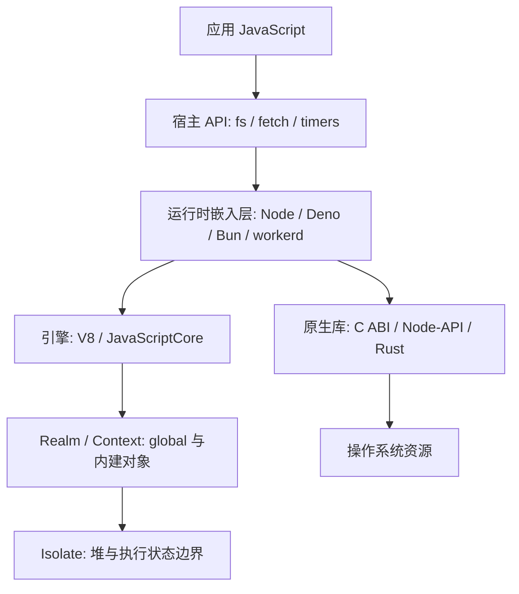
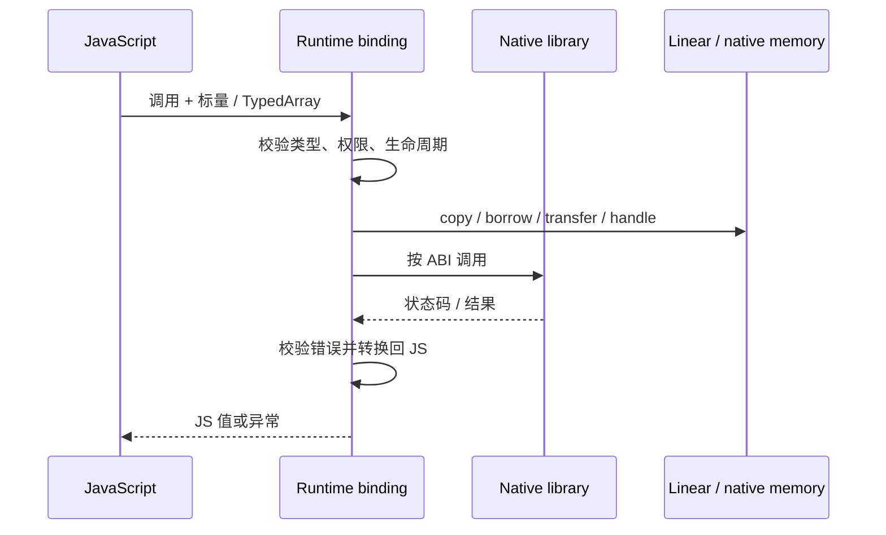
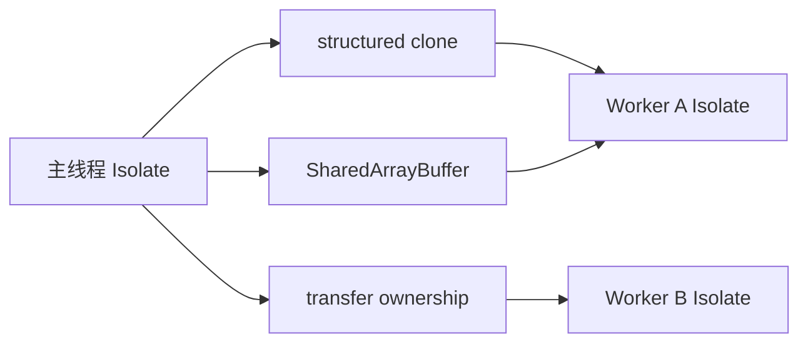

# JavaScript 引擎与运行时边界：Isolate、Realm、Worker 和 FFI

“JavaScript 在 Node 里运行”容易让人把语言引擎和宿主能力当成一层。实际上，V8 负责解析、执行和管理 JavaScript 堆；Node 还提供文件、网络、定时器、模块加载和进程接口。换成 Bun、Deno 或 workerd，语言语法可能相同，宿主 API、权限策略、线程模型和原生调用 ABI 却不同。

本文从边界开始，不重复 Node 的普通事件循环讲解；需要追踪 libuv 阶段时见[Node/libuv 专题](nodejs-event-loop-libuv.md)，需要了解完整 Node 启动和绑定见[架构总览](node-architecture-overview.md)。

## 一张边界图

图中每一层都有独立职责。跨层时必须回答：调用者传了什么、谁持有它、何时可以释放，以及失败是否可安全传播。



图中的层次是逻辑职责，不意味着每个产品恰好有独立进程或每个调用都经过同一段代码。引擎可以被多个运行时嵌入，同一进程也可能承载多个 isolate 或 context。

## 五层递进：先看可见差异

### 1. 现象：语法相同，能力和权限不同

浏览器页面可以访问 DOM，却通常没有任意路径文件读写；Node 可通过 `node:fs` 访问主机文件；Deno 可以通过权限标志限制文件、网络等能力；Cloudflare Workers 提供 Web API 子集并在其宿主环境中执行。差异来自运行时暴露的 API 与授权，不来自 `const` 或 `async` 关键字。

运行时不是引擎的别名。引擎提供 ECMAScript 语言执行、垃圾回收和编译；宿主负责 I/O、事件循环集成、模块解析、计时器、权限和平台绑定。

### 2. 规则：Realm、Context、Isolate 与 Worker 不可互换

**Realm（领域）**是 ECMAScript 的规范概念，关联一套内建对象、全局环境和代码执行环境。两个 Realm 的 `Array` 构造器可以不同，因此跨 Realm 的 `instanceof` 可能与开发者直觉不同。

**V8 Context** 是 V8 API 中承载全局对象和脚本环境的实体，通常对应一组可区分的 Realm 语义；Context 不等于独立堆或安全边界。Node `vm.createContext()` 创建 V8 context，仍使用创建它的 Isolate。

**V8 Isolate** 是 V8 的独立执行/堆实例边界，通常由宿主线程进入与退出；其内部可以有多个 Context。它不自动提供操作系统级安全保证，也不等同独立进程。

**Worker** 是宿主提供的并发抽象。Node Worker Thread 在另一个线程运行，并有自己的 V8 isolate；数据可通过 structured clone 复制、通过 transfer 转移，或通过 `SharedArrayBuffer` 共享。浏览器 Worker API 也有独立全局环境，但具体实现与 Node 不同。

| 名词 | 关注点 | 典型边界 | 不能直接推出 |
|---|---|---|---|
| Realm | 全局环境与内建对象 | 语言语义 | 独立线程或安全沙箱 |
| V8 Context | V8 API 中的执行上下文 | globals / microtasks 等配置 | 独立 Isolate |
| V8 Isolate | 引擎执行状态和堆 | 执行实例 | OS 进程隔离 |
| Worker | 宿主并发与消息传递 | 线程/代理对象 | 任意共享普通 JS 对象 |
| Process | OS 地址空间与权限 | 操作系统 | 自动正确的 API 级权限最小化 |

### 3. 机制：宿主 API 是绑定层，不是 ECMAScript 内建

当应用执行 `await fs.readFile(...)`，语言层处理 Promise 和控制流；Node 的 JS API 再进入 C++ 绑定，最后与 libuv 和操作系统交互。I/O 完成后宿主将结果放回 JS 世界，并安排后续任务。每层都有错误模型和资源生命周期。

Node 的 `node_contextify.cc` 将 V8 `Context` 创建后关联到 `Environment` 和运行时包装对象；`Environment` 管理 Node 层 per-isolate/per-context 状态。阅读源码时从 [`src/node_contextify.cc`](https://github.com/nodejs/node/blob/main/src/node_contextify.cc) 的 `CreateV8Context`、`ContextifyContext` 开始，再读 [`src/env.h`](https://github.com/nodejs/node/blob/main/src/env.h)。

Deno 的 `deno_core` 建立 V8 `JsRuntime`，通过 ops 暴露宿主函数。权限检查应在相关 op/资源层实施，不能仅靠“脚本没写文件 API”判断安全。[deno_core 源码](https://github.com/denoland/deno_core/tree/main/runtime)和[Deno 权限文档](https://docs.deno.com/runtime/fundamentals/security/)是入口。

Bun 使用 JavaScriptCore，而不是 V8；运行时核心有 Zig/Rust/C++ 实现和大量内建绑定。其 FFI 文档描述 `bun:ffi` 的 ABI 接口，并在当前文档标为 experimental；生产设计应核对具体发行版本的稳定性声明。[Bun FFI](https://bun.com/docs/runtime/ffi)、[Bun 源码](https://github.com/oven-sh/bun/tree/main/src)。

Cloudflare workerd 是 Workers 的开源运行时实现，使用 V8，并提供 Workers API 宿主。Isolate 可用于多租户执行，但安全边界还依赖 API 设计、运行时检查和操作系统机制。[workerd](https://github.com/cloudflare/workerd) 与[Workers 安全模型](https://developers.cloudflare.com/workers/reference/security-model/)共同说明这些层次。

### 4. 机制：跨 FFI 边界时，类型与所有权要显式

FFI（foreign function interface）让 JS 调用 C ABI 或宿主原生绑定。两个 ABI 边界不能直接传任意 JS 对象；通常要把它变成整数、浮点、指针、长度、句柄或受控引用。



边界契约必须注明：

1. **布局**：整数宽度、符号、对齐、端序、结构体 padding 与调用约定。
2. **所有权**：谁分配、谁释放、借用能活多久、异步回调结束后指针是否仍有效。
3. **别名**：TypedArray 是否共享底层 buffer；native 是否可能并发修改。
4. **错误**：错误码、异常、panic 和 callback throw 如何映射；跨语言异常通常不能无条件穿越 ABI。
5. **权限**：原生函数通常继承进程权限；如果它能打开任意路径，JS 层的 capability 设计不会自动限制它。

### 5. 机制：复制、转移和共享的语义不同

结构化克隆通常创建接收方可用的数据副本，发送方仍持有原数据。transfer 将受支持对象的所有权移动给接收方，例如 `ArrayBuffer` 转移后发送侧变为 detached。共享内存不移动所有权；两方都能访问同一批字节，需要同步协议避免数据竞争。

Node 的 `vm` 文档明确指出它不是安全机制。`vm` context 可以隔开全局变量，却不能把不可信代码变成可安全执行的沙箱。对于真正不可信代码，应采用独立进程/容器/OS 沙箱并限制系统权限；`vm` 适合测试模块或隔离全局状态，不是威胁边界。[Node vm 文档](https://nodejs.org/api/vm.html)。

## 手写机制：把一个调用契约写全

示意代码：未通过自动验证。以下是接口设计伪代码，用来说明必须显式定义长度与生命周期；它不是任何运行时的 FFI 实际 API。本页已实际运行的是后文 `context-ownership.mjs` 教学脚本，不是 Node、Bun、Deno 或 workerd 的所有产品示例。

```text
function hashBytes(pointer, byteLength): uint32
  require pointer in caller's registered region
  require 0 <= byteLength <= region.length
  borrow bytes until the synchronous call returns
  return native_hash(pointer, byteLength) as uint32
```

这段模型刻意拒绝裸指针的隐式信任。真实系统还需处理对齐、无效地址、线程同步、异常展开、ABI 版本、动态库加载策略与释放顺序。

## 实验：Context 全局与 ArrayBuffer 所有权

脚本 `scripts/content-labs/engine-runtime/context-ownership.mjs` 使用 Node 内建 `vm` 与 `structuredClone` 验证两个可观察事实：context 的全局属性不会自动成为宿主 global 属性；transfer 后发送侧 buffer 长度为零。

在仓库根目录运行：

```sh
node scripts/content-labs/engine-runtime/context-ownership.mjs
```

Node.js v24.16.0 实际输出：

```text
context=separate-global transfer=sender-detached receiver=1,2,3,4
```

验收条件是脚本退出码为 0 且所有断言通过。这个实验不测试安全性，也不代表 Node Worker 的线程行为；若测试 transfer，关键证据是发送侧 `byteLength === 0` 和接收侧字节序列。脚本只创建内存对象，无需清理。

## 两个真实运行时路径

| 项目 | 引擎与宿主结合点 | 建议源码阅读路线 |
|---|---|---|
| Node.js | V8 Context / Isolate 加 Node Environment、C++ bindings、libuv | [`node_contextify.cc`](https://github.com/nodejs/node/blob/main/src/node_contextify.cc) → [`env.h`](https://github.com/nodejs/node/blob/main/src/env.h) → [`src/`](https://github.com/nodejs/node/tree/main/src) |
| Deno | V8 `JsRuntime` 加 `deno_core` ops 与权限检查 | [`deno_core/runtime`](https://github.com/denoland/deno_core/tree/main/runtime) → [permissions](https://github.com/denoland/deno/tree/main/runtime/permissions) |
| Bun | JavaScriptCore + Bun 的 Zig/Rust/C++ bindings；FFI 有自身生命周期约定 | [`src/jsc`](https://github.com/oven-sh/bun/tree/main/src/jsc) → [FFI 文档](https://bun.com/docs/runtime/ffi) |
| workerd | V8 isolate + Workers API 实现和运行时策略 | [`workerd/src/workerd`](https://github.com/cloudflare/workerd/tree/main/src/workerd) → [security model](https://developers.cloudflare.com/workers/reference/security-model/) |

Node 和 Deno 共享 V8 并不意味着宿主行为相同；Bun 的 JavaScriptCore 也遵循 ECMAScript，但 JIT、API 和诊断工具与 V8 不同。实现细节引用链接中的 `main` 分支时，应在实际调查中记录访问日期和 commit。

## 常见误区与边界

| 误区 | 更精确的说法 |
|---|---|
| “vm sandbox 可以跑不可信代码” | Context 只隔开一部分语言环境；Node 文档明确不把 vm 作为安全机制。 |
| “一个进程只有一个 Isolate” | V8 embedder 可创建多个 Isolate；具体调度与线程关系由宿主决定。 |
| “Worker 自动共享对象” | 默认消息传递结构化克隆；transfer 与 shared memory 各有独立语义。 |
| “原生代码比 JS 可信” | 原生库直接继承宿主进程能力，越界读写风险往往更高。 |
| “FFI 传指针就是零拷贝” | 指针可避免某次复制，但必须满足生命周期、布局与安全检查。 |
| “Realm 等于安全域” | Realm 用于语言环境隔离，不是 OS 权限边界。 |

排查跨边界故障时，先给每个值标记“复制、借用、转移、共享”之一；再检查字节长度、所有权结束点、线程、释放者和错误映射。若安全问题涉及本机权限，继续追到操作系统进程凭据和沙箱配置。

### 线程和 Isolate 的关系不能只凭 API 名推断

V8 Isolate 通常被单个线程进入，但宿主可以管理多个 Isolate，并将它们分配到线程池或专用线程。某些宿主对象可能引用与 Isolate 绑定的状态，因此不能任意跨线程使用 V8 Local handle。Native embedding 代码通常要在正确的 Isolate 和 HandleScope 中操作值；跨线程任务应把可传输数据复制/序列化，或经线程安全的宿主通道返回。

Node Worker Threads 的文档给出可验证 API 边界：每个 Worker 运行独立 JavaScript 环境，消息默认结构化克隆；transferList 用于转移支持的对象，SharedArrayBuffer 用于显式共享。Node worker 之间的普通对象不会变成共享引用。[worker_threads 文档](https://nodejs.org/api/worker_threads.html)。



图中的三条通道表示三种不同的数据语义。clone 创建接收侧表示；transfer 让发送侧放弃 buffer 所有权；shared 保留两边访问权但要求并发协调。structured clone 也可能因不可克隆值而失败，调用方必须处理异常。

### FFI 生命周期检查表

设计 native binding 前可以逐项写出契约：

| 契约 | 示例问题 |
|---|---|
| 入口 ABI | 参数是 `int32_t` 还是平台 `long`？返回值是否允许 sentinel？ |
| 字符串 | UTF-8 / UTF-16？长度按字节还是 code units？是否保证 NUL 终止？ |
| Buffer | 调用期间借用还是复制？异步返回后还能持有 pointer 吗？ |
| Ownership | 谁释放？释放函数与 allocator 是否来自同一库？ |
| Callback | 可能同步重入 JS 吗？callback 保留多久？如何解除引用？ |
| Threading | native 调用是否可能在后台线程回调？如何重新进入 JS isolate？ |
| Error | 错误码如何转 JS exception？native panic/exception 是否会跨 ABI？ |
| Capability | 动态库可访问哪些系统资源？是否能加载其他库？ |

若某一项答案是“调用方自己知道”，接口就缺少可审阅的契约。至少把约定写在 binding 声明或 wrapper API 文档中，并为错误路径加释放测试。

### 安全边界分层

在安全审查中，可以从内到外依次检查语言对象、引擎上下文、引擎实例、宿主 API、操作系统进程。每层只能保证自己负责的性质：Context 管全局环境；Isolate 管引擎执行状态；运行时授权控制 API surface；操作系统权限限制进程能访问的资源。跨越到 native FFI 后，原生库通常拥有进程权限，因此必须单独审查。

Cloudflare 的 Workers 安全材料强调 isolate 隔离只是设计的一部分，API surface 和侧信道/宿主保护也参与整体边界。Node `vm` 的明确警告则说明“独立 context”不应宣传成恶意代码沙箱。这两个项目对照起来可提醒读者：同一个引擎概念在产品安全架构中的承诺不同，必须阅读产品文档，不凭名词推断。

## 30 秒与 2 分钟回答

**30 秒：** 引擎负责执行 JavaScript，运行时负责宿主 API、I/O、模块和权限。Realm/Context 隔离全局环境，Isolate 是引擎实例边界，Worker 是宿主并发抽象；它们都不能单独替代 OS 安全沙箱。跨 FFI 必须明确 ABI、内存所有权、生命周期和错误处理。

**2 分钟：** 以 Node 为例，V8 执行 JS，Node 的 Environment 与 bindings 把 `fs` 等 API 接到 libuv 和操作系统。`vm.createContext` 创建另一份 V8 context/global，但仍处于同一 isolate，Node 明确说明 `vm` 不是安全边界。Worker Thread 使用独立线程与 isolate，通过 structured clone、transfer 或 shared memory 传数据。FFI 则跨到原生 ABI，需明确标量布局、指针长度、borrow 时长、释放责任和 native 权限。验证时用断言观察 transfer 的 detached 状态，再检查实际绑定代码和权限检查位置。

## 自测

??? question "1. 两个 `vm.createContext()` context 是否共享同一个 `Array` 构造器？"
    通常各自有 Realm 对应的内建对象，因此不能假设构造器身份相同；应在具体 API 和引擎语义下验证跨 realm 对象。

??? question "2. transfer 与共享内存的区别是什么？"
    transfer 转移资源所有权，发送端失去访问；共享内存让双方同时访问同一存储，必须自行同步。

??? question "3. 为什么 native addon 可以越过 JS 权限限制？"
    它在宿主进程中执行并继承进程能力，除非 OS 或运行时额外限制；JS 层未暴露 API 不构成系统级访问控制。

??? question "4. Node vm Context 为什么不能用于恶意代码沙箱？"
    它提供不同 Context/global，不提供完整资源权限和 OS 隔离；Node 文档明确警告不是安全机制。

## 深入阅读

- [Node `vm`](https://nodejs.org/api/vm.html)：核对 Context API 与安全边界警告。
- [Node Worker Threads](https://nodejs.org/api/worker_threads.html)：查看 worker、transferList 和共享内存语义。
- [V8 Embedder's Guide](https://v8.dev/docs/embed)：了解 Isolate 与 Context 的嵌入 API。
- [Deno security](https://docs.deno.com/runtime/fundamentals/security/)：比较显式能力授权和宿主 API。
- [Bun FFI](https://bun.com/docs/runtime/ffi)：核查 Bun 当前 FFI 的实验状态及使用约束。
- [workerd](https://github.com/cloudflare/workerd)：从真实 Workers runtime 代码追踪 V8 isolate 与宿主 API。
